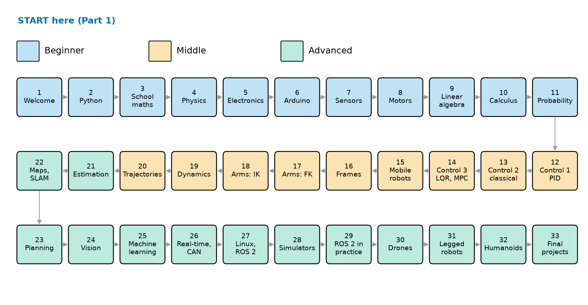
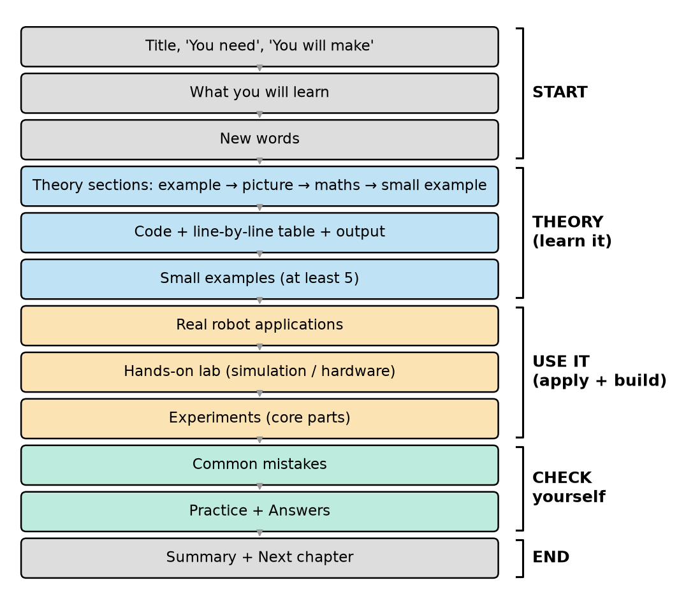
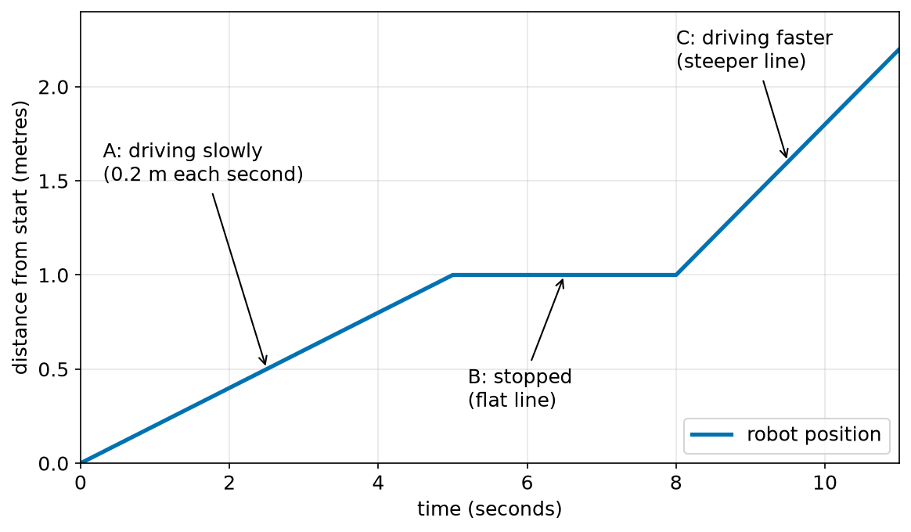
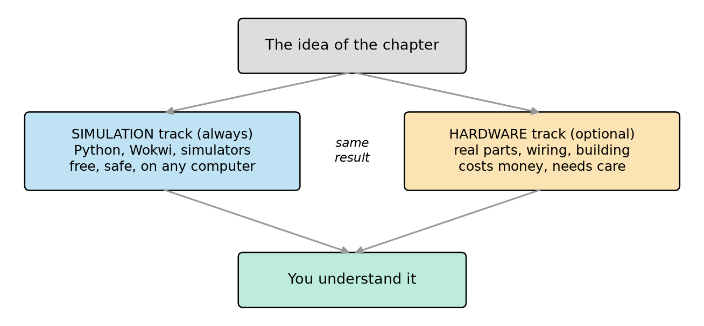
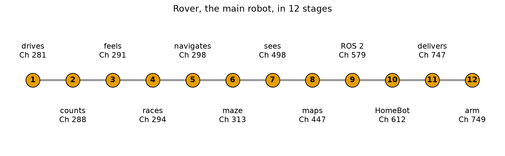
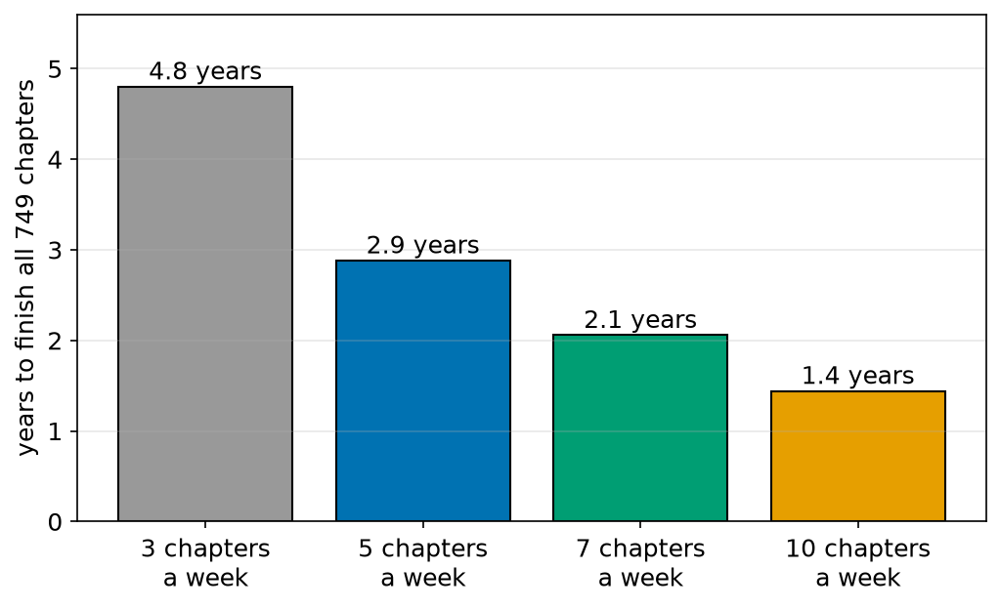

# Chapter 1 — How to Use This Book

> **Part 1 · Chapter 1 of 749**
> **You need:** nothing. This is the first chapter.
> **You will make:** your robotics notebook, your robotics folder, your study plan, and the "human robot" game.

---

## What you will learn

- Who this course is for, and what you need before you start (almost nothing).
- The map of the whole course: 33 parts, from beginner to advanced.
- How every chapter is built, so you always know where you are.
- How to read the three things you will see on every page: **formulas**, **code** and **figures**.
- The two ways to do every lab: the **simulation track** and the **hardware track**.
- The robots you will build, and how to study so you really finish.

---

## New words in this chapter

| Word | Simple meaning |
|---|---|
| **robot** | A machine that can **sense** the world, **decide** what to do, and **act** (move or change something). Chapter 2 explains this fully. |
| **theory** | The idea that explains *why* something works. |
| **practice** | Doing it with your own hands: running code, building, measuring. |
| **formula** | A short way to write a rule with letters and numbers, like `distance = speed × time`. |
| **program** / **code** | Instructions for a computer, written in a language the computer understands. |
| **output** | What a program shows or does when it runs. |
| **figure** | A picture in the book: a drawing, a diagram or a plot. |
| **plot** (or **graph**) | A figure that shows how one number changes with another number, for example distance with time. |
| **simulation** | A robot (or a world) that lives inside the computer. It behaves like the real thing, but it is made of maths and code. |
| **hardware** | Real physical parts: boards, wires, motors, wheels. |
| **lab** | A practical task in a chapter. You do it, you look, you learn. |
| **project** | A bigger lab that builds a whole robot, or a new stage of a robot. |

---

## 1.1 Welcome

Hello, and welcome.

This course teaches you **robotics from the very beginning**. At the start you do not need to know anything about robots, electricity, programming or higher maths. At the end you will understand, and build, robots that drive, see, make maps, pick things up, fly and walk.

That is a long road. So this first chapter is a guide to the road. It shows you:

- where the road goes (the map),
- what every step looks like (the chapter plan),
- how to read the book (formulas, code, figures),
- and how to walk the road without getting lost or tired (how to study).

You can read this chapter in one or two hours. Please do not skip it. Every later chapter uses the signs, tables and habits you learn here.

🧠 **Remember:** This chapter is a guide. It has no hard maths. Its job is to make all the other chapters easier.

---

## 1.2 Who this course is for

This course is for **you** if one of these is true:

- You are curious about robots and you want to understand how they really work.
- You are a student, and you want to go much further than your school or college course.
- You are a programmer, and you want to move from screens into the real world.
- You are an engineer or technician, and you want the full picture: electronics, control, software and AI together.
- You are a parent or teacher, and you want to learn together with children.

### What you do **not** need

| You do not need… | Because… |
|---|---|
| Programming skills | Part 2 teaches Python from zero. Part 6 teaches C++ for small boards from zero. |
| Higher maths | Part 3 starts from school maths. Parts 9, 10 and 11 teach linear algebra, calculus and probability step by step. |
| Physics or electronics | Parts 4 and 5 start from "what is a force?" and "what is electricity?". |
| Expensive tools | Every lab can be done in **simulation** on a normal computer. Hardware is optional. |
| Perfect English | The sentences are short. Every new word is explained the first time. The same word always means the same thing. |

### What you **do** need

1. **A computer.** Windows, macOS or Linux. A normal laptop is enough for almost every chapter. (A few advanced chapters about one simulator need a strong graphics card. Those chapters say so, and you can read along without one.)
2. **Basic school maths up to about age 12.** You can add, subtract, multiply and divide, and you know what a fraction is. That is all.
3. **Time and patience.** This is a big course. Section 1.11 shows you how to plan it.
4. **A notebook and a pencil.** Yes, real paper. You will draw robots, write formulas and check numbers by hand. The lab in this chapter shows you how to set it up.

💡 **Tip:** If English is not your first language, keep a small "word list" at the back of your notebook. Each time you see 📖 **New word**, write the word and its meaning in your own language.

---

## 1.3 The map of the course

The course has **33 parts** and **749 chapters**. Look at Figure 1.1.



*Figure 1.1 — The map of the course. Each box is one part. Follow the grey arrows like a snake: left to right, then right to left, then left to right.*

**How to read this picture:** Each box is one part of the course. The number at the top of the box is the part number. The colour shows the level: light blue is beginner, light orange is middle, light green is advanced. The grey arrows show the order. You start at box 1 (top left) and you finish at box 33 (bottom right).

### The three levels

| Level | Parts | What you learn | What you can do at the end |
|---|---|---|---|
| **Beginner** | 1–11 | What robots are. Python. School maths. Physics. Electronics. Arduino. Sensors. Motors. Linear algebra, calculus and probability. | Build small machines with sensors and motors. Write programs. Read the maths of robotics. |
| **Middle** | 12–20 | Control (PID, classical, state-space, LQR, MPC). Mobile robots. Frames. Robot arms. Dynamics. Trajectories. | Make robots move **well**: straight, smooth, stable and exactly where you want them. |
| **Advanced** | 21–33 | Estimation and Kalman filters. Maps and SLAM. Path planning. Vision. Machine learning. Real-time systems and CAN. ROS 2. Simulators. Drones. Legged robots. Humanoids. Final projects. | Build robots that know where they are, make maps, plan, see, learn, fly and walk. |

### Why this order?

The order follows one simple rule:

> **A chapter only uses ideas from earlier chapters.**

Here is an example of the rule. A drone needs control (Part 12) to stay level. Control needs calculus (Part 10) to explain "how fast the error changes". Calculus needs school maths (Part 3) and Python (Part 2) to calculate and plot. So Python comes before calculus, calculus comes before control, and control comes before drones.

```
 Python ──► school maths ──► calculus ──► control ──► drones
 (Part 2)    (Part 3)        (Part 10)    (Part 12)   (Part 30)
```

Sometimes a chapter says *"we will see this in Chapter N"*. That is only a promise. You never **need** a later chapter to understand the one you are reading.

🧠 **Remember:** Go in order. If you jump ahead, you will meet words and ideas you have not learned yet.

💡 **Tip:** The full list of all 749 chapter titles is in the file `README.md`. Every robot you build is in `ROBOTS.md`. Where every theory is used in real robots is in `APPLICATIONS.md`.

---

## 1.4 How every chapter is built

Every chapter has the same parts, always in the same order. When you know this order, you never feel lost. Look at Figure 1.2.



*Figure 1.2 — The parts of every chapter, from top to bottom, and the four big steps they belong to.*

**How to read this picture:** Read from top to bottom. Each box is one part of a chapter. The brackets on the right group the parts into big steps: **start**, **theory** (learn it), **use it** (apply it and build it), **check yourself**, and **end**. The colours match the brackets.

Here is what each part does:

| Part of the chapter | What it gives you |
|---|---|
| **Title box** | The part number, the chapter number, what you need to know first ("You need"), and what you will make ("You will make"). |
| **What you will learn** | 3 to 6 short goals. Read them first. At the end, check that you reached each one. |
| **New words** | A table of the new words, with simple meanings. |
| **Theory sections** | The main teaching. Each idea comes in four steps: an **everyday example**, a **picture**, the **maths with real numbers**, and a **small example**. |
| **Code** | A full program, a table that explains **every line**, and the real **output**. |
| **Small examples** | At least five tiny examples, each one fully explained. |
| **🏭 Real robot applications** | Where this idea is used in real robots: factories, warehouses, cars, drones, humanoids, hospitals, space, farms, homes. Two of them are worked out in full. |
| **🔧 Hands-on lab** | Practical work: a simulation track for everyone, and a hardware track when it makes sense. |
| **🧪 Experiments** | In the core parts: change one number, run again, and see what changes in the plot. |
| **Common mistakes** | The mistakes that most learners make, so you can avoid them. |
| **Practice** | 6 to 10 tasks, from easy to hard. |
| **Answers** | Full answers, explained step by step. |
| **Summary** | The 5 to 8 most important ideas. |
| **Next chapter** | One or two sentences about what comes next. |

### Theory and practice, half and half

Look at the colours in Figure 1.2 again. The blue boxes are **theory**. The orange boxes are **practice and applications**. They are about the same size. That is on purpose. In robotics, theory without practice is easy to forget. Practice without theory breaks the first time something is different. You need both.

---

## 1.5 The signs used in every chapter

Small signs help you find things fast on a page.

| Sign | Name | Meaning |
|---|---|---|
| 📖 | **New word** | A new word, explained simply. Add it to your word list. |
| 🔢 | **Maths** | A maths idea, worked step by step with numbers. |
| 🤖 | **Robot link** | A short note: where this idea appears in a real robot. |
| 💡 | **Tip** | A helpful idea that saves time. |
| ⚠️ | **Careful** | A common mistake, or a **safety warning**. Always read these. |
| 🧠 | **Remember** | The most important idea of the section. |
| 🏋️ | **Practice** | A small task for you. Answers are at the end of the chapter. |
| 🖼️ | **Figure** | A picture, always followed by "How to read this picture". |
| 🏭 | **Application** | A real robot that uses this idea. |
| 🔧 | **Lab** | Hands-on work: build it, run it, measure it. |
| 🧪 | **Experiment** | Change one number, run again, see what happens. |

Here is how a sign looks inside the text:

> ⚠️ **Careful:** A spinning drone propeller can cut your fingers. Always remove the propellers when you test motors on a table.

---

## 1.6 How to read a formula

Robotics uses many formulas. Many people are afraid of formulas. You do not need to be. A formula is just **a sentence written in short form**.

In this course, every formula has three things:

1. **The formula**, written with letters.
2. **The formula in words**, written as a normal sentence.
3. **A worked example**, with real numbers, every step shown.

### Example: distance, speed and time

🔢 **Maths**

**The formula:**

```
d = v × t
```

**In words:** "The distance equals the speed times the time."

**What each letter means:**

| Letter | Means | Unit (how we measure it) |
|---|---|---|
| `d` | distance | metres (m) |
| `v` | speed (from the word "velocity") | metres per second (m/s) |
| `t` | time | seconds (s) |

**Worked example:** A small robot drives at 0.2 metres per second for 5 seconds. How far does it go?

```
Step 1. Write the formula.           d = v × t
Step 2. Put in the numbers.          d = 0.2 × 5
Step 3. Multiply.                    d = 1.0
Step 4. Add the unit.                d = 1.0 m
```

**Answer:** The robot drives 1.0 metre.

**Check that it makes sense:** In 1 second the robot goes 0.2 m. In 5 seconds it goes 5 times as far: 0.2 + 0.2 + 0.2 + 0.2 + 0.2 = 1.0 m. ✔

### Four habits for every formula

| Habit | Why |
|---|---|
| **Say it in words.** | If you can say it, you understand it. |
| **Write the units.** | Units catch many mistakes. If your answer for a distance comes out in seconds, something is wrong. |
| **Do one example by hand.** | Your hand is slower than a computer, so your brain has time to follow. |
| **Check that it makes sense.** | A robot vacuum that drives at 300 metres per second is not a vacuum. It is a rocket. |

⚠️ **Careful:** In maths, letters next to each other often mean "multiply": `vt` means `v × t`. In this course we usually write the `×` sign, so it is clear.

---

## 1.7 How to read code

You will write a lot of code in this course. You start learning Python properly in Part 2. But you will **see** code in Part 1 already, so you need to know how we explain it.

**Every program in this course comes with:**

1. **the code**, with line numbers;
2. **a table that explains every line**, with nothing skipped;
3. **the real output**, copied from the computer, and an explanation of it.

### A first look

You do not need to type this now. Just read it, and read the table.

```python
# first_look.py - my first look at robot code
speed = 0.2          # metres per second
time = 5             # seconds
distance = speed * time
print("The robot drove", distance, "metres")
```

| Line | Code | What it does (simple English) |
|---|---|---|
| 1 | `# first_look.py - my first look at robot code` | A **comment**. It starts with `#`. The computer ignores it. It is a note for people. Here it says the file name and what the program is about. |
| 2 | `speed = 0.2          # metres per second` | Makes a named box called `speed` and puts the number `0.2` in it. The comment after `#` tells us the unit. |
| 3 | `time = 5             # seconds` | Makes a box called `time` and puts `5` in it. |
| 4 | `distance = speed * time` | Takes the number in `speed`, multiplies it (`*` means "times") by the number in `time`, and puts the answer in a new box called `distance`. This is our formula `d = v × t`. |
| 5 | `print("The robot drove", distance, "metres")` | Shows a message on the screen: the words, then the number in `distance`, then the word "metres". |

**Output:**

```
The robot drove 1.0 metres
```

**What the output means:** The computer did the same multiplication that we did by hand in Section 1.6: 0.2 × 5 = 1.0. The answer is the same. That is the point: **the code is the formula, written for a computer.**

📖 **New word: comment** — a note in the code for people. In Python it starts with `#`. The computer skips it.

💡 **Tip:** Do not worry about the exact rules yet (why `=`, why quotes `"…"`). Part 2 explains every one of them. Now you only need to know **how to read the table**: one row for every line, from top to bottom.

---

## 1.8 How to read a figure

This course has thousands of figures. In the core parts (control, arms, mobile robots, drones, humanoids) every chapter has at least 15 figures. So reading figures well is a very important skill.

Every figure has:

- **a number**, like "Figure 1.3" (chapter 1, figure 3);
- **a caption**: one sentence under the figure that says what it shows;
- **"How to read this picture"**: 2 to 5 short sentences that guide your eyes.

### A first plot

Look at Figure 1.3. It is a **plot**: a picture of how one number changes with another.



*Figure 1.3 — The position of a robot over 11 seconds. It drives slowly, stops, then drives faster.*

**How to read this picture:** The line going **across** (the bottom edge) is **time** in seconds. The line going **up** (the left edge) is **distance from the start** in metres. The blue line shows where the robot is at each moment. A **sloping** line means the robot is moving. A **flat** line means it is stopped. A **steeper** line means it is moving faster.

### Reading a plot, step by step

1. **Read the axes first.** What is across? What is up? What are the units?
   Here: time in seconds across, distance in metres up.
2. **Read the legend.** The small box in a corner says what each line is.
   Here: one blue line, "robot position".
3. **Pick one point and read it.** Put your finger on the line at time = 5 s. Go straight left to the up-axis. You read 1.0 m. So after 5 seconds, the robot is 1 metre from the start.
4. **Look at the shape.** Where does the line rise? Where is it flat? Where is it steep?
5. **Ask "why?"** Why is part C steeper than part A? Because the robot drives faster in part C (0.4 m/s instead of 0.2 m/s).

### Colours mean the same thing everywhere

In the whole course, the same thing always has the same colour:

| Colour and line style | Always means |
|---|---|
| **black dashed** line | the **setpoint**: the value we want |
| **blue** | the **output**: what the robot really does |
| **red** | the **error**: the difference between what we want and what we get |
| **green** | the **control signal**: what the controller tells the motors |
| **orange** | the **robot** itself, in drawings |
| **grey** | **obstacles**, walls and helper lines |

You will meet "setpoint", "error" and "control signal" properly in Part 12. For now, just remember that the colours never change their meaning. The lines also use different styles (solid, dashed, dotted), so you can tell them apart even if you see colours differently, or if you print the book in black and white.

---

## 1.9 Two tracks: simulation and hardware

Every chapter has a 🔧 **hands-on lab**. Every lab has two tracks. Look at Figure 1.4.



*Figure 1.4 — Every idea can be learned on the simulation track, the hardware track, or both.*

**How to read this picture:** Start at the top box: the idea of the chapter. The arrows split into two tracks. The left track (blue) is the simulation track. The right track (orange) is the hardware track. Both tracks lead to the same box at the bottom: you understand the idea.

### The simulation track (always)

- You do the lab **inside your computer**.
- You use Python (from Part 2), the free **Wokwi** website for Arduino (from Part 6), and real robot simulators like Gazebo, Webots and MuJoCo (later parts).
- It is **free** and **safe**. Nothing can burn, break or fly away.
- **Every** lab has a simulation track. You can finish the whole course this way.

### The hardware track (optional)

- You build the **real** thing: a circuit, a robot car, an arm, a drone.
- It costs money. `ROBOTS.md` has a shopping list with rough prices.
- It teaches things a simulation cannot: loose wires, noisy sensors, weak batteries, motors that are not exactly the same. Real robots are messy, and learning to handle the mess is a real skill.
- Hardware chapters always have ⚠️ **safety** notes. Read them.

### Which track should you choose?

| Your situation | Our advice |
|---|---|
| You have no money for parts now. | Do the simulation track. You lose nothing important in theory. Add hardware later if you can. |
| You have a small budget. | Do simulation always. Buy the Arduino starter kit for Parts 5–8 (about $30–50). It gives a lot of learning for little money. |
| You love building things. | Do both tracks. Simulation first (to understand), hardware second (to see it really work). |
| You are a teacher with a class. | Simulation for everyone, plus one shared hardware kit per small group. |

🧠 **Remember:** Simulation first, hardware second. When something does not work on the real robot, go back to the simulation. If it works there, the problem is in the hardware (wires, power, sensors). If it fails there too, the problem is in your idea or your code.

---

## 1.10 The robots you will build

In this course you build **28 robots and machines**. Some are tiny, like a meter that measures distance. Some are big, like a drone that flies a mission by itself, or a small humanoid that walks.

Your **main robot** is called **Rover**. Rover starts as two wheels and a small board. It grows with you in 12 stages. Look at Figure 1.5.



*Figure 1.5 — Rover grows in 12 stages. Each circle is one stage. The label shows what Rover learns and in which chapter.*

**How to read this picture:** Read from left to right. Each orange circle is one stage. The words next to the circle say what Rover can do after that stage, and the chapter where it happens. The stages are not all next to each other in the book: between them you learn the theory that the next stage needs.

| Stage | Rover can… |
|---|---|
| 1 | drive straight and turn |
| 2 | count how far it has driven |
| 3 | feel bumps, lines and walls |
| 4 | race along a line |
| 5 | drive to a goal and follow a path |
| 6 | find its way out of a maze |
| 7 | see with a camera |
| 8 | make a map and find itself on it |
| 9 | talk with ROS 2 (the standard robot software) |
| 10 | drive to any room in a house ("HomeBot") |
| 11 | deliver things ("Courier") |
| 12 | carry an arm and bring you objects ("Fetch") |

Some of the other robots:

| Robot | What it is |
|---|---|
| **Moth** | A robot that drives towards light, made only with electronic parts, with **no code at all**. |
| **Beam** | A machine that keeps a ball balanced on a tilting beam. |
| **Balancer** | A two-wheeled robot that stands up by itself. |
| **Scribe** | A small arm that draws pictures. |
| **Hover** | A quadcopter drone. First you write your own small flight program, then it flies a full mission by itself. |
| **Quad** | A four-legged walking robot. |
| **Buddy** | A real small humanoid robot with 18 motors. It stands, walks, and gets up after a fall. |
| **Hero** | A full-size humanoid in simulation. It learns to walk. |

The full list, with chapters and prices, is in `ROBOTS.md`.

---

## 1.11 How to study this course

### How long does it take?

This is a very big course: 749 chapters. Look at Figure 1.6.



*Figure 1.6 — How many years it takes to finish all 749 chapters at four different speeds.*

**How to read this picture:** Each bar is one study speed. The label under the bar says how many chapters you do each week. The height of the bar (and the number on top) is how many years you need to finish everything. Faster study means shorter bars.

🔢 **Maths** — how the numbers in Figure 1.6 are made:

```
years = chapters ÷ (chapters per week) ÷ (weeks per year)

At 5 chapters a week:
Step 1. Weeks needed  = 749 ÷ 5   = 149.8 weeks
Step 2. Years needed  = 149.8 ÷ 52 ≈ 2.9 years
```

That may look like a long time. But think about it like this: in about three years you go from "what is a robot?" to humanoids and drones. A university degree in engineering is also three to five years. And you do not have to finish everything to gain a lot. After Part 15 (about one year at 5 chapters a week) you can already build and program a good mobile robot.

💡 **Tip:** Choose a speed you can **keep**. Five chapters a week for three years is much better than twenty chapters in one week and then nothing.

### How to study one chapter

Follow these steps for every chapter:

| Step | What to do | Time (about) |
|---|---|---|
| 1 | Read **What you will learn** and **New words**. Add the words to your word list. | 5 min |
| 2 | Read the **theory** slowly. Do every 🔢 maths example **by hand** in your notebook. | 40–60 min |
| 3 | **Type** the code yourself. Do not copy and paste. Run it. Compare your output with the book. | 20–30 min |
| 4 | Read the **🏭 applications**. Try to explain one of them to a friend (or to yourself, aloud). | 15–20 min |
| 5 | Do the **🔧 lab**. | 30–90 min |
| 6 | Do the **🏋️ practice**. Only then look at the answers. | 20–40 min |
| 7 | Read the **summary**. Close the book. Write the main ideas from memory. | 5–10 min |

### Why type the code yourself?

When you copy and paste, your eyes see the code, but your brain does not work. When you type, you notice every symbol. You make small mistakes, and you fix them. Fixing mistakes is how programmers learn. In robotics it is even more important, because a small mistake in code can make a real motor turn the wrong way.

### What to do when you are stuck

Everybody gets stuck. It is normal. Here is a plan:

1. **Read the section again, slowly.** Often one sentence was missed.
2. **Go back one step.** Look at "You need" in the title box. Re-read the chapters it lists.
3. **Do a smaller example.** Use smaller numbers, or a shorter program.
4. **Draw it.** Draw the robot, the numbers, the arrows. Many problems become clear on paper.
5. **Take a break.** Walk for 10 minutes. Your brain keeps working while you rest.
6. **Ask.** Ask a friend, a teacher or an online forum. Show what you tried. (Write down the exact error message if it is a code problem.)

🧠 **Remember:** Being stuck is not failing. Being stuck is the moment when you are learning.

---

## 1.12 Safety from the first day

Robots move. Moving things can hurt people. Electricity can burn. Batteries can catch fire. Chapter 7 is all about safety. But here are five rules from the first day:

1. **Simulation first.** Test new ideas in the computer before you try them on a real robot.
2. **Always have a way to stop.** A real robot must have an off switch that you can reach fast.
3. **Start slow.** Use low speeds and low power for the first test.
4. **No propellers on the table.** Remove drone propellers when you test motors indoors.
5. **Respect batteries.** Never short-circuit a battery. Never charge a damaged one. (Chapter 7 and Chapter 89 explain why.)

⚠️ **Careful:** A "small" robot can still pinch fingers, fall from a table, or burn a wire. Small does not mean safe.

---

## Code

Here is a slightly bigger program. It calculates the trip from Figure 1.3. Again, you do **not** need to type it now. The goal is to practise reading a program with its line-by-line table. You will type programs like this from Part 2.

The file is `code/ch001/robot_trip.py`.

```python
# robot_trip.py - the trip from Figure 1.3
speed_a = 0.2      # part A: speed in metres per second
time_a = 5         # part A: time in seconds
time_b = 3         # part B: the robot is stopped, time in seconds
speed_c = 0.4      # part C: speed in metres per second
time_c = 3         # part C: time in seconds

distance_a = speed_a * time_a
distance_c = speed_c * time_c
total_distance = distance_a + distance_c
total_time = time_a + time_b + time_c
average_speed = total_distance / total_time

print("Distance in part A:", distance_a, "m")
print("Distance in part C:", round(distance_c, 2), "m")
print("Total distance:", round(total_distance, 2), "m")
print("Total time:", total_time, "s")
print("Average speed:", round(average_speed, 3), "m/s")
```

| Line | Code | What it does (simple English) |
|---|---|---|
| 1 | `# robot_trip.py - the trip from Figure 1.3` | A comment: the file name and what the program is about. |
| 2 | `speed_a = 0.2 …` | The speed in part A of the trip: 0.2 metres per second. |
| 3 | `time_a = 5 …` | Part A lasts 5 seconds. |
| 4 | `time_b = 3 …` | Part B lasts 3 seconds. The robot is stopped, so part B has no speed. |
| 5 | `speed_c = 0.4 …` | The speed in part C: 0.4 metres per second (twice as fast as part A). |
| 6 | `time_c = 3 …` | Part C lasts 3 seconds. |
| 7 | *(empty line)* | An empty line. The computer ignores it. It separates the "numbers we know" from the "calculations", so people can read the program easily. |
| 8 | `distance_a = speed_a * time_a` | Distance in part A, using `d = v × t`: 0.2 × 5 = 1.0. |
| 9 | `distance_c = speed_c * time_c` | Distance in part C: 0.4 × 3 = 1.2. |
| 10 | `total_distance = distance_a + distance_c` | Adds the two distances: 1.0 + 1.2 = 2.2. (Part B adds nothing, because the robot did not move.) |
| 11 | `total_time = time_a + time_b + time_c` | Adds all the times, **including** the stop: 5 + 3 + 3 = 11. |
| 12 | `average_speed = total_distance / total_time` | The average speed is total distance divided by total time (`/` means "divided by"): 2.2 ÷ 11 = 0.2. |
| 13 | *(empty line)* | Separates the calculations from the printing. |
| 14 | `print("Distance in part A:", distance_a, "m")` | Shows the distance of part A. |
| 15 | `print("Distance in part C:", round(distance_c, 2), "m")` | Shows the distance of part C. `round(…, 2)` keeps 2 numbers after the decimal point. (Why do we need it? See the note under the output.) |
| 16 | `print("Total distance:", round(total_distance, 2), "m")` | Shows the total distance, rounded to 2 decimal places. |
| 17 | `print("Total time:", total_time, "s")` | Shows the total time. |
| 18 | `print("Average speed:", round(average_speed, 3), "m/s")` | Shows the average speed, rounded to 3 decimal places. |

**Output:**

```
Distance in part A: 1.0 m
Distance in part C: 1.2 m
Total distance: 2.2 m
Total time: 11 s
Average speed: 0.2 m/s
```

**What the output means:**

- The robot drove 1.0 m in part A and 1.2 m in part C, so 2.2 m in total. Look at Figure 1.3: at time 11 s the blue line is at 2.2 m. ✔ The program and the figure agree.
- The whole trip took 11 seconds, **including** the 3 seconds when the robot was stopped.
- The average speed is 0.2 m/s. Notice: this is **lower** than the speed in part C (0.4 m/s), because the stop in part B pulls the average down.

💡 **Why `round`?** Computers store decimal numbers in a special way, and sometimes there is a tiny error. Without `round`, the computer prints 0.4 × 3 as `1.2000000000000002` instead of `1.2`. The error is tiny (0.0000000000000002), but it looks strange. Chapter 54 explains exactly why this happens, and when it matters for robots.

---

## Small examples

### Example 1 — Saying a formula in words

The formula `t = d ÷ v` gives the time for a trip.

- **In words:** "The time equals the distance divided by the speed."
- **Numbers:** A robot must drive 3 m at 0.5 m/s. Then t = 3 ÷ 0.5 = 6 s.
- **Check:** At 0.5 m/s, the robot drives 0.5 m in 1 second, 1 m in 2 seconds, so 3 m in 6 seconds. ✔

### Example 2 — Catching a mistake with units

A learner writes: "A robot drives at 0.2 m/s for 5 s, so it goes 0.2 + 5 = 5.2."

- Units: 0.2 is in **m/s**. 5 is in **s**. You cannot add metres-per-second to seconds. That is like adding apples to hours.
- The formula says **multiply**: 0.2 × 5 = 1.0 m.
- **Lesson:** writing the units shows the mistake at once.

### Example 3 — Reading one row of a code table

Row 11 in the Code section says: `total_time = time_a + time_b + time_c`.

- Inside the boxes: `time_a` is 5, `time_b` is 3, `time_c` is 3.
- The line adds them: 5 + 3 + 3 = 11.
- The answer goes into a new box called `total_time`.
- So after line 11, `total_time` holds **11**.

### Example 4 — Reading one point from a plot

In Figure 1.3, find the time **9.5 s** on the bottom axis. Go straight up to the blue line, then straight left.

- You read about **1.6 m**.
- Check with maths: at 8 s the robot is at 1.0 m. Then it drives 0.4 m/s for 1.5 s more: 0.4 × 1.5 = 0.6 m. So 1.0 + 0.6 = 1.6 m. ✔

### Example 5 — Choosing a track

Sara has a laptop and no money for parts this year. Ali has a laptop and $40.

- **Sara:** simulation track for everything. She can finish the whole course.
- **Ali:** simulation track for everything, plus an Arduino starter kit for Parts 5–8, because it gives the most hands-on learning for $40.

### Example 6 — Planning a week

You can study about 1 hour on weekdays and 3 hours on Saturday.

- One chapter takes about 2–4 hours (Section 1.11).
- Weekdays: 5 × 1 h = 5 h. Saturday: 3 h. Total: 8 h a week.
- 8 h ÷ about 3 h per chapter ≈ **2–3 chapters a week**.
- From Figure 1.6, 3 chapters a week takes about 4.8 years for the whole course. Maybe you finish Parts 1–15 in the first 2 years and then decide how far to go.

---

## 🏭 Real robot applications

Chapter 1 has no new theory. So instead, here is a short look at **real robots that you will fully understand** by the end of this course. Each one uses ideas from many parts. Read them now to see where the road goes. Read them again at the end, and see how much you have learned.

### Application 1 — 🏠 A robot vacuum cleaner

A robot vacuum looks simple, but it uses most of the beginner and middle parts:

- **Sensors (Part 7):** bump sensors, cliff sensors that stop it falling down stairs, wheel encoders, sometimes a LiDAR or a camera.
- **Motors (Part 8):** two wheel motors, a brush motor, a fan motor.
- **Mobile robots (Part 15):** two-wheel "differential drive", exactly like Rover.
- **Maps (Part 22):** it builds a map of your home and remembers where it cleaned.
- **Planning (Part 23):** it plans a path that covers the whole floor and goes back to its dock.

### Application 2 — 📦 A warehouse robot

Some warehouses have hundreds of small robots that carry shelves to the workers.

- **Control (Parts 12–14):** smooth starts and stops, so the shelf does not fall.
- **Physics (Part 4):** how fast it can speed up before the load slides (you will calculate this in Chapter 63).
- **Planning (Part 23):** hundreds of robots on one grid, without crashing into each other.
- **Communication (Part 26):** the robots talk to a central computer all the time.

### Application 3 — 🚁 A camera drone

- **Physics and motors (Parts 4, 8):** how much thrust four propellers must make to lift the drone.
- **Sensors and estimation (Parts 7, 21):** the drone knows its tilt from a gyroscope and accelerometer, combined with a filter.
- **Control (Parts 12–14):** more than a thousand corrections every second keep it level in the wind.
- **Drones (Part 30):** missions, return-home, landing on a marker.

### Application 4 — 🏭 A factory robot arm

- **Arms (Parts 17–18):** which joint angles put the welding tool exactly on the seam.
- **Dynamics (Part 19):** how much torque each motor needs.
- **Trajectories (Part 20):** smooth motion, so the arm does not shake.
- **Vision (Part 24):** a camera finds the parts on the table.

### Application 5 — 🦿 A walking humanoid

- **Balance (Part 32):** keeping the "centre of mass" over the feet.
- **Control and MPC (Part 14):** planning the next steps a little into the future.
- **Machine learning (Part 25):** learning to walk in a simulator, then on the real robot.
- **Real-time systems (Part 26):** many motors controlled together, very fast.

🤖 **Robot link:** Notice that every real robot uses **many** parts of the course at once. That is why the order matters, and why each part is useful even if your dream robot is only a drone or only a humanoid.

---

## 🔧 Hands-on lab

This lab needs no computer skills and no hardware. Everyone does it.

### Lab 1.1 — Set up your robotics notebook

**You need:** a notebook (squared paper is best), a pencil, an eraser, a ruler.

**Steps:**

1. On the first page, write: **"My Robotics Notebook"**, your name, and today's date.
2. Number the pages in the top corner. (You will refer to them later: "see page 14".)
3. Leave **pages 2–3 empty** for a table of contents. Each time you start a new chapter, write the chapter number and the page.
4. Turn to the **last 6 pages**. Write **"Word list"** at the top. This is where every 📖 New word goes, with its meaning in your own language.
5. On page 4, copy the table of signs from Section 1.5. (Writing it once helps you remember it.)
6. On page 5, draw a small copy of Figure 1.1 (the course map). Just boxes with part numbers. Colour each box when you finish that part.

**What you should see:** A notebook with numbered pages, an empty contents page, a word list at the back, the signs table, and your own course map.

**If it does not work:**

| Problem | Likely cause | Fix |
|---|---|---|
| "I lose my place in the notebook." | No page numbers or contents. | Number pages, keep the contents page updated. |
| "My word list is a mess." | Words in random order. | Write the chapter number next to each word. Order is less important than finding the chapter. |
| "I prefer digital notes." | — | That is fine for text. But keep paper for drawing robots and doing maths by hand. |

### Lab 1.2 — Make your robotics folder

**You need:** your computer.

**Steps:**

1. Make a folder called `robotics` in a place you can find easily (for example in "Documents").
2. Inside it, make a folder called `my-code`. Inside that, make a folder called `ch001`.
3. Later, every chapter gets its own folder: `ch002`, `ch003`, and so on.

```
robotics/
  my-code/
    ch001/
```

**What you should see:** The three folders, one inside the other.

💡 **Tip:** Chapter numbers have three digits (`ch001`, not `ch1`). Then your computer lists them in the right order: `ch009`, `ch010`, `ch011`. With one digit, the computer puts `ch10` before `ch2`.

### Lab 1.3 — The "human robot" game

This game shows you the most important thing about robots: **a robot does exactly what you tell it, not what you mean.**

**You need:** two people (or one person and a toy), a room, a paper cup.

**Steps:**

1. One person is the **robot**. The other is the **programmer**.
2. Put the cup somewhere in the room, for example on a chair 4 metres away.
3. The robot stands at the door, facing into the room.
4. The programmer must bring the robot to the cup and make it pick up the cup. **But** the programmer can only use these commands:

   | Command | Robot does |
   |---|---|
   | `FORWARD n` | takes `n` normal steps forward |
   | `TURN LEFT` | turns 90° (a quarter turn) to the left |
   | `TURN RIGHT` | turns 90° to the right |
   | `ARM DOWN` | moves one hand down until it is at chair height |
   | `GRAB` | closes the hand |
   | `ARM UP` | moves the hand up |

5. The robot must **only** do exactly what is said. If the programmer says `FORWARD 3` but the cup is 4 steps away, the robot stops after 3 steps and waits. If a command is not in the list (for example "go a bit left"), the robot says **"ERROR"** and does nothing.
6. The programmer writes the commands on paper **before** the robot moves. Then the programmer reads them out, one by one.
7. Count how many tries it takes to grab the cup.

**What you should see:** The first plan almost never works. The robot walks too far or too short, turns the wrong way, or grabs the air. Then the programmer **measures** (counts steps) and fixes the plan.

**What it teaches** (write this in your notebook):

- Robots need **exact** instructions. ("A bit to the left" is not a command.)
- Robots need **sensors**. Your robot could see, but it was not allowed to use what it saw. Real robots use sensors to correct themselves (Chapter 2 and Part 7).
- Plans need **measurement** and **testing**. That is the loop of all engineering: plan → try → measure → fix.

**If it does not work:**

| Problem | Likely cause | Fix |
|---|---|---|
| The robot "helps" by walking to the cup alone. | The robot person is being kind. | Remind them: a robot only does the commands. Kindness is not in the command list! |
| Steps are different sizes each time. | People's steps change. | Good! This is real. Real wheels also slip. This is called **noise**, and Part 11 is all about it. |
| The programmer gets angry. | It is hard! | That is how every robot programmer feels at first. Laugh, measure, fix. |

**Challenge:** Put a chair (an "obstacle") in the way. Now plan a path around it. Then swap roles and try with your eyes closed as the robot.

---

## Common mistakes

⚠️ **Skipping the "You need" chapters.** If a chapter feels impossible, the cause is often a missing earlier chapter. Go back.

⚠️ **Reading the maths without doing it.** Your eyes can follow a calculation that your hands cannot do. Always do the 🔢 examples on paper.

⚠️ **Copy-pasting code.** You learn much less. Type it.

⚠️ **Looking at answers too early.** Try each practice task for at least 10 minutes first. A wrong try teaches more than a right answer that you only read.

⚠️ **Buying lots of hardware on day one.** Wait until the chapter that needs it. Then you know exactly what to buy, and why.

⚠️ **Ignoring safety notes because "it is just a small robot".** Small robots can still hurt fingers and burn wires.

⚠️ **Going too fast and then stopping.** Choose a speed you can keep for months (Section 1.11).

---

## Practice

🏋️ **1.** How many parts and how many chapters does the course have? Which parts are "beginner"?

🏋️ **2.** Write the formula `d = v × t` in words. Then: a robot drives at 0.3 m/s for 10 s. How far does it go? Show the four steps from Section 1.6.

🏋️ **3.** A learner says: "A robot drives at 0.5 m/s for 4 s, so the distance is 0.5 + 4 = 4.5 m." What is wrong? What is the right answer?

🏋️ **4.** In Figure 1.3, how far from the start is the robot at time 3 s? Read it from the plot, then check with maths.

🏋️ **5.** In Figure 1.3, between which times is the robot stopped? How can you see it in the picture?

🏋️ **6.** In the Code section, what number is in `total_time` after line 11? Why is it 11 and not 8?

🏋️ **7.** You study 4 chapters a week. About how many years do you need for all 749 chapters? Show your steps.

🏋️ **8.** What colour and line style is always used for the **setpoint** in this course? And for the **error**?

🏋️ **9.** In the human robot game (Lab 1.3), the programmer says `FORWARD 4`, and the robot stops one step before the cup. Give two possible reasons.

🏋️ **10.** (Harder) Change the trip in the Code section: part A is now 0.3 m/s for 4 s, part B is a stop of 2 s, part C is 0.5 m/s for 2 s. What will the program print? Work it out by hand.

---

## Answers

**1.** The course has **33 parts** and **749 chapters**. The beginner parts are **Parts 1–11** (from "Welcome" to "Probability").

**2.** In words: "The distance equals the speed times the time."
```
Step 1. Write the formula.     d = v × t
Step 2. Put in the numbers.    d = 0.3 × 10
Step 3. Multiply.              d = 3
Step 4. Add the unit.          d = 3 m
```
The robot drives **3 metres**.

**3.** The learner **added** the speed and the time. But the formula says **multiply**. Also, the units show the mistake: you cannot add m/s and s. The right answer: d = 0.5 × 4 = **2 m**.

**4.** From the plot: at 3 s the blue line is at about **0.6 m**. With maths: the robot is in part A (0 to 5 s) at 0.2 m/s, so d = 0.2 × 3 = 0.6 m. ✔

**5.** The robot is stopped **from 5 s to 8 s** (part B). You can see it because the line is **flat**: time goes on, but the distance does not change.

**6.** `total_time` is **11**. Line 11 adds all three times: 5 + 3 + 3 = 11. It is not 8, because the 3 seconds of the stop also count as time. The clock does not stop when the robot stops.

**7.**
```
Step 1. Weeks needed = 749 ÷ 4  = 187.25 weeks
Step 2. Years needed = 187.25 ÷ 52 ≈ 3.6 years
```
About **3.6 years**. (This is between the 3-a-week and 5-a-week bars in Figure 1.6, as it should be.)

**8.** The setpoint is always a **black dashed** line. The error is always **red**.

**9.** Possible reasons (any two):
- The cup was really about 5 steps away. The programmer did not measure carefully.
- The robot person took smaller steps than the programmer expected.
- The robot did not start exactly at the door, or was not facing exactly straight.
- The robot turned a little less or more than 90° earlier, so the path was a bit off.

All of these happen with real robots too: bad measurement, wheel slip, a wrong starting position, and turn errors.

**10.**
```
distance_a     = 0.3 × 4  = 1.2 m
distance_c     = 0.5 × 2  = 1.0 m
total_distance = 1.2 + 1.0 = 2.2 m
total_time     = 4 + 2 + 2 = 8 s
average_speed  = 2.2 ÷ 8  = 0.275 m/s
```
The program prints:
```
Distance in part A: 1.2 m
Distance in part C: 1.0 m
Total distance: 2.2 m
Total time: 8 s
Average speed: 0.275 m/s
```
(We checked this on the computer. Here 0.3 × 4 prints as `1.2` with no tiny error. But some other numbers, like 0.4 × 3, do show a tiny error. That is why lines 15 and 16 use `round`. A careful programmer would add `round(distance_a, 2)` in line 14 too.)

---

## Summary

🧠 The course has **33 parts and 749 chapters**, in three levels: beginner (Parts 1–11), middle (12–20) and advanced (21–33).

🧠 **Go in order.** A chapter only uses ideas from earlier chapters.

🧠 Every chapter has the same plan: **start → theory → use it (applications, lab) → check yourself → end**.

🧠 Every **formula** comes with its meaning in words and a worked example. Always write the **units** and check that the answer makes sense.

🧠 Every **program** comes with a table that explains every line, and the real output.

🧠 Every **figure** comes with "How to read this picture". Read the axes first. Colours keep the same meaning in the whole course.

🧠 Every lab has a **simulation track** (always, free) and often a **hardware track** (optional). Simulation first, hardware second.

🧠 You build **28 robots**. Your main robot, **Rover**, grows in 12 stages. Choose a study speed you can keep.

---

## Next chapter

In **Chapter 2 — What is a robot? Sense, think, act**, we answer the big question properly. You will learn the three things every robot does, see why a washing machine is (almost) a robot but a hammer is not, and play the human robot game again, this time **with** sensors.
