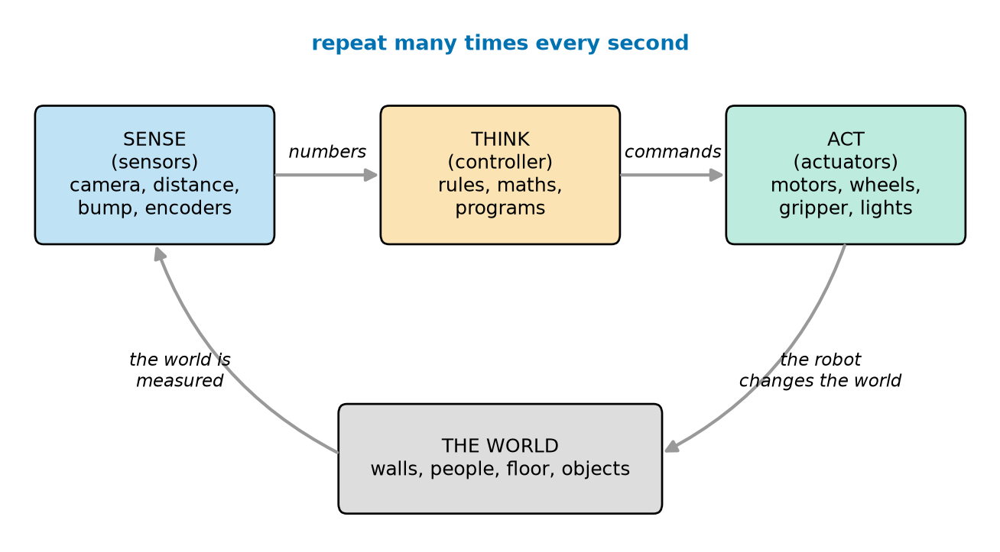
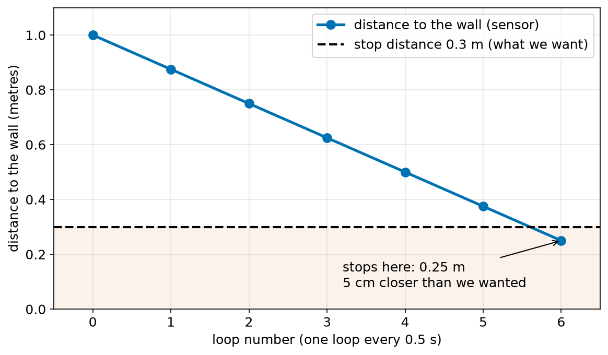
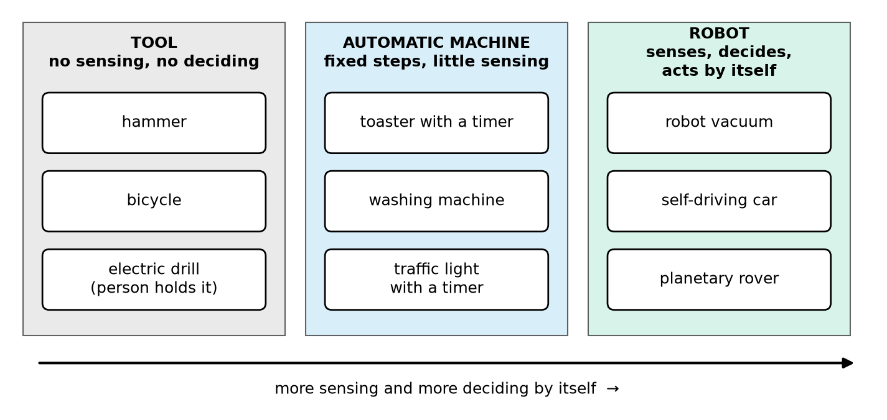
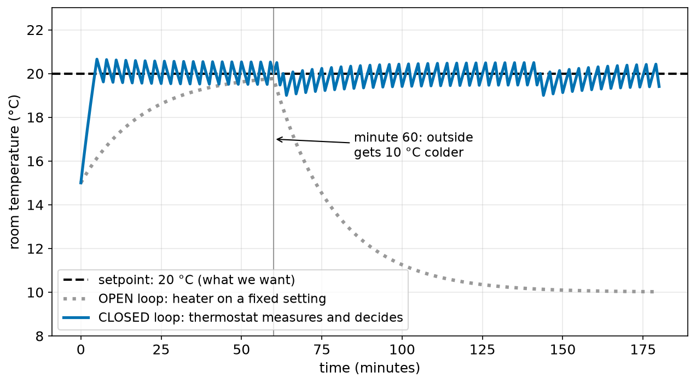
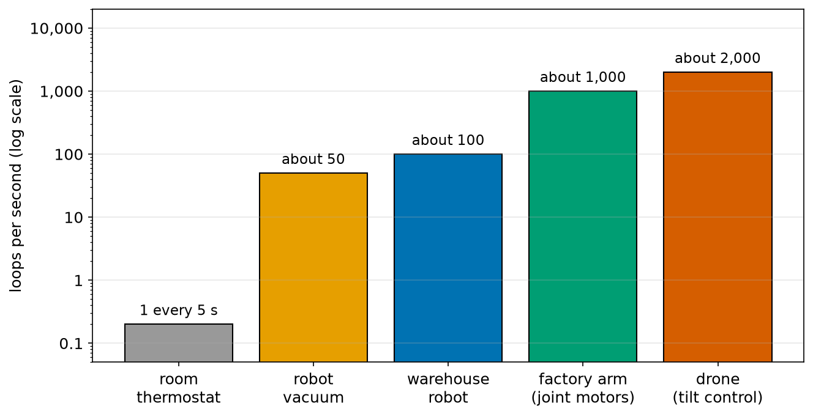
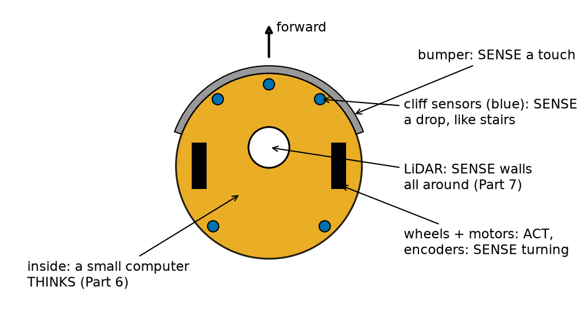

# Chapter 2 — What Is a Robot? Sense, Think, Act

> **Part 1 · Chapter 2 of 749**
> **You need:** Chapter 1.
> **You will make:** a paper simulation of a robot, a "robot hunt" list of the machines in your home, and the human robot game, version 2 (now **with** sensors).

---

## What you will learn

- The three things every robot does: **sense**, **think** and **act**.
- Why a robot does these three things **again and again**, in a loop, many times every second.
- A simple test that tells a **tool**, an **automatic machine** and a **robot** apart.
- The difference between **open loop** (no checking) and **closed loop** (measure and correct).
- What **autonomy** means: who does the thinking, a person or the machine?
- Why the **speed of the loop** can decide whether a robot is safe.

---

## New words in this chapter

| Word | Simple meaning |
|---|---|
| **sense** | To measure something about the world (or about the robot itself). |
| **sensor** | A part that senses. Examples: a camera, a distance sensor, a bump switch. |
| **think** | To decide what to do, using what was sensed. |
| **controller** | The part that thinks: a small computer and its program. |
| **act** | To do something in the world: move, push, grab, light up. |
| **actuator** | A part that acts. Examples: a motor, a gripper, a speaker. |
| **loop** | Something that repeats again and again. |
| **loop rate** | How many times the loop runs every second. |
| **open loop** | The machine acts **without** checking the result. |
| **closed loop** | The machine **measures** the result and corrects itself. Also called **feedback**. |
| **setpoint** | The value we want, for example 20 °C in a room. |
| **autonomy** | How much a machine decides **by itself**, without a person. |
| **teleoperation** | A person controls a machine from a distance. The person does the thinking. |

---

## 2.1 Start with a person

Before we talk about machines, think about **you**.

You are standing at the edge of a road. You want to cross. What do you do?

1. You **look** left and right. You **listen** for cars.
2. You **decide**: "The road is empty. I can go." Or: "A car is coming. I wait."
3. You **walk**, or you **stand still**.
4. While you walk, you **keep looking**. If a car appears, you walk faster, or you step back.

That is the whole idea of a robot, done by a person:

| You | The robot word |
|---|---|
| Your eyes and ears measure the world. | **Sense** |
| Your brain decides what to do. | **Think** |
| Your legs move you. | **Act** |
| You keep looking while you walk. | **Loop** |

Here is a second example. You catch a ball.

- Your eyes **sense** where the ball is, many times every second.
- Your brain **thinks**: "It is coming to my right. It is falling fast."
- Your arm and hand **act**: they move to the right place.
- Your eyes keep watching, and your brain keeps correcting the hand, until the ball is in it.

You do not calculate the whole flight of the ball once and then close your eyes. You **look, decide, move, look again, decide again, move again**. This repeating is the most important idea in all of robotics.

🧠 **Remember:** A robot does what you do when you cross a road or catch a ball: **sense → think → act**, and then **again**, and **again**.

---

## 2.2 The sense–think–act loop

Now look at the same idea as a picture. Figure 2.1 shows the loop that runs inside every robot.



*Figure 2.1 — The sense–think–act loop. Sensors measure the world, the controller decides, the actuators change the world, and then everything starts again.*

**How to read this picture:** Start at the blue box on the left (SENSE). Follow the grey arrows to the right: the sensors send **numbers** to the THINK box, and the THINK box sends **commands** to the ACT box. Then follow the curved arrow down: the robot changes the world. Then follow the left curved arrow up: the sensors measure the changed world. The blue words at the top say that this circle runs many times every second.

Let us look at each box.

### SENSE — measuring the world

📖 **New word: sensor** — a part that measures something and turns it into a number (or a signal) for the computer.

A sensor answers a question:

| Question | Sensor that answers it | Part of the course |
|---|---|---|
| "Did I touch something?" | bump switch | Ch 115 |
| "How far is the wall?" | ultrasonic or laser distance sensor | Ch 119–120 |
| "Is the floor dark or light here?" | light sensor, line sensor | Ch 117–118 |
| "How much did my wheel turn?" | encoder | Ch 122–123 |
| "Am I tilting?" | accelerometer and gyroscope (IMU) | Ch 124–127 |
| "Where am I on Earth?" | GPS | Ch 130 |
| "What is in front of me?" | camera | Ch 131, Part 24 |

There are two kinds of sensing:

- **Sensing the world (outside):** walls, people, the floor, light. Example: a distance sensor.
- **Sensing the robot itself (inside):** how fast the wheels turn, how full the battery is, how hot the motor is. Example: an encoder on a wheel.

A robot needs both. You also need both: your eyes sense the world, and other senses inside your body tell you where your arms and legs are, even with your eyes closed.

### THINK — deciding what to do

📖 **New word: controller** — the "brain" of the robot. Usually a small computer and the program that runs on it.

The THINK step takes the numbers from the sensors and decides what to do. It can be very simple:

```
IF the wall is closer than 0.3 m
    THEN stop
    ELSE drive forward
```

Or it can be very complex: a program that builds a map, finds a path through a house, and plans each wheel speed for the next two seconds. You will learn both kinds in this course. The simple rules come first (Part 2 and Part 6). The complex thinking comes later (Parts 12–25).

The important point is: **the decision depends on what the robot sensed.** If the wall is far, the robot drives. If the wall is near, it stops. The same program does different things in different situations. That is what makes it smart.

### ACT — changing the world

📖 **New word: actuator** — a part that makes something happen: it moves, pushes, turns, grabs, heats or lights up.

| Actuator | What it does | Part of the course |
|---|---|---|
| DC motor | turns a wheel | Ch 137–142 |
| servo motor | turns to an exact angle (an arm joint) | Ch 143 |
| stepper motor | turns in small exact steps (3D printers) | Ch 144–145 |
| brushless motor | spins very fast (drone propellers) | Ch 146 |
| gripper | holds and lets go of objects | Ch 149 |
| speaker, lights, screen | talk to people | various |

When the robot acts, **the world changes**. The robot is now closer to the wall. Or the cup is now in the gripper. So the next time the robot senses, it sees a **new** world. That is why the loop must go round again.

### The loop

📖 **New word: loop** — something that repeats.

The three steps are not done once. They are done in a loop:

```
repeat forever:
    SENSE  → read all the sensors
    THINK  → decide what to do now
    ACT    → send commands to the motors
```

Each time round the loop is short. A robot vacuum goes round about 50 times every second. A drone goes round more than a thousand times every second (Section 2.7 shows why).

🧠 **Remember:** Sense → think → act → **repeat**. The robot never "finishes". It keeps checking and correcting.

---

## 2.3 A robot in numbers: driving to a wall

Let us follow one robot, step by step, with real numbers. The robot drives towards a wall. It must stop when the wall is **0.3 m** away.

- At the start it is **1.0 m** from the wall.
- It drives at **0.25 m/s** (metres per second).
- Its loop runs once every **0.5 s** (two times per second). This is very slow, so we can follow it by hand.

🔢 **Maths** — how far does the robot drive in one loop?

```
Step 1. Formula (Chapter 1):     d = v × t
Step 2. Numbers:                 d = 0.25 × 0.5
Step 3. Multiply:                d = 0.125
Step 4. Unit:                    d = 0.125 m    (12.5 cm in each loop)
```

Now we play the loop. Each row is one time round:

| Loop | SENSE: distance | THINK: is it more than 0.3 m? | ACT | Distance after acting |
|---|---|---|---|---|
| 0 | 1.000 m | yes | forward | 1.000 − 0.125 = 0.875 m |
| 1 | 0.875 m | yes | forward | 0.875 − 0.125 = 0.750 m |
| 2 | 0.750 m | yes | forward | 0.625 m |
| 3 | 0.625 m | yes | forward | 0.500 m |
| 4 | 0.500 m | yes | forward | 0.375 m |
| 5 | 0.375 m | yes | forward | 0.250 m |
| 6 | 0.250 m | **no** | **stop** | 0.250 m |

The robot stops at **0.25 m**. But we wanted 0.3 m! It stopped **5 cm too close**. Why?

Look at loop 5. The robot sensed 0.375 m. That is more than 0.3 m, so it drove forward for half a second, a full 12.5 cm. It went past 0.3 m before it could look again. The robot was "blind" between two loops.

Look at Figure 2.2: it is the same table, drawn as a plot.



*Figure 2.2 — The distance to the wall at each loop. The robot stops at 0.25 m, which is 5 cm closer than the 0.3 m we wanted.*

**How to read this picture:** The bottom axis is the loop number (one loop every half second). The left axis is the distance to the wall. Each blue dot is one sensor reading. The black dashed line is the distance where we want to stop (0.3 m). The light red area under it is "too close". The last blue dot is inside the red area.

What can we do? Two simple ideas:

1. **Run the loop faster.** With a loop every 0.1 s, the robot moves only 0.25 × 0.1 = 0.025 m (2.5 cm) between two looks. It can be at most 2.5 cm too close.
2. **Drive slower near the wall.** If the robot slows down when it is close, it moves less between two looks.

Real robots use both ideas. Idea 2 is the beginning of **control**, which is Part 12 of this course.

🧠 **Remember:** Between two loops the robot cannot see. **Faster loops** and **slower movement** both make the "blind" distance smaller.

---

## 2.4 Tool, automatic machine or robot?

Many machines move, and many machines have computers inside. Which of them are robots? Let us make a simple test.

### The robot test: four questions

| # | Question | |
|---|---|---|
| 1 | **Does it sense?** Does it measure the world or itself? | SENSE |
| 2 | **Does it think by itself?** Does it decide what to do, using what it sensed? (Not a person deciding.) | THINK |
| 3 | **Does it act by moving?** Does it move itself, or move things in the world? | ACT |
| 4 | **Does it loop?** Does it keep sensing and correcting while it works? | LOOP |

A machine that answers **yes** to all four questions is a **robot**.

Now look at Figure 2.3. It puts some everyday machines into three groups.



*Figure 2.3 — Three groups of machines. From left to right, the machines sense more and decide more by themselves.*

**How to read this picture:** There are three columns. The left column (grey) is tools: they do not sense or decide. The middle column (light blue) is automatic machines: they follow fixed steps and sense only a little. The right column (light green) is robots: they sense, decide and act by themselves. The black arrow at the bottom shows the direction: more sensing and more deciding to the right.

### Let us test some machines

**A hammer.**
1. Sense? No. 2. Think? No. 3. Act by itself? No: a person swings it. 4. Loop? No.
→ A **tool**. All the sensing and thinking is done by the person.

**A toaster with a timer.**
1. Sense? Hardly: it only counts time. It does not measure how brown the bread is.
2. Think? Very little: "after 2 minutes, stop".
3. Act by moving? It heats; at the end the bread pops up.
4. Loop? No. It does not check the bread and correct itself.
→ An **automatic machine**. If you put in frozen bread, the toaster does not notice. It still stops after 2 minutes, and the bread is pale.

**A washing machine.**
1. Sense? Yes, a little: the door is locked, the water level, the water temperature, and in many machines the weight of the clothes and the speed of the drum.
2. Think? A little: many modern machines choose how much water to use from the weight of the clothes, and they slow down the spin if the drum shakes too much.
3. Act by moving? Yes: the drum turns, valves open, the pump runs.
4. Loop? Partly. It checks the water level and the drum shaking while it runs. But most of its program is a fixed list of steps (wash, rinse, spin) with fixed times.
→ **Almost a robot.** It has sense, think, act and some loops, but mostly it follows a fixed plan. It does not handle new situations by itself.

**A traffic light with a timer.**
1. Sense? No (a simple timer light). 2. Think? Only "change after 30 seconds". 3. Act by moving? No, it only changes lights. 4. Loop? It repeats, but it never checks anything.
→ An **automatic machine**. (A smart traffic light with car sensors is a step closer to a robot, but it still does not move.)

**A robot vacuum.**
1. Sense? Yes: bumpers, cliff sensors, wheel sensors, often a laser scanner or a camera.
2. Think? Yes: it decides where to go, when to turn, when to go home to charge.
3. Act by moving? Yes: it drives and cleans.
4. Loop? Yes, about 50 times every second.
→ A **robot**.

**A self-driving car** and **a planetary rover** also answer yes to all four questions. We look at them in the applications.

### What about a thermostat?

A room thermostat **senses** the temperature, **decides** ("too cold, heater on"), and **loops** (it checks again and again). But question 3 says "act by **moving**". A thermostat only switches a heater on and off. Nothing moves.

So a thermostat is not a robot by our test. It is a **controller**: the THINK part of a loop, without a moving body. It is still very important for us, because robots are full of controllers like it. Section 2.5 uses the thermostat to explain closed loops.

### A note about everyday words

People use the word "robot" in many ways. A kitchen mixer is sometimes called a "food robot". A computer program that answers emails is sometimes called a "bot". In this course, **robot** always means a machine that passes all four questions. This keeps our words exact (Chapter 1: one name for one thing).

💡 **Tip:** The line between "automatic machine" and "robot" is not sharp. It is a slope, like the arrow in Figure 2.3. More sensing and more thinking move a machine to the right.

---

## 2.5 Open loop and closed loop

This is one of the most important ideas in the whole course. Part 12 is built on it. Here is the first look.

📖 **New word: open loop** — the machine acts, but it does **not** measure the result. It cannot correct itself.

📖 **New word: closed loop** — the machine acts, **measures** the result, and **corrects** itself. Another name is **feedback**: the result is "fed back" to the controller.

📖 **New word: setpoint** — the value we want. For a room, maybe 20 °C. For the robot in Section 2.3, a distance of 0.3 m.

### An example: keeping a room warm

We want the room to stay at **20 °C** (the setpoint). We try two ways.

**Way 1 — open loop.** We set the heater to "half power" and leave it. We chose half power because, on a normal day, it keeps the room at about 20 °C. The heater never measures the room. It just works at half power, all the time.

**Way 2 — closed loop.** A thermostat measures the room temperature every minute. If the room is below 20 °C, it turns the heater on. If the room is 20 °C or more, it turns the heater off.

Now something changes: after 60 minutes, the weather outside gets **10 °C colder**. Look at Figure 2.4.



*Figure 2.4 — The room temperature over 3 hours. At minute 60, the outside gets 10 °C colder. The open-loop heater cannot react. The thermostat (closed loop) keeps the room near 20 °C.*

**How to read this picture:** The bottom axis is time in minutes. The left axis is the room temperature. The black dashed line is the setpoint, 20 °C. The grey dotted line is the open-loop heater. The blue line is the thermostat. The thin vertical line at minute 60 marks the moment when the weather gets colder.

What do we see?

- **Before minute 60**, both ways work. The grey dotted line slowly climbs to almost 20 °C. The blue line goes up fast and then stays near 20 °C.
- **After minute 60**, the open-loop heater still works at half power. It does not know that the weather changed. The room cools down to about **10 °C**, ten degrees too cold.
- The thermostat **notices** that the room is cooling (it measures!). It turns the heater on more often. The room stays near **20 °C**.

🔢 **Maths** — how the computer drew Figure 2.4. Each minute, the temperature changes like this:

```
new temperature = old temperature + heating − heat lost to the outside
heat lost       = 0.05 × (room temperature − outside temperature)
```

In words: "Each minute, the heater adds some warmth, and the room loses a little warmth through the walls. The bigger the difference with the outside, the more warmth the room loses."

Example: the room is at 20 °C, the outside is at 10 °C, and the open-loop heater adds 0.5 °C each minute.

```
heat lost       = 0.05 × (20 − 10) = 0.05 × 10 = 0.5 °C
new temperature = 20 + 0.5 − 0.5   = 20 °C      → it stays at 20 °C ✔
```

Now the outside gets colder, 0 °C:

```
heat lost       = 0.05 × (20 − 0) = 0.05 × 20 = 1.0 °C
new temperature = 20 + 0.5 − 1.0  = 19.5 °C     → it starts to cool down
```

The heater adds 0.5, but the room now loses 1.0 each minute. It cools down until the loss is only 0.5 again. When does that happen? When 0.05 × (room − 0) = 0.5, so room = 0.5 ÷ 0.05 = **10 °C**. That is exactly where the grey dotted line ends in Figure 2.4. ✔

Why does the blue line make a small zigzag? Because the thermostat is either fully on or fully off. When it is on, the room warms a little above 20 °C. Then it switches off, and the room cools a little below 20 °C. Then it switches on again. This is called **on-off control**. Chapter 208 studies it, and Chapters 210–216 show smoother ways (P, I and D control).

### Open and closed loops in robots

| Open loop (no checking) | Closed loop (measure and correct) |
|---|---|
| "Turn the wheel motors on for 2 seconds." The robot does not know if it really drove 1 m. On a carpet it drives less, on a smooth floor more. | "Drive until the wheel sensors say 1 m." Carpet or smooth floor, the robot drives 1 m. |
| "Move the arm motor for 0.5 s." A heavy object makes the arm move less. | "Move the arm until the joint sensor says 45°." |
| The timer toaster. | A toaster with a camera that stops when the bread is golden. |

Open loop is not always bad. It is simple and cheap, and it works when the world does not change. But robots live in a world that changes all the time: floors, loads, batteries, weather, people. So almost every robot uses **closed loops**.

🧠 **Remember:** Open loop acts **blind**. Closed loop **measures and corrects**. When the world changes, only the closed loop keeps working well.

---

## 2.6 Who does the thinking? Autonomy

📖 **New word: autonomy** — how much a machine decides **by itself**. A machine with full autonomy needs no person to decide.

📖 **New word: teleoperation** — a person controls a machine from a distance, using a screen, a joystick or a remote control. The person does the thinking.

Think about the sense–think–act loop again. The question is: **where is the THINK box?**

| Level | Who senses? | Who thinks? | Who acts? | Example |
|---|---|---|---|---|
| **Tool** | person | person | person (with the tool) | hammer, bicycle |
| **Teleoperated machine** | machine (camera) and person | **person** | machine | remote-control car, an underwater vehicle steered from a ship, a bomb-disposal machine with a joystick |
| **Shared control** | machine | **person and machine together** | machine | a car that keeps itself in its lane but needs the driver's hands; a drone that holds its position by itself while a person chooses where to go |
| **Autonomous robot** | machine | **machine** | machine | robot vacuum, warehouse robot, planetary rover driving between commands |

By our test, a teleoperated machine is **not quite a robot**, because a person does the thinking (question 2). But many of these machines have small robot loops **inside** them. A drone that a person flies still keeps itself level by itself, more than a thousand times every second. The person says "go left". The drone's own loop does the rest. So many real machines are a **mix**: the person thinks about the big plan, and the robot loops handle the small, fast work.

🤖 **Robot link:** Surgical robots in hospitals are usually teleoperated: the surgeon sits at a console and moves handles, and the robot arms copy the movement with tiny, steady motions. The surgeon thinks. The robot senses its joints, filters out the shaking of the surgeon's hands, and acts very precisely. People call it a "robot" in everyday words. In our exact words, it is a teleoperated machine with many robot loops inside.

---

## 2.7 How fast must the loop be?

Section 2.3 showed that a slow loop made the robot stop 5 cm too close. How fast must a loop be? It depends on **how fast things change**. Look at Figure 2.5.



*Figure 2.5 — Typical loop rates of different machines. The left axis grows ten times for each grid line (a "log scale"), so that very small and very large numbers fit in one picture.*

**How to read this picture:** Each bar is one kind of machine. The height of the bar is how many times per second its main loop runs. The number on top gives the value. Be careful: the left axis is not normal. Each grid line is **10 times** the one below (0.1, 1, 10, 100, 1,000, 10,000). This kind of axis is called a **log scale**. Chapter 52 explains it fully. These are typical values: real products differ.

| Machine | About how often | Why |
|---|---|---|
| Room thermostat | once every 5 seconds | A room changes temperature slowly, over minutes. |
| Robot vacuum | about 50 times per second | It drives slowly, about 0.3 m/s, but it must not fall down stairs. |
| Warehouse robot | about 100 times per second | It drives faster and carries heavy loads. |
| Factory arm (joint motors) | about 1,000 times per second | Each joint must follow its path to a fraction of a millimetre. |
| Drone (tilt control) | about 2,000 times per second (often 1,000 to 8,000) | A drone is unstable: without fast corrections it flips over in a fraction of a second. |

The rule is easy to say:

> **The faster the world (or the robot) changes, the faster the loop must run.**

You will see the exact maths of this in Part 13 (Chapter 250, "Digital control"). For now, the applications below show it with numbers.

---

## Code

This program is the robot from Section 2.3. It drives towards a wall and stops. You do not need to type it yet; you install Python in Chapter 8. Read it with the line-by-line table, as you learned in Chapter 1.

The file is `code/ch002/wall_stop.py`.

```python
# wall_stop.py - a robot drives towards a wall and stops (sense, think, act)
distance = 1.0        # metres from the wall at the start
speed = 0.25          # metres per second when driving
step_time = 0.5       # seconds between two loops
stop_distance = 0.3   # stop when the wall is this close (metres)

step = 0
moving = True
while moving:
    # SENSE: read the distance sensor
    reading = distance
    # THINK: decide what to do
    if reading > stop_distance:
        action = "forward"
    else:
        action = "stop"
    # ACT: move the robot, or stop it
    print("step", step, "| sensor:", round(reading, 3), "m | action:", action)
    if action == "forward":
        distance = distance - speed * step_time
    else:
        moving = False
    step = step + 1
```

| Line | Code | What it does (simple English) |
|---|---|---|
| 1 | `# wall_stop.py - …` | A comment: the file name and what the program does. |
| 2 | `distance = 1.0 …` | The robot starts 1.0 m from the wall. In a real robot we would not know this: the sensor would tell us. Here the program **is** the world, so it keeps the true distance. |
| 3 | `speed = 0.25 …` | The driving speed: 0.25 m/s. |
| 4 | `step_time = 0.5 …` | The time for one loop: 0.5 s. |
| 5 | `stop_distance = 0.3 …` | The **setpoint**: we want to stop when the wall is 0.3 m away. |
| 6 | *(empty line)* | Separates the settings from the loop. |
| 7 | `step = 0` | A counter for the loops. It starts at 0. |
| 8 | `moving = True` | A note to ourselves: "the robot is still moving". `True` means "yes". |
| 9 | `while moving:` | The **loop**. It means: "repeat the lines below (the ones pushed to the right) as long as `moving` is `True`". Part 2 (Chapter 19) explains `while` fully. |
| 10 | `# SENSE: …` | A comment that marks the SENSE part. |
| 11 | `reading = distance` | The "sensor" reads the distance. In this simple program the sensor is perfect: it reads the true distance. (Real sensors are never perfect. Part 7 and Part 11 show what happens then.) |
| 12 | `# THINK: …` | A comment that marks the THINK part. |
| 13 | `if reading > stop_distance:` | The decision: "**if** the reading is more than 0.3 m…". `>` means "is more than". |
| 14 | `action = "forward"` | …then the action is "forward". |
| 15 | `else:` | **Otherwise** (the reading is 0.3 m or less)… |
| 16 | `action = "stop"` | …the action is "stop". |
| 17 | `# ACT: …` | A comment that marks the ACT part. |
| 18 | `print("step", step, …)` | Shows one line on the screen: the loop number, the sensor reading (rounded to 3 decimals, as in Chapter 1), and the action. |
| 19 | `if action == "forward":` | If the action is "forward" (`==` means "is equal to")… |
| 20 | `distance = distance - speed * step_time` | …the robot drives for one loop: the distance to the wall gets smaller by 0.25 × 0.5 = 0.125 m. This is `d = v × t` from Chapter 1. |
| 21 | `else:` | Otherwise (the action is "stop")… |
| 22 | `moving = False` | …the robot stops, and `moving` becomes `False` ("no"). The `while` loop in line 9 sees this and does not repeat again. |
| 23 | `step = step + 1` | Adds 1 to the loop counter. Then the program goes back to line 9. |

**Output:**

```
step 0 | sensor: 1.0 m | action: forward
step 1 | sensor: 0.875 m | action: forward
step 2 | sensor: 0.75 m | action: forward
step 3 | sensor: 0.625 m | action: forward
step 4 | sensor: 0.5 m | action: forward
step 5 | sensor: 0.375 m | action: forward
step 6 | sensor: 0.25 m | action: stop
```

**What the output means:** The output is exactly the table in Section 2.3. Each line is one time round the sense–think–act loop. The robot reads the distance, decides, and acts. At step 6 the reading (0.25 m) is no longer more than 0.3 m, so the robot stops, 5 cm closer than we wanted, as Figure 2.2 showed.

💡 **Tip:** Find the three comments `# SENSE`, `# THINK` and `# ACT` in the program. Almost every robot program you write in this course has these three parts inside a loop, even when it is thousands of lines long.

---

## Small examples

### Example 1 — Sense, think, act in a lift (elevator)

- **Sense:** the buttons pressed, the floor sensors in the shaft, the door edge sensor.
- **Think:** "Someone pressed 5. We are at 2. Go up. Stop at 5."
- **Act:** the motor moves the car, and the doors open and close.
- **Loop:** if a hand blocks the closing door, the door sensor sees it and the door opens again.
→ A lift passes all four questions. It is a robot that lives in a shaft and moves only up and down.

### Example 2 — The loop distance

A robot drives at 0.4 m/s with a loop every 0.2 s. How far does it drive between two looks?

```
d = v × t = 0.4 × 0.2 = 0.08 m = 8 cm
```

It can be up to 8 cm past the point where it should stop.

### Example 3 — Making the loop faster

The same robot (0.4 m/s) now loops every 0.02 s (50 times per second).

```
d = 0.4 × 0.02 = 0.008 m = 8 mm
```

Ten times faster loop → ten times smaller blind distance.

### Example 4 — Open or closed?

"A garden watering machine opens the water for 10 minutes every morning."
→ **Open loop.** It does not measure the soil. It waters even after a night of rain.

"A garden watering machine measures the soil wetness and opens the water only when the soil is dry."
→ **Closed loop.**

### Example 5 — Where is the THINK box?

A child drives a toy car with a remote control.
- Sense: the child's eyes. Think: the child's brain. Act: the car's motors.
→ **Teleoperated.** Not a robot by our test. If the toy car had a distance sensor and stopped by itself before a wall, it would have a small robot loop inside it.

### Example 6 — The thermostat numbers

Outside is 5 °C, the room is 20 °C. How much warmth does the room lose in one minute, using the rule from Section 2.5?

```
heat lost = 0.05 × (20 − 5) = 0.05 × 15 = 0.75 °C
```

To stay at 20 °C, the heater must add 0.75 °C every minute.

---

## 🏭 Real robot applications

Now we use the sense–think–act loop on real robots. The first two applications are worked in full, with numbers and code. The next three are shorter.

### Application 1 (worked in full) — 🏠 A robot vacuum must not fall down the stairs

**1. The real problem.** A robot vacuum cleans a floor with stairs going down. If it drives over the edge, it falls, breaks and may hurt someone. Look at Figure 2.6: the vacuum has **cliff sensors** underneath, near the front. They look down at the floor. When the floor suddenly "disappears" (a step down), the sensor sees it.



*Figure 2.6 — A robot vacuum seen from above. Each label says whether the part senses, thinks or acts.*

**How to read this picture:** The orange circle is the robot, seen from above. The arrow at the top shows "forward". The grey arc at the front is the bumper. The blue dots are the cliff sensors underneath. The white circle on top is a laser scanner (LiDAR). The black rectangles are the two wheels. Each label says if the part senses, thinks or acts.

**2. Why the sense–think–act loop.** The cliff sensor only helps if the loop **senses** the edge, **thinks** "stop!", and **acts** (stops the wheels) before the wheel reaches the edge.

**3. The numbers.**

| Fact | Value |
|---|---|
| Speed of the vacuum | 0.3 m/s |
| The cliff sensor sees the edge this far before the wheel reaches it | 20 mm (0.020 m) |
| After the motors are told to stop, the robot still rolls | 10 mm (0.010 m) |
| Loop rates we compare | 10, 25, 50 and 100 loops per second |

**4. The maths, step by step.** The worst case: the edge appears **just after** the sensor was read. Then the robot drives one whole loop before it sees the edge. Then it rolls 10 mm more while stopping.

For **10 loops per second**:

```
Step 1. Time of one loop       = 1 ÷ 10           = 0.1 s
Step 2. Distance in one loop   = 0.3 × 0.1        = 0.03 m = 30 mm
Step 3. Distance until stopped = 30 mm + 10 mm    = 40 mm
Step 4. Compare with 20 mm:      40 mm > 20 mm  →  the robot FALLS
```

For **50 loops per second**:

```
Step 1. Time of one loop       = 1 ÷ 50           = 0.02 s
Step 2. Distance in one loop   = 0.3 × 0.02       = 0.006 m = 6 mm
Step 3. Distance until stopped = 6 mm + 10 mm     = 16 mm
Step 4. Compare with 20 mm:      16 mm < 20 mm  →  safe
```

**5. The code.** File `code/ch002/cliff_check.py` does the same for four loop rates.

```python
# cliff_check.py - does a robot vacuum stop before the stairs?
speed = 0.3            # metres per second
look_ahead = 0.020     # the cliff sensor sees the edge 20 mm before the wheel reaches it
stop_needs = 0.010     # after the motors are told to stop, the robot still rolls 10 mm

for loops_per_second in [10, 25, 50, 100]:
    loop_time = 1 / loops_per_second              # seconds between two loops
    late = speed * loop_time                      # worst case: the edge appears just after a sense step
    needed = late + stop_needs                    # distance used before the robot is stopped
    if needed < look_ahead:
        result = "safe"
    else:
        result = "FALLS"
    print(loops_per_second, "loops/s | moves", round(late * 1000, 1), "mm per loop | needs",
          round(needed * 1000, 1), "mm |", result)
```

| Line | Code | What it does (simple English) |
|---|---|---|
| 1 | `# cliff_check.py - …` | A comment: the name and the question the program answers. |
| 2 | `speed = 0.3` | The vacuum's speed in m/s. |
| 3 | `look_ahead = 0.020` | How far ahead the cliff sensor sees: 20 mm, written in metres. |
| 4 | `stop_needs = 0.010` | How far the robot rolls after "stop": 10 mm, in metres. |
| 5 | *(empty line)* | Separates the facts from the calculation. |
| 6 | `for loops_per_second in [10, 25, 50, 100]:` | A loop that runs 4 times: first with `loops_per_second` = 10, then 25, then 50, then 100. (`for` loops are explained in Chapter 20.) |
| 7 | `loop_time = 1 / loops_per_second` | Step 1: the time of one loop. 10 loops per second → 0.1 s each. |
| 8 | `late = speed * loop_time` | Step 2: how far the robot drives in one loop (`d = v × t`). |
| 9 | `needed = late + stop_needs` | Step 3: the distance until the robot stands still. |
| 10 | `if needed < look_ahead:` | Step 4: is it less than 20 mm? (`<` means "is less than".) |
| 11 | `result = "safe"` | If yes: safe. |
| 12 | `else:` | Otherwise… |
| 13 | `result = "FALLS"` | …the robot falls. |
| 14–15 | `print(…)` | Shows the loop rate, the distance per loop and the distance needed (both changed from metres to millimetres by `× 1000`), and the result. The line is split in two because it is long; Python allows this inside brackets. |

**Output:**

```
10 loops/s | moves 30.0 mm per loop | needs 40.0 mm | FALLS
25 loops/s | moves 12.0 mm per loop | needs 22.0 mm | FALLS
50 loops/s | moves 6.0 mm per loop | needs 16.0 mm | safe
100 loops/s | moves 3.0 mm per loop | needs 13.0 mm | safe
```

**6. The result.** With 10 or 25 loops per second, the vacuum can fall down the stairs, even though it has a cliff sensor. With 50 or more, it is safe. **The sensor alone is not enough. The loop must also be fast enough.** Notice that 25 loops per second fails by only 2 mm (22 mm instead of 20 mm). Engineers add a **safety margin**: they want the robot to stop well before the edge, not just in time.

**7. Going further.** Real vacuums also slow down near edges they remember from their map (Part 22), use several cliff sensors so a single dirty sensor does not cause a fall, and check that the sensor values make sense. In Chapter 135 you build your own obstacle-detecting distance meter and measure these delays yourself.

### Application 2 (worked in full) — 📦 How far ahead must a warehouse robot see?

**1. The real problem.** A warehouse robot carries shelves between people and other robots. It has a distance sensor that sees obstacles up to **2.0 m** ahead. The company wants it to drive as fast as possible, but it must always be able to stop before it hits a person who steps out in front of it.

**2. Why the sense–think–act loop.** From the moment the person appears to the moment the robot stands still, three things happen, one after the other:
- **Sense:** the robot must wait for the next sensor reading.
- **Think:** the computer must decide "stop".
- **Act:** the brakes work, and the robot slows down until it stands still.
During **all three**, the robot keeps moving.

**3. The numbers.**

| Fact | Value |
|---|---|
| Sensor readings | 10 per second → in the worst case, the robot waits 0.1 s for the next one |
| Time to think | 0.05 s |
| Sensor range | 2.0 m |
| Braking distance, measured by the maker | 0.50 m at 1.0 m/s, 1.13 m at 1.5 m/s, 2.00 m at 2.0 m/s |

(Why does the braking distance grow so fast with speed? Twice the speed gives four times the braking distance. Chapter 59 shows the formula behind this. Here we just use the maker's measured values.)

**4. The maths, step by step.** At **1.5 m/s**:

```
Step 1. Waiting + thinking time      = 0.1 + 0.05          = 0.15 s
Step 2. Distance before braking      = 1.5 × 0.15          = 0.225 m     (d = v × t)
Step 3. Braking distance (maker)     =                       1.13 m
Step 4. Total distance to stand still = 0.225 + 1.13        = 1.355 m
Step 5. Compare with the sensor range: 1.355 m < 2.0 m  →  safe
```

At **2.0 m/s**:

```
Step 1. Waiting + thinking time       = 0.15 s
Step 2. Distance before braking       = 2.0 × 0.15         = 0.3 m
Step 3. Braking distance (maker)      =                      2.00 m
Step 4. Total distance                = 0.3 + 2.00         = 2.3 m
Step 5. Compare with the sensor range: 2.3 m > 2.0 m  →  NOT safe
```

**5. The code.** File `code/ch002/stop_distance.py`:

```python
# stop_distance.py - how far ahead must a warehouse robot see?
wait_time = 0.1        # worst case: the obstacle appears just after a sensor reading (10 readings per second)
think_time = 0.05      # the computer needs 0.05 s to decide
sensor_range = 2.0     # the sensor sees obstacles up to 2.0 m away

speeds = [1.0, 1.5, 2.0]            # metres per second
brake_distances = [0.50, 1.13, 2.00]  # metres, measured by the robot's maker

for i in range(3):
    speed = speeds[i]
    reaction = speed * (wait_time + think_time)   # distance driven before the brakes start
    total = reaction + brake_distances[i]         # distance driven until the robot stands still
    if total < sensor_range:
        result = "safe"
    else:
        result = "NOT safe"
    print("speed", speed, "m/s | reaction", round(reaction, 3), "m | total", round(total, 3), "m |", result)
```

| Line | Code | What it does (simple English) |
|---|---|---|
| 1 | `# stop_distance.py - …` | A comment: the name and the question. |
| 2 | `wait_time = 0.1` | Worst-case waiting time for the next sensor reading. |
| 3 | `think_time = 0.05` | Time the computer needs to decide. |
| 4 | `sensor_range = 2.0` | How far the sensor can see. |
| 5 | *(empty line)* | Separates the facts. |
| 6 | `speeds = [1.0, 1.5, 2.0]` | A **list** of three speeds to test. (Lists come in Chapter 21.) |
| 7 | `brake_distances = [0.50, 1.13, 2.00]` | The braking distance for each speed, in the same order. |
| 8 | *(empty line)* | Separates the facts from the calculation. |
| 9 | `for i in range(3):` | A loop that runs 3 times, with `i` = 0, then 1, then 2. We use `i` to pick the matching items from the two lists. |
| 10 | `speed = speeds[i]` | Takes item number `i` from the list of speeds. (Python counts from 0, so item 0 is 1.0.) |
| 11 | `reaction = speed * (wait_time + think_time)` | Steps 1 and 2: the distance driven before the brakes start. The brackets mean "add these first". |
| 12 | `total = reaction + brake_distances[i]` | Steps 3 and 4: add the braking distance for this speed. |
| 13 | `if total < sensor_range:` | Step 5: does the robot stop within what the sensor can see? |
| 14 | `result = "safe"` | If yes: safe. |
| 15 | `else:` | Otherwise… |
| 16 | `result = "NOT safe"` | …not safe. |
| 17 | `print(…)` | Shows the speed, the reaction distance, the total distance and the result. |

**Output:**

```
speed 1.0 m/s | reaction 0.15 m | total 0.65 m | safe
speed 1.5 m/s | reaction 0.225 m | total 1.355 m | safe
speed 2.0 m/s | reaction 0.3 m | total 2.3 m | NOT safe
```

**6. The result.** With this sensor, the robot may drive at **1.5 m/s**, but **not at 2.0 m/s**. If the company wants 2.0 m/s, it must buy a sensor that sees farther, make the loop faster, or improve the brakes. This is a real engineering choice, and every part of the sense–think–act loop is in it: the **sense** time, the **think** time and the **act** (braking) distance.

**7. Going further.** Real warehouse robots use laser scanners with "safety fields": an outer zone where the robot slows down and an inner zone where it stops. The size of the zones changes with the speed, using exactly this kind of calculation. Safety rules for robots near people are in Chapter 744.

### Application 3 — 🚁 Why a drone needs thousands of loops per second

A small drone is like a pencil standing on your finger: if nobody corrects it, it falls over. A tiny gust of wind tilts it. If the tilt is not corrected quickly, the drone tips more and more, and it flips over in a fraction of a second. So its tilt loop runs very fast. If a drone tilts at 100° per second (a quick but normal motion), then in one loop at 2,000 loops per second it tilts only 100 ÷ 2,000 = **0.05°** before the next correction. At 20 loops per second it would tilt 100 ÷ 20 = **5°** between corrections, much too much for a smooth flight. You will build this tilt loop yourself in Chapters 641–643.

### Application 4 — 🚀 A planetary rover must think for itself

A rover on Mars cannot be driven with a joystick from Earth. A radio signal takes between about **3 and 22 minutes** to go from Earth to Mars, depending on where the two planets are in their orbits. If a person on Earth sees a rock in a camera picture and presses "stop", the command arrives many minutes later. By then the rover could already be stuck.

So the people on Earth send a goal ("drive to that point, 50 m away"), and the rover does the sense–think–act loop **by itself**: its cameras sense the ground, its computer finds a safe path between the rocks, and its wheels follow the path, checking again and again. This is **autonomy** because of a real need: the radio is too slow for teleoperation. You learn how a rover finds safe paths in Part 23.

### Application 5 — 🌾 A milking robot on a farm

Some dairy farms use robots that milk the cows. The cow walks into a stall by herself when she wants to be milked.

- **Sense:** a tag on the cow's collar tells the robot which cow it is. Cameras or laser sensors find the exact position of each teat, because every cow is different and every cow moves a little.
- **Think:** the robot decides where to move the cups, and checks the cow's record (when was she last milked?).
- **Act:** a robot arm attaches the cups, the milk flows, and the arm takes the cups off.
- **Loop:** while the arm moves, the sensors keep watching. If the cow steps sideways, the arm follows.

This is a robot in a world that is very hard to predict: a living animal that moves. An open-loop arm (move to a fixed position) would fail every time. Only a fast closed loop works.

---

## 🔧 Hands-on lab

### Lab 2.1 — The human robot game, version 2 (with sensors)

In Lab 1.3 (Chapter 1), the "robot" person could see, but was not allowed to use what they saw. The programmer had to plan everything in advance, and it rarely worked the first time. Now we add **sensors** and **decisions**.

**You need:** two people, a room, a paper cup, paper and a pencil.

**The new commands.** Keep all the commands from Lab 1.3 and add these:

| Command | Type | Robot does |
|---|---|---|
| `DISTANCE?` | SENSE | says how many normal steps away the cup is, straight ahead (or "NOT AHEAD" if the cup is not in front) |
| `LEFT?` / `RIGHT?` | SENSE | says "YES" if the cup is more to the left / right |
| `IF … THEN … ELSE …` | THINK | the programmer may use these words in the program |
| `REPEAT … UNTIL …` | LOOP | the programmer may repeat lines |

**Steps:**

1. Put the cup somewhere in the room. The robot stands at the door. **Do not tell the programmer where the cup is**: the programmer turns around and does not look.
2. The programmer writes a program **before** looking. Example:
   ```
   REPEAT
       IF LEFT? is YES THEN TURN LEFT
       IF RIGHT? is YES THEN TURN RIGHT
       ask DISTANCE?
       IF the answer is more than 0 THEN FORWARD 1
   UNTIL the answer to DISTANCE? is 0
   ARM DOWN
   GRAB
   ARM UP
   ```
3. The programmer reads the program, line by line. The robot person follows it exactly.
4. Move the cup to a **new** place. Run **the same program** again. Does it still work?

**What you should see:** The same program works for **many different** cup positions, even ones the programmer never saw. In Lab 1.3, every new cup position needed a new plan. That is the power of the closed loop: the program **senses** and **adapts**.

**If it does not work:**

| Problem | Likely cause | Fix |
|---|---|---|
| The robot turns left and right forever. | "Left" and "right" change after each turn, and the robot overshoots. | Add a rule: after a turn, ask `DISTANCE?` before turning again. (Robots have this problem too!) |
| The robot walks past the cup. | `FORWARD` with big numbers. | Use `FORWARD 1` inside the loop: small steps, check often. This is the "faster loop" idea from Section 2.3. |
| The robot never stops. | The `UNTIL` condition is never true. | Check the stop rule. A robot program needs a clear way to end. |

**Challenge:** Put a chair between the door and the cup. Add a sensor `FRONT?` that says "BLOCKED" or "CLEAR". Write a program that goes around the chair.

### Lab 2.2 — Be the computer (paper simulation)

**You need:** your notebook, a pencil. (The simulation track for Part 1 is on paper: you are the computer.)

**Steps:**

1. Copy the empty table below into your notebook.
2. Use the program `wall_stop.py` from the Code section, but change **one** setting: `step_time = 0.2` instead of 0.5.
3. First, calculate the distance in one loop: d = 0.25 × 0.2 = ?
4. Fill in the table, row by row, until the action is "stop".

| Loop | SENSE: distance | THINK: more than 0.3? | ACT | Distance after |
|---|---|---|---|---|
| 0 | 1.000 | | | |
| 1 | | | | |
| … | | | | |

**What you should see:** Each loop moves 0.05 m. The robot reads 1.00, 0.95, 0.90, … 0.35, 0.30. At 0.30 the question "more than 0.3?" is **no**, so it stops at exactly **0.30 m**. With the faster loop, the robot stops exactly where we wanted, not 5 cm too close. (Check: from 1.00 to 0.30 is 0.70 m, and 0.70 ÷ 0.05 = 14 loops of driving, so the stop comes at loop 14.)

⚠️ **Careful:** It worked perfectly here only because 0.70 m divides exactly into 0.05 m steps. With other numbers there can still be a small overshoot, but it is never more than one loop distance (here 5 cm → now at most 0.05 m, before it was up to 0.125 m).

**Challenge:** Try `speed = 0.4` and `step_time = 0.5`. Where does the robot stop? How many centimetres too close?

### Lab 2.3 — The robot hunt

**You need:** your home (or school), your notebook.

**Steps:**

1. Find **10 machines** in your home or school. Examples: fridge, washing machine, microwave, lift, automatic door, printer, toaster, air conditioner, toy car, phone.
2. For each machine, make one row in a table and answer the four questions from Section 2.4:

| Machine | 1. Senses? What? | 2. Thinks by itself? | 3. Acts by moving? | 4. Loops? | Tool / automatic machine / robot? |
|---|---|---|---|---|---|
| fridge | yes, temperature | yes, cooling on/off | not really: the compressor runs, but nothing moves around | yes | automatic machine (a controller, like a thermostat) |
| … | | | | | |

3. For each machine that is **not** a robot, write one sentence: "It would become more like a robot if it could …".

**What you should see:** Most machines are tools or automatic machines. A few, like an automatic door, a lift or a robot vacuum, pass all four questions. Many machines have a small **closed loop** inside (fridge, air conditioner), even if they are not robots.

**If it does not work:**

| Problem | Likely cause | Fix |
|---|---|---|
| "I cannot tell if it senses." | Sensors are hidden inside. | Watch how it behaves. Does it do something different when the situation changes? Then it senses. |
| "Everything is a robot!" | Question 3 forgotten. | The machine must **move** itself or move things. |

**Challenge:** Choose one automatic machine from your list and draw it with its sense, think and act parts, like Figure 2.6.

---

## Common mistakes

⚠️ **"It has a computer, so it is a robot."** A computer alone only thinks. A robot also senses and acts. A laptop is not a robot.

⚠️ **"It moves, so it is a robot."** A fan moves, but it does not sense or decide. It is an automatic machine.

⚠️ **Forgetting the loop.** Sensing once at the start is not enough. A robot must keep sensing while it acts, because its own actions change the world.

⚠️ **Thinking a sensor makes a robot safe by itself.** Application 1 showed it: a cliff sensor with a slow loop still lets the robot fall. The **whole loop** must be fast enough.

⚠️ **Thinking open loop is always wrong.** Open loop is fine when the world does not change and mistakes do not matter (a toaster, a timer light). Robots need closed loops because their world changes.

⚠️ **Mixing up teleoperation and autonomy.** A remote-control car with a camera is still driven by a person. Who does the **thinking** decides which one it is.

---

## Practice

🏋️ **1.** Name the three things every robot does, and say what part of the robot does each one.

🏋️ **2.** You pour water into a glass until it is full. Describe what you do as sense, think, act and loop.

🏋️ **3.** Use the four questions to test an **automatic door** in a shop (the door opens when a person walks towards it). Is it a robot?

🏋️ **4.** A robot drives at 0.5 m/s. Its loop runs every 0.1 s. How far does it drive between two looks? How far past its stop point can it go?

🏋️ **5.** In Section 2.3, what would happen if the loop ran every **1.0 s** instead of every 0.5 s? Work out the table. Where does the robot stop?

🏋️ **6.** Open loop or closed loop?
(a) A microwave that heats for 90 seconds.
(b) A car's cruise control that keeps the car at 80 km/h, also uphill.
(c) A street light that switches on at 7 pm every day.
(d) A street light that switches on when a light sensor says it is dark.

🏋️ **7.** In Section 2.5, the outside is at 0 °C and the open-loop heater adds 0.5 °C each minute. The room is at 15 °C. How much warmth does it lose in one minute? Will the room get warmer or colder in the next minute?

🏋️ **8.** Use the cliff-sensor numbers from Application 1 (0.3 m/s, 20 mm look-ahead, 10 mm to stop). What is the **lowest** loop rate (loops per second) that is still safe? (Hint: the distance in one loop must be less than 20 − 10 = 10 mm.)

🏋️ **9.** In Application 2, the company buys a faster computer. Now the thinking time is 0.01 s instead of 0.05 s. Is 2.0 m/s safe now? Show the numbers.

🏋️ **10.** (Harder) A drone tilts at 200° per second when a strong gust hits it. Its designer wants it to tilt **less than 0.1°** between two loops. How many loops per second does it need, at least?

---

## Answers

**1.** **Sense** (sensors measure the world and the robot), **think** (the controller decides what to do), **act** (actuators such as motors move the robot or move things). And then it repeats: **loop**.

**2.**
- **Sense:** your eyes watch the water level in the glass.
- **Think:** your brain decides "not full yet, keep pouring" or "almost full, pour slower" or "full, stop".
- **Act:** your hand tilts the bottle more or less.
- **Loop:** you keep watching while you pour, and you correct your hand all the time.
This is a closed loop: if you poured with your eyes closed (open loop), the water would probably spill.

**3.**
1. Senses? **Yes**: a motion sensor sees the person.
2. Thinks by itself? **Yes**: "person coming → open; nobody for 5 seconds → close".
3. Acts by moving? **Yes**: a motor slides the doors.
4. Loops? **Yes**: it keeps checking. If a person stands in the door while it is closing, it opens again.
→ It passes all four questions. It is a (simple) **robot**.

**4.**
```
d = v × t = 0.5 × 0.1 = 0.05 m = 5 cm
```
It drives 5 cm between two looks, so it can go up to **5 cm** past its stop point.

**5.** Distance in one loop: d = 0.25 × 1.0 = 0.25 m.

| Loop | Distance | More than 0.3? | Action | After |
|---|---|---|---|---|
| 0 | 1.00 | yes | forward | 0.75 |
| 1 | 0.75 | yes | forward | 0.50 |
| 2 | 0.50 | yes | forward | 0.25 |
| 3 | 0.25 | no | stop | 0.25 |

The robot stops at **0.25 m**, 5 cm too close. (The same as before, by chance: the readings just happen to land on 0.25. But the robot was "blind" for 25 cm at a time, so with a different start distance it could have been up to 25 cm too close, or even hit the wall if the wall were closer than one loop distance.)

**6.** (a) **Open loop**: it heats for a fixed time without measuring the food. (b) **Closed loop**: it measures the speed and adds power uphill. (c) **Open loop**: a fixed time, even if it is still bright or already dark. (d) **Closed loop**: it measures the light.

**7.**
```
heat lost       = 0.05 × (15 − 0) = 0.05 × 15 = 0.75 °C
new temperature = 15 + 0.5 − 0.75 = 14.75 °C
```
It loses 0.75 °C and gains only 0.5 °C, so the room gets **colder** (to 14.75 °C). It will keep cooling until it reaches 10 °C, where the loss is exactly 0.5 °C per minute.

**8.** The distance in one loop must be less than 10 mm = 0.010 m.
```
distance in one loop = speed × loop time
0.3 × loop time < 0.010
loop time < 0.010 ÷ 0.3 = 0.0333 s
loops per second > 1 ÷ 0.0333 = 30
```
The vacuum needs **more than 30 loops per second**. (Check with 30: 0.3 ÷ 30 = 0.010 m = 10 mm per loop, plus 10 mm to stop = exactly 20 mm, with no margin at all. So "more than 30", and in practice much more, for a safety margin.)

**9.**
```
Waiting + thinking  = 0.1 + 0.01     = 0.11 s
Before braking      = 2.0 × 0.11     = 0.22 m
Total               = 0.22 + 2.00    = 2.22 m
2.22 m > 2.0 m  →  still NOT safe
```
A faster computer helps a little (2.3 m → 2.22 m), but the braking distance (2.00 m) is the big part. At 2.0 m/s the robot needs a sensor that sees farther, or better brakes.

**10.** Tilt in one loop = 200 × loop time. We want this to be less than 0.1°.
```
200 × loop time < 0.1
loop time < 0.1 ÷ 200 = 0.0005 s
loops per second > 1 ÷ 0.0005 = 2,000
```
The drone needs **more than 2,000 loops per second**. This is why real drone tilt loops often run at thousands of times per second (Figure 2.5).

---

## Summary

🧠 Every robot does three things: **sense** (sensors), **think** (controller), **act** (actuators).

🧠 It does them in a **loop**, again and again, because its own actions change the world.

🧠 The **robot test**: Does it sense? Does it think by itself? Does it act by moving? Does it loop? Four yeses → a robot. Tools and automatic machines fail one or more questions.

🧠 **Open loop** acts without checking. **Closed loop** (feedback) measures and corrects. When the world changes, only a closed loop keeps working well.

🧠 Between two loops a robot is "blind". **Faster loops** and **slower movement** make the blind distance smaller. The loop must be fast enough for the robot to be **safe**.

🧠 **Autonomy** asks who does the thinking. In teleoperation a person thinks; in an autonomous robot the machine thinks. Many real machines are a mix.

🧠 Real robots (vacuums, warehouse robots, drones, planetary rovers, milking robots) are all built around the same sense–think–act loop.

---

## Next chapter

In **Chapter 3 — A short history of robots**, we travel from ancient water clocks and moving dolls to factory arms, planetary rovers and walking humanoids. You will see how each big step in robots came from a new way to **sense**, a new way to **think**, or a new way to **act**.
