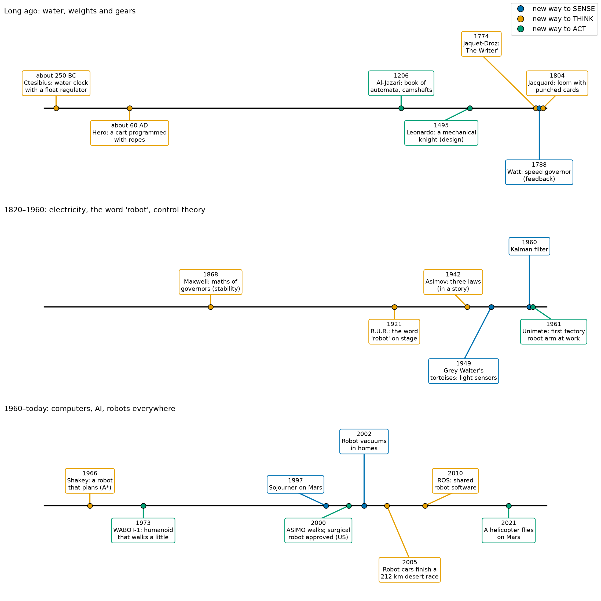
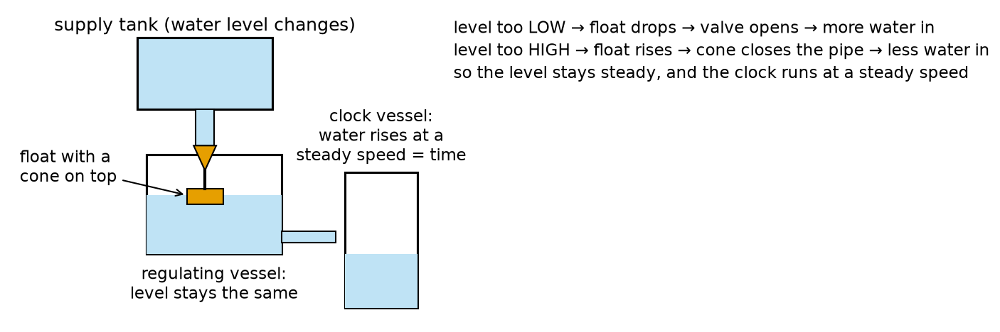
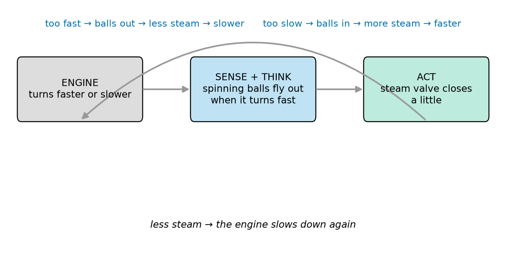
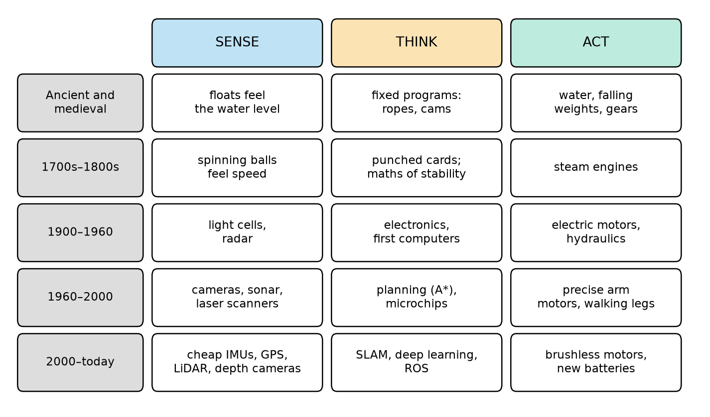
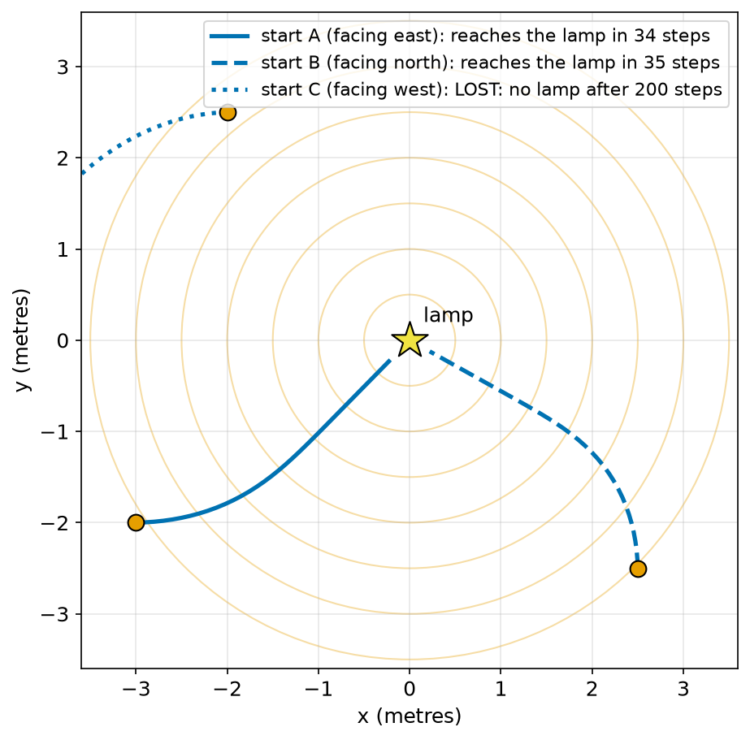
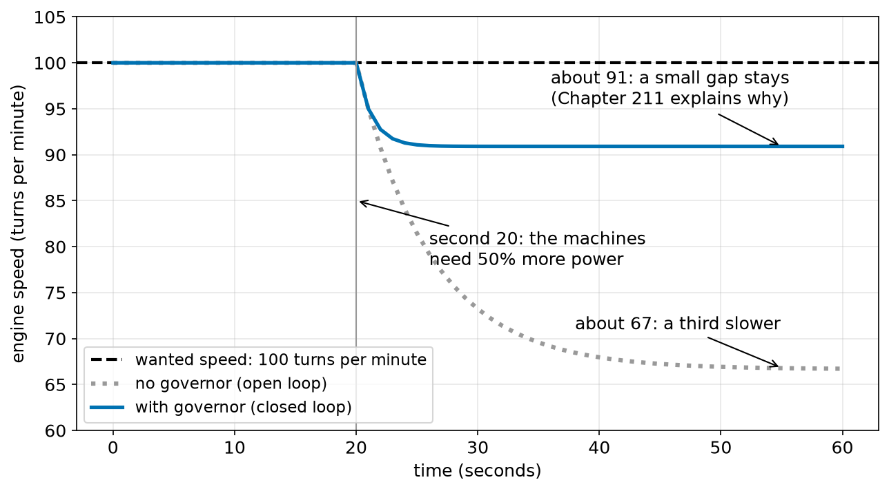

# Chapter 3 — A Short History of Robots

> **Part 1 · Chapter 3 of 749**
> **You need:** Chapters 1–2 (especially the sense–think–act loop and the four-question robot test).
> **You will make:** your own robotics timeline, a "look inside" lab with a real float valve, and paper experiments with the first light-seeking robot.

---

## What you will learn

- How people built moving machines more than 2,000 years ago, with water, weights, ropes and gears.
- How **feedback** (the closed loop from Chapter 2) appeared long before electricity, in water clocks and steam engines.
- Where the word **"robot"** comes from.
- The first electronic robots, the first factory robot arm, the first robot that planned its own moves, and robots on other planets.
- The big pattern: **every big step in robots came from a new way to sense, a new way to think, or a new way to act.**

---

## New words in this chapter

| Word | Simple meaning |
|---|---|
| **automaton** (plural: **automata**) | An old word for a machine that moves by itself, usually following fixed steps. A mechanical doll that writes is an automaton. |
| **mechanism** | A set of moving parts (gears, levers, ropes) that work together. |
| **cam** | A wheel with a bumpy edge. As it turns, the bumps push a lever up and down in a fixed pattern. Cams "store" a movement. |
| **feedback** | Using the result to correct the action. The closed loop from Chapter 2. |
| **governor** | A device that keeps an engine at a steady speed using feedback. |
| **punched card** | A card with holes. The pattern of holes is a program that a machine can read. |
| **industrial robot** | A robot that works in a factory, usually an arm. |
| **rover** | A robot vehicle that drives over the ground of another world (the Moon, Mars). |
| **milestone** | An important event that marks a step forward. |

---

## 3.1 Why learn the history?

You might ask: "I want to build robots. Why should I read about old machines?"

There are three good reasons.

1. **Old ideas are still inside new robots.** The idea that keeps a 2,000-year-old water clock steady is the same idea that keeps a drone level today: feedback. When you see an idea in its simplest, oldest form, it is easier to understand.
2. **History shows which problems were hard.** For thousands of years, people could make machines that **act** beautifully. But making machines that **sense** and **think** well took much longer. Knowing this helps you understand why some parts of this course (control, estimation, vision, planning) are so big.
3. **It is a great story.** Robots grew out of clockmakers, steam engineers, writers, brain scientists, car factories and space agencies. That story is part of the subject you are learning.

As we go, we tag each milestone with one of three letters:

| Tag | Meaning |
|---|---|
| **S** | a new way to **SENSE** |
| **T** | a new way to **THINK** (decide, program, plan) |
| **A** | a new way to **ACT** (move, push, grab) |

Here is the whole story in one picture. Do not try to read every box now. Come back to Figure 3.1 at the end of the chapter.



*Figure 3.1 — Robot milestones from about 250 BC to today, in three panels. The colour of each dot shows whether the step was mainly a new way to sense (blue), think (orange) or act (green).*

**How to read this picture:** There are three panels, one for each long period. The top panel covers about 2,000 years, the middle panel about 140 years, and the bottom panel about 65 years. So the panels do **not** use the same scale: the closer we get to today, the more things happen, and the more space they need. Each dot on a black line is one milestone. The box connected to it gives the year and a short description. The dot colour is the S/T/A tag. Some lines are slanted only so that the boxes do not cover each other.

⚠️ **Careful:** Many history books say "the first robot was…". Be careful with the word "first". Often many people had similar ideas at similar times, and old records are not complete. In this chapter we say "an early …" or "one of the first …" when we are not sure.

---

## 3.2 Long ago: water, weights and ropes

### The water clock that corrected itself (about 250 BC) — **T**

In the city of Alexandria, in Egypt, an engineer called **Ctesibius** (say: *te-SIB-ee-us*) worked about 2,250 years ago. He is known for a better **water clock**.

A simple water clock works like this: water drips from one container into another. The water rises in the second container, and marks on its side show the hours. There is a problem. When the first container is full, the water pushes harder and drips **faster**. When it is nearly empty, it drips **slower**. So the clock runs fast at the start and slow at the end.

Ctesibius solved this with a **float regulator**. Look at Figure 3.2.



*Figure 3.2 — A float regulator. A float with a cone on top keeps the water level steady in the middle vessel, so the clock vessel fills at a steady speed.*

**How to read this picture:** Water flows from the top left (the supply tank) down a pipe into the middle vessel (the regulating vessel). Inside the regulating vessel floats an orange block with an orange cone on top. The cone sits under the end of the pipe. From the regulating vessel, a thin pipe lets water flow into the clock vessel on the right. The three sentences at the top right describe the loop.

Here is how it works, step by step:

1. If the water in the middle vessel gets **too low**, the float **drops**. The cone moves away from the pipe. **More** water flows in. The level rises again.
2. If the water gets **too high**, the float **rises**. The cone pushes into the pipe and closes it. **Less** water flows in. The level drops again.
3. So the level in the middle vessel stays almost the same. A steady level means steady pressure. Steady pressure means the clock vessel fills at a steady speed. The clock keeps good time.

Now use the words from Chapter 2:

| Loop part | In the float regulator |
|---|---|
| **Sense** | The float "measures" the water level by floating on it. |
| **Think** | There is no brain. The "decision" is built into the shape: float up → cone closes, float down → cone opens. |
| **Act** | The cone opens or closes the pipe. |
| **Loop** | It works all the time, continuously. |

This is one of the oldest known **feedback** devices. It has a **setpoint** (the right water level), it **measures**, and it **corrects**. It is a **closed loop**, more than 2,000 years old.

🤖 **Robot link:** Look inside the water tank of a modern toilet (the cistern). You will find a float valve that works in almost the same way. You do exactly this in Lab 3.1.

By our four-question test, the water clock is not a robot (it does not move itself or move things around). But it holds the **heart** of every robot: a loop that measures and corrects.

### Hero's programmed cart (about 60 AD) — **T**

About 300 years later, also in Alexandria, lived **Hero** (also called Heron). He wrote books about many clever machines. One of them was a small cart for the theatre that moved **by itself** along a planned path.

The cart had a heavy weight inside. The weight slowly sank and pulled a rope. The rope was wound around the axle of the wheels, so as the rope unwound, the wheels turned. The clever part was **how the rope was wound**:

- Wind the rope one way around the axle → the wheels turn forward.
- Wind it the other way → the wheels turn backward.
- Leave a loose loop of rope (slack) → nothing happens for a while → the cart **pauses**.
- Use separate ropes for the left and right wheels, wound differently → the cart **turns**.

So the **pattern of the rope was the program**. To change the cart's path, you re-wound the rope. That is a real idea of programming: the machine stays the same, and you change the instructions.

But use the test from Chapter 2:

| Question | Hero's cart |
|---|---|
| Senses? | **No.** It does not know where it is. |
| Thinks by itself? | Only a fixed program, decided in advance. |
| Acts by moving? | **Yes.** |
| Loops? | **No.** It never checks the result. |

It is an **open-loop** automatic machine. If a wheel slipped on the stage, the cart would end up in the wrong place and never notice. (Remember Lab 1.3, the human robot game without sensors? Hero's cart is exactly that robot.)

### Al-Jazari's book of machines (1206) — **A**

In the year 1206, the engineer **Ismail al-Jazari** finished a famous book in northern Mesopotamia (today in the south-east of Turkey). Its name is often translated as *The Book of Knowledge of Ingenious Mechanical Devices*. It describes about 100 machines with careful drawings: water clocks, pumps, and **automata**, for example a boat with mechanical musicians, powered by water.

Al-Jazari used **cams** and pegs on rotating wheels to make movements in a fixed pattern. Changing the pegs changed the rhythm, again a kind of programming. His careful drawings also mattered: they told other people exactly how to build the machines. Clear drawings, as in this course, help knowledge travel.

📖 **New word: cam** — a turning wheel with a bumpy edge. A lever rests on the edge. When a bump comes round, the lever goes up. Between bumps, it goes down. The shape of the cam stores a movement.

---

## 3.3 Clockwork automata: beautiful, but blind

### Leonardo's mechanical knight (about 1495) — **A**

The artist and engineer **Leonardo da Vinci** drew plans for a mechanical knight in armour, around 1495. It was designed to sit up, move its arms and turn its head, driven by pulleys and cables. We are not sure if Leonardo built it. In modern times, engineers built working models from his drawings, and they moved.

### "The Writer" (1774) — **T**

Between 1768 and 1774, the Swiss watchmaker **Pierre Jaquet-Droz**, with his son Henri-Louis and the mechanic Jean-Frédéric Leschot, built three famous automata. The most famous is **"The Writer"**: a doll the size of a small child, sitting at a desk. It dips a goose feather pen in ink and **writes** a text with real letters. It still works today, and it is kept in a museum in Neuchâtel, Switzerland.

The text is not fixed. A wheel inside holds the letters to write. By changing that wheel, people can make the doll write a different text, up to about 40 letters. The movement of each letter is stored in a stack of cams. So "The Writer" is a **programmable** machine, made around 250 years ago.

### Why these machines are not robots

These automata are wonderful. Their **act** part is superb: smooth, exact, lifelike. But use the test:

- They **do not sense**. If you move the paper, "The Writer" writes in the air.
- They **do not decide**. They play back a fixed movement.
- They **do not loop**. They never check the result.

So they are **open-loop automata**. For more than 2,000 years, people became very good at **acting** (gears, cams, springs), but almost nobody built machines that **sense** the world and **change** what they do because of it. The missing piece was feedback in moving machines.

---

## 3.4 Feedback comes to machines (1788) — **S**

### Watt's governor

In the late 1700s, steam engines started to power factories. An engine turned a long shaft, and belts took the power to many machines. There was a problem: when more machines were switched on, the **load** grew, and the engine **slowed down**. When machines were switched off, it **sped up**. Workers had to watch the engine and turn the steam valve by hand.

In 1788, **James Watt** fitted his steam engines with a **centrifugal governor**. (Similar governors were already used in windmills. Watt made them famous on steam engines.)

📖 **New word: governor** — a device that keeps an engine at a steady speed using feedback.

How it works:

- Two heavy metal balls hang on arms from a spinning shaft. The shaft is turned by the engine.
- When the engine turns **faster**, the balls swing **outwards** (like a person on a spinning playground ride who feels pushed outwards).
- The arms are linked to the steam valve. Balls **out** → the valve **closes** a little → **less** steam → the engine **slows down**.
- When the engine turns **slower**, the balls drop **inwards** → the valve **opens** → **more** steam → the engine **speeds up**.

Look at Figure 3.3. It draws the governor as a sense–think–act loop.



*Figure 3.3 — Watt's governor as a loop. The spinning balls sense the speed, their position decides how far the valve is open, and the valve changes the speed.*

**How to read this picture:** Start at the grey box (the engine). Follow the arrows right: the speed of the engine moves the balls (blue box), and the balls move the valve (green box). The long curved arrow at the bottom returns to the engine: the valve changes the steam, and the steam changes the speed. The blue sentence at the top gives the two directions of the loop: too fast and too slow.

This was a big step. For the first time, a **moving, powerful machine** sensed its own state and corrected itself, again and again, with no person. In Application 1 below, you see the governor working with real numbers.

### The maths of feedback (1868) — **T**

Governors were not perfect. Sometimes the engine speed started to **swing**: too fast, too slow, too fast, too slow, more and more. Engineers did not understand why.

In 1868, the scientist **James Clerk Maxwell** wrote a paper called *On Governors*. He used maths to explain when a feedback loop is **stable** (it settles down) and when it is **unstable** (it swings more and more). This was the beginning of **control theory**, the subject of Parts 12–14 of this course. The question "will my robot's loop settle down or start to shake?" is still one of the most important questions in robotics, for drones, balancing robots and walking humanoids.

### Programs on cards (1804) — **T**

In 1804, **Joseph Marie Jacquard** in France built a weaving loom controlled by **punched cards**. Each card had a row of holes. At each step, the loom read one card: where there was a hole, a thread was lifted; where there was no hole, it stayed down. A long chain of cards made a complex pattern in the cloth.

📖 **New word: punched card** — a card with holes; the pattern of holes is a program.

To weave a different pattern, the weaver did not rebuild the loom. They changed the cards. The **program** was separated from the **machine**. This idea inspired early computer designers, and punched cards were used to feed programs to computers until the 1970s.

🤖 **Robot link:** Today, a 3D printer or a CNC machine reads a file of instructions ("move here, then here, then here") line by line. That file is the great-great-grandchild of Jacquard's cards.

---

## 3.5 The word "robot" (1921) and robots in stories (1942)

### A play gives us the word

In 1920, the Czech writer **Karel Čapek** (say: *CHAH-pek*) wrote a play called **R.U.R.** ("Rossum's Universal Robots"). It was first performed in Prague in January 1921. In the play, a factory makes artificial workers, called **robots**, that look like people. In the end, the robots rebel against the humans.

The word was suggested by Karel's brother, the painter **Josef Čapek**. It comes from the Czech word **robota**, which means hard, forced work. So from the very start, the word "robot" meant "a machine that does work for people".

Interesting fact: Čapek's robots were not metal machines. They were made of a kind of artificial living material. The metal robot we imagine today came later, from films and stories.

### Asimov's three laws (1942)

In 1942, the writer **Isaac Asimov** published a story called *Runaround*, with **three laws of robotics**. In short:

1. A robot may not harm a human, or, by doing nothing, allow a human to come to harm.
2. A robot must obey humans, except when this would break the first law.
3. A robot must protect itself, except when this would break the first or second law.

Asimov also used the word **"robotics"** in his stories; it is usually said that he was the first to use it in print.

⚠️ **Careful:** The three laws come from **stories**, not from engineering. Real robots do not "understand" laws like these. Real robot safety comes from careful engineering: fast and reliable loops (Chapter 2), safety sensors, speed limits, emergency stops, and safety standards (Chapter 744). But the laws started an important discussion that is still going on: how should robots behave around people? Chapter 745 returns to it.

---

## 3.6 The first electronic robots (1948–1960) — **S**

### Grey Walter's tortoises (1948–49)

After the Second World War, electronics became common. In 1948–49, a brain scientist in Bristol, England, called **William Grey Walter**, built two small robots that he named **Elmer** and **Elsie**. Because of their shape and slow speed, people called them **tortoises**.

Each tortoise had:

- a **light sensor** (a photocell) that turned with the steering, so it looked around as the robot moved;
- a **touch sensor**: the shell moved when it bumped into something;
- two motors: one to drive and one to steer;
- a tiny electronic "brain" made of only **two** electronic valves (an early kind of amplifier, before transistors).

With this very simple brain, the tortoises showed surprising behaviour:

- In the dark, they **wandered and explored**.
- They moved **towards** a moderate light.
- They moved **away** from a very bright light.
- When they bumped into something, they turned and pushed around it.
- When their battery was low, the light in their hutch "attracted" them more, so they went back home to **recharge**.

Use the robot test: they **sense** (light, touch), they **decide** by themselves (with electronics), they **act** (they drive and steer), and they **loop** (all the time). The tortoises are among the first real electronic robots. And they showed something important: **simple rules plus real sensors can give behaviour that looks clever.**

🤖 **Robot link:** In Chapter 93 you build **Moth**, a robot that follows light using only transistors and no code at all. It is a modern cousin of Grey Walter's tortoises. In the Code section of this chapter, you see a light-seeking robot in a simulation.

### A new science and a new filter (1948, 1960) — **S**

In 1948, the mathematician **Norbert Wiener** published a book called *Cybernetics*. It said that animals and machines can be studied with the same ideas: **feedback**, **control** and **communication**. Grey Walter's tortoises were part of the same movement.

In 1960, the engineer **Rudolf Kálmán** published a method for **estimating** the true state of a system from noisy measurements. Today it is called the **Kalman filter**. It was soon used in the navigation computers of the Apollo missions to the Moon. It is a new way to **sense**: not a new sensor, but a better way to combine and clean sensor readings. You will study it fully in Part 21, and every drone, self-driving car and phone uses ideas from it.

---

## 3.7 Robots go to work (1961) — **A**

In 1954, the American inventor **George Devol** applied for a patent for a "programmed article transfer" machine: an arm that could repeat a recorded list of movements. He met the engineer **Joseph Engelberger**, and together they started a company called Unimation.

In **1961**, their robot arm, the **Unimate**, started work in a General Motors car factory in New Jersey, USA. It took hot metal parts out of a casting machine and stacked them. This job was hot, dangerous and boring for people. The Unimate is usually called the **first industrial robot** to work on a production line.

📖 **New word: industrial robot** — a robot that works in a factory, usually an arm fixed to the floor.

The Unimate was very strong and repeatable, but it sensed very little. It played back stored movements. It was a step forward in **acting**: a powerful, precise, programmable arm. In the following years, arms got better:

- **1969:** the **Stanford Arm**, designed by Victor Scheinman at Stanford University, was one of the first electrically driven arms controlled by a computer.
- **1978:** the **PUMA** arm (from Unimation) became popular in factories and research labs.

Today there are millions of industrial robot arms at work worldwide. The International Federation of Robotics counted about four million in operation in the early 2020s. They weld, paint, assemble, pack and pick. Parts 17–20 of this course are about the maths of these arms.

---

## 3.8 Robots that plan (1966–1973) — **T**

### Shakey (1966–1972)

At the Stanford Research Institute in California, a team built **Shakey**, a mobile robot with a TV camera, a laser range finder and bump sensors, connected by radio to a big computer. It was called Shakey because it shook as it moved.

Shakey was important because it was one of the first robots that could **reason about its own actions**. You could give it a task like "push the block from room A to room B", and it would:

1. **sense** the rooms with its camera,
2. **think**: make a plan, step by step (go to the door, go through, find the block, push it…),
3. **act**: carry out the plan, and check whether each step worked.

To find good paths, the Shakey team (Peter Hart, Nils Nilsson and Bertram Raphael) published in 1968 a search method called **A\*** (say: *A-star*). A\* is still used everywhere today: in warehouse robots, in car navigation and in video games. You will program it yourself in Chapter 454.

### WABOT-1 (1973) — **A**

In 1973, at Waseda University in Tokyo, a team led by Ichiro Kato finished **WABOT-1**. It is often called the first full-size **humanoid** robot: it had two legs, two arms with hands, and eyes and ears (camera-like sensors and microphones). It could walk a few slow steps, grip objects, and speak simple Japanese. Walking on two legs is very hard, as you will see in Parts 31 and 32. WABOT-1 was a first step on a very long road.

---

## 3.9 Robots explore other worlds — **S**

Some places are too far, too dangerous or too expensive for people. Robots go there first.

- **1970 — Lunokhod 1.** A Soviet rover on the Moon. It was **teleoperated**: a team on Earth drove it, using pictures it sent back. The radio delay to the Moon is only about 1.3 seconds each way, so driving from Earth was possible, though slow and careful.
- **1997 — Sojourner.** A small NASA rover on Mars, about the size of a microwave oven. Because the radio delay to Mars is many minutes (Chapter 2), Sojourner had to do some thinking by itself: it used its sensors to detect rocks and steps and avoid them. It drove about 100 metres in total, a few centimetres at a time.
- **2004 — Spirit and Opportunity.** Two bigger Mars rovers. They were planned to work for about three months. Opportunity worked for almost **15 years** and drove about 45 km. They used more autonomy: they could find safe paths between rocks by themselves.
- **2012 — Curiosity**, a car-sized Mars rover with a laboratory on board, still working many years later.
- **2021 — Perseverance and Ingenuity.** Perseverance collects rock samples. It carried a small helicopter, **Ingenuity**, which on 19 April 2021 made the **first powered, controlled flight on another planet**. Mars has very thin air, so Ingenuity's blades had to spin very fast. Its flight computer ran the same kind of fast tilt loop as a drone on Earth (Chapter 2, Application 3).

🤖 **Robot link:** Planetary rovers are a perfect example of why robots need **autonomy**: with a radio delay of many minutes, a rover that waits for a human to say "stop" may be stuck before the message arrives.

---

## 3.10 Robots everywhere (2000–today)

From around the year 2000, several things became cheap and small at the same time: computer chips, cameras, accelerometers and gyroscopes (from phones), GPS receivers, laser scanners and good batteries. Robots left the factories and laboratories.

| Year | Milestone | Tag |
|---|---|---|
| 2000 | Honda's **ASIMO** humanoid walks smoothly, climbs stairs, and is shown all over the world. | A |
| 2000 | A **surgical robot system** is approved for use in hospitals in the USA. The surgeon controls it from a console (teleoperation, Chapter 2). | A |
| about 2002 | Affordable **robot vacuums** arrive in ordinary homes. Many millions are sold in the following years. | S |
| 2004–2005 | The **DARPA Grand Challenge**: robot cars must drive across a desert by themselves. In 2004 no car finished. In 2005, five cars finished the 212 km course. The winner was "Stanley", from Stanford University. | T |
| 2007 | The **DARPA Urban Challenge**: robot cars drive in a mock town, with traffic rules and other cars. | T |
| 2000s–2010s | **Warehouse robots** move shelves to workers. One large online shop bought a warehouse-robot company in 2012 and now uses huge numbers of them. | T |
| 2007–2010 | **ROS** (Robot Operating System) is started; version 1.0 comes in 2010. For the first time, robot builders around the world share the same basic software. ROS 2 follows from 2017. (Parts 27 and 29.) | T |
| 2005, 2013 | Legged robots that keep their balance when pushed or walking on snow and rocks, such as **BigDog** (2005) and later the **Atlas** humanoid (2013). | A |
| early 2010s | **Camera drones** become cheap and popular. Their flight controllers run fast loops with gyroscopes and accelerometers. | S |
| 2012 onward | **Deep learning**: computers learn to recognise objects in pictures far better than before. Robots start to "see" much better. (Part 25.) | S |
| 2019, 2023 | Robots that **learn** skills: a robot hand learns to turn a cube puzzle (2019); a learned drone controller beats human champions in a drone race (2023). | T |
| 2020s | Many companies build **humanoid robots** for factories and warehouses; robot taxis carry passengers in some cities. | A, T |

---

## 3.11 The big pattern

Now step back and look at the whole story in Figure 3.4.



*Figure 3.4 — For each era (rows), the main new ways to sense, think and act (columns).*

**How to read this picture:** Each row is one period of time, from long ago (top) to today (bottom). The three columns are SENSE (blue), THINK (orange) and ACT (green). Each white box gives the main new things in that column for that period. Read across a row to see a period. Read down a column to see how sensing, thinking or acting grew over time.

What do we notice?

1. **ACT came first.** For about 2,000 years, people built beautiful moving machines (Hero's cart, Al-Jazari's automata, "The Writer"). But they were open loop: blind.
2. **SENSE + feedback came next.** The float regulator and the governor showed that a machine can measure itself and correct itself. Electronics then gave much better sensors (light cells, cameras, lasers).
3. **THINK grew with computers.** Cards and cams stored fixed programs. Computers allowed real decisions, plans (A\*) and maps. Learning came last.
4. **Real robots need all three, joined in a loop.** The big jumps happened when a new sense, think or act ability was **joined** into the loop: Grey Walter (electronic sense + think), Shakey (camera + planning), Mars rovers (sensors + autonomy), robot vacuums (cheap sensors + cheap computers).

🧠 **Remember:** Every big step in robot history came from a new way to **sense**, a new way to **think** or a new way to **act**, joined into the **loop**. This course follows the same path: sensing (Part 7), acting (Part 8), thinking and control (Parts 12–25), all joined together.

---

## Code

This program is a **light-seeking robot** in a simulation, in the spirit of Grey Walter's tortoises. It is not an exact copy of Elmer or Elsie (they used one scanning light sensor and electronic valves). Our robot has **two** light sensors, one looking a little to the left and one a little to the right. It turns towards the brighter side, like a moth flying to a lamp.

You still do not need to type it. Read it with the table. It uses a few new things (`import math`, `def`, `math.cos`, `math.sin`). The table tells you what they do; Part 2 and Part 3 explain them fully.

The file is `code/ch003/tortoise.py`.

```python
# tortoise.py - a light-seeking robot, in the spirit of the first electronic "tortoises" (1948-49)
import math

light_x, light_y = 0.0, 0.0      # the lamp is at (0, 0)
x, y = -3.0, -2.0                # the robot starts here (metres)
heading = 0.0                    # direction it faces, in degrees (0 = east, 90 = north)
speed = 0.1                      # metres per step
turn_gain = 400                  # how strongly it turns towards the brighter side


def brightness(px, py):
    # light gets weaker with distance: 1 at the lamp, smaller far away
    d2 = (px - light_x) ** 2 + (py - light_y) ** 2
    return 1 / (1 + d2)


for step in range(100):
    # SENSE: two light sensors, 0.2 m in front, 30 degrees to the left and to the right
    left_angle = math.radians(heading + 30)
    right_angle = math.radians(heading - 30)
    left = brightness(x + 0.2 * math.cos(left_angle), y + 0.2 * math.sin(left_angle))
    right = brightness(x + 0.2 * math.cos(right_angle), y + 0.2 * math.sin(right_angle))

    # THINK: turn towards the brighter side; stop when the light is very bright
    if brightness(x, y) > 0.9:
        print("step", step, "| reached the light at", round(x, 2), round(y, 2))
        break
    turn = turn_gain * (left - right)

    # ACT: turn, then drive one step forward
    heading = heading + turn
    x = x + speed * math.cos(math.radians(heading))
    y = y + speed * math.sin(math.radians(heading))
    if step % 10 == 0:
        print("step", step, "| left", round(left, 3), "| right", round(right, 3),
              "| turn", round(turn, 1), "| position", round(x, 2), round(y, 2))
```

| Line | Code | What it does (simple English) |
|---|---|---|
| 1 | `# tortoise.py - …` | A comment: the name and the idea. |
| 2 | `import math` | Brings in Python's maths tools, such as `math.cos` and `math.sin`. (Chapter 26.) |
| 3 | *(empty)* | Separates the parts of the program. |
| 4 | `light_x, light_y = 0.0, 0.0` | The lamp stands at the point x = 0, y = 0. We place things on a flat floor with two numbers, x (east–west) and y (north–south). (Coordinates: Chapter 42.) |
| 5 | `x, y = -3.0, -2.0` | The robot starts 3 m west and 2 m south of the lamp. |
| 6 | `heading = 0.0` | The robot faces east (0°). 90° would be north. |
| 7 | `speed = 0.1` | Each step, the robot drives 0.1 m. |
| 8 | `turn_gain = 400` | A setting: how strongly the robot turns when one sensor is brighter than the other. You change it in Lab 3.3. |
| 9–10 | *(empty)* | Separate the settings from the function. |
| 11 | `def brightness(px, py):` | Makes our own command, called `brightness`. Give it a point (`px`, `py`), and it gives back how bright the lamp looks there. (`def` makes a **function**: Chapter 23.) |
| 12 | `# light gets weaker …` | A comment. |
| 13 | `d2 = (px - light_x) ** 2 + (py - light_y) ** 2` | The **squared distance** from the point to the lamp. `** 2` means "times itself". (Distance and Pythagoras: Chapter 48.) |
| 14 | `return 1 / (1 + d2)` | The brightness: 1 right at the lamp (distance 0), and smaller and smaller far away. This is a simple model, not real physics, but it has the right shape. |
| 15–16 | *(empty)* | Separate the function from the main loop. |
| 17 | `for step in range(100):` | The **loop**: repeat at most 100 times, with `step` = 0, 1, 2, …, 99. |
| 18 | `# SENSE: …` | Marks the SENSE part. |
| 19 | `left_angle = math.radians(heading + 30)` | The left sensor looks 30° to the left of the heading. `math.radians` changes degrees into another unit for angles, called radians, which `math.cos` and `math.sin` need. (Chapter 47.) |
| 20 | `right_angle = math.radians(heading - 30)` | The right sensor looks 30° to the right. |
| 21 | `left = brightness(x + 0.2 * math.cos(left_angle), …)` | Finds the point 0.2 m from the robot in the left sensor's direction, and measures the brightness there. `math.cos` and `math.sin` turn a direction into "how much east" and "how much north". (Trigonometry: Chapters 49–50.) |
| 22 | `right = brightness(…)` | The same for the right sensor. |
| 23 | *(empty)* | Separates SENSE from THINK. |
| 24 | `# THINK: …` | Marks the THINK part. |
| 25 | `if brightness(x, y) > 0.9:` | If the robot is very close to the lamp (brightness more than 0.9)… |
| 26 | `print("step", step, "| reached …")` | …show where it stopped… |
| 27 | `break` | …and **leave** the loop. The robot has arrived. |
| 28 | `turn = turn_gain * (left - right)` | The decision: if the left sensor is brighter, `left − right` is positive, so `turn` is positive: turn **left**. If the right is brighter, `turn` is negative: turn **right**. If both are equal, go straight. |
| 29 | *(empty)* | Separates THINK from ACT. |
| 30 | `# ACT: …` | Marks the ACT part. |
| 31 | `heading = heading + turn` | Turn the robot. |
| 32 | `x = x + speed * math.cos(math.radians(heading))` | Drive 0.1 m in the new direction: the east–west part of the move. |
| 33 | `y = y + speed * math.sin(math.radians(heading))` | The north–south part of the move. |
| 34 | `if step % 10 == 0:` | Every 10th step (`%` gives the remainder of a division; `step % 10 == 0` is true for 0, 10, 20, …)… |
| 35–36 | `print(…)` | …show the sensor values, the turn and the position. We print only every 10th step so the output is short. |

**Output:**

```
step 0 | left 0.079 | right 0.075 | turn 1.9 | position -2.9 -2.0
step 10 | left 0.137 | right 0.13 | turn 2.5 | position -1.94 -1.76
step 20 | left 0.294 | right 0.291 | turn 0.9 | position -1.14 -1.16
step 30 | left 0.76 | right 0.76 | turn 0.0 | position -0.44 -0.45
step 34 | reached the light at -0.23 -0.23
```

**What the output means:**

- At step 0, the left sensor reads 0.079 and the right 0.075. The lamp is to the robot's front-left (it faces east, and the lamp is north-east of it), so the left sensor is a bit brighter. The robot turns left by 1.9°.
- Step by step, the robot keeps turning left a little, until it points at the lamp.
- At step 30, both sensors read 0.76: the lamp is straight ahead. The turn is 0.0. The robot drives straight at the lamp.
- At step 34 it is very close (brightness above 0.9), and it stops.

Look at Figure 3.5: it shows the path, and two more starting places.



*Figure 3.5 — The paths of the light-seeking robot from three starting places. The star is the lamp. The light rings show distance from the lamp.*

**How to read this picture:** The star in the middle is the lamp. The faint orange circles are rings of equal distance from the lamp, every 0.5 m. Each orange dot is a starting place. The blue lines are the paths: solid for start A, dashed for B, dotted for C. The legend says what happened on each path.

Start A and start B reach the lamp. Start C does **not**: the robot faces **away** from the lamp, and at that distance the two sensors see almost the same brightness. The difference is too small to turn the robot round, so it drives away and gets lost. This is a real weakness of this simple design. Grey Walter solved it differently: his tortoise's light sensor **scanned** around as the robot moved, so it could find a light behind it. Real robots face this problem all the time: a sensor can only help if it can "see" the thing that matters.

---

## Small examples

### Example 1 — Tagging a milestone

**"1788: Watt's governor"**
- What was new? The engine could **measure its own speed** with the spinning balls.
- Tag: **S** (a new way to sense), joined to a valve in a feedback loop.

### Example 2 — Open or closed?

**Hero's cart:** the rope pattern decides everything in advance, and nothing is measured → **open loop**.
**Ctesibius's float:** the float measures the level and moves the valve → **closed loop**.

### Example 3 — Programs without computers

Three machines, three "programs":

| Machine | Where is the program? | How do you change it? |
|---|---|---|
| Hero's cart | the way the rope is wound | re-wind the rope |
| "The Writer" | a wheel of letters and stacks of cams | change the letter wheel |
| Jacquard's loom | a chain of punched cards | change the cards |

All three separate the **machine** from the **program**. Computers do the same with files.

### Example 4 — Radio delay and teleoperation

The Moon is about 384,000 km away. Radio travels at about 300,000 km per second.

```
time = distance ÷ speed = 384,000 ÷ 300,000 ≈ 1.3 s
```

So a command from Earth reaches the Moon in about 1.3 seconds. A picture comes back in another 1.3 seconds. Driving Lunokhod 1 from Earth was possible, but slow. For Mars, the same calculation gives minutes, not seconds, which is why Mars rovers need autonomy.

### Example 5 — Reading the governor numbers

In Figure 3.6 (in Application 1), the engine without a governor slows from 100 to about 67 turns per minute.

```
drop = 100 − 67 = 33 turns per minute
33 ÷ 100 = 0.33 → about one third slower
```

With the governor it slows only from 100 to about 91: a drop of 9, less than one tenth.

---

## 🏭 Real robot applications

The ideas from history are not museum pieces. They are working inside today's robots and machines. The first two applications are worked in full.

### Application 1 (worked in full) — 🏭 The governor: feedback that keeps a machine's speed steady

**1. The real problem.** A steam engine (or today, an electric motor or a diesel generator) drives a set of machines. When more machines are switched on, the **load** grows, and the engine slows down. Machines that run at the wrong speed make bad products, or stop. We want the speed to stay near **100 turns per minute**, even when the load changes.

**2. Why this idea.** Without feedback, the engine has a **fixed** valve: it cannot react to the load (open loop, Chapter 2). With a governor, the speed itself moves the valve: slower → more steam (closed loop).

**3. The numbers.** We use a simple model, like the room model in Chapter 2:

| Fact | Value |
|---|---|
| Wanted speed | 100 turns per minute |
| Push from the steam | 2.0 × (how open the valve is), where the valve opening goes from 0 (closed) to 1 (fully open) |
| Pull from the load | load × speed ÷ 100 |
| Load | 1.0 at first; **1.5** from second 20 (machines need 50% more power) |
| Each second, the speed changes by | 10 × (push − pull) |
| Valve without governor | always 0.5 |
| Valve with governor | 0.5 + 0.02 × (100 − speed) |

In words, the governor rule says: "Start at half open. For every 1 turn per minute **too slow**, open the valve 0.02 more. For every 1 turn per minute **too fast**, close it 0.02 more."

**4. The maths, step by step.**

*Before second 20 (load 1.0), at speed 100:*

```
Without governor: push = 2.0 × 0.5 = 1.0     pull = 1.0 × 100 ÷ 100 = 1.0
                  change = 10 × (1.0 − 1.0) = 0            → the speed stays at 100 ✔
With governor:    valve = 0.5 + 0.02 × (100 − 100) = 0.5   → the same, 100 ✔
```

*Just after the load jumps to 1.5, at speed 100:*

```
Without governor: push = 1.0     pull = 1.5 × 100 ÷ 100 = 1.5
                  change = 10 × (1.0 − 1.5) = −5           → the speed drops to 95
```

*Where does each engine settle?* It settles where push = pull (then the change is 0).

Without the governor:

```
2.0 × 0.5 = 1.5 × speed ÷ 100
      1.0 = 0.015 × speed
    speed = 1.0 ÷ 0.015 ≈ 66.7 turns per minute
```

With the governor:

```
2.0 × (0.5 + 0.02 × (100 − speed)) = 1.5 × speed ÷ 100
Step 1. Multiply out the left side:   1.0 + 0.04 × (100 − speed)
                                    = 1.0 + 4 − 0.04 × speed
                                    = 5 − 0.04 × speed
Step 2. The right side:               0.015 × speed
Step 3. Set them equal:               5 − 0.04 × speed = 0.015 × speed
Step 4. Move the speed terms together: 5 = 0.055 × speed
Step 5. Divide:                       speed = 5 ÷ 0.055 ≈ 90.9 turns per minute
```

(Moving terms from one side of an equation to the other is taught in Chapter 41. Here, just follow the steps.)

**5. The code.** File `code/ch003/governor.py`:

```python
# governor.py - a steam engine with and without a speed governor (feedback, about 1788)
wanted = 100          # the speed we want (turns per minute)

speed_open = 100.0    # engine without a governor: the valve stays half open
speed_gov = 100.0     # engine with a governor: the valve opens or closes with the speed

for second in range(0, 61):
    if second < 20:
        load = 1.0    # normal work
    else:
        load = 1.5    # at second 20 the machines need more power

    valve_open = 0.5                                   # fixed valve, no feedback
    valve_gov = 0.5 + 0.02 * (wanted - speed_gov)      # slower than wanted -> open the valve more
    valve_gov = max(0.0, min(1.0, valve_gov))          # a valve cannot open less than 0 or more than 1

    if second % 10 == 0:
        print("second", second, "| load", load, "| no governor:", round(speed_open, 1),
              "| with governor:", round(speed_gov, 1), "| valve", round(valve_gov, 2))

    speed_open = speed_open + 10 * (2.0 * valve_open - load * speed_open / 100)
    speed_gov = speed_gov + 10 * (2.0 * valve_gov - load * speed_gov / 100)
```

| Line | Code | What it does (simple English) |
|---|---|---|
| 1 | `# governor.py - …` | A comment: the name and the idea. |
| 2 | `wanted = 100` | The **setpoint**: 100 turns per minute. |
| 3 | *(empty)* | Separates the parts. |
| 4 | `speed_open = 100.0` | The engine **without** a governor starts at 100. |
| 5 | `speed_gov = 100.0` | The engine **with** a governor also starts at 100. We simulate both at once, side by side. |
| 6 | *(empty)* | |
| 7 | `for second in range(0, 61):` | Repeat for each second from 0 to 60. |
| 8–11 | `if second < 20: load = 1.0 / else: load = 1.5` | Before second 20 the load is 1.0. From second 20 it is 1.5. |
| 12 | *(empty)* | |
| 13 | `valve_open = 0.5` | Without a governor, the valve is always half open. |
| 14 | `valve_gov = 0.5 + 0.02 * (wanted - speed_gov)` | The governor rule: too slow → `wanted − speed` is positive → open more. Too fast → negative → close more. **This one line is the feedback.** |
| 15 | `valve_gov = max(0.0, min(1.0, valve_gov))` | A real valve cannot be more than fully open (1) or less than closed (0). `min(1.0, …)` cuts anything above 1, and `max(0.0, …)` cuts anything below 0. |
| 16 | *(empty)* | |
| 17–19 | `if second % 10 == 0: print(…)` | Every 10 seconds, show the load, both speeds and the governor's valve. |
| 20 | *(empty)* | |
| 21 | `speed_open = speed_open + 10 * (…)` | The engine without a governor: the speed changes by 10 × (push − pull). |
| 22 | `speed_gov = speed_gov + 10 * (…)` | The engine with a governor: the same rule, but with the governor's valve. |

**Output:**

```
second 0 | load 1.0 | no governor: 100.0 | with governor: 100.0 | valve 0.5
second 10 | load 1.0 | no governor: 100.0 | with governor: 100.0 | valve 0.5
second 20 | load 1.5 | no governor: 100.0 | with governor: 100.0 | valve 0.5
second 30 | load 1.5 | no governor: 73.2 | with governor: 90.9 | valve 0.68
second 40 | load 1.5 | no governor: 68.0 | with governor: 90.9 | valve 0.68
second 50 | load 1.5 | no governor: 66.9 | with governor: 90.9 | valve 0.68
second 60 | load 1.5 | no governor: 66.7 | with governor: 90.9 | valve 0.68
```

Figure 3.6 draws every second of the same run.



*Figure 3.6 — The engine speed over 60 seconds. At second 20 the load grows by 50%. Without a governor the engine slows to about 67; with a governor it settles at about 91.*

**How to read this picture:** The bottom axis is time in seconds. The left axis is the engine speed. The black dashed line is the wanted speed (100). The grey dotted line is the engine without a governor. The blue line is the engine with a governor. The thin vertical line at second 20 marks the moment when the load grows.

**6. The result.** The numbers from the program agree with our maths: about **66.7** without the governor and about **90.9** with it. The governor opened the valve from 0.5 to 0.68 by itself, with no person. Without feedback, the engine lost a third of its speed. With feedback, it lost less than a tenth.

But notice: even with the governor, the speed does **not** go all the way back to 100. A small gap stays. Why? Look at the rule: the valve only opens **more** when the speed is **too slow**. If the speed were exactly 100, the valve would go back to 0.5, which is not enough for the bigger load. So the engine must stay a little slow to keep the valve open. This gap is called **steady-state error**. It is a famous problem of this simple kind of feedback (a "proportional" controller). Chapter 211 explains it, and Chapter 212 shows how to remove it with an "integral" term, which is the I in PID.

**7. Going further.** Modern engines and electric motors do not use spinning balls. They use speed sensors and a small computer that runs a PID controller (Part 12), often hundreds or thousands of times per second. But the idea is exactly Watt's: measure the speed, compare it with the wanted speed, and correct the power. Drones (Part 30), cruise control in cars, the wheel motors of your Rover (Part 15) and the joints of a humanoid (Part 32) all use it.

### Application 2 (worked in full) — 🏠 Light-seeking: from the 1949 tortoises to today's robots

**1. The real problem.** A small robot must find a light source, for example a charging station marked with a lamp, or (for a solar-powered robot) the sunniest spot. It has no map and no camera, only two cheap light sensors.

**2. Why this idea.** Grey Walter's tortoises showed that simple sensing and a simple rule can give useful behaviour. The rule here is: **turn towards the brighter side.**

**3. The numbers.** The robot from the Code section:

| Fact | Value |
|---|---|
| Start | x = −3.0 m, y = −2.0 m, facing east (heading 0°) |
| Lamp | at x = 0, y = 0 |
| Sensors | 0.2 m from the robot centre, 30° to the left and 30° to the right of the heading |
| Brightness at a point | 1 ÷ (1 + squared distance to the lamp) |
| Turn rule | turn (degrees) = 400 × (left − right) |
| Speed | 0.1 m per step |

**4. The maths, step by step** (the first step of the loop, done by hand).

*Where is the left sensor?* It is 0.2 m away at an angle of 0° + 30° = 30°. From the computer (Chapter 49 explains these values): cos 30° ≈ 0.866 and sin 30° = 0.5.

```
east part  = 0.2 × 0.866 = 0.173      → x = −3.0 + 0.173 = −2.827
north part = 0.2 × 0.5   = 0.100      → y = −2.0 + 0.100 = −1.900
```

*How bright is it there?*

```
squared distance = (−2.827)² + (−1.900)² = 7.992 + 3.610 = 11.602
brightness       = 1 ÷ (1 + 11.602) = 1 ÷ 12.602 ≈ 0.0794
```

*The right sensor* is at −30°: same east part, but the north part is −0.1.

```
x = −2.827,  y = −2.0 − 0.1 = −2.100
squared distance = 7.992 + 4.410 = 12.402
brightness       = 1 ÷ 13.402 ≈ 0.0746
```

*The decision:*

```
turn = 400 × (0.0794 − 0.0746) = 400 × 0.0048 ≈ 1.9°
```

The left sensor is brighter, so the robot turns **left** by about 1.9°. This is exactly the first line of the program's output (`left 0.079 | right 0.075 | turn 1.9`). ✔ The program and our hand calculation agree.

**5. The code.** This is the program `tortoise.py` from the Code section.

**6. The result.** From starts A and B, the robot reaches the lamp in about 35 steps (3.5 m of driving), with a smooth curve (Figure 3.5). From start C, facing away, it gets lost. Two lessons:
- A very simple **closed loop** can do a useful job without a map.
- Its weakness is the **sensor**: when both sensors see almost the same light, the robot cannot decide. Real designs add a scanning sensor (like Grey Walter), a rule like "if both sensors are dark, spin slowly and look around", or better sensors.

**7. Going further.** The same "turn towards the stronger side" idea is used in many places:
- 🏠 Some robot vacuums find their dock by following an **infrared beam** from the dock: stronger on the left → turn left.
- 🌾 Solar trackers on farms turn their panels to follow the sun with two light sensors.
- 🌊 Some underwater robots find a docking station by following an acoustic signal.
In Chapter 93 you build **Moth**, a real light-seeker with no code, and in Chapters 292–295 you program Rover to follow lines and walls with the same "compare left and right" idea.

### Application 3 — 🌾 The float valve on the farm

The float regulator of Ctesibius is still everywhere. On farms, **automatic water troughs** for cows and sheep have a float valve: when the animals drink, the level drops, the float drops, the valve opens, and fresh water flows in until the trough is full again. The same idea keeps the fuel level steady in the float chamber of small petrol engines, and the water level in the toilet cistern of your home. It needs no electricity and no computer, and it can work for years. When an engineer says "the simplest solution is often the best", the float valve is a good example.

### Application 4 — 🏭 From Jacquard's cards to G-code

A **CNC machine** (a computer-controlled cutting machine) or a **3D printer** reads a file of instructions called **G-code**. Each line is one small command, for example "move the tool to x = 10 mm, y = 25 mm at this speed". The machine reads the file line by line, just as Jacquard's loom read its cards one by one. The machine stays the same; you change the file to make a different part. Inside, each axis motor runs a fast closed loop (Part 12) to follow the commanded positions exactly, so the old **program** idea (Jacquard) and the old **feedback** idea (Watt) work together.

### Application 5 — 📦 From Shakey's A\* to warehouse robots

The search method A\*, invented for Shakey in 1968, is used today in many places:
- **Warehouse robots** find routes between shelves on a grid of floor squares.
- **Car navigation** apps find routes on a map of roads (often with improved versions of A\*).
- **Video games** use it to move characters around walls.
- **Robot vacuums** plan the way back to their dock.
You will write A\* from scratch in Chapter 454 and use it to guide Rover and Racer.

---

## 🔧 Hands-on lab

### Lab 3.1 — Look inside a 2,000-year-old idea: the float valve

**You need:** a toilet with a cistern (the water tank behind or above the toilet) that has a removable lid, a torch (optional). Ask an adult or the owner first.

⚠️ **Careful:** The lid can be heavy and made of ceramic. Lift it with both hands and put it on a towel on the floor, so it does not break. The water in the cistern is clean supply water, but wash your hands after the lab anyway. Do not bend or force any parts.

**Steps:**

1. Lift the lid and look inside. Find the **float**. It may be a ball on an arm, or a cup that slides up and down a pipe.
2. Find the **valve** where the water comes in. See how the float is connected to it.
3. **Flush** the toilet and watch closely:
   - The level drops → the float drops → water starts to flow in.
   - The level rises → the float rises → the flow becomes slower → the flow stops.
4. In your notebook, draw the float valve and label: **sense** (what measures the level?), **think** (what "decides"?), **act** (what changes the flow?).
5. Compare your drawing with Figure 3.2.

**What you should see:** The water flows in fast when the tank is empty, slower as it fills, and stops when the level reaches a fixed height. That height is the **setpoint**. On many cisterns you can find a screw or clip that changes it.

**If it does not work:**

| Problem | Likely cause | Fix |
|---|---|---|
| "I cannot see the float." | It is a small cup on a tall pipe, not a ball. | Look for the part that goes up and down when you flush. |
| "The lid does not come off." | Some cisterns are built into the wall. | Use a picture or video of a cistern instead, or look at a farm water trough or an aquarium auto top-up valve. |
| "The water keeps running after it is full." | The valve or float is worn out. | That is a broken feedback loop! Tell the owner; it wastes water. |

**Challenge:** Gently hold the float down with one finger for 2 seconds while the tank is full. What happens? Then let go. (Answer: water flows in while you hold it down, because the "sensor" says "too low". When you let go, it stops. You fooled the sensor, and the loop believed it.)

### Lab 3.2 — Your own robotics timeline

**You need:** your notebook (two facing pages), coloured pencils in blue, orange and green.

**Steps:**

1. Draw a long line across the two pages. Mark these years: −250, 60, 1206, 1495, 1774, 1788, 1804, 1868, 1921, 1942, 1949, 1960, 1961, 1966, 1968, 1973, 1997, 2000, 2004, 2005, 2010, 2021. (You may squeeze the old years together, as Figure 3.1 does with its panels.)
2. For each year, write the milestone in a few words.
3. Colour each mark: **blue** for a new way to sense, **orange** for a new way to think, **green** for a new way to act. Use your own judgement; sometimes two colours fit.
4. Add **one** milestone that is not in this chapter. Find it in a library or online (for example, a robot from your own country).

**What you should see:** Green (act) marks are many in the old times. Blue (sense) and orange (think) marks become many after 1950.

**Challenge:** Add a mark for **today** and write one sentence: "The next big step in robots will be a new way to … because …".

### Lab 3.3 — Change the tortoise (paper prediction)

**You need:** your notebook, Figure 3.5, the `tortoise.py` table.

**Steps:**

1. Look at line 8 of `tortoise.py`: `turn_gain = 400`. Without any computer, **predict** what the robot from start A will do if:
   - (a) `turn_gain = 50` (a much weaker turn),
   - (b) `turn_gain = -400` (the same strength, but the sign is negative).
2. Write your predictions in your notebook, with a small sketch of the path.
3. Then read the results below and compare.

**What the computer shows** (we ran it for you; you will run it yourself after Chapter 8):

- (a) `turn_gain = 50`: the robot turns towards the lamp, but **too slowly**. It passes **beside** the lamp, curves around it, and then drives away. After 100 steps it is about **4.4 m** from the lamp. Lesson: a correction that is too weak arrives too late. You will meet this again in control: a gain that is too small gives a slow, weak response (Chapter 210).
- (b) `turn_gain = -400`: a negative gain means "turn towards the **darker** side". The robot runs **away** from the light. After 100 steps it is about **11 m** away. Lesson: the **sign** of a feedback rule decides if the robot approaches or escapes. Grey Walter's tortoises also moved away from very bright lights. A wrong sign is one of the most common bugs in robot programs: the robot does exactly the opposite of what you want.

**If your prediction was wrong:** good! Write down **why** you expected something else. That is how intuition grows.

**Challenge:** What would `turn_gain = 4000` do? (Hint: think about a very strong correction. Does the robot go straight, or does it wiggle?) Keep your answer; you can test it after Chapter 8.

---

## Common mistakes

⚠️ **"Automata were robots."** They were beautiful moving machines, but they did not sense or decide. They were open loop.

⚠️ **"Feedback was invented with computers."** Feedback is more than 2,000 years old (the float regulator), and it was used in powerful machines in the 1700s (the governor).

⚠️ **"The word robot comes from engineering."** It comes from a **play** (1921), from a Czech word for forced work.

⚠️ **Treating Asimov's laws as real engineering.** They are from stories. Real safety comes from engineering and standards (Chapter 744).

⚠️ **Believing every "first" in history.** Many inventions had several fathers and mothers. Say "one of the first" when you are not sure.

⚠️ **Thinking history is only about "act".** The biggest steps came when **sense** and **think** joined **act** in a loop.

---

## Practice

🏋️ **1.** Give the S/T/A tag for each: (a) Jacquard's punched cards, (b) Watt's governor, (c) the Unimate arm, (d) the Kalman filter, (e) Shakey's A\* search.

🏋️ **2.** Use the four-question robot test from Chapter 2 on Grey Walter's tortoise. Is it a robot? Explain each answer.

🏋️ **3.** Why is "The Writer" (1774) **not** a robot by our test, even though it is programmable?

🏋️ **4.** In the float regulator, what is the **setpoint**? What plays the part of the **sensor**? Of the **actuator**?

🏋️ **5.** Where does the word "robot" come from, and what did it first mean?

🏋️ **6.** In Application 1, use the numbers to work out the **first second** after the load jumps to 1.5, for the engine **with** the governor, starting at speed 100. (Find the valve, the push, the pull and the change.)

🏋️ **7.** In Application 1, the governor engine settles at 90.9. How far is that from the wanted speed? Why does a gap stay?

🏋️ **8.** Mars is, at its closest, about 55 million km from Earth, and radio travels at about 300,000 km per second. How long does a command take to reach Mars at that moment? Why does this force rovers to think for themselves?

🏋️ **9.** In the light-seeking robot, at one moment the left sensor reads 0.30 and the right sensor reads 0.35. With `turn_gain = 400`, how much does it turn, and in which direction?

🏋️ **10.** (Harder) In Application 1, imagine a **stronger** governor: valve = 0.5 + 0.05 × (100 − speed). Where does the engine settle after the load becomes 1.5? Is the gap smaller or bigger than with 0.02? (Follow the five steps in point 4 of Application 1.)

---

## Answers

**1.** (a) **T** — a stored program. (b) **S** — the balls sense the speed (joined to a valve in a loop). (c) **A** — a strong, programmable arm. (d) **S** — a better way to combine sensor readings. (e) **T** — planning a path.

**2.**
- Senses? **Yes**: a light sensor and a touch sensor.
- Thinks by itself? **Yes**: its small electronic circuit decides to go towards or away from light, and to turn after a bump.
- Acts by moving? **Yes**: it drives and steers.
- Loops? **Yes**: it senses and reacts all the time.
→ It is a **robot**, one of the first electronic ones.

**3.** "The Writer" does not **sense** anything, does not **decide** anything (it only plays back stored movements), and does not **loop** (it never checks its writing). It only passes question 3 (it acts by moving). Being programmable is not enough: a robot must sense and react.

**4.** The **setpoint** is the right water level in the middle vessel. The **float** is the sensor (it "measures" the level by floating on it). The **cone** that opens and closes the pipe is the actuator. (The "thinking" is built into the linkage between them.)

**5.** From the Czech word **robota**, meaning hard, forced work. It was used in Karel Čapek's play **R.U.R.** (first performed in 1921); his brother Josef suggested it. It first meant artificial workers made to work for people.

**6.**
```
valve  = 0.5 + 0.02 × (100 − 100) = 0.5
push   = 2.0 × 0.5               = 1.0
pull   = 1.5 × 100 ÷ 100         = 1.5
change = 10 × (1.0 − 1.5)        = −5
new speed = 100 − 5              = 95
```
In the first second, the governor engine also drops to 95, just like the engine without a governor. The governor has not reacted yet, because the speed was still exactly 100 when the valve was set. From the next second on, the speed is below 100, so the governor opens the valve more, and the two engines separate.

**7.** 100 − 90.9 = **9.1** turns per minute. The gap stays because the governor only opens the valve more when the speed is **below** 100. To hold the bigger load, the valve must stay at about 0.68, and the rule gives 0.68 only when the speed is about 9 below 100. This is **steady-state error** (Chapter 211); an integral term removes it (Chapter 212).

**8.**
```
time = 55,000,000 ÷ 300,000 ≈ 183 s ≈ 3 minutes
```
About **3 minutes** one way, at the closest. When Mars is far, it is about 22 minutes. A rover that is about to drive into a hole cannot wait 6 minutes or more for a "stop" from Earth (3 minutes for the picture to arrive, 3 minutes for the command to go back), so it must sense and decide by itself.

**9.**
```
turn = 400 × (0.30 − 0.35) = 400 × (−0.05) = −20°
```
It turns **20° to the right** (negative = right), towards the brighter right sensor.

**10.**
```
2.0 × (0.5 + 0.05 × (100 − speed)) = 1.5 × speed ÷ 100
Step 1. Left side:  1.0 + 0.1 × (100 − speed) = 1.0 + 10 − 0.1 × speed = 11 − 0.1 × speed
Step 2. Right side: 0.015 × speed
Step 3. Equal:      11 − 0.1 × speed = 0.015 × speed
Step 4. Together:   11 = 0.115 × speed
Step 5. Divide:     speed = 11 ÷ 0.115 ≈ 95.7
```
The engine settles at about **95.7**. The gap is about 4.3, **smaller** than 9.1. A stronger governor gives a smaller gap. (But in Chapter 211 you will see the danger: if the gain is made too strong, the loop starts to swing, which is exactly the problem Maxwell studied in 1868.)

---

## Summary

🧠 People built moving **automata** for more than 2,000 years (Hero, al-Jazari, Leonardo, Jaquet-Droz). They were great at **acting** but **open loop**: blind.

🧠 **Feedback** is very old: Ctesibius's float regulator (about 250 BC) and Watt's governor (1788) measured and corrected themselves. Maxwell (1868) began the maths of stable feedback: control theory.

🧠 **Programs** came before computers: rope patterns, cams, punched cards (Jacquard, 1804).

🧠 The word **robot** comes from Čapek's play R.U.R. (1921), from the Czech *robota*, forced work.

🧠 Grey Walter's **tortoises** (1948–49) were among the first electronic robots: simple sensors plus simple rules gave lifelike behaviour.

🧠 Then came the **Unimate** factory arm (1961), **Shakey** and A\* (1966–1972), **WABOT-1** (1973), Mars **rovers** (from 1997), and robots in homes, warehouses, hospitals and on the road (2000s).

🧠 The big pattern: every big step was a new way to **sense**, **think** or **act**, joined into the **loop**.

---

## Next chapter

In **Chapter 4 — Kinds of robots**, we look at the robot family today: arms, wheeled robots, legged robots, flying robots, underwater robots, soft robots and humanoids. For each kind you will see how it senses, thinks and acts, what it is good at, and where you will build one in this course.
