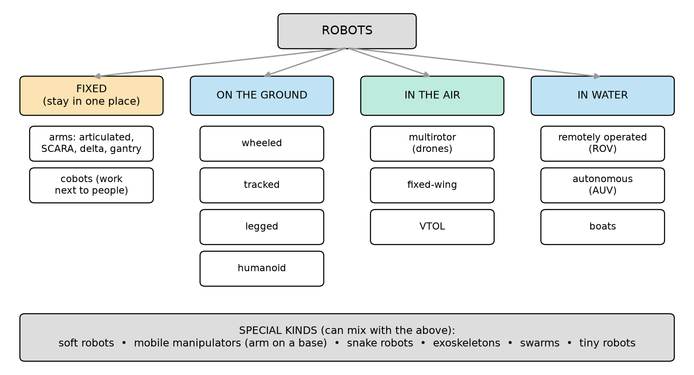
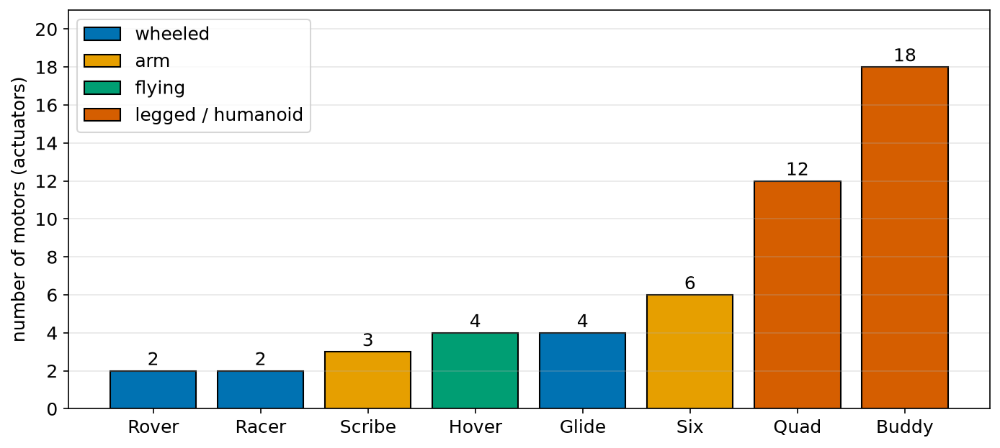
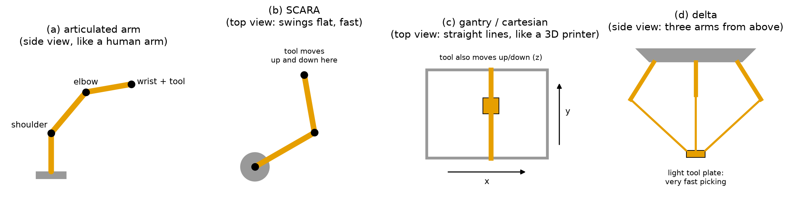
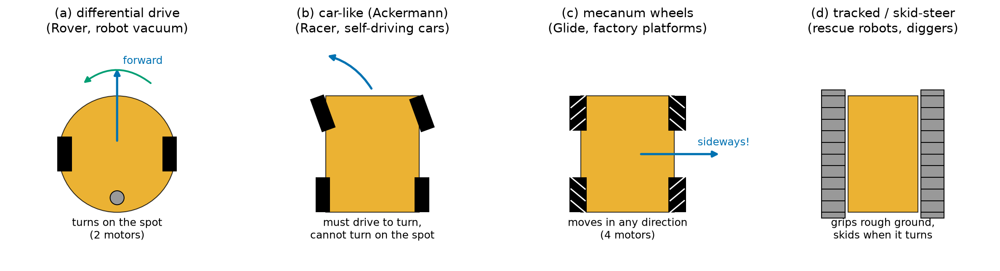
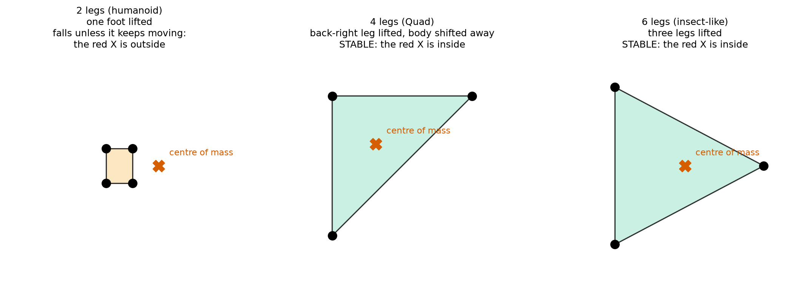
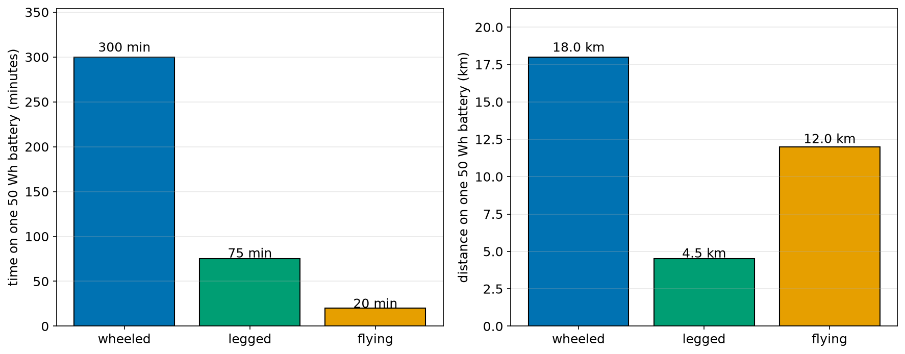
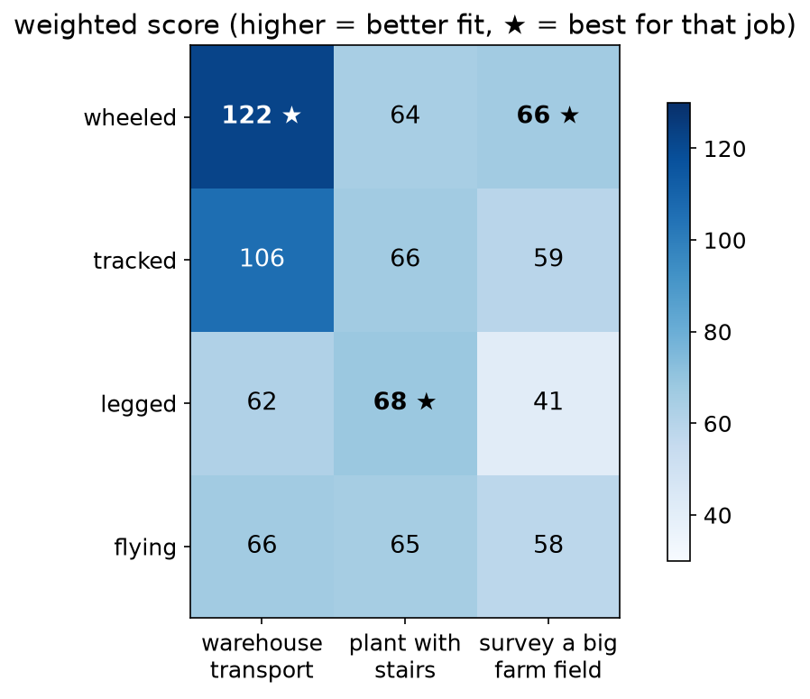

# Chapter 4 — Kinds of Robots

> **Part 1 · Chapter 4 of 749**
> **You need:** Chapters 1–3 (the sense–think–act loop and the robot test).
> **You will make:** a robot "family tree" in your notebook, a robot-choosing score sheet for a real job, and a "spot the robot kind" list from videos or pictures.

---

## What you will learn

- The big families of robots: **fixed arms**, **ground robots** (wheeled, tracked, legged, humanoid), **flying robots**, **underwater robots**, and some **special kinds** (soft, snake, swarms, exoskeletons, mobile manipulators).
- For each kind: how it **senses**, **thinks** and **acts**, what it is **good** at, what is **hard** for it, and where **you** build one in this course.
- A first look at **degrees of freedom**: how many separate ways a robot can move.
- Why the **same battery** gives very different times and distances for wheels, legs and propellers.
- How engineers **choose** a kind of robot for a job, using a simple score table.

---

## New words in this chapter

| Word | Simple meaning |
|---|---|
| **base** | The part of a robot that stays still (for an arm) or carries everything (for a mobile robot). |
| **link** | A stiff part of an arm, like a bone. |
| **joint** | A place where two links meet and can move, like an elbow. |
| **end effector** | The tool at the end of an arm: a gripper, a welding torch, a suction cup. |
| **degree of freedom (DOF)** | One separate way to move. A door has 1 DOF (it swings). A robot arm often has 6. |
| **mobile robot** | A robot that moves itself from place to place. |
| **manipulator** | A robot arm (a robot that handles things). |
| **cobot** | A "collaborative robot": an arm made to work safely next to people. |
| **multirotor** | A flying robot with several propellers, like a quadcopter (4 propellers). |
| **tether** | A cable that connects a robot to its base station, for power and data. |
| **centre of mass** | The point where the whole weight of an object seems to act. (Chapter 70.) |
| **support polygon** | The shape on the ground made by joining all the points (feet, wheels) that touch the ground. |

---

## 4.1 The robot family

Robots come in many shapes. A factory arm, a robot vacuum, a drone and a walking humanoid look very different. But all of them pass the robot test from Chapter 2: they **sense**, **think**, **act by moving**, and **loop**.

The easiest way to sort them is to ask: **where does the robot work, and how does it move?** Look at Figure 4.1.



*Figure 4.1 — The robot family, sorted by where robots work: fixed in one place, on the ground, in the air, or in water. Some special kinds mix with these.*

**How to read this picture:** Start at the top box (ROBOTS). The arrows lead to four big groups. Under each group, the white boxes are the main kinds in that group. The grey box at the bottom lists special kinds that can be combined with the others. For example, a "mobile manipulator" is an arm (fixed group) on a wheeled base (ground group).

The table below shows where you meet each kind in this course.

| Kind | Example robots | In this course |
|---|---|---|
| Fixed arm | factory arms, cobots | Scribe, Six (Parts 17–20) |
| Wheeled | robot vacuums, warehouse robots, self-driving cars | Rover, Racer, Glide, Balancer (Part 15) |
| Tracked | rescue and bomb-disposal robots | Chapter 309 |
| Legged | four-legged inspection robots | Quad, Walker (Part 31) |
| Humanoid | two-legged human-shaped robots | Buddy, Hero (Part 32) |
| Flying | camera drones, delivery drones | Hover (Part 30) |
| Underwater | inspection and research vehicles | applications throughout the course |
| Special | soft grippers, swarms, mobile manipulators | Chapters 368, 740–742, Fetch |

We now look at each kind, one by one.

---

## 4.2 Degrees of freedom: counting the ways to move

Before we look at the kinds, we need one important idea.

📖 **New word: degree of freedom (DOF)** — one separate way to move.

Some everyday examples:

| Object | How it can move | DOF |
|---|---|---|
| A door | swings around its hinges | **1** |
| A drawer | slides in and out | **1** |
| A light switch | up or down (only two positions, but still one way of moving) | **1** |
| A ball on the floor (seen from above) | east–west, north–south, and it can turn | **3** |
| Your arm, from the shoulder to the wrist | shoulder: 3 ways (forward–back, sideways, twist); elbow: 1 way; wrist: 3 ways | about **7** |
| A box flying in the air | 3 ways to move (up–down, left–right, forward–back) and 3 ways to turn | **6** |

Two simple rules will help you a lot:

1. **An object floating freely in space has 6 DOF**: 3 for its **position** (where it is) and 3 for its **orientation** (which way it faces). A drone in the air has these 6.
2. **An object sliding on a flat floor has 3 DOF**: 2 for its position (x and y) and 1 for its heading (which way it faces). Rover on the floor has these 3.

🔢 **Maths** — a robot arm with joints in a chain: each simple joint (one that turns, like an elbow, or slides, like a drawer) adds **1 DOF**.

```
An arm with 6 turning joints:   DOF = 1 + 1 + 1 + 1 + 1 + 1 = 6
```

Why do factory arms usually have **6** joints? Because the tool must reach any **position** (3 DOF) **and** point in any **direction** (3 DOF): 3 + 3 = 6. With fewer joints, there are some positions or directions the tool cannot reach. Chapter 334 (Grübler's formula) counts DOF for more complex machines.

### Motors in the robots you will build

Each moving joint or wheel usually needs its own **motor** (actuator). So the number of motors tells you a lot about how complex a robot is. Look at Figure 4.7.



*Figure 4.7 — The number of motors in eight robots you build in this course, coloured by kind.*

**How to read this picture:** Each bar is one robot from `ROBOTS.md`. The height (and the number on top) is how many motors it has. The colour shows the kind: blue for wheeled, light orange for arms, green for flying, dark orange for legged and humanoid robots.

- **Rover** has 2 motors (one per wheel) but moves with 3 DOF on the floor (x, y, heading). It cannot control all 3 directly: it cannot slide sideways. We come back to this in Chapter 284.
- **Racer** also has 2: one to drive, one to steer.
- **Glide** has 4, one per mecanum wheel, and **can** control all 3 floor DOF directly.
- **Hover** has 4, one per propeller, and moves with 6 DOF in the air.
- **Quad** (12) and **Buddy** (18) have many more: legs need several joints each. More motors means more freedom, but also more weight, more power, more cost and more control work.

🧠 **Remember:** Degrees of freedom = how many separate ways something can move. Free in space: 6. On a flat floor: 3. A chain of simple joints: one per joint.

---

## 4.3 Fixed robot arms

📖 **New words:** **link** (a stiff part, like a bone), **joint** (where two links meet and move, like an elbow), **end effector** (the tool at the end).

A fixed arm is bolted to a table, a floor or a ceiling. It does not travel; it **reaches**. There are four common shapes. Look at Figure 4.2.



*Figure 4.2 — Four common kinds of robot arm, drawn very simply. Orange bars are links, black dots are joints, grey parts are fixed.*

**How to read this picture:** There are four small drawings. (a) is seen from the side; (b) and (c) are seen from above; (d) is seen from the side. In each, the grey part does not move, the orange parts move, and the black dots are joints. The text under each title says what the arm is good at.

| Kind | How it moves | Good at | Typical uses |
|---|---|---|---|
| **(a) Articulated arm** | a chain of turning joints, like a human arm; usually 6 joints | reaching almost anywhere around it, at any angle | welding, painting, handling parts, car factories |
| **(b) SCARA** | two links swing flat like an elbow on a table, plus an up–down slide at the end; usually 4 DOF | very fast, accurate work on a flat table | putting parts on circuit boards, assembling small things |
| **(c) Gantry (cartesian)** | slides along straight rails: x, y and z | big work areas, simple maths, very stiff | 3D printers, CNC machines, large pick-and-place |
| **(d) Delta** | three light arms from above join at a small tool plate | extremely fast picking of light objects | packing food, sorting small items |

### How a fixed arm senses, thinks and acts

- **Sense:** every joint has an **encoder** that measures its angle (Chapter 122). Many arms also have cameras to find parts, and **force sensors** to feel how hard they push.
- **Think:** the controller turns "put the tool here" into "turn each joint to these angles". This is called **inverse kinematics** (Part 18). It also plans smooth motions (Part 20).
- **Act:** an electric motor with a gearbox at each joint (Part 8).

### Cobots

📖 **New word: cobot** — a collaborative robot: an arm designed to work **next to people**, without a safety fence.

Older factory arms are fast and strong, and they work inside cages, because they can hurt a person badly. Cobots are lighter and slower, and they have sensors that feel an unexpected touch. When a cobot bumps into a person, it **stops** (or moves back) within a fraction of a second. You can often teach a cobot by holding its arm and guiding it by hand. Chapters 390 and 743 come back to cobots.

### Strengths and weaknesses

- ✅ Very **accurate** and **repeatable**: a factory arm can return to the same point to within a fraction of a millimetre, millions of times.
- ✅ The world around it is **known and controlled**: parts arrive in the same place every time.
- ❌ It cannot **travel**: it can only work within reach.
- ❌ It is usually **blind to surprises**, unless it has extra sensors.

🤖 **Robot link:** You build **Scribe**, a 3-servo arm that draws (Chapters 348–349), and **Six**, a six-axis arm in simulation (Chapter 370). Look back at Figure 4.2(a): Scribe is a small articulated arm.

---

## 4.4 Wheeled robots

📖 **New word: mobile robot** — a robot that moves itself from place to place.

Wheels are the most common way for a robot to move on the ground. They are **simple**, **cheap**, **efficient** and **fast** on flat ground. Look at Figure 4.3: there are several ways to arrange wheels.



*Figure 4.3 — Four ways to build a ground robot, seen from above. The orange shape is the body, black rectangles are wheels, grey bands are tracks. Blue arrows show a typical motion; the green arrow shows turning on the spot.*

**How to read this picture:** Each drawing is a robot seen from above, with the front at the top. (a) has two driven wheels and a small free wheel (grey circle) at the back. (b) has four wheels; the front two are turned for steering. (c) has four special wheels with rollers (white lines). (d) has two tracks. The text under each drawing gives the main feature.

### (a) Differential drive

Two wheels, each with its own motor, on the left and right. A small free wheel (a **caster**) keeps the robot from tipping.

- Both wheels forward at the same speed → **straight**.
- Left wheel faster than right → **turns right**.
- Left wheel forward, right wheel backward → **turns on the spot**.

It is the simplest robot base. Robot vacuums and many warehouse robots use it. **Rover**, your main robot, is a differential-drive robot (Chapter 285).

🔢 **Maths** — a first taste. Rover's wheels are 0.15 m apart. The left wheel moves at 0.20 m/s, the right wheel at 0.10 m/s.

```
forward speed = (left + right) ÷ 2 = (0.20 + 0.10) ÷ 2 = 0.15 m/s
```

In words: "the robot's centre moves at the **average** of the two wheel speeds". The **difference** (0.10 m/s) makes it turn to the right. (How fast it turns: Chapter 285.)

### (b) Car-like (Ackermann steering)

Four wheels, like a car: the back wheels drive, the front wheels turn to steer. It is very **stable** at high speed, and it is the shape of every self-driving car.

But it **cannot turn on the spot** and **cannot move sideways**. To turn around in a narrow street, it needs a three-point turn. Parking it needs planning (Chapter 476). You build **Racer**, a car-like robot (Chapters 301–305).

### (c) Mecanum (and omni) wheels

Each wheel has small rollers around its edge, set at an angle. By turning the four wheels in different combinations, the robot can drive **forward**, **sideways**, **diagonally**, and turn, all at the same time. On a flat floor it uses all **3 DOF** (x, y and heading) directly.

It is used for moving heavy parts in factories, where moving sideways into a tight space is very useful. It needs **smooth floors** (the small rollers do not like bumps) and 4 motors. You build **Glide** in simulation (Chapters 307–308).

### (d) Tracked and skid-steer

Two tracks (like a tank or a digger), or four wheels that cannot steer. To turn, the left and right sides run at different speeds, and the tracks **skid** sideways on the ground.

Tracks spread the weight and **grip** mud, sand, snow, rubble and stairs much better than wheels. But skidding wastes energy and wears the ground and the tracks. Rescue robots and bomb-disposal robots are often tracked (Chapter 309).

### How a wheeled robot senses, thinks and acts

- **Sense:** wheel **encoders** (how far each wheel turned), an **IMU** (turning and tilting), distance sensors or a **LiDAR** (walls and obstacles), cameras, and outdoors **GPS**.
- **Think:** where am I (**localization**, Parts 21–22), where should I go (**planning**, Part 23), how should each wheel turn (**control**, Parts 12–15).
- **Act:** usually electric DC motors with gearboxes (Part 8).

### Strengths and weaknesses

- ✅ **Efficient**: a rolling wheel loses very little energy on a hard floor.
- ✅ **Simple** to build and control. A good first robot.
- ✅ **Stable**: with 3 or more wheels on the ground, it does not fall over when it stops.
- ❌ **Stairs and big steps** stop most wheeled robots.
- ❌ **Soft or rough ground** (sand, mud, tall grass) can trap small wheels.

---

## 4.5 Legged robots

Why would anyone build a robot with legs? Legs are complex, need many motors, and fall over. The answer: **legs go where wheels cannot**. Stairs, rocks, ladders, rubble, forest floors. A leg only needs a few good **footholds**; a wheel needs a continuous path.

### Static and dynamic balance

To understand legged robots, we need two ideas.

📖 **New word: centre of mass** — the point where the whole weight of the robot seems to act. If you could hold the robot up with one finger at exactly the right point, that point is (above) the centre of mass. Chapter 70 explains how to find it.

📖 **New word: support polygon** — join all the points that touch the ground (feet or wheels) with straight lines, around the outside. The shape you get is the support polygon.

The rule for standing still without falling:

> **A robot standing still is stable if its centre of mass is above the inside of its support polygon.**

Look at Figure 4.4.



*Figure 4.4 — Support polygons seen from above. Black dots are feet on the ground, the coloured shape is the support polygon, the red X is the point under the centre of mass. Green means stable when standing still; orange means it would fall if it stopped.*

**How to read this picture:** Each panel is a robot seen from above, at one moment in its walk. The black dots are the feet that touch the ground at that moment. The shape joining them is the support polygon. The red X shows where the centre of mass is, seen from above. If the red X is inside the shape (green), the robot can stand still in that pose. If it is outside (orange), the robot will tip over unless it keeps moving.

- **Six legs (right):** an insect-like robot lifts three legs at a time and stands on the other three, which make a big triangle. The centre of mass is easily inside it. Very stable, even when walking slowly. But six legs means many motors (often 18).
- **Four legs (middle):** when one leg is lifted, three feet make a triangle. The robot first **shifts its body** away from the leg it will lift, so that the centre of mass is inside the triangle. Then it lifts the leg safely. This is **static walking**: slow, but it never falls (Chapter 671). Faster gaits, like a trot (two legs at a time), need dynamic balance.
- **Two legs (left):** when one foot is lifted, the support polygon is only **one foot**: a small rectangle. Most of the time, the centre of mass is **not** above it. A walking human (or humanoid) is always **falling a little and catching itself** with the next step. This is **dynamic balance**: it only works while moving, with fast, careful control (Part 32).

### How a legged robot senses, thinks and acts

- **Sense:** joint encoders (where each leg is), an **IMU** (is the body tilting? falling?), **foot contact** sensors (is this foot on the ground?), cameras or LiDAR to see the ground ahead.
- **Think:** where to put each foot, how to move the body to keep balance, how hard to push. Modern legged robots often use **model predictive control** (Chapter 270 onwards) or **learned** controllers (Part 25).
- **Act:** many motors: usually 3 per leg (12 for four legs). Leg motors must be strong, fast and able to absorb landing shocks (Chapter 668).

### Strengths and weaknesses

- ✅ **Rough ground**, **stairs**, **gaps**: legs step over things.
- ✅ Can carry sensors to places built for people and animals.
- ❌ **Complex**: many motors, many sensors, hard control.
- ❌ **Energy-hungry**: legs lift and lower the body all the time (Section 4.10).
- ❌ Can **fall**, and must get up again.

🤖 **Robot link:** You build **Quad**, a 12-servo four-legged robot (Chapters 688–690), and you teach **Walker** to walk by itself with reinforcement learning (Chapters 594 and 687).

---

## 4.6 Humanoid robots

A **humanoid** is a robot with a human-like shape: two legs, a body, two arms, often hands and a head with cameras.

Why build a robot in our shape? Not because it is the easiest shape (it is one of the hardest!), but because **our world is built for human bodies**:

- Stairs, doors, door handles, ladders and car seats are sized for people.
- Tools (screwdrivers, boxes, shopping trolleys) are made for human hands.
- A humanoid could, in principle, work anywhere a person works, **without changing the building**.

### How a humanoid senses, thinks and acts

- **Sense:** many joint encoders, an **IMU** in the body, **force sensors** in the feet (to measure where the weight presses on each foot), cameras in the head, sometimes touch sensors in the hands, and microphones.
- **Think:** everything a legged robot thinks about (balance, where to step) **plus** using two arms and hands, plus understanding people. It is one of the hardest thinking problems in robotics.
- **Act:** many motors. A full-size humanoid often has **about 30** joints; a dexterous hand alone can have 20 or more.

### Strengths and weaknesses

- ✅ Fits human spaces and human tools.
- ✅ People understand its movements (they can guess what it will do).
- ❌ The **hardest** robot to build and control: balance on two small feet, many joints, high cost.
- ❌ Falls are dangerous, both for the robot and for people nearby.

🤖 **Robot link:** Part 32 (48 chapters) is all about humanoids. You build **Buddy**, a small real humanoid with 18 servos, and **Hero**, a full-size humanoid in simulation that learns to walk.

---

## 4.7 Flying robots

Flying robots (often called **drones**) can go where ground robots cannot: over buildings, rivers, fields and forests. They see the world **from above**.

📖 **New word: multirotor** — a flying robot with several propellers. A **quadcopter** has 4.

| Kind | How it flies | Good at | Weak at |
|---|---|---|---|
| **Multirotor** (quadcopter, hexacopter) | propellers push air down; changing the speed of each propeller tilts and steers it | hovering in one place, taking off and landing anywhere, flying slowly and precisely | **short flight time**: it must hold its whole weight up with propellers all the time |
| **Fixed-wing** (like a small aeroplane) | the wings make lift when air flows over them; a propeller pushes it forward | **long, fast flights** with little energy; covering large areas | needs a runway or a launcher; cannot hover |
| **Helicopter** | one big rotor for lift, a small tail rotor to stop it spinning | hovering, carrying more weight than a small multirotor | mechanically complex |
| **VTOL** (vertical take-off and landing) | takes off like a multirotor, then flies like a fixed-wing | the best of both: no runway, long range | complex, expensive |

### How a drone senses, thinks and acts

- **Sense:** an **IMU** (tilt and turning, read very fast), a **barometer** (air pressure → height), a **magnetometer** (compass), **GPS** outdoors, and sometimes cameras, optical-flow sensors and distance sensors (Chapter 630).
- **Think:** the fastest loops in this course. The tilt loop runs **thousands of times per second** (Chapter 2). Above it, slower loops control height, position and the route.
- **Act:** **brushless motors** spinning propellers (Chapter 146). A multirotor has no steering surfaces: it steers only by changing the speeds of its propellers (Chapter 624).

### Strengths and weaknesses

- ✅ Goes **anywhere** above the ground, fast.
- ✅ Sees large areas **from above**.
- ❌ **Short flight time** (often 15–40 minutes for small multirotors).
- ❌ Carries **little weight**.
- ❌ **Wind**, **rain** and **rules** (where you are allowed to fly) limit it.
- ❌ A falling drone can hurt people (Chapter 615: safety and the law).

🤖 **Robot link:** Part 30 (53 chapters) is about drones. You build **Hover**: first your own flight controller on a test stand, then a full drone that flies missions by itself.

---

## 4.8 Underwater and marine robots

About 70% of the Earth's surface is covered by water. Much of the deep sea is still unexplored, because it is dark, cold, and the water pressure is enormous. Robots go there instead of people.

| Kind | What it is | Uses |
|---|---|---|
| **ROV** (remotely operated vehicle) | an underwater robot connected to a ship by a **tether** (a cable for power and data); a person drives it, often helped by robot loops that hold depth and heading | inspecting oil platforms, pipelines and ship hulls; deep-sea research; repairs |
| **AUV** (autonomous underwater vehicle) | an underwater robot with **no cable**; it follows a planned mission by itself and comes back | mapping the sea floor; measuring the water; searching for wrecks |
| **Autonomous boats** | robot boats on the surface | measuring the sea, mapping harbours, carrying sensors for weeks |

📖 **New word: tether** — a cable that connects a robot to a base (a ship, a person), carrying power and data.

### Why underwater robots are special

Water changes the sense–think–act loop in big ways:

- **No GPS.** Radio waves do not travel far in water. An underwater robot cannot use GPS below the surface. It must estimate where it is from its speed, its heading and its depth (a kind of odometry, Part 15), corrected by **sound** signals from beacons (Part 21 shows how such estimates are combined).
- **Slow, weak communication.** Without a tether, an AUV talks with **sound** (acoustic signals), which is slow and carries only small messages. So it **must** be autonomous, like a Mars rover (Chapter 2).
- **Darkness.** Cameras need lights and see only a few metres in cloudy water. **Sonar** (sound echoes) is used to "see" farther.
- **Pressure and leaks.** Every 10 m of depth adds about one more atmosphere of pressure. At 1,000 m, the water pushes on every square centimetre about 100 times harder than air at the surface. The robot body must be very strong and fully sealed.
- **Currents.** Moving water pushes the robot off its path, so its control loops must keep correcting.

There is no separate part about underwater robots in this course, but every idea you learn applies to them: sensing (Part 7), control (Parts 12–14), estimation without GPS (Part 21), mapping (Part 22) and planning (Part 23). Underwater examples appear in the 🌊 applications all through the course.

---

## 4.9 Special kinds of robots

Some robots do not fit neatly into one box. They often **combine** kinds, or use new materials.

### Mobile manipulators

An **arm on a moving base**: for example, a wheeled robot with a robot arm on top. It can travel **and** handle objects: fetch a box from a shelf, open a door, load a machine. Warehouses, hospitals and research labs use them. In this course, **Fetch** is Rover carrying Scribe (Chapters 368 and 749).

### Soft robots

Most robots are made of hard metal and plastic. **Soft robots** are made of soft materials like silicone rubber. Many are moved by **air**: when air is pumped into a soft chamber, it bends, like a finger.

- ✅ Soft grippers can pick up **delicate** things without crushing them: fruit, eggs, cakes, living creatures in the sea.
- ✅ Soft robots are naturally **safer** when they touch people.
- ❌ They are harder to model and control exactly, because their shape changes in complex ways.

Chapter 740 is about soft robots.

### Snake robots

A long chain of many small joints. They can crawl through **pipes**, **rubble** and narrow gaps where no other robot fits, for example to inspect the inside of a machine or to search for survivors after an earthquake.

### Exoskeletons

A robot that a **person wears**: motors at the hips and knees (or shoulders and elbows) that help the person's own movements. Uses: helping people who cannot walk well to walk again (🏥 rehabilitation), and helping workers lift heavy things without hurting their backs (🏭). Exoskeletons use the same balance and joint-control ideas as humanoids (Parts 19 and 32).

### Swarms

Many small, simple robots that work **together**, like ants or bees. No single robot is very clever, but together they can cover a big area, search, or build something. If one robot breaks, the others continue. Chapters 741–742 build a swarm in simulation.

### Tiny robots

Robots smaller than a coin, or even smaller, are a research area. Their actuators and sensors are very different (for example, moved by magnetic fields from outside). This course does not go into them, but the sense–think–act loop still applies.

---

## 4.10 Same battery, very different robots

Every mobile robot carries its energy with it, usually in a battery. How long it can work, and how far it can go, depends very much on **how** it moves. Let us compare three kinds of robot of about the **same size** (about 1 kg), each with the **same battery**.

📖 **New words:**
- **power** — how fast energy is used. Measured in **watts (W)**.
- **watt-hour (Wh)** — an amount of energy: the energy used by 1 W for 1 hour. Batteries are often labelled in Wh. (Power and energy are explained fully in Chapter 67.)

The rule we need:

```
time (hours) = battery energy (Wh) ÷ power (W)
```

In words: "the time a battery lasts equals the energy stored in it divided by the power the robot uses".

These are **example values** for robots of about 1 kg. They are typical sizes, chosen to show the idea; real robots differ a lot.

| Kind | Power while moving | Speed |
|---|---|---|
| wheeled | 10 W | 1.0 m/s |
| legged | 40 W | 1.0 m/s |
| flying (multirotor) | 150 W | 10 m/s |

Why so different?
- A **wheel** rolls. On a hard floor, almost no energy is lost.
- A **leg** lifts and lowers the body at each step, and its motors must hold the robot up even when standing still.
- A **multirotor** must push enough air down **every second** to hold its full weight in the air. If the propellers stop, it falls.

🔢 **Maths** — the **wheeled** robot with a 50 Wh battery:

```
Step 1. Time        = 50 ÷ 10           = 5 hours   = 300 minutes
Step 2. In seconds  = 5 × 3600          = 18,000 s
Step 3. Distance    = 1.0 × 18,000      = 18,000 m  = 18 km     (d = v × t)
```

The **flying** robot:

```
Step 1. Time        = 50 ÷ 150          = 0.333 hours = 20 minutes
Step 2. In seconds  = 0.333 × 3600      = 1,200 s
Step 3. Distance    = 10 × 1,200        = 12,000 m  = 12 km
```

Look at Figure 4.5.



*Figure 4.5 — How long (left) and how far (right) three kinds of 1 kg robot can go on the same 50 Wh battery, using the example values in the table.*

**How to read this picture:** There are two bar charts. The left one shows the working time in minutes. The right one shows the distance in kilometres. In each chart, there is one bar for each kind of robot: wheeled (blue), legged (green), flying (orange). The number above each bar is its value.

What do we learn?
- The **wheeled** robot works **15 times longer** than the flying one (300 ÷ 20 = 15).
- But the flying robot is **10 times faster**, so its **distance** (12 km) is not so far behind the wheeled robot's (18 km). It gets there **quickly**, but cannot stay long.
- The **legged** robot is the slowest **and** uses much more power than wheels: on a flat floor it loses on both. Legs are worth it only where wheels **cannot go**.

🧠 **Remember:** Wheels are the most efficient on good ground. Legs pay energy to go anywhere on the ground. Multirotors pay a lot of energy to go anywhere, fast, but not for long.

---

## Code

This program does the calculation from Section 4.10 for all three kinds of robot at once. You still read it with the table; from Chapter 8 you will type and run programs yourself.

The file is `code/ch004/robot_range.py`.

```python
# robot_range.py - how long and how far can different kinds of robot go on the same battery?
battery = 50                     # battery energy in watt-hours (Wh)

kinds = ["wheeled", "legged", "flying"]
power = [10, 40, 150]            # watts used while moving (example values for a robot of about 1 kg)
speed = [1.0, 1.0, 10.0]         # metres per second while moving

for i in range(3):
    hours = battery / power[i]                 # time = energy / power
    seconds = hours * 3600                     # 1 hour = 3600 seconds
    distance_km = speed[i] * seconds / 1000    # d = v x t, then metres -> kilometres
    print(kinds[i], "| time:", round(hours * 60), "minutes | distance:", round(distance_km, 1), "km")
```

| Line | Code | What it does (simple English) |
|---|---|---|
| 1 | `# robot_range.py - …` | A comment: the name and the question the program answers. |
| 2 | `battery = 50` | The battery stores 50 Wh of energy. All three robots get the same battery. |
| 3 | *(empty)* | Separates the battery from the robot data. |
| 4 | `kinds = ["wheeled", "legged", "flying"]` | A **list** of three names (Chapter 21). Item 0 is "wheeled", item 1 "legged", item 2 "flying". |
| 5 | `power = [10, 40, 150]` | The power of each kind, in the same order: wheeled 10 W, legged 40 W, flying 150 W. |
| 6 | `speed = [1.0, 1.0, 10.0]` | The speed of each kind, in the same order. |
| 7 | *(empty)* | Separates the data from the calculation. |
| 8 | `for i in range(3):` | Repeat 3 times, with `i` = 0, 1, 2: once for each kind. |
| 9 | `hours = battery / power[i]` | Step 1: time in hours = energy ÷ power. For `i` = 0: 50 ÷ 10 = 5. |
| 10 | `seconds = hours * 3600` | Step 2: change hours to seconds (1 hour = 60 × 60 = 3600 s). |
| 11 | `distance_km = speed[i] * seconds / 1000` | Step 3: distance = speed × time (in metres), then ÷ 1000 to get kilometres. |
| 12 | `print(kinds[i], "| time:", …)` | Shows the name, the time in minutes (hours × 60, rounded to a whole number) and the distance in km (rounded to 1 decimal). |

**Output:**

```
wheeled | time: 300 minutes | distance: 18.0 km
legged | time: 75 minutes | distance: 4.5 km
flying | time: 20 minutes | distance: 12.0 km
```

**What the output means:** The program gives the same numbers as our hand calculation in Section 4.10, and Figure 4.5 draws them. Check the legged line yourself: 50 ÷ 40 = 1.25 hours = 75 minutes; 1.25 × 3600 = 4,500 s; 1.0 × 4,500 = 4,500 m = 4.5 km. ✔

💡 **Tip:** Notice how the program keeps the data (lines 2–6) **separate** from the calculation (lines 8–12). To compare a fourth kind of robot, you only add one more item to each list and change `range(3)` to `range(4)`. Good programs are easy to change.

---

## Small examples

### Example 1 — Counting DOF of a robot arm

A small arm has: a base that turns (1), a shoulder (1), an elbow (1), and a gripper that only opens and closes.

- The joints that move the gripper around: 1 + 1 + 1 = **3 DOF**.
- The gripper opening is usually **not counted** as a DOF of the arm, because it does not move the tool to a new place; it is a separate "hand" movement.
- With 3 DOF, the arm can reach points in 3D, but it **cannot** choose freely which way the tool points.

### Example 2 — Which way does Rover turn?

Left wheel 0.10 m/s, right wheel 0.20 m/s.

```
forward speed = (0.10 + 0.20) ÷ 2 = 0.15 m/s
```

The right wheel is faster, so the robot turns **left** (towards the slower wheel's side).

### Example 3 — Turning on the spot

Left wheel +0.10 m/s, right wheel −0.10 m/s (backwards).

```
forward speed = (0.10 + (−0.10)) ÷ 2 = 0 m/s
```

The centre does not move forward. The robot **spins on the spot** (to the right). A car-like robot cannot do this.

### Example 4 — Underwater pressure

Every 10 m of water adds about 1 atmosphere of pressure. At the surface the pressure is already 1 atmosphere (from the air).

```
At 200 m depth:  pressure ≈ 1 + 200 ÷ 10 = 1 + 20 = 21 atmospheres
```

The robot's body must survive about 21 times the normal air pressure.

### Example 5 — Drone flight time

A drone uses 120 W and carries a 40 Wh battery.

```
time = 40 ÷ 120 = 0.333 hours = 20 minutes
```

If the drone carries a camera that adds weight, it needs more power to stay up (say 150 W):

```
time = 40 ÷ 150 = 0.267 hours ≈ 16 minutes
```

Heavier → more power → shorter flight.

### Example 6 — Stable or not?

A four-legged robot stands on three feet at (−0.8, 0.8), (0.8, 0.8) and (−0.8, −0.8) (in metres, seen from above). Its centre of mass is above the point (0.5, −0.5).

- Draw it: the three feet make a triangle in the upper-left half of the square.
- The point (0.5, −0.5) is in the **lower-right** corner, outside the triangle.
- → **Not stable.** The robot tips towards its missing back-right leg. It must shift its body towards the upper-left before lifting that leg (Figure 4.4).

---

## 🏭 Real robot applications

Real engineers must choose the **right kind of robot** for each job. The first two applications are worked in full; the others are shorter.

### Application 1 (worked in full) — 🏭📦🌾 Choosing a kind of robot with a score table

**1. The real problem.** Three companies ask an engineer for help:
- **A warehouse** wants robots to carry boxes across a large flat floor, all day, near workers.
- **A chemical plant** wants a robot to walk around the plant every night, read gauges and check for leaks. The plant has stairs and metal grid floors.
- **A farm** wants to check the health of crops on a big field every week.

Which **kind** of robot fits each job best: wheeled, tracked, legged or flying?

**2. Why this method.** There is no single "best robot". Each kind is good at some things and bad at others (Sections 4.4–4.7). Engineers often use a **weighted score table**:
1. List the important **points** (for example "can climb stairs").
2. **Score** each kind on each point, from 1 (bad) to 5 (very good).
3. For each job, give each point a **weight** from 0 (does not matter) to 5 (very important).
4. For each kind: multiply each score by its weight, and **add** everything up. The highest total fits the job best.

**3. The numbers.** Our scores (from Sections 4.4–4.7):

| Kind | flat floor | stairs | rough ground | speed | working time | cheap | carry load | safe near people |
|---|---|---|---|---|---|---|---|---|
| wheeled | 5 | 1 | 2 | 4 | 5 | 5 | 4 | 5 |
| tracked | 4 | 2 | 4 | 3 | 4 | 4 | 5 | 4 |
| legged | 4 | 5 | 5 | 2 | 2 | 1 | 2 | 3 |
| flying | 5 | 5 | 5 | 5 | 1 | 3 | 1 | 1 |

(Flying robots get 5 for "stairs" and "rough ground" because they fly over them. They get 1 for "safe near people", because a falling drone or a spinning propeller is dangerous indoors.)

The weights for each job:

| Job | flat | stairs | rough | speed | time | cheap | load | safe |
|---|---|---|---|---|---|---|---|---|
| warehouse transport | 5 | 0 | 0 | 3 | 5 | 4 | 5 | 4 |
| plant with stairs | 2 | 5 | 3 | 1 | 3 | 1 | 1 | 3 |
| survey a big farm field | 1 | 0 | 3 | 5 | 3 | 3 | 0 | 1 |

**4. The maths, step by step** — the **wheeled** robot for the **warehouse**:

```
flat:   5 × 5 = 25
stairs: 1 × 0 =  0
rough:  2 × 0 =  0
speed:  4 × 3 = 12
time:   5 × 5 = 25
cheap:  5 × 4 = 20
load:   4 × 5 = 20
safe:   5 × 4 = 20
total = 25 + 0 + 0 + 12 + 25 + 20 + 20 + 20 = 122
```

The **legged** robot for the **warehouse**:

```
4×5 + 5×0 + 5×0 + 2×3 + 2×5 + 1×4 + 2×5 + 3×4
= 20 + 0 + 0 + 6 + 10 + 4 + 10 + 12 = 62
```

Wheeled (122) beats legged (62) by far for the warehouse. That makes sense: a flat floor, long shifts and heavy boxes are exactly what wheels are good at.

**5. The code.** File `code/ch004/choose_robot.py`:

```python
# choose_robot.py - which kind of robot fits a job best? (a weighted score)
kinds = ["wheeled", "tracked", "legged", "flying"]

# How good each kind is (1 = bad, 5 = very good) at:
#          flat  stairs rough speed  time  cheap  load  safe near people
scores = [[5,    1,     2,    4,     5,    5,     4,    5],    # wheeled
          [4,    2,     4,    3,     4,    4,     5,    4],    # tracked
          [4,    5,     5,    2,     2,    1,     2,    3],    # legged
          [5,    5,     5,    5,     1,    3,     1,    1]]    # flying

# How important each point is for the job (0 = not at all, 5 = very important)
jobs = [["warehouse transport",     [5, 0, 0, 3, 5, 4, 5, 4]],
        ["plant with stairs",       [2, 5, 3, 1, 3, 1, 1, 3]],
        ["survey a big farm field", [1, 0, 3, 5, 3, 3, 0, 1]]]

for job in jobs:
    name = job[0]
    weights = job[1]
    print("Job:", name)
    for k in range(4):
        total = 0
        for c in range(8):
            total = total + scores[k][c] * weights[c]
        print("   ", kinds[k], total)
```

| Line | Code | What it does (simple English) |
|---|---|---|
| 1 | `# choose_robot.py - …` | A comment: the name and the question. |
| 2 | `kinds = [...]` | The four kinds of robot, in a fixed order. |
| 3 | *(empty)* | |
| 4–5 | `# How good …` / `# flat stairs …` | Comments that explain the table below and name its 8 columns. |
| 6–9 | `scores = [[5, 1, …], …]` | A **list of lists**: a table with 4 rows (one per kind) and 8 columns (one per point). `scores[0]` is the wheeled row; `scores[0][1]` is the wheeled score for stairs (1). Lists inside lists are explained in Chapter 21. |
| 10 | *(empty)* | |
| 11 | `# How important …` | A comment for the weights. |
| 12–14 | `jobs = [["warehouse transport", [5, 0, …]], …]` | Three jobs. Each job is a list of two things: its **name**, and its **8 weights**. |
| 15 | *(empty)* | |
| 16 | `for job in jobs:` | Repeat once for each job. |
| 17 | `name = job[0]` | Item 0 of the job: its name. |
| 18 | `weights = job[1]` | Item 1 of the job: its list of 8 weights. |
| 19 | `print("Job:", name)` | Shows which job we are scoring. |
| 20 | `for k in range(4):` | Inside: repeat for each of the 4 kinds (`k` = 0, 1, 2, 3). |
| 21 | `total = 0` | Start the total for this kind at 0. |
| 22 | `for c in range(8):` | Inside that: repeat for each of the 8 points (`c` = 0 to 7). This is a loop inside a loop inside a loop. |
| 23 | `total = total + scores[k][c] * weights[c]` | Multiply this kind's score for this point by the job's weight for this point, and add it to the total. This is one line of our step-by-step sum. |
| 24 | `print("   ", kinds[k], total)` | After all 8 points: show the kind and its total. The spaces at the start make the output indented. |

**Output:**

```
Job: warehouse transport
    wheeled 122
    tracked 106
    legged 62
    flying 66
Job: plant with stairs
    wheeled 64
    tracked 66
    legged 68
    flying 65
Job: survey a big farm field
    wheeled 66
    tracked 59
    legged 41
    flying 58
```

Figure 4.6 shows the same totals as a coloured table.



*Figure 4.6 — Weighted scores for four kinds of robot (rows) and three jobs (columns). Darker blue means a higher score; the star marks the best kind for each job.*

**How to read this picture:** Each row is a kind of robot, and each column is a job. The number in each square is the total score, and the colour shows the same number (darker = higher, see the colour bar on the right). The star ★ marks the highest score in each column.

**6. The result.** Read the three jobs carefully. Each teaches something different.

- **Warehouse → wheeled (122), clearly.** The scores are far apart. This is a clear decision.
- **Plant with stairs → legged (68), but only just.** Tracked (66), flying (65) and wheeled (64) are very close. When the scores are this close, the table is telling you: "**I cannot decide; look closer.**" An engineer would now ask more questions: How steep are the stairs? Are the grid floors safe for robot feet? Must it open doors? (In real plants, four-legged robots are used for exactly this job, because stairs and grid floors are a must.)
- **Farm field → wheeled (66)?!** This is a surprise. Many real farms use **drones** for crop surveys. What went wrong? Look at our list of points: we **forgot** the most important one for this job: **"can see the whole field from above"**. Let us add it as a 9th point, with scores wheeled 1, tracked 1, legged 1, flying 5, and weight 5 for the farm job:

```
wheeled: 66 + 1 × 5 = 71
flying:  58 + 5 × 5 = 83   → now flying wins
```

The lesson: **a score table is only as good as its list of points and its weights.** The computer added the numbers correctly; the mistake was in **our** list. Always check that the result makes sense. If it surprises you, ask: "what important point did I forget?"

**7. Going further.** Real engineering teams use the same method, often called a **decision matrix**, to choose motors, sensors, batteries and even whole robot designs. They often add a step where several people score independently, then compare, so that one person's opinion does not decide everything. In Chapter 150 you use a similar table to choose a motor.

### Application 2 (worked in full) — 🚁🌾 How much field can a drone survey on one battery?

**1. The real problem.** A farmer wants a multirotor drone to take pictures of a whole field. The camera sees a strip of ground **40 m wide** below the drone. The drone flies back and forth in straight lines, like mowing a lawn. How much field can it cover on one battery?

**2. Why this idea.** Section 4.10 gave us the flight time. Area covered = width of the strip × length flown. The length flown = speed × time (`d = v × t`).

**3. The numbers.**

| Fact | Value |
|---|---|
| Battery | 50 Wh |
| Power while flying | 150 W |
| Speed while taking pictures | 8 m/s (slower than its top speed, to get sharp pictures) |
| Strip width seen by the camera | 40 m |
| Safety: land with 25% of the battery left | use only 75% of 50 Wh |

**4. The maths, step by step.**

```
Step 1. Usable energy       = 0.75 × 50              = 37.5 Wh
Step 2. Flight time         = 37.5 ÷ 150             = 0.25 hours = 15 minutes = 900 s
Step 3. Length flown        = 8 × 900                = 7,200 m
Step 4. Area covered        = 40 × 7,200             = 288,000 m²
Step 5. In hectares         = 288,000 ÷ 10,000       = 28.8 hectares
```

(1 hectare = 10,000 m², a square 100 m × 100 m. A football pitch is a bit less than 1 hectare.)

**5. The code.** You can do this with the same pattern as `robot_range.py`. Try writing it in your notebook as a list of steps first; from Chapter 8 you will type it. (Practice task 9 asks you to do one version by hand.)

**6. The result.** One battery covers about **29 hectares**, a little less in practice, because the drone also flies to the field, turns at the end of each line, and climbs and lands. A 100-hectare farm needs about **4 batteries**, about 1 hour of flying. A wheeled robot driving through the same field at 1 m/s would take many hours, and would damage crops. This is why, for **looking** at large areas, drones are so popular in farming, even though their flight time is short. (This is also the missing 9th point from Application 1!)

**7. Going further.** Real survey drones plan their "lawn-mower" path automatically, overlap the strips (so the pictures can be joined), and fly lower for sharper pictures (which makes the strip narrower). Fixed-wing drones are used for very large farms, because they fly much longer on the same battery (Section 4.7). You will plan coverage paths and missions for Hover in Part 30.

### Application 3 — 🏭 Arms in a car factory

A car factory may have hundreds of **articulated arms** in a row. Each arm welds, glues or paints the same spots on every car body that arrives. They work in **cages**, because they are fast and strong. Some newer lines also use **cobots** for final assembly next to people, for example fitting small parts inside the car. The cars arrive at exactly the same place every time, so the arms can repeat stored motions with tiny errors. That is why fixed arms were the first robots to go to work (Chapter 3, the Unimate).

### Application 4 — 🔥 Tracked robots for rescue and bomb disposal

After an earthquake or a gas explosion, the ground is covered with rubble, broken stairs and holes. **Tracked** robots with cameras, lights and sometimes an arm are sent in first, driven by a person from a safe distance (teleoperation, Chapter 2). The tracks grip rubble and climb small steps. Bomb-disposal units use similar tracked robots with an arm to look at and move suspicious objects. Their small robot loops help the operator: for example, they keep the arm steady or stop the tracks if the robot starts to tip over.

### Application 5 — 🌊 An autonomous underwater vehicle maps the sea floor

An AUV, shaped like a torpedo, dives from a ship and follows a "lawn-mower" path above the sea floor for many hours, measuring the depth with **sonar**. It cannot use GPS, and it cannot be driven from the ship, so it is fully **autonomous**. It estimates its position from its speed through the water, its heading and its depth, and corrects the estimate with sound signals from beacons (the same kind of combining you learn in Part 21). When the mission ends, it comes up to the surface, gets a GPS fix, and sends a "come and pick me up" message by radio. The map it makes helps people lay cables, find wrecks and understand the sea.

---

## 🔧 Hands-on lab

### Lab 4.1 — Your robot family tree

**You need:** your notebook, coloured pencils.

**Steps:**

1. Copy Figure 4.1 into your notebook as a family tree (you may make it bigger).
2. Under each kind, write **one real example** you know (from TV, the internet, a museum, your city). If you do not know one, leave a gap and come back later.
3. Next to each kind, write two small signs: ✅ one thing it is good at, ❌ one thing that is hard for it.
4. Mark with a star ★ every kind that **you** will build in this course (use `ROBOTS.md` or the table in Section 4.1).

**What you should see:** A tree with all the kinds, examples, strengths and weaknesses, and about 8 stars.

### Lab 4.2 — Choose a robot for your own job (score table on paper)

**You need:** your notebook, a pencil. (Simulation track: you are the computer, as in Lab 2.2.)

**Steps:**

1. Think of a real job near you that a robot could do. Examples: deliver books inside a library; check the shelves in a supermarket at night; inspect the roof of a school; collect rubbish on a beach; carry water to plants in a greenhouse.
2. Copy the score table from Application 1 (4 kinds × 8 points).
3. **Add one or two points** that matter for your job (for example "works in sand", "can open doors", "sees from above"). Give each kind a score of 1–5 for your new points.
4. Choose your **weights** (0–5) for your job.
5. Calculate the 4 totals, step by step, like point 4 of Application 1.
6. Look at the result. Does it make sense? If not, ask: "Which important point did I forget? Which weight is wrong?" Change it, and calculate again.

**What you should see:** One kind with the highest total. If two totals are within a few points of each other, write "too close to decide — need more information", and write two questions you would ask.

**If it does not work:**

| Problem | Likely cause | Fix |
|---|---|---|
| "All totals are almost the same." | All weights are similar (everything is "important"). | Be honest: only 2 or 3 points should get a 5. |
| "The winner is clearly wrong." | A key point is missing (like "sees from above"). | Add the missing point. That is the lesson! |
| "Adding is slow." | Many numbers. | Do it row by row, and check one row with a friend. After Chapter 8 you can use `choose_robot.py`. |

**Challenge:** Give your table to a friend **without** your weights. Ask them to choose their own weights for the same job. Compare: do you choose the same kind of robot? If not, discuss why.

### Lab 4.3 — Spot the robot kind

**You need:** the internet or books, 30 minutes, your notebook.

**Steps:**

1. Find pictures or short videos of **10 different robots** (search words: "warehouse robot", "agricultural robot", "underwater ROV", "delta robot", "quadruped robot", "fixed-wing drone survey", "soft gripper", "snake robot", "exoskeleton", "mobile manipulator").
2. For each robot, fill one row:

| Robot | Kind (from Figure 4.1) | How many DOF / motors can you count? | Sense (2 sensors you can see or guess) | Act (how does it move?) |
|---|---|---|---|---|

3. For the wheeled ones, write which base from Figure 4.3 it uses.

**What you should see:** 10 robots in at least 5 different kinds.

**Challenge:** Find one robot that **combines** two kinds (for example legs with wheels at the end, or a drone with an arm). Why did its designers combine them?

---

## Common mistakes

⚠️ **"Humanoids are the best robots because they look like us."** They are the most flexible, but also the hardest and most expensive. For most jobs, a simpler kind is better.

⚠️ **"Drones can do everything wheels can, but faster."** They are fast, but their working time is short, they carry little, and they are risky near people.

⚠️ **"Legs are always better on the ground."** On flat floors, wheels are more efficient and much simpler. Legs are worth it only where wheels cannot go.

⚠️ **Counting the gripper as an arm DOF.** The gripper opening is usually counted separately. A "6-axis arm" has 6 joints that move the tool, plus a gripper.

⚠️ **Forgetting the environment.** The same robot can be perfect in a warehouse and useless on a farm. Always start with **where** and **what** the job is.

⚠️ **Trusting a score table blindly.** The computer adds correctly, but if your list of points or your weights are wrong, the answer is wrong (Application 1, farm job).

---

## Practice

🏋️ **1.** Name the four big groups of robots in Figure 4.1, and give one kind of robot in each group.

🏋️ **2.** How many degrees of freedom does each have? (a) a sliding door, (b) a robot vacuum on the floor, (c) a drone in the air, (d) an arm with 5 turning joints.

🏋️ **3.** Rover's left wheel moves at 0.30 m/s and its right wheel at 0.10 m/s. What is the forward speed of its centre? Which way does it turn?

🏋️ **4.** Why can a car-like robot not turn on the spot, while a differential-drive robot can?

🏋️ **5.** Give two reasons why underwater robots must often be autonomous.

🏋️ **6.** A legged robot uses 40 W and has an 80 Wh battery. How long can it walk? How far, at 0.8 m/s?

🏋️ **7.** In Application 1, calculate the total for the **flying** robot for the **warehouse** job, step by step. Check your answer with the program output.

🏋️ **8.** A four-legged robot is about to lift its **front-left** leg. Its other feet are at (0.8, 0.8) front-right, (−0.8, −0.8) back-left and (0.8, −0.8) back-right. Should it shift its body towards the front-left or towards the back-right before lifting the leg? Why?

🏋️ **9.** Repeat Application 2 with a fixed-wing drone: power 60 W, the same 50 Wh battery, 75% usable, speed 15 m/s, strip width 40 m. How many hectares can it cover?

🏋️ **10.** (Harder) In Application 1, change the weight of "safe near people" for the **plant with stairs** job from 3 to 0 (the robot works at night when nobody is there). Which kind wins now? Calculate the new totals for all four kinds. (Hint: each total changes by "safe score × 3".)

---

## Answers

**1.** **Fixed** (for example a factory arm, a SCARA, a cobot), **on the ground** (wheeled, tracked, legged, humanoid), **in the air** (multirotor, fixed-wing, VTOL), **in water** (ROV, AUV, robot boats).

**2.** (a) **1** (it slides one way). (b) **3** (x, y on the floor, and its heading). (c) **6** (3 for position, 3 for orientation). (d) **5** (one per joint).

**3.**
```
forward speed = (0.30 + 0.10) ÷ 2 = 0.20 m/s
```
The left wheel is faster, so it turns **right**.

**4.** A car-like robot steers by turning its front wheels; its wheels must roll forward or backward to change direction, so it always moves along a curve. A differential-drive robot can run one wheel forward and the other backward, so its centre stays still while it spins.

**5.** Any two: (1) **no GPS** under water (radio does not travel far in water); (2) **communication is slow and weak** without a cable (only sound signals); (3) the robot may be **far away** from the ship and cannot wait for commands.

**6.**
```
time     = 80 ÷ 40          = 2 hours = 7,200 s
distance = 0.8 × 7,200      = 5,760 m ≈ 5.8 km
```

**7.**
```
flat:   5 × 5 = 25
stairs: 5 × 0 =  0
rough:  5 × 0 =  0
speed:  5 × 3 = 15
time:   1 × 5 =  5
cheap:  3 × 4 = 12
load:   1 × 5 =  5
safe:   1 × 4 =  4
total = 25 + 0 + 0 + 15 + 5 + 12 + 5 + 4 = 66
```
The program also prints **66**. ✔

**8.** The three feet that stay down are front-right, back-left and back-right. They make a triangle in the **back-right** part of the body (the front-left corner is missing). So the robot must shift its body towards the **back-right**, so that its centre of mass is inside that triangle, before it lifts the front-left leg. If it shifted the other way, it would tip towards the lifted leg.

**9.**
```
Step 1. Usable energy  = 0.75 × 50        = 37.5 Wh
Step 2. Time           = 37.5 ÷ 60        = 0.625 hours = 2,250 s (37.5 minutes)
Step 3. Length flown   = 15 × 2,250       = 33,750 m
Step 4. Area           = 40 × 33,750      = 1,350,000 m²
Step 5. Hectares       = 1,350,000 ÷ 10,000 = 135 hectares
```
About **135 hectares**, almost 5 times the multirotor's 28.8 hectares, because the fixed-wing uses less power **and** flies faster.

**10.** Each total goes **down** by (safe score × 3), because that weight drops from 3 to 0.
```
wheeled: 64 − 5 × 3 = 64 − 15 = 49
tracked: 66 − 4 × 3 = 66 − 12 = 54
legged:  68 − 3 × 3 = 68 − 9  = 59
flying:  65 − 1 × 3 = 65 − 3  = 62   → flying wins now
```
**Flying** wins (62), because its weak point (safety near people) no longer matters. But look closer: is flying a drone through a chemical plant at night with no person nearby a good idea? Drones inside buildings with pipes and grids can crash; and does it have enough flight time for a whole round (its time score is 1)? Again, the table starts the discussion; it does not end it.

---

## Summary

🧠 Robots can be sorted by **where** they work: **fixed** (arms), **on the ground** (wheeled, tracked, legged, humanoid), **in the air** (multirotor, fixed-wing, VTOL), **in water** (ROV, AUV, boats), plus **special** kinds (soft, snake, swarms, exoskeletons, mobile manipulators).

🧠 **Degrees of freedom** count the separate ways to move: 6 free in space, 3 on a flat floor, and one per simple joint in an arm.

🧠 **Arms** are accurate in a known world. **Wheels** are efficient and simple on good ground. **Tracks** grip rough ground. **Legs** go almost anywhere on the ground but cost energy and complexity. **Humanoids** fit our world but are the hardest. **Drones** see from above and move fast but fly briefly. **Underwater** robots must work without GPS and with little communication.

🧠 A robot stands still safely only if its **centre of mass** is above its **support polygon**. Two-legged robots must keep moving to balance.

🧠 With the same battery, the way a robot moves changes its working time and range a lot: time = energy ÷ power.

🧠 Engineers choose a kind of robot with a **weighted score table**, and then check that the answer makes sense.

---

## Next chapter

In **Chapter 5 — The parts of a robot: body, sensors, brain, actuators, power**, we open a robot and look inside. You will see the five main parts that every robot has, how they connect with wires and signals, and you will draw the complete "block diagram" of Rover, the robot you will build.
