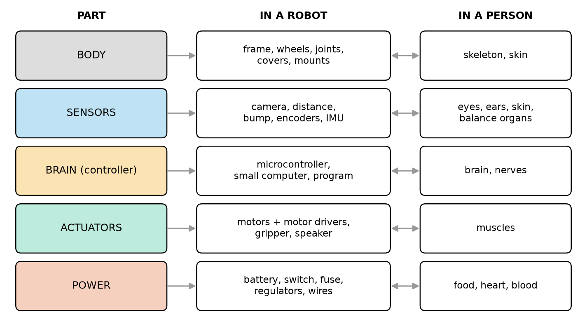
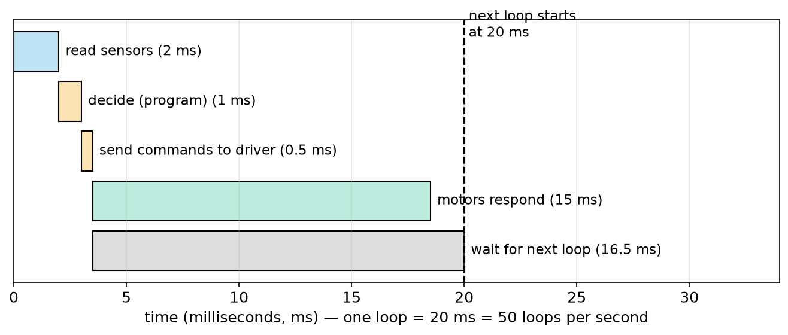
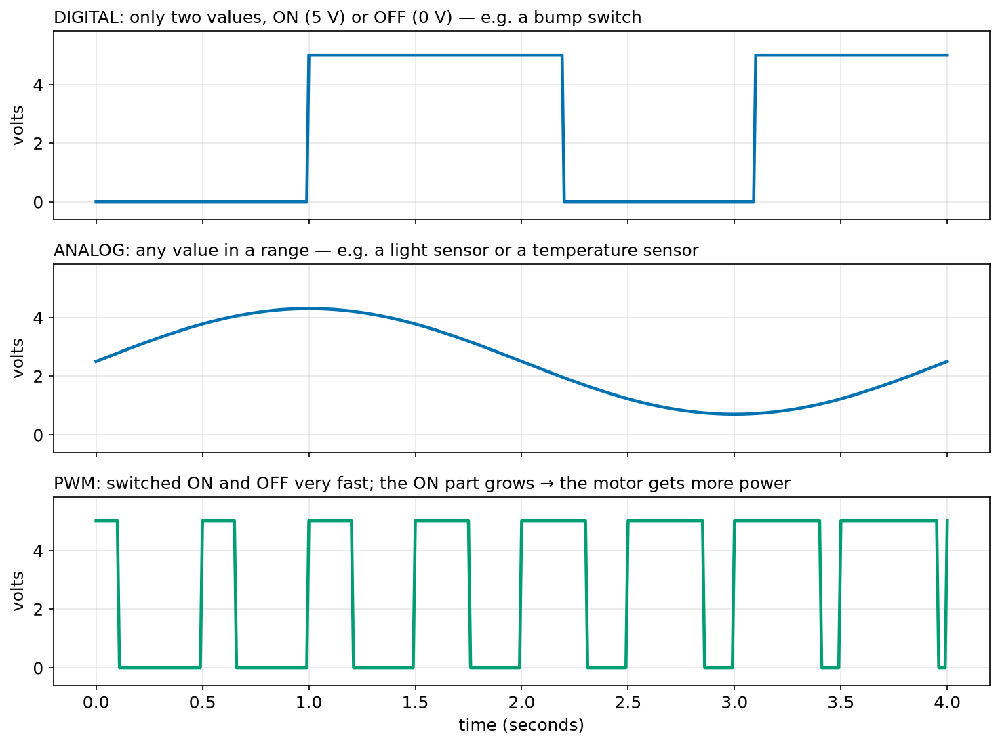
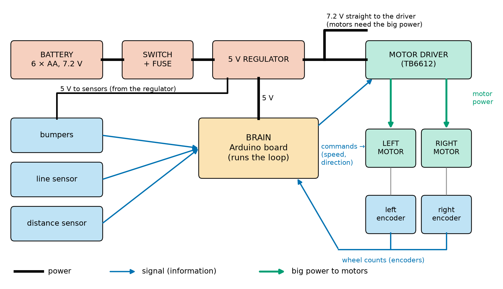
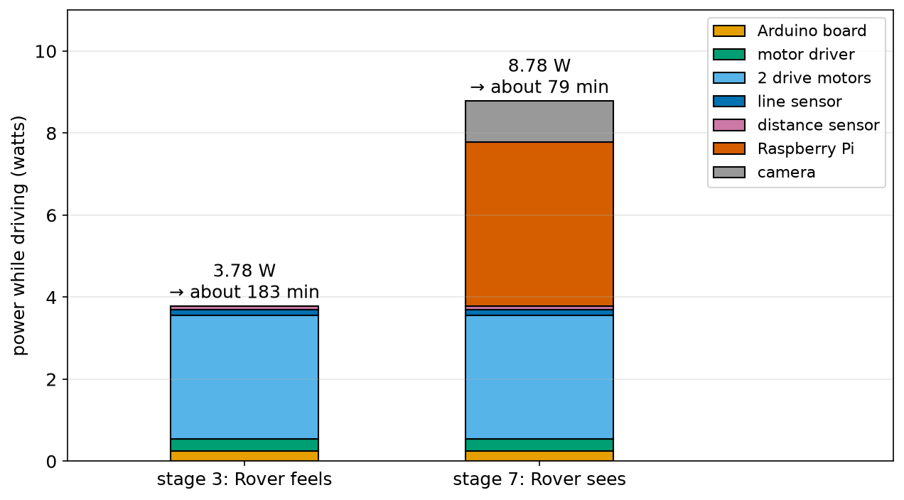
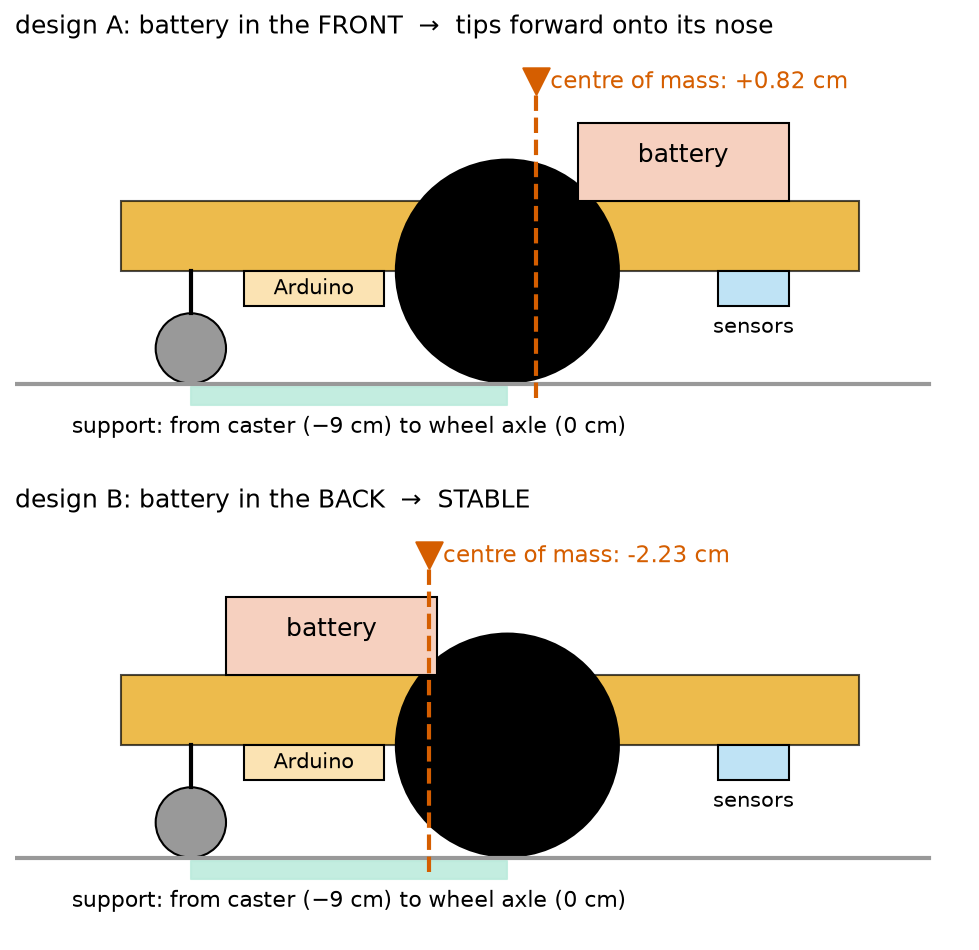

# Chapter 5 — The Parts of a Robot: Body, Sensors, Brain, Actuators, Power

> **Part 1 · Chapter 5 of 749**
> **You need:** Chapters 1–4 (sense–think–act, kinds of robots, W and Wh from Chapter 4).
> **You will make:** the full block diagram of Rover, a power budget and a weight plan for a robot, and a "look inside" lab with an old toy.

---

## What you will learn

- The **five main parts** that every robot has: **body**, **sensors**, **brain**, **actuators** and **power**.
- What each part does, what it is made of, and how the parts are connected.
- The difference between **power** wires and **signal** wires, and why a brain cannot drive a motor directly.
- Three kinds of signals: **digital**, **analog** and **PWM**.
- How to draw a **block diagram** of a robot, starting with Rover.
- How to make a **power budget** (how long will the battery last?) and a **weight plan** (will the robot tip over?).

---

## New words in this chapter

| Word | Simple meaning |
|---|---|
| **chassis** | The main frame of a robot's body. Everything is fixed to it. |
| **controller** / **brain** | The part that runs the program and makes decisions (Chapter 2). |
| **microcontroller** | A tiny computer on one chip, made to control machines. An Arduino board has one. |
| **single-board computer** | A small but complete computer on one board, such as a Raspberry Pi. |
| **motor driver** | A part that takes weak commands from the brain and gives strong power to a motor. |
| **battery** | A store of electrical energy. |
| **regulator** | A part that turns the battery's electricity into the exact, steady level that the electronics need. |
| **fuse** | A small safety part that breaks the circuit if too much electricity flows, to stop fires. |
| **signal** | Electricity that carries **information** (a number, on/off), not much energy. |
| **block diagram** | A drawing that shows the main parts as boxes and their connections as lines and arrows. |
| **power budget** | A list of how much power each part uses, added up, to see how long the battery lasts. |
| **volt (V)** | The unit of electrical "push". A bigger number means a stronger push. (Chapter 74 explains it fully.) |

---

## 5.1 Five parts, like a living body

Open any robot, from a robot vacuum to a humanoid, and you find the same five main parts. A good way to remember them is to compare a robot with a person. Look at Figure 5.1.



*Figure 5.1 — The five main parts of every robot. The middle column shows what they are in a robot; the right column shows the matching parts of a person.*

**How to read this picture:** Each row is one part. The coloured box on the left gives its name. The middle white box gives examples in a robot. The right white box gives the matching parts of a human body. The double arrows mean "is like".

| Part | Job | In a robot | In a person |
|---|---|---|---|
| **Body** | holds everything together, protects, carries the load | frame (chassis), wheels, joints, covers | skeleton, skin |
| **Sensors** | **sense** (Chapter 2) | cameras, distance sensors, bump switches, encoders, IMU | eyes, ears, skin, the balance organ in the ear |
| **Brain** | **think** | microcontroller, small computer, the program | brain and nerves |
| **Actuators** | **act** | motors with motor drivers, grippers, speakers | muscles |
| **Power** | gives energy to everything | battery, switch, fuse, regulators, wires | food, heart and blood |

Three of the five are the **sense–think–act** parts from Chapter 2. The other two, **body** and **power**, make it possible for the other three to work. A brain with no power does nothing. A motor with no body to push against just spins in the air.

🧠 **Remember:** Body, sensors, brain, actuators, power. Every robot has all five.

---

## 5.2 The body

📖 **New word: chassis** (say: *SHASS-ee*) — the main frame of the robot's body.

The body has four jobs:

1. **Hold the parts in the right places.** A distance sensor must point forward, not wobble. A camera must not move against the robot, or the robot "sees" the world moving when it is not.
2. **Carry the load.** The weight of the battery, the electronics, and anything the robot carries.
3. **Move.** Wheels, legs, joints and propeller arms are part of the body.
4. **Protect.** From bumps, dust, water, and also protect **people** from sharp edges and moving parts.

### Materials

| Material | Good | Not so good | Used for |
|---|---|---|---|
| Plastic sheet (acrylic) | cheap, light, easy to cut | can crack | many small robot kits, including Rover's chassis |
| 3D-printed plastic | any shape you can draw | weaker than metal; printing takes time | brackets, custom parts, Buddy's body |
| Aluminium | strong, light, does not rust | needs tools to cut and drill | arms, drone frames, bigger robots |
| Carbon fibre | very stiff and very light | expensive; dust is harmful when cutting | racing drones, light arms |
| Wood or cardboard | very cheap, easy | weak, not waterproof | first prototypes (a perfectly good start!) |
| Steel | very strong | heavy | big industrial arms and bases |

### Two important properties

- **Stiffness.** A body that bends is a problem. If an arm bends a little under a heavy load, the tool ends up in the wrong place, even if every joint angle is perfect. Industrial arms are very stiff for this reason.
- **Weight and its position.** Every gram must be carried (more power, shorter battery time, Chapter 4). And **where** the weight sits decides if the robot tips over (Section 5.9).

💡 **Tip:** Your first robot body does not need to be beautiful. Cardboard and tape are fine for testing where the parts should go. Many professional robots started as a messy prototype.

---

## 5.3 Sensors

You met sensors in Chapter 2. Here we look at them as **parts** of the robot.

Robot engineers sort sensors into two groups:

| Group | Measures | Examples | In a person |
|---|---|---|---|
| **Inside sensors** | the robot **itself** | wheel encoders (how far each wheel turned), joint angles, battery level, motor temperature, IMU (tilt, turning) | feeling where your arms are with your eyes closed |
| **Outside sensors** | the **world** around the robot | bumpers, distance sensors, line sensors, cameras, LiDAR, GPS, microphones | eyes, ears, touch |

(Engineers often use longer words for these two groups: *proprioceptive* for inside sensors and *exteroceptive* for outside sensors. You do not need to remember them now.)

### What a sensor gives the brain

A sensor turns something in the world (light, distance, a turn of a wheel) into an **electrical signal** that the brain can read. Section 5.7 shows the three common kinds of signal: **digital**, **analog** and **PWM**.

### Where sensors are placed

- **Distance sensors** and **cameras** usually point **forward**, where the robot is going.
- **Line sensors** and **cliff sensors** point **down**, close to the floor.
- **Bumpers** go on the **front edge**, where the robot will touch things first.
- **Encoders** sit on the **motors** or **wheels**.
- An **IMU** should sit near the **middle** of the robot, fixed firmly (vibration makes its readings noisy).

Part 7 (Chapters 114–135) teaches each sensor in detail.

---

## 5.4 The brain

📖 **New word: microcontroller** — a tiny computer on one chip, made to control machines. It reads sensors and controls motors directly, through its pins.

📖 **New word: single-board computer** — a small but complete computer on one board, with an operating system (like a small PC), for example a Raspberry Pi.

Robots use different brains for different jobs:

| Brain | Speed and power | Good at | Example |
|---|---|---|---|
| **Microcontroller** | slow compared with a PC, but **exact timing**; uses very little power (about 0.25 W for a board) | reading sensors and controlling motors in fast, regular loops; starts instantly when switched on | Arduino board (Part 6), ESP32 |
| **Single-board computer** | much faster; runs Linux and Python; uses more power (often 3–7 W) | cameras, maps, path planning, ROS 2, talking to the network | Raspberry Pi (Chapter 112) |
| **Laptop / PC / special AI computer** | very fast; uses a lot of power | heavy vision, machine learning, simulation | used in big robots and research |

### Two brains are often better than one

Many robots use **two levels** of brain, like a person:

- A **low-level brain** (a microcontroller) runs the fast, simple loops: "keep each wheel at this speed", "stop now if the bumper is pressed". These loops must run on time, every time, many times per second.
- A **high-level brain** (a single-board computer) does the slow, complex thinking: "where am I on the map?", "which way to the kitchen?", "is that a person?". It sends simple commands down: "drive at 0.3 m/s and turn slightly left".

In your body, the spinal cord reacts very fast (pull your hand from a hot plate) while the brain plans (where to go for dinner). Rover follows the same idea: an Arduino board first (stages 1–6), then a Raspberry Pi is added on top for the camera, the map and ROS 2 (stages 7–12). Chapter 554 explains how robot software is organised in layers.

### What happens inside the brain: one loop

The brain runs the sense–think–act loop again and again. Figure 5.2 shows **one** time round the loop inside Rover, which runs 50 times per second (one loop every 20 milliseconds).

📖 **millisecond (ms)** — one thousandth of a second. 1 s = 1,000 ms. So 20 ms = 0.02 s.



*Figure 5.2 — What Rover's brain does during one 20 ms loop. The work takes 3.5 ms; then the brain waits for the next loop while the motors respond.*

**How to read this picture:** The bottom axis is time in milliseconds. Each bar is one activity: where it starts and how long it lasts. The text next to each bar names it and gives its length. The dashed line at 20 ms is where the next loop begins.

- Reading the sensors takes about 2 ms.
- Deciding (running the program) takes about 1 ms.
- Sending the commands to the motor driver takes about 0.5 ms.
- Then the brain has nothing to do until 20 ms, so it **waits**. Meanwhile the motors respond to the new commands.

So in this example the brain is busy only 3.5 ms out of every 20 ms, about 18% of the time. That spare time is useful: later, when the program grows (more sensors, more thinking), it still fits in the loop. If the work ever takes **longer** than 20 ms, the loop is late, and the robot reacts late. Part 26 is about making sure loops are never late.

---

## 5.5 Actuators, and why the brain needs a motor driver

Actuators are the parts that **act**: motors, servos, grippers, pumps, speakers, lights. Part 8 teaches them in detail. Here we learn one very important fact about connecting them.

### A brain cannot drive a motor directly

A microcontroller pin can give only a **tiny** amount of electrical power: enough to light a small LED, not enough to turn a wheel motor. A small wheel motor may need **50 to 100 times** more electricity than a pin can safely give. If you connect a motor straight to a brain pin:

- the motor does not turn (or turns very weakly), and
- the pin, or the whole microcontroller, can be **damaged**.

📖 **New word: motor driver** — a part that takes **weak command signals** from the brain and switches **strong power** from the battery to the motor.

An everyday comparison: a light switch on the wall needs only a small push from your finger, but it controls a big flow of electricity to the lamp. The motor driver is an electronic "switch" that the brain can press thousands of times per second.

```
   BRAIN  ──(weak signal: "left motor, forward, 60%")──►  MOTOR DRIVER  ──(strong power)──►  MOTOR
                                                              ▲
                                                              │
                                                          BATTERY
```

The motor driver also lets the motor turn **both ways** (forward and backward) and at **different speeds**. How it does this (the H-bridge and PWM) is taught in Chapters 139–141. Rover uses a small motor driver board called TB6612.

🧠 **Remember:** **Signals** carry information. **Power** carries energy. The brain makes signals; the motor driver turns them into power for the motors.

⚠️ **Careful:** Never connect a motor directly to a microcontroller pin. Always use a motor driver (or, for a hobby servo, its own power wires, Chapter 143).

---

## 5.6 Power

The power system gives energy to every other part. It has four main pieces:

| Piece | Job |
|---|---|
| **Battery** | stores the energy. |
| **Switch** | turns the whole robot on and off. Also your **emergency stop** (Chapter 1, rule 2). |
| **Fuse** | 📖 a small safety part that **breaks** the circuit if far too much electricity flows (for example in a short circuit). It stops wires from overheating and causing a fire. |
| **Regulator** | 📖 turns the battery's electricity into the **exact, steady** level the electronics need. |

### Why a regulator?

📖 **New word: volt (V)** — the unit of electrical "push". You can think of it like water pressure in a pipe: a higher number pushes harder. (Chapter 74 explains volts properly.)

Different parts need different volts:

- Rover's battery of 6 rechargeable AA cells gives about **7.2 V**. When the battery is full it gives a bit more, and when it is nearly empty, less.
- The Arduino board and the sensors need a steady **5 V**. Too much can damage them; too little makes them behave strangely.
- The motors work well with the battery's **7.2 V**, through the motor driver.

So the regulator takes the changing 7.2 V and makes a steady 5 V for the electronics, while the motors get their power straight from the battery through the driver. Chapters 89–90 explain batteries and regulators.

⚠️ **Careful:** Batteries store a lot of energy. A short circuit (the two ends of a battery touching through a wire or a metal tool) can make wires very hot within seconds. Rechargeable lithium batteries can catch fire if damaged or charged wrongly. Chapter 7 is about safety, and Chapter 89 is about batteries. Always have a **fuse** and a **switch**.

---

## 5.7 Connections: power, signals and the three kinds of signal

A robot is full of wires. They come in two kinds.

| Kind | Carries | Looks like | Example |
|---|---|---|---|
| **Power wires** | energy | thicker wires, often red (+) and black (−) | battery → switch → regulator → driver → motors |
| **Signal wires** | information | thin wires, many colours | sensor → brain, brain → driver |

There is one more rule that beginners often forget: **all the parts must share a common "ground"** (the minus side, 0 V), so that their signals make sense to each other. Imagine two people measuring heights, but each measures from a different floor: their numbers cannot be compared. A shared ground is the "same floor" for all signals. Chapter 80 shows how to wire it.

### Three kinds of signal

Look at Figure 5.3.



*Figure 5.3 — Three kinds of electrical signal over 4 seconds: digital (top), analog (middle) and PWM (bottom).*

**How to read this picture:** Each panel shows one signal. The bottom axis is time in seconds. The left axis is volts. The title of each panel says which kind of signal it is and gives an example.

- **Digital (top):** only **two** values: ON (here 5 V) or OFF (0 V). Like a light switch. A bump switch gives a digital signal: pressed or not pressed. In the picture, the bumper is pressed from 1.0 s to 2.2 s, and again from 3.1 s.
- **Analog (middle):** **any** value in a range, for example anywhere between 0 V and 5 V. Like a dimmer, or like water level. A light sensor or a temperature sensor gives an analog signal: more light → more volts. The brain measures it with a part called an **ADC** (analog-to-digital converter, Chapter 101), which turns it into a number.
- **PWM (bottom):** a digital signal that switches ON and OFF **very fast**. What matters is **how long it stays ON** in each cycle. In the picture, the ON part grows from about 20% of each cycle at the start to about 90% at the end. A motor driver uses this to give the motor more or less power: more ON time → faster motor. PWM is how a digital brain controls a "smooth" amount, like motor speed (Chapter 102).

🤖 **Robot link:** Real PWM for motors switches thousands of times per second, much faster than in the picture, which is slowed down so that you can see the pulses.

### Communication buses

Some sensors send more than one number: an IMU sends tilt, turning and more, many times per second. They talk to the brain through a **communication bus**: a few wires that carry messages in an agreed "language". The common ones in small robots are **UART**, **I2C** and **SPI** (Chapters 107–109), and in bigger robots **CAN** (Part 26). For now, think of a bus as a small shared telephone line between the brain and its sensors.

---

## 5.8 The block diagram of Rover

📖 **New word: block diagram** — a drawing that shows the main parts as **boxes** and their connections as **lines and arrows**. It does not show every wire. It shows **what is connected to what**, and **what flows** (power or information).

Engineers draw a block diagram **before** they buy parts or build. It helps them check that nothing is missing and that every part gets power and signals. Figure 5.4 is the block diagram of **Rover at stage 3** (Rover feels: bumpers, line sensor, distance sensor, wheel encoders).



*Figure 5.4 — The block diagram of Rover at stage 3. Red boxes are power parts, blue boxes are sensors, the orange box is the brain, green boxes are actuators.*

**How to read this picture:** The legend at the bottom explains the three kinds of line: thick black lines are **power**, thin blue arrows are **signals** (information), and thick green arrows are **big power to the motors**. Start at the top left (the battery) and follow the black power lines to the right. Then start at the sensors on the left and follow the blue arrows into the brain, and from the brain to the motor driver. Then follow the green arrows from the driver to the motors, and the blue line from the encoders back to the brain.

Let us read it step by step.

**The power path (black):**
1. The **battery** (7.2 V) goes through the **switch and fuse**.
2. Then it goes two ways: to the **5 V regulator**, and straight to the **motor driver** (motors need the big power).
3. The regulator gives **5 V** to the **brain** and to the **sensors**.

**The sense path (blue, from left to centre):**
4. The **bumpers**, **line sensor** and **distance sensor** send their signals to the brain.

**The think part (orange):**
5. The **brain** (the Arduino board) runs the loop: read the sensors, decide.

**The act path (blue, then green):**
6. The brain sends **commands** (which motor, which direction, how fast) to the **motor driver**.
7. The motor driver sends **big power** to the **left motor** and the **right motor**.

**The feedback path (blue, bottom right):**
8. The **encoders** on the motors count how much each wheel turned and send the counts **back** to the brain. This closes the loop (Chapter 2): the brain can check that the wheels really did what it asked.

🧠 **Remember:** A good block diagram shows three paths: **power** (where the energy goes), **sensing** (what information comes in), and **acting** (what commands go out), plus the **feedback** that closes the loop.

---

## 5.9 Weight and balance: a first look

In Chapter 4 you learned that a robot standing still is stable if its **centre of mass** is above its **support polygon**. Rover touches the ground at three points: the **two drive wheels** (left and right of the centre, on the wheel axle) and the **caster** (a small free wheel at the back). Seen from the side, the support goes from the caster to the wheel axle.

Where should we put the heavy parts, especially the battery, which is one of the heaviest? Application 2 below works this out with numbers. The short answer: put heavy parts **low** and **between** the wheels and the caster. If the centre of mass moves in front of the wheel axle, Rover tips forward onto its nose.

🔢 **Maths** — the centre of mass of several parts along a line is a **weighted average** of their positions:

```
centre of mass = (m₁ × x₁ + m₂ × x₂ + …) ÷ (m₁ + m₂ + …)
```

In words: "multiply each part's mass by its position, add them all up, and divide by the total mass". Heavy parts pull the centre of mass towards themselves more than light parts. (Chapter 70 explains this fully, also in two and three dimensions.)

A tiny example: a 100 g part at 0 cm and a 300 g part at 4 cm.

```
centre of mass = (100 × 0 + 300 × 4) ÷ (100 + 300) = (0 + 1,200) ÷ 400 = 3 cm
```

The centre of mass is at 3 cm, much closer to the heavy part (at 4 cm) than to the light one (at 0 cm). ✔

---

## Code

This program makes a **power budget** for Rover at stage 3: it adds up the power of all the parts and works out how long the battery lasts. You will do this kind of calculation for every robot you build.

📖 **New word: power budget** — a list of how much power each part uses, added up, to see how long the battery lasts (and whether the battery and wires are big enough).

One fact we need: a battery label often shows **volts** (V) and **amp-hours** (Ah) or **milliamp-hours** (mAh). The energy in watt-hours is:

```
energy (Wh) = volts × amp-hours
```

Trust this rule for now. Chapter 89 explains why. Rover's battery: 6 rechargeable AA cells, 7.2 V together, 2,000 mAh = 2.0 Ah each. So 7.2 × 2.0 = **14.4 Wh**.

The file is `code/ch005/power_budget.py`.

```python
# power_budget.py - how long does Rover's battery last?
battery_wh = 7.2 * 2.0     # 6 rechargeable AA cells: 7.2 volts x 2.0 amp-hours = 14.4 Wh
usable = 0.8               # we only use 80% of the battery, to protect it

parts = ["Arduino board", "motor driver", "2 drive motors", "line sensor", "distance sensor"]
watts = [0.25, 0.3, 3.0, 0.15, 0.08]     # typical power of each part while Rover drives

total = 0
for i in range(len(parts)):
    print(parts[i], ":", watts[i], "W")
    total = total + watts[i]

hours = battery_wh * usable / total
print("total power:", round(total, 2), "W")
print("battery:", battery_wh, "Wh, usable:", round(battery_wh * usable, 2), "Wh")
print("driving time:", round(hours, 2), "hours =", round(hours * 60), "minutes")
```

| Line | Code | What it does (simple English) |
|---|---|---|
| 1 | `# power_budget.py - …` | A comment: the name and the question. |
| 2 | `battery_wh = 7.2 * 2.0` | The battery energy: 7.2 V × 2.0 Ah = 14.4 Wh. |
| 3 | `usable = 0.8` | We plan to use only 80% of the battery. Emptying a rechargeable battery completely shortens its life, and the electronics may stop working properly before it is fully empty. |
| 4 | *(empty)* | |
| 5 | `parts = [...]` | A list of the five parts that use power. |
| 6 | `watts = [0.25, 0.3, 3.0, 0.15, 0.08]` | The power of each part, in the same order. These are typical values while driving; the motors use the most by far. |
| 7 | *(empty)* | |
| 8 | `total = 0` | Start the total power at 0. |
| 9 | `for i in range(len(parts)):` | Repeat once for each part. `len(parts)` is the number of items in the list (5), so `i` goes 0, 1, 2, 3, 4. Using `len` means the program still works if we add more parts later. |
| 10 | `print(parts[i], ":", watts[i], "W")` | Show each part and its power. |
| 11 | `total = total + watts[i]` | Add this part's power to the total. |
| 12 | *(empty)* | |
| 13 | `hours = battery_wh * usable / total` | time = usable energy ÷ total power (Chapter 4). |
| 14–16 | `print(…)` | Show the total power, the battery energy, the usable energy, and the driving time in hours and minutes. |

**Output:**

```
Arduino board : 0.25 W
motor driver : 0.3 W
2 drive motors : 3.0 W
line sensor : 0.15 W
distance sensor : 0.08 W
total power: 3.78 W
battery: 14.4 Wh, usable: 11.52 Wh
driving time: 3.05 hours = 183 minutes
```

**What the output means:**

- The total power while driving is **3.78 W**.
- Of the 14.4 Wh in the battery, we use **11.52 Wh** (80%).
- 11.52 ÷ 3.78 ≈ **3.05 hours**: Rover can drive for about **3 hours** on one charge.
- Look at the list: the **motors** use 3.0 of the 3.78 W, about **80%** of all the power. If you want a longer driving time, the motors are where to look first (lighter robot, slower driving, better gears).

---

## Small examples

### Example 1 — Which part is it?

Sort these into body, sensors, brain, actuators, power: a gripper, a GPS receiver, a fuse, a Raspberry Pi, an aluminium frame, a speaker, a camera, a battery.

| Body | Sensors | Brain | Actuators | Power |
|---|---|---|---|---|
| aluminium frame | GPS receiver, camera | Raspberry Pi | gripper, speaker | fuse, battery |

(A speaker is an actuator: it acts on the world by making sound.)

### Example 2 — Inside or outside sensor?

- Wheel encoder → **inside** (the robot's own wheels).
- Battery level → **inside**.
- Bump switch → **outside** (touches the world).
- IMU → **inside** (the robot's own tilt and turning).
- Camera → **outside**.

### Example 3 — Signal or power?

- The wire from the line sensor to the Arduino → **signal**.
- The wire from the battery to the switch → **power**.
- The wire from the Arduino to the motor driver → **signal** (a command).
- The wire from the motor driver to the motor → **power** (the driver gives the motor its energy).

### Example 4 — Which kind of signal?

- A bumper → **digital** (pressed / not pressed).
- A light sensor → **analog** (more or less light).
- The speed command to the motor driver → **PWM** (more ON time = faster).

### Example 5 — Loop time

Rover's loop runs 50 times per second.

```
loop time = 1 ÷ 50 = 0.02 s = 20 ms
```

If reading the sensors takes 2 ms, deciding 1 ms, and sending 0.5 ms, the brain is busy 3.5 ms per loop:

```
busy part = 3.5 ÷ 20 = 0.175 → about 18% of the time
```

### Example 6 — A heavier battery

Rover gets a bigger battery: 7.2 V, 4.0 Ah. Its parts still use 3.78 W.

```
energy = 7.2 × 4.0     = 28.8 Wh
usable = 0.8 × 28.8    = 23.04 Wh
time   = 23.04 ÷ 3.78  ≈ 6.1 hours
```

Twice the battery → about twice the time. (In reality a little less, because the heavier battery also makes the motors work a little harder.)

---

## 🏭 Real robot applications

### Application 1 (worked in full) — 🏠 A power budget: what happens when Rover gets a camera?

**1. The real problem.** At stage 7 (Chapter 498), Rover gets a **Raspberry Pi** and a **camera** to follow a coloured ball. Will the same battery still be enough for a useful session (we want at least 1 hour)?

**2. Why a power budget.** The new parts add power. The battery stays the same. A power budget tells us the new driving time **before** we build, and shows which part matters most.

**3. The numbers.** All values are typical, while driving.

| Part | Stage 3 | Stage 7 |
|---|---|---|
| Arduino board | 0.25 W | 0.25 W |
| motor driver | 0.3 W | 0.3 W |
| 2 drive motors | 3.0 W | 3.0 W |
| line sensor | 0.15 W | 0.15 W |
| distance sensor | 0.08 W | 0.08 W |
| **Raspberry Pi** | — | **4.0 W** |
| **camera** | — | **1.0 W** |
| Battery (usable) | 11.52 Wh | 11.52 Wh |

**4. The maths, step by step.**

```
Step 1. Stage 3 total     = 0.25 + 0.3 + 3.0 + 0.15 + 0.08          = 3.78 W
Step 2. Stage 7 total     = 3.78 + 4.0 + 1.0                         = 8.78 W
Step 3. Stage 7 time      = 11.52 ÷ 8.78                             ≈ 1.31 hours ≈ 79 minutes
Step 4. Compare:            3.05 hours → 1.31 hours: less than half
Step 5. Who uses the most? Pi + camera = 5.0 W, motors = 3.0 W
```

**5. The code.** Change two lines in `power_budget.py`:

```python
parts = ["Arduino board", "motor driver", "2 drive motors", "line sensor", "distance sensor", "Raspberry Pi", "camera"]
watts = [0.25, 0.3, 3.0, 0.15, 0.08, 4.0, 1.0]
```

Nothing else changes: thanks to `range(len(parts))` (line 9), the loop now runs 7 times instead of 5. The program prints `total power: 8.78 W` and `driving time: 1.31 hours = 79 minutes`. Figure 5.5 shows both budgets side by side.



*Figure 5.5 — Rover's power while driving, part by part, at stage 3 (without camera) and stage 7 (with a Raspberry Pi and a camera), with the driving time on the battery.*

**How to read this picture:** There are two stacked bars. Each coloured block in a bar is one part, and its height is that part's power (in watts). The legend on the right names the colours. The number on top of each bar is the total power and the driving time on the same battery (11.52 Wh usable).

**6. The result.** With the camera, Rover drives about **79 minutes**: more than our 1-hour target, so the same battery is **enough**, but with less margin. The new "thinking" parts (Pi + camera, 5 W) now use **more power than the motors** (3 W). This is common in modern robots: computers and sensors can use as much energy as the motors, or more. If we need longer sessions: a bigger battery (Example 6), a lower camera frame rate, or putting the Pi to sleep when it is not needed.

**7. Going further.** Real engineers also check the **peak** power, not only the average: when both motors start at full power at the same moment, the battery, the wires and the fuse must handle the much bigger short burst. Chapter 151 builds a full power budget with peaks, and Chapter 129 measures real power with a meter.

### Application 2 (worked in full) — 📦 Where should the battery go? A weight plan

**1. The real problem.** We are placing the parts on Rover's chassis. The battery is one of the heaviest parts (165 g). Should it go at the **front** (near the sensors) or at the **back** (near the caster)? If the centre of mass ends up in front of the wheel axle, Rover tips forward onto its nose, scrapes the floor, and its line sensor hits the ground.

**2. Why this idea.** Section 5.9: Rover stands on its two wheels (axle at 0 cm) and its caster (at −9 cm, at the back). It is stable when the centre of mass is **between −9 cm and 0 cm**, and safest well inside that range, not right at the edge (when Rover brakes, its weight shifts forward).

**3. The numbers.** Positions are in centimetres from the wheel axle: + = towards the front, − = towards the back.

| Part | Mass | Position (design A) | Position (design B) |
|---|---|---|---|
| chassis | 150 g | −3 cm | −3 cm |
| 2 motors + wheels | 160 g | 0 cm | 0 cm |
| Arduino + driver | 35 g | −4 cm | −4 cm |
| sensors (front) | 30 g | +7 cm | +7 cm |
| **battery** | **165 g** | **+5 cm** (front) | **−5 cm** (back) |

**4. The maths, step by step** — design A (battery in the front):

```
Step 1. Total mass = 150 + 160 + 35 + 30 + 165 = 540 g
Step 2. Each mass × position:
        chassis   150 × (−3) = −450
        motors    160 × 0    =    0
        Arduino    35 × (−4) = −140
        sensors    30 × 7    =  210
        battery   165 × 5    =  825
Step 3. Add them:  −450 + 0 − 140 + 210 + 825 = 445
Step 4. Divide:     445 ÷ 540 ≈ +0.82 cm
```

The centre of mass is **0.82 cm in front of the axle**: outside the support (−9 to 0). **Rover tips forward.**

Design B (battery at the back): only the battery line changes: 165 × (−5) = −825.

```
Step 3. Add them:  −450 + 0 − 140 + 210 − 825 = −1,205
Step 4. Divide:    −1,205 ÷ 540 ≈ −2.23 cm
```

The centre of mass is **2.23 cm behind the axle**: inside the support. **Rover is stable.**

**5. The code.** File `code/ch005/centre_of_mass.py`:

```python
# centre_of_mass.py - where is Rover's centre of mass, front to back?
# Positions are in centimetres along the robot: 0 = the wheel axle, + = towards the front, - = towards the back.
# The caster (small free wheel) is at -9 cm. Rover is stable if the centre of mass is between -9 and 0 ... and
# safest when it is well inside that range.

names = ["chassis", "2 motors + wheels", "Arduino + driver", "sensors (front)", "battery"]
masses = [150, 160, 35, 30, 165]            # grams
positions_a = [-3, 0, -4, 7, 5]             # design A: battery in the FRONT (+5 cm)
positions_b = [-3, 0, -4, 7, -5]            # design B: battery in the BACK (-5 cm)

for design, positions in [["A (battery front)", positions_a], ["B (battery back)", positions_b]]:
    total_mass = 0
    total_moment = 0
    for i in range(len(names)):
        total_mass = total_mass + masses[i]
        total_moment = total_moment + masses[i] * positions[i]
    com = total_moment / total_mass
    print("design", design, "| mass", total_mass, "g | centre of mass at", round(com, 2), "cm")
```

| Line | Code | What it does (simple English) |
|---|---|---|
| 1–4 | comments | Explain the positions and the stability rule. |
| 5 | *(empty)* | |
| 6 | `names = [...]` | The five parts. |
| 7 | `masses = [...]` | Their masses in grams, in the same order. |
| 8 | `positions_a = [...]` | Where each part sits in design A. Only the last number (the battery, +5) differs from design B. |
| 9 | `positions_b = [...]` | Where each part sits in design B (battery at −5). |
| 10 | *(empty)* | |
| 11 | `for design, positions in [[…], […]]:` | Repeat twice: first with the name "A (battery front)" and the list `positions_a`, then with "B (battery back)" and `positions_b`. Each item of the outer list holds two things, and Python puts them into `design` and `positions`. |
| 12 | `total_mass = 0` | Start adding masses from 0. |
| 13 | `total_moment = 0` | Start adding "mass × position" from 0. (The product mass × position is called a **moment**; you meet it again in Chapter 65.) |
| 14 | `for i in range(len(names)):` | For each of the 5 parts… |
| 15 | `total_mass = total_mass + masses[i]` | …add its mass (Step 1)… |
| 16 | `total_moment = total_moment + masses[i] * positions[i]` | …and add its mass × position (Steps 2 and 3). |
| 17 | `com = total_moment / total_mass` | Step 4: divide. `com` stands for **c**entre **o**f **m**ass. |
| 18 | `print(…)` | Show the design, the total mass and the centre of mass. |

**Output:**

```
design A (battery front) | mass 540 g | centre of mass at 0.82 cm
design B (battery back) | mass 540 g | centre of mass at -2.23 cm
```

Figure 5.6 draws both designs.



*Figure 5.6 — Rover seen from the side, front to the right. Top: design A, battery in the front. Bottom: design B, battery at the back. The red dashed line marks the centre of mass; the green strip under the floor is the support range from the caster to the wheel axle.*

**How to read this picture:** In each drawing, the big black circle is a drive wheel (its centre is the axle, at 0 cm), the small grey circle at the left is the caster (at −9 cm), the orange bar is the chassis, and the boxes are the battery, the Arduino and the sensors. The green strip under the floor shows the support range. The red dashed line shows where the centre of mass is. If the red line is above the green strip, Rover is stable.

**6. The result.** The program agrees with our hand calculation: **+0.82 cm** (design A, tips over) and **−2.23 cm** (design B, stable). Moving **one part** by 10 cm moved the centre of mass by about 3 cm, because the battery is heavy (165 g of 540 g, about 31%). So: **place the battery at the back**, low and between the caster and the wheels. When Rover brakes hard, its weight shifts forward a little, so a centre of mass of −2.23 cm (not 0) also gives a safety margin.

**7. Going further.** Real robots check the centre of mass in **all three directions** (front–back, left–right and height). A **high** centre of mass makes a robot tip over more easily when it turns fast or climbs a slope; that is why heavy batteries usually sit at the **bottom** of robots, cars and drones. For humanoids (Part 32), the centre of mass moves every time an arm or leg moves, and the robot must calculate it hundreds of times per second to keep its balance. Chapter 70 teaches the full method.

### Application 3 — 🏭 The parts of a factory robot arm

A typical six-axis factory arm has all five parts:
- **Body:** a stiff cast-metal base and links.
- **Sensors:** an encoder on every joint (inside sensors), often a force sensor at the wrist and a camera above the work area (outside sensors).
- **Brain:** a control cabinet next to the arm, with a computer that plans the motion and fast drives that control every joint motor thousands of times per second (two levels, like Rover).
- **Actuators:** six electric motors with gearboxes, plus the gripper or tool.
- **Power:** from the factory's mains electricity, with an emergency stop button that cuts the motor power instantly.
Notice the safety idea: the emergency stop is part of the **power** system, not only a message to the brain, so it works even if the program has a bug.

### Application 4 — 🚁 The parts of a drone

- **Body:** a carbon-fibre or plastic frame with four arms.
- **Sensors:** IMU, barometer, compass, GPS (Chapter 630).
- **Brain:** a **flight controller** (a microcontroller running the fast tilt loop, Chapter 2), often with a companion computer for cameras and missions (two levels again).
- **Actuators:** four brushless motors with propellers, each with its own motor driver called an **ESC** (Chapter 620).
- **Power:** a lithium battery, a power module that measures the battery, and regulators.
In a drone, the motors use most of the power (Chapter 4: about 150 W for a 1 kg drone), so the power wires must be thick, and a weak battery connection is a real danger.

### Application 5 — 🏥 The parts of a hospital delivery robot

A robot that carries medicines and meals along hospital corridors:
- **Body:** a closed, easy-to-clean box with lockable drawers.
- **Sensors:** LiDAR and cameras (people, walls, doors), bumpers, wheel encoders, and often a radio link to open doors and call lifts.
- **Brain:** a computer with a map of the hospital (Part 22) and a microcontroller for the wheels.
- **Actuators:** two wheel motors (differential drive, like Rover), drawer locks, a screen and a speaker to talk to staff.
- **Power:** a large battery; it docks itself to charge at night.
Its power budget decides how many trips it can make per charge, and its weight plan must stay stable even when its drawers are full on one side.

---

## 🔧 Hands-on lab

### Lab 5.1 — Look inside an old toy (with an adult)

**You need:** an old **battery-powered** toy that moves (a toy car, a moving animal, an old remote-control car) that nobody needs any more, a small screwdriver, a tray for screws, your notebook. An adult must help.

⚠️ **Careful:**
- Use only **battery-powered** toys. **Never** open anything that plugs into the wall socket, and never open microwaves, old TVs or power supplies: they can hold dangerous electricity even when unplugged.
- **Take the batteries out first.**
- Keep small parts away from small children.

**Steps:**

1. Remove the batteries. Unscrew the cover. Put all screws in the tray.
2. Find and write down: the **body** (the frame), the **actuators** (motors; any gears?), the **power** parts (battery holder, switch, wires), any **sensors** (switches, light sensors, a radio receiver), and the **brain** (a small circuit board, or nothing at all!).
3. Draw a simple block diagram of the toy, like Figure 5.4, with boxes and arrows.
4. Use the robot test from Chapter 2. Is the toy a robot, or an automatic machine, or a teleoperated machine?
5. Put it back together if you can. (Keep the motor if the adult agrees: you can use it in Part 8.)

**What you should see:** Most simple toys have **power** (battery, switch), **actuators** (one or two motors with gears) and a **body**. Many have **no sensors** and **no brain**: the switch connects the battery straight to the motor. A remote-control toy has a radio receiver (a sensor of commands) and a small board (a brain that follows your commands, not its own decisions).

**If it does not work:**

| Problem | Likely cause | Fix |
|---|---|---|
| "I cannot open it." | Hidden screws under stickers or rubber feet, or clips. | Ask the adult. Do not force it with a knife. |
| "I cannot find a brain." | The toy has none. | That is a real result! Write "no brain: open loop, switch → motor". |
| "There are many tiny parts on the board." | That is the brain and its helpers. | You do not need to name them now. Draw it as one box: "brain". |

### Lab 5.2 — Draw Rover's block diagram yourself

**You need:** your notebook, pencils in black, blue and green.

**Steps:**

1. **Without** looking at Figure 5.4, draw Rover's block diagram for **stage 3** from the list: battery, switch + fuse, 5 V regulator, Arduino, motor driver, two motors, two encoders, bumpers, line sensor, distance sensor.
2. Use **black** for power lines, **blue** arrows for signals, **green** arrows for motor power.
3. Compare with Figure 5.4. Did you forget anything? (Common: the encoders' feedback arrows, the 5 V to the sensors, or the direct 7.2 V line to the motor driver.)
4. Now draw **stage 7**: add a **Raspberry Pi** and a **camera**. Where does the camera connect? How do the Pi and the Arduino talk? (Hint: a signal line between them, for commands like "drive at 0.3 m/s". Chapter 111 shows how.) Where does the Pi get its power? (It needs 5 V and quite a lot of power: from the regulator, or from its own regulator.)

**What you should see:** Your stage 7 diagram has a new box (Pi) above the Arduino: the high-level brain. The camera sends signals to the Pi; the Pi sends commands to the Arduino; the Arduino still controls the motors.

**Challenge:** Draw the block diagram of the toy from Lab 5.1 next to Rover's. How many of the five parts does each have?

### Lab 5.3 — A power budget and a weight plan for your own robot idea

**You need:** your notebook. (Paper simulation track.)

**Steps:**

1. Choose a small robot you might build one day (for example a robot that waters plants, or a robot pet).
2. List its parts. For each one, write a **power** (use the values from this chapter as a guide: small board 0.25 W, small sensor 0.1 W, small motor 1.5 W, Raspberry Pi 4 W, camera 1 W).
3. Choose a battery (for example 7.2 V, 2.0 Ah = 14.4 Wh; or 3.7 V, 3.0 Ah = 11.1 Wh) and calculate the driving time with 80% usable, like the Code section.
4. Draw your robot from the side. Give each part a mass and a position. Calculate the centre of mass like Application 2. Is it stable?
5. If it is not stable, or the time is too short: move a part, change the battery, or remove a part, and calculate again.

**What you should see:** Two numbers you can trust more than a guess: "about **___** hours on one charge" and "centre of mass at **___** cm: stable / not stable".

**If it does not work:**

| Problem | Likely cause | Fix |
|---|---|---|
| "My time is very short." | A big part (camera, computer, many motors). | Find the biggest number in your budget first. That is where to save. |
| "The centre of mass is outside." | Heavy part at one end. | Move the heaviest part (usually the battery) towards the middle of the support. |

**Challenge:** In Application 2, how far back must the battery go so that the centre of mass is exactly in the middle of the support (−4.5 cm)? (Hint: you need total moment = −4.5 × 540 = −2,430.)

---

## Common mistakes

⚠️ **Connecting a motor straight to the brain.** The brain gives signals, not power. Always use a motor driver.

⚠️ **Forgetting the common ground.** If the parts do not share the same 0 V, their signals are nonsense. All grounds must be connected.

⚠️ **Forgetting the fuse and the switch.** They are cheap, and they can prevent a fire and let you stop the robot at once.

⚠️ **Putting the heavy battery anywhere it fits.** Its position decides whether the robot is stable. Plan it.

⚠️ **Planning the power budget with only the motors.** Computers and cameras can use as much power as the motors (Application 1).

⚠️ **Mixing up power wires and signal wires.** Thin signal wires can overheat if they carry motor power.

⚠️ **Thinking "no brain = broken".** Many simple machines have no brain. They are just not robots.

---

## Practice

🏋️ **1.** Name the five main parts of every robot, and the matching part of a person for each.

🏋️ **2.** Sort into **inside** and **outside** sensors: GPS, motor temperature sensor, microphone, joint angle sensor, line sensor, battery voltage sensor.

🏋️ **3.** Why can a microcontroller not drive a wheel motor directly? What part do we put in between?

🏋️ **4.** What does a regulator do in Rover, and why do the motors not go through it?

🏋️ **5.** Say whether each signal is digital, analog or PWM: (a) a door switch, (b) a microphone, (c) the brightness command to a dimmed LED, (d) a light sensor.

🏋️ **6.** A robot's loop runs 100 times per second. How long is one loop in milliseconds? If the work takes 4 ms, what fraction of the time is the brain busy?

🏋️ **7.** A robot uses 0.3 W (brain) + 0.2 W (sensors) + 2.0 W (motors). Its battery is 3.7 V, 2.5 Ah. With 80% usable, how long can it drive?

🏋️ **8.** In Application 1, what would the driving time be if we added the camera and Pi **and** a bigger battery of 7.2 V, 4.0 Ah?

🏋️ **9.** Three parts on a line: 200 g at −2 cm, 100 g at 0 cm, 100 g at +6 cm. Where is the centre of mass?

🏋️ **10.** (Harder) In Application 2, design B: we add a 60 g gripper at the very front (+10 cm). Where is the new centre of mass? Is Rover still stable? Then: where must the battery go so that the centre of mass returns to −2.23 cm?

---

## Answers

**1.** **Body** (skeleton, skin), **sensors** (eyes, ears, skin, balance organ), **brain** (brain and nerves), **actuators** (muscles), **power** (food, heart, blood).

**2.** **Inside:** motor temperature sensor, joint angle sensor, battery voltage sensor. **Outside:** GPS, microphone, line sensor.

**3.** A microcontroller pin can give only a very small amount of electricity; a motor needs much more (often 50–100 times more). Connecting it directly can damage the pin or the microcontroller, and the motor will not turn properly. We put a **motor driver** in between: the brain sends weak command signals, and the driver switches strong power from the battery to the motor.

**4.** The regulator turns the battery's changing 7.2 V into a steady 5 V for the brain and the sensors. The motors do not go through it because they work well with the battery's 7.2 V and need much more power than a small regulator can give; they get their power from the battery through the motor driver.

**5.** (a) **digital** (open or closed), (b) **analog** (any loudness), (c) **PWM** (the ON time sets the brightness), (d) **analog** (more or less light).

**6.**
```
loop time = 1 ÷ 100 = 0.01 s = 10 ms
busy      = 4 ÷ 10  = 0.4 → 40% of the time
```

**7.**
```
total power = 0.3 + 0.2 + 2.0 = 2.5 W
energy      = 3.7 × 2.5       = 9.25 Wh
usable      = 0.8 × 9.25      = 7.4 Wh
time        = 7.4 ÷ 2.5       = 2.96 hours ≈ 2 hours 58 minutes
```

**8.**
```
energy = 7.2 × 4.0       = 28.8 Wh
usable = 0.8 × 28.8      = 23.04 Wh
time   = 23.04 ÷ 8.78    ≈ 2.62 hours ≈ 157 minutes
```
About **2 hours 37 minutes** (before counting the extra weight of the bigger battery).

**9.**
```
total mass   = 200 + 100 + 100 = 400 g
total moment = 200 × (−2) + 100 × 0 + 100 × 6 = −400 + 0 + 600 = 200
centre       = 200 ÷ 400 = +0.5 cm
```

**10.** Design B had total mass 540 g and total moment −1,205.
```
new mass   = 540 + 60           = 600 g
new moment = −1,205 + 60 × 10   = −1,205 + 600 = −605
new centre = −605 ÷ 600         ≈ −1.01 cm
```
The centre of mass moves forward to about **−1.01 cm**. It is still inside the support (between −9 and 0), so Rover is **still stable**, but with a smaller margin; hard braking could now tip it.

To bring it back to −2.23 cm, we work out where the battery must go:
```
Step 1. Wanted total moment           = −2.23 × 600       = −1,338
Step 2. Moment without the battery    = −605 − 165 × (−5) = −605 + 825 = 220
Step 3. The battery must give          −1,338 − 220        = −1,558
Step 4. Battery position               = −1,558 ÷ 165      ≈ −9.4 cm
```
The battery would have to go to about **−9.4 cm**, which is behind the caster, at the very back edge, and a bit beyond the support. That is a sign that the gripper is too heavy for this small chassis, or that the chassis must be longer at the back. Engineering answers often lead to new questions!

---

## Summary

🧠 Every robot has five main parts: **body**, **sensors**, **brain**, **actuators** and **power**.

🧠 **Inside sensors** measure the robot itself; **outside sensors** measure the world.

🧠 Small robots often have **two brains**: a microcontroller for fast, exact loops and a small computer for heavy thinking.

🧠 The brain gives **signals**, not power. A **motor driver** turns the brain's commands into power for the motors.

🧠 The power system has a **battery**, a **switch**, a **fuse** and **regulators**. All parts share a common **ground**.

🧠 Signals can be **digital** (on/off), **analog** (any value) or **PWM** (fast on/off, where the ON time carries the value).

🧠 A **block diagram** shows the power path, the sensing path, the acting path and the feedback.

🧠 A **power budget** gives the working time (time = usable energy ÷ total power). A **weight plan** (centre of mass = Σ mass × position ÷ total mass) tells you if the robot tips over.

---

## Next chapter

In **Chapter 6 — How a robot "thinks": the control loop**, we look much more closely at the THINK part. You will follow a person catching a ball, step by step, and see how the same steps (measure, compare, correct, repeat) become the control loop that every robot runs, with its setpoint, its error and its correction.
