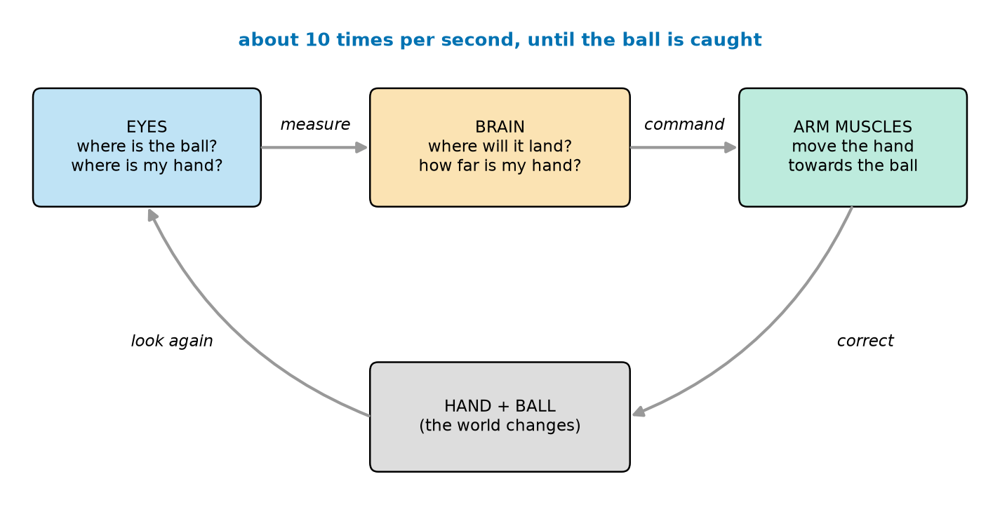
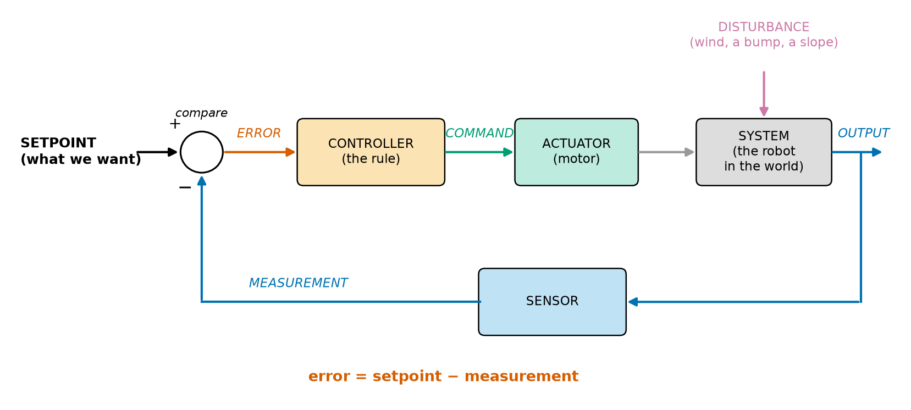
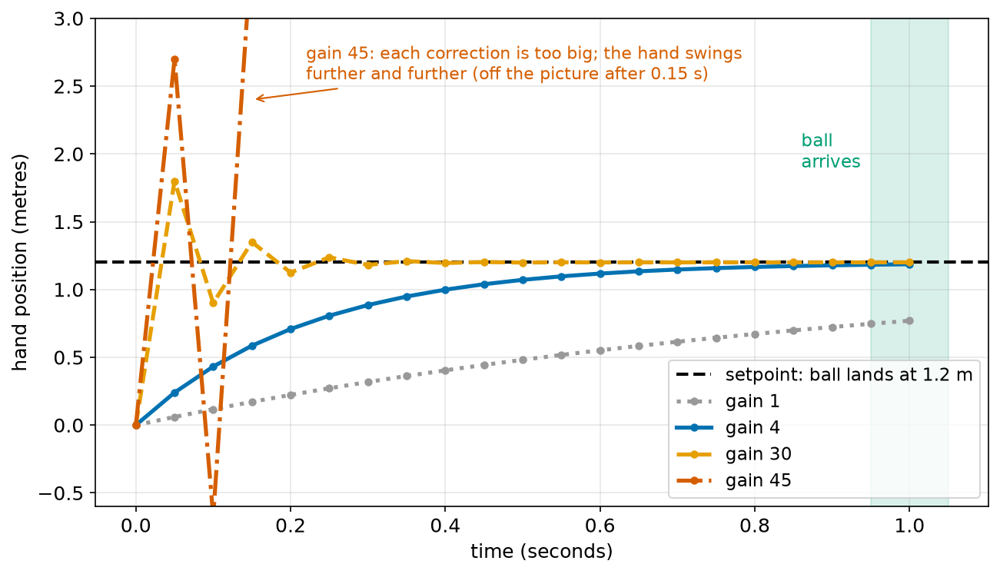
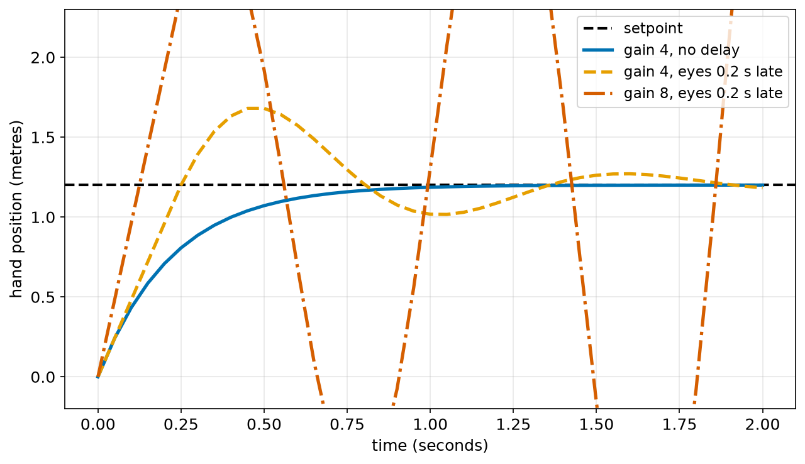
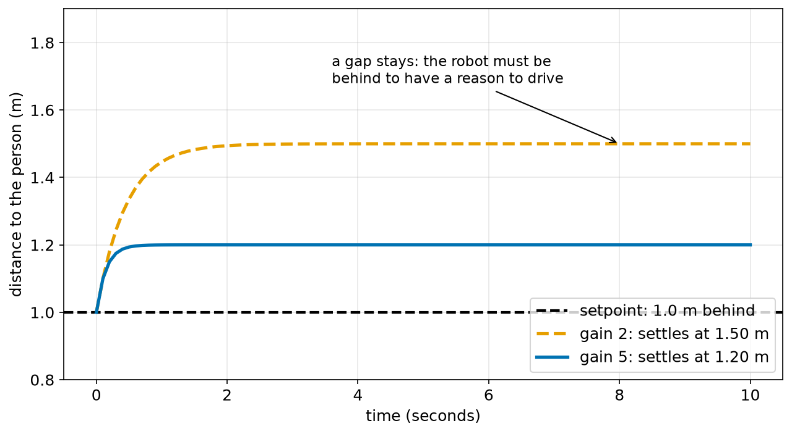
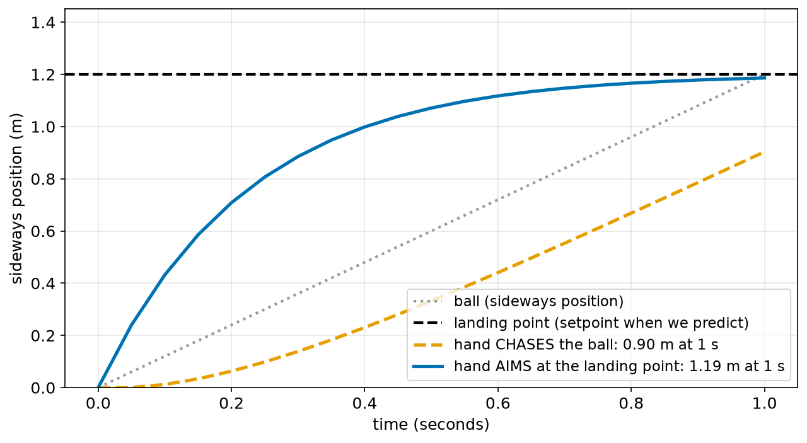
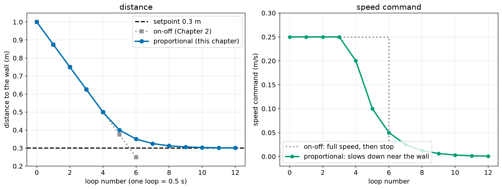

# Chapter 6 — How a Robot "Thinks": The Control Loop

> **Part 1 · Chapter 6 of 749**
> **You need:** Chapters 1–5 (especially Chapter 2: sense–think–act, open and closed loop, setpoint; Chapter 3: the governor's gap; Chapter 5: Rover's parts and its 20 ms loop).
> **You will make:** a reaction-time measurement with a ruler, a paper simulation of a robot that follows a person, and the "balance a stick" experiment.

---

## What you will learn

- How you catch a ball, step by step, and why it is a **control loop**.
- The names of every part of a control loop: **setpoint**, **measurement**, **error**, **controller**, **command**, **actuator**, **system**, **output**, **disturbance**.
- The most important formula of this chapter: **error = setpoint − measurement**.
- A first, simple controller: **correct more when the error is bigger** (a *proportional* correction).
- What happens when the correction is **too weak**, **just right** or **too strong**, and why **delay** is dangerous.
- Why a small **gap can stay** with a simple controller, and why **predicting** the future helps.

---

## New words in this chapter

| Word | Simple meaning |
|---|---|
| **control** | Making something do what we want, by measuring and correcting. |
| **control loop** | The repeating cycle: measure → compare → correct → measure again. |
| **setpoint** | The value we want (Chapter 2). |
| **measurement** | The value the sensor says we have now. |
| **error** | How far we are from what we want: **setpoint − measurement**. |
| **controller** | The rule (in the brain) that turns the error into a command. |
| **command** | What the controller tells the actuator to do (for example a motor speed). |
| **system** | The thing we control: the robot, a joint, a room, a hand. Control books also call it the **plant**. |
| **output** | What the system really does (for example its real position). |
| **disturbance** | Something from outside that pushes the system away from the setpoint: wind, a bump, a slope, a heavy load. |
| **gain** | A number that says **how strongly** the controller corrects. |
| **overshoot** | Going past the setpoint before coming back. |
| **delay** | The time between something happening and the controller knowing about it (or acting on it). |
| **steady-state error** | A gap between setpoint and output that **stays**, even after a long time. |

---

## 6.1 Catching a ball, step by step

Your friend throws you a ball. You catch it. It feels easy. But inside you, a lot happens. Let us slow it down.

**At the start (0.0 s).** Your eyes see the ball leave your friend's hand. Your brain makes a first guess: "It will come to my right, at about chest height." Your hand starts to move to the right.

**A moment later (0.1 s).** Your eyes look again. The ball is a bit higher than you thought. Your brain corrects the guess: "A bit higher." Your hand changes its path a little.

**Again (0.2 s, 0.3 s, …).** Look, compare, correct. Look, compare, correct. Each time, the guess is better, because the ball is closer and easier to see. Each correction is smaller.

**At the end (about 1 s).** The ball arrives. Your hand is already there. Your fingers close. Caught.

Look at Figure 6.1.



*Figure 6.1 — Catching a ball is a loop: the eyes measure, the brain compares and decides, the arm muscles move the hand, and the eyes look again.*

**How to read this picture:** Start at the blue box on the left (eyes). Follow the arrow to the orange box (brain), then to the green box (arm muscles). The curved arrow goes down to the grey box: the hand moves and the ball flies on, so the world changes. The other curved arrow goes back up to the eyes: look again. The blue words at the top say how often this happens.

Notice four things that will be important for robots too:

1. **You never stop measuring.** You do not look once and close your eyes.
2. **You compare** where your hand **is** with where it **should be**.
3. **Big difference → big correction. Small difference → small correction.** When your hand is far away, you move it fast. When it is almost there, you make tiny adjustments.
4. **You predict.** You do not move your hand to where the ball **is** now. You move it to where the ball **will be** when it arrives.

These four ideas are the heart of this chapter.

---

## 6.2 The parts of a control loop, with their names

In Chapter 2 you learned the sense–think–act loop. Control engineers draw the same loop with more exact names. Look at Figure 6.2. Take your time with it: you will see this picture, in many forms, hundreds of times in this course.



*Figure 6.2 — The control loop, with the name of every part. The circle compares the setpoint with the measurement and gives the error.*

**How to read this picture:** Start on the left, at the SETPOINT. It goes into the small circle, marked "compare". The MEASUREMENT comes into the same circle from below (the "−" sign means it is subtracted). Out of the circle comes the ERROR (red). The error goes into the CONTROLLER, which makes a COMMAND (green). The command goes to the ACTUATOR (a motor), which moves the SYSTEM. The system's OUTPUT (blue) is measured by the SENSOR, and the measurement goes back to the circle. A DISTURBANCE (purple) pushes on the system from outside.

Here is every part, for the ball and for Rover:

| Part | Meaning | Catching a ball | Rover stopping at a wall |
|---|---|---|---|
| **Setpoint** | what we want | hand where the ball will land | 0.3 m from the wall |
| **Measurement** | what the sensor says now | where the eyes see the hand | the distance-sensor reading |
| **Error** | setpoint − measurement | how far the hand still has to go | how much farther Rover may drive |
| **Controller** | the rule that decides | the brain | the program in the Arduino |
| **Command** | what the controller asks for | "move the hand this fast" | "drive at this speed" |
| **Actuator** | the part that acts | arm muscles | wheel motors (with the motor driver) |
| **System** | the thing we control | arm and hand | Rover on the floor |
| **Output** | what really happens | the real hand position | the real distance to the wall |
| **Disturbance** | a push from outside | wind on the ball, a slippery floor | a slope, a carpet, a weak battery |

### The most important formula of this chapter

🔢 **Maths**

```
error = setpoint − measurement
```

**In words:** "The error is what we want, minus what we have."

**The sign tells the direction:**

| Error | Meaning | Example (setpoint 20 °C) |
|---|---|---|
| **positive** (+) | we have **less** than we want | room at 18 °C → error = 20 − 18 = **+2** → heat more |
| **zero** (0) | we have exactly what we want | room at 20 °C → error = **0** → do nothing |
| **negative** (−) | we have **more** than we want | room at 23 °C → error = 20 − 23 = **−3** → heat less (or cool) |

The controller's whole job is to make the error **small**, as fast as possible, without making things worse.

💡 **Tip:** Sometimes it is more natural to compute the error the other way round, as in Rover's case "distance − 0.3": "how much farther may I go?". That is fine, as long as you know which way round you chose and what the sign means. Mixing up the sign is one of the most common bugs (Chapter 3, Lab 3.3: the robot ran away from the light!).

### A disturbance is not an error

A **disturbance** is a cause from outside (a gust of wind). The **error** is its effect, measured by the loop (the drone has drifted 30 cm). The controller cannot see the wind directly; it only sees the error the wind causes, and corrects it. That is exactly why closed loops are so useful: they correct the effect of disturbances **they do not even know about** (Chapter 2, Figure 2.4: the thermostat did not know that the weather changed).

---

## 6.3 A first controller: correct more when the error is bigger

What rule should the controller use? In Chapter 2, the thermostat used the simplest rule, **on-off**: if the error is positive, heater fully on; otherwise fully off. It worked, but it made a zigzag, and Rover with on-off control stopped 5 cm too close to the wall.

Remember point 3 from catching a ball: **big difference → big correction; small difference → small correction.** We can write this as a rule:

🔢 **Maths**

```
command = gain × error
```

**In words:** "The command is the error, multiplied by a fixed number called the **gain**."

📖 **New word: gain** — a number that says how **strongly** the controller reacts to the error. A big gain means strong reactions.

This rule is called **proportional control**, because the command is **proportional** to the error: twice the error → twice the command. It is the "P" in the famous **PID** controller, which you will study in depth in Part 12 (Chapters 210–216). Here we only meet the idea.

### A tiny example with numbers

The hand is at 0.0 m. The ball will land at 1.2 m. The gain is 4. The loop runs every 0.05 s.

🔢 **Maths** — the first loop:

```
Step 1. Measurement       = 0.0 m
Step 2. Error             = 1.2 − 0.0          = 1.2 m
Step 3. Command (speed)   = 4 × 1.2            = 4.8 m/s
Step 4. Move for 0.05 s:    4.8 × 0.05         = 0.24 m
Step 5. New position      = 0.0 + 0.24         = 0.24 m
```

The second loop:

```
Step 1. Measurement       = 0.24 m
Step 2. Error             = 1.2 − 0.24         = 0.96 m
Step 3. Command (speed)   = 4 × 0.96           = 3.84 m/s
Step 4. Move for 0.05 s:    3.84 × 0.05        = 0.192 m
Step 5. New position      = 0.24 + 0.192       = 0.432 m
```

Look at what happens: in the first loop the hand moved 0.24 m; in the second loop only 0.192 m, because the error was smaller. Each loop, the hand moves a **fixed fraction** of the remaining distance:

```
fraction per loop = gain × loop time = 4 × 0.05 = 0.2   (20%)
```

So the hand covers 20% of the remaining distance in each loop. It gets closer and closer, faster at first and slower near the end, just like your real hand. The Code section runs this for 1 second.

---

## 6.4 Too weak, just right, too strong

How big should the gain be? Let us try four values. Look at Figure 6.3.



*Figure 6.3 — The hand moving towards the landing point (1.2 m) with four different gains. The green band marks the moment the ball arrives (1.0 s).*

**How to read this picture:** The bottom axis is time in seconds. The left axis is the hand position. The black dashed line is the setpoint (1.2 m). Each coloured line is the same controller with a different gain; the dots are the loop steps (every 0.05 s). The green band on the right is when the ball arrives: the hand must be at the dashed line by then.

| Gain | Fraction per loop (gain × 0.05) | What happens | Catch? |
|---|---|---|---|
| **1** (grey, dotted) | 5% | the hand moves **too slowly**; at 1.0 s it is only at 0.77 m | ❌ missed |
| **4** (blue, solid) | 20% | smooth, steady approach; at 1.0 s it is at 1.19 m | ✅ caught |
| **30** (orange, dashed) | 150% | each step goes **past** the target (overshoot), then back, then past again, but the swings get smaller | ✅ caught, but shaky |
| **45** (red, dash-dot) | 225% | each step goes past by **more** than the step before; the swings **grow**; the hand flies off | ❌ disaster |

Why does a big gain overshoot? With gain 30, the fraction per loop is 30 × 0.05 = 1.5. That means each loop tries to move **150%** of the remaining distance: it goes all the way, and then 50% further, past the target. Next loop, the error has the opposite sign, so it moves back, again too far, but now only by half as much. The swings shrink by half each time, so it settles.

With gain 45, the fraction is 2.25: each loop moves 225% of the remaining distance. Now it overshoots by **125%**: more than the error it started with. Each swing is **bigger** than the one before.

🔢 **Maths** — the first loops with gain 45:

```
Loop 0: hand = 0.0,    error = +1.2   → move 45 × 1.2 × 0.05  = +2.7   → hand = 2.7
Loop 1: hand = 2.7,    error = −1.5   → move 45 × (−1.5) × 0.05 = −3.375 → hand = −0.675
Loop 2: hand = −0.675, error = +1.875 → move +4.219               → hand = 3.544
```

The errors are 1.2, then 1.5, then 1.875: each one is 1.25 times bigger than the last. This is called an **unstable** loop. (Remember Maxwell in Chapter 3: his question was exactly "when does a feedback loop settle, and when does it swing more and more?")

🧠 **Remember:**
- **Gain too small** → slow, the robot is late.
- **Gain about right** → fast and smooth.
- **Gain too big** → overshoot and shaking; **much too big** → unstable, the swings grow.

Choosing the gain is called **tuning**. Part 12 teaches how to tune with care (Chapters 218–219).

---

## 6.5 The danger of delay

In Section 6.4, the eyes reported the hand position **at once**. Real loops always have a **delay**:

- Your eyes and brain need about **0.2 s** to react (Lab 6.1 lets you measure your own).
- A robot's sensor reads only once per loop, its program needs time to think, and its motors need time to speed up (Chapter 5, Figure 5.2).

📖 **New word: delay** — the time between something happening and the controller knowing about it (or being able to act on it).

What does delay do? Look at Figure 6.4.



*Figure 6.4 — The same hand controller with and without a delay of 0.2 s in what the eyes report.*

**How to read this picture:** The black dashed line is the setpoint. The blue line is gain 4 with no delay: the smooth curve from Figure 6.3, shown for 2 seconds. The orange dashed line is the **same gain 4**, but the eyes report where the hand was 0.2 s ago. The red dash-dot line is gain 8 with the same 0.2 s delay.

- **Gain 4, no delay (blue):** smooth, as before.
- **Gain 4, delay 0.2 s (orange):** the hand **overshoots** to about 1.68 m, comes back to about 1.02 m, overshoots again a little, and slowly settles. Why? When the hand reaches 1.2 m, the eyes still report an old, smaller position, so the brain still says "keep going". It only stops pushing 0.2 s too late.
- **Gain 8, delay 0.2 s (red):** with a stronger gain **and** the delay, the swings grow: the loop is unstable. Without the delay, gain 8 would have been perfectly fine.

🧠 **Remember:** **Delay makes loops shake.** The longer the delay, the **gentler** the controller must be. This is why robots need fast loops and fast sensors (Chapter 2), and why Part 26 is about timing. It is also why you catch a ball better with **both** eyes open and when you are not tired: your delay is shorter.

---

## 6.6 Why a gap can stay

In Chapter 3, Watt's governor kept the engine at about 91 turns per minute instead of 100: a gap stayed. Proportional control often does this when the system needs a **constant push** to stay where it is.

Here is a clear example. A delivery robot follows a person and should stay **1.0 m** behind (the setpoint). The person walks at a steady 1.0 m/s. The robot uses proportional control:

```
error = gap − 1.0                 (how much too far behind we are)
speed = gain × error
```

Think about it in words: to keep up with the person, the robot **must** drive at 1.0 m/s. But with this rule, the robot only drives at 1.0 m/s when **gain × error = 1.0**, so the error **cannot** be zero. If the error were zero, the speed would be zero, and the robot would fall behind.

🔢 **Maths** — where does the robot settle?

```
To keep up:   speed = 1.0 m/s
The rule:     speed = gain × error
So:           gain × error = 1.0
              error = 1.0 ÷ gain

Gain 2:  error = 1.0 ÷ 2 = 0.5 m   → the robot stays 1.5 m behind
Gain 5:  error = 1.0 ÷ 5 = 0.2 m   → the robot stays 1.2 m behind
```

Look at Figure 6.5.



*Figure 6.5 — The distance between a following robot and a walking person, for two gains. The black dashed line is the setpoint, 1.0 m.*

**How to read this picture:** The bottom axis is time. The left axis is the distance between the robot and the person. The dashed black line is the distance we want. The orange dashed line (gain 2) settles at 1.5 m; the blue line (gain 5) settles at 1.2 m. Neither reaches 1.0 m.

The gap that stays is called the **steady-state error**. A bigger gain makes it **smaller**, but never zero, and (Section 6.4) a gain that is too big makes the loop shake. Part 12 shows two ways to remove the gap:
- add a correction that **grows while the error stays** (the "I", integral, in PID, Chapter 212), or
- add the **known push in advance**: "the person walks at 1.0 m/s, so drive at 1.0 m/s **plus** a correction" (**feedforward**, Chapter 227).

---

## 6.7 Predict: aim where the ball will be

Remember point 4 from Section 6.1: you move your hand to where the ball **will be**, not where it **is**. What if you did not predict?

Look at Figure 6.6. The ball moves sideways at a steady speed, from 0 to 1.2 m in 1 second. We compare two hands with the same gain (4):

- **Chase:** the setpoint is where the ball **is now**. The setpoint keeps moving.
- **Aim:** the setpoint is where the ball **will land** (1.2 m), predicted at the start.



*Figure 6.6 — Two hands with the same controller. The orange hand chases the ball's current position; the blue hand aims at the predicted landing point.*

**How to read this picture:** The grey dotted line is the ball's sideways position. The black dashed line is the predicted landing point. The orange dashed line is the hand that chases the ball; the blue line is the hand that aims at the landing point. The legend gives where each hand is at 1 s, when the ball arrives.

- The **chasing** hand is always **behind** the ball (just like the following robot in Section 6.6). At 1 s it is at 0.90 m: it **misses** by 30 cm.
- The **aiming** hand is at 1.19 m at 1 s: **caught**.

The lesson: **feedback alone is always a little late**, because it reacts to errors that have already happened. **Prediction** lets the controller act **before** the error appears. Good robots use both: they predict what they can (where the ball will land, where the path turns, how much power a slope needs) and use feedback to correct what they could not predict. You will meet prediction again in **feedforward** (Chapter 227), in the **Kalman filter**, which predicts and then corrects (Chapter 416), and in **model predictive control** (Chapter 270).

---

## 6.8 The control loop in one page

Here is everything in this chapter, in one list.

```
repeat many times per second:
    1. MEASURE       measurement = read the sensor
    2. COMPARE       error = setpoint − measurement
    3. DECIDE        command = rule(error)            for example: gain × error
    4. ACT           send the command to the actuator
    5. WAIT          until the next loop time
```

And the five big lessons:

| Lesson | Section |
|---|---|
| **Error = setpoint − measurement.** The sign tells the direction. | 6.2 |
| **Correct in proportion to the error**: big error, big correction. | 6.3 |
| **The gain must be right**: too small is slow, too big shakes or explodes. | 6.4 |
| **Delay makes loops shake**: fast loops, gentle gains. | 6.5 |
| **A simple controller can leave a gap**; **prediction** helps a lot. | 6.6–6.7 |

---

## Code

This program is the hand from Section 6.3: it moves towards the landing point with **proportional control**, gain 4, one loop every 0.05 s, for 1 second. Read it with the table; you start typing programs in Chapter 8.

The file is `code/ch006/catch.py`.

```python
# catch.py - a hand moves to where the ball will land: measure, compare, correct, repeat
setpoint = 1.2        # the ball will land 1.2 m to the right (where we WANT the hand)
hand = 0.0            # the hand starts at 0 m
gain = 4              # how strongly we correct: hand speed = gain x error
dt = 0.05             # one loop every 0.05 s (20 loops per second)

for step in range(21):
    t = step * dt
    measurement = hand                 # SENSE: where is my hand?
    error = setpoint - measurement     # THINK: how far is it from where it should be?
    speed = gain * error               #        correct more when the error is bigger
    if step % 4 == 0:
        print("t =", round(t, 2), "s | hand", round(hand, 3), "m | error", round(error, 3), "m | speed", round(speed, 2), "m/s")
    hand = hand + speed * dt           # ACT: move the hand for one loop
```

| Line | Code | What it does (simple English) |
|---|---|---|
| 1 | `# catch.py - …` | A comment: the name and the idea. |
| 2 | `setpoint = 1.2` | The **setpoint**: the hand should be at 1.2 m. |
| 3 | `hand = 0.0` | The hand starts at 0 m. In this simulation, `hand` is the **output** (the real position). |
| 4 | `gain = 4` | The **gain** of the proportional controller. You change it in the experiments. |
| 5 | `dt = 0.05` | The loop time: 0.05 s. ("dt" is a common short name for a small time step; "d" for "difference" and "t" for time.) |
| 6 | *(empty)* | |
| 7 | `for step in range(21):` | Repeat 21 times: steps 0 to 20, which is 0.0 s to 1.0 s. |
| 8 | `t = step * dt` | The time of this step: step 0 → 0.0 s, step 4 → 0.2 s, step 20 → 1.0 s. |
| 9 | `measurement = hand` | **Measure.** Our "eyes" are perfect and have no delay here (Section 6.5 adds a delay). |
| 10 | `error = setpoint - measurement` | **Compare.** The error formula: setpoint − measurement. |
| 11 | `speed = gain * error` | **Decide.** The proportional rule: the **command** (hand speed) is gain × error. |
| 12 | `if step % 4 == 0:` | Only print every 4th step (0.0, 0.2, 0.4 … s), so the output is short. (`%` gives the remainder, Chapter 3.) |
| 13 | `print(…)` | Show the time, the hand position, the error and the speed command. |
| 14 | `hand = hand + speed * dt` | **Act.** Move the hand: distance = speed × time (`d = v × t`). This line is the **system**: it says how the hand responds to the command. |

**Output:**

```
t = 0.0 s | hand 0.0 m | error 1.2 m | speed 4.8 m/s
t = 0.2 s | hand 0.708 m | error 0.492 m | speed 1.97 m/s
t = 0.4 s | hand 0.999 m | error 0.201 m | speed 0.81 m/s
t = 0.6 s | hand 1.118 m | error 0.082 m | speed 0.33 m/s
t = 0.8 s | hand 1.166 m | error 0.034 m | speed 0.14 m/s
t = 1.0 s | hand 1.186 m | error 0.014 m | speed 0.06 m/s
```

**What the output means:**

- At the start, the error is big (1.2 m), so the speed command is big (4.8 m/s).
- Every 0.2 s, the error becomes **less than half**: 1.2 → 0.492 → 0.201 → 0.082 → … (each 0.2 s is 4 loops, and 0.8 × 0.8 × 0.8 × 0.8 ≈ 0.41).
- The speed falls together with the error: the hand slows down as it arrives, like your real hand.
- At 1.0 s, the error is only 0.014 m = **1.4 cm**. A real hand is wider than that: **caught**. This is the blue line in Figure 6.3.

💡 **Tip:** Find the four steps of Section 6.8 in the program: measure (line 9), compare (line 10), decide (line 11), act (line 14). The "wait" is hidden: in a simulation we just jump to the next step. On a real robot, the program really waits until the next loop time (Chapter 103).

---

## Small examples

### Example 1 — Computing errors

Setpoint: a joint should be at 90°.

| Measurement | Error = 90 − measurement | Meaning |
|---|---|---|
| 60° | +30° | turn further (30° to go) |
| 90° | 0° | stay |
| 95° | −5° | turned 5° too far; turn back |

### Example 2 — Proportional commands

Gain 0.5 (degrees per second, per degree of error). Using the errors above:

```
error +30° → command = 0.5 × 30   = +15 °/s  (turn forward fast)
error   0° → command = 0.5 × 0    =   0 °/s  (stop)
error  −5° → command = 0.5 × (−5) = −2.5 °/s (turn back slowly)
```

### Example 3 — Fraction per loop

A loop runs every 0.02 s (50 per second) with gain 10.

```
fraction per loop = 10 × 0.02 = 0.2   → 20% of the remaining error each loop: smooth
```

With gain 60:

```
fraction per loop = 60 × 0.02 = 1.2   → 120%: overshoots every loop, but shrinks (by 0.2 each time)
```

With gain 120:

```
fraction per loop = 120 × 0.02 = 2.4  → 240%: each overshoot is 1.4 times the last one → unstable
```

A simple rule for this kind of loop: the fraction per loop should be **well below 1** for a smooth approach, and **must** be below 2 to avoid growing swings.

### Example 4 — Find the disturbance

A drone should hover at 10 m. A gust of wind pushes it down to 9.6 m. Its height sensor says 9.6 m.
- Setpoint: 10 m. Measurement: 9.6 m. Error = 10 − 9.6 = **+0.4 m**.
- **Disturbance:** the gust. The controller does not measure the wind; it sees the error, and increases the motor power.

### Example 5 — The gap that stays

A robot follows a person at 0.8 m/s with gain 4.

```
error = 0.8 ÷ 4 = 0.2 m   → it stays 0.2 m farther back than the setpoint
```

### Example 6 — How much does the delay cost?

A robot drives at 0.5 m/s. Its sensor and program together have a delay of 0.1 s.

```
distance driven during the delay = 0.5 × 0.1 = 0.05 m = 5 cm
```

Every decision is based on a world that is already 5 cm old.

---

## 🏭 Real robot applications

### Application 1 (worked in full) — 🏠 Rover stops exactly at the wall

**1. The real problem.** In Chapter 2, Rover drove towards a wall with **on-off** control (full speed, then stop) and a slow loop (every 0.5 s). It stopped at 0.25 m instead of 0.3 m: **5 cm too close**. Can proportional control fix this **without** a faster loop?

**2. Why this idea.** On-off control drives at full speed until the last moment. Proportional control **slows down** as the error gets smaller (Section 6.3), so it cannot overshoot by a full high-speed step.

**3. The numbers.**

| Fact | Value |
|---|---|
| Start | 1.0 m from the wall |
| Setpoint | 0.3 m |
| Loop time | 0.5 s (as slow as in Chapter 2) |
| Rule | speed = 1.0 × (distance − 0.3), but between 0 and 0.25 m/s |

Here the error is written "distance − 0.3" (how much farther Rover may drive). It is positive while Rover is too far away, and Rover drives forward.

**4. The maths, step by step.**

```
Loop 0: error = 1.0 − 0.3   = 0.7   → 1.0 × 0.7 = 0.7, too fast → speed 0.25 (limit)
        drive 0.25 × 0.5 = 0.125 m  → distance 0.875
Loops 1–3: still speed 0.25 (errors 0.575, 0.45, 0.325 all give more than 0.25)
        distances 0.75, 0.625, 0.5
Loop 4: error = 0.5 − 0.3   = 0.2   → speed 0.2
        drive 0.2 × 0.5 = 0.1 m     → distance 0.4
Loop 5: error = 0.4 − 0.3   = 0.1   → speed 0.1   → drive 0.05 m  → distance 0.35
Loop 6: error = 0.05                 → speed 0.05  → drive 0.025 m → distance 0.325
Loop 7: error = 0.025                → drive 0.0125 m              → distance 0.3125
...
```

Each loop, Rover drives **half** of the remaining error (fraction per loop = 1.0 × 0.5 = 0.5). It never goes past 0.3 m.

**5. The code.** File `code/ch006/wall_proportional.py`:

```python
# wall_proportional.py - the robot from Chapter 2 again, but now it slows down near the wall
distance = 1.0        # metres from the wall at the start
step_time = 0.5       # seconds between two loops (as slow as in Chapter 2)
setpoint = 0.3        # we want to stop 0.3 m from the wall
gain = 1.0            # speed = gain x error
max_speed = 0.25      # the robot cannot drive faster than 0.25 m/s

for step in range(13):
    error = distance - setpoint                # SENSE + compare: how much further may we go?
    speed = gain * error                       # THINK: drive slower when the error is small
    speed = max(0.0, min(max_speed, speed))    #        but never faster than max_speed, never backwards
    print("step", step, "| distance", round(distance, 3), "m | error", round(error, 3), "m | speed", round(speed, 3), "m/s")
    distance = distance - speed * step_time    # ACT: drive for one loop
```

| Line | Code | What it does (simple English) |
|---|---|---|
| 1 | comment | The name and the idea. |
| 2–6 | settings | Start distance, loop time, setpoint, gain, and the top speed of Rover. |
| 7 | *(empty)* | |
| 8 | `for step in range(13):` | 13 loops: 6.5 seconds. |
| 9 | `error = distance - setpoint` | How much farther Rover may drive. |
| 10 | `speed = gain * error` | The proportional rule. |
| 11 | `speed = max(0.0, min(max_speed, speed))` | Keep the speed between 0 and 0.25 m/s: Rover's motors cannot go faster, and we never want it to reverse here. Real controllers almost always have such **limits**. (You saw `max` and `min` used this way in Chapter 3's governor.) |
| 12 | `print(…)` | Show the loop, the distance, the error and the speed. |
| 13 | `distance = distance - speed * step_time` | Rover drives for one loop and gets closer to the wall. |

**Output:**

```
step 0 | distance 1.0 m | error 0.7 m | speed 0.25 m/s
step 1 | distance 0.875 m | error 0.575 m | speed 0.25 m/s
step 2 | distance 0.75 m | error 0.45 m | speed 0.25 m/s
step 3 | distance 0.625 m | error 0.325 m | speed 0.25 m/s
step 4 | distance 0.5 m | error 0.2 m | speed 0.2 m/s
step 5 | distance 0.4 m | error 0.1 m | speed 0.1 m/s
step 6 | distance 0.35 m | error 0.05 m | speed 0.05 m/s
step 7 | distance 0.325 m | error 0.025 m | speed 0.025 m/s
step 8 | distance 0.312 m | error 0.013 m | speed 0.013 m/s
step 9 | distance 0.306 m | error 0.006 m | speed 0.006 m/s
step 10 | distance 0.303 m | error 0.003 m | speed 0.003 m/s
step 11 | distance 0.302 m | error 0.002 m | speed 0.002 m/s
step 12 | distance 0.301 m | error 0.001 m | speed 0.001 m/s
```

Figure 6.7 compares both controllers.



*Figure 6.7 — Left: the distance to the wall with on-off control (Chapter 2, grey) and with proportional control (blue). Right: the speed command of each.*

**How to read this picture:** In the left panel, the bottom axis is the loop number and the left axis is the distance to the wall. The black dashed line is the setpoint, 0.3 m. The grey squares are the on-off robot; the blue dots are the proportional robot. In the right panel, the same loops show the **speed command**: grey dotted for on-off, green for proportional.

**6. The result.** The proportional Rover never goes closer than 0.3 m: after 6 seconds it is at **0.301 m**, 1 mm from the setpoint, with the **same slow loop** that made the on-off Rover hit 0.25 m. The price: it takes longer to arrive (it creeps the last few centimetres). In the right panel you can see the difference in behaviour: on-off brakes from full speed to zero in one step (hard on the robot and its load); proportional slows down **gently**.

(Why no gap here, unlike the following robot? Because to **stand still** at the setpoint, Rover needs **no** push. The gap only appears when the system needs a constant command to stay at the setpoint, like the following robot that must keep driving.)

**7. Going further.** Real robots combine both ideas from this chapter: a top speed (limit), proportional slowing near the goal, and a **small tolerance** ("closer than 5 mm is good enough, stop") so that the robot does not creep forever. In Chapter 298, Rover drives to a goal point in 2D with the same idea.

### Application 2 (worked in full) — 📦🏥 A robot that follows a person

**1. The real problem.** Shopping-cart robots, airport luggage robots and hospital helper robots can follow a person. The robot should stay about **1.0 m** behind: close enough to be useful, far enough to be safe. The person walks at a steady **1.0 m/s**.

**2. Why this idea.** A distance sensor (or a camera) measures the gap to the person. Proportional control drives faster when the gap is too big.

**3. The numbers.**

| Fact | Value |
|---|---|
| Setpoint (gap) | 1.0 m |
| Person's speed | 1.0 m/s |
| Loop time | 0.1 s |
| Rule | speed = gain × (gap − 1.0), between 0 and 2 m/s |
| Gains tried | 2 and 5 |

**4. The maths, step by step** (gain 2, the first two loops). Start: person 1.0 m ahead, robot at 0.

```
Loop 0: gap = 1.0 − 0.0 = 1.0   → error = 0     → speed = 0
        robot stays at 0;  person walks to 1.1
Loop 1: gap = 1.1 − 0.0 = 1.1   → error = 0.1   → speed = 2 × 0.1 = 0.2 m/s
        robot moves 0.02 to 0.02; person walks to 1.2
Loop 2: gap = 1.2 − 0.02 = 1.18 → error = 0.18  → speed = 0.36 m/s
...
```

The robot speeds up while the gap grows, until its speed matches the person's 1.0 m/s. That happens (Section 6.6) when gain × error = 1.0, so error = 0.5 m and the gap = **1.5 m** (gain 2), or error = 0.2 m and gap = **1.2 m** (gain 5).

**5. The code.** File `code/ch006/follow.py`:

```python
# follow.py - a robot follows a walking person and tries to stay 1.0 m behind
wanted_gap = 1.0       # setpoint: 1.0 m behind the person
person_speed = 1.0     # the person walks at 1.0 m/s
dt = 0.1               # 10 loops per second

for gain in [2, 5]:
    person = 1.0       # the person starts 1.0 m ahead of the robot
    robot = 0.0
    for step in range(101):                    # 10 seconds
        gap = person - robot                   # SENSE: distance to the person
        error = gap - wanted_gap               # THINK: too far behind (+) or too close (-)?
        speed = gain * error                   #        drive faster when the error is bigger
        speed = max(0.0, min(2.0, speed))      #        the robot can only drive 0 to 2 m/s forward
        robot = robot + speed * dt             # ACT: drive for one loop
        person = person + person_speed * dt    # the person keeps walking
    print("gain", gain, "| after 10 s: gap", round(gap, 3), "m | error", round(error, 3), "m | robot speed", round(speed, 2), "m/s")
```

| Line | Code | What it does (simple English) |
|---|---|---|
| 1 | comment | The name and the job. |
| 2–4 | settings | The setpoint (1.0 m), the person's speed, the loop time. |
| 5 | *(empty)* | |
| 6 | `for gain in [2, 5]:` | Run the whole test twice: once with gain 2, once with gain 5. |
| 7–8 | `person = 1.0` / `robot = 0.0` | Start positions (in metres along the corridor). The test restarts for each gain. |
| 9 | `for step in range(101):` | 101 loops of 0.1 s: about 10 seconds. |
| 10 | `gap = person - robot` | **Measure** the gap. |
| 11 | `error = gap - wanted_gap` | **Compare**: positive means "too far behind". |
| 12 | `speed = gain * error` | **Decide**: proportional rule. |
| 13 | `speed = max(0.0, min(2.0, speed))` | Limits: never backwards, never faster than 2 m/s. |
| 14 | `robot = robot + speed * dt` | **Act**: the robot drives. |
| 15 | `person = person + person_speed * dt` | The world changes too: the person keeps walking. (This is the **disturbance** for our loop: the setpoint keeps running away.) |
| 16 | `print(…)` | After 10 s, show the gap, the error and the robot's speed. |

**Output:**

```
gain 2 | after 10 s: gap 1.5 m | error 0.5 m | robot speed 1.0 m/s
gain 5 | after 10 s: gap 1.2 m | error 0.2 m | robot speed 1.0 m/s
```

(This is Figure 6.5.)

**6. The result.** The program agrees with our maths: the robot settles at **1.5 m** (gain 2) and **1.2 m** (gain 5), and in both cases it drives at exactly the person's speed, 1.0 m/s. A steady-state error of 0.2–0.5 m stays. For a luggage robot this might be acceptable, but if the person speeds up, the gap grows further (at 1.5 m/s and gain 5, error = 1.5 ÷ 5 = 0.3 m). If the person **stops**, the robot slows down and stops at exactly 1.0 m (no constant push needed to stand still).

**7. Going further.** A real follower uses the ideas from Part 12 to remove the gap: **feedforward** (measure the person's speed and add it to the command: speed = person's speed + gain × error, Chapter 227) or **integral** action (Chapter 212). It also adds safety: if the gap gets smaller than 0.5 m, it stops at once, whatever the controller says. And it must **recognise** the right person among many (Part 24). In Chapter 306 you control Rover along a moving path with a tracking controller.

### Application 3 — 🚁 A drone holding its height in the wind

A drone's **altitude hold** mode (Chapter 637) is a control loop: setpoint = the height the pilot chose; measurement = the barometer and other sensors; error = setpoint − height; command = more or less total motor power; disturbance = gusts of wind and the battery getting weaker. A drone is a system that needs a **constant push** to stay where it is: the motors must hold its weight up all the time. So a pure proportional height controller would leave a gap (it would hover a little too low). Real drones add a hover-power feedforward ("we know it needs about this much power to hover") and an integral term, exactly the two fixes from Section 6.6.

### Application 4 — 🏭 A robot arm joint moving to an angle

Each joint of a factory arm has its own control loop, running about 1,000 times per second (Chapter 2): setpoint = the joint angle from the motion plan; measurement = the joint encoder; command = motor current. Two lessons of this chapter matter a lot here: **delay** (the arm is heavy and the motor needs time to speed up, so a too-strong gain makes the arm shake) and **disturbance** (a heavy part in the gripper pulls the arm down; gravity is a constant push, so arms add gravity feedforward, Chapter 385). In Chapter 228 you see the full chain of loops inside such a joint (current, speed, position: **cascade control**).

### Application 5 — 🌾🏠 Greenhouses, cars and hands

The same loop is everywhere:
- 🌾 **Greenhouse**: setpoint = soil wetness; sensor = moisture probe; actuator = water valve; disturbance = sun and wind drying the soil.
- 🚗 **Lane keeping** in a car: setpoint = centre of the lane; sensor = camera; actuator = steering; disturbance = side wind, road slope. Here delay is critical: at 30 m/s, a delay of 0.1 s means 3 m driven "blind" (Example 6).
- 🏥 **Prosthetic hand**: setpoint = grip force chosen by the user; sensor = force sensor in the fingertips; actuator = finger motor. Too strong a gain makes the grip shake; too weak a grip drops the cup.

---

## 🔧 Hands-on lab

### Lab 6.1 — Measure your own delay (the ruler drop)

**You need:** a 30 cm ruler, a friend.

**Steps:**

1. Your friend holds the ruler from the top, hanging down. The 0 cm mark is at the bottom.
2. Hold your thumb and first finger open, at the 0 cm mark, **not touching** the ruler.
3. Without warning, your friend lets go. Catch the ruler as fast as you can.
4. Read the mark where your fingers caught it. Do it **5 times** and write the numbers down.
5. Use the table to change the distance into time. (A falling object falls a known distance in a known time; Chapter 59 explains the formula behind this table.)

| Caught at | Your reaction time |
|---|---|
| 5 cm | 0.10 s |
| 10 cm | 0.14 s |
| 15 cm | 0.18 s |
| 20 cm | 0.20 s |
| 25 cm | 0.23 s |
| 30 cm | 0.25 s |

6. Find your **average** (add the 5 times, divide by 5).
7. Try again **with one eye closed**, and again **after jumping 20 times**. Does your delay change?

**What you should see:** Most people catch it between about 10 and 25 cm: a delay of roughly **0.15 to 0.23 s**. That is your sense–think–act delay. Compare it with Rover's 20 ms loop: Rover reacts about **10 times faster** than you, but it is much less clever about **what** to do.

**If it does not work:**

| Problem | Likely cause | Fix |
|---|---|---|
| You catch it at 0 cm every time. | You guessed when your friend would let go. | Your friend must wait a different time each try. |
| The ruler falls through. | Delay longer than 0.25 s, or fingers too far apart. | Keep fingers closer, focus, try again. |

**Challenge:** In Section 6.5, a delay of 0.2 s made the gain-4 hand overshoot. Your own delay is about the same. Why don't **you** overshoot when you catch a ball? (Answer: your brain **predicts**, Section 6.7, and it automatically uses a gentler correction near the end. Your control is much more clever than a single gain.)

### Lab 6.2 — Be the controller (paper simulation of the follower)

**You need:** your notebook. (Paper simulation track.)

**Steps:**

1. Copy this table. Use **gain 3**, loop time **0.5 s**, the person walks at **1.0 m/s**, and the setpoint is **1.0 m**. Start: person at 1.0, robot at 0.

| Loop | Person | Robot | Gap = person − robot | Error = gap − 1.0 | Speed = 3 × error (0 to 2) | Robot moves (speed × 0.5) |
|---|---|---|---|---|---|---|
| 0 | 1.0 | 0.0 | 1.0 | 0.0 | 0.0 | 0.0 |
| 1 | 1.5 | 0.0 | | | | |
| 2 | 2.0 | | | | | |
| … | | | | | | |

2. Each loop: the person moves 0.5 m (1.0 m/s × 0.5 s). Fill in the robot's new position, the gap, the error, the speed and the move.
3. Continue for 8 loops.
4. **Predict** the gap where it will settle, with the formula from Section 6.6 (error = 1.0 ÷ gain). Does your table get close?

**What you should see:** The gap grows at first, then settles near **1.33 m** (error = 1 ÷ 3 ≈ 0.33 m). Because the loop is slow (0.5 s) and the fraction per loop is 3 × 0.5 = 1.5 (above 1!), you will also see the gap **jump up and down** around 1.33 before it settles: an overshoot, as in Section 6.4.

(Check your first rows: loop 1: gap 1.5, error 0.5, speed 1.5, move 0.75. Loop 2: robot at 0.75, person at 2.0, gap 1.25, error 0.25, speed 0.75, move 0.375. Loop 3: robot 1.125, person 2.5, gap 1.375, …)

**Challenge:** Do the same with gain 5 and loop time 0.5 s (fraction per loop 2.5). What happens? (Without limits it would swing more and more. With the speed limits of 0 and 2 m/s, it gets stuck in an endless jump: the gap goes 1.0, 1.5, 1.0, 1.5, 1.0, … every loop, forever. The robot drives at full speed, then stops, then full speed, then stops: it never settles. Slow loops need gentle gains!)

### Lab 6.3 — Balance a stick on your hand

**You need:** a broom, a long stick or a long ruler (at least 1 m is easiest), some free space.

**Steps:**

1. Stand the broom (handle up, brush on your hand) on your open palm. Try to keep it upright by moving your hand.
2. Try **looking at the top** of the stick. Then try **looking at your hand**. Which is easier?
3. Try a **short** stick (a 30 cm ruler). Easier or harder?

**What you should see:**
- Looking at the **top** is much easier: you see the tilt **early** (less delay), and you can **predict** where it is falling.
- A **long** stick is **easier** than a short one: a long stick falls more slowly, so your 0.2 s delay matters less. A short stick falls so fast that your loop is too slow.

This is exactly the problem of a balancing robot (Balancer, Chapters 310–312), a drone, and a humanoid standing on one foot: the system wants to fall, and the loop must be **faster than the fall**.

**If it does not work:** Everyone drops the stick at first. Use a soft floor and keep away from windows and people.

---

## Common mistakes

⚠️ **Mixing up the sign of the error.** setpoint − measurement and measurement − setpoint have opposite signs. If your robot runs away from the goal, check the sign first.

⚠️ **"A bigger gain is always better."** A bigger gain is faster, but it overshoots, shakes, and finally becomes unstable (Figure 6.3).

⚠️ **Forgetting the delay.** A gain that works in a perfect simulation can shake on a real robot with a slow sensor (Figure 6.4).

⚠️ **Forgetting limits.** Real motors have a top speed. A controller that asks for 50 m/s gets the top speed instead. Always add limits, like line 11 of `wall_proportional.py`.

⚠️ **Expecting proportional control to reach the setpoint exactly** when the system needs a constant push. A gap stays (Section 6.6).

⚠️ **Only reacting, never predicting.** Pure feedback is always a little late. Use what you know in advance (Section 6.7).

⚠️ **Thinking the controller "knows" the disturbance.** It only sees the error that the disturbance causes.

---

## Practice

🏋️ **1.** Name the parts of the control loop for a **thermostat** in a room: setpoint, measurement, error, controller, command, actuator, system, output, disturbance.

🏋️ **2.** The setpoint is 50 cm. Compute the error for measurements of 30 cm, 50 cm and 62 cm. What does each sign mean?

🏋️ **3.** A proportional controller has gain 2. What is the command for errors of +3, 0 and −1.5?

🏋️ **4.** The hand from the Code section has gain 4 and loop time 0.05 s. Work out loop 2 (the third loop) by hand, starting from hand = 0.432 m.

🏋️ **5.** For each gain, find the fraction per loop (gain × 0.05) and say whether the hand approaches smoothly, overshoots but settles, or is unstable: (a) gain 10, (b) gain 25, (c) gain 50.

🏋️ **6.** Why does a delay make a control loop shake? Explain in two or three sentences, using the hand and the ball.

🏋️ **7.** A following robot uses gain 4. The person walks at 1.2 m/s. The setpoint is 1.0 m. Where does the robot settle?

🏋️ **8.** In Application 1, the gain is changed to 1.6 (loop time still 0.5 s). Compute the fraction per loop. Will Rover overshoot the 0.3 m setpoint once it is below the speed limit?

🏋️ **9.** A car drives at 25 m/s. Its lane-keeping system has a total delay of 0.15 s. How far does the car drive "blind" during the delay?

🏋️ **10.** (Harder) In Section 6.6 we said that **feedforward** removes the gap: speed = person's speed + gain × error. Use gain 2 and the person's speed of 1.0 m/s. If the robot stays exactly 1.0 m behind (error = 0), what speed does the rule give? Does the robot keep up? What does this tell you?

---

## Answers

**1.** Setpoint: the wanted temperature (e.g. 20 °C). Measurement: the thermometer reading. Error: setpoint − measured temperature. Controller: the thermostat's rule (on-off in Chapter 2). Command: heater on or off (or a power level). Actuator: the heater. System: the room. Output: the real room temperature. Disturbance: cold weather outside, an open window, the sun shining in, people in the room.

**2.**
```
30 cm: error = 50 − 30 = +20 cm  → we have less than we want: move up / forward
50 cm: error = 50 − 50 =   0 cm  → exactly right: do nothing
62 cm: error = 50 − 62 = −12 cm  → we have more than we want: move back
```

**3.** +3 → **+6**; 0 → **0**; −1.5 → **−3**.

**4.**
```
Step 1. Measurement     = 0.432 m
Step 2. Error           = 1.2 − 0.432        = 0.768 m
Step 3. Command (speed) = 4 × 0.768          = 3.072 m/s
Step 4. Move            = 3.072 × 0.05       = 0.1536 m
Step 5. New position    = 0.432 + 0.1536     = 0.5856 m ≈ 0.586 m
```
(Check: the remaining distance goes 1.2 → 0.96 → 0.768 → 0.6144; each is 0.8 times the one before.)

**5.**
(a) 10 × 0.05 = **0.5** → below 1: **smooth** (half the remaining distance per loop).
(b) 25 × 0.05 = **1.25** → between 1 and 2: **overshoots but settles** (each overshoot is 0.25 of the last).
(c) 50 × 0.05 = **2.5** → above 2: **unstable** (each swing is 1.5 times the last).

**6.** With a delay, the controller decides using an **old** measurement. When the hand reaches the target, the controller still "sees" the hand where it was a moment ago, short of the target, so it keeps pushing. By the time it sees that the hand has passed the target, the hand is already too far, and the same thing happens on the way back. So the hand swings around the target, and with a strong gain the swings grow.

**7.**
```
error = 1.2 ÷ 4 = 0.3 m   → gap = 1.0 + 0.3 = 1.3 m
```

**8.** Fraction per loop = 1.6 × 0.5 = **0.8**. This is below 1, so once the speed is below the limit, each loop covers 80% of the remaining error and **does not overshoot**: the approach is faster than with gain 1.0, but still smooth. (A gain of 2.0 would give a fraction of exactly 1.0: Rover would reach 0.3 m in one step. Above 2.0, it would overshoot.)

**9.**
```
blind distance = 25 × 0.15 = 3.75 m
```
The car drives almost 4 metres between "seeing" and "acting".

**10.**
```
speed = 1.0 + 2 × 0 = 1.0 m/s
```
With feedforward, the robot drives at 1.0 m/s **even when the error is zero**, which is exactly the person's speed. So it **can** stay exactly 1.0 m behind: no gap is needed. The lesson: when we **know** the constant push the system needs (here, the person's speed), adding it in advance removes the steady-state error, and the feedback part only has to correct the small surprises. Chapter 227 develops this idea.

---

## Summary

🧠 Catching a ball is a **control loop**: measure, compare, correct, repeat, and **predict** where the ball will be.

🧠 The parts of the loop: **setpoint**, **measurement**, **error**, **controller**, **command**, **actuator**, **system**, **output**, **disturbance**.

🧠 **error = setpoint − measurement.** Its sign tells the direction of the correction.

🧠 **Proportional control**: command = gain × error. Big error → big correction.

🧠 The **gain** must be right: too small is slow; too big overshoots, shakes and can become **unstable**. For a simple loop, gain × loop time should be well below 1 and must be below 2.

🧠 **Delay** makes loops shake. Longer delay → gentler gain. Fast loops matter.

🧠 When the system needs a **constant push** to stay at the setpoint, proportional control leaves a **steady-state error**. **Feedforward** and **integral** action (Part 12) remove it.

🧠 Feedback is always a little late. **Prediction** lets a robot act before the error appears.

---

## Next chapter

In **Chapter 7 — Safety first: electricity, moving parts, batteries, tools**, we prepare for building real robots. You will learn the dangers of electricity, batteries (especially lithium batteries), spinning motors and propellers, and tools, and the simple habits that keep you, your friends and your robots safe. You will also design the **emergency stop** that every one of your robots will have.
