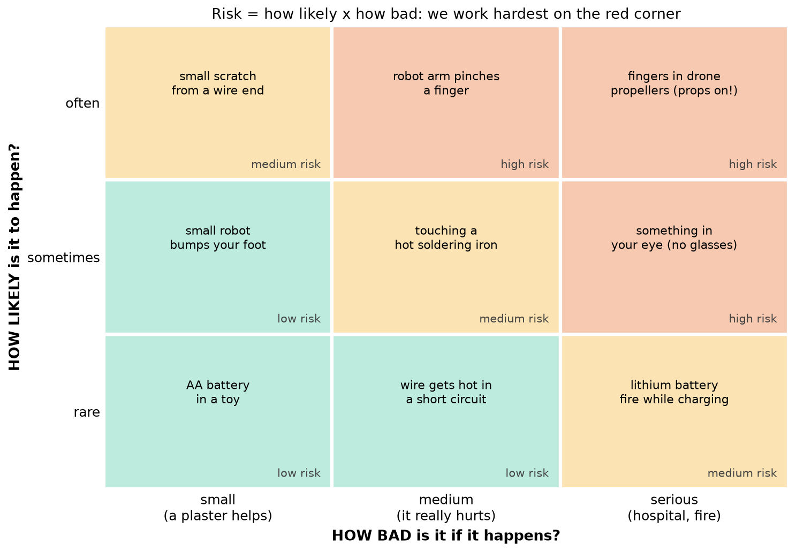
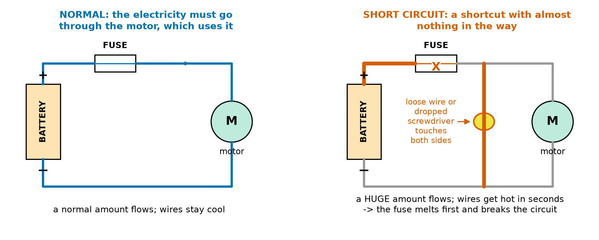
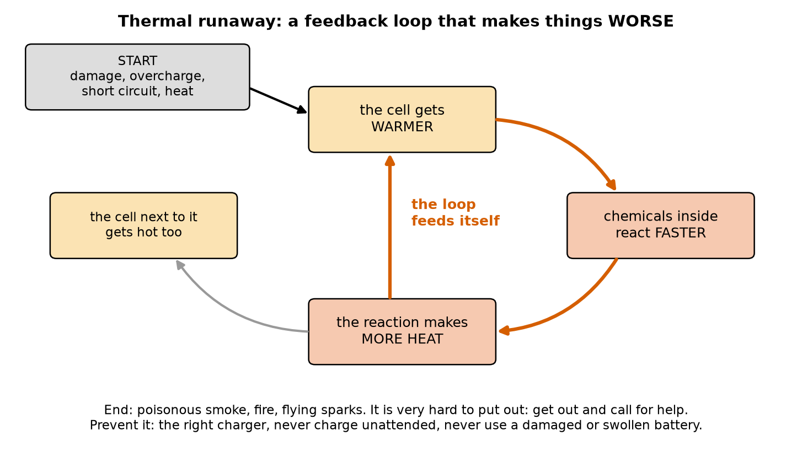
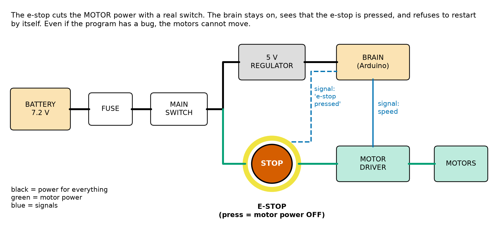
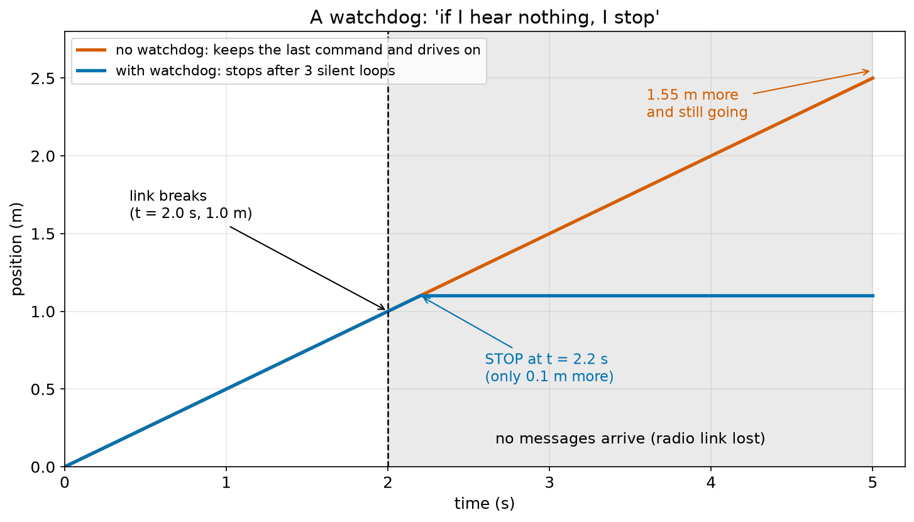
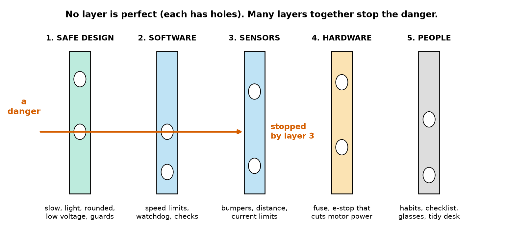
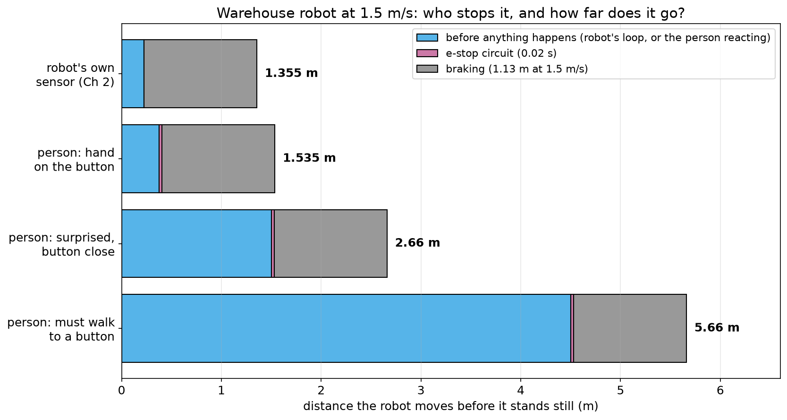
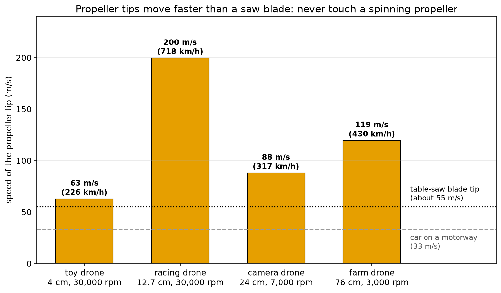

# Chapter 7 — Safety First: Electricity, Moving Parts, Batteries, Tools

> **Part 1 · Chapter 7 of 749**
> **You need:** Chapters 1–6 (especially Chapter 1: the five safety rules; Chapter 2: the "blind distance" = speed × time; Chapter 5: Rover's power path with switch and fuse; Chapter 6: feedback loops and delay).
> **You will make:** a safety check of your own workbench, a tested emergency stop for a small motor (or a drawing of one), and the "watchdog game" with friends.

---

## What you will learn

- How engineers think about danger: **hazard** and **risk**, and why risk = **how likely** × **how bad**.
- Why the small batteries in our robots will not give you an electric shock, but **can** still burn you and start a fire, and why **mains electricity** is a completely different and deadly thing.
- What a **short circuit** is, and how a **fuse** protects you.
- Why **lithium batteries** are so useful and so dangerous, and how to charge, store and throw them away safely.
- The dangers of **moving parts**: pinch points, gears, robot arms, and **propellers** that move faster than a saw blade.
- How to use **tools** safely: soldering iron, hot glue, knives, cutters, drills.
- How to design an **emergency stop** (e-stop) that works **even when the program has a bug**, and a **watchdog** that stops a robot when its radio goes silent.
- Why real safety comes from **many layers**, not from one clever trick.

---

## New words in this chapter

| Word | Simple meaning |
|---|---|
| **hazard** | Something that **could** hurt someone: a hot iron, a spinning propeller, a battery. |
| **risk** | How **likely** it is that the hazard hurts someone, together with **how bad** it would be. |
| **mains electricity** | The electricity from the sockets in the wall (230 V or 120 V). It can kill. We never use it directly in this course. |
| **short circuit** | A shortcut for electricity: the two sides of a battery are connected with almost nothing in between. A huge amount of electricity flows, and wires get hot. |
| **fuse** | A small part with a thin wire inside that **melts** and breaks the circuit when too much electricity flows (Chapter 5). |
| **lithium battery** | A light, powerful rechargeable battery (in phones, drones, laptops). It can catch fire if damaged or charged wrongly. |
| **thermal runaway** | A battery fire that feeds itself: heat makes the chemicals react faster, which makes more heat. |
| **pinch point** | A place where two parts come together and can trap a finger: gears, a gripper, the gap between a wheel and the body. |
| **emergency stop (e-stop)** | A big, easy-to-reach button that **stops all dangerous motion at once**. |
| **fail-safe** | Designed so that when something breaks, the robot goes into a **safe** state (for example: it stops), not a dangerous one. |
| **watchdog** | A timer that checks "am I still getting messages?". If not, it stops the robot. |
| **safety layer** | One of several independent ways to stop a danger (design, software, sensors, hardware, people). |

---

## 7.1 Why safety comes first

Imagine you have just built your first real robot. The motors are connected. The program is ready. You switch it on and… the robot drives at full speed off the table, pulling the laptop with it by the USB cable.

This happens to almost every robot builder once. Usually the only damage is a broken robot and a bad mood. But robots can also:

- **pinch** a finger in a gear or a gripper,
- **cut** a finger with a propeller,
- **burn** a hand with a hot wire or a soldering iron,
- **start a fire** with a damaged battery,
- **hurt somebody else** who did not know the robot would move.

The good news: almost every accident is **predictable**, and almost every one can be **prevented** with a few habits. Professional robot engineers do not think "accidents happen". They ask, before every test: **"What could go wrong, and what will stop it?"** This chapter teaches you to ask that question too.

🧠 **Remember:** Safety is not a separate topic you learn once. It is part of **every** design and **every** test. A robot that works but hurts someone is a **failed** robot.

### Hazard and risk

Engineers use two words that sound similar but mean different things.

📖 **New word: hazard** — something that **could** cause harm. A sharp knife is a hazard. A spinning propeller is a hazard. A battery is a hazard.

📖 **New word: risk** — how much we should **worry** about a hazard. It depends on two things:

1. **How likely** is it that someone gets hurt?
2. **How bad** would it be?

A sharp knife in a closed drawer is a hazard, but the risk is low (nobody touches it). The same knife used to cut a hard plastic sheet towards your hand: same hazard, much higher risk.

🔢 **Maths** — a simple way to give risk a number:

```
how likely:  rare = 1    sometimes = 2    often = 3
how bad:     small = 1   medium = 2       serious = 3

risk = how likely × how bad          (from 1 to 9)
```

Example: touching a hot soldering iron. It happens **sometimes** (2) and it **really hurts** (medium, 2):

```
risk = 2 × 2 = 4   → medium risk
```

Example: putting your fingers into a racing-drone propeller that is armed on a table. Beginners do this **often** (3), and the injury is **serious** (3):

```
risk = 3 × 3 = 9   → highest risk
```

We call 1–2 **low**, 3–4 **medium** and 6–9 **high**. Look at Figure 7.1.



*Figure 7.1 — A risk matrix: how likely (up the side) against how bad (along the bottom). We work hardest on the red corner.*

**How to read this picture:** Find a hazard in the grid. Go **down** to read how bad it is, and **left** to read how likely it is. The colour shows the risk: green is low, yellow is medium, red is high. The top-right corner (likely **and** serious) is where we must act first.

### Two ways to lower a risk

The matrix shows the two ways to make things safer:

- **Make it less likely** (move **down** in the grid): keep the propellers off on the table; put the iron back in its stand every time; put a guard around the gears.
- **Make it less bad** (move **left** in the grid): use a small, slow robot instead of a big fast one; use a fuse so that a short circuit melts a cheap fuse instead of a wire; use safety glasses so that a flying wire end hits plastic instead of your eye.

The best safety ideas do **both**.

🤖 **Robot link:** Real companies that build robots must write down a **risk assessment** like this for every robot they sell: a list of hazards, a risk number for each, and what they do to lower it. Chapter 744 shows the real safety standards. You will make a small one for your own workbench in Lab 7.1.

---

## 7.2 Electricity: what can hurt you and what cannot

You will learn electricity properly in Part 5 (Chapters 73–93). Here we only need the **safety ideas**, explained in words.

### A water picture

Think of electricity like **water in pipes**:

- The **battery** is a pump that pushes water around.
- **Voltage** (measured in **volts**, V) is **how hard** the pump pushes.
- **Current** (measured in **amps**, A) is **how much** water flows each second.
- Everything in the circuit (a motor, a lamp, your body) is like a **narrow pipe** that makes it harder for the water to flow.

A weak pump (low voltage) cannot push much water through a very narrow pipe. A strong pump (high voltage) can.

### Why our robot batteries do not shock you

Your **dry skin** is like a very narrow pipe: it is hard for electricity to get through. The batteries in our robots are **weak pumps**: Rover's battery is 7.2 V; drone batteries are usually 7–25 V. They cannot push enough electricity through dry skin to hurt you. You can touch both ends of Rover's battery with dry fingers and feel **nothing**.

### Mains electricity is completely different

The sockets in the wall give **mains electricity**: **230 V** in most countries (120 V in some, such as the USA). That is a **very strong pump**. It can push enough electricity through your body to **stop your heart**. People die from mains electricity every year.

⚠️ **Careful:** In this course:
- **Never** connect anything you build to the wall socket.
- **Never** open a mains power supply, a phone charger, a microwave or a TV. Some parts inside can stay dangerous **even after you unplug it**.
- When you need power from the wall, use a **finished, closed** power adapter (a "wall wart") or a closed bench power supply, and connect only to its low-voltage side.
- Big industrial robots, electric cars and some big machines use **hundreds of volts**. Only trained adults work on those.

🧠 **Remember:** **Low voltage** (our batteries, under about 25 V) → no shock, but heat and fire are still possible. **Mains** (230 V or 120 V) → can kill. We do not touch it.

### The real danger of low voltage: heat

If low-voltage batteries cannot shock you, why do we need a fuse? Because of **heat**.

When a lot of electricity flows through a wire, the wire gets **hot**. Normally, the motor is a "narrow pipe" that limits how much flows, so the wires stay cool. But if the two ends of the battery are connected by just a **piece of metal**, nothing limits the flow. Look at Figure 7.2.



*Figure 7.2 — Left: in a normal circuit, all the electricity must go through the motor, which limits it. Right: in a short circuit, a loose wire or a dropped screwdriver makes a shortcut. A huge amount flows, and the fuse melts before the wires get dangerously hot.*

**How to read this picture:** Follow the coloured wire from the **+** end of the battery, round the circuit, back to the **−** end. On the left (blue), the only way is through the motor. On the right, a red shortcut connects the top wire to the bottom wire **before** the motor. The thick red line shows where the huge flow goes. The **X** on the fuse means it has melted and broken the circuit. The grey wires carry nothing any more.

📖 **New word: short circuit** — a path for electricity with almost nothing in the way, usually by accident. The name means the electricity takes a **short** way round instead of going through the parts it should go through.

A short circuit of even a small battery can:
- make a thin wire **glow red** in a few seconds,
- **melt** the plastic around wires and make poisonous smoke,
- **burn** your fingers if you are holding the wire or a ring or watch that made the shortcut,
- **damage the battery** (and a damaged lithium battery can catch fire — Section 7.3).

### How a fuse protects you

📖 A **fuse** (Chapter 5) is a small part with a thin, special wire inside. It is the **weakest** place in the circuit **on purpose**. When far too much electricity flows, the fuse wire melts first and **breaks the circuit**. Then nothing flows any more.

Think of it as a **guard** that sacrifices itself. A new fuse costs very little. A melted robot, a burned table or a house fire costs much more.

The rules for a fuse:

1. Put it **as close to the battery as possible**, on the **+** wire. Then almost every wire in the robot is protected. (A short circuit **before** the fuse is not protected.)
2. Choose its size (in amps) so that it is **bigger** than the most the robot needs normally, but **smaller** than what the wires can carry safely. Application 3 below works this out for Rover.
3. When a fuse melts, **find the cause first**. Never replace it with a bigger fuse or with a piece of wire. That would remove the guard.

### Other electrical habits

- **Switch off before you change wires.** A wire end that swings onto the wrong pin can make a short circuit or destroy a part.
- **No loose metal on the workbench.** Screws, paper clips and cut wire ends are the most common cause of short circuits on a desk.
- **Take off rings, watches and metal bracelets** when you work on bigger batteries. A ring that touches both ends gets very hot.
- **Battery wires: red for +, black for −**, always. Connecting a battery the wrong way round (**reverse polarity**) can destroy electronics in a moment.
- **Cover bare ends** of wires with insulating tape or heat-shrink tube.
- **Check with your nose and fingers (carefully):** a burning smell, smoke, or a part that is too hot to touch means **switch off at once**.

🤖 **Robot link:** Real robots measure their own current all the time (Chapter 129). If a motor suddenly draws far too much (for example because it is blocked), the software or the motor driver cuts the power before anything gets hot. That is an "electronic fuse".

---

## 7.3 Batteries: small boxes full of energy

A battery is **stored energy**. That is why it is useful (it runs your robot for hours), and that is also why it can be dangerous (if the energy comes out all at once, it comes out as **heat**).

### Kinds of batteries you will meet

| Kind | Where you see it | Danger level | Notes |
|---|---|---|---|
| **Alkaline** (AA, AAA, 9 V) | toys, remotes | low | Not rechargeable. Do not try to charge them: they can leak or burst. |
| **NiMH** (rechargeable AA) | Rover (Chapter 5), cameras | low–medium | Quite safe. A short circuit still makes them very hot. |
| **Lithium-ion** cells (for example the "18650" size) | laptops, power tools, e-bikes | medium–high | Lots of energy in a small, heavy cell. Strong metal case. |
| **LiPo** (lithium polymer, soft pouch) | drones, racing cars, phones | **high** | Very light and powerful. The soft pouch is easy to damage. |
| **Coin cells** (button batteries) | watches, small sensors | special danger | If a small child **swallows** one, it can burn through the throat within a couple of hours. Keep them away from small children. If one is swallowed, go to a hospital immediately. |
| **Lead-acid** | cars, some big robots, backup power | medium | Heavy. Contains acid. Can give off a gas that burns while charging. |

Chapter 89 explains the batteries in detail (capacity, voltage, how fast they can give energy). Chapter 621 explains LiPo batteries for drones.

### Why lithium batteries catch fire

Lithium batteries pack a lot of energy into a small, light box. That is great for drones. But if a lithium cell is **damaged**, **overcharged** (filled too much), **short-circuited** or **heated**, something dangerous can begin.

Look at Figure 7.3. It shows a **loop**, just like the control loops in Chapter 6, but this loop makes things **worse**, not better.



*Figure 7.3 — Thermal runaway: once a lithium cell gets too warm, the chemicals inside react faster, which makes more heat, which makes them react even faster.*

**How to read this picture:** Start at the grey box (top left): something starts the problem. Follow the red arrows round the circle: warmer → faster reaction → more heat → warmer again. Each time round the loop, the temperature is higher. The grey arrow shows that a hot cell also heats the cell **next to it**, so the fire spreads from cell to cell. The text at the bottom tells you what happens at the end, and how to prevent it.

📖 **New word: thermal runaway** — "thermal" means "about heat", and "runaway" means "out of control". A battery in thermal runaway heats itself, faster and faster, until it vents smoke and catches fire.

🔢 **Maths** — why this loop is so dangerous. In Chapter 6, a good control loop **shrinks** the error a little each time: 1.2 → 0.96 → 0.768… (0.8 times each loop). A runaway loop does the opposite: it **grows** each time. Suppose a damaged cell is 10 °C too warm, and each "round" of the loop makes the extra heat 1.5 times bigger:

```
round 0:  10 °C too warm
round 1:  10 × 1.5 = 15 °C
round 2:  15 × 1.5 = 22.5 °C
round 3:  22.5 × 1.5 ≈ 34 °C
round 4:  ≈ 51 °C
round 5:  ≈ 76 °C
round 6:  ≈ 114 °C      → the cell is now far too hot and starts to vent and burn
```

(These numbers are only a picture of the idea; real batteries are more complicated.) It is exactly the "unstable" loop from Chapter 6, Figure 6.3, where each swing was 1.25 times bigger than the last. Once it has started, it is very hard to stop. So the whole point of battery safety is: **never let it start.**

### Signs that a battery is damaged

Stop using a battery, and put it somewhere safe (outside, on stone or sand, away from anything that can burn), if:

- it is **swollen** or puffy (a LiPo pouch that looks like a pillow),
- it has a **dent**, a cut, or a hole,
- it gets **hot** when it should not,
- it **smells** sweet or chemical,
- it was in a **crash** (drone crashes often damage batteries without showing it at once).

### Safe charging

1. Use the **right charger** for the battery type. A LiPo needs a LiPo charger with **balance** connection (which fills every cell equally). Never charge LiPo with a NiMH charger or the other way round.
2. **Never charge unattended.** Stay in the room. Do not charge overnight or while you are out.
3. Charge on a surface that **does not burn** (stone, ceramic tiles, metal), away from curtains and paper. For LiPo, use a **LiPo safety bag** or a metal box.
4. Do not charge a battery that is **hot** (for example just after a drone flight). Wait until it is cool.
5. Do not charge a battery that is **damaged** (see the list above).
6. Have a plan: know where the door is and how to call for help.

⚠️ **Careful:** If a battery starts smoking or burning, **do not try to be a hero**. Get everyone out of the room, close the door, and call an adult and the emergency services. The smoke is poisonous. A lithium battery fire is very hard to put out and can flare up again later.

### Safe storage and transport

- **Storage charge:** do not leave lithium batteries **completely full** or **completely empty** for weeks. Store them **half full**. For LiPo cells this "storage voltage" is about **3.8 V per cell** (full is 4.2 V). Most good chargers have a "storage" button. Application 4 works this out.
- Store them in a **cool, dry** place, in a fire-safe box or bag.
- **Cover the contacts** (tape, or the original cap) so that nothing metal can touch both ends in your bag. Never carry loose batteries in a pocket with coins or keys.
- Many airlines have special rules for lithium batteries: they must usually be in your **hand luggage**, never in checked bags.

### Throwing batteries away

Never put batteries in the normal rubbish bin. In a rubbish truck they get crushed, and crushed lithium batteries start fires. Take them to a **battery recycling** point (many supermarkets and electronics shops have one). For lithium batteries, **tape over the contacts** first.

🤖 **Robot link:** Every serious robot has a small computer that watches its battery: the voltage of each cell, the temperature and the current. It is called a **battery management system** (BMS). If something looks wrong, it disconnects the battery. Your phone and every electric car have one. Chapters 89, 129 and 621 come back to this.

---

## 7.4 Moving parts: where robots bite

A robot **moves**. That is the point of a robot. But every moving part is a hazard.

### Pinch points

📖 **New word: pinch point** — a place where two parts come together and can trap a finger. Look for them on every robot:

- **Gears** that mesh with each other (a finger pulled between two gears can be badly hurt, even with a small motor, because gears **multiply force**; Chapter 68 shows how).
- **Grippers** that close.
- The gap between a **wheel** and the robot body.
- The **elbow** of a robot arm, where two links fold together.
- **Belts and pulleys.**
- The space between a robot arm and a **wall or table**: the arm can push your hand against it.

Ways to make pinch points safer:
- Put a **cover** (guard) over gears and belts.
- Leave **gaps** big enough for a finger (or too small for one to go in).
- Make grippers and small robots **weak** enough that they cannot hurt (a safe design is the best safety).
- Keep hands away when the robot is powered.

### Stored energy you cannot see

Motors are not the only things that move. Watch out for:

- **Springs** and stretched rubber bands (they jump when released).
- **Gravity:** a robot arm that holds a load up will **fall** when the power is cut, unless it has brakes. Real industrial arms have brakes in their joints that **grab automatically when the power goes off** (a fail-safe design). Chapter 385 shows how an arm "holds itself up" against gravity with its motors.
- **A robot that is coasting:** if you cut a moving robot's power, it does not stop at once; it rolls on. Section 7.6 shows how far.

### Speed and size make a huge difference

A small 1 kg robot that crawls at 0.1 m/s bumping into your foot is harmless. A 100 kg robot at 2 m/s can break a leg. Two things matter:

- **Mass:** a heavier robot hits harder.
- **Speed:** a faster robot hits **much** harder. Twice as fast means **four times** the energy in a crash. (You saw the same "twice as fast → four times the braking distance" rule in Chapter 2. Chapter 67 explains the maths behind both.)

That is why rule 3 in Chapter 1 says: **start slow**. A new program on a new robot always starts at low speed and low power.

### Propellers: the most dangerous part in this course

Drone propellers look like light plastic toys. They are not. A propeller spins so fast that its **tip** moves faster than a car on a motorway, and often faster than the teeth of a saw blade. Application 2 below works out the exact numbers. For now, the rules:

- **Propellers OFF** whenever you test motors, change settings, or work on the drone on a table (rule 4 in Chapter 1).
- **Arm** the drone (make the motors ready to spin) only when it is on the ground, outside or in a safe cage, with **everyone** well away.
- **Disarm** before you walk to the drone. Never pick up an armed drone.
- Use **propeller guards** on small drones that fly near people.
- Wear **safety glasses** when you fly or test: a broken propeller piece flies off very fast.

Chapter 615 explains drone safety and the laws for flying.

### The robot arm

Industrial robot arms are fast, strong and blind (unless they have special sensors). They usually work inside a **cage** with a door. When the door opens, the arm **stops**. Never climb into a robot cage, and never reach into the space a robot arm can reach while it is switched on. Special "cobots" (collaborative robots, Chapter 4) are designed to work next to people: they are slower, lighter, rounded, and they stop when they touch something. Application 5 shows how they slow down when a person comes close.

---

## 7.5 Tools: the workbench rules

You will use a few tools to build robots. Each has its own hazard.

| Tool | Hazard | Safe habit |
|---|---|---|
| **Soldering iron** (about 300–400 °C) | burns; fumes from the flux; lead in old solder | Always put it back in its **stand**. Never touch the metal part. Hold wires with pliers or a "helping hands" clamp. Work in a room with **fresh air**, or use a small fan that blows the smoke away from your face. Prefer **lead-free** solder; if you use solder with lead, **wash your hands** afterwards and do not eat at the bench. Switch it off when you finish. Chapter 92 teaches soldering step by step. |
| **Hot glue gun** (about 120–200 °C) | burns; hot glue sticks to skin | Put it on its stand. Do not touch the nozzle or fresh glue. Have a bowl of cold water ready for small burns. |
| **Craft knife** | cuts | Cut **away** from your body and hands. Use a metal ruler and a cutting mat. Retract or cover the blade after each cut. |
| **Wire cutters** | flying wire ends | Point the wire end **down** or hold it while cutting. Wear **safety glasses**. |
| **Drill** | flying chips; long hair or loose clothes caught in the drill | Clamp the work piece; never hold small parts in your hand. Tie long hair back. Wear glasses. Use a drill only with an adult if you are young. |
| **Saw** | cuts | Clamp the work piece. Let an adult help with power saws. |
| **Screwdrivers** | slipping into your hand; short circuits | Push **away** from your other hand. Use one with an insulated handle. Never let it fall across battery terminals. |
| **Multimeter** | wrong setting can blow its fuse; mains is deadly | Chapter 81 teaches safe measuring. Never measure the wall socket. |

### Workbench habits

- **Safety glasses** whenever you cut, drill, solder or test a new robot or a drone. Eyes cannot be replaced.
- **Tidy bench**: no loose screws or wire ends near batteries; tools back in their place.
- **No drinks** next to the electronics. Water and electronics do not mix.
- **Good light** and enough space.
- **Know where the first-aid kit is.** For a small burn: cool it under running **cool water** for at least 10–20 minutes. For anything bigger, get help.
- **Tell someone** what you are doing when you test something risky, especially when you are young: an adult nearby is part of your safety system.
- **Wheels up first**: when you test a new driving robot, put it on a block so that its wheels spin **in the air**. If something is wrong, it cannot drive away.

---

## 7.6 The emergency stop: every robot in this course has one

Rule 2 in Chapter 1 said: **always have a way to stop**. Now we design it properly.

📖 **New word: emergency stop (e-stop)** — a big, easy-to-press button that stops all dangerous motion **at once**.

### What a good e-stop must do

1. **Easy to see:** a **red** button on a **yellow** background. People everywhere know this means "stop".
2. **Easy to reach:** big, on top of the robot or within reach of the person testing it. Not hidden under the robot.
3. **Easy to press:** one quick slap with the palm, even in panic. Usually a "mushroom" shaped button.
4. **It stays pressed:** after you press it, it **latches** (stays down) until you twist or pull it to release it. So the robot cannot start again by itself.
5. **It cuts the motor power with a real switch**, not only a message to the program. (Chapter 5 said this already.)
6. **Releasing it does not restart the robot.** After the button is released, the robot waits until a person **deliberately** starts it again (a separate start button, or a command).

Point 5 is the most important. Why not just let the brain read the button and stop the motors in software?

Because the e-stop is for the moment when **something has gone wrong**, and the thing that went wrong might be **the program itself**. If the program is stuck in a loop, crashed, or has a bug that says "full speed", it will not read your button. A **hardware** switch in the motor power wire does not care what the program does: no power, no motion.

🧠 **Remember:** An e-stop that only sends a message to the program is a **"please stop"**. An e-stop that cuts the motor power is a **"you must stop"**. For safety, we want "you must stop".

### Rover's e-stop

Look at Figure 7.4. It is Rover's power path from Chapter 5, with an e-stop added.



*Figure 7.4 — Rover's e-stop sits in the motor power wire (green). Pressing it cuts the power to the motor driver and the motors. The brain stays powered, reads a second contact of the button, and refuses to restart until the button is released and a person starts it again.*

**How to read this picture:** Start at the battery on the left. The black wire goes through the **fuse** and the **main switch** (both from Chapter 5). Then it splits. The upper black path goes to the 5 V regulator and the brain: **the e-stop does not touch it**, so the brain keeps running. The lower green path is the **motor power**: it goes **through the red e-stop button** to the motor driver and the motors. Blue lines are signals (thin wires that carry information, not power). The dashed blue line tells the brain that the button is pressed.

Why keep the brain on? Three good reasons:

- It can **remember and report** what happened ("e-stop pressed at 14:32:05, speed was 0.4 m/s").
- It can **refuse to restart** until the button is released **and** you give a start command (point 6).
- It does not have to boot again, which can take many seconds on a Raspberry Pi.

Many real e-stop buttons have **two** separate contacts inside, exactly for this: one to cut the power, one to tell the computer.

For bigger robots, the motor current is too big for a button. Then the button controls a strong electric switch called a **relay** or **contactor** (or a transistor, Chapters 87–88), which cuts the power. The idea is the same.

### How the robot stops: two kinds of stop

When the power is cut, a moving robot does not stop at once.

- A wheeled robot **rolls on** (it coasts) until friction stops it.
- A robot arm holding a load **falls**, unless its joints have brakes.
- A drone whose motors stop **falls out of the sky** (more about this below).

So engineers choose between two main kinds of stop:

| Kind of stop | What happens | Good for |
|---|---|---|
| **Cut the power at once** | Motor power off immediately. Brakes (if any) grab. | Small robots, and anything where the motors themselves are the danger. |
| **Brake first, then cut the power** | The controller brakes the robot as hard as is safe, and **then** the power is cut (by a timer in hardware, even if the program fails). | Heavy, fast robots that would roll or swing a long way if they just coasted. |

(The real standards call these "stop category 0" and "stop category 1"; Chapter 744 explains them.)

### What about drones?

For a drone, "cut the power" means "fall". Falling from 1 m on a test stand is safe; falling from 50 m on a crowd is not. So drones have:

- an **arm/disarm switch** on the remote control (disarmed = motors cannot spin; the drone's version of the e-stop for the ground);
- a **failsafe**: if the radio signal is lost, the drone does something safe that was chosen in advance: hover and slowly land, or fly back home (Chapter 640);
- a **kill switch** for emergencies near the ground (cuts the motors at once — used when the drone is about to hurt someone and falling is the lesser danger).

This shows a big idea: **the safe state depends on the robot.** For Rover, "safe" is "standing still". For a drone in the air, "safe" is "landing slowly". For a robot arm holding a hot pan, "safe" might be "stop and keep holding".

📖 **New word: fail-safe** — designed so that when something fails, the robot ends up in its **safe state**. A door lock that opens when the power fails is fail-safe for a fire. Brakes that close when the power fails are fail-safe for a robot arm.

### The watchdog: what if the messages stop?

Many robots are controlled by messages: a remote control sends "drive forward at 0.5 m/s" ten times every second. What happens if those messages **stop coming**? Maybe the robot drove out of radio range, or the remote's battery died, or the laptop program crashed.

A badly made robot keeps doing the **last thing it was told**: it drives on at 0.5 m/s, forever, with nobody controlling it. That is how robots end up in swimming pools.

A well-made robot has a **watchdog**.

📖 **New word: watchdog** — a timer that counts how long it has been since the last "I am still here" message. If it gets too long, the watchdog **stops the robot**. (The name comes from a dog that barks when something is wrong.) The regular "I am still here" message is sometimes called a **heartbeat**.

The rule is simple: **"If I hear nothing, I stop."** Silence is treated as danger. That is fail-safe thinking.

The Code section below simulates this. Figure 7.5 shows the result.



*Figure 7.5 — The radio link breaks at 2.0 s. Without a watchdog (red), the robot keeps driving with its last command. With a watchdog (blue), it stops after 3 silent loops (0.3 s).*

**How to read this picture:** The bottom axis is time, the left axis is how far the robot has driven. Until 2.0 s, both robots drive the same way (the lines lie on top of each other). The grey area is the time with no messages. The red line keeps climbing: the robot drives on with nobody in control. The blue line becomes flat at 1.1 m: the watchdog stopped it.

🔢 **Maths** — how far does the robot drive "unsupervised"? It is the blind-distance idea from Chapter 2:

```
distance after the link breaks = speed × time until the watchdog acts
                               = 0.5 m/s × 0.2 s        (two full loops: 2.0–2.2 s)
                               = 0.1 m
```

The watchdog notices the silence in the loop at 2.0 s (1 silent loop), 2.1 s (2) and 2.2 s (3), and stops in that third silent loop. The robot only drove in two of those loops, so it moved 0.1 m more. Without the watchdog, it would keep going: after 5 s it has driven 1.5 m further, and it does not stop.

💡 **Tip:** A shorter timeout stops the robot sooner, but if it is **too** short, a single lost message (radio links lose some messages all the time) would stop the robot for no reason. Engineers choose a timeout of a few message periods: here, 3 messages. Chapters 544 and 640 show real numbers.

🤖 **Robot link:** Watchdogs are everywhere:
- Inside almost every microcontroller there is a **hardware watchdog**: if the program gets stuck and stops "feeding" the watchdog, the chip **restarts itself**.
- Train drivers have a "dead man's switch": if the driver does not press a pedal or button every so often, the train brakes by itself.
- Lawn mowers have a handle you must hold; let go and the blade stops.
- Robots running ROS 2 (Part 27) stop when the velocity commands stop arriving.

---

## 7.7 Many layers of safety

No single safety idea is perfect. The fuse does not help if the robot drives off the table. The e-stop does not help if nobody is near it. The software limit does not help if the software crashes. So engineers use **many layers**, each different from the others. Look at Figure 7.6.



*Figure 7.6 — Five layers of safety. Each layer has "holes" (ways it can fail). A danger only gets through if the holes in all the layers line up. Here, the danger passes through the holes in layers 1 and 2 but is stopped by layer 3.*

**How to read this picture:** The red arrow is a danger coming from the left (for example "the program accidentally commands full speed towards a person"). Each coloured bar is one safety layer. The white holes are the ways each layer can fail. The arrow passes through a hole in **safe design** (the robot is fast enough to hurt) and a hole in **software** (the speed limit had a bug), but hits a solid part of **sensors** (the bumper sees the person and stops the motors). Layers 4 and 5 were not even needed this time, but they are there in case layer 3 also fails.

The five layers, from first to last:

1. **Safe design:** make the robot unable to cause serious harm in the first place: small, light, slow, rounded edges, low voltage, gears covered. This is the **strongest** layer, because it works without anything having to "notice" the danger.
2. **Software:** speed limits, checks on every command ("never more than 0.3 m/s near people"), watchdogs.
3. **Sensors:** bumpers, distance sensors, current sensing, tilt sensors that notice something is wrong and stop the robot.
4. **Hardware protection:** fuses, the e-stop that cuts motor power, brakes that grab when the power fails. These work even when the program does not.
5. **People:** safe habits, checklists, safety glasses, a tidy bench, a friend standing by the e-stop during the first test.

🧠 **Remember:** Do not trust one layer. **Every** robot in this course gets at least: a **safe design** (start slow and small), a **fuse**, an **e-stop** that cuts motor power, **software limits**, and **you** following the checklist.

### The pre-power checklist

Before you switch on a new or changed robot, check (out loud is best):

1. ☐ **Battery** undamaged, right way round, contacts covered when not in use.
2. ☐ **Fuse** in place, the right size.
3. ☐ **Wires** checked: no bare ends, no loose metal on the bench.
4. ☐ **E-stop** within reach and tested (press it once: does the motor power go off?).
5. ☐ **Speed** limit set low for the first test.
6. ☐ **Wheels up** (on a block) or propellers **off** for the first test.
7. ☐ **People** know the robot is about to move; hands, hair and loose clothes clear.
8. ☐ **Glasses** on.

Pilots go through a checklist before every flight, even after 10,000 flights, because checklists catch the mistakes that experienced people still make. Robot engineers do the same.

---

## Code

This program simulates a robot driven by a remote control. The remote sends a "drive at 0.5 m/s" message in every loop (10 loops per second). At 2.0 s the radio link breaks. The program runs twice: once **without** a watchdog and once **with** one. Read it with the table; you start typing programs in Chapter 8.

The file is `code/ch007/watchdog.py`.

```python
# watchdog.py - what does a robot do when its remote control goes silent?
speed_command = 0.5    # the remote control says: drive forward at 0.5 m/s
link_lost_step = 20    # at loop 20 (2.0 s) the radio link breaks
max_silent = 3         # the watchdog stops the robot after 3 loops without a message
dt = 0.1               # one loop every 0.1 s (10 loops per second)

for use_watchdog in [False, True]:
    position = 0.0
    speed = 0.0
    silent = 0                                  # how many loops since the last message
    for step in range(51):                      # 5 seconds
        if step < link_lost_step:               # SENSE: did a message arrive in this loop?
            speed = speed_command
            silent = 0
        else:
            silent = silent + 1
        if use_watchdog and silent >= max_silent and speed > 0:   # THINK: silent for too long?
            speed = 0.0
            print("  t =", round(step * dt, 1), "s: no message for", silent, "loops -> STOP")
        position = position + speed * dt        # ACT: drive for one loop
    print("watchdog", use_watchdog, "| final position", round(position, 2), "m | driven after the link broke",
          round(position - speed_command * link_lost_step * dt, 2), "m")
```

| Line | Code | What it does (simple English) |
|---|---|---|
| 1 | `# watchdog.py - …` | A comment: the name and the idea. |
| 2 | `speed_command = 0.5` | The command inside every message from the remote: drive at 0.5 m/s. |
| 3 | `link_lost_step = 20` | The radio link breaks at loop 20. Loop 20 is at 20 × 0.1 = 2.0 s. |
| 4 | `max_silent = 3` | The watchdog's limit: 3 loops in a row without a message → stop. |
| 5 | `dt = 0.1` | The loop time: 0.1 s. |
| 6 | *(empty)* | |
| 7 | `for use_watchdog in [False, True]:` | Run the whole simulation twice. 📖 `True` and `False` are Python's words for **yes** and **no**. The first time, `use_watchdog` is `False` (no watchdog); the second time it is `True`. |
| 8 | `position = 0.0` | The robot starts at 0 m (fresh for each run). |
| 9 | `speed = 0.0` | It is standing still before the first message. |
| 10 | `silent = 0` | A counter: how many loops in a row have had **no** message. |
| 11 | `for step in range(51):` | 51 loops: 0.0 s to 5.0 s. |
| 12 | `if step < link_lost_step:` | **Sense.** Before loop 20, a message arrives in every loop. |
| 13 | `speed = speed_command` | Do what the message says: drive at 0.5 m/s. |
| 14 | `silent = 0` | We just heard from the remote, so the silence counter goes back to 0. This is "feeding the watchdog". |
| 15 | `else:` | Otherwise (loop 20 and later): no message arrived. |
| 16 | `silent = silent + 1` | One more silent loop. Notice: `speed` is **not** changed here. The robot keeps the last command it got. That is the dangerous default. |
| 17 | `if use_watchdog and silent >= max_silent and speed > 0:` | **Think.** 📖 `and` means **all** of these must be true: the watchdog is switched on, **and** we have had 3 or more silent loops, **and** the robot is still moving. (`>=` means "greater than or equal to".) The last part makes sure we only print "STOP" once. |
| 18 | `speed = 0.0` | The watchdog stops the robot. |
| 19 | `print(…)` | Report the moment the watchdog acted. |
| 20 | `position = position + speed * dt` | **Act.** Drive for one loop: distance = speed × time. |
| 21–22 | `print(…)` | After 5 s, show where the robot ended up, and how far it drove **after** the link broke. At 2.0 s it was at 0.5 × 20 × 0.1 = 1.0 m, so we subtract 1.0 m. (A long line can continue on the next line inside the brackets.) |

**Output:**

```
watchdog False | final position 2.55 m | driven after the link broke 1.55 m
  t = 2.2 s: no message for 3 loops -> STOP
watchdog True | final position 1.1 m | driven after the link broke 0.1 m
```

**What the output means:**

- **Without a watchdog**, the robot drove **1.55 m** after it lost contact, and it was still driving at 0.5 m/s when the simulation ended. In real life, it would drive on until it hit something or its battery died.
- **With a watchdog**, the robot noticed the silence at 2.2 s and stopped after only **0.1 m**. This is Figure 7.5.
- (Why 2.55 m and not 2.5 m? There are 51 loops, from 0.0 s to 5.0 s, and the robot drives in every one of them: 51 × 0.05 = 2.55 m.)

💡 **Tip:** Find the sense–think–act parts: sense (line 12), think (line 17), act (line 20). The watchdog is just **one more `if`** in the loop. Safety code is often very short, but it must be **correct**, and it must be **tested**: the only way to know your watchdog works is to switch off the remote and watch the robot stop (Lab 7.3 practises this with people first).

---

## Small examples

### Example 1 — Risk numbers

Use risk = how likely × how bad (each 1 to 3).

| Hazard | How likely | How bad | Risk | Level |
|---|---|---|---|---|
| Loose screw on the bench causes a short circuit | 2 | 2 | 4 | medium |
| Charging a LiPo overnight unattended, fire | 1 | 3 | 3 | medium |
| A slow 1 kg robot drives into your foot | 2 | 1 | 2 | low |
| Testing a racing drone indoors with propellers on | 3 | 3 | 9 | high |

### Example 2 — Lowering one risk

"Testing a racing drone indoors with propellers on" (risk 9). Take the propellers off: now even if the motors start, nothing can cut you.

```
how likely: 3 → 1 (the motors may still start, but they cannot cut you)
how bad:    3 → 1 (a bare motor shaft spinning is not dangerous)
risk = 1 × 1 = 1   → low
```

One simple habit took the worst risk on the bench down to the lowest.

### Example 3 — The blind distance of an e-stop

A robot drives at 0.8 m/s. You press the e-stop 0.3 s after you see the danger.

```
distance before the button is pressed = 0.8 × 0.3 = 0.24 m
```

The robot moves 24 cm before **anything** starts to happen, and then it still has to brake.

### Example 4 — Watchdog timeout

Messages arrive every 0.05 s (20 per second). The watchdog stops the robot after 4 silent message periods.

```
timeout = 4 × 0.05 = 0.2 s
at 1.2 m/s: distance before the watchdog acts is at most 1.2 × 0.2 = 0.24 m
```

### Example 5 — Turns per second

A drone motor spins at 24,000 rpm (turns per minute).

```
turns per second = 24,000 ÷ 60 = 400
```

In your reaction time of 0.2 s it turns 400 × 0.2 = **80 times**.

### Example 6 — LiPo storage voltage

A drone battery has **3 cells** in a row ("3S"). Full is 4.2 V per cell; storage is about 3.8 V per cell.

```
full:     3 × 4.2 = 12.6 V
storage:  3 × 3.8 = 11.4 V
```

If your charger shows 12.6 V after a day without flying, discharge it to about 11.4 V before you put it away for weeks.

---

## 🏭 Real robot applications

### Application 1 (worked in full) — 🏭📦 How far does a warehouse robot move after someone hits the e-stop?

**1. The real problem.** In Chapter 2, we checked that a warehouse robot at 1.5 m/s can stop in time using its **own sensor**. But warehouse robots also have e-stop buttons, and workers carry wireless e-stops. Managers sometimes think: "If anything goes wrong, a worker will just press the button." Is that a good plan?

**2. Why this idea.** Stopping always has three parts: the time **before** anything happens (someone has to notice and press, like the sense–think part of a loop), the time the **e-stop circuit** needs to cut the power, and the **braking** distance. The first part is the blind distance from Chapter 2: speed × time.

**3. The numbers.**

| Fact | Value |
|---|---|
| Robot speed | 1.5 m/s |
| Braking distance at 1.5 m/s (from Chapter 2, measured by the maker) | 1.13 m |
| E-stop circuit delay | 0.02 s |
| Person's time from "danger!" to button pressed | 0.25 s (hand already on the button), 1.0 s (surprised, button close), 3.0 s (must walk to a button) |
| For comparison: robot's own sensor + thinking (Chapter 2) | 0.15 s, total 1.355 m |

The 0.25 s is your "ready" reaction time from the ruler-drop lab (Lab 6.1). A **surprised** person is much slower than a person waiting for the ruler to drop: about 1 second or more is normal.

**4. The maths, step by step** (the "hand on the button" case):

```
Step 1. Distance while the person reacts = 1.5 × 0.25  = 0.375 m   (d = v × t)
Step 2. Distance while the circuit works = 1.5 × 0.02  = 0.03 m
Step 3. Braking distance (maker)                       = 1.13 m
Step 4. Total = 0.375 + 0.03 + 1.13                     = 1.535 m
```

**5. The code.** File `code/ch007/e_stop_distance.py`:

```python
# e_stop_distance.py - how far does a warehouse robot move after a person sees danger?
speed = 1.5             # the robot drives at 1.5 m/s
brake_distance = 1.13   # metres to stand still at 1.5 m/s, measured by the maker (Chapter 2)
circuit_delay = 0.02    # the e-stop circuit needs 0.02 s to cut the motor power

situations = ["hand on the button", "surprised, button close", "must walk to a button"]
human_times = [0.25, 1.0, 3.0]   # seconds from "danger!" until the button is pressed

for i in range(3):
    human = speed * human_times[i]        # distance driven while the person reacts
    circuit = speed * circuit_delay       # distance driven while the circuit works
    total = human + circuit + brake_distance
    print(situations[i], "| person", round(human, 3), "m | circuit", round(circuit, 3),
          "m | braking", brake_distance, "m | total", round(total, 3), "m")
```

| Line | Code | What it does (simple English) |
|---|---|---|
| 1 | comment | The name and the question. |
| 2–4 | settings | The robot's speed, its braking distance at that speed, and the e-stop circuit's delay. |
| 5 | *(empty)* | |
| 6 | `situations = [...]` | A list of three names, one for each situation (lists: Chapter 2). |
| 7 | `human_times = [...]` | The person's reaction time in each situation, in the same order. |
| 8 | *(empty)* | |
| 9 | `for i in range(3):` | Do the calculation for situation 0, 1 and 2. |
| 10 | `human = speed * human_times[i]` | Step 1: distance driven while the person reacts. |
| 11 | `circuit = speed * circuit_delay` | Step 2: distance driven while the circuit cuts the power. |
| 12 | `total = human + circuit + brake_distance` | Steps 3 and 4: add the braking distance. |
| 13–14 | `print(…)` | Show all the parts and the total. |

**Output:**

```
hand on the button | person 0.375 m | circuit 0.03 m | braking 1.13 m | total 1.535 m
surprised, button close | person 1.5 m | circuit 0.03 m | braking 1.13 m | total 2.66 m
must walk to a button | person 4.5 m | circuit 0.03 m | braking 1.13 m | total 5.66 m
```

Figure 7.7 shows these totals next to the robot's own sensor.



*Figure 7.7 — The distance a warehouse robot at 1.5 m/s moves before it stands still: stopped by its own sensor (top) and by a person pressing an e-stop in three situations.*

**How to read this picture:** Each bar is one situation. The light-blue part is the distance driven **before anything happens** (the robot's sense-and-think time, or the person's reaction). The thin purple part is the e-stop circuit. The grey part is braking. The number at the end of each bar is the total.

**6. The result.**

- The **e-stop circuit** itself is almost nothing: 3 cm.
- The **braking** is the same in every case: 1.13 m.
- The **person** is the big, uncertain part: from 0.375 m to 4.5 m.
- The robot's **own sensor** stops it in **1.355 m**, better than even the best human case.

So the manager's plan is wrong. An e-stop is the **last** layer (layer 4 and 5 in Figure 7.6), not the first. The robot's sensors and software (layers 2 and 3) must stop it **automatically**, because they react faster than any person and they never look away. The e-stop is there for when those layers fail.

One more point: an e-stop that only **cuts the power** may make the robot **coast** without braking, which takes even farther than 1.13 m. That is why heavy warehouse robots use "brake first, then cut the power" (Section 7.6), or brakes that grab automatically when the power goes off.

**7. Going further.** Real safety standards turn this exact calculation into a rule: the robot's safety scanner must look far enough ahead to cover **reaction + braking** distance, with an extra margin. Chapter 744 shows the real rule. In Chapter 59 you will learn why the braking distance grows with speed², and in Chapter 523 how to measure every delay in a robot's loop.

### Application 2 (worked in full) — 🚁 How fast is the tip of a propeller?

**1. The real problem.** Drone propellers are light plastic. Beginners often think "it is just plastic, it cannot hurt much." Every year, many people are badly cut by drone propellers, often on their fingers and faces. How fast does a propeller tip really move?

**2. Why this idea.** In one full turn, the tip of the propeller travels once around a circle. If we know the **length of that circle** and **how many turns per second**, we know the tip's speed:

```
distance in one turn  = π × diameter          (the circumference of a circle; Chapter 48)
turns per second      = rpm ÷ 60              (rpm = revolutions = turns per minute)
tip speed             = distance in one turn × turns per second
```

📖 **π** ("pi") is a special number, about **3.14159**. For every circle, the distance around it is π times the distance across it. Chapter 48 explains it.

**3. The numbers** (typical values at full power):

| Drone | Propeller diameter | Speed |
|---|---|---|
| Small toy drone | 4 cm = 0.04 m | 30,000 rpm |
| Racing drone ("5-inch" props) | 12.7 cm = 0.127 m | 30,000 rpm |
| Camera drone | 24 cm = 0.24 m | 7,000 rpm |
| Big farm spraying drone | 76 cm = 0.76 m | 3,000 rpm |

**4. The maths, step by step** (the racing drone):

```
Step 1. Distance in one turn = 3.14159 × 0.127  ≈ 0.399 m
Step 2. Turns per second     = 30,000 ÷ 60      = 500
Step 3. Tip speed            = 0.399 × 500      ≈ 199.5 m/s
Step 4. In km/h              = 199.5 × 3.6      ≈ 718 km/h
```

(To change m/s into km/h, multiply by 3.6, because 1 m/s = 3,600 m per hour = 3.6 km/h.)

**5. The code.** File `code/ch007/prop_tip.py`:

```python
# prop_tip.py - how fast does the tip of a propeller move?
pi = 3.14159

names = ["toy drone", "racing drone", "camera drone", "farm drone"]
diameters = [0.04, 0.127, 0.24, 0.76]     # metres (0.127 m = 5 inches)
rpms = [30000, 30000, 7000, 3000]         # turns per minute at full power

for i in range(4):
    circumference = pi * diameters[i]           # metres the tip travels in one turn
    turns_per_second = rpms[i] / 60
    tip_speed = circumference * turns_per_second
    print(names[i], "| diameter", diameters[i], "m |", rpms[i], "rpm |", round(turns_per_second, 1),
          "turns/s | tip speed", round(tip_speed, 1), "m/s =", round(tip_speed * 3.6), "km/h")
```

| Line | Code | What it does (simple English) |
|---|---|---|
| 1 | comment | The name and the question. |
| 2 | `pi = 3.14159` | The number π, written with 5 decimals. (Python has a more exact π in its `math` module; Chapter 26.) |
| 3 | *(empty)* | |
| 4–6 | three lists | The names, diameters (in metres) and speeds (rpm) of four propellers, in the same order. |
| 7 | *(empty)* | |
| 8 | `for i in range(4):` | Do the calculation for each of the 4 propellers. |
| 9 | `circumference = pi * diameters[i]` | Step 1: the distance the tip travels in one turn. 📖 **circumference** = the distance around a circle. |
| 10 | `turns_per_second = rpms[i] / 60` | Step 2: there are 60 seconds in a minute. |
| 11 | `tip_speed = circumference * turns_per_second` | Step 3: metres per turn × turns per second = metres per second. |
| 12–13 | `print(…)` | Show the results, also in km/h (step 4). `round(tip_speed * 3.6)` with no second number rounds to a whole number. |

**Output:**

```
toy drone | diameter 0.04 m | 30000 rpm | 500.0 turns/s | tip speed 62.8 m/s = 226 km/h
racing drone | diameter 0.127 m | 30000 rpm | 500.0 turns/s | tip speed 199.5 m/s = 718 km/h
camera drone | diameter 0.24 m | 7000 rpm | 116.7 turns/s | tip speed 88.0 m/s = 317 km/h
farm drone | diameter 0.76 m | 3000 rpm | 50.0 turns/s | tip speed 119.4 m/s = 430 km/h
```



*Figure 7.8 — The speed of the propeller tip for four drones, compared with a car on a motorway (33 m/s) and the teeth of a table-saw blade (about 55 m/s).*

**How to read this picture:** Each orange bar is one drone. The number on top is its tip speed. The grey dashed line is a car on a motorway (120 km/h = 33 m/s). The black dotted line is the tip of a typical table-saw blade. Every bar goes **above both lines**.

**6. The result.**

- Even the **tiny toy drone's** propeller tip moves faster than the teeth of a table saw (63 m/s against about 55 m/s). It is so light that it usually just scratches, but it can still hurt an eye.
- The **racing drone's** tip moves at about **200 m/s**, more than half the speed of sound. It turns **500 times per second**. In your 0.2 s reaction time it turns **100 times**; with two blades, that is **200 cuts** before you can even pull your hand back.
- The **farm drone** turns slower, but its propellers are big and heavy, so they carry much more energy. They can cause very serious injuries.

This is why Chapter 1's rule 4 (**no propellers on the table**) is not a suggestion. When you work on a drone, the propellers come off.

**7. Going further.** Propeller makers keep the tip speed below the speed of sound (about 343 m/s), because near it propellers become very loud and work badly. Chapter 618 uses this formula again to design propellers, and Chapter 615 covers safe and legal flying.

### Application 3 — 🏠 Choosing Rover's fuse

**The problem:** Rover (Chapter 5) has a fuse next to its 7.2 V battery. What size?

A fuse is rated in **amps** (how much electricity per second may flow). We have Rover's power in **watts** from Chapter 5. There is a simple link (Chapter 76 explains it):

```
current (amps) = power (watts) ÷ voltage (volts)
```

**The numbers:**

```
Normal driving:  3.78 W ÷ 7.2 V              ≈ 0.53 A
Start-up peak:   each small gearmotor can draw about 1.5 A for a moment when it starts
                 (or when it is blocked), so 2 × 1.5 = 3.0 A, plus about 0.1 A for the
                 electronics                  ≈ 3.1 A
Wire limit:      the thin power wires we use are safe up to about 5 A
Short circuit:   six NiMH cells can push 20 A or more through a shortcut
```

**The choice:** the fuse must be **above 3.1 A** (or it would melt every time the motors start) and **below 5 A** (to protect the wires). A **4 A** fuse fits. We choose a **slow** ("time-delay") type, which allows short start-up peaks but still melts quickly in a real short circuit of 20 A.

**Lesson:** a fuse is chosen from the **peak** current of the robot (Chapter 5, Application 1's "going further") and the **limit** of the wires. Chapters 76, 89 and 151 make this exact.

### Application 4 — 🚁📦 A delivery-drone company's battery room

**The problem:** A drone delivery company has **40 batteries**, each 6 cells ("6S"), each storing about 100 Wh. Some days the drones do not fly. How do they keep the battery room safe?

**The numbers:**

```
total energy stored = 40 × 100 Wh = 4,000 Wh
```

That is about 280 times Rover's battery (14.4 Wh). If the batteries burned, all that energy would come out as heat.

```
full voltage    = 6 × 4.2 = 25.2 V
storage voltage = 6 × 3.8 = 22.8 V
```

**What they do:**
- Every battery that will not fly in the next day or two is brought to **22.8 V** (storage charge). Full batteries left for weeks age faster and are more likely to swell.
- Batteries are kept in **fire-resistant cabinets**, separated so that one battery in thermal runaway cannot easily heat its neighbours (Figure 7.3, grey arrow).
- The room has **smoke detectors** and is never used to store paper boxes.
- Every battery has a **log**: number of flights, crashes, and swelling checks. A battery from a crash is put in quarantine (watched in a safe place) for a day.
- The drones' own BMS reports each cell's voltage and temperature after every flight.

### Application 5 — 🏭🏥 A cobot that slows down when a person comes close

**The problem:** A collaborative robot arm (a "cobot") in a factory or a hospital pharmacy works without a cage. A person can walk up to it. How close may a person come before the robot must stop?

**The idea:** A scanner on the floor measures the distance to the nearest person. The robot uses **zones**:

| Person's distance | Robot does |
|---|---|
| more than 2.0 m | works at full speed |
| 2.0 m to 1.3 m | slows down to a safe low speed |
| less than 1.3 m | stops (and waits) |

**Where does 1.3 m come from?** It is the "blind distance" again, but now the **person** is the one moving. Safety rules assume a person can walk towards the robot at about **1.6 m/s**. If the scanner, the computer and the robot together need **0.6 s** to bring the robot to a stop:

```
distance the person walks while the robot stops = 1.6 × 0.6 = 0.96 m
+ the reach of the robot arm while it slows down ≈ 0.2 m
+ a margin for the scanner's measuring error   ≈ 0.1 m
total ≈ 1.26 m   → round up to 1.3 m
```

(This is a simplified version of the real rule; Chapter 744 shows the real one, and Chapter 743 shows how humans and robots work together.) Notice: a **faster** robot needs **more** time to stop, so it needs a **bigger** zone. Slowing down near people is not a weakness; it lets the robot work closer to them.

### Application 6 — Safety in other fields (short)

- 🌊 **Underwater robots:** water and electricity do not mix. The electronics sit in sealed, waterproof cases, with a **leak sensor** inside. If it detects water, the robot cuts the power to the thrusters and **floats up** to the surface (its fail-safe state is "come up").
- 🦿 **Humanoid and legged robots:** a falling 60 kg humanoid can hurt itself and anyone nearby. They are tested hanging from a **safety rope** (a gantry), and they learn to **fall safely** (Chapter 718). Chapter 729 covers humanoid safety.
- 🚗 **Self-driving cars:** if a car's system detects a fault, it performs a "minimal risk manoeuvre": it slows down, puts the hazard lights on and stops at the side of the road. Its safe state is "stopped, off the road", not "brakes slammed on in the fast lane".
- 🌾 **Farm robots:** big field robots have e-stop buttons on **every side** of the machine and a **wireless e-stop** carried by the farmer, plus a watchdog: if the link to the base station is lost, they stop.
- 🚀 **Space robots:** nobody can press a button on Mars. Rovers there use watchdogs and a **safe mode**: if anything unexpected happens, they stop moving, point their antenna to Earth and wait for instructions.

---

## 🔧 Hands-on lab

### Lab 7.1 — A safety check of your own workbench

**You need:** your notebook, your workspace (a desk or table where you will build robots), an adult if you are young.

**Steps:**

1. Copy this table into your notebook.

| # | Check | Yes / No | What I will do |
|---|---|---|---|
| 1 | Is there a non-burning surface (tile, metal tray, stone) for batteries and the soldering iron? | | |
| 2 | Do I have safety glasses? | | |
| 3 | Is there a stand for the soldering iron / hot glue gun? | | |
| 4 | Can I open a window or use a fan for fresh air? | | |
| 5 | Is the bench free of loose screws, wire ends and paper clips? | | |
| 6 | Are drinks kept away from the electronics? | | |
| 7 | Do I know where the first-aid kit is? | | |
| 8 | Is there a box with a lid for batteries, with their contacts covered? | | |
| 9 | Are cables on the floor tidy, so nobody trips? | | |
| 10 | Is there space to test a driving robot "wheels up" on a block? | | |

2. Walk around your workspace and fill in the table honestly.
3. For every **No**, write a small action in the last column ("buy a ceramic tile", "move my water bottle to the shelf").
4. Now list **three hazards** in your workspace. For each, give a risk number (how likely × how bad, Section 7.1), and one way to lower it.
5. Make a small **safety poster** with the pre-power checklist from Section 7.7 and stick it above your bench.

**What you should see:** Most people find 2–4 "No" answers at the start. The most common: no safety glasses, no stand for the iron, loose metal on the desk. All are cheap and quick to fix.

**If it does not work:**

| Problem | Likely cause | Fix |
|---|---|---|
| "I have no space for a workbench." | Small home. | Use a big tray or a board you can put away. It becomes your workbench, and it keeps small parts together. |
| "I cannot buy safety glasses yet." | Cost. | Until you have them, do no cutting, drilling or soldering. Paper, cardboard and simulation work is fine. |

### Lab 7.2 — Build and test an e-stop for a small motor

**You need (hardware track):** a holder for **2 × AA** batteries (3 V), a small toy DC motor (the kind from toy kits, 3 V), a **switch** (any on/off switch; a big push-button with latching is best), a few wires, insulating tape. A small flag of paper tape on the motor shaft so you can see it spinning.
**Paper track:** your notebook and coloured pens.

**Steps (hardware track):**

1. With the battery holder **empty**, connect: battery + → **switch** → motor → back to battery −. The switch is your e-stop, in the **power** wire.
2. Check the circuit against Figure 7.4 (the green path): the switch must be **between** the battery and the motor.
3. Put the batteries in, with the switch **off**. The motor must not move. Now switch on: the paper flag spins.
4. **Test the e-stop** five times: switch off while the motor runs. Does it stop every time? Count how many turns it still makes after you switch off (it coasts for a moment).
5. Hold the motor gently (it is weak at 3 V) so its shaft cannot turn, with the switch on, for **2 seconds only**. Feel the wires and the motor: slightly warm? That is the "start-up/blocked" current from Application 3. Do not hold it longer.
6. Draw the circuit in your notebook with the right symbols for battery, switch and motor (Chapter 80 teaches circuit symbols; for now, boxes are fine).

⚠️ **Careful:** Use **only** 2 AA batteries (alkaline or NiMH) for this lab. **Do not** make a short circuit on purpose to "see the fuse work", not even with AA batteries. Do not use lithium batteries for this lab.

**Steps (paper track):**

1. Draw Rover's power path (Figure 7.4) from memory.
2. Colour the power wires black, the motor power green, the signals blue.
3. Mark with a red X **every** place where a single broken wire or bad connection would make the robot unsafe (move when it should not), and every place where it would make it **safe** (stop). Which kind of failure does the e-stop wiring produce? (Answer: if the e-stop wire breaks, the motor power is cut → the robot stops → **fail-safe**.)

**What you should see:** The motor stops every time you switch off, no matter what. The paper flag turns a few more times after you switch off (coasting): even a tiny motor does not stop instantly. That is why heavy robots need brakes.

**If it does not work:**

| Problem | Likely cause | Fix |
|---|---|---|
| The motor does not spin. | Batteries empty, or a loose wire. | Check each connection; try new batteries. |
| The motor spins backwards. | The motor wires are swapped. | That is fine for this lab (swap them if you like). |
| The switch does not stop the motor. | The switch is not in the motor's power path (for example, it is wired across the motor). | Take the batteries out and re-check step 1. A switch wired **across** the motor makes a short circuit when closed: take the batteries out at once. |

### Lab 7.3 — The watchdog game

**You need:** 3 or more people, an open space (a garden, a hall), a watch or phone with seconds.

**Roles:**
- The **robot**: walks slowly forward, eyes closed or blindfolded (with a friend guarding), **only** while it hears the command.
- The **remote control**: says "go" every 2 seconds.
- The **safety officer**: walks next to the robot, keeps it from bumping into anything, and keeps time.

**Steps:**

1. **Round 1 (no watchdog):** The robot's rule: "When I hear 'go', I walk. I keep walking until I hear 'stop'." The remote says "go" a few times, then **goes silent** (without warning). The robot keeps walking. The safety officer stops it after 3 steps and measures how far it went.
2. **Round 2 (with watchdog):** The robot's new rule: "When I hear 'go', I walk. If I hear nothing for **3 seconds** (count in your head: one-and, two-and, three-and), I stop." Again the remote goes silent without warning. Count how many steps the robot takes after the last "go".
3. **Round 3 (lost message):** The remote "forgets" one "go" (silence for 4 seconds), then continues. What does the robot do? Was the timeout too short or just right?
4. Swap roles and try a timeout of 5 seconds.

**What you should see:** Without the watchdog, the robot keeps walking until someone stops it. With the watchdog, it stops on its own, a few steps after the last "go". In round 3, a 3-second timeout stops the robot unnecessarily when one "go" is missed; a 5-second timeout does not, but the robot walks farther before stopping when the remote really is silent. That is the trade-off in the Tip of Section 7.6.

⚠️ **Careful:** The "robot" walks **slowly**, and the safety officer is **always** next to it. Do this in an open space without stairs, furniture or traffic.

---

## Common mistakes

⚠️ **"It is only 7 volts, it cannot hurt."** It will not shock you, but a short circuit can make wires glow and batteries burn. Low voltage still needs a fuse.

⚠️ **Replacing a melted fuse with a bigger one or a wire.** The fuse melted for a reason. Find the cause. A wire instead of a fuse removes your protection.

⚠️ **An e-stop that only tells the program to stop.** If the program has crashed, nothing happens. The e-stop must cut the **motor power**.

⚠️ **Putting the e-stop where nobody can reach it**, for example under the robot or on the laptop that is in another room.

⚠️ **Releasing the e-stop restarts the robot.** It must not. Restarting must be a separate, deliberate action.

⚠️ **Keeping the last command when messages stop.** Without a watchdog, a robot that loses its radio drives on forever.

⚠️ **Charging lithium batteries overnight or while out.** Never charge unattended.

⚠️ **Using a swollen or crashed LiPo "because it still works".** Damaged batteries are the most common start of a battery fire.

⚠️ **Testing a drone indoors with propellers on.** The most dangerous habit in this course.

⚠️ **First test at full speed.** Always start slow, with wheels up or propellers off.

⚠️ **Trusting one safety layer.** Every layer has holes. Use several.

---

## Practice

🏋️ **1.** Explain the difference between a **hazard** and a **risk**, with an example from robotics.

🏋️ **2.** Give a risk number (how likely × how bad, 1–3 each) to these, and say low, medium or high: (a) burning a finger on a hot glue gun that has no stand; (b) a 200 kg warehouse robot hitting a worker; (c) a 3 V toy motor touching your finger.

🏋️ **3.** Why can you touch both ends of Rover's 7.2 V battery without feeling anything, while a 230 V wall socket can kill? Use the water picture.

🏋️ **4.** A friend says: "My robot's fuse keeps melting, so I replaced it with a piece of wire. Now it works." Explain what is wrong, and what they should do instead.

🏋️ **5.** Why should the fuse be placed as close to the battery as possible?

🏋️ **6.** List four signs that a lithium battery is damaged and must not be used.

🏋️ **7.** A 4-cell ("4S") LiPo is full at 4.2 V per cell. What is its full voltage and its storage voltage (3.8 V per cell)?

🏋️ **8.** A camera drone's propeller has a diameter of 0.2 m and spins at 9,000 rpm. Compute its tip speed in m/s and km/h.

🏋️ **9.** A robot drives at 0.6 m/s. Its remote sends a message every 0.1 s, and the watchdog stops it after 5 silent loops. About how far can it drive after the link breaks, before the watchdog acts?

🏋️ **10.** Give the six properties of a good e-stop from Section 7.6. For each one, say in a few words what could go wrong without it.

🏋️ **11.** (Harder) For a robot arm holding a heavy box above a table, which is safer when the e-stop is pressed: "cut the power at once" with no brakes, or "brake first, then cut the power" with joint brakes that grab when the power goes off? Explain.

🏋️ **12.** (Harder) In Application 1, the warehouse wants to raise the robot's speed to 2.0 m/s (braking distance 2.00 m, Chapter 2). A worker with a hand on the button (0.25 s) presses the e-stop. What is the total distance? Compare with 1.5 m/s.

---

## Answers

**1.** A **hazard** is something that **could** cause harm; a **risk** is how likely it is to cause harm combined with how bad it would be. Example: a spinning propeller is a hazard. On a drone flying high above an empty field, the risk to people is low; on a drone being tested on a kitchen table with propellers on, the risk is high. Same hazard, different risk.

**2.**
```
(a) likely: often (3)     bad: medium (2)   → 3 × 2 = 6 → high   (fix: use a stand → likely drops to 1 → risk 2)
(b) likely: rare (1)      bad: serious (3)  → 1 × 3 = 3 → medium (it is rare because of sensors and zones,
                                                                 but it is serious, so it gets lots of attention)
(c) likely: sometimes (2) bad: small (1)    → 2 × 1 = 2 → low
```
(Your "how likely" numbers may be a little different; what matters is that you think about both parts.)

**3.** In the water picture, voltage is how hard the pump pushes, and your dry skin is a very narrow pipe. A 7.2 V battery is a weak pump: it cannot push a dangerous amount of electricity through that narrow pipe. A 230 V socket is a pump 30 times stronger: it can push enough electricity through your body to stop your heart.

**4.** The fuse melts because **too much electricity** is flowing: maybe a short circuit, a blocked motor, or a wrong connection. The wire removes the guard: the next time, the **wires** or the **battery** get hot instead of the fuse, which can melt insulation or start a fire. They should switch off, find the cause (check for a short circuit, a stuck motor, a wrong wire), fix it, and then put in a new fuse of the **correct** size.

**5.** A fuse only protects the wires **after** it. If it is close to the battery, almost every wire in the robot is protected. A short circuit between the battery and a fuse that is far away is not protected at all.

**6.** Any four: swollen or puffy; dented, cut or punctured; gets hot when it should not; smells sweet or chemical; has been in a crash; leaks.

**7.**
```
full:    4 × 4.2 = 16.8 V
storage: 4 × 3.8 = 15.2 V
```

**8.**
```
Step 1. Distance in one turn = 3.14159 × 0.2 ≈ 0.628 m
Step 2. Turns per second     = 9,000 ÷ 60    = 150
Step 3. Tip speed            = 0.628 × 150   ≈ 94.2 m/s
Step 4. In km/h              = 94.2 × 3.6    ≈ 339 km/h
```

**9.** The watchdog acts in the 5th silent loop, so the robot drives during about 4 silent loops = 0.4 s (as in the Code section, where 3 silent loops gave 2 loops of driving):
```
distance ≈ 0.6 × 0.4 = 0.24 m
```
(If you used 5 × 0.1 = 0.5 s, you get 0.3 m. That is a safe "worst case" estimate and also a good answer.)

**10.**
1. **Red on yellow, easy to see** — without it, people waste time looking for the button.
2. **Easy to reach** — a button you cannot reach in time is useless.
3. **Easy to press** (big mushroom, one slap) — in panic, people cannot press small buttons accurately.
4. **Latches (stays pressed)** — without it, the robot could start again as soon as you let go.
5. **Cuts the motor power with a real switch** — a crashed or buggy program would ignore a "please stop" message.
6. **Releasing it does not restart the robot** — without it, the robot might suddenly move when someone releases the button, perhaps while another person's hand is inside the robot.

**11.** "Brake first, then cut the power" with joint brakes is safer. If you cut the power at once with no brakes, the arm **falls** with the heavy box: it can crush a hand or drop the box on someone. With brakes that grab when the power goes off (fail-safe brakes), the arm stops and **holds** the box where it is. The safe state of this arm is "stopped and holding", not "power off and falling".

**12.**
```
Step 1. Person reacts: 2.0 × 0.25 = 0.5 m
Step 2. Circuit:       2.0 × 0.02 = 0.04 m
Step 3. Braking:                    2.00 m
Step 4. Total = 0.5 + 0.04 + 2.00 = 2.54 m
```
At 1.5 m/s it was 1.535 m. Increasing the speed by a third (1.5 → 2.0 m/s) makes the stopping distance about **65% longer**, mostly because the braking distance grows with speed² (Chapter 59). Faster robots need much bigger safety zones.

---

## Summary

🧠 **Risk = how likely × how bad.** Lower it by making the danger less likely, less bad, or both.

🧠 Our robot batteries (low voltage) **cannot shock** you through dry skin, but a **short circuit** makes wires dangerously hot. **Mains electricity** (230 V / 120 V) can kill: we never use it directly.

🧠 A **fuse** next to the battery is a cheap guard that melts first. Never replace it with a bigger one or a wire.

🧠 **Lithium batteries** store a lot of energy. Damage, overcharging, short circuits or heat can start **thermal runaway**, a feedback loop that makes things worse. Right charger, never unattended, never damaged, store half full, recycle.

🧠 Moving parts bite: **pinch points**, falling arms, coasting robots, and **propellers** whose tips move faster than a saw blade. Propellers **off** on the bench.

🧠 Tools: glasses, stands for hot tools, cut away from yourself, tidy bench, fresh air.

🧠 Every robot gets an **e-stop**: red on yellow, easy to reach, latching, **cuts the motor power**, and does not restart by itself.

🧠 A **watchdog** stops the robot when its messages stop: **"if I hear nothing, I stop."** That is **fail-safe** thinking.

🧠 Safety comes in **layers**: safe design, software, sensors, hardware, people. Never trust one layer alone. Use the **pre-power checklist**.

---

## Next chapter

In **Chapter 8 — Setting up your computer: Python, a code editor, folders**, you finally get your hands on the keyboard. You will install Python and a code editor, create the `robotics/my-code/` folders from Chapter 1, and run your very first program. After that, every program you have read in Chapters 1–7 (including today's watchdog) is one you can type, run and change yourself.
