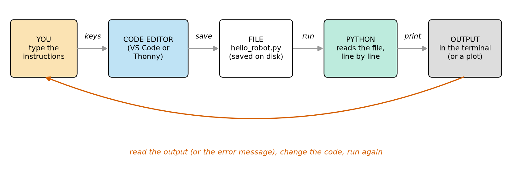
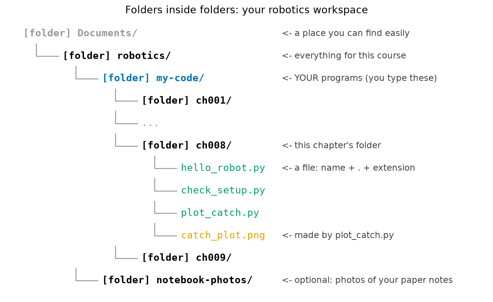
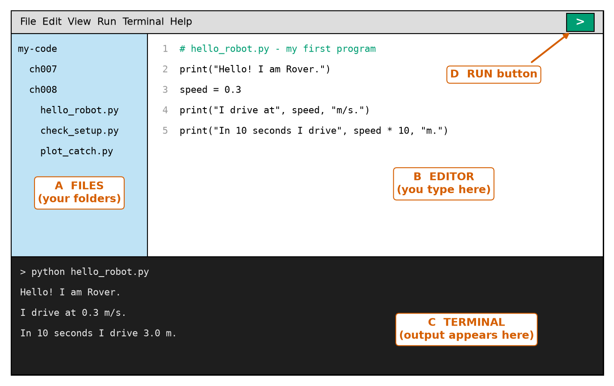
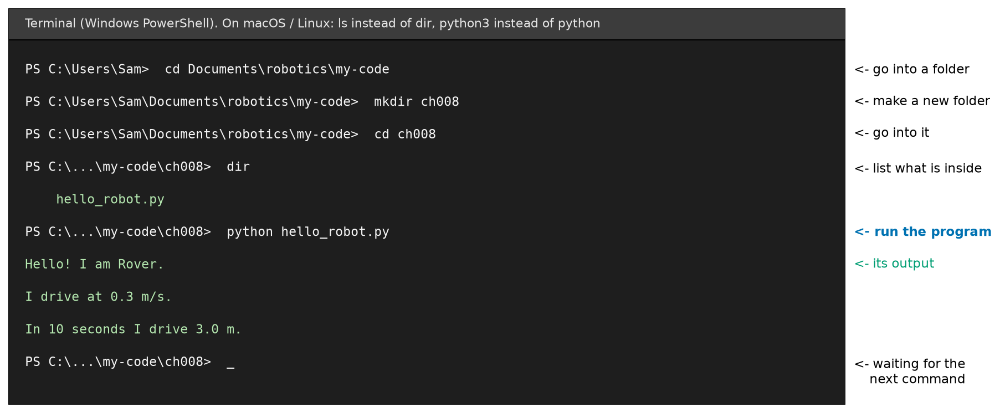
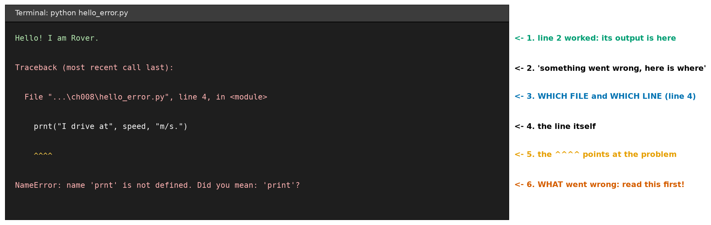
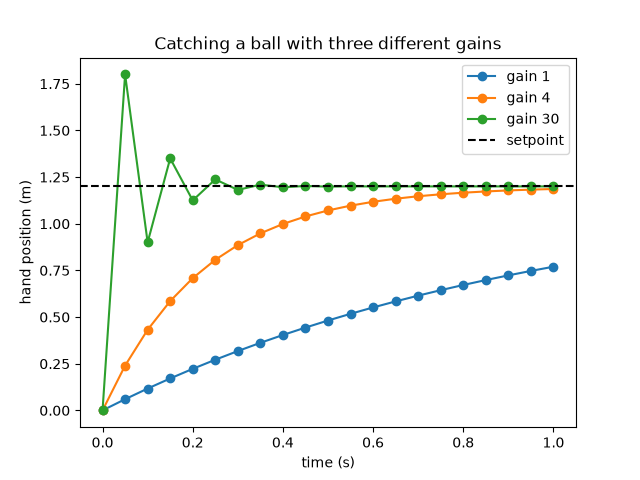

# Chapter 8 — Setting Up Your Computer: Python, a Code Editor, Folders

> **Part 1 · Chapter 8 of 749**
> **You need:** Chapters 1–7 (especially Chapter 1, Lab 1.2: the `robotics/my-code/` folder; Chapter 6: the ball-catching hand; Chapter 7: the watchdog program). A computer (Windows, macOS or Linux) and an internet connection for the downloads. An adult's permission to install programs, if it is not your own computer.
> **You will make:** a working Python setup, your first program, a program that checks your setup, and your first graph of a robot moving.

---

## What you will learn

- What a **program file**, a **folder**, a **path** and a file **extension** are.
- How to install **Python** on Windows, macOS or Linux, and how to check that it works.
- How to install and use a **code editor** (Thonny or VS Code).
- How to use the **terminal**: move between folders, list files, and run a program.
- How to **read an error message** without panic.
- How to install **libraries** (numpy and matplotlib) with `pip`.
- How to run the programs from Chapters 1–7 yourself, **change** them, and see what happens.

From this chapter on, every program in this course is one you can **run**. You will not learn the Python language properly yet; that is Part 2 (Chapters 11–36). Here we only build the workshop.

---

## New words in this chapter

| Word | Simple meaning |
|---|---|
| **Python** | The programming language of this course. Also the name of the program that **reads and runs** Python files. |
| **program file** (script) | A text file with Python instructions inside. Its name ends with `.py`. |
| **code editor** | A program for typing and changing code. It colours the code and helps you find mistakes. |
| **terminal** | A window where you type commands to the computer as text. Also called the **command line**, **console** or **shell**. |
| **command** | One instruction typed in the terminal, for example `cd my-code`. |
| **folder** (directory) | A box on the computer that holds files and other folders. |
| **path** | The "address" of a file or folder: the list of folders you go through to reach it. |
| **extension** | The end of a file name after the dot: `.py`, `.png`, `.txt`. It tells what kind of file it is. |
| **error message** | Python's report when something goes wrong: where it happened and what went wrong. |
| **library** (package) | Ready-made code that someone else wrote, which you can use in your programs. |
| **pip** | The tool that downloads and installs Python libraries. |
| **install** | Copy a program onto your computer and set it up so that it can run. |

---

## 8.1 What we need, and why

To build robots with programs, you need a small **software workshop**. It has four parts:

1. **Python**: the program that reads your instructions and carries them out.
2. A **code editor**: where you type your instructions.
3. The **terminal**: where you tell Python which file to run, and where the output appears.
4. **Folders**: a tidy place for every file, so you can find your work again.

Look at Figure 8.1. It shows how they work together.



*Figure 8.1 — You type in the code editor, save a file, Python runs the file, and the output appears. Then you read the output, change the code, and run again.*

**How to read this picture:** Follow the grey arrows from left to right. **You** press keys in the **code editor**. The editor **saves** your work as a **file** on the disk. You **run** the file: **Python** reads it, line by line, and does what it says. Whatever the program prints appears as **output**. The red arrow goes back to the start: you look at the output (or an error message), change the code, and run it again.

Look at the red arrow again. It is a **loop**: try → look → correct → try again. That is the same **sense–think–act** loop from Chapter 2, with **you** as the controller (Chapter 6): you **measure** what the program did, **compare** it with what you wanted, and **correct** the code. Programmers spend most of their time going round this loop. Nobody writes a perfect program the first time.

🧠 **Remember:** Programming is not "write it once, correctly". It is "write a little, run, look, fix, run again". Small steps, many loops.

### Why Python?

Chapter 1 explained the choice. In short:

- Python is **easy to read**: it looks almost like English.
- It is **free** and runs on Windows, macOS, Linux and the **Raspberry Pi** (the small computer that becomes Rover's second brain in Chapter 112).
- Robot engineers really use it: for simulation, for testing ideas, for computer vision, for machine learning, and in **ROS 2** (Part 27).
- It has thousands of free **libraries**. We will use two of them very often: **numpy** (fast maths with lists of numbers) and **matplotlib** (drawing graphs). All the figures in this book were made with matplotlib.

On the small microcontroller (the Arduino) we will use a different language, **C++**, from Chapter 96. But the ideas are the same, and you start with Python.

---

## 8.2 Files, folders and paths

Before installing anything, let us make sure we speak the same language about files.

### Files and extensions

A **file** is a piece of saved information: a photo, a song, a text, a program. Every file has a **name**. Most names end with a dot and a few letters: the **extension**.

| File name | Extension | What it is |
|---|---|---|
| `hello_robot.py` | `.py` | a Python program |
| `catch_plot.png` | `.png` | a picture |
| `notes.txt` | `.txt` | plain text |
| `rover_parts.csv` | `.csv` | a table of values separated by commas (Chapter 27) |
| `ch008-setting-up-your-computer.md` | `.md` | a text file with simple formatting (like this chapter) |

The extension tells the computer (and you) **what kind** of file it is. Python only runs files that contain Python code; by habit, these end with **`.py`**.

⚠️ **Careful (Windows):** Windows often **hides** extensions. Then `hello_robot.py` might be shown as just `hello_robot`, and you cannot see if it is really `hello_robot.py.txt`. Switch extensions on: open **File Explorer** → **View** → **Show** → tick **File name extensions**. (On older Windows: **View** → tick **File name extensions**.)

### Good file names

Follow these rules, and many strange problems will never happen:

- Use **small letters**, numbers and the underscore `_`: `hello_robot.py`, `plot_catch.py`.
- **No spaces.** `hello robot.py` causes trouble in the terminal (it looks like two words).
- **No special characters** like `é`, `?`, `#`, `/`.
- **Do not** name your file like a library you use: a file called `numpy.py` or `matplotlib.py` will confuse Python ("which numpy do you mean?").
- Start the name with a **letter**, not a number.

### Folders and paths

A **folder** (also called a **directory**) holds files and other folders. Folders inside folders make a **tree**. Look at Figure 8.2.



*Figure 8.2 — Your robotics workspace: `robotics` contains `my-code`, which contains one folder for each chapter, which contains your programs.*

**How to read this picture:** Each step to the right is "one folder deeper". The grey lines show which folder each thing is inside. Folders are bold and marked `[folder]`; files are not. The notes on the right explain the most important ones. The blue folder, `my-code`, is where **your** programs live.

📖 **New word: path** — the address of a file: all the folders you pass through, in order, with a separator between them. For `hello_robot.py` in Figure 8.2:

```
Windows:          C:\Users\Sam\Documents\robotics\my-code\ch008\hello_robot.py
macOS:            /Users/sam/Documents/robotics/my-code/ch008/hello_robot.py
Linux:            /home/sam/Documents/robotics/my-code/ch008/hello_robot.py
```

(Here "Sam" is the name of the user account on the computer; yours will be different.)

- Windows separates folders with a **backslash** `\` and starts with a **drive letter** like `C:`.
- macOS and Linux use a **forward slash** `/` and start at `/`, the "root" of everything.

You made `robotics/my-code/ch001/` in Lab 1.2. If you did not, you will make it in Section 8.6.

---

## 8.3 Installing Python

⚠️ **Careful:** Download programs **only** from their **official websites** (the addresses given here). Other sites sometimes add unwanted programs. If it is not your own computer, ask the owner (or an adult) first.

This course was tested with **Python 3.14**. Any version **3.12 or newer** is fine. (Python **2** is very old and **different**: do not use it.)

### First: is Python already there?

Open a **terminal** (Section 8.5 explains it in detail):

- **Windows:** press the **Windows key**, type `terminal` (or `powershell`), press **Enter**.
- **macOS:** press **Cmd + Space**, type `terminal`, press **Enter**.
- **Linux:** press **Ctrl + Alt + T** (on most versions), or find "Terminal" in the menu.

Type this and press **Enter**:

```
python --version
```

On macOS and Linux, type `python3 --version` instead.

If you see something like `Python 3.14.7`, Python is installed. If the version is 3.12 or higher, you can skip to Section 8.4. If you see an error, an old version, or (on Windows) the Microsoft Store opens, install Python as below.

### Windows

1. Go to **python.org/downloads** and download the version the page recommends for Windows.
2. Run the downloaded file and follow the steps. Recent Python versions come with the **Python install manager**, which sets everything up and gives you the commands `python` and `py`. If you use the older classic installer instead, **tick the box "Add python.exe to PATH"** on its first screen. This box is very important: without it, the terminal cannot find Python.
3. **Close** the terminal and open a **new** one (the old one does not know about the new installation).
4. Type `python --version`. You should see `Python 3.1x.x`.

💡 **Tip:** On Windows, `py` also starts Python. If `python` does not work, try `py --version`.

### macOS

1. Go to **python.org/downloads** and download the macOS installer.
2. Open it and follow the steps (Continue, Agree, Install). You may need your computer password.
3. Open a **new** terminal and type `python3 --version`.

On macOS, always type **`python3`** (not `python`) in the terminal. In this book we write `python`; on a Mac, add the 3.

### Linux (and the Raspberry Pi)

Most Linux systems already have Python 3. Check with `python3 --version`. If it is missing or too old, install it with the system's package manager. On Ubuntu, Debian and Raspberry Pi OS:

```
sudo apt update
sudo apt install python3 python3-pip python3-venv
```

`sudo` means "do this as the administrator": it asks for your password. Like on macOS, type `python3` instead of `python`.

### What did we just install?

Python is an **interpreter**: a program that **reads** your Python file and **carries out** each instruction, one after the other, from top to bottom. When you type `python hello_robot.py`, you are saying: "Python, please read `hello_robot.py` and do what it says." Chapter 11 explains what a program is, and Chapter 12 explains the two ways of running Python (the interactive shell and script files) in detail.

---

## 8.4 A code editor

You **could** write programs in Notepad or TextEdit. Please do not: they add hidden formatting, may save `hello_robot.py` as `hello_robot.py.txt`, and give you no help. A **code editor** is made for programs. It:

- **colours** the code (comments one colour, text another), so mistakes stand out;
- shows **line numbers** (error messages tell you the line number, Section 8.7);
- **indents** lines for you (Python needs correct indentation; Chapter 18);
- has a **Run** button;
- often shows a **terminal** at the bottom.

Choose **one** of these two. Both are free.

| | **Thonny** | **VS Code** (Visual Studio Code) |
|---|---|---|
| Website | **thonny.org** | **code.visualstudio.com** |
| Best for | complete beginners, younger readers | readers who want the tool most professionals use |
| Python included? | **Yes**, it comes with its own Python | No, uses the Python you installed in Section 8.3 |
| Extra setup | none | install the **Python extension** (by Microsoft) |
| Later in the course | fine for Parts 1–6 | needed for bigger projects, ROS 2, Arduino work, Git |

My advice: if you are under about 13, or feel nervous, start with **Thonny**. Otherwise, start with **VS Code**. You can switch later; your `.py` files work in both.

### Setting up Thonny

1. Download from **thonny.org** and install it.
2. Open Thonny. You see an **editor** at the top and a **Shell** at the bottom.
3. To install libraries (Section 8.8): **Tools** → **Manage packages…**, search for `matplotlib`, click **Install**. Do the same for `numpy`.
4. To run a program: open it and press the green **Run** button (or **F5**).

### Setting up VS Code

1. Download from **code.visualstudio.com** and install it.
2. Open VS Code. Click the **Extensions** icon on the left (four small squares), search for **Python**, and install the one **by Microsoft**.
3. **File** → **Open Folder…** → choose your `robotics` folder. Now its files appear on the left.
4. **Terminal** → **New Terminal** opens a terminal at the bottom, already inside your `robotics` folder.
5. To run a program: open it and click the **Run** button (a triangle ▷) at the top right ("Run Python File").

Look at Figure 8.3. It shows the four areas you will use every day.



*Figure 8.3 — A code editor window: (A) your files and folders, (B) the editor where you type, (C) the terminal where the output appears, (D) the Run button.*

**How to read this picture:** The light-blue column on the left (A) shows the folder tree from Figure 8.2. The white area (B) is the file `hello_robot.py`, with **line numbers** in grey on the left; the first line, a comment, is coloured green by the editor. The dark area at the bottom (C) is the terminal: the command `python hello_robot.py` and the three lines of output. The green button at the top right (D) runs the file that is open. Thonny looks a little different (no file column by default, and the terminal is called "Shell"), but it has the same parts.

---

## 8.5 The terminal: talking to the computer in text

Most people use a computer by **clicking**. Programmers also **type commands**. This is often faster, it works the same way on a robot (Rover's Raspberry Pi has no mouse when it drives around!), and every robot tool, including ROS 2, is controlled this way.

📖 **New word: terminal** — a window where you type commands. The computer answers in text.

### The prompt

When the terminal is ready, it shows a **prompt**: a short text that ends with `>`, `$` or `%`. It usually shows **which folder you are in now**:

```
PS C:\Users\Sam>                          (Windows PowerShell)
sam@laptop ~ %                            (macOS; ~ means "my home folder")
sam@laptop:~$                             (Linux)
```

Everything you type comes after the prompt. Press **Enter** to send the command.

### The five commands you need now

| What you want | Windows (PowerShell) | macOS / Linux |
|---|---|---|
| Where am I? | `pwd` | `pwd` |
| What is in this folder? | `dir` (or `ls`) | `ls` |
| Go into a folder | `cd foldername` | `cd foldername` |
| Go up one folder | `cd ..` | `cd ..` |
| Make a new folder | `mkdir foldername` | `mkdir foldername` |
| Run a Python file | `python filename.py` | `python3 filename.py` |

- `pwd` = "**p**rint **w**orking **d**irectory": it shows the folder you are in.
- `cd` = "**c**hange **d**irectory".
- `..` (two dots) always means "the folder **above** this one".
- `mkdir` = "**m**a**k**e **dir**ectory".

Figure 8.4 shows a real session.



*Figure 8.4 — Going into the `my-code` folder, making a `ch008` folder, listing it, and running the first program.*

**How to read this picture:** Each white line starts with the **prompt** (`PS C:\...>`) and then the **command** typed by the user. Green lines are what the computer **answers**. Notice how the prompt changes after each `cd`: it always shows the current folder. The notes on the right say what each command does. The last line is the prompt again, with a blinking cursor: the terminal is waiting for the next command.

### Three terminal tricks that save hours

1. **Tab completion:** type the first few letters of a folder or file name and press **Tab**. The terminal finishes the name for you. This also prevents typing mistakes.
2. **Arrow up:** press **↑** to get the last command back. Change it, or just press Enter to run it again. You will run the same program dozens of times.
3. **Stop a running program:** press **Ctrl + C**. If a program is stuck in a loop that never ends, this stops it. (This is your **software e-stop** from Chapter 7! But remember: on a real robot it is not enough, because it is "please stop", not "you must stop".)

⚠️ **Careful:** The terminal does **exactly** what you type, and some commands delete files **without** a recycle bin. In this course, only use the commands from the table above until Chapter 549 teaches more. Never paste a command from a random website into your terminal if you do not know what it does.

---

## 8.6 Making your folders

Now let us build the workspace from Figure 8.2. If you did Lab 1.2, some of it already exists; `mkdir` will just say the folder is already there.

**Windows (PowerShell):**

```
cd Documents
mkdir robotics
cd robotics
mkdir my-code
cd my-code
mkdir ch008
cd ch008
pwd
```

**macOS / Linux:**

```
cd Documents
mkdir -p robotics/my-code/ch008
cd robotics/my-code/ch008
pwd
```

(`mkdir -p` makes all the folders in the path at once, and does not complain if some already exist.)

The last command, `pwd`, should show a path that ends in `robotics/my-code/ch008` (or `robotics\my-code\ch008` on Windows). You are now in your chapter 8 folder.

💡 **Tip:** If your computer has no `Documents` folder, or it is called differently (for example in another language), choose any folder you can find easily, and use that instead. On some Windows computers, "Documents" is inside **OneDrive**; that is fine too.

---

## 8.7 Your first program

In your editor, make a **new file**, type these five lines **exactly**, and **save** it as `hello_robot.py` in the `ch008` folder.

The file is also in `code/ch008/hello_robot.py`, but **type it yourself**: your fingers learn while you type.

```python
# hello_robot.py - my first program: a robot says hello and does a little maths
print("Hello! I am Rover.")
speed = 0.3
print("I drive at", speed, "m/s.")
print("In 10 seconds I drive", speed * 10, "m.")
```

| Line | Code | What it does (simple English) |
|---|---|---|
| 1 | `# hello_robot.py - …` | A **comment**. Everything after `#` is for **people**; Python ignores it. We always start with the file name and the idea. |
| 2 | `print("Hello! I am Rover.")` | `print` shows something in the terminal. The text between the quote marks `"…"` is shown exactly as written. |
| 3 | `speed = 0.3` | Make a **variable** called `speed` and put the number 0.3 in it (a box with a name; Chapter 14). |
| 4 | `print("I drive at", speed, "m/s.")` | Show three things, with spaces between them: a text, the **value** inside `speed`, and another text. |
| 5 | `print("In 10 seconds I drive", speed * 10, "m.")` | `*` means "times". Python first works out `0.3 * 10`, then prints it. This is `d = v × t` from Chapter 2. |

Now run it. Either click **Run** in your editor, or in the terminal (in the `ch008` folder) type:

```
python hello_robot.py
```

(macOS/Linux: `python3 hello_robot.py`.)

**Output:**

```
Hello! I am Rover.
I drive at 0.3 m/s.
In 10 seconds I drive 3.0 m.
```

**Congratulations: you just ran your first program.** 🎉

**What the output means:**

- Each `print` makes **one line** of output, in the same order as in the file: Python runs from top to bottom.
- Line 1 (the comment) printed nothing.
- In line 4, Python replaced `speed` with its **value**, 0.3.
- In line 5, Python **calculated** 0.3 × 10 = 3.0 before printing. (It writes `3.0`, not `3`, because 0.3 is a decimal number, so the answer is also a decimal number. Chapter 13 explains this.)

🧪 **Experiment:** Change line 3 to `speed = 0.5`, save, and run again. Which lines of the output change? (Lines 2 and 3 of the output: `0.5 m/s` and `5.0 m`.) You just changed a robot's "setting" and saw the effect, exactly like changing the gain in Chapter 6.

⚠️ **Careful:** **Save before you run.** If you change the code and forget to save, Python runs the **old** file from the disk, and you will wonder why nothing changed. (Most editors show a dot or a star on the tab of a file that is not saved.)

---

## 8.8 When things go wrong: reading error messages

Every programmer, every day, sees error messages. They are not a punishment; they are **help**. Python tells you **where** the problem is and **what** it is. Let us make a mistake on purpose.

Make a copy of your program called `hello_error.py`, and in line 4 change `print` to `prnt` (a typo):

```python
# hello_error.py - a program with a mistake in it, on purpose
print("Hello! I am Rover.")
speed = 0.3
prnt("I drive at", speed, "m/s.")
```

Run it:

```
python hello_error.py
```

**Output:**

```
Hello! I am Rover.
Traceback (most recent call last):
  File "C:\roy1\learn_2\robotics\code\ch008\hello_error.py", line 4, in <module>
    prnt("I drive at", speed, "m/s.")
    ^^^^
NameError: name 'prnt' is not defined. Did you mean: 'print'?
```

(The path in the third line shows where the file is on **your** computer, so yours looks different.) Look at Figure 8.5.



*Figure 8.5 — The six parts of a Python error message. Read the last line first, then the file and line number.*

**How to read this picture:** The dark box is the terminal output. The numbered notes on the right explain each line. The most important line is the **last** one (6, red): it says **what** went wrong. The third line (3, blue) says **where**: which file and which line. The `^^^^` (5) points at the exact part of the line Python did not understand.

### How to read any error message: four steps

1. **Read the last line first.** It has the **kind** of error (`NameError`) and a short explanation. Here: "the name `prnt` is not defined" — Python does not know a word `prnt`. It even suggests: "Did you mean: 'print'?"
2. **Find the line number** (`line 4`) and go to that line in your editor.
3. **Look at the `^^^^` marks**: they point at the problem.
4. **Fix, save, run again.**

Notice the first line of output: `Hello! I am Rover.` Line 2 **worked**. Python runs from top to bottom and **stops at the first error**. Everything before the error happened; nothing after it did.

### A second kind of error: a syntax error

Make a file `hello_syntax.py` with a missing quote mark:

```python
# hello_syntax.py - another mistake: a missing quote mark
print("Hello! I am Rover.)
```

**Output:**

```
  File "C:\roy1\learn_2\robotics\code\ch008\hello_syntax.py", line 2
    print("Hello! I am Rover.)
          ^
SyntaxError: unterminated string literal (detected at line 2)
```

📖 A **syntax error** means Python cannot even **read** the file, because something is written wrongly, like a sentence with a missing full stop. ("Syntax" means the rules of how to write a language.) "Unterminated string literal" sounds scary, but it only means: "a text that starts with `"` never ends with a second `"`." The `^` points at the place where the text started.

Notice: this time, **nothing** was printed before the error. With a syntax error, Python does not run **any** line, because it could not read the file.

### The errors you will meet most often

| Last line starts with | What it usually means | Typical fix |
|---|---|---|
| `SyntaxError` | Something is written wrongly: a missing `"`, `(`, `)` or `:` | Look at the line shown **and the line before it**. |
| `NameError` | A word Python does not know: a typo, or a variable used before it was made | Check the spelling (Python cares about big and small letters: `Speed` is not `speed`). |
| `IndentationError` | The spaces at the start of a line are wrong | Indent with 4 spaces, the same for all lines in a block (Chapter 18). |
| `TypeError` | Two things that do not fit together, for example a number + a text | Chapter 15. |
| `ModuleNotFoundError` | A library is not installed (or its name is misspelled) | Install it with pip (Section 8.9). |
| `ZeroDivisionError` | You divided by 0 | Check where the 0 comes from. |

💡 **Tip:** Chapter 25 is all about errors and debugging. Until then: when you cannot understand an error, **copy the last line** and search for it on the internet. Thousands of people have had the same error. But first, try the four steps yourself: they solve most errors in under a minute.

🧠 **Remember:** An error message is a **measurement**. It tells you the "error" between what you wrote and what Python can do, just like the error in a control loop (Chapter 6). Read it, correct, run again.

---

## 8.9 Libraries: standing on other people's shoulders

Python comes with many tools built in. But for robotics we also need two **libraries** (also called **packages**) that are not built in:

- **numpy**: fast maths with lists and tables of numbers (Chapters 34–35 and much of the course).
- **matplotlib**: drawing graphs (Chapter 33). Every figure in this book was drawn with it.

📖 **New word: pip** — the tool that downloads libraries from the internet (from a big free library collection called **PyPI**) and installs them.

### Installing numpy and matplotlib

In the terminal, type:

**Windows:**
```
python -m pip install numpy matplotlib
```

**macOS:**
```
python3 -m pip install numpy matplotlib
```

`-m pip` means "run the pip tool that belongs to **this** Python". This makes sure the libraries go to the Python you will actually use.

You will see a few lines like `Downloading…` and `Successfully installed matplotlib-3.x.x numpy-2.x.x …`. It takes a minute.

**Thonny users:** use **Tools** → **Manage packages…** instead (Section 8.4).

**Linux (and some macOS setups):** if you get an error with the words **"externally-managed-environment"**, your system protects its own Python. Then make your own **virtual environment** (a private Python just for this course) once:

```
python3 -m venv ~/robotics-venv
source ~/robotics-venv/bin/activate
python -m pip install numpy matplotlib
```

After `activate`, the prompt starts with `(robotics-venv)`, and inside it you can type `python` and `pip` normally. Every time you open a new terminal for this course, run the `source …/activate` line again. (Chapter 26 comes back to libraries and virtual environments.)

### Checking the whole setup

This program checks everything at once. Type it (or copy it from `code/ch008/check_setup.py`) into `my-code/ch008/check_setup.py` and run it.

```python
# check_setup.py - is my computer ready for the robotics course?
import sys
print("Python version:", sys.version.split()[0])

import numpy
print("numpy version:", numpy.__version__)

import matplotlib
print("matplotlib version:", matplotlib.__version__)

print("All good! Your computer is ready.")
```

| Line | Code | What it does (simple English) |
|---|---|---|
| 1 | comment | The name and the question. |
| 2 | `import sys` | 📖 `import` **loads** a library so that we can use it. `sys` is built into Python: it knows things about Python itself ("sys" = system). |
| 3 | `print("Python version:", sys.version.split()[0])` | `sys.version` is a long text like `3.14.7 (tags/…) [MSC …]`. `.split()[0]` keeps only the **first word**: the version number. (Chapter 15 explains `.split()`.) |
| 4 | *(empty)* | Empty lines make the program easier to read. Python ignores them. |
| 5 | `import numpy` | Load numpy. **If numpy is not installed, the program stops here** with a `ModuleNotFoundError`. |
| 6 | `print("numpy version:", numpy.__version__)` | Every library knows its own version, in a variable called `__version__` (two underscores on each side). |
| 7 | *(empty)* | |
| 8–9 | `import matplotlib` … | The same for matplotlib. |
| 10 | *(empty)* | |
| 11 | `print("All good! …")` | We only reach this line if **every** import above worked. |

**Output** (on the computer that made this book; your version numbers may be different, which is fine):

```
Python version: 3.14.7
numpy version: 2.5.3
matplotlib version: 3.11.2
All good! Your computer is ready.
```

**If numpy is missing**, you see instead:

```
Python version: 3.14.7
Traceback (most recent call last):
  File "...check_setup.py", line 5, in <module>
    import numpy
ModuleNotFoundError: No module named 'numpy'
```

Use the four steps: the last line says numpy is missing; the fix is the `pip install` command above. Then run `check_setup.py` again until you see **"All good!"**.

---

## 8.10 Your first graph of a robot

Now the reward. In Chapter 6, you **read** a program about a hand catching a ball, and you looked at graphs we made for you. Now you will make such a graph yourself.

The file is `code/ch008/plot_catch.py`. Type it into `my-code/ch008/plot_catch.py`.

```python
# plot_catch.py - the hand from Chapter 6, now drawn as a graph
import matplotlib.pyplot as plt

setpoint = 1.2        # the ball lands 1.2 m to the right
dt = 0.05             # one loop every 0.05 s

for gain in [1, 4, 30]:
    hand = 0.0
    times = []                            # an empty list for the times
    positions = []                        # an empty list for the hand positions
    for step in range(21):
        times.append(step * dt)           # remember this time ...
        positions.append(hand)            # ... and where the hand was
        error = setpoint - hand
        hand = hand + gain * error * dt
    print("gain", gain, "| hand at 1.0 s:", round(positions[20], 3), "m")
    plt.plot(times, positions, marker="o", label="gain " + str(gain))

plt.axhline(setpoint, color="black", linestyle="--", label="setpoint")
plt.xlabel("time (s)")
plt.ylabel("hand position (m)")
plt.title("Catching a ball with three different gains")
plt.legend()
plt.savefig("catch_plot.png")
plt.show()
```

| Line | Code | What it does (simple English) |
|---|---|---|
| 1 | comment | The name and the idea. |
| 2 | `import matplotlib.pyplot as plt` | Load the **drawing** part of matplotlib (`pyplot`) and give it the short nickname `plt`. Every Python robotics programmer writes exactly this line. |
| 3 | *(empty)* | |
| 4–5 | `setpoint`, `dt` | The same settings as `catch.py` in Chapter 6. |
| 6 | *(empty)* | |
| 7 | `for gain in [1, 4, 30]:` | Run the simulation three times, once for each gain. |
| 8 | `hand = 0.0` | Each run starts with the hand at 0 m. |
| 9–10 | `times = []`, `positions = []` | Two **empty lists**. We will fill them with numbers to draw. |
| 11 | `for step in range(21):` | 21 loops: 0.0 s to 1.0 s. |
| 12 | `times.append(step * dt)` | 📖 `.append(…)` **adds** a value to the **end** of a list (Chapter 21). Here: the time of this loop. |
| 13 | `positions.append(hand)` | Add the hand's position at this time. After the loop, both lists have 21 numbers. |
| 14 | `error = setpoint - hand` | **Compare** (Chapter 6). |
| 15 | `hand = hand + gain * error * dt` | **Correct and act**: proportional control, in one line. |
| 16 | `print(…)` | Show where the hand was at 1.0 s. `positions[20]` means "the value at place 20 in the list": the 21st value, because counting starts at 0 (Chapter 21). |
| 17 | `plt.plot(times, positions, marker="o", label="gain " + str(gain))` | **Draw** a line: times along the bottom, positions up the side. `marker="o"` puts a dot at each loop. `label` is the name for the legend; `str(gain)` turns the number 4 into the text `"4"`, so that it can be joined to `"gain "` with `+`. |
| 18 | *(empty)* | |
| 19 | `plt.axhline(setpoint, …)` | Draw a **h**orizontal **line** at 1.2 m: the setpoint, black and dashed, like in every control graph of this course. |
| 20–22 | `plt.xlabel`, `plt.ylabel`, `plt.title` | Names for the axes and the graph. A graph without axis names is a puzzle. |
| 23 | `plt.legend()` | Show the box that says which line is which. |
| 24 | `plt.savefig("catch_plot.png")` | Save the graph as a picture file in the **current folder**. |
| 25 | `plt.show()` | Open a window with the graph. The program waits here until you **close** the window. |

**Output** (in the terminal):

```
gain 1 | hand at 1.0 s: 0.77 m
gain 4 | hand at 1.0 s: 1.186 m
gain 30 | hand at 1.0 s: 1.2 m
```

…and a window with this graph (also saved as `catch_plot.png`):



*Figure 8.6 — The graph made by `plot_catch.py`: the hand position over time for gains 1, 4 and 30. This picture is exactly what the program produces on your screen.*

**How to read this picture:** Time goes along the bottom, from 0 to 1 s. The hand's position goes up the side. The black dashed line is the setpoint (1.2 m). Each coloured line with dots is one gain; each dot is one loop. matplotlib chose the colours itself (blue, orange, green); later in the course we will choose our own colours to match the book's colour rules.

**What the output means:**

- **Gain 1** (blue) is too slow: at 1.0 s it is only at 0.77 m. The ball is missed.
- **Gain 4** (orange) rises smoothly and arrives at 1.186 m: caught. These are the same numbers as `catch.py` in Chapter 6.
- **Gain 30** (green) jumps to 1.8 m in the first loop (an overshoot), swings back and forth, and settles at 1.2 m. You can see the "fraction per loop" rule from Chapter 6: 30 × 0.05 = 1.5, between 1 and 2, so it overshoots but settles.

🧠 **Remember:** A **graph** shows in one second what a table of 63 numbers hides. Engineers look at graphs all the time: every test of a real robot ends with "let me plot that".

---

## Small examples

### Example 1 — Paths

The file `wheel_test.py` is in the folder `ch010`, which is in `my-code`, which is in `robotics`, which is in `Documents` of user Ana.

```
Windows: C:\Users\Ana\Documents\robotics\my-code\ch010\wheel_test.py
macOS:   /Users/ana/Documents/robotics/my-code/ch010/wheel_test.py
```

### Example 2 — Moving around with cd

You are in `robotics/my-code/ch008`.

```
cd ..        → now in robotics/my-code
cd ch007     → now in robotics/my-code/ch007
cd ../..     → up two folders: now in robotics
```

### Example 3 — Good and bad file names

```
motor_test.py       good
Motor Test.py       bad (space; capital letters are allowed but make typing harder)
2nd_try.py          bad (starts with a number)
numpy.py            bad (same name as a library)
motor_test.py.txt   bad (wrong extension: Python files must end in .py)
```

### Example 4 — Which line had the error?

```
  File "rover.py", line 12, in <module>
    distance = distance - sped * step_time
                          ^^^^
NameError: name 'sped' is not defined. Did you mean: 'speed'?
```

Line **12**, the word `sped` (a typo for `speed`).

### Example 5 — Predicting output

```python
print("Battery:", 7.2, "V")
print("Two batteries:", 7.2 * 2, "V")
```

Output:

```
Battery: 7.2 V
Two batteries: 14.4 V
```

### Example 6 — Error or not?

```python
print("Rover is ready)
```

`SyntaxError`: the text has no closing `"`. Python runs **nothing** from this file.

---

## 🏭 Real robot applications

Setting up a computer sounds like a small thing. In real robot teams, it is a big thing: a robot only works if **the right program**, with **the right libraries**, runs on **the right computer**.

### Application 1 (worked in full) — 🏭🚗 "It works on my computer!": checking every computer in a robot team

**1. The real problem.** A team of 10 engineers works on a warehouse robot. One engineer's simulation shows the robot stopping safely at 0.3 m from a shelf. Another engineer runs **the same program** and the robot stops at a different distance, or the program crashes with an error. Why? Very often: they have **different versions** of Python or of a library, and something behaves differently between versions. "It works on my computer" is one of the most famous sentences in software.

**2. Why this idea.** If every computer prints its versions in the same way, the team can compare them in seconds. That is exactly what `check_setup.py` does.

**3. The numbers.** Suppose the team agrees on this list:

| Software | Required version |
|---|---|
| Python | 3.12 or newer |
| numpy | 2.0 or newer |
| matplotlib | 3.8 or newer |

and two engineers run `check_setup.py`:

| Engineer | Python | numpy | matplotlib | OK? |
|---|---|---|---|---|
| A | 3.14.7 | 2.5.3 | 3.11.2 | yes |
| B | 3.10.4 | 1.26.0 | 3.7.1 | **no** |

**4. The maths, step by step.** Comparing versions: compare the **first** number; only if equal, compare the **second**. For engineer B's Python, 3.10.4: the first numbers are equal (3 and 3), so compare the second numbers: 10 is less than 12, so 3.10 is **older** than 3.12. (Careful: 3.10 is **newer** than 3.9, because 10 > 9; versions are not decimal numbers!) numpy 1.26 is older than 2.0 (1 < 2). matplotlib 3.7 is older than 3.8 (7 < 8). Engineer B must update all three.

**5. The code.** `check_setup.py` from Section 8.9. In a real team, the required versions are written in a file called `requirements.txt`, for example:

```
numpy>=2.0
matplotlib>=3.8
```

and everybody installs them with one command: `python -m pip install -r requirements.txt`. (`>=` means "this version or newer".) Chapter 554 shows how real robot software is organised.

**6. The result.** After engineer B updates, both computers print the same versions, and the simulation gives the same result on both. The team adds `check_setup.py` to their project, and the first thing they do when a program behaves strangely is to run it.

**7. Going further.** Big robot projects go one step further and put the **whole** setup (operating system, Python, libraries, their own code) into a "container" that is identical on every computer and on the robot itself. ROS 2 teams do this all the time (Part 27). Space agencies **freeze** the versions of every tool for years before a launch: the software that drives a Mars rover is never "updated just to try".

### Application 2 (worked in full) — 🚁 Plot it! Finding a problem in a drone's test log

**1. The real problem.** A team tests a new height controller on a drone. The drone must hold 2.0 m. The flight computer records the measured height 10 times per second, and the team gets a long list of numbers. Is the controller good?

**2. Why this idea.** A list of numbers is hard to judge. A graph shows the **shape** at once: does it overshoot? Does it shake? Does a gap stay? (All the things you learned in Chapter 6.) That is exactly what `plot_catch.py` does with the hand.

**3. The numbers.** The first 2 seconds of the log (height in metres, every 0.1 s):

```
0.00 0.45 0.90 1.32 1.71 2.05 2.30 2.41 2.38 2.25
2.10 1.97 1.90 1.89 1.93 1.99 2.04 2.06 2.05 2.02
```

**4. The maths, step by step.** Without a graph, an engineer would have to go through the numbers: the setpoint (2.0 m) is passed between 0.4 s and 0.5 s (1.71 → 2.05); the highest value is 2.41 m at 0.7 s; then it comes down to a lowest value of 1.89 m at 1.3 s, and back up to 2.06 m. So the overshoot is 2.41 − 2.0 = **0.41 m** (about 20% of the setpoint), and the height is swinging, with each swing smaller than the last.

**5. The code.** The same plot program, with a list instead of a simulation:

```python
import matplotlib.pyplot as plt
heights = [0.00, 0.45, 0.90, 1.32, 1.71, 2.05, 2.30, 2.41, 2.38, 2.25,
           2.10, 1.97, 1.90, 1.89, 1.93, 1.99, 2.04, 2.06, 2.05, 2.02]
times = [i * 0.1 for i in range(20)]
plt.plot(times, heights, marker="o")
plt.axhline(2.0, color="black", linestyle="--")
plt.xlabel("time (s)"); plt.ylabel("height (m)")
plt.show()
```

(The line `times = [i * 0.1 for i in range(20)]` makes the list 0.0, 0.1, … 1.9 in one line; Chapter 21 explains it. You can also build it with `append` like in `plot_catch.py`.)

**6. The result.** On the graph, the engineers see in one look: the drone **overshoots** by 0.41 m and **swings** around 2.0 m before settling, like the gain-30 hand in Figure 8.6. For a drone flying under a bridge, 41 cm too high could mean hitting it. The controller is too "strong": they lower the gain (or add damping, Chapter 214) and fly again.

**7. Going further.** Real flight controllers write logs with thousands of numbers per second (Chapter 639 tunes a drone from its flight logs). Engineers always plot them. You will plot your own robot's real sensor data from Chapter 111 onwards.

### Application 3 — 🏠 The same Python on Rover's second brain

Rover gets a Raspberry Pi in stage 7 (Chapter 112). It runs **Linux** and **Python 3**, exactly like your computer. A program you test on your laptop (for example a line-following simulation) can be copied to the Pi and run there with `python3`. This is one big reason this course uses Python: **one language from your desk to the robot**. The terminal commands from Section 8.5 are how you will control the Pi over Wi-Fi, because it has no screen while it drives.

### Application 4 — 🏥🌾 Folders and file names in real robot projects

A hospital delivery robot records every trip: where it went, how long it took, every time it stopped for a person. A farm robot records the soil moisture at every point it visits. These records are files, and after a month there are **thousands** of them. Teams use the same habits as your `my-code/ch008` folder: one folder per day or per mission, names like `2026-11-03_trip_017.csv`, no spaces, the date written year-month-day so that the files sort correctly (like your `ch001`, `ch002`, … with three digits). A good folder plan is the difference between "let me check last Tuesday's trip" taking 10 seconds or 2 hours.

### Application 5 — 🚀🏭 Simulation first, on the same computer

Chapter 1's first safety rule was **simulation first**. The setup you made today is your simulation lab. Companies that build factory robots, and space agencies, test every new program in a simulator, on an ordinary computer like yours, before it goes near a real machine. Part 28 uses big robot simulators (Gazebo, Webots, MuJoCo, Isaac Sim); they all start from a working Python and a terminal.

---

## 🔧 Hands-on lab

### Lab 8.1 — Install and check

**You need:** your computer, an internet connection, permission to install programs.

**Steps:**

1. Check whether Python is installed (Section 8.3). Install it if needed.
2. Install a code editor (Thonny or VS Code, Section 8.4).
3. Make your folders: `robotics/my-code/ch008` (Section 8.6).
4. Install numpy and matplotlib (Section 8.9).
5. Type and run `check_setup.py`.
6. Write the three version numbers in your notebook, with today's date.

**What you should see:** `All good! Your computer is ready.`

**If it does not work:**

| Problem | Likely cause | Fix |
|---|---|---|
| `python` is not recognised (Windows), or the Microsoft Store opens | Python not installed, or not on the PATH | Install from python.org; with the classic installer, tick **"Add python.exe to PATH"**; open a **new** terminal. Or try `py`. |
| `command not found: python` (macOS/Linux) | On these systems the command is `python3` | Type `python3`. |
| `can't open file '…hello_robot.py': No such file or directory` | The terminal is in a different folder than the file | Use `pwd` and `dir`/`ls` to see where you are; `cd` into the right folder. |
| `ModuleNotFoundError: No module named 'numpy'` | numpy is not installed for **this** Python | Run `python -m pip install numpy` with the **same** command (`python`, `python3` or `py`) you use to run programs. In Thonny: Tools → Manage packages. |
| `error: externally-managed-environment` | Your Linux/macOS protects its system Python | Make a virtual environment (Section 8.9). |
| The prompt changed to `>>>` | You typed `python` alone: this opens the interactive shell (Chapter 12) | Type `exit()` and press Enter to get back. |
| VS Code runs, but says "Select Interpreter" | VS Code does not know which Python to use | Click the message (or press Ctrl+Shift+P, type "Python: Select Interpreter") and choose the Python you installed. |

### Lab 8.2 — Break it on purpose (the error hunt)

**You need:** your working setup.

**Steps:**

1. Type `hello_robot.py` (Section 8.7) and run it.
2. Now make **one** mistake at a time, run, read the error message with the four steps, write down the **kind** of error and the **line**, then fix it:
   - (a) Remove the closing `)` at the end of line 2.
   - (b) Write `Speed` (capital S) in line 4 instead of `speed`.
   - (c) Remove the `#` at the start of line 1.
   - (d) Put two spaces at the **start** of line 3.
   - (e) Write `speed * ten` instead of `speed * 10` in line 5.
3. For each one, write in your notebook: kind of error, line number, how you fixed it.

**What you should see:**

| Mistake | Kind of error | Notes |
|---|---|---|
| (a) | `SyntaxError` ('(' was never closed) | Python points at the `(` that was opened. |
| (b) | `NameError` (name 'Speed' is not defined) | Big and small letters are different. Note: line 2 of the output still printed. |
| (c) | `SyntaxError` (invalid syntax, or similar) | Python tries to read the comment as code. |
| (d) | `IndentationError` (unexpected indent) | Spaces at the start of a line mean something in Python (Chapter 18). |
| (e) | `NameError` (name 'ten' is not defined) | Python does not understand number words. |

(The exact wording can be a little different between Python versions. The **kind** of error is what matters.)

**If it does not work:** If no error appears, you probably forgot to **save** before running.

**Challenge:** Make a mistake that gives **no error at all**, but **wrong output**. (For example: `speed * 100` instead of `speed * 10`.) Python cannot find these mistakes; only **you** can, by checking whether the output makes sense. This is why we always check results by hand in this course.

### Lab 8.3 — Change the robot and watch

**You need:** your working setup, the files `plot_catch.py` (Section 8.10) and `watchdog.py` (Chapter 7; type it from Chapter 7 or copy it from `code/ch007/watchdog.py` into `my-code/ch007/`).

**Steps:**

1. Run `plot_catch.py`. Check that your graph looks like Figure 8.6.
2. 🧪 Change the list of gains in line 7 to `[4, 10, 20, 39]`. Run again. Which gains overshoot? Use the rule from Chapter 6 (fraction per loop = gain × 0.05) to **predict** before you run.
3. 🧪 Change it to `[4, 45]`. What happens to the graph? (Look at the numbers on the left axis.)
4. Run `watchdog.py` from Chapter 7. Check that the output matches Chapter 7.
5. 🧪 Change `max_silent = 3` to `max_silent = 10`. Predict how far the robot drives after the link breaks, then run. Then try `max_silent = 1`.

**What you should see:**

- Step 2: gain 4 (0.2) and gain 10 (0.5) approach smoothly; gain 20 (fraction exactly 1.0) jumps to the setpoint in **one** loop and stays there; gain 39 (1.95) swings for a long time but slowly settles.
- Step 3: gain 45 (fraction 2.25) swings further and further. The axis grows to show huge values, and the gain-4 line looks almost flat in comparison. Unstable, as in Chapter 6, Figure 6.3.
- Step 5: with `max_silent = 10`, the robot stops at t = 2.9 s after driving **0.45 m** more (9 driving loops × 0.05 m). With `max_silent = 1`, it stops at once at t = 2.0 s: **0.0 m** more. (But remember Chapter 7: a too-short timeout stops the robot every time a single message is lost.)

**If it does not work:**

| Problem | Likely cause | Fix |
|---|---|---|
| No window appears | Some setups cannot open windows | Look for `catch_plot.png` in your folder and open it. |
| The program seems to "hang" after printing | `plt.show()` waits until you close the graph window | Close the window. |
| The graph from the last run is still there | You opened the old `catch_plot.png` | It is overwritten each run; reopen it. |

---

## Common mistakes

⚠️ **Forgetting to save** before running. Python runs the file on the disk, not what you see in the editor.

⚠️ **Running from the wrong folder.** `No such file or directory` usually means the terminal is somewhere else. Use `pwd` and `ls`/`dir`.

⚠️ **`python` vs `python3` vs `py`.** Use the one that works on your computer, and use the **same** one for `pip` (`python -m pip …`).

⚠️ **Saving as `.py.txt`** because the extension was hidden, or because Notepad added `.txt`. Show extensions; use a code editor.

⚠️ **Spaces in file names**, or naming your file `numpy.py`.

⚠️ **Panicking at red text.** Read the **last line** first, then the line number.

⚠️ **Trying to fix ten things at once.** Change one thing, run, look. Small loops.

⚠️ **Downloading Python or editors from unofficial websites.** Use python.org, thonny.org, code.visualstudio.com.

⚠️ **Copying code without reading it.** Type it, or at least read every line with the table. You learn by your fingers and eyes, not by the clipboard.

---

## Practice

🏋️ **1.** What is the extension of `rover_test.py`? What kind of file is it?

🏋️ **2.** Write the Windows path and the macOS path of `pid_test.py`, which is in the folder `ch212`, inside `my-code`, inside `robotics`, inside `Documents` of the user Lee.

🏋️ **3.** You are in `robotics/my-code/ch008`. Which commands take you to `robotics/my-code/ch006`? And then to `robotics`?

🏋️ **4.** Which of these are good file names? Why not the others? `line_follower.py`, `line follower.py`, `3wheels.py`, `matplotlib.py`, `speed_test.py`.

🏋️ **5.** Predict the output of:
```python
print("Rover")
distance = 2.5
print("Distance to wall:", distance, "m")
print("Half of it:", distance / 2, "m")
```

🏋️ **6.** A program prints this. Which line has the problem, what is the problem, and how do you fix it?
```
  File "motor.py", line 7, in <module>
    print("Speed is", motr_speed)
                      ^^^^^^^^^^
NameError: name 'motr_speed' is not defined. Did you mean: 'motor_speed'?
```

🏋️ **7.** A program has a `SyntaxError` on line 30. How many lines of output appear before the error message? Why?

🏋️ **8.** A program has a `NameError` on line 30. Lines 2, 10 and 20 each contain one `print`, and nothing else prints. How many lines of output appear before the error message?

🏋️ **9.** Write the command that installs the library `pyserial` (Chapter 111 will need it) on your computer.

🏋️ **10.** Engineer C has Python 3.9.18, numpy 2.1.0 and matplotlib 3.10.1. Using the team's list in Application 1 (Python ≥ 3.12, numpy ≥ 2.0, matplotlib ≥ 3.8), which must be updated?

🏋️ **11.** In `plot_catch.py`, what would `positions[0]` and `positions[10]` be for gain 4? (Hint: the hand moves 20% of the remaining distance each loop; after 10 loops the remaining distance is 1.2 × 0.8¹⁰. You may use a calculator, or a one-line Python program.)

🏋️ **12.** (Harder) Change `plot_catch.py` so that it also draws gain 20 and prints the hand position at 0.05 s (that is `positions[1]`) for each gain. Before you run it, predict `positions[1]` for gain 20 using the rule from Chapter 6.

---

## Answers

**1.** `.py`. A Python program (a script).

**2.**
```
Windows: C:\Users\Lee\Documents\robotics\my-code\ch212\pid_test.py
macOS:   /Users/lee/Documents/robotics/my-code/ch212/pid_test.py
```

**3.** `cd ..` (now in `my-code`), then `cd ch006`. Or in one step: `cd ../ch006`. From `ch006` to `robotics`: `cd ../..` (up two folders).

**4.** Good: `line_follower.py`, `speed_test.py`. Bad: `line follower.py` (space), `3wheels.py` (starts with a number), `matplotlib.py` (same name as a library; `import matplotlib` would load your file instead of the real library).

**5.**
```
Rover
Distance to wall: 2.5 m
Half of it: 1.25 m
```

**6.** Line 7. The name `motr_speed` is not known: it is a typo for `motor_speed`. Fix: change `motr_speed` to `motor_speed` in line 7, save, and run again.

**7.** **None.** With a syntax error, Python cannot read the file, so it runs no line at all.

**8.** **Three** (from lines 2, 10 and 20). Python runs every line before line 30, then stops at the error.

**9.** `python -m pip install pyserial` (on macOS `python3 -m pip install pyserial`; in Thonny: Tools → Manage packages, search `pyserial`).

**10.** Python 3.9 is older than 3.12 (9 < 12): **update**. numpy 2.1 is newer than 2.0: fine. matplotlib 3.10 is newer than 3.8 (10 > 8): fine. Only **Python** must be updated. (Careful: someone reading "3.9" and "3.10" as decimal numbers would think 3.9 is bigger. It is not: 10 > 9.)

**11.** `positions[0]` = **0.0** (the start). After 10 loops, the remaining distance is 1.2 × 0.8¹⁰ = 1.2 × 0.107 ≈ 0.129 m, so `positions[10]` ≈ 1.2 − 0.129 = **1.071 m**. (A one-line check: `print(1.2 - 1.2 * 0.8 ** 10)` prints about 1.0712. `**` means "to the power of".)

**12.** Change line 7 to `for gain in [1, 4, 20, 30]:` and add a print, for example `print("gain", gain, "| hand at 0.05 s:", round(positions[1], 3), "m")`. Prediction for gain 20: fraction per loop = 20 × 0.05 = 1.0, so the hand moves **100%** of the error in the first loop: from 0 to exactly **1.2 m**, and stays there. (For gain 1: 0.06 m; gain 4: 0.24 m; gain 30: 1.8 m, as in Figure 8.6.)

---

## Summary

🧠 Your software workshop: **Python** (runs programs), a **code editor** (Thonny or VS Code), the **terminal** (commands and output), and tidy **folders** (`robotics/my-code/chNNN/`).

🧠 A Python program is a text file ending in **`.py`**. Use simple names: small letters, `_`, no spaces, never a library's name.

🧠 A **path** is a file's address. `cd` moves between folders, `cd ..` goes up, `dir`/`ls` lists, `pwd` shows where you are, `mkdir` makes a folder.

🧠 Run a program with `python file.py` (`python3` on macOS/Linux). **Save first.**

🧠 Python runs **top to bottom** and stops at the **first error**. A **syntax error** stops it before any line runs.

🧠 Read error messages: **last line first** (what), then **file and line** (where), then the `^^^` (exactly where). Fix, save, run again.

🧠 Install libraries with `python -m pip install numpy matplotlib`. Check everything with `check_setup.py`.

🧠 Programming is a loop: **write a little, run, look, fix**. And always **plot** your robot's data.

---

## Next chapter

In **Chapter 9 — Simulation or real hardware: what you need (and what is optional)**, you will plan your path through the course. You will see what you can do with only this computer (a lot: every chapter has a simulation track), what a first hardware kit for Rover contains and roughly what it costs, and how to choose parts safely and cheaply.
