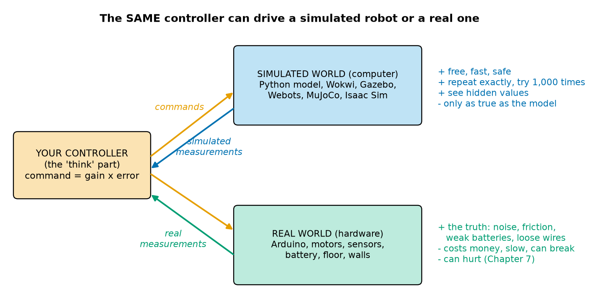
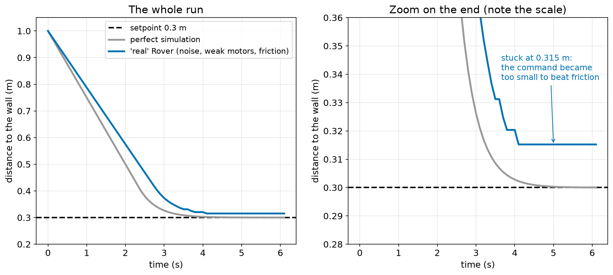
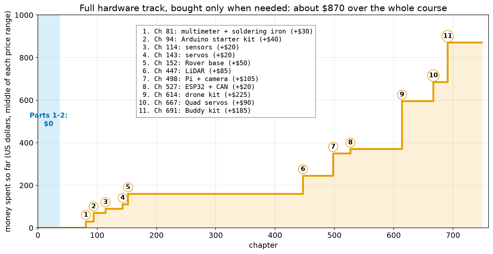
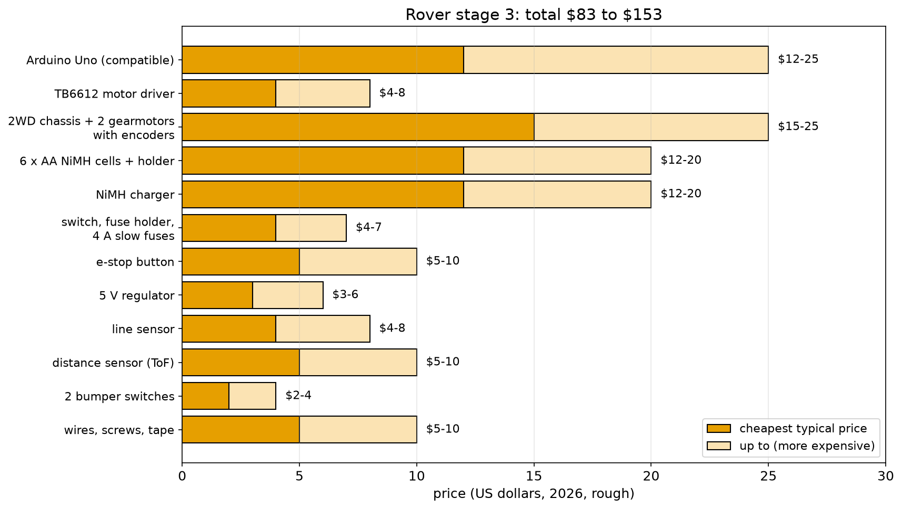
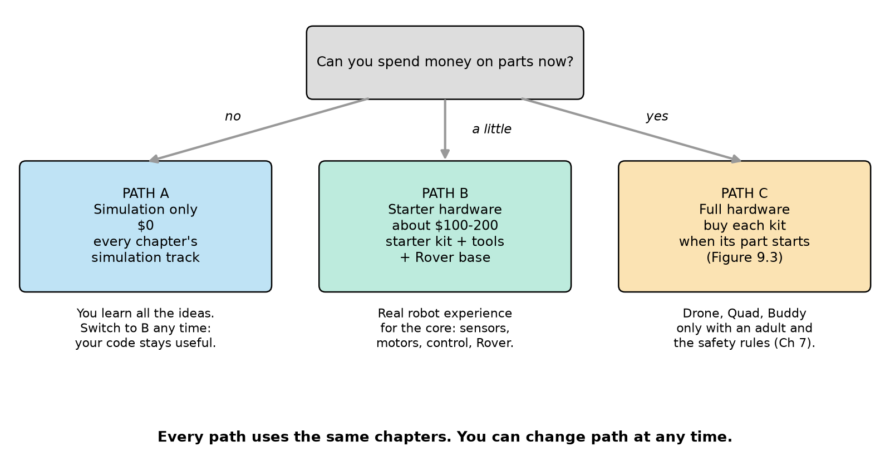
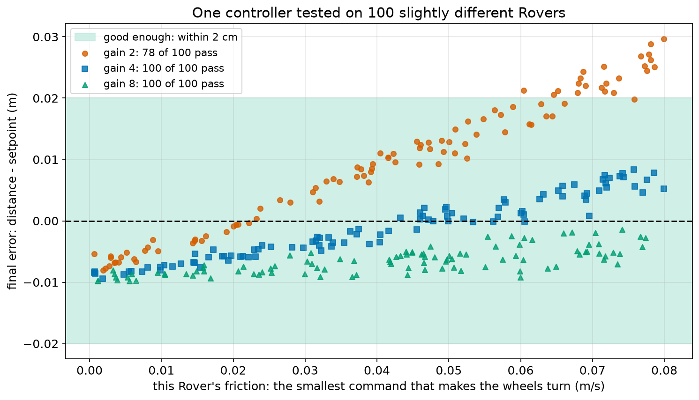

# Chapter 9 — Simulation or Real Hardware: What You Need (and What Is Optional)

> **Part 1 · Chapter 9 of 749**
> **You need:** Chapters 1–8 (especially Chapter 5: Rover's parts; Chapter 6: proportional control; Chapter 7: safety; Chapter 8: a working Python setup).
> **You will make:** a "perfect" and a "real" simulation of Rover, a test of one controller on 100 different Rovers, your own parts budget, and your personal plan for the course.

---

## What you will learn

- What a **simulation** is, and that you have already used several.
- What simulations are **good** at, and what they **miss**: the **reality gap**.
- How engineers make a controller that works on the real robot, not only in the computer: **test many variations**.
- Which **free tools** you will use: Python, online Arduino simulators, and the big robot simulators.
- What **hardware** you need for each part of the course, **when** you need it, and roughly **what it costs**.
- How to buy parts **safely and cheaply**.
- How to choose your own **path**: simulation only, starter hardware, or full hardware.

---

## New words in this chapter

| Word | Simple meaning |
|---|---|
| **simulation** | A program that pretends to be the real world, so that we can test ideas in the computer. |
| **model** | The rules (formulas) a simulation uses to imitate the real thing. "The hand moves speed × time" is a model. |
| **hardware** | The real, physical parts: boards, motors, wires, batteries. |
| **software** | Programs. |
| **reality gap** | The difference between what happens in a simulation and what happens with the real robot. |
| **noise** | Small random errors in a measurement. A sensor that says 0.302, 0.298, 0.305 for the same distance is "noisy". |
| **friction** | A force that resists motion. Because of it, a motor with too little power does not turn at all. |
| **robust** | Still working well when things are a little different from what you expected. |
| **random** | Not predictable; like rolling a die. |
| **kit** | A box of parts that belong together, often with instructions. |
| **compatible board** (clone) | A board made by another company that works like the original (for example an Arduino-compatible board). |
| **datasheet** | The document from the maker that tells exactly what a part does and its limits (voltage, current, size). |

---

## 9.1 Two ways to learn robotics

Every robot in this course can be done in **two ways**:

1. **The simulation track:** the robot lives inside your computer. You write the controller, and a program pretends to be the robot and its world.
2. **The hardware track:** you build the real robot with real parts, and your controller drives real motors.

The important idea is in Figure 9.1.



*Figure 9.1 — The same controller (orange) can send its commands to a simulated world (blue) or to a real robot (green), and gets measurements back from either one.*

**How to read this picture:** The orange box on the left is your controller: the "think" part of sense–think–act. Orange arrows carry its **commands** out. The blue box is a simulated world; its blue arrow brings **simulated measurements** back. The green box is the real robot; its green arrow brings **real measurements** back. The text on the right lists the good points (+) and bad points (−) of each world.

The controller does not care where its measurements come from. If you write it carefully, the **same** code (or the same idea) works in both worlds. That is why a simulation is so useful: you can develop and test the controller safely, and then move it to the real robot.

### You have already used simulations

Look back at the programs you have read:

| Chapter | Program | What it pretended to be |
|---|---|---|
| 2 | `wall_stop.py` | a robot driving towards a wall |
| 3 | `governor.py`, `tortoise.py` | a steam engine; a light-seeking robot |
| 6 | `catch.py`, `follow.py` | a hand catching a ball; a robot following a person |
| 7 | `watchdog.py` | a remote-controlled robot losing its radio |
| 8 | `plot_catch.py` | the hand again, as a graph |

Each one is a **simulation**. Each has a **model**: a few lines that say how the world reacts. In `catch.py`, the model was one line:

```python
hand = hand + speed * dt
```

📖 **New word: model** — the rules a simulation uses to imitate the real thing. This model says: "the hand moves exactly speed × time, every time." Is that true for a real hand? Not exactly. A real hand cannot change speed instantly, the eyes are a little noisy, and the muscles get tired. The model is a **simplification**. Every model is.

🧠 **Remember:** "All models are wrong, but some are useful." (A famous saying from the statistician George Box.) A simulation is never the real world. It is useful when it is **close enough** for the question you are asking.

---

## 9.2 What simulation is good at, and what it misses

### What simulation is good at

- **Free.** No parts to buy.
- **Fast.** Six seconds of robot life take a few thousandths of a second to compute. You can test 1,000 versions before lunch.
- **Safe.** A simulated robot can drive off a simulated cliff, and nothing breaks. A simulated drone can crash 500 times. (Chapter 1, rule 1: **simulation first**.)
- **Repeatable.** Run it again and you get exactly the same result. With a real robot, every run is a little different.
- **You can see everything.** In a simulation, you know the **true** position of the robot, even values that no real sensor can measure. This makes it much easier to find mistakes.
- **Impossible worlds are easy.** Mars, the bottom of the sea, a warehouse that does not exist yet.

### What simulation misses: the reality gap

📖 **New word: reality gap** — the difference between what the simulation shows and what the real robot does.

Here is a list of things that real robots have and simple simulations usually forget:

| Real-world effect | What it does to the robot |
|---|---|
| **Sensor noise** | Every measurement is a little wrong, differently each time. |
| **Friction** | With a very small command, the motor does not turn at all. |
| **Weaker (or stronger) motors** | Two "identical" motors are never exactly the same. One wheel turns faster, and the robot curves. |
| **Battery getting weaker** | As the battery empties, the motors get slower. |
| **Delay** | Sensors, programs and motors all need time (Chapter 6). |
| **Wheel slip** | On a smooth floor, wheels spin without moving the robot. |
| **Loose wires and bad contacts** | A sensor suddenly gives 0 or a crazy value. |
| **The world is messy** | Carpets, cables on the floor, sunlight blinding a sensor, a cat. |

### An experiment: a perfect world and a "real" world

Let us see the reality gap in numbers. We take Rover stopping at a wall with proportional control (Chapter 6), and simulate it twice: once in a **perfect** world, and once in a world with three real effects:

1. The distance sensor is **noisy**: each reading is off by up to ±1 cm, randomly.
2. The motors give only **85%** of the speed asked for.
3. **Friction:** if the command is below 0.05 m/s, the wheels do not turn at all.

The file is `code/ch009/sim_vs_real.py` (also used in Application 1).

```python
# sim_vs_real.py - Rover stops at a wall: a perfect simulation and a more "real" one
import random
random.seed(1)            # the same "random" numbers every run, so results can be compared

setpoint = 0.3            # stop 0.3 m from the wall
gain = 2.0                # speed command = gain x error
max_speed = 0.25          # m/s
dt = 0.1                  # 10 loops per second

for world in ["perfect", "real"]:
    distance = 1.0
    for step in range(61):                                  # 6 seconds
        measured = distance                                 # SENSE
        if world == "real":
            measured = distance + random.uniform(-0.01, 0.01)   # the sensor is noisy: +/- 1 cm
        command = gain * (measured - setpoint)              # THINK
        command = max(0.0, min(max_speed, command))
        speed = command                                     # ACT
        if world == "real":
            speed = 0.85 * command                          # the motors are a bit weaker than promised
            if command < 0.05:
                speed = 0.0                                 # friction: too little power, the wheels do not turn
        distance = distance - speed * dt
    print(world, "world | final distance", round(distance, 3), "m | error", round(distance - setpoint, 3), "m")
```

| Line | Code | What it does (simple English) |
|---|---|---|
| 1 | comment | The name and the idea. |
| 2 | `import random` | Load Python's built-in **random** module: it makes unpredictable numbers, like rolling dice (Chapter 31). |
| 3 | `random.seed(1)` | 📖 A **seed** makes the "random" numbers the **same** every time you run the program. Without it, each run would be different. With it, your output matches the book. |
| 4 | *(empty)* | |
| 5–8 | settings | Setpoint 0.3 m, gain 2, top speed 0.25 m/s, 10 loops per second. Fraction per loop = 2 × 0.1 = 0.2 (smooth, Chapter 6). |
| 9 | *(empty)* | |
| 10 | `for world in ["perfect", "real"]:` | Run the simulation twice: first `world` is the text `"perfect"`, then `"real"`. |
| 11 | `distance = 1.0` | Rover starts 1 m from the wall. |
| 12 | `for step in range(61):` | 61 loops: 0 to 6 seconds. |
| 13 | `measured = distance` | **Sense**, perfect version: the sensor tells the exact truth. |
| 14 | `if world == "real":` | 📖 `==` means "is equal to?" (one `=` puts a value in a box; two `==` **compare**; Chapter 17). Only in the "real" world… |
| 15 | `measured = distance + random.uniform(-0.01, 0.01)` | …add noise: `random.uniform(a, b)` gives a random decimal number between a and b. So the sensor is wrong by up to 1 cm. |
| 16 | `command = gain * (measured - setpoint)` | **Think**: proportional control (Chapter 6). |
| 17 | `command = max(0.0, min(max_speed, command))` | Limits: between 0 and 0.25 m/s. |
| 18 | `speed = command` | **Act**, perfect version: the motors do exactly what they are told. |
| 19–20 | `if world == "real":` `speed = 0.85 * command` | Real version: the motors give only 85% of the command. |
| 21–22 | `if command < 0.05:` `speed = 0.0` | Real version: friction. A tiny command cannot make the wheels turn. (This `if` is **inside** the other `if`: it only happens in the real world. The extra indentation shows that.) |
| 23 | `distance = distance - speed * dt` | Rover moves (towards the wall). |
| 24 | `print(…)` | After 6 seconds, show where Rover ended. |

**Output:**

```
perfect world | final distance 0.3 m | error 0.0 m
real world | final distance 0.315 m | error 0.015 m
```



*Figure 9.2 — Rover stopping at a wall in a perfect simulation (grey) and in a simulation with noise, weak motors and friction (blue). Right: a zoom on the end.*

**How to read this picture:** In both panels, the bottom axis is time and the side axis is the distance to the wall; the black dashed line is the setpoint, 0.3 m. In the **left** panel you see the whole run: both Rovers start at 1 m and slow down near 0.3 m. The blue line is a little behind (weaker motors). The **right** panel shows only the bottom part, from 0.28 to 0.36 m: here the difference is clear. The grey line glides down to 0.300. The blue line moves in small **steps** (sometimes the noisy sensor says "a little farther", the command gets just big enough, and Rover creeps forward), then it **stops** at 0.315 m and never moves again.

**What the output means:**

- In the perfect world, Rover reaches 0.300 m.
- In the "real" world, Rover stops **1.5 cm** short. Why? Near the end, the command is gain × error = 2 × error. When the error is below 0.025 m, the command is below 2 × 0.025 = 0.05 m/s, and friction wins: the wheels stop. Rover is **stuck**.
- A perfect simulation would have told you "your controller is perfect". The real robot would surprise you.

🔢 **Maths** — where does a robot get stuck because of friction?

```
the wheels stop when      gain × error < smallest command that moves the wheels
so the robot can stop with error up to   smallest command ÷ gain

here: 0.05 ÷ 2 = 0.025 m = 2.5 cm
```

The noise helped a little (some lucky readings pushed Rover closer, to 1.5 cm), but the limit is 2.5 cm. And look at the formula: a **bigger gain** makes this gap **smaller**. Application 1 uses this.

🤖 **Robot link:** This "stuck because of friction" effect is very real. Engineers call the smallest force that makes something start to move **static friction** or **stiction** (Chapter 63). It is one reason why the **integral** part of a PID controller exists (Chapter 212): it slowly increases the command until the robot moves.

### So: simulation or hardware?

Both. The best robot engineers use the loop in Figure 9.1 all the time:

1. Develop the idea in a **simple simulation** (fast, free, safe).
2. Make the simulation **more real** (noise, friction, delays) and check that the idea still works.
3. Test it on the **real robot**, slowly and safely (Chapter 7).
4. When the real robot does something surprising, **add that effect to the simulation**, and go back to step 2.

Each time round this loop, the simulation gets closer to reality, and the controller gets better.

---

## 9.3 The free tools you will use

Here are the main simulation tools of this course. All are free.

| Tool | What it simulates | Used in | Needs |
|---|---|---|---|
| **Python** (with numpy, matplotlib) | anything we can write a model for: motors, control loops, robot motion, sensors, filters | almost every chapter | your setup from Chapter 8 |
| **Wokwi** (website) | an Arduino or ESP32 board with LEDs, buttons, sensors, servos, displays: you write real Arduino code, and it runs in the browser | Parts 6–8 | a web browser |
| **Tinkercad Circuits** (website) | simple circuits and an Arduino, with a virtual multimeter | Part 5 (electronics) | a web browser |
| **Webots** | complete robots in 3D, with physics, sensors and cameras; easy to start | Part 28, mobile robots | a normal computer |
| **Gazebo** | complete robots in 3D; the standard simulator for **ROS 2** | Parts 28–29, HomeBot, Courier, drones (with PX4) | Linux works best; a good computer |
| **MuJoCo** | very accurate, very fast physics for robots that walk, jump and grasp | Walker, Quad, Hero, Part 31–32 | a normal computer |
| **Isaac Sim / Isaac Lab** (NVIDIA) | photo-realistic 3D robots, training thousands of robots at once with machine learning | Hero, Part 32 | a powerful computer with an NVIDIA graphics card (optional chapters) |

You do not need to install any of these now. Each part tells you when and how. Python is the only tool you need for the next 100 chapters (plus a web browser for Wokwi and Tinkercad).

💡 **Tip:** If your computer is old or slow, do not worry. Python simulations and the web simulators run on almost any computer. Only the big 3D simulators (Part 28 and later) need a stronger machine, and those chapters show their results with pictures and videos too, so you can follow along.

---

## 9.4 What hardware you need, and when

**You do not need to buy everything at once.** In fact, you should not: you will understand each part much better when you reach the chapter that uses it, and prices change over time.

Figure 9.3 shows when each kit is first needed, and how much the full hardware track costs **in total** if you buy each kit only when its part starts.



*Figure 9.3 — The money spent over the whole course if you follow the full hardware track and buy each kit when it is first needed (using the middle of each price range from `ROBOTS.md`).*

**How to read this picture:** The bottom axis is the chapter number, from 1 to 749. The orange line goes **up** each time you buy something; the numbers in circles match the list in the box. The light-blue strip on the left is Parts 1–2 (Chapters 1–36): you spend **nothing** there. The first purchase comes at Chapter 81 (a multimeter), the big Rover purchases come before Chapter 160, and then the line is **flat** for almost 300 chapters (Parts 9–22: control, arms, planning and more, all with the parts you already have, plus simulation). The expensive kits (drone, Quad, Buddy) come at the very end.

**What the picture tells you:**

- For the first **36 chapters**, you need only your computer.
- With about **$160** (steps 1–5), you have everything for the **core** of the course: electronics, Arduino, sensors, motors, control, and Rover itself, up to about Chapter 446.
- The whole hardware track costs about **$870**, spread over the whole course. Many people do the drone, Quad and Buddy in simulation, or only one of them on real hardware.

All prices in this chapter are rough US dollar prices from 2026. They are different in every country and change over time. Use them only to plan.

### The first kits, in detail

The full list is in `ROBOTS.md`. The first ones, in the order you need them:

| When | Kit | What is inside | Rough cost |
|---|---|---|---|
| Part 5 (Ch 73–93) | **Multimeter + small soldering iron** | to measure voltages and currents safely (Chapter 81) and to solder (Chapter 92) | $20–40 |
| Part 6 (Ch 94–113) | **Arduino starter kit** | an Arduino Uno (or compatible) board, a breadboard, wires, LEDs, resistors, buttons, a servo, an ultrasonic sensor | $30–50 |
| Part 7 (Ch 114–135) | **Sensors** | a line sensor array, an IMU (accelerometer and gyroscope), a time-of-flight distance sensor | $15–25 |
| Part 8 (Ch 136–153) | **Rover base** | a 2-wheel chassis, 2 gearmotors with encoders, a TB6612 motor driver, a battery pack | $40–60 |
| Part 8 | **3–4 hobby servos** | for the pan-tilt head and Scribe | $15–25 |

---

## Code

This program adds up the cost of everything for **Rover stage 3** (Chapter 5: Rover with its bumpers, line sensor and distance sensor, plus the fuse and e-stop from Chapter 7). Many of these parts come in the kits above; here we list each part separately, so that you can buy them one by one if you prefer, or check a kit's price.

The file is `code/ch009/budget.py`.

```python
# budget.py - how much does the hardware for Rover (stage 3) cost?
parts = ["Arduino Uno (compatible)", "TB6612 motor driver", "2WD chassis + 2 gearmotors with encoders",
         "6 x AA NiMH cells + holder", "NiMH charger", "switch, fuse holder, 4 A slow fuses",
         "e-stop button", "5 V regulator", "line sensor", "distance sensor (time of flight)",
         "2 bumper switches", "wires, screws, tape"]
low = [12, 4, 15, 12, 12, 4, 5, 3, 4, 5, 2, 5]      # dollars, cheapest typical price
high = [25, 8, 25, 20, 20, 7, 10, 6, 8, 10, 4, 10]  # dollars, more expensive typical price

total_low = 0
total_high = 0
for i in range(len(parts)):
    total_low = total_low + low[i]
    total_high = total_high + high[i]
    print(parts[i], "|", low[i], "to", high[i], "dollars")
print("TOTAL |", total_low, "to", total_high, "dollars")
print("Average guess:", (total_low + total_high) / 2, "dollars")
```

| Line | Code | What it does (simple English) |
|---|---|---|
| 1 | comment | The name and the question. |
| 2–5 | `parts = [...]` | A **list** of 12 part names. A long list may continue over several lines, as long as the square brackets are not closed yet. |
| 6 | `low = [...]` | The cheapest typical price of each part, **in the same order** as `parts`. |
| 7 | `high = [...]` | The more expensive typical price of each part. |
| 8 | *(empty)* | |
| 9–10 | `total_low = 0`, `total_high = 0` | Two "money boxes" that start empty. We will add every price into them. |
| 11 | `for i in range(len(parts)):` | 📖 `len(parts)` gives the **length** of the list: 12. So `i` goes 0, 1, 2, … 11: one number for each part. (Better than writing `range(12)`: if you add a part to the list, the loop still covers all of them.) |
| 12 | `total_low = total_low + low[i]` | Add this part's low price to the low total. This "running total" pattern is very common: a box that grows a little in each loop. |
| 13 | `total_high = total_high + high[i]` | The same for the high price. |
| 14 | `print(parts[i], …)` | Show the part and its price range. |
| 15 | `print("TOTAL |", …)` | After the loop: show both totals. |
| 16 | `print("Average guess:", …)` | The middle between the two totals: (low + high) ÷ 2. |

**Output:**

```
Arduino Uno (compatible) | 12 to 25 dollars
TB6612 motor driver | 4 to 8 dollars
2WD chassis + 2 gearmotors with encoders | 15 to 25 dollars
6 x AA NiMH cells + holder | 12 to 20 dollars
NiMH charger | 12 to 20 dollars
switch, fuse holder, 4 A slow fuses | 4 to 7 dollars
e-stop button | 5 to 10 dollars
5 V regulator | 3 to 6 dollars
line sensor | 4 to 8 dollars
distance sensor (time of flight) | 5 to 10 dollars
2 bumper switches | 2 to 4 dollars
wires, screws, tape | 5 to 10 dollars
TOTAL | 83 to 153 dollars
Average guess: 118.0 dollars
```



*Figure 9.4 — The price range of every part of Rover stage 3. Dark orange: the cheapest typical price; light orange: how much more it can cost.*

**How to read this picture:** Each bar is one part. The dark part of the bar is the cheapest price you can expect; the bar continues in light orange up to the more expensive price. The numbers on the right are the ranges. The title gives the totals from the program.

**What the output means:**

- Rover stage 3 costs about **$83 to $153**, about **$118** in the middle.
- The biggest items are the **Arduino**, the **chassis with motors**, and the **batteries with charger**. If you already have an Arduino from the starter kit, or rechargeable AA batteries and a charger at home, the cost drops by $25–65.
- The **safety parts** (switch, fuse, e-stop) cost only about $9–17 together: about a tenth of the robot. They are never the place to save money.

💡 **Tip:** Add a column to the program for parts **you already have** (price 0), and see your real total. That is Practice 8.

---

## 9.5 Choosing parts safely and cheaply

### Safe choices (Chapter 7)

- **Low voltage only.** Everything in this course runs on batteries or a closed adapter, under about 25 V. No mains projects.
- **NiMH before lithium.** Rover uses AA NiMH cells: safe, cheap, easy to charge. LiPo batteries come only with the drone (Part 30), with a proper charger and a fire-safe bag.
- **Buy the charger that belongs to the battery.**
- **Small and slow first.** A small robot with small motors cannot hurt much (Chapter 7, "safe design" layer).
- **Fuse and e-stop** are on the shopping list from the start.

### Cheap choices

- **Compatible boards are fine.** 📖 An "Arduino-compatible" board (sometimes called a **clone**) is made by another company but works the same way. Arduino's designs are open, so this is allowed. It is often much cheaper. (Buying from the original company supports the people who made Arduino; both are good choices.)
- **Kits** are usually cheaper than buying parts one by one, but check that the kit has what you need (compare with the table in Section 9.4).
- **Share and borrow.** Schools, libraries and **makerspaces** (workshops where people share tools) often have multimeters, soldering irons and 3D printers.
- **Reuse.** Old toys contain motors, gears and wheels. Old computer fans contain small brushless motors. (Never open anything that plugs into the wall, and never take batteries out of old devices if they are swollen; Chapter 7.)
- **Buy a few spares** of cheap parts (LEDs, resistors, fuses, jumper wires). A $0.10 part that is missing can stop a whole afternoon.

### Avoiding bad parts

- Buy from shops and sellers with **good reviews** and a clear **return policy**.
- Look for the **datasheet**. 📖 A **datasheet** is the maker's document that says exactly what a part does and its limits (voltage, current, size). A part without a datasheet is a mystery box. Chapter 141 reads the TB6612 datasheet.
- Be careful with **very** cheap batteries and chargers. They are the parts where low quality is dangerous.
- Check the **voltage**: a "5 V" sensor connected to a "3.3 V" board (or the other way round) can be damaged (Chapter 91).

---

## 9.6 Choose your path

Look at Figure 9.5.



*Figure 9.5 — Three paths through the course, depending on whether you can spend money on parts.*

**How to read this picture:** Start at the grey question at the top. Follow the arrow for your answer: "no" to path A, "a little" to path B, "yes" to path C. Under each path is what it gives you. The sentence at the bottom is the most important one.

### Path A — Simulation only ($0)

- You do every chapter's **simulation track**: Python models, Wokwi for the Arduino chapters, and the free simulators later.
- Hardware-only chapters (Moth in Chapter 93 and the CAN base in Chapter 548) show every result with photos and plots, so you can read along.
- You learn **all** the ideas and all the maths. Every program you write stays useful if you get hardware later.

### Path B — Starter hardware (about $100–200)

- Multimeter and soldering iron, Arduino starter kit, sensors, Rover base: the first four rows of the table in Section 9.4.
- You build the real **Rover** and the small projects of Parts 5–9: the most important hands-on experience in the course.
- For the expensive robots (drone, Quad, Buddy), use the simulation track.

### Path C — Full hardware (about $870 over the whole course)

- Path B, plus each later kit when its part starts (Figure 9.3).
- The drone, Quad and Buddy are **advanced** projects. Do them with an adult if you are young, and always with the safety rules of Chapter 7.

🧠 **Remember:** Every path uses the **same chapters**, and you can change path at any time. Many good robot engineers started with simulation only.

---

## Small examples

### Example 1 — Is it a simulation?

```
A program that computes Rover's battery time from watts (Chapter 5)  → a calculation, not a simulation (no step-by-step world)
A program that moves a robot step by step and checks for walls       → a simulation
A video of a real robot                                               → not a simulation (it is a recording of reality)
Wokwi running your Arduino code with a virtual LED                    → a simulation
```

### Example 2 — Friction gap

A robot uses gain 4. Its wheels do not move for commands below 0.06 m/s.

```
largest stuck error = 0.06 ÷ 4 = 0.015 m = 1.5 cm
```

### Example 3 — Running total

Prices: 12, 4, 15.

```
start:          total = 0
after part 1:   total = 0 + 12  = 12
after part 2:   total = 12 + 4  = 16
after part 3:   total = 16 + 15 = 31
```

### Example 4 — Middle of a range

A kit costs $40 to $60.

```
middle = (40 + 60) ÷ 2 = 50 dollars
```

### Example 5 — Saving up

You can save $5 per week. Rover stage 3 costs about $118.

```
weeks = 118 ÷ 5 = 23.6   → 24 weeks (about 6 months)
```

You will reach Chapter 152 (the Rover base) after many weeks of chapters anyway, so you have time.

### Example 6 — Simulation speed

A simulation of 6 seconds of Rover (`sim_vs_real.py`, both worlds) takes about 0.002 s on a laptop.

```
how many runs in 1 second of computer time ≈ 1 ÷ 0.002 = 500 runs
```

A real test of 6 seconds, plus putting Rover back at the start, takes about 30 s. 500 real tests = 500 × 30 = 15,000 s ≈ 4 hours.

---

## 🏭 Real robot applications

### Application 1 (worked in full) — 🦿🏭 Testing one controller on 100 different robots

**1. The real problem.** You build one Rover. A school builds 30. A company builds 10,000. No two robots are exactly the same: one has stronger motors, one has a stiffer gearbox, one drives on carpet. A controller that works perfectly on **one** simulated Rover might fail on many real ones. How can we make a controller that works on **all** of them, before we build them?

**2. Why this idea.** Instead of one simulation, we run **many** simulations, each with slightly different (random) values for the things we do not know exactly. If the controller works on almost all of them, it is **robust**.

📖 **New word: robust** — still works well when things are a little different from what you expected.

This is exactly what big robot companies do. Teams that train walking robots in simulation change the friction of the ground, the mass of the legs and the strength of the motors **randomly** in every run, so that the walking controller works on the real robot. Engineers call this **domain randomization**. Chapter 687 uses it to teach Quad to walk.

**3. The numbers.** Each simulated Rover gets:

| Unknown | Random range |
|---|---|
| Motor strength | 60% to 120% of the promised speed |
| Friction: the smallest command that moves the wheels | 0 to 0.08 m/s |
| Sensor noise | ±1 cm on every reading |

The test: after 10 seconds, Rover must be within **2 cm** of the setpoint (0.3 m). We test **three** gains: 2, 4 and 8.

**4. The maths, step by step.** Before running anything, the friction formula from Section 9.2 predicts the worst case:

```
largest stuck error = largest friction ÷ gain
gain 2: 0.08 ÷ 2 = 0.04 m = 4 cm    → some Rovers will fail the 2 cm test
gain 4: 0.08 ÷ 4 = 0.02 m = 2 cm    → just inside the test
gain 8: 0.08 ÷ 8 = 0.01 m = 1 cm    → all inside
```

Also check that no gain is too strong (Chapter 6): the fraction per loop is gain × strength × dt. The worst case for gain 8 is 8 × 1.2 × 0.1 = 0.96, still below 1. No overshoot from the controller itself.

**5. The code.** File `code/ch009/robust_test.py`:

```python
# robust_test.py - test one controller on 100 slightly different "real" Rovers
import random
random.seed(2)

setpoint = 0.3
max_speed = 0.25
dt = 0.1

for gain in [2.0, 4.0, 8.0]:
    passed = 0
    for trial in range(100):
        strength = random.uniform(0.6, 1.2)      # this Rover's motors: 60% to 120% of the promised speed
        stiction = random.uniform(0.0, 0.08)     # below this command (m/s), the wheels do not turn
        distance = 1.0
        for step in range(100):                  # 10 seconds
            measured = distance + random.uniform(-0.01, 0.01)
            command = max(0.0, min(max_speed, gain * (measured - setpoint)))
            speed = strength * command
            if command < stiction:
                speed = 0.0
            distance = distance - speed * dt
        if abs(distance - setpoint) <= 0.02:     # good enough: within 2 cm of the setpoint
            passed = passed + 1
    print("gain", gain, "| passed", passed, "of 100 Rovers")
```

| Line | Code | What it does (simple English) |
|---|---|---|
| 1–3 | comment, `import random`, `random.seed(2)` | As before. Seed 2 gives a fixed set of 100 "random" Rovers. |
| 5–7 | settings | Setpoint, top speed, loop time. |
| 9 | `for gain in [2.0, 4.0, 8.0]:` | Test three controllers. |
| 10 | `passed = 0` | A counter of Rovers that pass the test, for this gain. |
| 11 | `for trial in range(100):` | 100 different Rovers. |
| 12 | `strength = random.uniform(0.6, 1.2)` | This Rover's motor strength. |
| 13 | `stiction = random.uniform(0.0, 0.08)` | This Rover's friction ("stiction" = static friction, Section 9.2). |
| 14 | `distance = 1.0` | Each Rover starts 1 m from the wall. |
| 15 | `for step in range(100):` | 100 loops = 10 seconds. This is a loop **inside** a loop **inside** a loop: 3 gains × 100 Rovers × 100 steps = 30,000 steps in total. A computer does that in a fraction of a second. |
| 16 | `measured = …` | Noisy sensor. |
| 17 | `command = max(0.0, min(max_speed, gain * (measured - setpoint)))` | Proportional control with limits, all in one line. |
| 18 | `speed = strength * command` | Weak or strong motors. |
| 19–20 | `if command < stiction:` `speed = 0.0` | Friction. |
| 21 | `distance = distance - speed * dt` | Move. |
| 22 | `if abs(distance - setpoint) <= 0.02:` | 📖 `abs(x)` gives the size of x without its sign ("absolute value"): `abs(-0.015)` is 0.015. So this asks "is the error smaller than 2 cm, on either side?" |
| 23 | `passed = passed + 1` | Count this Rover as a pass. |
| 24 | `print(…)` | After 100 Rovers, show the score for this gain. |

**Output:**

```
gain 2.0 | passed 78 of 100 Rovers
gain 4.0 | passed 100 of 100 Rovers
gain 8.0 | passed 100 of 100 Rovers
```



*Figure 9.6 — The final error of 100 different Rovers for each gain, against each Rover's friction. The green band is the "good enough" zone (within 2 cm).*

**How to read this picture:** Each mark is one Rover. Its position along the bottom is how much friction that Rover has; its height is the final error (above 0: stopped too early; below 0: went a little too far). Orange circles are gain 2, blue squares gain 4, green triangles gain 8. Every mark inside the green band passed.

**6. The result.**

- **Gain 2** fails on **22** Rovers: the ones with the most friction (the orange circles above the green band, on the right). Exactly as the maths predicted: their error can reach 4 cm.
- **Gain 4** passes all 100, with errors within about ±1 cm.
- **Gain 8** also passes all 100, but look at the green triangles: they are all **below** zero. The robots went a little **too far**. Why? With a strong gain, the sensor noise (±1 cm) makes bigger commands: a reading that is 1 cm too far gives a command of 8 × 0.01 = 0.08 m/s, enough to beat friction and creep past the setpoint. A strong gain **amplifies noise**.
- So **gain 4** is the best balance here: strong enough to beat friction, gentle enough not to react much to noise.

A single "perfect" simulation would have said "gain 2 is perfect" (Section 9.2, grey line). Testing on 100 varied Rovers shows that it fails on about one robot in five. If a company had built 10,000 robots with gain 2, about 2,200 customers would have complained.

**7. Going further.** This method, "run many simulations with random values and count the results", is called a **Monte Carlo** method (named after a famous casino, because of the randomness). Engineers use it for robots, bridges, weather forecasts and rockets. You will see it again in Chapter 31 (random numbers), in particle filters (Chapters 423–424) and in learning to walk (Chapter 687).

### Application 2 (worked in full) — 🏠🏭 Budget planning for a school robotics club

**1. The real problem.** A school robotics club has 12 students and $600 for the year. They want every student to build a real robot. Is that possible, and how?

**2. Why this idea.** Use `budget.py`: list the parts, add up the costs, and look for savings. Then compare with the money available.

**3. The numbers.** From the program: one Rover stage 3 costs $83–153, middle $118. Some parts are **shared**: one charger can charge many battery packs, and tools are shared anyway.

**4. The maths, step by step.**

```
Option 1: one Rover per student
  12 × 118                              = 1,416 dollars      → too much (budget 600)

Option 2: one Rover per pair of students (6 robots)
  6 × 118                               = 708 dollars        → still too much

Option 3: 6 robots, but share chargers (buy 2 instead of 6)
  charger middle price = (12 + 20) ÷ 2  = 16 dollars
  saving = 4 chargers × 16              = 64 dollars
  6 × 118 − 64                          = 644 dollars        → close

Option 4: Option 3, with the cheapest typical prices for the boards (compatible Arduinos: 12 instead of 18.5)
  saving = 6 × (18.5 − 12)              = 39 dollars
  644 − 39                              = 605 dollars        → just about
```

**5. The code.** The club changes `budget.py`: multiplies each price by the number of robots, and sets the charger quantity to 2. (Practice 9 asks you to do this.)

**6. The result.** Six robots for 12 students (pairs), with shared chargers and compatible boards: about $605. Working in pairs is also how real engineers work: one drives, one watches the data, then they swap. The club also uses Path A (simulation) for everyone during the first months, which costs nothing, and starts buying parts only before Part 8, when prices may also have changed.

**7. Going further.** Real companies do exactly this calculation, called the **bill of materials** (BOM): the list of every part, with quantity and price. For a product sold in thousands, saving $1 per robot can matter a lot, but never on safety parts. Chapter 151 makes a full power budget, and the final projects (Chapters 747–749) start with a BOM.

### Application 3 — 🚗 Self-driving cars: billions of simulated kilometres

Self-driving car companies drive their cars on real roads, but they drive them **much** more in simulation: billions of kilometres, including dangerous situations that are too risky to test for real (a child running onto the road, a truck losing its load). When a real car meets a strange situation, engineers rebuild it in the simulator and test thousands of variations of it, just like Application 1 but much bigger. Then the improved software is tested on closed test tracks before it drives on public roads again.

### Application 4 — 🚀 Mars rovers: a twin on Earth

NASA's Perseverance rover on Mars has an almost identical **twin** on Earth, called OPTIMISM, in a "Mars yard" full of sand and rocks. Before a difficult move on Mars (driving over rocks, using the robot arm), engineers try it on the twin and in simulation. On Mars, nobody can repair the robot, so every command is tested first. This is Path C and Path A together: the best of both.

### Application 5 — 🏭🚁 Virtual factories and software-in-the-loop drones

- 🏭 Before a new factory line with 50 robot arms is built, engineers build it **in simulation** ("virtual commissioning"). They test the robot programs, check that no two arms can collide, and measure how many products per hour the line can make. Problems found in the computer cost almost nothing to fix; problems found after building can cost months.
- 🚁 Drone software such as PX4 can run "software in the loop" (SITL): the real flight-control program runs on a computer and flies a **simulated** drone in Gazebo. You will do exactly this in Part 30 before your real drone flies.

---

## 🔧 Hands-on lab

### Lab 9.1 — Make your simulation more real

**You need:** your computer with the setup from Chapter 8.

**Steps:**

1. Copy `sim_vs_real.py` into `my-code/ch009/` (or type it) and run it. Check that your output matches the chapter.
2. 🧪 Change the friction limit in line 21 from `0.05` to `0.10`. Predict the stuck error first with the formula (0.10 ÷ 2), then run.
3. 🧪 Put it back to `0.05`, and change `gain = 2.0` to `gain = 5.0`. Predict, then run.
4. 🧪 Remove the seed (put a `#` in front of line 3) and run the program 5 times. Write down the "real world" result each time. Why does it change now?
5. 🧪 Add **one more** real effect of your own: for example, make the noise bigger (±3 cm), or make the motors weaker (0.6 instead of 0.85). What happens?

**What you should see:**

- Step 2: the predicted limit is 0.10 ÷ 2 = 0.05 m. Rover stops a few centimetres from the setpoint (at most 5 cm away).
- Step 3: the limit becomes 0.05 ÷ 5 = 0.01 m: Rover stops within about 1 cm.
- Step 4: without the seed, the noise is different every run, so the final distance changes a little each time, like a real robot.

**If it does not work:**

| Problem | Likely cause | Fix |
|---|---|---|
| `NameError: name 'random' is not defined` | Line 2 (`import random`) is missing or misspelled | Add `import random` at the top. |
| Output is different from the book, with the seed | You changed something else, or the lines are in a different order | Compare line by line with the chapter (the order of random calls matters). |
| `IndentationError` | The inner `if` (lines 21–22) is not indented enough | It must be indented **more** than the `if` on line 19. |

### Lab 9.2 — Your personal budget and plan

**You need:** your computer, `budget.py`, your notebook, (optional) a parent or teacher to talk to.

**Steps:**

1. Copy `budget.py` into `my-code/ch009/`.
2. Look around your home (with permission): do you already have any of the parts? (Rechargeable AA batteries and a charger, wires, tape, a screwdriver set, maybe an Arduino.) Set their prices to `0` in **both** lists.
3. Look up the real prices of two or three parts in a shop in **your** country, and change those numbers.
4. Run the program. Write your total in your notebook.
5. Choose your path (A, B or C, Section 9.6) and write it down, with a reason.
6. If you chose B or C: write **when** you will need the first purchase (Chapter 81) and how you will pay for it.

**What you should see:** A total that is probably lower than $118 if you have some parts at home, and a clear plan in your notebook.

**If it does not work:** If the totals look wrong, check that `low` and `high` still have exactly **12** numbers each, in the same order as `parts`. If one list is shorter, Python gives an `IndexError: list index out of range` (you asked for a place in the list that does not exist).

### Lab 9.3 — The reality gap on your table (no computer needed)

**You need:** a toy car (or a ball), a table or smooth floor, a ruler or tape measure, a book to make a ramp.

**Steps:**

1. Make a small ramp with a book. Let the car roll down from the same point 5 times. Measure how far it rolls **after** the ramp each time.
2. Write the 5 distances. Are they the same? Calculate the smallest, the largest and the average.
3. Now do it on a **different surface** (carpet, a towel, a different table). Measure 5 times again.

**What you should see:** Even with "the same" start, the 5 distances are **different** by a few centimetres: that is real-world **noise**. On a different surface, the average changes a lot: that is a change in **friction**. A simple simulation ("the car rolls 50 cm") would predict the same number every time and on every surface. Now you have measured the reality gap with your own hands.

**Challenge:** Use your 10 measurements to make a "more real" model: "the car rolls between ___ and ___ cm on the table, and between ___ and ___ cm on the carpet." This is exactly what `random.uniform` does in the programs.

---

## Common mistakes

⚠️ **Believing the perfect simulation.** A perfect simulation shows what **could** happen in a perfect world. Add noise, friction, delays and weak batteries before you trust it.

⚠️ **Testing on only one simulated robot.** Real robots are all a little different. Test many variations (Application 1).

⚠️ **Thinking "simulation is not real robotics".** Almost all professional robot software is developed in simulation first. It is a core skill, not a second choice.

⚠️ **Thinking "I must buy everything before I start".** You need nothing until Chapter 81. Buy each kit when its part starts.

⚠️ **Saving money on batteries, chargers, fuses or the e-stop.** These are the parts where cheap can mean dangerous (Chapter 7).

⚠️ **Buying parts without checking the voltage.** A 3.3 V part on a 5 V board can be destroyed.

⚠️ **Forgetting the seed** when you want to compare results, or **keeping** it when you want to see real variation.

---

## Practice

🏋️ **1.** Name three things a simulation is good at, and three real-world effects a simple simulation often misses.

🏋️ **2.** What is a **model**? Give the model (one line) from `catch.py` in Chapter 6, and say one way in which it is not exactly true for a real hand.

🏋️ **3.** A robot uses gain 3. Its wheels do not turn for commands below 0.09 m/s. What is the largest error at which it can get stuck?

🏋️ **4.** You want a robot with friction 0.06 m/s to always stop within 1 cm of its setpoint. What is the smallest gain that guarantees this (ignoring noise)?

🏋️ **5.** Why does a strong gain make a robot react more to sensor noise? Use the numbers: noise ±1 cm, gain 8.

🏋️ **6.** What does `random.seed(1)` do, and when would you **not** want it?

🏋️ **7.** Work out the running total, step by step, for the prices 25, 8, 25, 20.

🏋️ **8.** You already have an Arduino (from a starter kit) and the wires, screws and tape. Using the prices in `budget.py`, what is your new low and high total?

🏋️ **9.** A club builds 4 Rovers. Using the **average** guess of $118 per Rover, and sharing chargers (one charger for all 4 instead of 4), what is the total? (Charger middle price: $16.)

🏋️ **10.** Which path (A, B or C) would you recommend for: (a) a 12-year-old with no money for parts but a laptop; (b) a school that has $150 for one robot; (c) a university student who wants to work with drones? Explain briefly.

🏋️ **11.** (Harder) In Application 1, gain 2 failed on 22 Rovers. Using the friction formula, above what friction value would you expect gain 2 to fail (ignoring noise)? What fraction of the range 0 to 0.08 is that? Why might the real number of failures (22) be smaller than this fraction predicts?

---

## Answers

**1.** Good at (any three): free; fast (thousands of runs); safe (no broken robots, no injuries); repeatable; you can see true, hidden values; can model places you cannot visit. Often missed (any three): sensor noise; friction; motors that are not identical; battery getting weaker; delays; wheel slip; loose wires; messy environments.

**2.** A model is the set of rules a simulation uses to imitate reality. In `catch.py`: `hand = hand + speed * dt`. It is not exactly true because a real hand cannot change its speed instantly (it has mass and must accelerate), the eyes' measurements are noisy and delayed, and the muscles do not produce exactly the commanded speed.

**3.**
```
largest stuck error = 0.09 ÷ 3 = 0.03 m = 3 cm
```

**4.**
```
we need   friction ÷ gain ≤ 0.01
so        gain ≥ 0.06 ÷ 0.01 = 6
```
A gain of at least **6**. (Then check the fraction per loop stays below 1: with dt = 0.1, 6 × 0.1 = 0.6, fine.)

**5.** The command is gain × (measured error). A noise of 1 cm makes the measured error 1 cm wrong, so the command is wrong by gain × 0.01. With gain 8, that is 8 × 0.01 = **0.08 m/s**, a big command for a robot that is supposed to be almost stopped. With gain 2 it would be only 0.02 m/s. So a strong gain turns small sensor errors into big motor commands.

**6.** It makes the "random" numbers the same every time the program runs, so results can be repeated and compared with the book. You would **not** want it when you want to see how much the results **vary** from run to run (like a real robot), for example in step 4 of Lab 9.1.

**7.**
```
start: 0
0 + 25 = 25
25 + 8 = 33
33 + 25 = 58
58 + 20 = 78
```

**8.** Remove the Arduino (12 to 25) and wires/screws/tape (5 to 10):
```
low:  83 − 12 − 5  = 66 dollars
high: 153 − 25 − 10 = 118 dollars
```

**9.**
```
4 × 118          = 472 dollars
saving: 3 chargers not bought × 16 = 48 dollars
total = 472 − 48 = 424 dollars
```

**10.** (a) **Path A**: simulation only costs nothing, and every idea can be learned; switch to B later if money appears. (b) **Path B**: $150 is enough for a starter kit and a Rover base (about $100–200), especially if some tools are borrowed. (c) **Path C** for the drone part, but **start with simulation** (PX4 + Gazebo, Part 30) before buying the drone kit, and follow the safety rules of Chapter 7 and the drone laws of Chapter 615.

**11.** Gain 2 fails (error > 2 cm) when friction ÷ 2 > 0.02, so when the friction is above **0.04 m/s**. That is half of the range 0 to 0.08, so we would expect about **50** failures. The real number is smaller (22) because the **noise** sometimes helps: a reading that is a little too far gives a slightly bigger command, enough to beat friction for one loop, so Rover creeps a little closer (look at the orange circles in Figure 9.6: many Rovers with friction 0.04–0.06 still ended within 2 cm). The formula gives the **worst case**, not the typical case.

---

## Summary

🧠 Every robot in the course has a **simulation track** and (usually) a **hardware track**. The same controller can drive both.

🧠 A simulation uses a **model**: a simplification of the real world. All models are wrong; some are useful.

🧠 Simulation is free, fast, safe, repeatable and shows hidden values. It misses real effects (noise, friction, weak motors, delays, slip): the **reality gap**.

🧠 Friction can leave a robot **stuck** with an error up to **friction ÷ gain**. A bigger gain shrinks this gap but **amplifies noise**.

🧠 To make a **robust** controller, test it on **many varied** simulated robots (Monte Carlo, domain randomization), not on one perfect one.

🧠 You need **no hardware until Chapter 81**. About $160 covers the core of the course; the full hardware track is about $870, bought step by step.

🧠 Buy safely (low voltage, NiMH first, proper chargers, fuse and e-stop) and cheaply (compatible boards, kits, sharing, reuse). Check **datasheets** and **voltages**.

🧠 Choose a path (A, B or C). Every path uses the same chapters, and you can switch at any time.

---

## Next chapter

In **Chapter 10 — Your first robot on paper: designing a tiny cleaning robot**, you put everything from Part 1 together. Without building anything, you will design a small cleaning robot from scratch: what it must do, which sensors and actuators it needs, its block diagram, its power budget, its control loop, its safety features and its parts list, and you will simulate its first simple cleaning pattern in Python.
