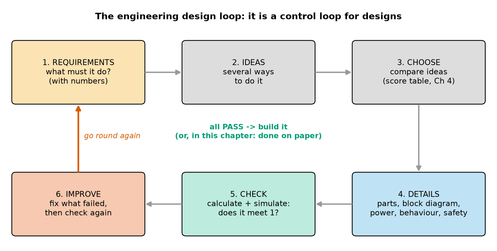
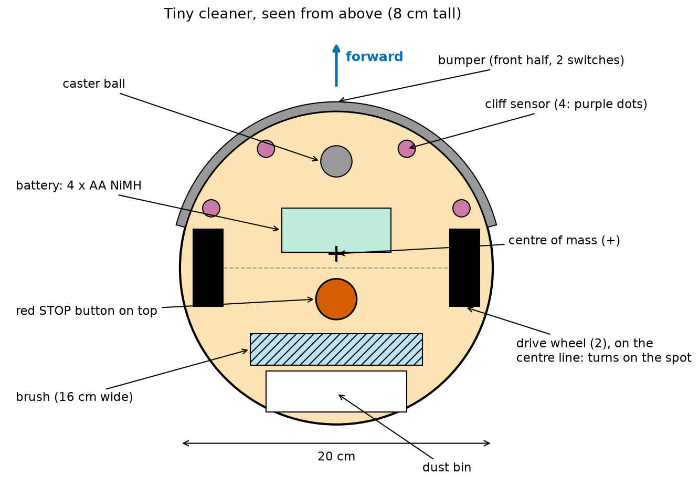
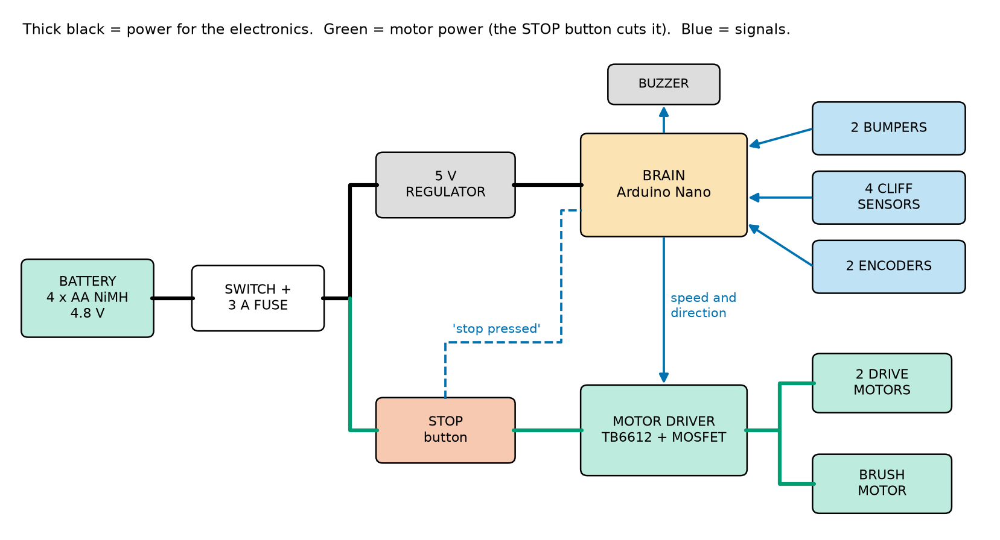
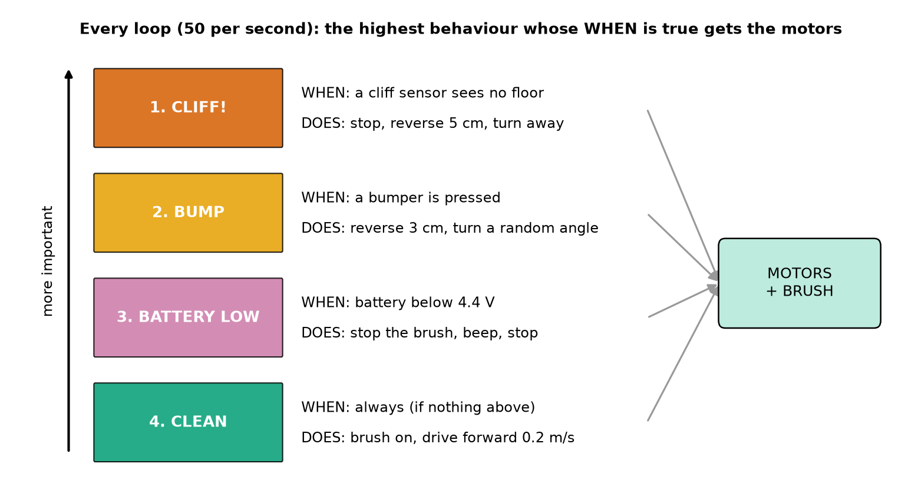
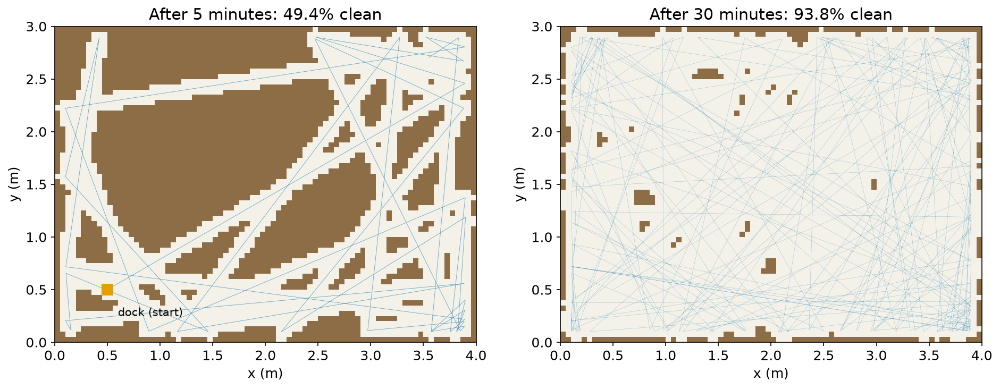
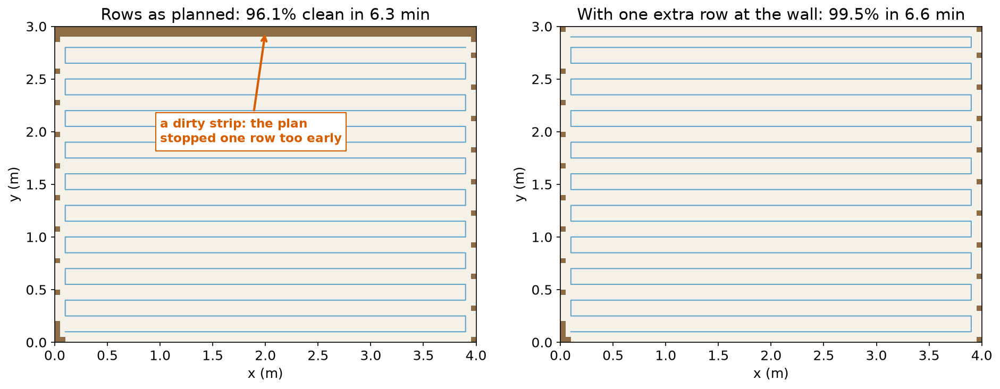
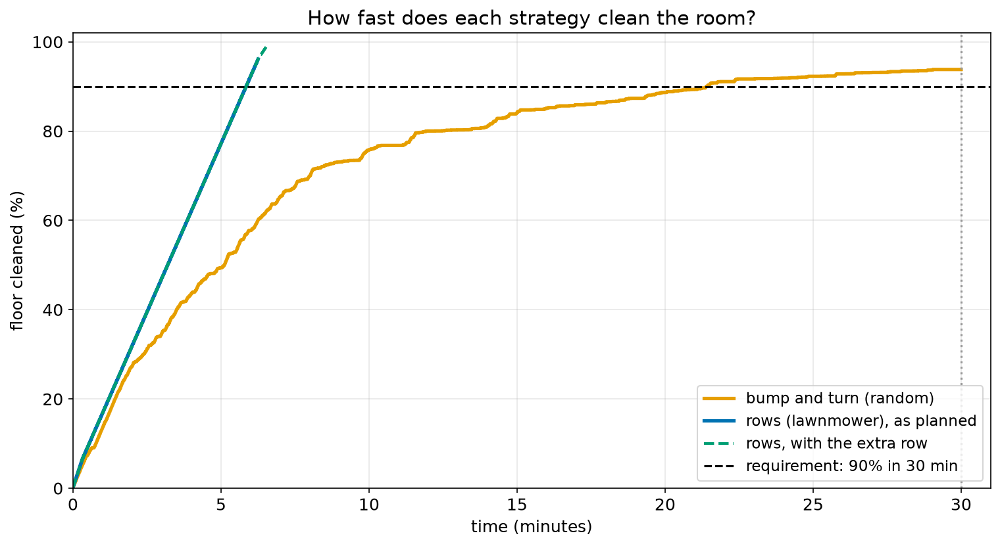
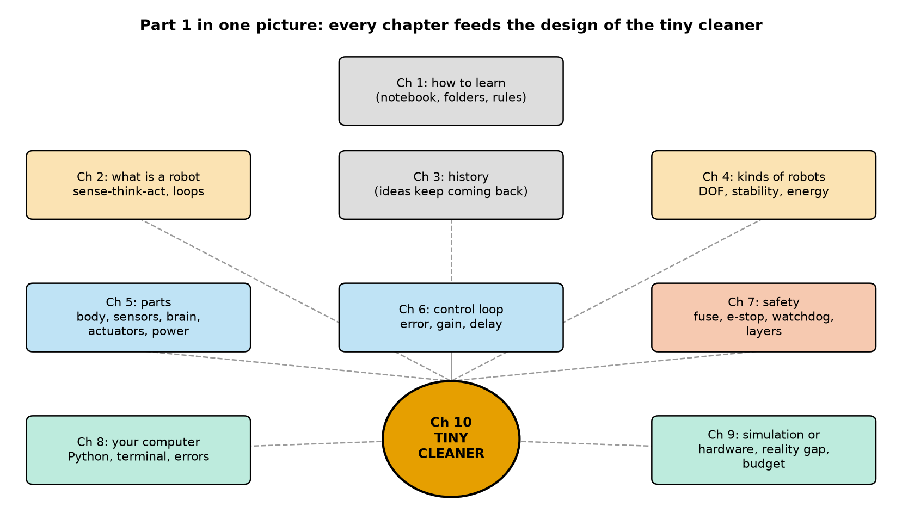

# Chapter 10 — Your First Robot on Paper: Designing a Tiny Cleaning Robot

> **Part 1 · Chapter 10 of 749** (the last chapter of Part 1)
> **You need:** Chapters 1–9. This chapter uses something from every one of them.
> **You will make:** a complete paper design of a small floor-cleaning robot (requirements, sketch, block diagram, power budget, behaviours, safety, parts list), two Python simulations of how it cleans a room, a requirements checker, and your own second robot design.

---

## What you will learn

- How engineers design a robot: the **design loop** (requirements → ideas → choose → details → check → improve).
- How to write **requirements** with numbers, and why "must" and "nice to have" are different.
- How to turn requirements into a **body**, **sensors**, **actuators**, a **brain** and a **power** system (Chapter 5).
- How to draw a **block diagram**, make a **power budget**, and list the **parts** with prices (a bill of materials).
- How a robot can run several **behaviours** with **priorities** ("a cliff is more important than cleaning").
- How to build the **safety layers** of Chapter 7 into a design from the start.
- How to **simulate** two cleaning strategies (random bouncing and straight rows) and measure how much of the floor gets clean.
- How to **check** every requirement automatically, and what to do when one **fails**.

---

## New words in this chapter

| Word | Simple meaning |
|---|---|
| **design** | A plan for something that does not exist yet, detailed enough that someone could build it. |
| **requirement** | Something the robot **must** do or be, written so that it can be checked (best with a number). |
| **specification** (spec) | The full list of requirements. |
| **constraint** | A limit you cannot change: the size of the gap under a sofa, the budget, the laws of physics. |
| **trade-off** | When improving one thing makes another thing worse (a bigger battery runs longer but is heavier). |
| **coverage** | How much of the floor the robot has cleaned, as a percentage. |
| **behaviour** | One simple rule of action, such as "if the bumper is pressed, back up and turn". |
| **priority** | Which behaviour wins when two of them want different things. |
| **bill of materials** (BOM) | The list of every part, with how many and how much they cost (Chapter 9). |
| **prototype** | The first real version of a design, built to test it. |
| **verification** | Checking that the design really meets every requirement. |

---

## 10.1 How engineers design: the design loop

You have learned what robots are (Chapters 2–4), their parts (Chapter 5), how they control themselves (Chapter 6), how to keep them safe (Chapter 7), and how to simulate them (Chapters 8–9). Now you will use all of it at once to **design** a robot.

📖 **New word: design** — a plan for something that does not exist yet, detailed enough that someone could build it.

Good engineers do not start by buying parts. They follow a **loop**. Look at Figure 10.1.



*Figure 10.1 — The engineering design loop: requirements, ideas, choose, details, check, improve, and round again until every check passes.*

**How to read this picture:** Start at the orange box, **1. Requirements**, top left. Follow the grey arrows to the right and down: collect **ideas**, **choose** one, work out the **details**, and **check** whether the details meet the requirements. If something fails, go to **6. Improve** and follow the red arrow back up: go round again. When everything passes (green text in the middle), you build it. In this chapter we stop at "on paper"; Rover will be built for real from Chapter 281.

Look at the loop again: it is a **control loop** (Chapter 6) for designs. The requirements are the **setpoint**. The check is the **measurement**. The difference is the **error**. "Improve" is the **controller**. The same idea that keeps a drone level also produces good designs.

🧠 **Remember:** The first design is never the final design. Plan to go round the loop several times. Going round on **paper** is cheap; going round with real parts costs money and time.

### Our project

Here is the task, from an imaginary customer:

> "I want a small robot that cleans the floor of my child's bedroom while we are at school. It must not fall down the stairs, it must not hurt the cat, and it must be cheap."

This is a real kind of robot: millions of robot vacuum cleaners are sold every year (Chapter 4). We will design a **tiny** version: a sweeper with a brush and a dust bin, without the suction fan of a real vacuum (Application 1 asks what a fan would change).

---

## 10.2 Step 1: Requirements

The customer's words are a good start, but they are not **checkable**. What does "cheap" mean? $20? $200? An engineer turns every wish into a **requirement**.

📖 **New word: requirement** — something the robot must do or be, written so that you can **check** it, best with a number.

| Customer said | Bad requirement (cannot check) | Good requirement (can check) |
|---|---|---|
| "cleans the floor" | "It cleans well." | "It cleans **at least 90%** of the floor of a 4 m × 3 m room in **30 minutes**." |
| "while we are at school" | "It runs long." | "Its battery lasts **at least 45 minutes** (30 min cleaning + 15 min margin)." |
| "not fall down the stairs" | "It is careful." | "It **stops before** any wheel passes an edge (a drop of more than 2 cm)." |
| "not hurt the cat" | "It is safe." | "Top speed **0.2 m/s**; mass **at most 1.5 kg**; soft bumper; **stop button** on top." |
| "cheap" | "It is cheap." | "Parts cost **at most $100**." |
| (the bedroom has a bed) | "It is small." | "Height **at most 9 cm** (fits under the bed); width **at most 25 cm**." |

The last row is important: the customer did not **say** it, but an engineer **asks**: "Where is the dirt? Under the bed. How high is the gap? 9 cm." Good requirements come from asking questions.

### Must and nice to have

Not all wishes are equally important. Engineers sort them:

| Must (the design fails without it) | Nice to have (only if it is easy and cheap) |
|---|---|
| clean ≥ 90% in 30 min | go back to its charging dock by itself |
| battery ≥ 45 min | an app on a phone |
| never fall down stairs | a map of the room |
| safe for people and pets | very quiet |
| cost ≤ $100 | different colours |
| height ≤ 9 cm, width ≤ 25 cm | |

📖 **New word: constraint** — a limit you cannot change. The 9 cm gap under the bed is a constraint: the bed will not grow taller for your robot. The laws of physics are constraints too.

💡 **Tip:** A requirement with a number can be checked by a program. In Section 10.8 we will do exactly that.

---

## 10.3 Steps 2 and 3: Ideas, and choosing

Before drawing details, collect **several** ideas for the main choices, and compare them.

### Body and locomotion (Chapter 4)

| Idea | Good | Bad |
|---|---|---|
| **Round, two wheels on the centre line + a caster** (differential drive) | turns on the spot; a round body never gets stuck when it turns next to a wall | cannot drive sideways (not needed) |
| Square, four wheels with car steering | corners clean better | needs space to turn; gets stuck in corners |
| Legs | climbs steps | complicated, slow, expensive, heavy |
| Flying | sees from above | cannot carry a brush and dirt; too short battery time (Chapter 4: flying costs ~150 W) |

**Choice: round, differential drive.** It is the shape of almost every real robot vacuum, and for a good reason: a circle with the wheels on its centre line can **turn on the spot** without any part of the body swinging out. If it fits through a gap, it can always turn round in it.

### How it decides where to go

| Idea | Needs | Good | Bad |
|---|---|---|---|
| **A. Bump and turn** (random) | bumpers only | very simple, cheap, cleans any shape of room | cleans some places many times and some never; slow |
| **B. Straight rows** (lawnmower) | must know where it is: wheel encoders (Chapter 122) | fast, cleans everything once | needs good position estimation; a mistake leaves gaps |
| C. Map the room with a camera or LiDAR | expensive sensors, a stronger brain | the best | far too expensive for $100 |

We cannot choose between A and B by thinking alone. **We will simulate both** (Section 10.7). This is the advice from Chapter 9: when in doubt, simulate.

---

## 10.4 Step 4: Details — body, sensors, actuators, brain, power

Now we fill in the five parts of a robot (Chapter 5). Look at Figure 10.2.



*Figure 10.2 — The tiny cleaner seen from above: a 20 cm round body (orange), bumper on the front half, two drive wheels on the centre line, a caster in front, four cliff sensors (purple), the battery, the stop button, the brush and the dust bin.*

**How to read this picture:** The blue arrow at the top shows "forward". The orange circle is the body, 20 cm wide (the arrow at the bottom). The grey arc around the front is the bumper. The two black rectangles are the drive wheels; the grey dashed line between them is the wheel axis, through the middle of the circle. The labels point to each part. The **+** marks the centre of mass.

### Body

- Round, **20 cm** wide, **8 cm** tall (inside both limits: 25 cm and 9 cm).
- A flat plastic plate at the bottom, a light cover on top.
- **Centre of mass** just in front of the wheel axis, so the robot rests on the two wheels and the front caster and never tips backwards (Chapter 5: CoM = Σ m·x ÷ Σ m; Chapter 4: support polygon). The battery is the heaviest part, so we put it **in front** of the axis to pull the centre of mass forward.

### Sensors (the robot's senses)

| Sensor | How many | Why (which requirement) |
|---|---|---|
| **Bumper** switches | 2 (left and right half of the front) | know when it hits a wall or furniture; know **which side**, to turn the right way |
| **Cliff sensors** (infrared light pointing down) | 4 | "never fall down the stairs". Each one shines light at the floor and measures the reflection. No reflection = no floor = cliff! |
| **Wheel encoders** | 2 | count wheel turns: how far it has driven (needed for idea B, straight rows) |
| Battery voltage | 1 (a wire to an analog pin) | know when the battery is low |

Why **four** cliff sensors, at the **front** and the **sides**? The robot drives forwards, so a step usually appears in front. But when it turns on the spot next to a step, a side can swing over the edge. The rear is safe because the robot only drives backwards a few centimetres after a bump, over floor it has just crossed.

🔢 **Maths** — will the robot stop in time at a cliff? This is the "blind distance" of Chapter 2:

```
Step 1. Loop time: 50 loops per second → 0.02 s
Step 2. Distance driven before the robot even notices = 0.2 m/s × 0.02 s = 0.004 m  (4 mm)
Step 3. Braking distance from 0.2 m/s (measured on a test floor)          = 0.02 m   (2 cm)
Step 4. Total stopping distance = 0.004 + 0.02                             = 0.024 m  (2.4 cm)
```

So the cliff sensors must look **more than 2.4 cm** ahead of the wheels. We place them **4 cm** ahead: a margin of 1.6 cm. (Chapter 2's `cliff_check.py` did a check like this.)

### Actuators (what moves)

| Actuator | How many | Job |
|---|---|---|
| Small DC gearmotors with wheels | 2 | drive and turn (differential drive) |
| Small DC motor with a brush | 1 | sweep dirt into the bin |
| Buzzer | 1 | beep when the battery is low or when it is stuck |

### Brain

An **Arduino Nano** (a small Arduino-compatible board, Chapter 94). It is enough: the robot only reads a few switches and sensors and drives three motors, 50 times per second. No camera, so no Raspberry Pi is needed.

### Power

- **4 × AA NiMH** cells: 4 × 1.2 V = **4.8 V**, 2.0 Ah (safe chemistry, Chapter 7; easy to buy and recharge).
- A **switch** and a **3 A slow fuse** right at the battery (Application 3 of Chapter 7 shows how to choose the size; Practice 6 asks you to check it).
- A small **5 V regulator** for the brain and sensors. Because 4 NiMH cells give between about 5.6 V (full) and 4.4 V (almost empty), it must be a type that can make 5 V from a little more **or** a little less than 5 V (Chapter 90 explains the types).
- The motors run directly from the battery, through the **stop button** and the motor driver.

### The block diagram

Look at Figure 10.3.



*Figure 10.3 — The tiny cleaner's block diagram. Thick black lines: power for the electronics. Green: motor power, which passes through the STOP button. Blue: signals.*

**How to read this picture:** Start at the battery (left). Power goes through the switch and fuse, then splits. The **black** path goes up to the regulator and the brain. The **green** path goes down through the **STOP button** to the motor driver (a TB6612 for the two drive motors, and a MOSFET transistor switch for the brush motor; Chapter 88), and then to the three motors. **Blue** arrows are signals: the bumpers, cliff sensors and encoders send information **to** the brain; the brain sends speed and direction **to** the motor driver and sounds the buzzer. The dashed blue line tells the brain that the STOP button is pressed. This is exactly the pattern of Rover's e-stop from Chapter 7, Figure 7.4.

---

## 10.5 The power budget

Will the battery last 45 minutes? We use the method of Chapter 5.

| Part | Typical power |
|---|---|
| Brain (Arduino Nano) | 0.25 W |
| Motor driver | 0.30 W |
| 2 drive motors (at 0.2 m/s) | 2.00 W |
| Brush motor | 1.50 W |
| 4 cliff sensors | 0.20 W |
| 2 encoders | 0.10 W |
| **Total** | **4.35 W** |

🔢 **Maths:**

```
Step 1. Battery energy      = 4.8 V × 2.0 Ah        = 9.6 Wh        (Wh = V × Ah, Chapter 5)
Step 2. Usable energy (80%) = 0.8 × 9.6             = 7.68 Wh
Step 3. Time                = 7.68 Wh ÷ 4.35 W      ≈ 1.77 h        (time = energy ÷ power)
Step 4. In minutes          = 1.77 × 60             ≈ 106 minutes
```

106 minutes is much more than the 45 minutes required. Good. (We will see in Application 1 that this margin is very useful.)

🧠 **Remember:** Always check the **biggest** power users first. Here the motors use 3.5 W of the 4.35 W: 80%. Making the brain more efficient would hardly matter; making the motors more efficient would.

---

## 10.6 Behaviours, priorities and safety

### Behaviours

The robot's brain runs a loop 50 times per second. In each loop, it must decide **what to do now**. We split the job into four simple **behaviours**.

📖 **New word: behaviour** — one simple rule of action: **when** something is true, **do** something.

Look at Figure 10.4.



*Figure 10.4 — The four behaviours of the tiny cleaner, from most important (top) to least important (bottom). In every loop, the highest behaviour whose WHEN is true controls the motors.*

**How to read this picture:** Each coloured box is one behaviour, with its **WHEN** (the condition) and its **DOES** (the action). The arrow on the left points **up**, towards "more important". All four want to control the motors (grey arrows on the right), but only **one** can win in each loop: the highest one whose WHEN is true.

📖 **New word: priority** — which behaviour wins when two want different things.

Why this order?

1. **CLIFF** is at the top because falling down the stairs is the most dangerous thing that can happen. Even if the bumper is pressed at the same moment, the cliff wins.
2. **BUMP** is next: the robot has hit something and must stop pushing.
3. **BATTERY LOW** is next: no point cleaning with an empty battery; stop and beep so that someone charges it.
4. **CLEAN** is the default: it runs whenever nothing more important is happening.

In Python-like words (you will write real versions of this from Chapter 18), one loop looks like this:

```
if a cliff sensor sees no floor:
    stop, reverse 5 cm, turn away from the cliff
elif a bumper is pressed:
    reverse 3 cm, turn a random angle (away from the pressed side)
elif the battery voltage is below 4.4 V:
    brush off, beep, stop
else:
    brush on, drive forward at 0.2 m/s
```

(`elif` means "else, if": it is only checked when everything above it was false. That is exactly how priorities work. Chapter 18 teaches it.)

🤖 **Robot link:** This way of building a robot from simple behaviours, with the most important on top, was made famous by the robot researcher Rodney Brooks in the 1980s (he called it the "subsumption architecture"). His company later built the first very successful home robot vacuum cleaner. Chapter 104 shows a related tool, the **state machine**.

### Safety: the five layers (Chapter 7)

| Layer | In the tiny cleaner |
|---|---|
| 1. Safe design | small (20 cm), light (0.6 kg), slow (0.2 m/s), round with no sharp edges, low voltage (4.8 V), NiMH (not LiPo), brush covered by the body |
| 2. Software | top speed limit in the program; "stuck" timer (if the wheels turn but the encoders say it is not moving for 5 s, stop and beep) |
| 3. Sensors | 4 cliff sensors, 2 bumpers, battery voltage |
| 4. Hardware | 3 A fuse at the battery; red STOP button that cuts **motor** power (Figure 10.3) |
| 5. People | instructions: charge only with the right charger; pick up cables and small toys before cleaning |

Is a cat safe? The robot weighs 0.6 kg and moves at 0.2 m/s, as fast as a slow walk. A bump feels like a soft push. The brush is underneath, inside the body. Yes. (Real robot vacuums have even more: they slow down near obstacles they can see.)

---

## Code

Now the most important question: **will it clean 90% of the floor in 30 minutes?** We cannot answer that with a formula. We **simulate** it (Chapter 9).

This program simulates **idea A, bump and turn**, in an empty 4 m × 3 m room. The floor is divided into small squares of 5 cm × 5 cm; each square is "dirty" until the brush passes over it. The robot drives straight; when it would hit a wall, the bumper triggers and it turns by a random angle.

The file is `code/ch010/clean_sim.py`. It uses two new tools, `math.cos` and `math.sin`, explained in the table; do not worry if they feel new: Chapters 47–50 explain angles and trigonometry fully.

```python
# clean_sim.py - a tiny cleaning robot in an empty room: drive straight, bump, turn a random angle
import math
import random
random.seed(3)

room_w, room_h = 4.0, 3.0     # the room is 4 m by 3 m
cell = 0.05                   # we divide the floor into squares of 5 cm x 5 cm
cols, rows = int(room_w / cell), int(room_h / cell)    # 80 x 60 = 4,800 squares
robot_r = 0.10                # the robot is a circle with radius 10 cm (20 cm wide)
brush_r = 0.08                # the brush cleans a circle with radius 8 cm under the robot
speed = 0.2                   # m/s
dt = 0.1                      # 10 loops per second

clean = [[False] * cols for r in range(rows)]   # a table of squares: False = still dirty
x, y = 0.5, 0.5               # start near a corner (the charging dock)
heading = 30.0                # direction in degrees (0 = towards the right wall)
clean_count = 0

for step in range(30 * 60 * 10 + 1):         # 30 minutes, 10 loops per second
    # ACT + SENSE: try to drive forward one step; the bumper tells us if we would hit a wall
    new_x = x + speed * dt * math.cos(math.radians(heading))
    new_y = y + speed * dt * math.sin(math.radians(heading))
    bumped = new_x < robot_r or new_x > room_w - robot_r or new_y < robot_r or new_y > room_h - robot_r
    if bumped:
        heading = heading + random.uniform(90, 270)   # THINK: turn away by a random angle
    else:
        x, y = new_x, new_y
    # the brush cleans every square whose centre is under it
    for r in range(int((y - brush_r) / cell), int((y + brush_r) / cell) + 1):
        for c in range(int((x - brush_r) / cell), int((x + brush_r) / cell) + 1):
            cx, cy = (c + 0.5) * cell, (r + 0.5) * cell
            if (cx - x) ** 2 + (cy - y) ** 2 <= brush_r ** 2 and not clean[r][c]:
                clean[r][c] = True
                clean_count = clean_count + 1
    if step % (5 * 60 * 10) == 0:            # every 5 minutes
        print("after", step // 600, "min:", round(100 * clean_count / (cols * rows), 1), "% of the floor is clean")
```

| Line | Code | What it does (simple English) |
|---|---|---|
| 1 | comment | The name and the idea. |
| 2–4 | `import math`, `import random`, `random.seed(3)` | Load the maths tools (Chapter 26) and the random tools (Chapter 9); fix the seed so your output matches the book. |
| 6 | `room_w, room_h = 4.0, 3.0` | Two variables in one line: `room_w` gets 4.0 and `room_h` gets 3.0. |
| 7 | `cell = 0.05` | The floor is divided into squares 5 cm wide. |
| 8 | `cols, rows = int(room_w / cell), int(room_h / cell)` | How many squares across (4 ÷ 0.05 = 80) and up (3 ÷ 0.05 = 60). 📖 `int(…)` turns a decimal number into a whole number. |
| 9–12 | settings | Robot radius 10 cm, brush radius 8 cm (16 cm wide), speed 0.2 m/s, 10 loops per second. |
| 14 | `clean = [[False] * cols for r in range(rows)]` | A **table** (a list of lists): 60 rows, each with 80 values `False` ("still dirty"). `clean[r][c]` is the square in row `r`, column `c`. (Chapter 21 explains lists of lists.) |
| 15 | `x, y = 0.5, 0.5` | The robot starts at x = 0.5 m, y = 0.5 m: near the bottom-left corner, where its charging dock is. |
| 16 | `heading = 30.0` | It starts facing 30° (0° = to the right, 90° = up). |
| 17 | `clean_count = 0` | Counter of clean squares. |
| 19 | `for step in range(30 * 60 * 10 + 1):` | 30 minutes × 60 seconds × 10 loops = 18,000 loops (plus one, so that the last one at exactly 30 min is printed). |
| 20 | comment | A comment can also be on its own line inside a loop. |
| 21–22 | `new_x = …`, `new_y = …` | Where the robot **would** be after one more step: 0.2 × 0.1 = 0.02 m in the direction `heading`. 📖 `math.cos` and `math.sin` split a step into its part **along x** and its part **along y**. Facing 0°: all of it along x. Facing 90°: all of it along y. Facing 30°: about 87% along x and 50% along y. `math.radians` changes degrees into the unit these functions need (Chapter 47). |
| 23 | `bumped = … or … or …` | **Sense**: would the robot's edge go past a wall? 📖 `or` means "at least one of these is true". If the centre would come closer than 10 cm (`robot_r`) to any wall, the bumper is pressed. `bumped` becomes `True` or `False`. |
| 24–25 | `if bumped:` `heading = heading + random.uniform(90, 270)` | **Think**: turn by a random angle between 90° and 270°, so that the robot faces roughly away from the wall it hit. It does **not** move in this loop. |
| 26–27 | `else:` `x, y = new_x, new_y` | **Act**: no bump, so the robot really moves to the new position. |
| 28 | comment | |
| 29–30 | two `for` loops | Look at the few squares around the robot (only those near the brush; no need to check all 4,800 every time). |
| 31 | `cx, cy = (c + 0.5) * cell, (r + 0.5) * cell` | The position of the **centre** of square (r, c). |
| 32 | `if (cx - x) ** 2 + (cy - y) ** 2 <= brush_r ** 2 and not clean[r][c]:` | Is the square's centre **under the brush** (closer than 8 cm to the robot's centre)? This uses **Pythagoras** (Chapter 48): distance² = (difference in x)² + (difference in y)². `**` means "to the power of", and `not` turns True into False. So: "under the brush **and** still dirty". |
| 33–34 | `clean[r][c] = True`, count + 1 | Mark the square as clean and count it. |
| 35 | `if step % (5 * 60 * 10) == 0:` | Every 3,000 loops (5 minutes)… |
| 36 | `print(…)` | …show the minutes (`step // 600`; 📖 `//` divides and drops the decimals) and the percentage of clean squares. |

**Output:**

```
after 0 min: 0.2 % of the floor is clean
after 5 min: 49.4 % of the floor is clean
after 10 min: 75.8 % of the floor is clean
after 15 min: 84.1 % of the floor is clean
after 20 min: 88.7 % of the floor is clean
after 25 min: 92.3 % of the floor is clean
after 30 min: 93.8 % of the floor is clean
```



*Figure 10.5 — The floor after 5 minutes (left) and 30 minutes (right) of bump-and-turn cleaning. Brown = still dirty; light = clean. The thin blue lines are the robot's path.*

**How to read this picture:** Each small square of colour is one 5 cm floor square: brown is dirty, light is clean. The thin blue lines show where the centre of the robot went; each straight line ends at a wall, where the robot bumped and turned. The orange square (left picture) is the dock where it started.

**What the output means:**

- **Requirement met:** 93.8% after 30 minutes (≥ 90%). ✅
- The first 5 minutes clean almost half the floor. Then it gets **slower and slower**: the next 5 minutes add 26%, the last 5 minutes only 1.5%. Why? At the start, every path crosses dirty floor. Later, most paths cross floor that is **already** clean. Random cleaning wastes more and more time.
- Look at the right picture: dirty **islands** remain in the middle, and a thin dirty **edge** along the walls. The edge is there because the round robot cannot get its brush right into the wall: the brush (radius 8 cm) is smaller than the body (radius 10 cm). Real robot vacuums add a small spinning **side brush** that sticks out to sweep the edges and corners.

🧪 **Experiment:** Change line 4 to `random.seed(4)` and run again. The result after 30 minutes changes (each seed is a different "random" run). Try 5 seeds and write down the results. Is 90% always reached? (This is the "test many variations" idea from Chapter 9.)

---

## 10.7 Idea B: straight rows

Now idea B. If the robot knows where it is (using its wheel encoders), it can clean in straight rows, like mowing a lawn: right, up a little, left, up a little, right, …

📖 **New word: coverage** — how much of the floor has been cleaned, as a percentage.

The rows must be **closer together than the brush is wide**, or there will be dirty stripes between them. The brush is 16 cm wide, so we choose a gap of **15 cm** between rows (1 cm of overlap).

🔢 **Maths** — how long should it take?

```
Step 1. The robot's centre can go from y = 0.10 m to y = 2.90 m (10 cm from each wall)
Step 2. Rows 15 cm apart: 0.10, 0.25, 0.40, …   number of rows ≈ (2.90 − 0.10) ÷ 0.15 + 1 ≈ 19.7 → 19 rows fit
Step 3. Each row is 4.0 − 0.2 = 3.8 m long → 19 × 3.8 = 72.2 m
Step 4. Plus 18 short moves up between rows: 18 × 0.15 = 2.7 m → total ≈ 74.9 m
Step 5. Time = distance ÷ speed = 74.9 ÷ 0.2 ≈ 374 s ≈ 6.2 minutes
```

The file `code/ch010/lawnmower.py` simulates it (Application 2 explains the code). Its output:

```
after 1 min: 16.8 % clean
after 2 min: 31.9 % clean
after 3 min: 47.0 % clean
after 4 min: 62.1 % clean
after 5 min: 77.2 % clean
after 6 min: 92.3 % clean
finished after 6.3 min: 19 rows, 96.1 % clean
```

Look at Figure 10.6 (left).



*Figure 10.6 — Left: the rows as first planned: a dirty strip remains along the top wall. Right: with one extra row added right against the top wall.*

**How to read this picture:** Same colours as Figure 10.5. The blue line is the robot's path: long rows to the right and to the left, joined by short moves up. In the left picture, the red label points to a **brown strip** at the very top: the plan stopped one row too early. In the right picture, an extra row was added at the top wall, and the strip is gone.

**What happened?** Step 2 of our maths said "19.7 rows" and we rounded down to 19. The 19th row is at y = 2.80 m; its brush reaches up to 2.88 m. The strip from 2.88 m to 3.00 m was **never** cleaned. That is about 3% of the floor. The simulation found a **bug in our plan** that the quick maths hid. With one extra row against the wall (at y = 2.90 m), coverage becomes **99.5%** in 6.6 minutes.

### Comparing the two ideas

Look at Figure 10.7.



*Figure 10.7 — The percentage of floor cleaned over time: bump and turn (orange), straight rows as planned (blue), and straight rows with the extra row (green dashed). The black dashed line is the 90% requirement.*

**How to read this picture:** Time goes along the bottom (0 to 30 minutes); the cleaned percentage goes up the side. The rows (blue and green) rise in a **straight line** (the robot cleans new floor all the time) and finish in under 7 minutes. The random robot (orange) rises fast at first, then bends over and **creeps** slowly; it crosses the 90% line only after about 21 minutes.

| | A. Bump and turn | B. Straight rows (fixed) |
|---|---|---|
| Coverage | 93.8% in 30 min | 99.5% in 6.6 min |
| Time to reach 90% | about 21 min | about 6 min |
| Extra sensors | none | wheel encoders (we planned them anyway) |
| Weak point | slow; random gaps | needs to **know where it is**; any position error leaves stripes; furniture breaks the simple row plan |

**Decision:** use **B (rows) in open areas, and A (bump and turn) when it meets furniture or gets lost**. Many real robot cleaners do something like this: systematic patterns where possible, simple reactive behaviours as a backup. Since B finishes in about 7 minutes, the battery could clean the room more than **10 times** on one charge. That margin will be very useful in Application 1.

⚠️ **Careful:** Our simulation is a **perfect** world (Chapter 9): an empty room, perfect wheels, perfect position. On a real floor, wheels slip and encoders make small errors that **add up**, so after 20 rows the robot may be several centimetres from where it thinks it is (Chapter 288 measures this). With only 1 cm of overlap between rows, a small error leaves a dirty stripe. A real design would use more overlap, or re-measure its position against a wall now and then.

---

## 10.8 Steps 5 and 6: Check every requirement, and the parts list

### The parts list (bill of materials)

| Part | Price (middle of typical range) |
|---|---|
| Arduino Nano (compatible) | $8 |
| TB6612 motor driver + MOSFET for the brush | $6 |
| 2 small gearmotors with wheels and encoders | $18 |
| Brush motor + brush | $6 |
| Caster ball | $2 |
| 4 × AA NiMH cells + holder | $10 |
| NiMH charger | $16 |
| Switch + fuse holder + 3 A slow fuses | $5 |
| Red STOP button | $6 |
| 2 bumper switches | $2 |
| 4 cliff sensors (infrared, pointing down) | $6 |
| 5 V regulator | $4 |
| Body: plastic plate, cover, dust bin, screws | $7 |
| **Total** | **$96** |

$96: just inside the $100 requirement. (Not much margin! The charger is the single most expensive part; if the customer already has one, the robot costs $80.)

### The requirements checker

A design is only finished when **every** requirement has been **checked**. This program collects the numbers from the whole chapter and checks them all.

The file is `code/ch010/design_check.py`.

```python
# design_check.py - does our tiny cleaning robot meet every requirement?
# --- power budget (Chapter 5) ---
watts = [0.25, 0.30, 2.00, 1.50, 0.20, 0.10]   # brain, motor driver, 2 drive motors, brush motor, 4 cliff sensors, encoders
battery_wh = 4.8 * 2.0                          # 4 x AA NiMH: 4.8 V, 2.0 Ah -> Wh = V x Ah
usable_wh = 0.8 * battery_wh                    # use only 80% (Chapter 5)
total_w = sum(watts)
battery_min = usable_wh / total_w * 60          # time = energy / power, in minutes

# --- stopping at a cliff (Chapter 2) ---
speed = 0.2           # m/s
loop_time = 0.02      # 50 loops per second
brake = 0.02          # metres to stop from 0.2 m/s (measured on a test floor)
stop_dist = speed * loop_time + brake
sensor_ahead = 0.04   # the cliff sensors look 4 cm in front of the wheels

# --- the requirements: name, design value, limit, "max" (must be <= limit) or "min" (must be >= limit) ---
names  = ["height (cm)", "width (cm)", "mass (kg)", "battery time (min)", "floor cleaned in 30 min (%)",
          "cost (dollars)", "cliff stopping distance (m)"]
values = [8.0, 20.0, 0.6, battery_min, 93.8, 96, stop_dist]
limits = [9.0, 25.0, 1.5, 45, 90, 100, sensor_ahead]
kinds  = ["max", "max", "max", "min", "min", "max", "max"]

print("total power", round(total_w, 2), "W | usable energy", usable_wh, "Wh")
all_ok = True
for i in range(len(names)):
    if kinds[i] == "max":
        ok = values[i] <= limits[i]
    else:
        ok = values[i] >= limits[i]
    if not ok:
        all_ok = False
    print(names[i], "| design", round(values[i], 3), "| limit", kinds[i], limits[i], "|", "PASS" if ok else "FAIL")
print("ALL REQUIREMENTS MET" if all_ok else "SOME REQUIREMENTS FAILED: change the design")
```

| Line | Code | What it does (simple English) |
|---|---|---|
| 1–2 | comments | The name; then a heading comment for the first block. |
| 3 | `watts = [...]` | The power table of Section 10.5, as a list. |
| 4 | `battery_wh = 4.8 * 2.0` | Battery energy: V × Ah = 9.6 Wh. |
| 5 | `usable_wh = 0.8 * battery_wh` | Only 80% is used (7.68 Wh). |
| 6 | `total_w = sum(watts)` | 📖 `sum(list)` adds all the numbers in a list: 4.35 W. (The same as the running total in Chapter 9, in one word.) |
| 7 | `battery_min = usable_wh / total_w * 60` | time = energy ÷ power, × 60 for minutes. |
| 9–14 | cliff block | The cliff calculation of Section 10.4: 0.2 × 0.02 + 0.02 = 0.024 m, and the sensors look 0.04 m ahead. |
| 16 | comment | Explains the four lists below. |
| 17–18 | `names = [...]` | The seven requirements. |
| 19 | `values = [...]` | What our **design** gives for each one, in the same order. Some come from calculations above (`battery_min`, `stop_dist`), one from the simulation (93.8), one from the parts list (96). |
| 20 | `limits = [...]` | The limit of each requirement. |
| 21 | `kinds = [...]` | `"max"`: the value must be **at most** the limit (height, cost…). `"min"`: it must be **at least** the limit (battery time, coverage). |
| 23 | `print(…)` | Show the power and energy. |
| 24 | `all_ok = True` | We start by assuming everything passes… |
| 25 | `for i in range(len(names)):` | …and check each requirement. |
| 26–29 | `if kinds[i] == "max": … else: …` | Choose the right comparison. `ok` becomes `True` or `False`. |
| 30–31 | `if not ok:` `all_ok = False` | If even **one** fails, the whole design fails. |
| 32 | `print(…, "PASS" if ok else "FAIL")` | 📖 `"PASS" if ok else "FAIL"` is a short if-else **inside** an expression: it gives the text `"PASS"` when `ok` is True, otherwise `"FAIL"`. |
| 33 | `print(…)` | The final verdict, with the same short if-else. |

**Output:**

```
total power 4.35 W | usable energy 7.68 Wh
height (cm) | design 8.0 | limit max 9.0 | PASS
width (cm) | design 20.0 | limit max 25.0 | PASS
mass (kg) | design 0.6 | limit max 1.5 | PASS
battery time (min) | design 105.931 | limit min 45 | PASS
floor cleaned in 30 min (%) | design 93.8 | limit min 90 | PASS
cost (dollars) | design 96 | limit max 100 | PASS
cliff stopping distance (m) | design 0.024 | limit max 0.04 | PASS
ALL REQUIREMENTS MET
```

**What the output means:** Every requirement passes, using the **worse** of our two cleaning ideas (random, 93.8%). The design is complete, on paper. The tightest margins are **cost** ($4 left) and **coverage** (3.8% above the limit, and that depends on luck: see the experiment with seeds). Those are the places to watch in a prototype.

📖 **New word: verification** — checking that the design really meets every requirement. Real engineering teams keep a table exactly like this output, with one more column: **how** each requirement was checked (calculation, simulation, or test on a prototype).

---

## Small examples

### Example 1 — Make it checkable

"The robot must be quiet." → "The robot must make **at most 55 dB** of noise, measured 1 m away." (dB, decibels, measure loudness; a quiet conversation is about 50–60 dB.)

### Example 2 — Must or nice to have?

For a robot lawnmower: "must not leave the garden" → **must**. "Mows in a nice pattern" → **nice to have**.

### Example 3 — Battery time

A cleaner uses 6.0 W and has a 7.2 V, 2.0 Ah battery (80% usable).

```
energy = 7.2 × 2.0 = 14.4 Wh;  usable = 0.8 × 14.4 = 11.52 Wh
time   = 11.52 ÷ 6.0 = 1.92 h ≈ 115 minutes
```

### Example 4 — Row gap

A brush is 30 cm wide. Rows must overlap by at least 2 cm.

```
largest row gap = 30 − 2 = 28 cm
```

### Example 5 — Priorities

In one loop, the bumper is pressed **and** the battery is low. Which behaviour wins (Figure 10.4)? **BUMP** (priority 2 is above 3). In the next loop, if the bumper is released, BATTERY LOW wins.

### Example 6 — Cliff sensor position

A robot drives at 0.3 m/s, its loop runs 100 times per second, and it brakes in 3 cm.

```
stopping distance = 0.3 × 0.01 + 0.03 = 0.033 m
the cliff sensors must look more than 3.3 cm ahead of the wheels
```

---

## 🏭 Real robot applications

### Application 1 (worked in full) — 🏠 The customer wants suction: going round the design loop

**1. The real problem.** The customer sees the design and says: "A brush is nice, but real vacuums **suck** the dirt up. Can you add a fan?" A small suction fan uses about **6 W**. Does the design still work?

**2. Why this idea.** This is step 6 of the design loop: a change arrives, and we **check again**. We do not guess; we put the new number into `design_check.py`.

**3. The numbers.** Add a fan of 6.0 W to the power list:

```python
watts = [0.25, 0.30, 2.00, 1.50, 0.20, 0.10, 6.00]
```

and add $8 for the fan to the cost (96 → 104).

**4. The maths, step by step.**

```
Step 1. New total power = 4.35 + 6.00          = 10.35 W
Step 2. Battery time    = 7.68 Wh ÷ 10.35 W    ≈ 0.742 h ≈ 44.5 minutes
Step 3. Requirement: at least 45 minutes        → FAIL (by half a minute)
Step 4. Cost            = 96 + 8               = 104 dollars → FAIL (limit 100)
```

**5. The code.** Running `design_check.py` with these two changes prints:

```
total power 10.35 W | usable energy 7.68 Wh
height (cm) | design 8.0 | limit max 9.0 | PASS
width (cm) | design 20.0 | limit max 25.0 | PASS
mass (kg) | design 0.6 | limit max 1.5 | PASS
battery time (min) | design 44.522 | limit min 45 | FAIL
floor cleaned in 30 min (%) | design 93.8 | limit min 90 | PASS
cost (dollars) | design 104 | limit max 100 | FAIL
cliff stopping distance (m) | design 0.024 | limit max 0.04 | PASS
SOME REQUIREMENTS FAILED: change the design
```

**6. The result — and three ways to fix it.** Two requirements fail. Now we **improve** (step 6 of the loop) and look for **trade-offs**.

📖 **New word: trade-off** — when improving one thing makes another worse.

| Fix | Battery time | Cost | Trade-off |
|---|---|---|---|
| (a) Bigger AA cells: 2.5 Ah instead of 2.0 Ah | 0.8 × 4.8 × 2.5 ÷ 10.35 × 60 ≈ **55.7 min** ✅ | about +$4 → $108 ❌ | still too expensive |
| (b) Remove the brush motor, keep the fan | 7.68 ÷ 8.85 × 60 ≈ **52.1 min** ✅ | 104 − 6 = **$98** ✅ | cleans carpets less well |
| (c) Use the **rows** strategy: the fan runs only ~7 minutes per room | needs only 7 min of cleaning → battery is plenty ✅ | still $104 ❌ | change the 45-minute requirement? |

Option (c) shows something important: the **45-minute requirement came from the random strategy** ("30 min of cleaning"). With rows, the room is clean in 7 minutes, so the real requirement ("the room gets clean before the battery is empty") is easily met. Sometimes the best fix is to **question a requirement** with the customer. The cost is the harder limit: the team offers (b), or asks the customer whether $104 is acceptable for suction.

**7. Going further.** Real robot vacuum teams make exactly these trade-offs, with more requirements (noise, carpet, pet hair, price). Chapter 151 makes a full power budget with peaks, and Chapter 747 (Courier) starts with a complete requirements table like this one.

### Application 2 (worked in full) — 🌾🌊🚁 Straight rows everywhere: lawns, fields, the sea floor and the sky

**1. The real problem.** Many robots must **cover** an area completely: a robot lawnmower covers a garden, a tractor sprays a field, an underwater robot searches the sea floor for a lost object, a drone photographs a farm. They all need the same thing as our cleaner: cover everything, with no gaps, in the shortest time.

**2. Why this idea.** The **row pattern** (engineers call it a "lawnmower" or "boustrophedon" pattern — a Greek word meaning "turning like an ox ploughing a field") is the simplest way to cover a rectangle with no gaps. The rule is always: **row gap ≤ tool width − overlap**.

**3. The numbers.** Our cleaner: tool (brush) 0.16 m, gap 0.15 m. `lawnmower.py` builds the list of corner points like this:

```python
plan = []
y_row = robot_r
going_right = True
while y_row <= room_h - robot_r:
    if going_right:
        plan.append((robot_r, y_row))
        plan.append((room_w - robot_r, y_row))
    else:
        plan.append((room_w - robot_r, y_row))
        plan.append((robot_r, y_row))
    going_right = not going_right
    y_row = y_row + row_gap
```

| Code | What it does (simple English) |
|---|---|
| `plan = []` | An empty list of corner points to drive to. |
| `y_row = robot_r` | The first row is 10 cm from the bottom wall. |
| `going_right = True` | The first row goes from left to right. |
| `while y_row <= room_h - robot_r:` | 📖 `while` repeats **as long as** the condition is true (Chapter 19): as long as the next row still fits in the room. |
| `plan.append((robot_r, y_row))` … | Add the start and end point of this row. `(x, y)` with round brackets is a **pair** of numbers (a "tuple", Chapter 22). Going right: from the left wall to the right wall; going left: the other way. |
| `going_right = not going_right` | Swap direction for the next row: `not True` is `False`, `not False` is `True`. |
| `y_row = y_row + row_gap` | The next row is 15 cm higher. |

The rest of the program drives the robot from corner point to corner point at 0.2 m/s and cleans squares exactly like `clean_sim.py`.

**4. The maths, step by step.** For a farm drone taking photos (from Chapter 4: a drone flies 8 m/s and each photo strip is 40 m wide):

```
Field: 400 m × 200 m
Step 1. Rows across 200 m with 40 m strips (no overlap for simplicity) = 200 ÷ 40 = 5 rows
Step 2. Distance = 5 × 400 m + 4 × 40 m (moves between rows)       = 2,160 m
Step 3. Time = 2,160 ÷ 8                                              = 270 s = 4.5 minutes
```

Real photo surveys use about 60–70% overlap between strips (so that a computer can stitch the photos together), which makes the rows much closer and the flight several times longer.

**5. The code.** `code/ch010/lawnmower.py` (output in Section 10.7).

**6. The result.** The bug we found in Section 10.7 (one row missing at the end) is a **classic** coverage bug: it happens to real lawnmower robots and survey drones too, which is why their planners always add a final pass along the far edge. The simulation found it in seconds; on a real field, you would find it when the crop at the far edge was not sprayed.

**7. Going further.**
- 🌾 Tractors with GPS autosteer drive these rows with errors of about 2 cm (Chapter 130 explains GPS, and how it gets so accurate).
- 🌊 Underwater survey robots (AUVs) fly lawnmower patterns over the sea floor with sonar, to find shipwrecks and lost aircraft.
- 🚁 Survey drones fly them to make maps and 3D models of fields and buildings (Part 30).
- Chapter 454 (A*) and Part 23 show how to plan paths around obstacles, which simple rows cannot do.

### Application 3 — 🏭 Floor-scrubbing robots in supermarkets and airports

Large self-driving floor scrubbers clean supermarkets and airports at night. They are the same design as our tiny cleaner, scaled up: about 300 kg, rows in open areas, careful driving near shelves. Because they are big and work near people, their safety layers are much stronger: laser scanners all around, slowing down when a person is near (Chapter 7, Application 5), e-stop buttons on several sides, and a speed of about walking pace.

### Application 4 — 🏥 UV disinfection robots

Hospital robots disinfect rooms with strong ultraviolet (UV) light. Their "coverage" is not floor but **light dose**: every surface must receive enough UV light. They use the same design loop: a requirement with a number (a minimum dose on every surface), a plan for where to stand, a simulation of the light, and a check. Their most important safety requirement: UV light harms eyes and skin, so the lamps switch off at once if a motion sensor detects a person in the room (a sensor layer and a hardware layer).

### Application 5 — 🏠🦿 From paper to product: prototypes

After a paper design passes, companies build a **prototype**: a first real version, often ugly, to test the design. The prototype always finds problems the paper missed (Chapter 9's reality gap): the cliff sensor is fooled by a black carpet (black reflects little light, so it looks like a cliff!), a sock gets wound into the brush, the robot gets stuck under a chair with a low bar. Each problem sends the team round the design loop again. Even big companies go through many prototypes before a robot is sold.

---

## 🔧 Hands-on lab

### Lab 10.1 — Design your own second robot on paper

**You need:** your notebook, pens, your computer (for the checker).

**Steps:** Choose **one** of these robots (or your own idea):
- a robot that **waters plants** on a windowsill,
- a robot that **cleans a window** (vertical!),
- a robot that **brings a glass of water** from the kitchen to a bedroom on the same floor,
- a robot that **follows the line of a toy race track** as fast as possible.

Then work through the design loop:

1. **Requirements:** write at least **6** requirements, each with a number. Mark each one **must** or **nice to have**.
2. **Ideas and choice:** for the body and for the main strategy, write 2–3 ideas and choose one, with reasons (a small score table, Chapter 4, is great).
3. **Sketch:** draw the robot from above (like Figure 10.2), with all parts labelled.
4. **Block diagram:** draw it like Figure 10.3: power black, motor power green through a stop button, signals blue.
5. **Power budget:** list the power of each part, choose a battery, compute the time.
6. **Behaviours:** write 3–5 behaviours with WHEN and DOES, in order of priority.
7. **Safety:** fill in the five layers.
8. **Parts list** with prices (use Chapter 9's prices as a guide).
9. **Check:** copy `design_check.py` into `my-code/ch010/`, change the lists to **your** requirements, and run it.

**What you should see:** A complete design on 3–4 notebook pages, and a checker output. It is **normal** if something fails the first time: go round the loop and write down what you changed and why.

**If it does not work:**

| Problem | Likely cause | Fix |
|---|---|---|
| "I cannot think of numbers for my requirements." | Not enough information. | Ask the "customer" (a family member), measure things (a windowsill, a glass), or make a sensible guess and write "guess" next to it. |
| The checker gives an `IndexError` | Your four lists have different lengths | Count: `names`, `values`, `limits` and `kinds` must have the same number of items. |
| Everything passes easily | Your requirements are too easy | Good engineers make requirements that are **hard enough** to matter. Tighten the most important one. |

### Lab 10.2 — Play with the cleaning simulation

**You need:** your computer, `clean_sim.py` and `lawnmower.py` in `my-code/ch010/`.

**Steps:** Change **one** thing at a time, **predict** first, then run.

1. 🧪 In `clean_sim.py`, make the brush wider: `brush_r = 0.10`. Does 30-minute coverage go up or down?
2. 🧪 Make the robot faster: `speed = 0.3`. (Is that still safe for the cat? Chapter 7.)
3. 🧪 Change the turn rule to always turn exactly 180°: `heading = heading + 180`. What happens? (Hint: think about what the robot does after it bounces back from a wall it hit straight on.)
4. 🧪 In `lawnmower.py`, change `row_gap = 0.15` to `row_gap = 0.20` (wider than the brush). Look at the result; what is the problem?
5. Fix the missing-row bug in `lawnmower.py` yourself: after the `while` loop, if the last row is below `room_h - robot_r`, add one more row there (Figure 10.6 right). Check that you get 99.5%.

**What you should see:**

- Step 1: a wider brush cleans more per metre: coverage goes up (98.2% after 30 minutes with seed 3), and the dirty edge along the walls gets thinner.
- Step 2: faster means more metres driven in 30 minutes, so more coverage (95.5%), but the cliff stopping distance grows (redo the calculation of Section 10.4!).
- Step 3: the robot goes back and forth along **the same line** forever: coverage stays very low (6.0%). Randomness is what makes bump-and-turn work.
- Step 4: dirty **stripes** between the rows (the gap is wider than the 16 cm brush), but it finishes sooner: 92.6% in 4.7 minutes. Fewer rows, worse cleaning: a trade-off.

**If it does not work:**

| Problem | Likely cause | Fix |
|---|---|---|
| `IndexError: list index out of range` in the cleaning loop | The brush or robot was made bigger than the distance to the wall allows | Keep `brush_r` ≤ `robot_r`. |
| The program runs for a long time | 18,000 loops × the cleaning loop is a lot of work | Wait up to a few seconds; it is normal. |

### Lab 10.3 — The paper cleaning game (no computer)

**You need:** squared paper (or draw a grid of 12 × 9 squares), a coin or button (the robot), a die, a pencil.

**Steps:**

1. Draw a room of 12 × 9 squares. Put the coin in a corner square. Shade it ("clean").
2. **Bump-and-turn rules:** the robot moves one square at a time in its direction (start: to the right). Each move, shade the new square. When the next square would be outside the room, roll the die for a new direction: 1–2 = up, 3–4 = left, 5–6 = down (re-roll if it still points into the wall).
3. Do **60 moves**. Count the shaded squares. What percentage of the 108 squares is clean?
4. On a fresh grid, do the **rows** pattern: right to the end, up one, left to the end, up one… Count how many moves you need to shade everything.

**What you should see:** With rows, you clean all 108 squares in about 107 moves (12 × 9 − 1), never wasting a move. With bump-and-turn, after 60 moves you will have cleaned roughly half of the room, with many squares visited twice. You have just done by hand what `clean_sim.py` and `lawnmower.py` do by computer, and found the same lesson.

---

## Common mistakes

⚠️ **Starting with parts instead of requirements.** "I have a cool sensor, what can I build?" is fun, but it is not design. Start with what the robot must do.

⚠️ **Requirements without numbers.** "Fast", "cheap", "safe" cannot be checked. Add numbers.

⚠️ **Forgetting hidden requirements.** The 9 cm gap under the bed was never said by the customer. Ask questions.

⚠️ **Only one idea.** Collect several and compare them; the first idea is rarely the best.

⚠️ **Trusting quick maths over simulation** (or the other way round). The quick row maths hid the missing-row bug; the simulation found it. But the simulation is a perfect world: a prototype will find more.

⚠️ **Adding safety at the end.** Safety layers (Chapter 7) belong in the design from the first sketch: stop button in the block diagram, cliff sensors in the requirements.

⚠️ **No priorities between behaviours.** If "clean" and "cliff!" both control the motors, the robot can drive over the edge. The most dangerous situation must win.

⚠️ **Not going round the loop.** When a check fails, change the design (or question the requirement), and check **everything** again.

---

## Practice

🏋️ **1.** Turn these wishes into checkable requirements with numbers: (a) "the robot should not be too heavy to carry"; (b) "it should be quiet at night"; (c) "it should climb onto the carpet".

🏋️ **2.** Sort into **must** and **nice to have** for a robot that carries food trays in a hospital: never drives into people; plays music; delivers within 10 minutes; shows the time on a screen; does not drive through closed doors.

🏋️ **3.** Why is a round body with the wheels on the centre line good for a cleaning robot? Explain in two sentences.

🏋️ **4.** Our cleaner gets a bigger, heavier battery behind the wheel axis. What could go wrong? (Hint: Chapter 4, support polygon; Chapter 5, centre of mass.)

🏋️ **5.** The tiny cleaner's loop slows to 10 loops per second because of a bug. Compute the new cliff stopping distance. Do the sensors (4 cm ahead) still pass?

🏋️ **6.** Check the 3 A fuse: the normal current is 4.35 W ÷ 4.8 V. At start-up, each drive motor can take 1.0 A and the brush motor 0.5 A for a moment, plus 0.1 A for the electronics. The wires are safe up to 5 A. Is 3 A a good choice? (Chapter 7, Application 3.)

🏋️ **7.** In one loop: a cliff sensor sees no floor **and** a bumper is pressed **and** the battery is low. Which behaviour controls the motors? Why is this the right choice?

🏋️ **8.** The rows strategy: a robot with a 25 cm wide brush cleans a room 5 m × 4 m. Its centre stays 15 cm from the walls. Choose a row gap with 2 cm of overlap, and estimate how many rows are needed and the total length driven (rows only, plus the moves between rows).

🏋️ **9.** Using your answer to 8 and a speed of 0.25 m/s, how many minutes does the rows strategy take?

🏋️ **10.** In Application 1, option (b) removes the brush motor. Check the battery time: 7.68 Wh ÷ (10.35 − 1.50) W. Does it meet 45 minutes?

🏋️ **11.** (Harder) The random robot reached 49.4% after 5 minutes and 75.8% after 10 minutes. In the first 5 minutes it cleaned 49.4% of the floor; in the next 5 minutes it cleaned 26.4%. Of the floor that was still dirty at 5 minutes (50.6%), what fraction did it clean in the next 5 minutes? If this fraction stayed the same, what would you predict for 15 minutes? Compare with the simulation (84.1%).

🏋️ **12.** (Harder) Name **three** things in a real bedroom that our simulation ignores, and say how each one could change the coverage result.

---

## Answers

**1.** (Possible answers.) (a) "Mass at most **2 kg**." (b) "Noise at most **45 dB** at 1 m." (c) "Climbs a step of at least **1.5 cm** (carpet edge)."

**2.** **Must:** never drives into people; delivers within 10 minutes; does not drive through closed doors. **Nice to have:** plays music; shows the time.

**3.** A circle with the wheels on its centre line can turn on the spot without any part of the body swinging outwards. So if it fits into a gap (under a bed, between chair legs), it can always turn round and get out again.

**4.** The centre of mass moves backwards. If it moves behind the wheel axis, the robot rests on the wheels and… nothing at the back: it **tips backwards** onto its tail (the support polygon is the triangle wheels–caster, and the CoM must stay inside it). Fix: put the battery in front of the axis, as in our design, or add a second caster at the back.

**5.**
```
loop time = 0.1 s
stopping distance = 0.2 × 0.1 + 0.02 = 0.02 + 0.02 = 0.04 m
```
Exactly 4 cm: **no margin at all**. In practice, that is a FAIL; the bug must be fixed (or the sensors moved further forward, or the speed reduced).

**6.**
```
normal current   = 4.35 ÷ 4.8 ≈ 0.91 A
start-up peak    = 2 × 1.0 + 0.5 + 0.1 = 2.6 A
wire limit       = 5 A
```
3 A is above the peak (2.6 A) and below the wire limit (5 A): **a good choice**, with a **slow** type so that short peaks do not melt it.

**7.** **CLIFF** (priority 1). Falling down the stairs is the most dangerous outcome; reversing away from the edge is more urgent than handling the bump or the low battery. Once the robot is safe, the other behaviours get their turn.

**8.**
```
row gap = 25 − 2 = 23 cm = 0.23 m
centre moves from y = 0.15 to y = 4.0 − 0.15 = 3.85 m → a span of 3.70 m
rows ≈ 3.70 ÷ 0.23 + 1 ≈ 17.1 → 18 rows (always round UP and put the last row at the wall: the lesson of Section 10.7)
row length = 5.0 − 0.3 = 4.7 m → 18 × 4.7 = 84.6 m
moves between rows: 17 moves, together 3.70 m
total ≈ 84.6 + 3.7 = 88.3 m
```

**9.**
```
time = 88.3 ÷ 0.25 ≈ 353 s ≈ 5.9 minutes
```

**10.**
```
7.68 ÷ 8.85 ≈ 0.868 h ≈ 52.1 minutes → meets 45 minutes ✅
```

**11.**
```
fraction of the remaining dirt cleaned in 5 min = 26.4 ÷ 50.6 ≈ 0.52 (about half)
dirty at 10 min = 100 − 75.8 = 24.2%
prediction: clean half of it in the next 5 min → 24.2 × 0.52 ≈ 12.6% more → 75.8 + 12.6 ≈ 88.4% at 15 min
```
The simulation gave **84.1%**: lower. The prediction is too optimistic because the dirt that remains is more and more in **hard places** (along the walls and in corners, which random paths rarely reach), so the fraction cleaned per 5 minutes **shrinks** over time. Still, "roughly half of what is left, every 5 minutes" is a good first idea of why random cleaning slows down (it is the same kind of shrinking you saw in Chapter 6's control loops).

**12.** (Any three, for example.) **Furniture** (bed, chair legs, desk): blocks the straight rows and makes shadows the random robot rarely reaches → coverage goes **down**, especially for rows. **Toys and cables on the floor:** the robot bumps or gets stuck → time lost, coverage down (or the robot stops). **Carpet:** wheels slip, the robot drives slower than commanded and position estimates drift → stripes in the row pattern. **The dock** in a corner: an obstacle in the room. **A door** left open: the robot leaves the room!

---

## Summary

🧠 Design follows a **loop**: requirements → ideas → choose → details → check → improve → (round again). It is a control loop for designs.

🧠 Good **requirements** have **numbers** and can be **checked**. Sort them into **must** and **nice to have**. Ask questions to find hidden constraints.

🧠 Fill in the five parts of a robot: **body** (round, differential drive), **sensors** (bumpers, cliff sensors, encoders, battery voltage), **actuators** (drive motors, brush), **brain** (Arduino Nano), **power** (4 × AA NiMH, switch, fuse, regulator, stop button).

🧠 Check with numbers: **power budget** (4.35 W → 106 min), **cliff stopping distance** (2.4 cm < 4 cm), **parts list** ($96 ≤ $100).

🧠 Several **behaviours** with **priorities**: cliff > bump > battery low > clean. The most dangerous situation always wins.

🧠 Build all five **safety layers** into the design from the start.

🧠 **Simulate** what you cannot calculate: random bump-and-turn reaches 93.8% in 30 minutes; straight rows reach 99.5% in 6.6 minutes, once a missing-row bug is fixed.

🧠 **Verify** every requirement (a program can do it). When a change breaks a requirement, look for **trade-offs**, and sometimes question the requirement itself.

---

## Part 1 review: what you can do now

You have finished **Part 1 — Welcome to Robots**. Look at Figure 10.8.



*Figure 10.8 — Every chapter of Part 1 fed into the design of the tiny cleaner.*

**How to read this picture:** Each box is one chapter of Part 1, with its main ideas. The dashed lines show that each one was used in this chapter's design (the orange circle).

### Check yourself

Tick each one you can do. If you cannot, the chapter number tells you where to look.

| I can… | Chapter |
|---|---|
| ☐ explain the sense–think–act loop and use the four-question robot test | 2 |
| ☐ explain open loop and closed loop, setpoint and feedback | 2, 6 |
| ☐ compute a "blind distance" (speed × time) | 2 |
| ☐ name some milestones in the history of robots | 3 |
| ☐ choose a kind of robot for a job, using DOF, stability and energy | 4 |
| ☐ draw a robot's block diagram with power and signal wires | 5 |
| ☐ compute a power budget and a battery time (time = energy ÷ power) | 5 |
| ☐ compute a centre of mass (Σ m·x ÷ Σ m) | 5 |
| ☐ name the parts of a control loop and compute error = setpoint − measurement | 6 |
| ☐ predict whether a proportional loop is smooth, overshoots or is unstable (fraction per loop) | 6 |
| ☐ explain why delay makes loops shake, and why a gap can stay | 6 |
| ☐ give a risk number and name the five safety layers | 7 |
| ☐ design an e-stop that cuts motor power, and explain a watchdog | 7 |
| ☐ run a Python program from the terminal and read an error message | 8 |
| ☐ explain the reality gap and test a controller on many varied robots | 9 |
| ☐ plan a hardware budget and choose a path | 9 |
| ☐ design a simple robot on paper, simulate it and check its requirements | 10 |

### Part 1 review quiz

🏋️ **R1.** A robot drives at 0.5 m/s and its loop runs 20 times per second. What is its blind distance? (Ch 2)

🏋️ **R2.** A battery is 7.2 V, 3.0 Ah. A robot uses 9 W. How long does it run on 80% of the battery? (Ch 5)

🏋️ **R3.** Masses on a line: 200 g at 0 cm, 100 g at +6 cm, 300 g at −2 cm. Where is the centre of mass? (Ch 5)

🏋️ **R4.** A loop has gain 12 and loop time 0.1 s. Fraction per loop? Smooth, overshoot or unstable? (Ch 6)

🏋️ **R5.** A robot follows a person walking at 1.5 m/s with a proportional gain of 3. How big is the steady gap error? (Ch 6)

🏋️ **R6.** Why must an e-stop cut the motor power instead of only telling the program to stop? (Ch 7)

🏋️ **R7.** Which line of a Python error message do you read first? (Ch 8)

🏋️ **R8.** Friction stops a robot's wheels for commands below 0.04 m/s, and its gain is 2. How far from the setpoint can it get stuck? (Ch 9)

**Answers:**

**R1.** Loop time = 1 ÷ 20 = 0.05 s → 0.5 × 0.05 = **0.025 m** (2.5 cm).

**R2.** 7.2 × 3.0 = 21.6 Wh; 80% = 17.28 Wh; 17.28 ÷ 9 = **1.92 h** ≈ 115 minutes.

**R3.** (200 × 0 + 100 × 6 + 300 × (−2)) ÷ (200 + 100 + 300) = (0 + 600 − 600) ÷ 600 = **0 cm**.

**R4.** 12 × 0.1 = **1.2**: between 1 and 2 → **overshoots but settles**.

**R5.** error = 1.5 ÷ 3 = **0.5 m** (it stays 0.5 m further back than its setpoint).

**R6.** Because the e-stop is for when something has gone wrong, and the thing that went wrong may be the **program** itself (crashed, stuck, or buggy). A hardware switch in the motor power works no matter what the program does.

**R7.** The **last line**: it says what kind of error happened and why. Then the file and line number.

**R8.** 0.04 ÷ 2 = **0.02 m** (2 cm).

If you got 6 or more right: you are ready for Part 2. If not, revisit the chapters for the ones you missed. There is no hurry; the foundation matters.

---

## Next chapter

**Part 2 — Programming in Python From Zero** begins. In **Chapter 11 — What is a program? Instructions in order**, you start learning Python properly, from the very beginning: what a program really is, why the order of instructions matters, and how a computer follows them exactly, one at a time, just like the "human robot" game from Chapter 1. Everything you have **read** in the programs of Part 1, you will now learn to **write** yourself.
