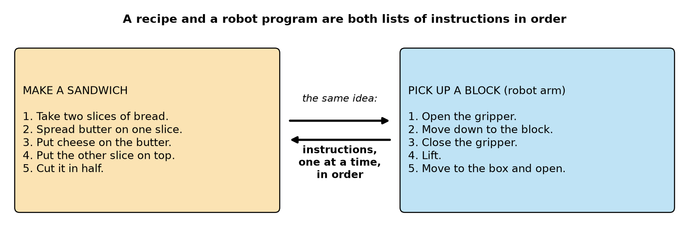
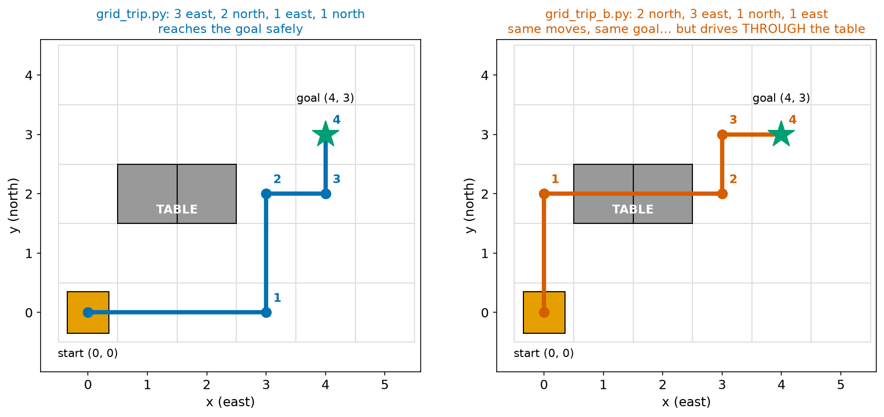
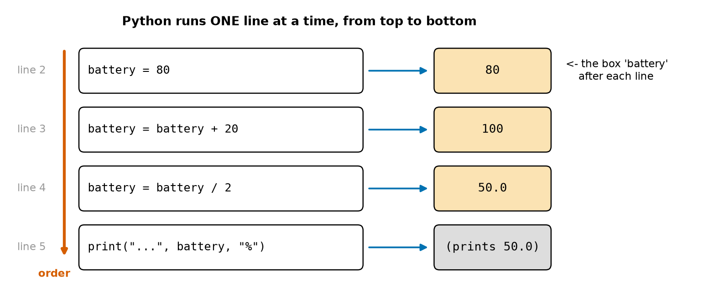
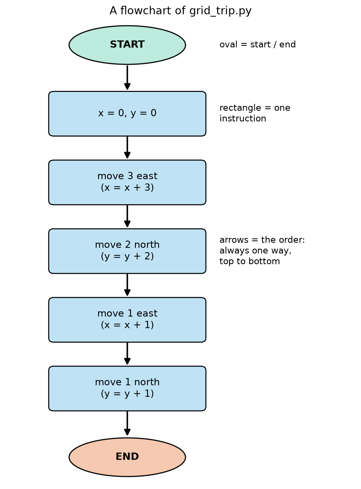
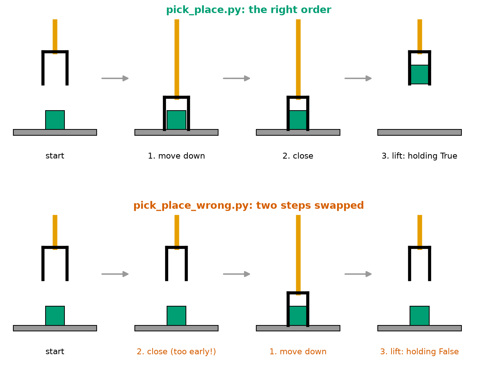

# Chapter 11 — What Is a Program? Instructions in Order

> **Part 2 · Chapter 11 of 749** (the first chapter of Part 2 — Programming in Python From Zero)
> **You need:** Chapter 8 (a working Python setup and a code editor). It helps to remember the "human robot" game (Chapter 1, Lab 1.3).
> **You will make:** a robot trip on a grid (twice, in two different orders), a pick-and-place sequence for a robot arm, trace tables by hand, and a flowchart.

---

## What you will learn

- What a **program** is: a list of **instructions** that a computer follows.
- What an **algorithm** is, and why you already know many.
- Why a computer does **exactly** what you write, not what you mean.
- Why the **order** of instructions matters so much, and how a wrong order causes **bugs**.
- How Python runs a program: **one line at a time, from top to bottom**.
- How to follow a program by hand with a **trace table**.
- How to draw a simple **flowchart**.

---

## Welcome to Part 2

In Part 1 you **read** many programs, with a table explaining every line. From now on, you will **write** them. Part 2 (Chapters 11–36) teaches Python from zero, one idea per chapter, always with robots. At the end of Part 2 you will build **GridBot** (Chapter 36), a robot simulator that runs on a grid in your terminal.

Some things in this part will feel familiar, because the Part 1 programs used them. That is good: now you will understand them properly, and use them yourself.

Make a folder for this chapter: `robotics/my-code/ch011/` (Chapter 8, Section 8.6). Type every program yourself.

---

## New words in this chapter

| Word | Simple meaning |
|---|---|
| **instruction** | One step that tells someone (or a computer) to do one thing. |
| **program** | A list of instructions for a computer, written in a programming language. |
| **programming language** | A language with strict rules that a computer can follow: Python, C++, and many more. |
| **algorithm** | A list of steps that solves a problem. It can be written in any language, even English. A program is an algorithm written for a computer. |
| **sequence** | Instructions that run one after another, in order. |
| **statement** | One complete instruction in Python. Usually one line. |
| **state** | The values of all the variables at one moment. |
| **trace table** | A table where you follow a program by hand, line by line, writing down the state after each line. |
| **flowchart** | A drawing of an algorithm with boxes and arrows. |
| **bug** | A mistake in a program that makes it do the wrong thing. |
| **debugging** | Finding and fixing bugs. |

---

## 11.1 Instructions in order: you already know algorithms

Here is a recipe:

1. Take two slices of bread.
2. Spread butter on one slice.
3. Put cheese on the butter.
4. Put the other slice on top.
5. Cut it in half.

It is a list of **instructions**. You do them **one at a time**, **in order**, and at the end you have a sandwich.

📖 **New word: algorithm** — a list of steps that solves a problem. The recipe is an algorithm for making a sandwich. Brushing your teeth, tying your shoes and walking to school are algorithms too. You follow dozens every day.

Now a robot arm that picks up a block:

1. Open the gripper.
2. Move down to the block.
3. Close the gripper.
4. Lift.
5. Move to the box and open the gripper.

Look at Figure 11.1. These two lists are the same **kind** of thing.



*Figure 11.1 — A recipe (left) and a robot arm's task (right): both are instructions, one at a time, in order.*

**How to read this picture:** The orange box is a recipe for people; the blue box is a task for a robot arm. The arrows in the middle say that both are built the same way: numbered instructions that are done one after another.

📖 **New word: program** — an algorithm written in a **programming language**, so that a **computer** can follow it. The robot arm's list in English is an algorithm. The same list written in Python is a program.

🤖 **Robot link:** Almost every factory robot runs a program that is mostly a long **sequence** like this: move here, close the gripper, move there, open, wait for the next part, repeat. A car factory robot that welds a car body runs a sequence of hundreds of points, in an exact order, thousands of times a day.

### A short history

The idea of a list of instructions for a machine is older than electronic computers. In the 1800s, weaving machines (Jacquard looms, Chapter 3) followed patterns punched as holes in cards: one card after another, in order. In 1843, **Ada Lovelace** wrote a list of steps for Charles Babbage's planned "Analytical Engine" to compute a series of numbers; it is often called the first computer program. Today's programs are much bigger, but the idea is the same: **instructions, in order**.

---

## 11.2 A computer does exactly what you say

When a person follows a recipe, they use **common sense**. If the recipe says "spread butter", they open the butter first, even though the recipe did not say so. A computer has **no** common sense. It does **exactly** what the instructions say, and **nothing else**.

You saw this in Chapter 1, Lab 1.3 (the "human robot" game): the "robot" walked into the wall because the programmer said `FORWARD 6` when only 4 steps fitted. The robot did what it was **told**, not what the programmer **meant**.

A funny example. Suppose you tell a very literal robot:

> "Put the cheese on the bread."

It might put the **whole block** of cheese, still in its packet, on top of the whole **loaf** of bread. Every word was followed. The result is not a sandwich. To get a sandwich, you must say **everything**: which bread, how many slices, open the packet, cut a slice of cheese, how thick…

🧠 **Remember:** A computer does what you **write**, not what you **mean**. Writing a program means saying everything, clearly, in the right order.

This sounds annoying, but it is also the computer's great strength: it never gets bored, never skips a step, never "improves" your instructions. A robot that welds a car does the 500th weld exactly like the first.

---

## 11.3 Order matters

A **sequence** is a list of instructions done one after another.

📖 **New word: sequence** — instructions that run one after another, in a fixed order.

Change the order, and you can get a completely different result.

| Correct order | Swapped order | Result of the swap |
|---|---|---|
| socks, then shoes | shoes, then socks | socks on top of your shoes |
| open the door, then walk through | walk through, then open the door | you walk into the door |
| move down to the block, then close the gripper | close the gripper, then move down | the gripper is closed before it reaches the block: it grabs nothing |
| check the propellers, then arm the drone | arm the drone, then check the propellers | your fingers are next to propellers that can spin (Chapter 7!) |

In the last two rows, every **instruction** is correct. Only the **order** is wrong, and that is enough to make the robot fail, or even be dangerous.

### The same moves, a different path

Look at Figure 11.2. A small robot drives on a grid of squares. It starts in the corner (0, 0) and must reach the goal at (4, 3). There is a table in the way, on squares (1, 2) and (2, 2).



*Figure 11.2 — Two programs use exactly the same four moves (3 east, 2 north, 1 east, 1 north), in different orders. Both reach the goal, but the right one drives through the table.*

**How to read this picture:** Each small square is one grid square; the numbers along the bottom are x (how far east, to the right) and along the side are y (how far north, up). The orange square is the start, the green star the goal, the grey squares the table. The coloured line is the robot's path; the small numbers show where it is after each move. Left (blue): east first, then north: it goes **around** the table. Right (red): north first, then east: its second move goes straight **through** the table.

Both programs use the moves **3 east, 2 north, 1 east, 1 north**. Both end at (4, 3). If you only checked the **end** position, you would think both are fine. But the robot on the right crashed into the table on the way. **The order of the moves decided the path.**

🤖 **Robot link:** This is why robot arms in factories are programmed with careful "via points": not only where the gripper must end up, but **which way** it goes there, so that it does not hit the machine, the part, or itself. Part 23 (path planning) teaches robots to find safe paths by themselves.

---

## 11.4 How Python runs a program: top to bottom

Python follows a program file the way you read a book: **the first line first**, then the next, then the next, **one at a time**, to the end.

📖 **New word: statement** — one complete instruction in Python. Most of the time, one line is one statement.

Each statement can change the **state** of the program.

📖 **New word: state** — the values of all the variables at one moment. (Variables are "boxes with names" that hold a value; Chapter 14 explains them fully. You have seen many already: `speed = 0.3` puts 0.3 into the box called `speed`.)

### The order changes the answer

Type this program and save it as `order_matters.py`:

```python
# order_matters.py - the same two steps, done in two different orders
battery = 80                 # Rover's battery is 80% full
battery = battery + 20       # step 1: charge it by 20%
battery = battery / 2        # step 2: drive around the house, using half of what is left
print("charge first, then drive:", battery, "%")

battery = 80                 # start again from 80%
battery = battery / 2        # step 2 first: drive around the house
battery = battery + 20       # step 1 second: charge by 20%
print("drive first, then charge:", battery, "%")
```

| Line | Code | What it does (simple English) |
|---|---|---|
| 1 | comment | The name and the idea. (Everything after `#` is for people; Python ignores it.) |
| 2 | `battery = 80` | Put 80 in the box `battery`. |
| 3 | `battery = battery + 20` | Read the box (80), add 20, and put the answer (100) **back into the same box**. The old value is gone. |
| 4 | `battery = battery / 2` | Read the box (100), divide by 2, put 50.0 back. (`/` always gives a decimal number in Python, so 50.0 and not 50. Chapter 13.) |
| 5 | `print(…)` | Show the value now in the box: 50.0. |
| 6 | *(empty)* | |
| 7 | `battery = 80` | Start again: put 80 in the box (the 50.0 is thrown away). |
| 8 | `battery = battery / 2` | 80 ÷ 2 = 40.0. |
| 9 | `battery = battery + 20` | 40.0 + 20 = 60.0. |
| 10 | `print(…)` | Show 60.0. |

**Output:**

```
charge first, then drive: 50.0 %
drive first, then charge: 60.0 %
```

**What the output means:** The two halves use the **same** two steps. Only the order is different, and the answers are different: 50% or 60%. Neither is "wrong"; they are two different **stories**. The program does the story you wrote, in the order you wrote it.

### Trace tables: be the computer

How can you be sure what a program will do **before** you run it? Follow it by hand, line by line, like the computer does. Write the **state** after each line in a **trace table**.

📖 **New word: trace table** — a table with one row per line that runs, and one column per variable, showing the state after each line.

Look at Figure 11.3. It is a picture of the first half of `order_matters.py`.



*Figure 11.3 — Python runs the lines one at a time, from top to bottom (red arrow). After each line, the box `battery` holds a new value (orange).*

**How to read this picture:** The white boxes are the lines of code, in order, with their line numbers on the left in grey. The red arrow on the far left shows the direction Python reads: down. The blue arrows point to the orange boxes, which show what is inside `battery` **after** that line has run. The last line does not change `battery`; it prints it (grey).

As a trace table on paper, the whole program looks like this:

| Line | battery | Printed |
|---|---|---|
| 2 | 80 | |
| 3 | 100 | |
| 4 | 50.0 | |
| 5 | 50.0 | charge first, then drive: 50.0 % |
| 7 | 80 | |
| 8 | 40.0 | |
| 9 | 60.0 | |
| 10 | 60.0 | drive first, then charge: 60.0 % |

💡 **Tip:** Trace tables look slow, but they are one of the best tools for learning to program. When a program surprises you, trace it by hand: you will find exactly the line where your idea and the computer's work went different ways. Professional programmers still do this in their heads all the time.

---

## Code

Now the robot trip from Figure 11.2, as a program. The robot's position is two variables: `x` (how far east) and `y` (how far north). Each move changes one of them.

Type this and save it as `my-code/ch011/grid_trip.py`. (It is also in `code/ch011/grid_trip.py`.)

```python
# grid_trip.py - a robot on a grid follows its moves, one after the other
x = 0                        # the robot starts in the corner square (0, 0)
y = 0
print("start:        ", x, y)
x = x + 3                    # move 1: 3 squares east (to the right)
print("after 3 east: ", x, y)
y = y + 2                    # move 2: 2 squares north (up)
print("after 2 north:", x, y)
x = x + 1                    # move 3: 1 square east
print("after 1 east: ", x, y)
y = y + 1                    # move 4: 1 square north
print("after 1 north:", x, y)
```

| Line | Code | What it does (simple English) |
|---|---|---|
| 1 | `# grid_trip.py - …` | A comment: the name and the idea. |
| 2 | `x = 0` | The robot's east position starts at 0. The comment at the end of the line explains it: a comment can also come **after** code on the same line. |
| 3 | `y = 0` | Its north position starts at 0. Now the **state** is x = 0, y = 0. |
| 4 | `print("start:        ", x, y)` | Show the label and the two values. The extra spaces inside the quotes make the numbers line up neatly in the output. |
| 5 | `x = x + 3` | **Move 1**: 3 east. Read x (0), add 3, store 3. y does not change. |
| 6 | `print(…)` | Show the new state: 3 0. |
| 7 | `y = y + 2` | **Move 2**: 2 north. y becomes 2. |
| 8 | `print(…)` | 3 2. |
| 9 | `x = x + 1` | **Move 3**: 1 east. x becomes 4. |
| 10 | `print(…)` | 4 2. |
| 11 | `y = y + 1` | **Move 4**: 1 north. y becomes 3. |
| 12 | `print(…)` | 4 3: the goal. |

Run it (Chapter 8): `python grid_trip.py` (on macOS/Linux, `python3 grid_trip.py`).

**Output:**

```
start:         0 0
after 3 east:  3 0
after 2 north: 3 2
after 1 east:  4 2
after 1 north: 4 3
```

**What the output means:** Each line is the robot's position after one move, in the order the moves happened. It ends at (4, 3): the goal. Compare with the blue path in Figure 11.2: the corners of the path are exactly these positions.

### The same moves, in another order

Now make `grid_trip_b.py` with the **same four moves** in the order of the red path:

```python
# grid_trip_b.py - the SAME four moves as grid_trip.py, in a different order
x = 0
y = 0
print("start:        ", x, y)
y = y + 2                    # 2 north first
print("after 2 north:", x, y)
x = x + 3                    # then 3 east
print("after 3 east: ", x, y)
y = y + 1                    # then 1 north
print("after 1 north:", x, y)
x = x + 1                    # then 1 east
print("after 1 east: ", x, y)
```

**Output:**

```
start:         0 0
after 2 north: 0 2
after 3 east:  3 2
after 1 north: 3 3
after 1 east:  4 3
```

**What the output means:** The end is (4, 3) again. But look at the second move: from (0, 2) to (3, 2). The robot drove east along row y = 2, through squares (1, 2) and (2, 2): **the table**. The output does not say "crash", because our program knows nothing about the table. It only adds numbers. **You** must notice it, by comparing the path with the map (Figure 11.2).

⚠️ **Careful:** A program that runs without an error message is **not** automatically correct. `grid_trip_b.py` runs perfectly and gives a dangerous path. Always check that the result makes sense for the real world. (In Chapter 18 the robot will learn to check for obstacles itself, with `if`.)

### The program as a flowchart

📖 **New word: flowchart** — a drawing of an algorithm, with boxes for the steps and arrows for the order.

Look at Figure 11.4.



*Figure 11.4 — The flowchart of `grid_trip.py`: start, five instructions, end, joined by arrows that show the order.*

**How to read this picture:** Start at the green oval at the top (START). Follow the arrows down through each blue rectangle: each rectangle is one instruction. The red oval at the bottom is the END. The notes on the right explain the shapes. In a pure sequence, the arrows always go **one way**: there are no choices and no going back. (Chapter 18 adds a diamond shape for **decisions**, and Chapter 19 adds arrows that go **back up**, for repeating.)

Flowcharts are useful **before** you write code: you can plan the order on paper and check it with a friend, without worrying about Python's exact rules.

---

## 11.5 Bugs and debugging

📖 **New word: bug** — a mistake in a program that makes it do the wrong thing.

📖 **New word: debugging** — finding and fixing bugs.

A famous story: on 9 September 1947, engineers working on the Harvard Mark II computer found that it was failing because a real **moth** was stuck in one of its electrical switches. They taped the moth into their logbook with the note "First actual case of bug being found." (The word "bug" for a technical fault is older; the joke was that this time it was a real insect.) The computer scientist **Grace Hopper**, who worked on that team, loved telling this story, and it helped make "bug" and "debugging" the words every programmer uses.

There are three big kinds of bugs:

| Kind | What happens | Example | Who finds it |
|---|---|---|---|
| **Syntax error** | Python cannot read the program at all | a missing `"` (Chapter 8) | Python, at once |
| **Runtime error** | Python starts, then crashes on one line | a typo like `prnt` (Chapter 8) | Python, when it reaches that line |
| **Logic error** | The program runs to the end with **no** error message, but does the wrong thing | `grid_trip_b.py`; moves in the wrong order | **only you**, by checking the result |

Logic errors are the hardest, because nothing warns you. A wrong **order** of instructions is one of the most common logic errors. The best tools against them:

1. **Know what you expect** before you run (predict!).
2. **Print the state** after important steps (like our programs do).
3. **Trace by hand** when the output surprises you.
4. **Draw it** (a path on a grid, a graph, a flowchart).

🧠 **Remember:** No error message ≠ no bug. Always ask: "Is this answer right for the real world?"

---

## Small examples

### Example 1 — Put the steps in order

A robot vacuum (Chapter 10) returning to its dock. Mixed up: "drive into the dock", "stop the brush", "find the dock", "start charging". Correct order:

```
1. stop the brush
2. find the dock
3. drive into the dock
4. start charging
```

(Stopping the brush first saves battery and avoids flicking dirt into the dock.)

### Example 2 — Trace a short program

```python
speed = 2
speed = speed * 3
speed = speed - 1
print(speed)
```

| Line | speed |
|---|---|
| 1 | 2 |
| 2 | 6 |
| 3 | 5 |
| 4 | 5 (prints 5) |

### Example 3 — Swap two lines

Same program, lines 2 and 3 swapped:

```
speed = 2 → 2 − 1 = 1 → 1 × 3 = 3   → prints 3
```

### Example 4 — The value is replaced

```python
x = 5
x = 7
print(x)
```

Prints **7**. The second line **replaces** the 5. A variable holds one value at a time.

### Example 5 — A print before the change

```python
y = 1
print(y)
y = y + 4
```

Prints **1**, not 5: the `print` runs **before** the change. Order again!

### Example 6 — A grid trip by hand

Start (0, 0). Moves: 2 east, 3 north, 1 east. End: (3, 3). Path corners: (0, 0) → (2, 0) → (2, 3) → (3, 3).

---

## 🏭 Real robot applications

### Application 1 (worked in full) — 🏭 A robot arm picks up a block

**1. The real problem.** A factory robot arm must pick up a block from a table. Its programmer writes the steps. If two steps are swapped, the arm moves perfectly, every motor works, and yet the block stays on the table. How can we see this **before** testing on the real arm?

**2. Why this idea.** We write the sequence as a program that keeps track of the arm's **state**: its height `z`, whether the `gripper` is open or closed, and whether it is `holding` the block. Printing the state after each step shows at once whether the sequence works.

**3. The numbers.**

| State variable | Meaning | Start value |
|---|---|---|
| `z` | gripper height above the table, in cm (the block sits at height 0) | 10 |
| `gripper` | `"open"` or `"closed"` (words in quotes are **text**; Chapter 15) | `"open"` |
| `holding` | is the block in the gripper? `True` or `False` (Chapter 17) | `False` |

The rule of the real world: **closing the gripper catches the block only if the gripper is down at the block** (height 0).

**4. The maths, step by step** (a trace table of the correct order):

| Step | z | gripper | holding | Why |
|---|---|---|---|---|
| start | 10 | open | False | |
| 1. move down | 0 | open | False | down at the block, not yet closed |
| 2. close | 0 | closed | **True** | closed **at height 0** → caught |
| 3. lift | 10 | closed | True | the block comes up with the gripper |

**5. The code.** File `code/ch011/pick_place.py`:

```python
# pick_place.py - a robot arm picks up a block: the steps must come in the right order
z = 10                       # gripper height above the table, in cm (the block is on the table, at 0 cm)
gripper = "open"
holding = False
print("start:          height", z, "| gripper", gripper, "| holding", holding)

z = 0                        # 1. move down to the block
print("1. move down:   height", z, "| gripper", gripper, "| holding", holding)
gripper = "closed"           # 2. close the gripper
holding = z == 0             #    it only catches the block if it is down at the block (height 0)
print("2. close:       height", z, "| gripper", gripper, "| holding", holding)
z = 10                       # 3. lift
print("3. lift:        height", z, "| gripper", gripper, "| holding", holding)
```

| Line | Code | What it does (simple English) |
|---|---|---|
| 1 | comment | The name and the idea. |
| 2 | `z = 10` | The gripper starts 10 cm above the table. |
| 3 | `gripper = "open"` | A variable can hold **text** too: here the word `open`. |
| 4 | `holding = False` | At the start, the arm holds nothing. `False` means "no". |
| 5 | `print(…)` | Show the starting state. |
| 6 | *(empty)* | |
| 7 | `z = 0` | Step 1: move down to the block. |
| 8 | `print(…)` | Show the state. |
| 9 | `gripper = "closed"` | Step 2: close the gripper. |
| 10 | `holding = z == 0` | The real-world rule. `z == 0` **asks** "is z equal to 0?" and gives `True` or `False` (two `=` signs ask; one `=` stores; Chapter 17). The answer is stored in `holding`. |
| 11 | `print(…)` | Show the state. |
| 12 | `z = 10` | Step 3: lift. |
| 13 | `print(…)` | Show the final state. |

**Output:**

```
start:          height 10 | gripper open | holding False
1. move down:   height 0 | gripper open | holding False
2. close:       height 0 | gripper closed | holding True
3. lift:        height 10 | gripper closed | holding True
```

Now the **bug**: swap "move down" and "close" (file `code/ch011/pick_place_wrong.py`: lines 7–8 and 9–11 change places). Output:

```
start:          height 10 | gripper open | holding False
2. close:       height 10 | gripper closed | holding False
1. move down:   height 0 | gripper closed | holding False
3. lift:        height 10 | gripper closed | holding False
```



*Figure 11.5 — Top: the right order (down, close, lift): the block comes up with the gripper. Bottom: close and down swapped: the gripper closes in the air, goes down around the block without grabbing it, and lifts nothing.*

**How to read this picture:** Each row is a short film, from left to right. The grey bar is the table, the green square the block, the orange bar the robot arm, the black shape the gripper (wide = open, narrower = closed). In the top row, in the last picture, the block is **inside** the gripper, in the air. In the bottom row, the block is still on the table at the end. The red labels mark the steps in the wrong order.

**6. The result.** With the wrong order, every step "works": the arm moves down, the gripper closes, the arm lifts. No error message. But `holding` is `False` at the end: the block was never caught, because the gripper closed when it was still 10 cm in the air. Printing the state after each step made the logic error visible **in the simulation**, before a real arm wasted time (or crushed the block by pressing a closed gripper down onto it).

**7. Going further.** Real robot arms have a sensor in the gripper (Chapter 149) that measures whether something is held, and the program **checks** it after closing: "if not holding: try again or call for help" (Chapter 18 teaches `if`). Real pick-and-place programs also add steps you might forget: "move above the block first", "slow down for the last 2 cm", "wait until the gripper is fully closed". Chapter 748 (Sorter) builds a complete pick-and-place robot.

### Application 2 (worked in full) — 🚁 A drone's start-up sequence

**1. The real problem.** Before a drone flies, the pilot and the flight software go through a fixed sequence. Some steps **must** come before others, or the drone is unsafe (Chapter 7).

**2. Why this idea.** Write the sequence as a numbered list (an algorithm), and for each step ask: "What must be true **before** this step?" This finds the order.

**3. The numbers.** The steps, in a random order:

- A. Arm the motors (they may now spin).
- B. Check the battery voltage is high enough.
- C. Check that the propellers are firmly on and undamaged.
- D. Wait for the GPS to find enough satellites (if flying with GPS).
- E. Check that the area is clear of people.
- F. Take off.

**4. The maths, step by step** (find what each step needs first):

```
F (take off)      needs: A (motors armed)
A (arm)           needs: B, C, D, E all done — once armed, nobody touches the drone
C (propellers)    needs: the motors NOT armed (hands near the propellers!) → before A
B (battery)       can be any time before A
D (GPS)           can be any time before A
E (area clear)    should be as late as possible before A (people can walk in)
```

A safe order: **C → B → D → E → A → F**. The one thing that must **never** happen: A before C (hands near propellers that can spin).

**5. The code.** A sequence of prints (the order **is** the program):

```python
print("1. check propellers (motors disarmed)")
print("2. check battery voltage")
print("3. wait for GPS")
print("4. check that the area is clear")
print("5. ARM motors")
print("6. take off")
```

**6. The result.** The software of real drones (Chapter 643: safe arming) **refuses** to arm until checks like B and D have passed, and many pilots read out a written checklist (Chapter 7, Section 7.7). Step order is safety.

**7. Going further.** When steps depend on each other ("C needs to be before A"), computer scientists call the problem of finding a valid order **topological sorting**. It is used in robot task planners, in build systems that compile big programs, and in project planning. You do not need the name yet: just ask "what must come first?"

### Application 3 — 🏭 Factory machines and PLCs

Most factory machines are controlled by a **PLC** (programmable logic controller): a tough small computer that runs a program in a fixed cycle. A filling machine's program is a strict sequence: bottle in position → nozzle down → fill until full → nozzle up → bottle out. If "bottle out" ran before "nozzle up", the nozzle would knock the bottle over. Factory engineers often draw these sequences as diagrams very like flowcharts before writing the program.

### Application 4 — 🚀 A rocket countdown

A rocket launch is one of the strictest sequences in engineering. The countdown is a list of hundreds of steps with exact times: fill fuel tanks, close valves, switch to internal power, start engines, release clamps. Starting the engines **before** the clamps are ready, or releasing the clamps **before** the engines are at full power, would be a disaster. The launch computer runs the final seconds of the sequence automatically, because no person could be fast and exact enough.

### Application 5 — 🏥🏠 Surgery robots and kitchen robots

- 🏥 Before a surgery robot moves, its system goes through a start-up sequence: self-tests, check the instruments are attached and recognized, align the arms, and only then let the surgeon control it.
- 🏠 A cooking robot following a recipe is a program in the most literal sense. The order "heat the pan, then add oil, then add the egg" matters exactly as much for the robot as for you, but the robot will never notice by itself that the egg went in before the oil.

---

## 🔧 Hands-on lab

### Lab 11.1 — Type, run, swap

**You need:** your computer (Chapter 8 setup).

**Steps:**

1. Type `order_matters.py`, `grid_trip.py` and `grid_trip_b.py` into `my-code/ch011/` and run each. Check your output against the chapter.
2. **Before running**, make a trace table for this program, and predict what it prints:
   ```python
   x = 1
   x = x + 4
   x = x * 2
   print(x)
   x = x - 3
   print(x)
   ```
3. Now run it. Were you right?
4. In `grid_trip.py`, find an order of the same four moves (3 east, 2 north, 1 east, 1 north) that **also** avoids the table. Draw the path on squared paper first. How many different safe orders can you find?

**What you should see:** Step 2: x goes 1 → 5 → 10, prints **10**, then 7, prints **7**. Step 4: the four moves are all different, so there are 4 × 3 × 2 × 1 = **24** possible orders. **16** of them avoid the table. A path is safe if it never enters squares (1, 2) or (2, 2): either the robot is already at x = 3 or more before it reaches y = 2 (for example 3 east, 1 north, 2 north, 1 east), or it first goes **above** the table, to y = 3, before going east (for example 2 north, 1 north, 3 east, 1 east). The 8 unsafe orders all drive through row y = 2 while x is 1 or 2.

**If it does not work:**

| Problem | Likely cause | Fix |
|---|---|---|
| `NameError: name 'x' is not defined` | You used `x` on a line **before** the line that creates it (for example `x = x + 3` above `x = 0`) | Order! A variable must be created before it is used. Move `x = 0` to the top. |
| The numbers do not line up | Different spaces inside the quotes | Not a real problem; copy the spaces exactly if you want neat columns. |

### Lab 11.2 — Instructions for a literal robot (no computer)

**You need:** a friend (the "robot"), a sheet of paper, a pencil.

**Steps:**

1. Write instructions for your friend to **draw a house** (a square with a triangle roof and a door) **without** saying "house", "square" or "triangle". Use only instructions like "put the pencil 5 cm from the left edge", "draw a line 6 cm to the right", "lift the pencil".
2. Your friend follows the instructions **exactly**, like a robot with no common sense (if an instruction is unclear, they do the silliest reasonable thing).
3. Compare the drawing with what you meant. Find the instruction that went wrong.
4. Fix that instruction and try again (debugging!).
5. Swap two of your instructions on purpose. What does the drawing look like now?

**What you should see:** The first drawing is almost never right. Common bugs: a missing "lift the pencil" (lines drawn across the page), a direction that was unclear ("draw up" — up the page, or towards the ceiling?), or two steps in the wrong order. Each fix makes your instructions more exact, which is exactly what programming is.

### Lab 11.3 — Plan a pick-and-place on paper, then in Python

**You need:** your notebook, your computer.

**Steps:**

1. Extend the arm's task: after lifting the block, the arm must **move 20 cm to the right** (a new variable `x`, starting at 0), **move down**, **open the gripper** (the block is released), and **lift** again.
2. Draw a **flowchart** of the whole task (like Figure 11.4).
3. Write a **trace table** with columns `x`, `z`, `gripper`, `holding` for every step.
4. Write it in Python, copying the style of `pick_place.py`. For "open the gripper", set `gripper = "open"` and `holding = False`.
5. Run it and compare with your trace table.
6. Now make a mistake on purpose: open the gripper **before** moving down. The block is dropped from 10 cm. Add a comment in your program saying why this order is bad for a real robot (fragile parts break, parts bounce away).

**What you should see:** Your trace table and your program's output agree. At the end: `x` 20, `z` 10, gripper open, holding False, and the block is now at x = 20 on the table.

---

## Common mistakes

⚠️ **Thinking the computer "knows what you mean".** It does exactly what you write.

⚠️ **Using a variable before it is created.** `x = x + 3` above `x = 0` gives a `NameError`: Python reads top to bottom and has not seen `x` yet.

⚠️ **Printing before the change.** If the `print` comes before the line that changes the value, you see the old value.

⚠️ **Checking only the end result.** `grid_trip_b.py` reaches the right goal by a wrong path. Check the steps on the way too.

⚠️ **"No error message means it works."** Logic errors give no message. Predict, print the state, trace by hand, draw.

⚠️ **Forgetting a step everybody "knows".** People fill gaps with common sense; computers do not. "Open the packet" must be written down.

⚠️ **Mixing up `=` and `==`.** One `=` **stores** a value; two `==` **ask** whether two values are equal (Chapter 17).

---

## Practice

🏋️ **1.** In your own words, what is the difference between an **algorithm** and a **program**?

🏋️ **2.** Put these steps for a robot lawnmower in a sensible order: "mow", "leave the charging station", "return to the charging station", "check that it is not raining", "start the blade", "stop the blade".

🏋️ **3.** Make a trace table and give the output:
```python
a = 3
b = 4
a = a + b
b = a * 2
print(a, b)
```

🏋️ **4.** Swap lines 3 and 4 of the program in question 3. What is printed now?

🏋️ **5.** What does this print, and why?
```python
speed = 10
print(speed)
speed = 20
```

🏋️ **6.** A grid robot starts at (0, 0) and does: 1 north, 4 east, 2 north, 1 west. Where does it end? List the corners of its path.

🏋️ **7.** In Figure 11.2, the table is on squares (1, 2) and (2, 2). Does the order "1 east, 2 north, 2 east, 1 north" (it ends at (3, 3)) touch the table? Trace the path.

🏋️ **8.** Name the three kinds of bugs from Section 11.5, and say which one is hardest to find, and why.

🏋️ **9.** Write a Python program (only assignments with `=` and `print`) for a robot that starts with `battery = 100`, drives to the kitchen (uses 15), drives back (uses 15), and charges (adds 25). Print the battery after each step. What is the final value?

🏋️ **10.** In `pick_place.py`, what would `holding` be at the end if line 12 (`z = 10`, lift) came **before** line 9 (close the gripper)? Use a trace table.

🏋️ **11.** (Harder) For the drone start-up in Application 2, give **one other** safe order, different from C → B → D → E → A → F, and one **unsafe** order. Explain what makes it unsafe.

---

## Answers

**1.** An **algorithm** is a list of steps that solves a problem; it can be written in any language, even everyday English. A **program** is an algorithm written in a programming language (like Python), so that a computer can follow it.

**2.** check that it is not raining → leave the charging station → start the blade → mow → stop the blade → return to the charging station. (Stopping the blade before driving back is a safety step: no spinning blade near the station or people.)

**3.**

| Line | a | b |
|---|---|---|
| 1 | 3 | |
| 2 | 3 | 4 |
| 3 | 7 | 4 |
| 4 | 7 | 14 |

Prints **7 14**.

**4.** Now line 3 is `b = a * 2` → b = 6, then line 4 is `a = a + b` → a = 3 + 6 = 9. Prints **9 6**.

**5.** It prints **10**. The `print` runs before `speed = 20`, so at that moment the box holds 10. (The 20 is stored afterwards, but nothing prints it.)

**6.** Corners: (0, 0) → (0, 1) → (4, 1) → (4, 3) → (3, 3). It ends at **(3, 3)**.

**7.** Path: (0, 0) → 1 east → (1, 0) → 2 north → (1, 1), **(1, 2)** ← the table! → … So **yes**, it touches the table on its second move (it drives north through square (1, 2)).

**8.** **Syntax errors** (Python cannot read the program), **runtime errors** (the program crashes on a line), and **logic errors** (it runs without any message but does the wrong thing). Logic errors are the hardest, because nothing warns you: only checking the result against what you expect reveals them.

**9.**
```python
battery = 100
battery = battery - 15     # drive to the kitchen
print(battery)
battery = battery - 15     # drive back
print(battery)
battery = battery + 25     # charge
print(battery)
```
Prints 85, 70, **95**.

**10.**

| Step | z | gripper | holding |
|---|---|---|---|
| start | 10 | open | False |
| move down | 0 | open | False |
| lift (moved earlier) | 10 | open | False |
| close | 10 | closed | **False** (z is 10, not 0) |

`holding` is **False**: the gripper closed in the air, after the lift.

**11.** Another safe order: **B → C → E → D → A → F** (any order where A comes after B, C, D and E, and F after A; it is best to keep E close to A). Unsafe: **A → C → …**: the motors are armed while someone checks the propellers by hand. A wrong signal or a bump on the controls could spin the propellers and cut their fingers (Chapter 7).

---

## Summary

🧠 An **algorithm** is a list of steps that solves a problem. A **program** is an algorithm written in a programming language for a computer.

🧠 A computer does **exactly** what you write, not what you mean. Say everything, clearly.

🧠 A **sequence** runs instructions one after another. The **order** matters: the same steps in another order can give a different, wrong or dangerous result.

🧠 Python runs a program **one line at a time, from top to bottom**. Each line can change the **state** (the values of the variables).

🧠 A **trace table** lets you be the computer: follow the program by hand and write the state after each line.

🧠 A **flowchart** draws an algorithm with ovals (start/end), rectangles (instructions) and arrows (order).

🧠 **Bugs** come in three kinds: syntax, runtime and **logic**. Logic errors give no message; predict, print the state, trace and draw to find them.

---

## Next chapter

In **Chapter 12 — Running Python: the shell and script files**, you will learn the two ways of talking to Python: typing one line at a time in the **interactive shell** (the `>>>` prompt from Chapter 8, which is a wonderful calculator and testing tool), and writing whole **script files** like the ones in this chapter. You will learn when to use each, how to move between them, and a few habits that make every later chapter easier.
