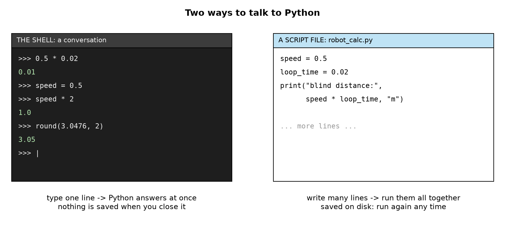
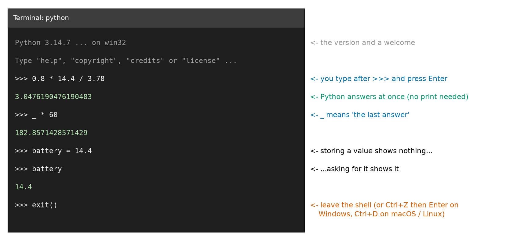
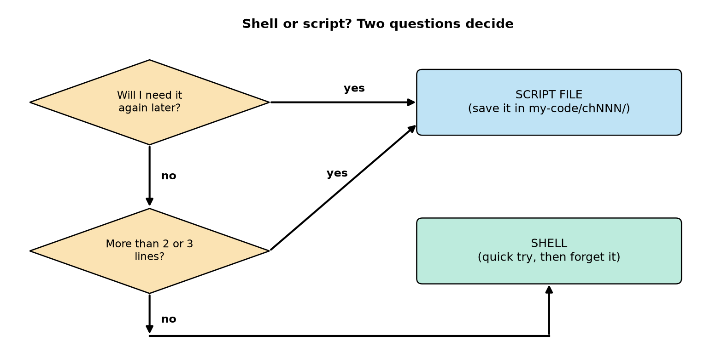
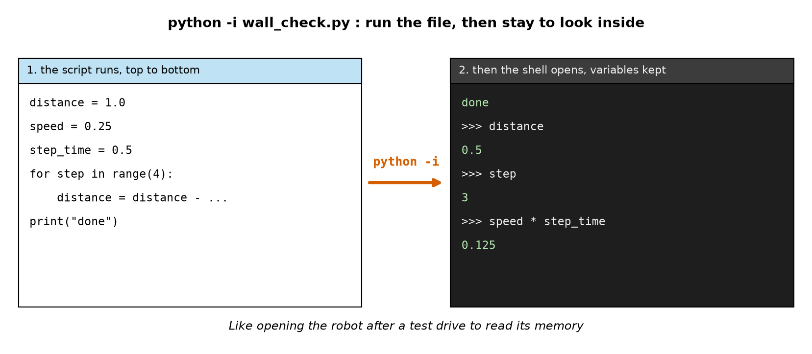

# Chapter 12 — Running Python: The Shell and Script Files

> **Part 2 · Chapter 12 of 749**
> **You need:** Chapter 8 (Python installed, a code editor, the terminal) and Chapter 11 (programs run top to bottom).
> **You will make:** quick robot calculations in the Python shell, the same calculations as a saved script, and a "look inside after the run" session with `python -i`.

---

## What you will learn

- The **two ways** to run Python: the interactive **shell** and **script files**.
- How to start the shell, type into it, and leave it.
- Why the shell shows answers **by itself**, but a script only shows what you `print`.
- Shell tricks: `_` (the last answer), the **↑** key, `help()`, `type()`.
- When to use the shell and when to use a script.
- How `python -i` runs a script and then lets you **look inside** it.
- Good working habits for the rest of the course.

---

## New words in this chapter

| Word | Simple meaning |
|---|---|
| **shell** (interactive shell, REPL) | A place where you type one line of Python and get the answer at once. |
| **prompt** | The sign that says "I am waiting for you": `>>>` in the Python shell. |
| **script** | A file of Python code (ending in `.py`) that runs all at once, from top to bottom. |
| **expression** | A piece of code that gives a value: `2 + 3`, `speed * 2`, `round(3.7)`. |
| **echo** | The shell showing the value of an expression automatically. |
| **session** | Everything you do in one shell, from opening it to closing it. |
| **interactive** | Working back and forth: you type, the computer answers, you type again. |

---

## 12.1 Two ways to talk to Python

You can talk to Python in two ways. Look at Figure 12.1.



*Figure 12.1 — Left: the shell, a conversation, one line at a time. Right: a script file, many lines written first and run together.*

**How to read this picture:** The dark window on the left is the **shell**. Lines starting with `>>>` are what **you** typed; the green lines under them are Python's **answers**. The white window on the right is a **script file**, `robot_calc.py`, opened in an editor: just code, no answers, until you run it. The text under each window sums up the difference.

| | Shell | Script file |
|---|---|---|
| Like… | a **conversation** (a phone call) | a **letter** (written first, read all at once) |
| You type | one line, press Enter | many lines, save, then run |
| Answers | at once, after each line | when you run the whole file |
| Saved? | **no**: gone when you close it | **yes**: on the disk, run again any time |
| Good for | trying things, quick sums, testing one idea | real programs, anything you will need again |

In Chapter 11 you wrote scripts. In this chapter you meet the shell, and learn to use both together.

📖 **New word: shell** — a place where you type Python one line at a time and get the answer at once. Programmers also call it the **REPL**: **R**ead (your line), **E**valuate (work it out), **P**rint (show the answer), **L**oop (wait for the next line). Notice: it is a **loop**, like the sense–think–act loop of Chapter 2.

---

## 12.2 Starting and leaving the shell

### Starting it

Open a terminal (Chapter 8) and type `python` (on macOS/Linux: `python3`) with **nothing** after it. Press Enter. You see something like:

```
Python 3.14.7 (tags/v3.14.7:823f032, Aug  5 2026, 10:51:32) [MSC v.1944 64 bit (AMD64)] on win32
Type "help", "copyright", "credits" or "license" for more information.
>>>
```

The first line shows your Python version (yours may be different; that is fine). The last line is the **prompt**.

📖 **New word: prompt** — the sign that says "I am waiting for you". The Python shell's prompt is `>>>`. (The terminal also has a prompt, like `PS C:\Users\Sam>` or `$`. Do not mix them up: after `>>>` you type **Python**; after the terminal's prompt you type **terminal commands** like `cd`.)

In **Thonny**, the shell is always open: it is the "Shell" area at the bottom. In **VS Code**, open a terminal (**Terminal** → **New Terminal**) and type `python` there.

### Leaving it

To leave the shell and get back to the terminal:

- type `exit()` and press Enter (in Python 3.13 and newer, `exit` alone also works), or
- press **Ctrl + Z** then **Enter** on Windows, or **Ctrl + D** on macOS and Linux.

⚠️ **Careful:** A very common beginner mistake: typing a terminal command like `cd my-code` or `python grid_trip.py` **inside** the shell (after `>>>`). Python does not understand it and shows a `SyntaxError`. If you see `>>>`, you are **in Python**: leave it first with `exit()`.

---

## 12.3 The shell as a robot calculator

The shell is the best calculator a robot builder can have. Type an expression and press Enter.

📖 **New word: expression** — a piece of code that gives a value: `2 + 3`, `speed * 2`, `round(3.7)`.

```
>>> 2 + 3
5
>>> 0.5 * 0.02
0.01
>>> 10 / 4
2.5
>>> 2 ** 10
1024
```

(`**` means "to the power of": 2¹⁰ = 1024. Chapter 13 explains every arithmetic sign.)

Remember the robot calculations of Part 1? Each one is a single line in the shell:

```
>>> 0.5 * 0.02
0.01
```

That is the **blind distance** of Rover driving at 0.5 m/s with a 20 ms loop (Chapter 2): 1 cm.

```
>>> 0.8 * 14.4 / 3.78
3.0476190476190483
```

That is Rover's **battery time** in hours (Chapter 5): 80% of 14.4 Wh, divided by 3.78 W.

```
>>> 3.14159 * 0.127 * 30000 / 60
199.490965
```

That is the **propeller tip speed** of a racing drone in m/s (Chapter 7).

📖 **New word: echo** — the shell shows the value of an expression **automatically**. You do not need `print`. This is the biggest difference between the shell and a script (Section 12.5).

### Variables live as long as the session

You can store values in variables and use them in the next lines:

```
>>> speed = 0.5
>>> loop_time = 0.02
>>> speed * loop_time
0.01
>>> speed = 1.5
>>> speed * loop_time
0.03
```

Notice: `speed = 0.5` shows **nothing**. Storing a value is a statement, not a question; the shell only echoes **values**. To see a variable, type its name alone:

```
>>> speed
1.5
```

📖 **New word: session** — everything you do in one shell, from opening to closing. Variables live for the whole session. When you `exit()`, they are **gone**. Next time you open the shell, `speed` does not exist any more:

```
>>> speed
Traceback (most recent call last):
  File "<python-input-0>", line 1, in <module>
    speed
NameError: name 'speed' is not defined
```

(In a shell, the "file" is not a real file, so Python calls it `<python-input-0>`; older versions say `<stdin>`. Otherwise it is the same error message as in Chapter 8: read the last line first.)

### Floating-point surprises

Try this:

```
>>> 0.8 * 14.4
11.520000000000001
```

You expected 11.52. The tiny `000000000001` at the end is not a mistake in your sum: computers store most decimal numbers in **binary** and cannot hold some of them exactly, so a very small rounding error appears. It is far too small to matter for a robot (a millionth of a millionth of a Wh), and `round()` hides it:

```
>>> round(0.8 * 14.4, 2)
11.52
```

Chapter 1 promised that Chapter 54 explains this properly. For now: it is normal, and you will see it often.

---

## 12.4 Shell tricks that save time

### `_`: the last answer

In the shell, the underscore `_` holds the **last answer** that was echoed. Look at Figure 12.2.



*Figure 12.2 — A short shell session: the welcome lines, a calculation, `_` used to continue it, storing and showing a variable, and leaving.*

**How to read this picture:** The dark box is the terminal. Grey lines are Python's welcome. White lines start with `>>>`: those are typed by you. Green lines are Python's answers. The notes on the right, in the same colour as what they explain, say what each line shows. The red note at the bottom shows the ways to leave.

So the battery time in **minutes** is one more short line:

```
>>> 0.8 * 14.4 / 3.78
3.0476190476190483
>>> _ * 60
182.8571428571429
>>> round(_)
183
```

About 183 minutes: 3 hours and 3 minutes, as in Chapter 5. (`_` only works in the shell, not in scripts.)

### ↑ and ↓: your history

Press **↑** (arrow up) to bring back the line you typed before. Press it again to go further back. Change a number and press Enter. This makes "what if?" questions very fast:

```
>>> 0.8 * 14.4 / 3.78        (Rover with its camera off)
>>> 0.8 * 14.4 / 8.78        (↑, change 3.78 to 8.78: camera and Pi on, Chapter 5)
```

### `help()`: ask Python

Python has its own help built in:

```
>>> help(round)
Help on built-in function round in module builtins:

round(number, ndigits=None)
    Round a number to a given precision in decimal digits.

    The return value is an integer if ndigits is omitted or None.
    Otherwise the return value has the same type as the number.  ndigits
    may be negative.
```

It tells you what `round` needs: a number, and optionally `ndigits` (how many digits after the decimal point). If the help is long, it opens in a page view: press **q** to leave it and get back to `>>>`.

### `type()`: what kind of value is this?

```
>>> type(14.4)
<class 'float'>
>>> type(5)
<class 'int'>
>>> type("hello")
<class 'str'>
```

`float` is a decimal number, `int` a whole number, `str` a piece of text ("string"). You do not need these words yet; Chapters 13 and 15 explain them. But `type()` is a handy question to ask the shell whenever a value behaves strangely.

### Several lines in the shell

You can even type a short loop. After a line ending in `:`, the shell shows `...` (it waits for the indented lines). Press Enter on an **empty** line to finish:

```
>>> for i in range(3):
...     print(i * 0.25)
...
0.0
0.25
0.5
```

This works, but it is clumsy for more than two or three lines. That is the moment to switch to a script.

---

## 12.5 Scripts: the program you keep

A **script** is a file of Python code, like all the programs in Chapter 11.

📖 **New word: script** — a `.py` file that Python runs from top to bottom: `python filename.py`.

### The big difference: echo

In the shell, a value on its own line is shown. In a script, it is **not**. Type this and save it as `my-code/ch012/quiet.py`:

```python
# quiet.py - in a script, a value on a line by itself is NOT shown
2 + 3
0.5 * 0.02
print(0.5 * 0.02)
```

| Line | Code | What it does (simple English) |
|---|---|---|
| 1 | comment | The name and the idea. |
| 2 | `2 + 3` | Python works out 5… and then throws it away. Nothing is shown. |
| 3 | `0.5 * 0.02` | The same: 0.01 is computed and thrown away. |
| 4 | `print(0.5 * 0.02)` | `print` **shows** the value. |

Run it: `python quiet.py`.

**Output:**

```
0.01
```

**What the output means:** Only **one** line appears, from the `print`. Lines 2 and 3 ran, but in a script nobody is "asking", so nothing is echoed. This surprises everyone who first tries the shell and then writes a script: "my program does nothing!" → you forgot `print`.

🧠 **Remember:** Shell: values are shown automatically. Script: **only `print` shows things.**

---

## Code

Here are the three shell calculations from Section 12.3, saved as a script, with names for every number so that anyone can understand them later.

The file is `code/ch012/robot_calc.py`. Type it into `my-code/ch012/`.

```python
# robot_calc.py - three quick robot calculations from Part 1, saved so they can be run again
speed = 0.5                  # Rover's speed in m/s
loop_time = 0.02             # 50 loops per second
print("blind distance:", speed * loop_time, "m")

usable_wh = 0.8 * 14.4       # 80% of Rover's 14.4 Wh battery (Chapter 5)
power_w = 3.78               # Rover's total power in watts
print("battery time:", round(usable_wh / power_w * 60), "minutes")

tip_speed = 3.14159 * 0.127 * 30000 / 60    # racing-drone propeller (Chapter 7)
print("propeller tip speed:", round(tip_speed, 1), "m/s")
```

| Line | Code | What it does (simple English) |
|---|---|---|
| 1 | comment | The name and why the file exists. |
| 2 | `speed = 0.5` | Rover's speed. The comment gives the **unit** (m/s): always write units in comments. |
| 3 | `loop_time = 0.02` | The time between loops. |
| 4 | `print("blind distance:", …)` | The blind distance, with a label and a unit, so the output explains itself. |
| 5 | *(empty)* | Empty lines separate the three calculations, like paragraphs. |
| 6 | `usable_wh = 0.8 * 14.4` | 80% of the battery energy. (Inside it is 11.520000000000001; we round at the end.) |
| 7 | `power_w = 3.78` | Rover's power. Names like `usable_wh` and `power_w` carry the unit in the name: a good habit. |
| 8 | `print(…, round(usable_wh / power_w * 60), …)` | Battery time in minutes, rounded to a whole number. |
| 9 | *(empty)* | |
| 10 | `tip_speed = 3.14159 * 0.127 * 30000 / 60` | π × diameter × turns per second. |
| 11 | `print(…, round(tip_speed, 1), …)` | Rounded to 1 decimal. |

**Output:**

```
blind distance: 0.01 m
battery time: 183 minutes
propeller tip speed: 199.5 m/s
```

**What the output means:** The same three answers as the shell, but now **with labels and units**, and saved: next month you can run `python robot_calc.py` again, change Rover's power to 8.78 W, and see the new battery time in two seconds. In the shell you would have to remember and retype everything.

### Shell or script?

Look at Figure 12.3.



*Figure 12.3 — Two questions decide whether to use the shell or a script.*

**How to read this picture:** Start at the top orange diamond. (A diamond in a flowchart is a **question**; Chapter 18 uses it for decisions in programs.) If you will need the code again later, follow "yes" to the blue **script** box. If not, go down to the second question: is it more than 2 or 3 lines? "Yes" also leads to a script; "no" leads along the bottom line to the green **shell** box.

Examples:

| Task | Use |
|---|---|
| "How many minutes is 3.05 hours?" | shell |
| "What does `round(2.5)` give?" | shell (try it!) |
| "Does `help(max)` explain what max needs?" | shell |
| the robot trip of Chapter 11 | script |
| a simulation you will change and run 20 times | script |
| anything in a lab or practice of this book | script (so you can show it and find it later) |

💡 **Tip:** The best programmers use **both together**: keep the editor (script) open in one part of the screen and the shell in another. Not sure what a line does? Try it in the shell first. When it works, copy it into the script.

---

## 12.6 `python -i`: run a script, then look inside

Sometimes a script finishes and you want to know the values of its variables at the end. You could add a `print` for each one… or you can run the script with `-i` ("interactive"):

```
python -i wall_check.py
```

Python runs the whole script, and then, instead of closing, it opens the shell **with all the script's variables still there**. Look at Figure 12.4.



*Figure 12.4 — `python -i` first runs the script from top to bottom (left), then opens a shell where all its variables can still be inspected (right).*

**How to read this picture:** On the left is the script, `wall_check.py`. The red arrow labelled `python -i` shows what happens next: on the right, the script's own output (`done`) appears, and then the `>>>` prompt. You can type the names of the script's variables and see their **final** values.

The file `code/ch012/wall_check.py`:

```python
# wall_check.py - Rover drives towards a wall; run it with "python -i" and look at the variables afterwards
distance = 1.0               # metres from the wall
speed = 0.25                 # m/s
step_time = 0.5              # seconds per loop
for step in range(4):
    distance = distance - speed * step_time
print("done")
```

| Line | Code | What it does (simple English) |
|---|---|---|
| 1 | comment | The name and how to run it. |
| 2–4 | settings | Start 1.0 m from the wall, drive 0.25 m/s, 0.5 s per loop (as in Chapter 2). |
| 5 | `for step in range(4):` | Repeat 4 times; `step` takes the values 0, 1, 2, 3 (Chapter 20). |
| 6 | `distance = distance - speed * step_time` | Each loop, Rover gets 0.125 m closer. |
| 7 | `print("done")` | The only output of the script. |

Session:

```
> python -i wall_check.py
done
>>> distance
0.5
>>> step
3
>>> speed * step_time
0.125
>>> exit()
```

**What the output means:** The script itself only printed `done`. But in the shell afterwards, we can ask: Rover ended at **0.5 m** from the wall; the loop variable `step` ended at **3** (the last value of `range(4)`); each loop moved Rover **0.125 m**. Four loops × 0.125 = 0.5 m driven, from 1.0 m to 0.5 m. Everything checks out.

🤖 **Robot link:** This is exactly what engineers do after a robot test: the robot records its data, and afterwards they "open it up" and look at the values (Chapter 9, Application 2 of Chapter 8: plot the log). `python -i` is the smallest version of that idea, and one of the fastest debugging tools you have.

---

## 12.7 Working habits for the rest of the course

From now on, every chapter's programs follow these habits. They save hours.

1. **One folder per chapter:** `my-code/ch012/`, `my-code/ch013/`, … (Chapter 8).
2. **Every script starts with a comment line:** its name and what it does.
3. **Names that explain:** `battery_time` not `bt`; units in comments or names (`power_w`).
4. **Save before you run** (Chapter 8).
5. **Small steps:** write 2–3 lines, run, check; then the next 2–3 lines. Never write 50 lines and then run for the first time.
6. **Predict, then run** (Chapter 11): know what you expect before Python tells you.
7. **Try in the shell, keep in a script.**
8. **Read error messages from the bottom** (Chapter 8).
9. **Keep a scratch file** `my-code/scratch.py` for experiments that are a bit too long for the shell but not worth a real name.

---

## Small examples

### Example 1 — Shell echo

```
>>> 7.2 * 2.0
14.4
```

Rover's battery energy in Wh (V × Ah), shown at once.

### Example 2 — No echo for storing

```
>>> energy = 7.2 * 2.0
>>>
```

Nothing is shown: storing is not a question. Type `energy` to see 14.4.

### Example 3 — Using `_`

```
>>> 14.4 * 0.8
11.520000000000001
>>> round(_, 2)
11.52
```

### Example 4 — The same in a script

```python
energy = 7.2 * 2.0
usable = energy * 0.8
print(round(usable, 2))
```

Output: `11.52`. Without the `print`, the script would show nothing.

### Example 5 — Wrong place

Typing `python robot_calc.py` after `>>>` gives a `SyntaxError`. Leave the shell (`exit()`) and type it at the terminal's prompt.

### Example 6 — Asking the shell what something is

```
>>> type(3.0)
<class 'float'>
>>> type(3)
<class 'int'>
```

3.0 and 3 look alike but are different kinds of number (Chapter 13).

---

## 🏭 Real robot applications

### Application 1 (worked in full) — 🚁 Quick answers in the field

**1. The real problem.** A drone team is at a farm field. The farmer asks: "Can you survey the second field too, before the battery is empty?" There is no time to write a program. The team has a laptop.

**2. Why this idea.** The shell is perfect for a **one-time** calculation with a few numbers: open it, type, read the answer, close it.

**3. The numbers.** The drone (Chapter 4): battery 50 Wh, 75% usable, uses 150 W, flies 8 m/s. Second field: 300 m × 120 m, photo strips 40 m wide (Chapter 10, Application 2).

**4. The maths, step by step, in the shell:**

```
>>> 50 * 0.75 / 150 * 60
15.0
```

Flight time: 15 minutes.

```
>>> 120 / 40
3.0
```

Three rows across the field.

```
>>> 3 * 300 + 2 * 40
980
```

Distance: 3 rows of 300 m, plus 2 moves of 40 m between rows = 980 m.

```
>>> _ / 8 / 60
2.0416666666666665
```

About 2 minutes of flying (980 m ÷ 8 m/s = 122.5 s, ÷ 60).

**5. The code.** Four shell lines; nothing saved, nothing needed.

**6. The result.** About 2 minutes for the survey, out of 15 minutes of flight time: yes, easily, even with take-off, landing and the flight to the field. The answer took one minute to compute, standing in the field.

**7. Going further.** If the team does this calculation **every week**, for many fields, it should become a script (with the field sizes as variables, or even read from a file: Chapter 27). That is the "Will I need it again?" question of Figure 12.3. Chapter 651 controls drones directly from Python.

### Application 2 (worked in full) — 🏭 A morning self-test script

**1. The real problem.** A small factory has a robot arm. Every morning, before work starts, an engineer checks some numbers: is the gripper air pressure OK, is the battery of the backup power OK, is the arm's temperature normal? Doing it by hand, one sum at a time in the shell, takes ten minutes, and on a busy day someone forgets a check.

**2. Why this idea.** Something that is done **every day** and must **never be forgotten** belongs in a **script**: it runs the same checks, in the same order (Chapter 11), every time.

**3. The numbers.** Today's readings and the allowed limits:

| Check | Reading | Must be |
|---|---|---|
| gripper air pressure | 6.1 bar | at least 5.5 bar |
| backup battery | 25.4 V | at least 24.0 V |
| arm temperature | 38 °C | at most 45 °C |

**4. The maths, step by step.** Each check is a comparison (Chapter 17 explains `>=` and `<=`): 6.1 ≥ 5.5 ✅, 25.4 ≥ 24.0 ✅, 38 ≤ 45 ✅.

**5. The code.** File `my-code/ch012/morning_check.py`:

```python
# morning_check.py - the robot arm's daily checks, always the same, always in order
pressure_bar = 6.1
backup_v = 25.4
temperature_c = 38
print("air pressure OK:", pressure_bar >= 5.5)
print("backup battery OK:", backup_v >= 24.0)
print("temperature OK:", temperature_c <= 45)
```

**Output:**

```
air pressure OK: True
backup battery OK: True
temperature OK: True
```

**6. The result.** One command, `python morning_check.py`, and three clear answers in a second. Tomorrow the engineer only changes the three readings at the top. Nothing is forgotten, because the script never forgets. (Chapter 10's `design_check.py` used the same idea for requirements.)

**7. Going further.** Real robots read these values from their own sensors automatically (Chapter 111: Arduino talking to Python), run self-tests every time they start, and refuse to move if one fails (Chapter 664: failsafes and fault detection).

### Application 3 — 🏠 Testing a sensor on Rover's Raspberry Pi

When Rover gets its Raspberry Pi (Chapter 112), you will connect to it from your laptop over Wi-Fi and get a terminal on the Pi. To check whether a new sensor works, you will open the Python shell **on the robot**, read the sensor with one line, and see the value at once, move your hand, and read it again. Only when it works will you write it into the robot's real script. Shell for trying, script for keeping.

### Application 4 — 🧪 Notebooks: shell and script in one

Many robot researchers use **Jupyter notebooks**: documents that mix small blocks of code (run one at a time, like the shell) with text, graphs and results, all saved together (like a script). They are popular for analysing robot test data and for machine learning (Part 25). They are built on the same two ideas you learned here: interactive trying, and saving what works.

### Application 5 — 🚀🦿 Command consoles on big robots

Large robot systems, from Mars rover ground stations to humanoid robot labs, give engineers a **console**: a place to type a command and see the robot's answer at once, just like `>>>`. ROS 2 (Part 27) has many such commands (for example to look at a sensor's latest values while the robot runs). The habit you start today, ask, look, then decide, is the same one.

---

## 🔧 Hands-on lab

### Lab 12.1 — Your shell calculator

**You need:** your computer.

**Steps:**

1. Open the shell (`python` or `python3`). Check the version on the first line.
2. Compute, **one line each**:
   - Rover's battery energy: `7.2 * 2.0`
   - its usable energy: `_ * 0.8`
   - the battery time in hours with the camera and Pi on (8.78 W): `_ / 8.78`
   - the same in minutes: `_ * 60`, then `round(_)`
3. Use **↑** to bring back the line `_ / 8.78` and change it to `_ / 4.0`. (Careful: `_` has changed in the meantime! What happens? Why?)
4. Store `speed = 0.3` and compute the blind distance for loop times of 0.02, 0.05 and 0.1 s.
5. Type `help(max)` and read it. Press q if needed. Then try `max(3, 7, 5)`.
6. Leave the shell. Open it again and type `speed`. What happens? Why?

**What you should see:**

- Step 2: 14.4 → 11.520000000000001 → about 1.312 h → about 78.7 minutes → **79**. (The camera and Pi make Rover's battery last 79 minutes instead of 183: Chapter 5.)
- Step 3: `_` is now the **last** answer (79, from step 2's `round`), not the usable energy, so the result is wrong for what you meant. The shell's `_` always means "the last answer", whatever that was. (This is why scripts with named variables are safer for anything important.)
- Step 4: 0.006, 0.015, 0.03 m (you may see tiny rounding digits).
- Step 5: `max` gives the biggest value: 7.
- Step 6: `NameError`: variables do not survive the end of a session.

**If it does not work:**

| Problem | Likely cause | Fix |
|---|---|---|
| `python` opens something else, or nothing | Python not on the PATH | Chapter 8, Lab 8.1. Try `py` (Windows) or `python3`. |
| You see `...` and nothing happens | The shell thinks your line is not finished (for example a missing `)`) | Type the missing `)` and press Enter, or press Ctrl+C to cancel the line. |
| The help text does not go away | It is in a page view | Press **q**. |

### Lab 12.2 — From shell to script

**You need:** your computer and editor.

**Steps:**

1. In the shell, work out how long Rover needs to drive 3.6 m at 0.25 m/s (time = distance ÷ speed).
2. Now write a script `my-code/ch012/drive_time.py` that does the same, with variables `distance_m` and `speed_ms`, and prints a sentence with the answer and its unit.
3. Run it. Then **without** printing anything new, run it with `python -i drive_time.py` and check the values of both variables in the shell.
4. Write `quiet.py` (Section 12.5) and confirm that only one line is printed. Then add a `print` around line 2 so that both results appear.

**What you should see:** 3.6 ÷ 0.25 = **14.4** seconds, in the shell and in your script. With `python -i`, typing `distance_m` shows 3.6 and `speed_ms` shows 0.25. After step 4, `quiet.py` prints `5` and `0.01`.

### Lab 12.3 — Python's hidden poem

**You need:** the shell.

**Steps:** Type this in the shell:

```
>>> import this
```

Python prints "The Zen of Python", a short poem of 19 sentences about writing good code, by Tim Peters. Read it. Find the lines "Simple is better than complex.", "Readability counts." and "Errors should never pass silently." Choose **one** line and write in your notebook what it could mean for a **robot** program. (For example: "Errors should never pass silently" → a robot whose sensor fails must stop and warn, not drive on as if nothing happened: the watchdog of Chapter 7.)

---

## Common mistakes

⚠️ **Typing terminal commands inside the shell** (`cd`, `python file.py` after `>>>`). Leave the shell first with `exit()`.

⚠️ **Typing Python inside the terminal** without starting the shell (for example `speed = 0.5` at `PS C:\...>`). The terminal does not know Python. Start `python` first, or put the line in a script.

⚠️ **Expecting a script to echo values.** In a script, only `print` shows things.

⚠️ **Doing important work only in the shell.** It disappears when you close it. Anything you will need again goes in a script.

⚠️ **Trusting `_` after other lines.** It always means the **last** answer, which may not be the one you think (Lab 12.1, step 3).

⚠️ **Being scared of the long decimals** like `11.520000000000001`. It is normal floating-point rounding (Chapter 54). Use `round()` when you show results.

⚠️ **Getting stuck in `...` or the help pages.** Ctrl+C cancels a line; q leaves help.

---

## Practice

🏋️ **1.** What does "REPL" stand for, and why is the shell a kind of loop?

🏋️ **2.** What will the shell show after each line?
```
>>> 4 * 0.25
>>> x = 10
>>> x / 4
>>> _ * 2
```

🏋️ **3.** The same four lines are in a script file (without `>>>`). What does the script print? Why?

🏋️ **4.** How do you leave the Python shell on your computer? Give two ways.

🏋️ **5.** You type `cd my-code` and get `SyntaxError: invalid syntax`. What happened, and what should you do?

🏋️ **6.** Shell or script? (a) Checking what `round(2.675, 2)` gives. (b) A simulation of a robot vacuum you will improve all week. (c) Converting 90 minutes into hours once. (d) A program your friend will run on their computer.

🏋️ **7.** What is the advantage of `python -i myfile.py` over plain `python myfile.py`?

🏋️ **8.** In `wall_check.py`, change `range(4)` to `range(6)`. Predict the values of `distance` and `step` that `python -i` will show.

🏋️ **9.** Use the shell (or by hand) to compute the cliff stopping distance of Chapter 10: 0.2 × 0.02 + 0.02. Then write it as a three-line script with named variables that prints the answer with its unit.

🏋️ **10.** Why do the names `power_w` and `usable_wh` in `robot_calc.py` make the program easier to read than `p` and `u`?

---

## Answers

**1.** **R**ead, **E**valuate, **P**rint, **L**oop. The shell reads your line, works it out, prints the answer, and then loops back to wait for the next line, again and again, until you leave.

**2.**
```
>>> 4 * 0.25
1.0
>>> x = 10
>>> x / 4
2.5
>>> _ * 2
5.0
```
(`x = 10` shows nothing.)

**3.** **Nothing at all** — and actually the last line gives an error! In a script there is no echo, so lines 1 and 3 compute values and throw them away. And `_` is a shell-only trick: in a script, `_` is just an ordinary (unknown) name, so line 4 gives `NameError: name '_' is not defined`.

**4.** Type `exit()` (or `exit` in Python 3.13+), or press Ctrl+Z then Enter (Windows) / Ctrl+D (macOS, Linux).

**5.** You were **inside** the Python shell (the `>>>` prompt), and `cd` is a terminal command, not Python. Type `exit()` to go back to the terminal, then type `cd my-code`.

**6.** (a) shell; (b) script; (c) shell; (d) script.

**7.** After the script ends, `python -i` opens the shell **with all the script's variables still there**, so you can inspect their final values (and try calculations with them) without adding `print` lines to the script.

**8.** Six loops of 0.125 m: 1.0 − 6 × 0.125 = **0.25** m. `step` ends at **5** (the last value of `range(6)`: 0, 1, 2, 3, 4, 5).

**9.** 0.2 × 0.02 + 0.02 = 0.004 + 0.02 = **0.024 m** (the shell shows `0.024`). A script:
```python
speed = 0.2
loop_time = 0.02
brake = 0.02
print("stopping distance:", round(speed * loop_time + brake, 3), "m")
```
prints `stopping distance: 0.024 m`.

**10.** The names say **what** the numbers are and in **which unit** (watts, watt-hours). A reader (including you, a month later) understands `usable_wh / power_w * 60` immediately as "energy ÷ power, in minutes"; `u / p * 60` could mean anything.

---

## Summary

🧠 Python can be used in two ways: the interactive **shell** (`>>>`, one line at a time, answers at once, nothing saved) and **script files** (`.py`, many lines, run together, saved).

🧠 Start the shell with `python` (or `python3`); leave it with `exit()`. Do not mix shell lines and terminal commands.

🧠 The shell **echoes** the value of every expression. A script shows **only** what you `print`.

🧠 Shell tricks: `_` = the last answer, ↑ = history, `help(…)` = built-in help, `type(…)` = what kind of value.

🧠 Variables in the shell live only for the **session**.

🧠 Two questions choose: "Will I need it again?" or "More than 2–3 lines?" → **script**; otherwise → **shell**. Use both together: try in the shell, keep in a script.

🧠 `python -i script.py` runs a script and then lets you **look inside** at its final variables.

🧠 Good habits: one folder per chapter, a header comment, clear names with units, save before running, small steps, predict first.

---

## Next chapter

In **Chapter 13 — Numbers and arithmetic**, you will learn exactly how Python calculates: whole numbers and decimal numbers (`int` and `float`), the signs `+ − * / // % **`, which operation happens first, and how to round. Every robot formula in this course, from blind distances to motor speeds, is built from these few signs.
