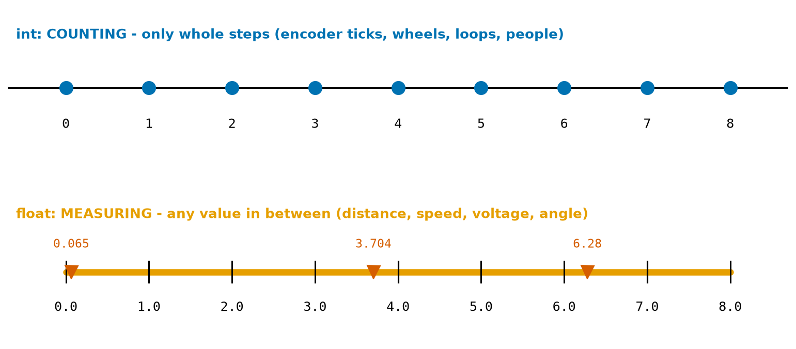
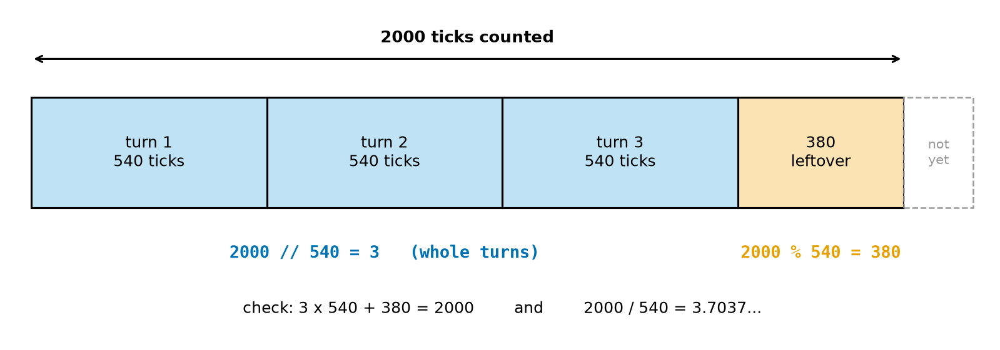
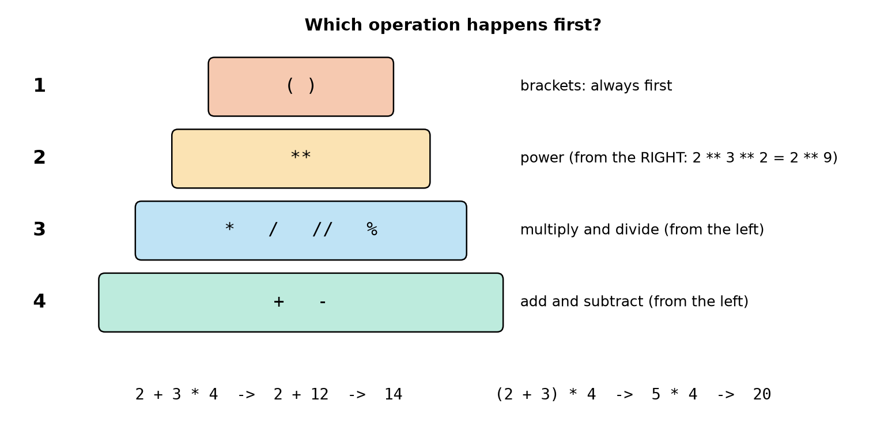
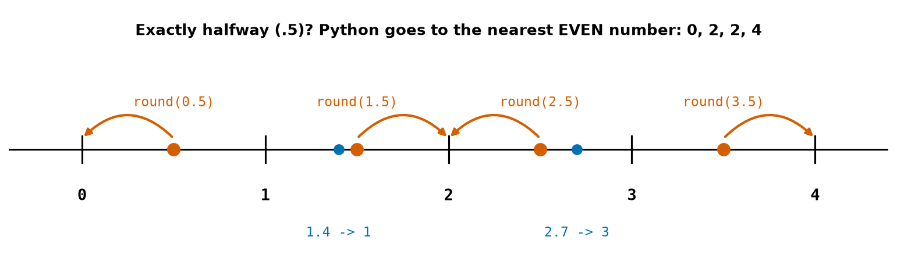
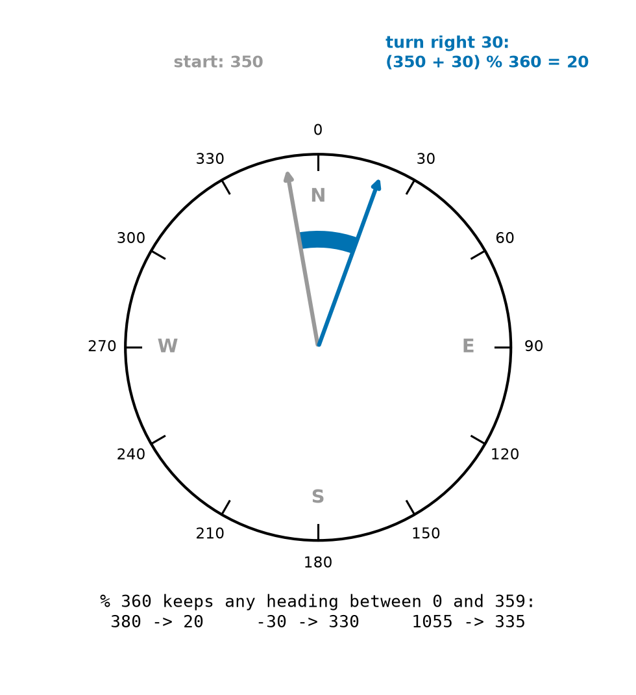

# Chapter 13 — Numbers and Arithmetic

> **Part 2 · Chapter 13 of 749**
> **You need:** Chapter 12 (the shell and scripts). Keep a shell open while you read: try every example.
> **You will make:** an encoder program that turns ticks into wheel turns and distance, a compass-heading program that never goes past 359°, and a trip-time calculator for a warehouse robot.

---

## What you will learn

- The two kinds of numbers in Python: **int** (whole numbers, for counting) and **float** (decimal numbers, for measuring).
- The seven arithmetic signs: `+  -  *  /  //  %  **`.
- What `//` (floor division) and `%` (remainder) do, and why robots use them all the time.
- **Which operation happens first**, and how brackets change it.
- How to **round**: `round(x)`, `round(x, n)`, and a surprise at exactly .5.
- How to convert robot units: cm and m, rpm and turns per second, m/s and km/h, degrees and turns.

---

## New words in this chapter

| Word | Simple meaning |
|---|---|
| **int** (integer) | A whole number: −3, 0, 7, 2000. No decimal point. |
| **float** (floating-point number) | A number with a decimal point: 0.065, 3.7, 2.0. |
| **operator** | A sign that does something with values: `+`, `*`, `//` … |
| **operand** | A value an operator works on. In `3 + 4`, the operands are 3 and 4. |
| **floor division** (`//`) | Division that keeps only the **whole** part of the answer. |
| **remainder** (`%`, "modulo") | What is **left over** after floor division. |
| **power** (`**`) | Multiplying a number by itself: `2 ** 3` = 2 × 2 × 2. |
| **order of operations** | The rules for which operation Python does first. |
| **rounding** | Making a number shorter by keeping fewer digits. |
| **unit conversion** | Changing a value from one unit to another (cm → m). |

---

## 13.1 Two kinds of numbers: counting and measuring

Robots deal with two kinds of numbers. Look at Figure 13.1.



*Figure 13.1 — Top: ints, for counting, only whole steps. Bottom: floats, for measuring, any value in between.*

**How to read this picture:** The top line has blue dots only at 0, 1, 2, … 8: you can have 3 encoder ticks, or 4, but never 3.7 ticks. The bottom line is a solid orange bar: a measurement can be anywhere, like 0.065 m (a wheel diameter), 3.704 (wheel turns) or 6.28. The red triangles mark three such values.

📖 **New word: int** — short for **integer**: a whole number with no decimal point: `−3`, `0`, `7`, `2000`. Use it for things you **count**: encoder ticks, loop numbers, motors, wheels, people.

📖 **New word: float** — short for **floating-point number**: a number with a decimal point: `0.065`, `3.7`, `2.0`. Use it for things you **measure**: distance, speed, voltage, time, angle.

Ask the shell (Chapter 12):

```
>>> type(2000)
<class 'int'>
>>> type(0.065)
<class 'float'>
>>> type(2.0)
<class 'float'>
```

Notice the last one: `2.0` is a float, even though its value is a whole number. **The decimal point makes it a float.**

### Mixing them

When you mix an int and a float, the answer is a float:

```
>>> 7.0 + 2
9.0
>>> type(7.0 + 2)
<class 'float'>
```

Python "promotes" the int to a float so that no decimals are lost.

### Writing numbers

```
>>> 1e3
1000.0
>>> 2.5e-3
0.0025
>>> 10 ** 6
1000000
```

`1e3` means 1 × 10³ (the `e` means "times ten to the power of"). Engineers use it for very big and very small numbers: `2.5e-3` seconds is 2.5 milliseconds. (You can also write `1_000_000` with underscores for a million: Python ignores the underscores, and people read it more easily.)

---

## 13.2 The seven arithmetic operators

📖 **New word: operator** — a sign that does something with values. The values are called **operands**.

| Operator | Name | Example | Answer | Robot example |
|---|---|---|---|---|
| `+` | add | `0.3 + 0.2` | `0.5` | two distances driven, one after the other |
| `-` | subtract | `1.0 - 0.3` | `0.7` | error = setpoint − measurement (Chapter 6) |
| `*` | multiply | `0.5 * 0.02` | `0.01` | blind distance = speed × loop time (Chapter 2) |
| `/` | divide | `7 / 2` | `3.5` | time = energy ÷ power (Chapter 5) |
| `//` | floor division | `7 // 2` | `3` | how many **whole** wheel turns |
| `%` | remainder (modulo) | `7 % 2` | `1` | ticks **left over**; keeping an angle below 360° |
| `**` | power | `2 ** 3` | `8` | speed² in braking and energy (Chapters 2, 7) |

### `/` always gives a float

```
>>> 6 / 3
2.0
>>> 7 / 2
3.5
```

Even when the answer is a whole number, `/` gives a float (`2.0`). You saw this in Chapter 11 (`50.0`). This is on purpose: division is a **measuring** operation, so its answer is a measurement.

### `**` power

```
>>> 2 ** 10
1024
>>> 9 ** 0.5
3.0
>>> 2 ** -1
0.5
```

`** 0.5` is the **square root** (9 ** 0.5 = 3.0, because 3 × 3 = 9). `** -1` means "1 divided by": 2 ** −1 = ½ = 0.5.

🔢 **Maths** — why speed² matters (Chapter 7: "twice as fast, four times the energy"):

```
>>> (2 * 0.2) ** 2 / (0.2 ** 2)
4.0
```

Doubling the speed (0.2 → 0.4 m/s) makes speed² **four** times bigger.

---

## 13.3 Floor division `//` and remainder `%`

These two are new for most people, and robots use them constantly.

📖 **New word: floor division** — `a // b` divides and keeps only the **whole** part: "how many **whole** b's fit into a?"

📖 **New word: remainder** — `a % b` is what is **left over** after taking out as many whole b's as possible. The `%` sign is called **modulo** (or "mod").

Think of sharing 7 sweets between 2 children: each gets **3** (7 // 2), and **1** is left over (7 % 2).

```
>>> 7 // 2
3
>>> 7 % 2
1
```

There is always a check:

```
(a // b) × b + (a % b) = a          here: 3 × 2 + 1 = 7  ✓
```

### A robot example: encoder ticks

A wheel encoder (Chapter 122) gives a **tick** each time the wheel turns a little. Suppose one full wheel turn gives 540 ticks, and the encoder has counted 2000. Look at Figure 13.2.



*Figure 13.2 — 2000 ticks are 3 whole wheel turns (2000 // 540) and 380 ticks of the fourth turn (2000 % 540).*

**How to read this picture:** The long bar is the 2000 ticks, cut into pieces of 540. Three whole pieces fit (blue): that is `2000 // 540 = 3`. What remains is the orange piece of 380 ticks: that is `2000 % 540 = 380`. The dashed piece is the part of the fourth turn that has not happened yet. The bottom line shows the check, and the **decimal** answer from `/`.

```
>>> 2000 // 540
3
>>> 2000 % 540
380
>>> 2000 / 540
3.7037037037037037
```

Three questions, three operators:
- "How many **whole** turns?" → `//` → 3
- "How far into the **next** turn?" → `%` → 380 ticks
- "How many turns **exactly**?" → `/` → 3.7037…

### Even or odd?

`% 2` tells whether a number is even (0) or odd (1). A robot that does something "every second loop" uses this. You saw `step % 4 == 0` in Chapter 6: "every 4th step". Any `n % k` is 0 exactly every k-th time.

```
>>> 17 % 5
2
>>> 20 % 5
0
```

### Minutes and seconds

```
>>> 754 // 60
12
>>> 754 % 60
34
```

754 seconds = **12 minutes 34 seconds**. This trick turns any number of seconds into minutes and seconds (Application 2).

⚠️ **Careful:** With **negative** numbers, `//` rounds **down** (towards minus infinity), not towards zero: `-7 // 2` is `-4`, not `-3`. And `-7 % 2` is `1`. This looks strange at first, but it is exactly what makes `%` perfect for angles (Application 1). For now: avoid negative numbers with `//` unless you have checked the result in the shell.

---

## 13.4 Which operation happens first?

What is `2 + 3 * 4`? If you go left to right: 5 × 4 = 20. But Python (and mathematics) says **14**: multiplication happens **before** addition.

📖 **New word: order of operations** — the rules for which operation Python does first. Look at Figure 13.3.



*Figure 13.3 — Python does brackets first, then powers, then multiply/divide, then add/subtract. The bottom line shows the same numbers with and without brackets.*

**How to read this picture:** Read from the top (1) down to the bottom (4): level 1 happens first. The text on the right explains each level. Operations on the same level go from left to right, except `**`, which goes from right to left. The two examples at the bottom give 14 and 20.

```
>>> 2 + 3 * 4
14
>>> (2 + 3) * 4
20
>>> 2 * 3 ** 2
18
>>> 10 - 4 - 3
3
>>> 2 ** 3 ** 2
512
```

- `2 * 3 ** 2`: the power first: 3² = 9, then 2 × 9 = 18.
- `10 - 4 - 3`: same level, left to right: (10 − 4) − 3 = 3.
- `2 ** 3 ** 2`: powers go **right to left**: 3² = 9 first, then 2⁹ = 512.

⚠️ **Careful:** `-2 ** 2` is `-4`, not 4: the power happens before the minus sign. Write `(-2) ** 2` if you mean "minus two, squared" (= 4).

### Brackets: when in doubt, use them

The classic bug: the average of two sensor readings, 0.30 and 0.34.

```
>>> 0.30 + 0.34 / 2
0.47
>>> (0.30 + 0.34) / 2
0.32
```

Without brackets, Python divides **only** 0.34 by 2, then adds 0.30: wrong (0.47 is bigger than both readings!). With brackets: 0.32, correct.

🧠 **Remember:** Brackets cost nothing and make your intention clear. If you are not sure which operation goes first, add brackets. The control formula of Chapter 6 is a good example: `hand + gain * (setpoint - hand) * dt` needs its brackets.

---

## 13.5 Rounding

📖 **New word: rounding** — making a number shorter by keeping fewer digits.

```
>>> round(3.14159, 2)
3.14
>>> round(3.7)
4
>>> round(1234.5678, -2)
1200.0
```

- `round(x, n)` keeps **n** digits after the decimal point.
- `round(x)` (no n) gives the nearest **whole** number, as an **int**.
- A negative n rounds to tens, hundreds…: `-2` rounds to the nearest hundred.

### The surprise at exactly .5

Try this:

```
>>> round(0.5)
0
>>> round(1.5)
2
>>> round(2.5)
2
>>> round(3.5)
4
```

At school you may have learned "0.5 always rounds up". Python does something different. Look at Figure 13.4.



*Figure 13.4 — Numbers exactly halfway between two whole numbers go to the nearest EVEN one. Other numbers simply go to the nearest whole number.*

**How to read this picture:** The red dots are at 0.5, 1.5, 2.5 and 3.5, exactly halfway. Each red arrow shows where `round` sends it: 0, 2, 2, 4, always the **even** neighbour. The blue dots (1.4 and 2.7) are not halfway, so they go to the nearest whole number as usual: 1 and 3.

This rule, "round half to even" (also called **banker's rounding**), is on purpose. If you add up many rounded numbers, always rounding .5 **up** makes the total a little too big. Rounding half to even goes up half the time and down half the time, so the errors cancel out. For robots, it rarely matters, but now it will not surprise you.

### Another surprise: floats are not exact

```
>>> round(2.675, 2)
2.67
>>> 0.1 + 0.2
0.30000000000000004
```

You expected 2.68 and 0.3. As you saw in Chapter 12, computers store floats in binary, and most decimal numbers (like 2.675 or 0.1) cannot be stored **exactly**. 2.675 is really stored as 2.67499999…, so it rounds down. Chapter 54 explains this fully. Two rules for now:

1. Use `round` when you **show** results, not in the middle of calculations.
2. **Never** test floats with `==`: `0.1 + 0.2 == 0.3` gives `False`! Chapter 17 shows how to compare floats safely ("close enough").

### `int()` cuts, it does not round

```
>>> int(3.9)
3
>>> int(-3.9)
-3
```

`int()` simply **cuts off** the decimals (towards zero). It does not look at whether .9 is closer to 4. Use `round()` to round, `int()` to cut.

---

## 13.6 Converting robot units

Robots measure in many units. Converting is just multiplying or dividing by the right number.

| From → to | Do | Example |
|---|---|---|
| cm → m | ÷ 100 | 65 cm → 0.65 m |
| m → cm | × 100 | 0.756 m → 75.6 cm |
| mm → m | ÷ 1000 | 65 mm → 0.065 m |
| rpm (turns per minute) → turns per second | ÷ 60 | 120 rpm → 2 turns/s |
| m/s → km/h | × 3.6 | 1.5 m/s → 5.4 km/h |
| km/h → m/s | ÷ 3.6 | 200 km/h → 55.6 m/s |
| seconds → minutes and seconds | `// 60` and `% 60` | 754 s → 12 min 34 s |
| turns → degrees | × 360 | 0.25 turns → 90° |

```
>>> 1.5 * 3.6
5.4
>>> 200 / 3.6
55.55555555555556
```

(Why × 3.6? 1 m/s = 3600 m in one hour = 3.6 km per hour.)

💡 **Tip:** Put the unit in the variable name (`wheel_diameter_m`, `speed_kmh`) or in a comment (Chapter 12). The most expensive unit bug in history: in 1999, NASA's Mars Climate Orbiter was lost because one piece of software gave a force in pound-force seconds and another expected newton seconds. The spacecraft flew too low into Mars' atmosphere. Units matter.

---

## Code

Now everything together: turning a wheel encoder's tick count into turns and a distance. This is the very first step of **odometry**: a robot measuring how far it has driven by counting wheel turns (Chapter 288).

The file is `code/ch013/encoder.py`. Type it into `my-code/ch013/`.

```python
# encoder.py - from encoder ticks to wheel turns and distance driven
ticks = 2000                 # the encoder counted 2,000 ticks (a whole number: an int)
ticks_per_turn = 540         # one full wheel turn gives 540 ticks
wheel_diameter = 0.065       # metres (a 65 mm wheel: a measurement, a float)
pi = 3.14159

full_turns = ticks // ticks_per_turn         # how many WHOLE turns
leftover = ticks % ticks_per_turn            # ticks of the turn that is not finished yet
turns = ticks / ticks_per_turn               # turns as a decimal number
circumference = pi * wheel_diameter          # metres the wheel rolls in one turn
distance = turns * circumference             # metres driven

print("full turns:", full_turns, "| leftover ticks:", leftover)
print("turns:", round(turns, 3))
print("wheel circumference:", round(circumference, 4), "m")
print("distance driven:", round(distance, 3), "m =", round(distance * 100, 1), "cm")
```

| Line | Code | What it does (simple English) |
|---|---|---|
| 1 | comment | The name and the idea. |
| 2 | `ticks = 2000` | The count from the encoder: an **int** (you cannot count half a tick). |
| 3 | `ticks_per_turn = 540` | How many ticks one full wheel turn gives. (Real gearmotor encoders give a few hundred to a few thousand; Chapter 122.) |
| 4 | `wheel_diameter = 0.065` | The wheel is 65 mm = 0.065 m across: a **float** (a measurement). |
| 5 | `pi = 3.14159` | π, as in Chapter 7. (Chapter 26 shows Python's more exact `math.pi`.) |
| 6 | *(empty)* | |
| 7 | `full_turns = ticks // ticks_per_turn` | **Floor division**: whole turns: 3. |
| 8 | `leftover = ticks % ticks_per_turn` | **Remainder**: ticks into the 4th turn: 380. |
| 9 | `turns = ticks / ticks_per_turn` | **Division**: the exact number of turns: 3.7037… |
| 10 | `circumference = pi * wheel_diameter` | Distance rolled in one turn = π × diameter (Chapter 48). |
| 11 | `distance = turns * circumference` | Total distance = turns × metres per turn. |
| 12 | *(empty)* | |
| 13 | `print(…)` | Whole turns and leftover ticks. |
| 14 | `print(…)` | Turns, rounded to 3 decimals for reading. |
| 15 | `print(…)` | The circumference, rounded to 4 decimals. |
| 16 | `print(…)` | Distance in m (3 decimals) and in cm (× 100, 1 decimal): a unit conversion inside the print. |

**Output:**

```
full turns: 3 | leftover ticks: 380
turns: 3.704
wheel circumference: 0.2042 m
distance driven: 0.756 m = 75.6 cm
```

**What the output means:**

- The wheel has turned **3 whole times** and is **380 ticks** into its fourth turn: 3.704 turns in total.
- Each turn rolls the robot forward **20.42 cm** (π × 6.5 cm).
- So the robot has driven about **75.6 cm** (if the wheel did not slip; Chapter 9's reality gap).
- Notice where the rounding is: only in the `print` lines. The calculation keeps all its digits (rule 1 of Section 13.5).

🔢 **Maths** — check by hand:

```
Step 1. turns    = 2000 ÷ 540           ≈ 3.7037
Step 2. circumf. = 3.14159 × 0.065      ≈ 0.20420 m
Step 3. distance = 3.7037 × 0.20420     ≈ 0.7563 m ≈ 75.6 cm   ✓
```

---

## Small examples

### Example 1 — int or float?

```
number of motors: 2          → int
battery voltage: 7.2         → float
loop counter: 150            → int
distance: 1.0                → float (a measurement, even if it is whole)
```

### Example 2 — Operators

```
>>> 17 // 5
3
>>> 17 % 5
2
>>> 5 * 3 + 2
17
```

Check: 3 × 5 + 2 = 17 ✓.

### Example 3 — Order of operations

```
3 + 2 * 5 ** 2  →  5 ** 2 = 25  →  2 * 25 = 50  →  3 + 50 = 53
```

### Example 4 — Brackets fix

Battery time in minutes: usable energy 11.52 Wh, power 3.78 W:

```
11.52 / 3.78 * 60      → (11.52 / 3.78) * 60 ≈ 182.86    correct (same level, left to right)
11.52 / (3.78 * 60)    → 11.52 / 226.8      ≈ 0.0508    wrong for "minutes"
```

### Example 5 — Rounding

```
round(2.345, 1) → 2.3        round(7.5) → 8        round(6.5) → 6        int(7.99) → 7
```

### Example 6 — Unit conversion

A wheel turns at 90 rpm with a circumference of 0.2 m.

```
turns per second = 90 / 60 = 1.5
speed = 1.5 × 0.2 = 0.3 m/s = 0.3 × 3.6 = 1.08 km/h
```

---

## 🏭 Real robot applications

### Application 1 (worked in full) — 🚁🌊 Keeping a heading between 0° and 359°

**1. The real problem.** A drone, a boat robot or Rover with a compass (Chapter 126) keeps track of its **heading**: the direction it faces, in degrees: 0° = north, 90° = east, 180° = south, 270° = west. When it turns, we add or subtract the turn. But 350° + 30° = 380°, which is not a compass direction. And 20° − 50° = −30°. We need every heading to stay between 0 and 359.

**2. Why this idea.** A full circle is 360°. Turning 360° brings you back to where you started. So only the **remainder** after taking out full circles matters: that is exactly `% 360`. And because Python's `%` always gives a result between 0 and 359 when dividing by 360, **even for negative numbers** (Section 13.3), one operator solves both problems.

**3. The numbers.** Start at 350°. Turn right 30°, then left 50°, then spin 725° (two full turns + 5°).

**4. The maths, step by step.**

```
Step 1. 350 + 30 = 380     → 380 % 360  = 20    (one full circle removed)
Step 2. 20 − 50  = −30     → −30 % 360  = 330   (Python adds a full circle for us)
Step 3. 330 + 725 = 1055   → 1055 % 360 = 335   (two full circles removed: 1055 − 720)
```

Look at Figure 13.5 for step 1.



*Figure 13.5 — A compass: the robot faces 350° (grey) and turns 30° to the right (blue arc). It now faces 20°, not 380°.*

**How to read this picture:** The circle is a compass with 0° (north) at the top and the angle growing clockwise: 90° east, 180° south, 270° west. The grey arrow is the start heading, 350°, just left of north. The blue arc is the 30° turn to the right, crossing north. The blue arrow is the new heading, 20°. The text at the bottom shows how `% 360` handles three cases.

**5. The code.** File `code/ch013/heading.py`:

```python
# heading.py - keep a compass heading between 0 and 359 degrees with %
heading = 350                          # degrees: almost north (0 = north, 90 = east)
heading = (heading + 30) % 360         # turn 30 degrees to the right
print("after turning right 30:", heading)
heading = (heading - 50) % 360         # turn 50 degrees to the left
print("after turning left 50: ", heading)
heading = (heading + 725) % 360        # spin two full turns and 5 degrees more
print("after spinning 725:    ", heading)
```

| Line | Code | What it does (simple English) |
|---|---|---|
| 1 | comment | The name and the idea. |
| 2 | `heading = 350` | Start heading. |
| 3 | `heading = (heading + 30) % 360` | Turn right: add, then wrap. The **brackets** matter: without them, `heading + 30 % 360` would compute `30 % 360` first (= 30) and give 380 (Section 13.4)! |
| 4 | `print(…)` | Show it. |
| 5 | `heading = (heading - 50) % 360` | Turn left: subtract, then wrap. |
| 6–8 | | The spin, and the prints. |

**Output:**

```
after turning right 30: 20
after turning left 50:  330
after spinning 725:     335
```

**6. The result.** Every heading stays between 0 and 359, whatever the robot does. One operator, `%`, replaces many lines of "if it is too big, subtract 360; if it is negative, add 360".

**7. Going further.** The same trick works for anything that goes round: wheel positions (`ticks % ticks_per_turn`), the hour on a clock (`% 24`), a robot that visits 4 stations in a loop (`% 4`). For angles, robots often use −180° to +180° instead of 0° to 360° (so that "turn left 10°" is −10 and not 350); Chapter 47 shows how to convert with `%` too, and Chapter 298 uses it when Rover steers towards a goal.

### Application 2 (worked in full) — 🏭📦 How long is the warehouse trip?

**1. The real problem.** A warehouse robot drives from the loading dock to shelf row K, 900 m away. Its wheels turn at 120 rpm and are 0.2 m in diameter. The warehouse software shows the arrival time to workers as "minutes and seconds". What does it show?

**2. Why this idea.** Unit conversions (rpm → turns/s → m/s), then time = distance ÷ speed, then `//` and `%` for minutes and seconds.

**3. The numbers.**

| Fact | Value |
|---|---|
| wheel speed | 120 rpm |
| wheel diameter | 0.2 m |
| route length | 900 m |

**4. The maths, step by step.**

```
Step 1. circumference      = 3.14159 × 0.2        = 0.628318 m
Step 2. turns per second   = 120 ÷ 60             = 2
Step 3. speed              = 2 × 0.628318         ≈ 1.257 m/s   (× 3.6 ≈ 4.52 km/h)
Step 4. time               = 900 ÷ 1.257          ≈ 716 s
Step 5. minutes            = 716 // 60            = 11
Step 6. seconds            = 716 % 60             = 56
```

**5. The code.** File `code/ch013/trip_time.py`:

```python
# trip_time.py - how fast is the robot, and how long is its trip?
rpm = 120                    # wheel turns per minute
wheel_diameter = 0.2         # metres
route = 900                  # metres from the loading dock to shelf row K

circumference = 3.14159 * wheel_diameter
speed = rpm / 60 * circumference           # turns per second x metres per turn = m/s
total_s = round(route / speed)             # whole seconds for the trip
minutes = total_s // 60
seconds = total_s % 60

print("speed:", round(speed, 3), "m/s =", round(speed * 3.6, 2), "km/h")
print("trip:", total_s, "s =", minutes, "min", seconds, "s")
```

| Line | Code | What it does (simple English) |
|---|---|---|
| 2–4 | settings | rpm, wheel diameter, route length. |
| 6 | `circumference = …` | Metres per wheel turn. |
| 7 | `speed = rpm / 60 * circumference` | rpm ÷ 60 = turns per second; × metres per turn = m/s. Same level, left to right, so no brackets needed. |
| 8 | `total_s = round(route / speed)` | Time = distance ÷ speed, rounded to whole seconds: an **int**, ready for `//` and `%`. |
| 9 | `minutes = total_s // 60` | Whole minutes. |
| 10 | `seconds = total_s % 60` | Seconds left over. |
| 12–13 | `print(…)` | Speed in two units, and the trip time. |

**Output:**

```
speed: 1.257 m/s = 4.52 km/h
trip: 716 s = 11 min 56 s
```

**6. The result.** The screen shows **11 min 56 s**. The robot drives at about 4.5 km/h, about walking speed, which is typical for warehouse robots near people (Chapter 7, Application 5).

**7. Going further.** Real trip times are longer: the robot accelerates, slows down at corners, and waits for other robots. Chapter 59 adds acceleration, and Part 23 plans the route itself.

### Application 3 — 🌾 Field areas and hectares

A farm robot must spray a field 400 m × 250 m. Area = 400 × 250 = 100,000 m². One **hectare** is 10,000 m², so the field is 100,000 ÷ 10,000 = **10 hectares**. If the robot sprays a 3 m wide strip at 1.5 m/s, it covers 3 × 1.5 = 4.5 m² per second, so the field takes 100,000 ÷ 4.5 ≈ 22,222 s; `22222 // 3600` = **6 hours**, `22222 % 3600 // 60` = **10 minutes**. (Notice the double step: first the remainder after hours, then whole minutes of it.)

### Application 4 — 🏥 A medicine pump

A hospital pump robot must give 250 ml of medicine over 2 hours. Rate = 250 ÷ 120 minutes ≈ 2.083 ml per minute. Its motor pushes 0.05 ml per step, so it needs 250 ÷ 0.05 = 5000 steps, one every 7200 s ÷ 5000 = **1.44 s**. Here `round` is dangerous: rounding 1.44 s to 1 s would deliver the medicine 44% too fast. Medical robots keep full precision in calculations and round only for display (rule 1 of Section 13.5).

### Application 5 — 🚀 Big and small numbers

A Mars rover is about 225,000,000 km from Earth at its closest: `2.25e8` km. Radio travels at about 300,000 km/s (`3e5`). Delay: 2.25e8 ÷ 3e5 = **750 s = 12 min 30 s** one way (`750 // 60` and `750 % 60`). That is why Mars rovers must drive autonomously (Chapter 2): a human joystick would be 25 minutes behind (there and back). The `e` notation makes such numbers easy to type and read.

---

## 🔧 Hands-on lab

### Lab 13.1 — The operator detective (shell)

**You need:** the Python shell.

**Steps:** For each line, **predict** the answer on paper, then type it. Mark your predictions right or wrong.

```
13 // 4        13 % 4        13 / 4        -13 // 4       -13 % 4
2 + 6 / 2      (2 + 6) / 2   2 ** 4        4 ** 0.5       -3 ** 2
round(4.5)     round(5.5)    round(4.567, 1)              int(4.99)
type(10 / 5)   type(10 // 5)                 0.1 + 0.7
```

**What you should see:** 3, 1, 3.25, −4, 3, 5.0, 4.0, 16, 2.0, −9, 4, 6, 4.6, 4, `<class 'float'>`, `<class 'int'>`, 0.7999999999999999. The ones people usually get wrong: the negative `//` and `%`, `-3 ** 2`, `round(4.5)`, and the last one (a float tail, Section 13.5).

### Lab 13.2 — Your own wheel

**You need:** a ruler, any wheel (a toy car wheel, a bottle cap, Rover's wheel), your computer.

**Steps:**

1. Measure the wheel's **diameter** in mm. Convert to m.
2. Copy `encoder.py`. Put in your diameter. Keep 540 ticks per turn.
3. Mark the wheel with a pen and roll it on paper for exactly **3 full turns**, marking the start and the end. Measure the distance.
4. In your program, set `ticks = 3 * 540` (three full turns). Run it. Compare the program's distance with your measurement.
5. Change `ticks` to 1000. What does the program say about full turns and leftover ticks? Check with `//` and `%` by hand.

**What you should see:** Your measurement and the program agree within a few millimetres per turn. Small differences come from measuring the diameter (a 1 mm error in the diameter gives 3.14 mm per turn) and from the wheel pressing into the paper: a small **reality gap** (Chapter 9). With 1000 ticks: 1 full turn, 460 leftover.

**If it does not work:**

| Problem | Likely cause | Fix |
|---|---|---|
| The distance is 1000 times too big | The diameter was typed in mm, not m | Divide by 1000: 65 mm → 0.065. |
| `full turns` shows `1.0` instead of `1` | One of the values is a float (`540.0` or `1000.0`) | `//` with a float gives a float. Use ints for counts. |

### Lab 13.3 — Fix the formulas

**You need:** the shell or a script.

**Steps:** Each formula has a bracket bug. Find it, fix it, and check your answer by hand.

1. Average of three distance readings 0.30, 0.31, 0.35: `0.30 + 0.31 + 0.35 / 3`
2. Error times gain (Chapter 6) with setpoint 1.2, measurement 0.9, gain 4: `4 * 1.2 - 0.9`
3. Blind distance in cm, speed 0.5 m/s, loop 0.02 s: `0.5 * 0.02 * 100` (is this one actually wrong?)
4. Speed squared doubled (speed 0.3): `2 * 0.3 ** 2` — is this "(2 × 0.3)²" or "2 × (0.3²)"? Which one does Python compute?

**What you should see:**

1. `(0.30 + 0.31 + 0.35) / 3` = 0.32 (the buggy one gives about 0.727).
2. `4 * (1.2 - 0.9)` ≈ 1.2 (the buggy one gives 3.9).
3. Not wrong: multiplications on the same level, left to right: 1.0 cm.
4. Python computes 2 × (0.3²) = 0.18 (power first). If you meant (2 × 0.3)² = 0.36, you need brackets.

---

## Common mistakes

⚠️ **Forgetting that `/` gives a float.** `6 / 3` is `2.0`. Use `//` if you need a whole number.

⚠️ **Mixing up `//` and `/`.** `7 // 2` is 3, `7 / 2` is 3.5. For distances and speeds you almost always want `/`.

⚠️ **Missing brackets.** `a + b / 2` is not an average. When in doubt, add brackets.

⚠️ **`-x ** 2`** is −(x²). Use `(-x) ** 2`.

⚠️ **Rounding too early.** Round only when you show the result; keep full precision in calculations.

⚠️ **Testing floats with `==`.** `0.1 + 0.2 == 0.3` is `False`. (Chapter 17 shows the fix.)

⚠️ **Thinking `int()` rounds.** It cuts: `int(3.9)` is 3.

⚠️ **Wrong units.** Diameter in mm in a formula that expects m, rpm used as turns per second. Write units in names and comments.

---

## Practice

🏋️ **1.** int or float? (a) the number of sensors on a robot; (b) the robot's mass in kg; (c) 5.0; (d) the result of `9 / 3`; (e) the result of `9 // 3`.

🏋️ **2.** Compute: (a) `23 // 7`; (b) `23 % 7`; (c) `23 / 7` (to 3 decimals). Check that (a) × 7 + (b) = 23.

🏋️ **3.** Compute, showing the order: (a) `4 + 6 * 2`; (b) `(4 + 6) * 2`; (c) `10 - 2 ** 3`; (d) `2 * 5 ** 2 - 1`.

🏋️ **4.** What do these give? (a) `round(6.5)`; (b) `round(7.5)`; (c) `round(2.71828, 3)`; (d) `int(-2.7)`.

🏋️ **5.** An encoder gives 360 ticks per wheel turn and has counted 1000 ticks. How many full turns, and how many leftover ticks?

🏋️ **6.** A wheel has a diameter of 0.1 m. How far has the robot driven after 5.5 turns? (Use π = 3.14159.)

🏋️ **7.** Convert: (a) 2.5 m/s to km/h; (b) 18 km/h to m/s; (c) 300 rpm to turns per second; (d) 3725 seconds to hours, minutes and seconds.

🏋️ **8.** A robot faces 15°. It turns left 40°, then right 400°. What is its heading after each turn (0–359)? Write the two Python lines.

🏋️ **9.** Write a script that computes how many **whole** 0.15 m rows fit in a 2.8 m wide room (`//`), and how much width is left over (`%`). (Remember Chapter 10's missing row!)

🏋️ **10.** Why does `round(2.675, 2)` give 2.67 and not 2.68?

🏋️ **11.** (Harder) A robot loop runs every 0.02 s. After `n` loops, the time is `n * 0.02`. Why is it safer to count loops with an **int** `n` and compute the time from it, than to add 0.02 to a float time in every loop? (Hint: try adding 0.02 fifty times in the shell, or think about Section 13.5.)

---

## Answers

**1.** (a) int; (b) float; (c) float (the decimal point); (d) float (`3.0`: `/` always gives a float); (e) int (`3`).

**2.** (a) **3**; (b) **2**; (c) **3.286**. Check: 3 × 7 + 2 = 23 ✓.

**3.** (a) 6 × 2 = 12 first → **16**; (b) brackets first → 10 × 2 = **20**; (c) 2³ = 8 first → **2**; (d) 5² = 25 → 2 × 25 = 50 → 50 − 1 = **49**.

**4.** (a) **6** (halfway → even); (b) **8** (halfway → even); (c) **2.718**; (d) **−2** (cuts towards zero).

**5.** `1000 // 360` = **2** full turns; `1000 % 360` = **280** leftover ticks. (Check: 2 × 360 + 280 = 1000.)

**6.**
```
circumference = 3.14159 × 0.1 = 0.314159 m
distance = 5.5 × 0.314159 ≈ 1.728 m
```

**7.** (a) 2.5 × 3.6 = **9.0 km/h**; (b) 18 ÷ 3.6 = **5.0 m/s**; (c) 300 ÷ 60 = **5 turns/s**; (d) 3725 // 3600 = **1 hour**, 3725 % 3600 = 125 s → 125 // 60 = **2 minutes**, 125 % 60 = **5 seconds**: 1 h 2 min 5 s.

**8.**
```python
heading = (15 - 40) % 360      # -25 % 360 = 335
heading = (heading + 400) % 360  # 735 % 360 = 15
```
After the left turn: **335°**; after the right turn of 400°: **15°** (400° is one full turn plus 40°, and 335 + 40 = 375 → 15).

**9.**
```python
room_m = 2.8
row_m = 0.15
print("whole rows:", room_m // row_m, "| left over:", round(room_m % row_m, 3), "m")
```
Output: `whole rows: 18.0 | left over: 0.1 m`. Two lessons: with floats, `//` gives a float (`18.0`); and 0.1 m is left over: a strip as wide as Chapter 10's missing row. (The exact leftover printed without `round` has a float tail, which is why we round for display.)

**10.** 2.675 cannot be stored exactly as a float; it is really stored as a number very slightly **below** 2.675 (2.67499999…), so it rounds down to 2.67. (Chapter 54 explains why.)

**11.** Each float addition can add a tiny rounding error (like `0.1 + 0.2` = 0.30000000000000004). After thousands of loops, these tiny errors **add up** and the time drifts. An int loop counter is always exact (ints have no rounding), so `n * 0.02` has at most **one** tiny rounding error, not thousands. You can see it after only 50 loops: adding 0.02 fifty times gives `1.0000000000000004`, while `50 * 0.02` gives exactly `1.0`. Real robot programs count ticks and loops as ints for this reason.

---

## Summary

🧠 **int** for counting (whole numbers), **float** for measuring (decimal numbers). A decimal point makes a float; mixing gives a float.

🧠 Seven operators: `+  -  *  /  //  %  **`. `/` always gives a float.

🧠 `//` gives **whole** parts; `%` gives what is **left over**. Check: (a // b) × b + a % b = a. Robots use them for ticks and turns, minutes and seconds, and angles.

🧠 Order: **brackets → `**` → `* / // %` → `+ -`**, left to right on the same level (`**` right to left). When in doubt, use brackets.

🧠 `round(x, n)` rounds; exactly .5 goes to the **even** neighbour. `int()` cuts. Floats are not exact: round only for display, never test floats with `==`.

🧠 `% 360` keeps a heading between 0 and 359, even after negative turns.

🧠 Unit conversions are multiplications and divisions: ÷ 100 (cm → m), ÷ 60 (rpm → turns/s), × 3.6 (m/s → km/h). Write units in names and comments.

---

## Next chapter

In **Chapter 14 — Variables: boxes with names**, you will learn properly what you have been using since Chapter 1: how a variable stores a value, what happens when you change it, the rules for good names, and how several variables together describe the **state** of a robot. You will also meet a classic puzzle: how to **swap** the values of two variables.
