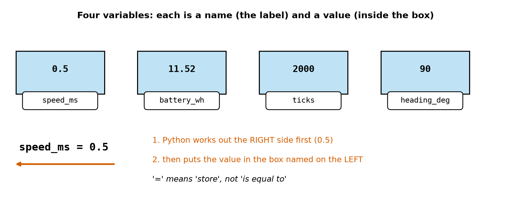
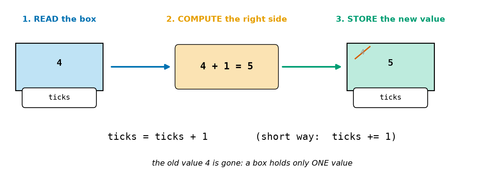
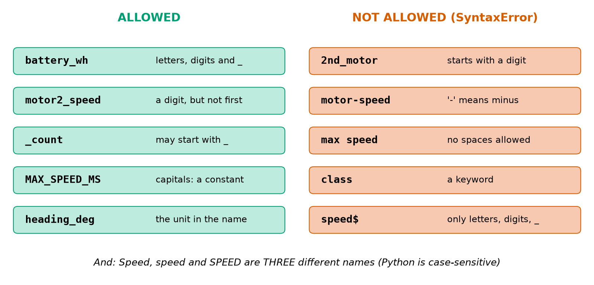
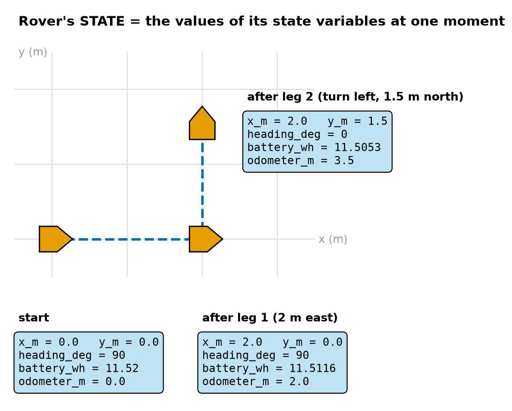
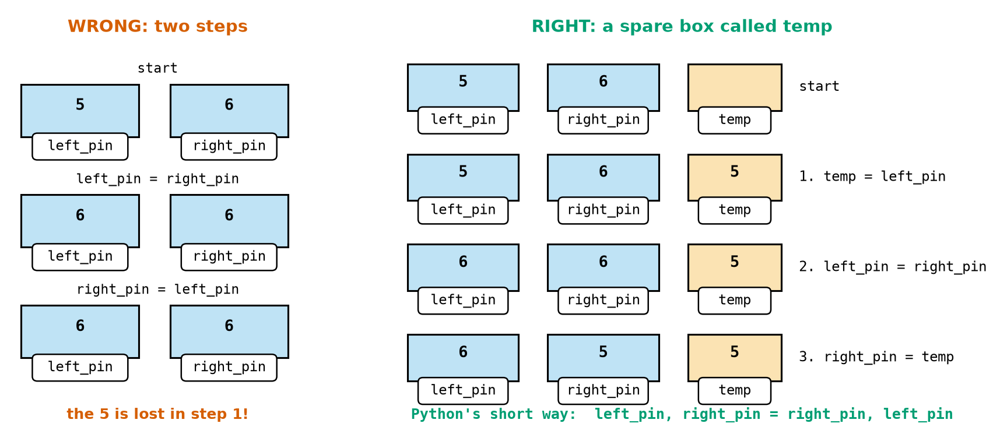
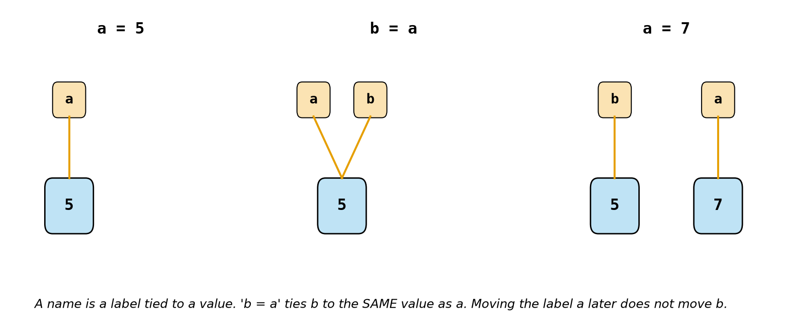

# Chapter 14 — Variables: Boxes with Names

> **Part 2 · Chapter 14 of 749**
> **You need:** Chapter 13 (numbers and the seven operators). Keep a shell open while you read and try every example.
> **You will make:** a program that keeps track of Rover's **state** (position, heading, battery, odometer) while it drives, a program that fixes crossed motor wires by **swapping** two variables, and a delivery counter for a warehouse robot.

---

## What you will learn

- What a **variable** is: a **name** for a **value**.
- What `=` really does. It means "store", not "is equal to".
- How to **change** a variable: replace it, or update it with `x = x + 1` or the shortcut `x += 1`.
- The **rules** for names, and how to choose **good** names (snake_case, with the unit in the name).
- Why `Speed` and `speed` are different, and which words Python keeps for itself (**keywords**).
- How a few variables together describe the **state** of a robot.
- The **swap puzzle**, and Python's one-line answer to it.
- **Multiple assignment** (`x, y = 0.0, 0.0`) and **constants** written in CAPITALS.

---

## New words in this chapter

| Word | Simple meaning |
|---|---|
| **variable** | A name that holds a value, like a labelled box. |
| **value** | The thing stored: a number such as `0.5` or `2000`. |
| **assignment** | Putting a value into a variable with `=`. |
| **update** | Changing a variable using its own old value: `ticks = ticks + 1`. |
| **augmented assignment** | The short way to update: `ticks += 1`. |
| **counter** | A variable that starts at 0 and goes up by 1 each time something happens. |
| **running total** | A variable that starts at 0 and adds each new amount. |
| **identifier** | The official word for a name in a program. |
| **keyword** | A word Python keeps for itself, such as `for` or `class`. You cannot use it as a name. |
| **case-sensitive** | Small and capital letters count as different: `speed` ≠ `Speed`. |
| **snake_case** | Writing names in small letters with `_` between words: `battery_wh`. |
| **state** | All the values that describe a robot at one moment. |
| **swap** | Exchanging the values of two variables. |
| **constant** | A value that should never change while the program runs. By habit its name is in CAPITALS. |

---

## 14.1 A variable is a box with a name

You have used variables since Chapter 1 (`speed = 0.5`). Now let us look at them properly. Look at Figure 14.1.



*Figure 14.1 — Four variables. Each one has a name (the white label) and a value (inside the blue box). Bottom: what happens when Python runs `speed_ms = 0.5`.*

**How to read this picture:** Each blue box is a place in the computer's memory. The white label on the front is the box's **name**. The number inside is its **value**. The box named `speed_ms` holds `0.5`, `battery_wh` holds `11.52`, and so on. At the bottom, the red arrow points from **right to left**: Python first works out the right side of `=`, then puts that value into the box named on the left.

📖 **New word: variable** — a **name** that holds a **value**. Think of a box with a label on it. You can look inside it (read the value) and you can put something new in it (change the value).

📖 **New word: assignment** — putting a value into a variable. The sign for it is `=`.

```
>>> speed_ms = 0.5
>>> speed_ms
0.5
```

The first line shows **nothing**. Storing a value is quiet (you saw this in Chapter 12). The second line asks for the value, and the shell shows it.

### `=` means "store", not "is equal to"

In maths, `x = 5` says "x and 5 are the same". In Python, `x = 5` is an **order**: "**put** 5 into the box called x". That is why the two sides cannot be exchanged:

```
>>> 0.5 = speed
  File "<python-input-1>", line 1
    0.5 = speed
    ^^^
SyntaxError: cannot assign to literal here. Maybe you meant '==' instead of '='?
```

You cannot store something **inside** the number 0.5. The left side of `=` must always be a **name**. (Python's hint mentions `==`. That is the sign that really means "is equal to?". You will meet it in Chapter 17.)

⚠️ **Remember:** Read `speed_ms = 0.5` aloud as "speed_ms **becomes** 0.5" or "store 0.5 in speed_ms". Do not say "speed_ms equals 0.5". This small habit stops many beginner mistakes.

### The right side is worked out first

The right side can be a whole calculation, as in Chapter 13:

```
>>> usable_wh = 0.8 * 14.4
>>> usable_wh
11.520000000000001
```

Python does it in two steps:

```
Step 1. work out the right side:   0.8 * 14.4  →  11.520000000000001
Step 2. store it in the box named on the left:  usable_wh
```

(The long tail is the float surprise from Chapter 13, Section 13.5. It is harmless here. We round only when we show a result.)

### Using a variable: Python looks inside the box

When a name appears on the **right** side, or inside `print`, Python looks inside the box and uses the value:

```
>>> usable_wh = 11.52
>>> power_w = 3.78
>>> usable_wh / power_w
3.0476190476190474
```

That is Rover's battery time in hours (Chapter 5). Python replaced `usable_wh` with 11.52 and `power_w` with 3.78, then divided.

### A box that does not exist yet

If you use a name that has never been given a value, Python cannot find the box:

```
>>> print(battery)
Traceback (most recent call last):
  File "<python-input-3>", line 1, in <module>
    print(battery)
          ^^^^^^^
NameError: name 'battery' is not defined
```

📖 **NameError** means "I do not know this name". There are two usual reasons:

1. You never stored anything in it.
2. You spelled it differently from the first time.

The fix is always the same: give the variable a value **before** you use it. Programs run from top to bottom (Chapter 11), so the line `battery = …` must come **above** the line that uses `battery`.

---

## 14.2 Changing a variable

### Replacing the value

A box holds **one** value. Storing a new value **replaces** the old one, and the old one is gone for ever:

```
>>> speed_ms = 0.5
>>> speed_ms = 0.2
>>> speed_ms
0.2
```

This is how a robot program follows a changing world. When the sensor reads a new distance, `distance_m = new_reading` replaces the old reading.

### Updating: using the old value to make the new one

Very often the new value **depends on** the old one. Rover's encoder counts ticks: every tick adds 1 to the count. Look at Figure 14.2.



*Figure 14.2 — What `ticks = ticks + 1` does: read the box (4), compute the right side (4 + 1 = 5), store the answer back in the same box (5).*

**How to read this picture:** On the left, the box `ticks` holds 4. The blue arrow means "read": Python takes the 4 out to use it. In the middle (orange), it computes 4 + 1 = 5. The green arrow means "store": the 5 goes back into the **same** box, on the right. The small grey 4 with a red line through it shows that the old value is gone.

```
>>> ticks = 4
>>> ticks = ticks + 1
>>> ticks
5
```

In maths, "ticks = ticks + 1" would be nonsense: no number is equal to itself plus one. In Python it makes perfect sense because `=` means **store**: "take the value of ticks, add 1, and store the answer in ticks".

📖 **New word: update** — changing a variable by using its own old value.

### The shortcuts: `+=  -=  *=  /=`

Updates are so common that Python has a shorter way to write them:

| Long way | Short way | Robot example |
|---|---|---|
| `ticks = ticks + 1` | `ticks += 1` | count one more encoder tick |
| `battery_wh = battery_wh - 0.0084` | `battery_wh -= 0.0084` | use some energy |
| `speed_ms = speed_ms * 2` | `speed_ms *= 2` | double the speed |
| `speed_ms = speed_ms / 2` | `speed_ms /= 2` | halve the speed |
| `n = n // 3` | `n //= 3` | keep whole parts only |
| `heading_deg = heading_deg % 360` | `heading_deg %= 360` | keep the heading between 0 and 359 |
| `n = n ** 2` | `n **= 2` | square |

📖 **New word: augmented assignment** — the short form `x += 1`. "Augmented" means "made bigger". It is a normal assignment with an operator stuck in front of `=`.

Try a chain of them:

```
>>> speed_ms = 0.5
>>> speed_ms = speed_ms * 2
>>> speed_ms -= 0.25
>>> speed_ms /= 3
>>> speed_ms
0.25
```

🔢 **Maths** — follow it step by step:

```
Step 1. speed_ms = 0.5
Step 2. speed_ms = 0.5 × 2   = 1.0
Step 3. speed_ms = 1.0 − 0.25 = 0.75
Step 4. speed_ms = 0.75 ÷ 3  = 0.25   ✓
```

⚠️ **The order of the signs matters:** `+=` adds, but `=+` does not! `ticks =+ 1` means `ticks = +1` ("store plus one"). It stores 1 every time instead of counting up. Python does not give an error, so this bug is hard to see. The operator always comes **first**: `+=`, `-=`, `*=`.

⚠️ **You cannot update a box that does not exist yet:**

```
>>> ticks += 1
Traceback (most recent call last):
  File "<python-input-0>", line 1, in <module>
    ticks += 1
    ^^^^^
NameError: name 'ticks' is not defined
```

`ticks += 1` must **read** `ticks` first, and there is nothing to read. Every counter needs a **starting value** first: `ticks = 0`.

### A calculation alone changes nothing

```
>>> x_m = 1.0
>>> x_m + 0.5
1.5
>>> x_m
1.0
```

The shell showed `1.5`, but `x_m` is still 1.0! `x_m + 0.5` only **computes** a value. It does not **store** it anywhere. To change `x_m`, you must assign: `x_m = x_m + 0.5`, or `x_m += 0.5`.

In a script this is even worse. A line like `x_m + 0.5` is silent: Python computes 1.5 and throws it away, with no message at all. If a variable "does not change", check that you really wrote `=` or `+=`.

### Tracing: follow the boxes by hand

A **trace table** follows the boxes line by line. It is the same tool you used for the grid trips in Chapter 11. Here is a short program:

```python
a = 3
b = a * 2
a = a + b
b -= 1
```

| After line | `a` | `b` | What happened |
|---|---|---|---|
| 1 | 3 | — | new box a |
| 2 | 3 | 6 | b = 3 × 2 |
| 3 | 9 | 6 | a = 3 + 6 (the **old** a and the current b) |
| 4 | 9 | 5 | b = 6 − 1 |

💡 **Tip:** When a program gives a strange answer, make a trace table. Most beginner bugs show up in the second or third row. In Chapter 12 you met `python -i`, which lets you look inside the boxes after a script has run. It is the computer's own trace table for the last row.

---

## 14.3 The rules for names

📖 **New word: identifier** — the official word for a name in a program (a variable name, and later function names too).

### The four rules

A name may contain only:

1. **letters** (a–z, A–Z),
2. **digits** (0–9), but **not as the first character**,
3. the **underscore** `_`.

And:

4. It must **not be a keyword** (a word Python keeps for itself; see below).

Look at Figure 14.3.



*Figure 14.3 — Left (green): five allowed names and why. Right (red): five names that give a SyntaxError and why.*

**How to read this picture:** Each row is a name in bold, with the reason next to it. The green names follow all four rules. Each red name breaks one rule: a digit first, a `-` sign (Python reads it as minus), a space, a keyword, or a character such as `$`. The line at the bottom is a fifth fact: capital and small letters make **different** names.

Here is what Python says about the red names. These outputs come from real runs:

```
2nd_motor = 1
    ^
SyntaxError: invalid decimal literal
```

Python saw `2` and expected a number. "2nd" is not a number.

```
motor-speed = 1
^^^^^^^^^^^
SyntaxError: cannot assign to expression here. Maybe you meant '==' instead of '='?
```

Python read this as `motor` **minus** `speed`, which is a calculation and not a name.

```
max speed = 1
    ^^^^^
SyntaxError: invalid syntax
```

A space ends a name, so Python saw two names next to each other.

```
class = 3
      ^
SyntaxError: invalid syntax
```

`class` is a keyword (Chapter 28 uses it to build robot "objects").

```
speed$ = 2
     ^
SyntaxError: invalid syntax
```

`$` is not allowed in a name.

💡 **Tip:** The little `^` signs point at **where** Python got confused. That is often the bad character itself, or just before it.

(Python also allows letters from other languages, such as `é` or Chinese characters. It is better not to use them in robot code: other people's keyboards and tools may not handle them well. Stick to a–z, digits and `_`.)

### Case-sensitive: `speed`, `Speed` and `SPEED` are three boxes

📖 **New word: case-sensitive** — small letters (lower case) and capital letters (upper case) count as different.

```
>>> Speed = 1
>>> speed = 2
>>> SPEED = 3
>>> print(Speed, speed, SPEED)
1 2 3
```

Three different boxes! This also explains a common NameError:

```
speed = 0.5
print(Speed)
```

```
NameError: name 'Speed' is not defined. Did you mean: 'speed'?
```

Python is helpful here: "Did you mean: 'speed'?" Read the last line of an error carefully. It often tells you the fix.

### Keywords: Python's own words

📖 **New word: keyword** — a word with a special meaning in Python. You cannot use it as a name.

Python can show you its list. The two lines below use `import`, which is explained in Chapter 26. For now, just type them:

```
>>> import keyword
>>> keyword.kwlist
['False', 'None', 'True', 'and', 'as', 'assert', 'async', 'await', 'break', 'class', 'continue', 'def', 'del', 'elif', 'else', 'except', 'finally', 'for', 'from', 'global', 'if', 'import', 'in', 'is', 'lambda', 'nonlocal', 'not', 'or', 'pass', 'raise', 'return', 'try', 'while', 'with', 'yield']
>>> len(keyword.kwlist)
35
```

There are **35** keywords in Python 3.14. You do not need to learn them by heart. You will meet most of them in Part 2: `True`, `False`, `and`, `or`, `not` (Chapter 17), `if`, `elif`, `else` (Chapter 18), `while`, `break` (Chapter 19), `for`, `in` (Chapter 20), `def`, `return` (Chapter 23), `import` (Chapter 26), `class` (Chapter 28). Your editor shows keywords in a different colour (Chapter 8). If a name you typed changes colour, it is probably a keyword.

### A trap: names that are allowed but break things

Some names are **not** keywords but are already used by Python: `print`, `round`, `type`, `max`, `min`, `sum`, `input`. Python **lets** you use them, and that is the trap:

```
round = 3
print(round(2.5))
```

```
Traceback (most recent call last):
  File "...", line 2, in <module>
    print(round(2.5))
          ~~~~~^^^^^
TypeError: 'int' object is not callable
```

Line 1 put the number 3 into the box called `round`. Python's rounding tool is no longer under that name. So line 2 tries to "call" the number 3 like a tool, which makes no sense. ("Callable" means "can be used like a tool, with brackets". Chapter 23 explains this.)

✅ **Fix:** choose another name: `rounded`, `round_count`, `max_speed_ms`. In the shell, restarting it (`exit()` and `python` again) gives you the real `round` back.

⚠️ **Never** name a variable `print`, `round`, `type`, `max`, `min`, `sum`, `input`, `list` or `str`. If your editor colours a name in a special way when you did not mean it, choose another name.

---

## 14.4 Good names

The rules say what is **allowed**. Good names are about what is **clear**. A robot program is read many more times than it is written: by you next month, by your teammates, by the person debugging a robot at 2 a.m.

### snake_case

📖 **New word: snake_case** — all small letters, with `_` between words: `battery_wh`, `left_motor_speed`, `max_turn_rate`. The underscores lie low like a snake. This is the Python habit for variable names (written down in a style guide called **PEP 8**).

Other languages use `camelCase` (`leftMotorSpeed`). Python programmers use snake_case for variables, and so does this book.

### Put the unit in the name

Chapter 13 ended with the Mars Climate Orbiter, which was lost because of a mix-up between units. The cheapest protection is in the name:

| Unclear | Clear | Why |
|---|---|---|
| `d = 0.065` | `wheel_diameter_m = 0.065` | what it is **and** the unit (metres) |
| `t = 8` | `drive_time_s = 8` | seconds, not minutes |
| `b = 11.52` | `battery_wh = 11.52` | watt-hours, not volts or percent |
| `a = 90` | `heading_deg = 90` | degrees, not radians (Chapter 47) |
| `s = 0.25` | `speed_ms = 0.25` | metres per second |

A real mistake shows why. A robot arm program has `x = 12` (centimetres) and `y = 0.3` (metres). Python happily computes `x + y`:

```
>>> x_cm = 12
>>> x_m = 0.3
>>> x_cm + x_m
12.3
```

The answer 12.3 is nonsense: 12 cm + 0.3 m is 42 cm. Python cannot know about units, but **you** can see the bug at once, because the names `x_cm + x_m` do not match. With names `x` and `y`, nobody would see it.

### Good names, step by step

| Ask yourself | Bad | Better |
|---|---|---|
| Does it say **what** it is? | `n`, `val`, `data` | `ticks`, `distance_m` |
| Does it say the **unit**? | `battery` | `battery_wh` or `battery_pct` |
| Is it **too long**? | `the_speed_of_the_left_wheel_in_metres_per_second` | `left_speed_ms` |
| Can it be **misread**? | `l`, `O`, `I` (they look like 1 and 0) | `left`, `count` |
| Is it a Python tool name? | `round`, `max`, `type` | `rounded`, `max_speed_ms` |

💡 **Tip:** Short names like `i`, `n`, `x`, `y` are fine when their meaning is obvious and they are used in only a few lines (a loop counter in Chapter 20, or `x` and `y` for a position). For anything that lives longer, use a full name.

---

## 14.5 Several variables together: the robot's state

In Chapter 11 you met the word **state**: the values that describe a robot at one moment. Now you can see what state is in a program: it is just a **group of variables**.

📖 **New word: state** — all the values that describe a robot at one moment. For Rover these are its position, the direction it faces, the energy left in its battery and how far it has driven.

```python
x_m, y_m = 0.0, 0.0        # position on the floor
heading_deg = 90           # facing east
battery_wh = 11.52         # energy left
odometer_m = 0.0           # distance driven so far
```

Look at Figure 14.4. It shows these variables at three moments of a short drive.



*Figure 14.4 — Rover drives 2 m east, turns left, and drives 1.5 m north. The blue boxes show its state variables at the start, after leg 1 and after leg 2.*

**How to read this picture:** The grey grid is the floor, with 1 m squares. The orange shapes are Rover seen from above, and the point shows the way it faces. The blue dashed line is its path. Each blue box lists Rover's state at that moment. Compare the boxes: after leg 1 only `x_m`, `battery_wh` and `odometer_m` changed. After leg 2, `y_m` and `heading_deg` changed too, and `x_m` stayed the same.

Every robot program in this book, from Rover to a humanoid, keeps its state in variables like these. Its loop (Chapter 6) does the same thing again and again:

1. **read** the state,
2. **compute** what changes,
3. **store** the new state.

That is Figure 14.2 again, for a whole robot.

🧠 **Remember:** State changes; rules and settings do not. Rover's **position** is state (it changes all the time). Rover's **wheel diameter** is not state: it is a fixed fact. Section 14.7 gives fixed facts their own kind of name.

---

## 14.6 Multiple assignment and the swap puzzle

### Several boxes in one line

You saw this in Chapter 10:

```
>>> x_m, y_m = 0.0, 0.0
>>> x_m
0.0
```

The values on the right are given **in order** to the names on the left: the first value to the first name, the second to the second. The two sides must have the **same number** of items:

```
>>> x, y = 1, 2, 3
ValueError: too many values to unpack (expected 2, got 3)
```

(The full message also has a `Traceback` line above it, as in Section 14.1.) "Unpack" means "take the values out and share them among the names". Two names cannot share three values.

There is also a form that puts the **same** value into several boxes:

```
>>> left_speed = right_speed = 0.0
>>> print(left_speed, right_speed)
0.0 0.0
```

This is handy for "stop both motors". Use it only for numbers like this. (Chapter 21 shows why it is a trap with lists.)

### The swap puzzle

Here is a real problem. You built Rover and wired the motors to the driver board (Chapter 141). In the program the left motor's speed goes to pin 5 and the right motor's speed goes to pin 6. On the first test, you ask Rover to turn **left**, and it turns **right**! The wires are **crossed**: pin 5 really drives the right motor.

You could take the robot apart and re-solder the wires. Or you could **swap** the two pin numbers in the program.

📖 **New word: swap** — exchanging the values of two variables.

The first idea most people have is wrong. Look at the left side of Figure 14.5.



*Figure 14.5 — Left: swapping in two steps loses a value. Right: a spare box `temp` keeps a copy, so three steps work. Bottom: Python's one-line swap.*

**How to read this picture:** Each row shows the boxes **after** the line of code printed next to it.

- **Left (wrong):** The first line copies 6 into `left_pin`. The 5 is now gone for ever. The second line copies that 6 back, so both boxes end up holding 6.
- **Right (correct):** A third box `temp` (orange) keeps a copy of the 5 first. Then `left_pin` can take the 6, and finally `right_pin` takes the 5 from `temp`.
- **Bottom:** Python can do the whole swap in a single line.

Here is the wrong way in a real run:

```
>>> x = 3
>>> y = 8
>>> x = y
>>> y = x
>>> print(x, y)
8 8
```

A trace table shows why:

| After line | `x` | `y` |
|---|---|---|
| `x = 3` | 3 | — |
| `y = 8` | 3 | 8 |
| `x = y` | **8** | 8 ← the 3 is lost here |
| `y = x` | 8 | 8 |

**The way that works, with a spare box:**

```
>>> x = 3
>>> y = 8
>>> temp = x
>>> x = y
>>> y = temp
>>> print(x, y)
8 3
```

It is like swapping the drinks in two full cups: you need a third, empty cup.

**Python's short way:**

```
>>> x, y = 3, 8
>>> x, y = y, x
>>> print(x, y)
8 3
```

How can one line do it without a spare box? Remember the rule from Section 14.1: **the right side is worked out first**. Python first reads `y, x`, which gives the values 8 and 3, and holds them. Only then does it store them in `x` and `y`. The right side is a snapshot of the old values, so nothing is lost. (Python's hidden "snapshot" is a spare box you do not have to write.)

💡 **Tip:** Use `a, b = b, a` in your own programs: it is short and clear. But understand the `temp` way too. Many other languages (C and C++ on microcontrollers, Chapter 96) do not have the one-line swap, and you will need the spare box there.

---

## 14.7 Constants: values that never change

Some values should **never** change while the program runs: Rover's wheel diameter, the motor power, the battery size, a speed limit for safety (Chapter 7). These are called **constants**.

Python has no special lock for constants. Instead, programmers agree on a **habit**: a name in **CAPITALS**, with `_` between the words, means "this is a constant: do not change it".

```python
WHEEL_DIAMETER_M = 0.065
MAX_SPEED_MS = 0.5
BATTERY_START_WH = 11.52
```

📖 **New word: constant** — a value that should stay the same for the whole program. By habit its name is in CAPITALS.

Python itself does not stop you:

```
>>> MAX_SPEED_MS = 0.5
>>> MAX_SPEED_MS = 0.8
>>> MAX_SPEED_MS
0.8
```

This works, but it breaks the agreement. Anyone reading the code expects `MAX_SPEED_MS` to be 0.5 everywhere. If it can change secretly in the middle of the program, a safety check that uses it can fail.

Why bother with constants at all? There are three reasons:

1. **One place to change.** If you buy bigger wheels, you change **one** line at the top, not every formula that uses 0.065.
2. **No "magic numbers".** `distance = turns * 3.14159 * 0.065` hides its meaning. `distance_m = turns * PI * WHEEL_DIAMETER_M` explains itself.
3. **Safety.** Limits such as `MAX_SPEED_MS` stand out in capitals, so a reviewer checks them.

💡 **Tip:** Put all constants together at the **top** of your program. Then it is easy to see every setting that controls the robot. Big robot software (ROS 2, Chapter 563) takes this idea further: the settings live in a separate file, so they can be changed without touching the code.

---

## 14.8 Names are labels on values

This section is a short look at what really happens inside Python. It will matter later, in Chapter 21.

The "box" picture is good for now, but Python actually works slightly differently. A name is more like a **label tied to a value**. Look at Figure 14.6.



*Figure 14.6 — Left: `a = 5` ties label a to the value 5. Middle: `b = a` ties label b to the same 5. Right: `a = 7` moves label a to a new value 7, and b stays on 5.*

**How to read this picture:** The orange tags are names and the blue squares are values. The lines show which value each name is tied to. In the middle, both tags point to **the same** 5: `b = a` does not make a new box, it ties a second label to the same value. On the right, `a = 7` moves only the `a` label. `b` still points to 5.

```
>>> a = 5
>>> b = a
>>> a = 7
>>> print(a, b)
7 5
```

It is the same for calculations:

```
>>> a = 2
>>> b = a + 3
>>> a = 10
>>> b
5
```

`b = a + 3` computed 5 **at that moment** and stored the 5. It does not remember "b is always a + 3". When `a` changes later, `b` does not follow. (A spreadsheet works differently: a cell with a formula updates itself. Python does not do that.)

🧠 **Remember:** `b = a + 3` is **not** a rule that stays true for ever. It is a **one-time calculation**. If you want `b` to follow `a`, you must compute it again after every change to `a`.

For numbers, "label" and "box" give the same answers, so keep using whichever picture helps you. The difference only shows with lists (Chapter 21).

---

## Code

Now everything together. Rover drives a short route, and the program keeps its **state** up to date: position, heading, battery and odometer. This is a first, simple version of what Rover's real program will do with its encoders (odometry, Chapter 288).

The file is `code/ch014/rover_state.py`. Type it into `my-code/ch014/`.

```python
# rover_state.py - Rover's STATE: a few variables that describe it right now
POWER_W = 3.78                # CONSTANT (capitals): Rover's power while driving (Chapter 5)
SPEED_MS = 0.25               # CONSTANT: Rover's cruising speed in metres per second
BATTERY_START_WH = 11.52      # CONSTANT: usable energy when full, 80% of 14.4 Wh (Chapter 5)

x_m, y_m = 0.0, 0.0           # STATE: position on the floor in metres (the start)
heading_deg = 90              # STATE: facing east (0 = north, 90 = east; Chapter 13)
battery_wh = BATTERY_START_WH # STATE: energy left
odometer_m = 0.0              # STATE: total distance driven so far
print("start: x", x_m, "y", y_m, "heading", heading_deg, "battery", battery_wh, "Wh")

leg_m = 2.0                   # leg 1: drive 2 m
x_m += leg_m                  # facing east, so only x changes
odometer_m += leg_m
battery_wh -= POWER_W * (leg_m / SPEED_MS) / 3600   # energy = power x time in hours
print("leg 1: x", x_m, "y", y_m, "heading", heading_deg, "battery", round(battery_wh, 4), "Wh")

heading_deg = (heading_deg - 90) % 360   # turn left 90 degrees: now facing north
leg_m = 1.5                   # leg 2: drive 1.5 m
y_m += leg_m                  # facing north, so only y changes
odometer_m += leg_m
battery_wh -= POWER_W * (leg_m / SPEED_MS) / 3600
print("leg 2: x", x_m, "y", y_m, "heading", heading_deg, "battery", round(battery_wh, 4), "Wh")

used_wh = BATTERY_START_WH - battery_wh
print("odometer:", odometer_m, "m | used:", round(used_wh, 4), "Wh =", round(used_wh / BATTERY_START_WH * 100, 2), "%")
```

| Line | Code | What it does (simple English) |
|---|---|---|
| 1 | comment | The name of the file and the idea. |
| 2 | `POWER_W = 3.78` | A **constant** (capitals): Rover uses 3.78 W while driving (Chapter 5). The `_W` says the unit: watts. |
| 3 | `SPEED_MS = 0.25` | Constant: Rover drives at 0.25 m/s. |
| 4 | `BATTERY_START_WH = 11.52` | Constant: the usable energy of a full battery (80% of 14.4 Wh). |
| 5 | *(empty)* | An empty line separates the constants from the state. |
| 6 | `x_m, y_m = 0.0, 0.0` | **Multiple assignment**: two state variables in one line. Rover starts at (0, 0). |
| 7 | `heading_deg = 90` | Facing east. The heading convention is the compass from Chapter 13. |
| 8 | `battery_wh = BATTERY_START_WH` | The state starts **from** the constant. Later the state changes, and the constant stays. |
| 9 | `odometer_m = 0.0` | A **running total** of the distance: it starts at 0. |
| 10 | `print(…)` | Shows the starting state. |
| 11 | *(empty)* | |
| 12 | `leg_m = 2.0` | The length of this leg. (The same variable is reused for leg 2 below: **replacing**.) |
| 13 | `x_m += leg_m` | **Update**: Rover faces east, so it moves along x. x becomes 0.0 + 2.0. |
| 14 | `odometer_m += leg_m` | Add the leg to the running total. |
| 15 | `battery_wh -= …` | Energy used = power × time. Time = 2.0 ÷ 0.25 = 8 s, and ÷ 3600 turns seconds into hours (Chapter 13). 3.78 × 8 ÷ 3600 = 0.0084 Wh. |
| 16 | `print(…)` | Shows the new state. The battery is **rounded only for display** (rule 1 of Section 13.5). |
| 17 | *(empty)* | |
| 18 | `heading_deg = (heading_deg - 90) % 360` | Turn left 90°: 90 − 90 = 0, which is north. `% 360` keeps it between 0 and 359 (Chapter 13, Application 1). |
| 19 | `leg_m = 1.5` | **Replace** the leg length with a new value. |
| 20 | `y_m += leg_m` | Facing north, so Rover moves along y. |
| 21–22 | | Update the odometer and the battery (6 s of driving: 0.0063 Wh). |
| 23 | `print(…)` | Shows the state after leg 2. |
| 24 | *(empty)* | |
| 25 | `used_wh = …` | A **new** variable for the energy used: the constant minus what is left. |
| 26 | `print(…)` | The odometer, the energy used, and the energy used as a percentage of the full battery. |

**Output:**

```
start: x 0.0 y 0.0 heading 90 battery 11.52 Wh
leg 1: x 2.0 y 0.0 heading 90 battery 11.5116 Wh
leg 2: x 2.0 y 1.5 heading 0 battery 11.5053 Wh
odometer: 3.5 m | used: 0.0147 Wh = 0.13 %
```

**What the output means:**

- After leg 1, Rover is at (2.0, 0.0) and still faces east (90).
- After leg 2, it is at (2.0, 1.5) and faces north (0). These are exactly the boxes in Figure 14.4.
- The battery went down a tiny amount: driving 3.5 m costs 0.0147 Wh, only **0.13 %** of the battery. Driving short distances is cheap. Most of Rover's battery goes to just **being on** for hours (Chapter 5).
- `odometer_m` (3.5 m) is not the same as the distance from the start. That is √(2² + 1.5²) = 2.5 m in a straight line. The odometer counts the path, not the shortcut.

🔢 **Maths** — check the battery by hand:

```
Step 1. time leg 1 = 2.0 ÷ 0.25 = 8 s     energy = 3.78 × 8 ÷ 3600 = 0.0084 Wh
Step 2. time leg 2 = 1.5 ÷ 0.25 = 6 s     energy = 3.78 × 6 ÷ 3600 = 0.0063 Wh
Step 3. total = 0.0084 + 0.0063 = 0.0147 Wh
Step 4. left  = 11.52 − 0.0147  = 11.5053 Wh       percent = 0.0147 ÷ 11.52 × 100 ≈ 0.13 %   ✓
```

⚠️ **Notice the repeated lines.** Legs 1 and 2 are almost the same four lines. Copying lines works for two legs, but not for 200. In Chapter 19 (`while`) and Chapter 20 (`for`) you will write them **once** and repeat them. In Chapter 23 you will give them a name (a **function**) such as `drive(leg_m)`. And the "if facing east, change x; if facing north, change y" choice will use `if` (Chapter 18), and later sine and cosine (Chapters 49–50), so that Rover can drive in **any** direction.

---

## Small examples

### Example 1 — Store, then show

```
>>> wheels = 4
>>> wheels
4
```

Storing shows nothing. Asking shows the value.

### Example 2 — Replace

```
>>> mode = 1
>>> mode = 2
>>> mode
2
```

The 1 is gone.

### Example 3 — Count

```
>>> bumps = 0
>>> bumps += 1
>>> bumps += 1
>>> bumps
2
```

A **counter**: it starts at 0 and adds 1 each time the bumper is hit.

### Example 4 — The shortcuts on integers

```
>>> n = 10
>>> n //= 3
>>> n
3
>>> n **= 2
>>> n
9
>>> n %= 4
>>> n
1
```

10 // 3 = 3, then 3² = 9, then 9 % 4 = 1.

### Example 5 — Case matters

```
>>> Battery = 50
>>> battery
NameError: name 'battery' is not defined. Did you mean: 'Battery'?
```

### Example 6 — One-line swap

```
>>> hot, cold = 80, 20
>>> hot, cold = cold, hot
>>> print(hot, cold)
20 80
```

### Example 7 — The same value in two boxes

```
>>> left_speed = right_speed = 0.0
>>> right_speed
0.0
```

### Example 8 — A label does not follow

```
>>> x = 10
>>> y = x
>>> x += 5
>>> print(x, y)
15 10
```

`y` got the value 10 at that moment. Changing `x` later does not change `y`.

---

## 🏭 Real robot applications

### Application 1 (worked in full) — 🤖 Fixing crossed motor wires in software

**1. The real problem.** You built a two-wheeled robot with a TB6612 motor driver (Chapter 141). The program sends the left motor's speed to pin 5 and the right motor's speed to pin 6. On the first test, "turn left" makes the robot turn **right**. The motor wires to the driver are crossed. Re-soldering takes an hour and risks damaging the board. Robot builders very often fix this in **software**: swap which pin each motor uses.

**2. Why this idea.** A differential-drive robot (Chapter 4) turns left when its **right** wheel runs faster than its left wheel. If the pins are crossed, every speed goes to the wrong wheel, so every turn is mirrored. Swapping the two pin variables, once, at the top of the program, makes every later line correct, with no other change.

**3. The numbers.**

| Fact | Value |
|---|---|
| left motor pin (what the program thinks) | 5 |
| right motor pin (what the program thinks) | 6 |
| turn left: left wheel speed | 0.1 m/s |
| turn left: right wheel speed | 0.3 m/s |

**4. The maths, step by step.** The swap, traced with a `temp` box:

```
Step 0. left_pin = 5    right_pin = 6    temp = —
Step 1. temp = left_pin         → left 5, right 6, temp 5
Step 2. left_pin = right_pin    → left 6, right 6, temp 5
Step 3. right_pin = temp        → left 6, right 5, temp 5      swapped ✓
```

And the turn: the robot's forward speed is (0.1 + 0.3) ÷ 2 = 0.2 m/s (Chapter 4). The right wheel is faster, so the robot curves **left**, as asked, once the speeds reach the correct wheels.

**5. The code.** File `code/ch014/swap_motors.py`:

```python
# swap_motors.py - crossed motor wires? Swap two variables instead of re-soldering
left_pin = 5                  # the pin the program sends the LEFT motor speed to
right_pin = 6                 # the pin the program sends the RIGHT motor speed to
left_speed = 0.1              # to turn left: left wheel slow ...
right_speed = 0.3             # ... and right wheel fast
print("before:       pin", left_pin, "gets", left_speed, "| pin", right_pin, "gets", right_speed)

# the test drive showed the wires are crossed: swap the pins, using a spare box
temp = left_pin               # 1. keep a copy of the left pin
left_pin = right_pin          # 2. left gets the right pin (the old value is safe in temp)
right_pin = temp              # 3. right gets the copy
print("after swap 1: pin", left_pin, "gets", left_speed, "| pin", right_pin, "gets", right_speed)

# Python's short way does the same in one line (here it swaps them back again)
left_pin, right_pin = right_pin, left_pin
print("after swap 2: pin", left_pin, "gets", left_speed, "| pin", right_pin, "gets", right_speed)
```

| Line | Code | What it does (simple English) |
|---|---|---|
| 1 | comment | The idea. |
| 2–3 | `left_pin = 5`, `right_pin = 6` | Which pin the program **thinks** each motor is on. |
| 4–5 | `left_speed`, `right_speed` | The speeds for a left turn: the right wheel is faster. |
| 6 | `print(…)` | Shows which pin gets which speed. |
| 8–10 | `temp = …`, `left_pin = …`, `right_pin = temp` | The three-step swap with a spare box (Figure 14.5, right). |
| 11 | `print(…)` | Pin 6 now gets the left speed. |
| 14 | `left_pin, right_pin = right_pin, left_pin` | The one-line swap. Here it swaps them **back**, just to show that it works too. |
| 15 | `print(…)` | Back to the start. |

**Output:**

```
before:       pin 5 gets 0.1 | pin 6 gets 0.3
after swap 1: pin 6 gets 0.1 | pin 5 gets 0.3
after swap 2: pin 5 gets 0.1 | pin 6 gets 0.3
```

**6. The result.** After swap 1, the slow speed (0.1) goes to pin 6. That is where the left motor really is, so the robot turns left as asked. In a real program you would keep only **one** swap (the first) and delete the swap back. Every later line of the program uses `left_pin` and `right_pin`, so it is now correct without any other change. This only works because the pins are in **named variables**. If the number 5 were typed directly into 20 different lines, you would have to find and change all 20.

**7. Going further.** The same "fix it in software" trick is used for a motor that spins **backwards**: multiply its speed by −1, often stored as a constant `LEFT_MOTOR_SIGN = -1`. Drone flight controllers have a "motor order" setting for the same reason: if the motors are plugged in the wrong order, you change a setting instead of the wires (Chapter 646). But be careful: a swap you forget to write down confuses the next person. Always add a comment such as `# wires crossed on Rover #2, fixed in software`.

### Application 2 (worked in full) — 🏭📦 Counting deliveries in a shift

**1. The real problem.** The warehouse robot from Chapter 13 makes deliveries all day. The manager's screen shows how many deliveries it has made, the total distance, the average trip length, and the time spent driving. The robot must keep these numbers up to date after **every** delivery.

**2. Why this idea.** Two of the most common variables in all of programming:

- a **counter** (start at 0, `+= 1` each time),
- a **running total** (start at 0, `+= amount` each time).

📖 **New words: counter** and **running total** — see the definitions above. The average is then **total ÷ count**.

**3. The numbers.**

| Delivery | Trip length |
|---|---|
| 1 | 120.0 m |
| 2 | 85.5 m |
| 3 | 240.0 m |
| speed (Chapter 13) | 1.257 m/s |

**4. The maths, step by step.**

```
Step 1. count:   0 → 1 → 2 → 3
Step 2. total:   0 → 120.0 → 205.5 → 445.5 m
Step 3. average: 445.5 ÷ 3 = 148.5 m
Step 4. time:    445.5 ÷ 1.257 ≈ 354.4 s → round → 354 s
Step 5. 354 // 60 = 5 min,  354 % 60 = 54 s
```

**5. The code.** File `code/ch014/deliveries.py`:

```python
# deliveries.py - a counter and a running total for a warehouse robot's shift
SPEED_MS = 1.257              # the robot's speed from Chapter 13 (120 rpm, 0.2 m wheels)
deliveries = 0                # a COUNTER: starts at 0 and goes up by 1
total_m = 0.0                 # a RUNNING TOTAL: starts at 0 and adds each trip

trip_m = 120.0                # delivery 1
deliveries += 1
total_m += trip_m

trip_m = 85.5                 # delivery 2: the same three lines again
deliveries += 1
total_m += trip_m

trip_m = 240.0                # delivery 3
deliveries += 1
total_m += trip_m

average_m = total_m / deliveries
drive_s = round(total_m / SPEED_MS)
print("deliveries:", deliveries, "| total:", total_m, "m | average:", average_m, "m")
print("driving time:", drive_s, "s =", drive_s // 60, "min", drive_s % 60, "s")
```

| Line | Code | What it does (simple English) |
|---|---|---|
| 2 | `SPEED_MS = 1.257` | A constant from Chapter 13's calculation. |
| 3 | `deliveries = 0` | The counter **must** start at 0. Without this line, `deliveries += 1` gives a NameError. |
| 4 | `total_m = 0.0` | The running total starts at 0.0 (a float, because distances are measured). |
| 6–8 | delivery 1 | Replace `trip_m`, count one more delivery, add the trip to the total. |
| 10–16 | deliveries 2 and 3 | The same three lines (Chapter 20 will turn them into a loop). |
| 18 | `average_m = …` | Average = total ÷ count. |
| 19 | `drive_s = round(…)` | The driving time in whole seconds. |
| 20–21 | `print(…)` | The screen, with `//` and `%` for minutes and seconds (Chapter 13). |

**Output:**

```
deliveries: 3 | total: 445.5 m | average: 148.5 m
driving time: 354 s = 5 min 54 s
```

**6. The result.** After three deliveries, the screen shows 3 deliveries, 445.5 m driven, an average trip of 148.5 m and 5 min 54 s of driving. Notice that the program never stored the three trip lengths. `trip_m` is **replaced** each time, and only the counter and the total remember the past. That uses very little memory, which matters on small robot computers. If the manager later wants "the longest trip", though, that number is gone. To keep all the trips you need a **list** (Chapter 21).

**7. Going further.** Real fleets keep many counters per robot: deliveries, bumps, emergency stops, battery charges, motor hours. A sudden jump in "bumps per hour" is an early sign of a dirty sensor. Engineers watch such counters in logs and live tools (Chapter 569), and they are saved to files at the end of each shift (Chapter 27).

### Application 3 — 🚁 A drone's height limit as a constant

In many countries, small drones may fly no higher than about **120 m** above the ground (400 feet in the USA). A drone program keeps this as a constant at the top, `MAX_ALTITUDE_M = 120`, and its state includes `altitude_m`. Every new height command is checked against the constant (with `if`, Chapter 18). There are two reasons to write it as a constant: a pilot in another country changes **one** line, and the capital letters make the safety limit easy to find in a review. A drone that mixed up `altitude_ft` and `altitude_m` would fly about 3.3 times too high or too low, which is another reason to keep the unit in the name.

### Application 4 — 🦾 An arm's joint angles

A 6-joint robot arm (Chapter 4) has a state of six angles: `base_deg`, `shoulder_deg`, `elbow_deg`, `wrist1_deg`, `wrist2_deg`, `wrist3_deg`. Moving to a "home" pose sets all six at once with multiple assignment: `base_deg, shoulder_deg, elbow_deg = 0, -90, 90` (and so on). The names matter: arm software uses **radians** inside the maths (Chapter 47) but shows **degrees** to people. Many real arm bugs come from passing a `_deg` value where `_rad` was expected. The arm then turns 57 times too far (1 radian ≈ 57.3°). With units in the names, the mistake is visible in the line itself.

### Application 5 — 🚶 A humanoid has too many variables

A humanoid robot such as the ones in Part 32 has about **30 joints**, and each joint has an angle, a speed and a motor current. That is 90 state variables! Writing `left_knee_deg`, `left_knee_speed`, `left_knee_current`, … 90 times would be slow and error-prone. Variables are the right idea, but one name per value does not grow well. Chapter 21 (lists), Chapter 22 (dictionaries: `joints["left_knee"]`) and Chapter 28 (classes: a `Joint` with its own angle, speed and current) are Python's answers. They all build on what you learned here: a name tied to a value.

---

## 🔧 Hands-on lab

### Lab 14.1 — Trace detective (paper, then shell)

**You need:** paper, a pencil, and the Python shell or a script.

**Steps:**

1. Copy this program onto paper and make a trace table with columns `a` and `b`:

   ```python
   a = 3
   b = a * 2
   a = a + b
   b -= 1
   a, b = b, a
   a //= 2
   print(a, b)
   ```

2. Predict the printed line. Then run it.
3. Do the same for these two programs:

   ```python
   battery = 100
   battery -= 15
   battery *= 0.5
   level = battery // 10
   print(battery, level)
   ```

   ```python
   x = 10
   y = x
   x += 5
   print(x, y)
   ```

**What you should see:**

- Program 1: `2 9`. The trace is a: 3, 3, 9, 9, **5**, **2** and b: —, 6, 6, 5, **9**, 9. The swap line exchanges 9 and 5, then `a //= 2` makes 5 // 2 = 2.
- Program 2: `42.5 4.0`. (100 − 15 = 85, then 85 × 0.5 = 42.5, which is a float, so `//` gives the float `4.0`, as in Chapter 13.)
- Program 3: `15 10` (Section 14.8: `y` does not follow `x`).

**If it does not work:**

| Problem | Likely cause | Fix |
|---|---|---|
| Your table gives a = 9 at the end of program 1 | You did the swap line as two separate steps | `a, b = b, a` uses the **old** values of both at the same time. |
| Program 2: you expected `4` | You forgot that `*= 0.5` makes a float | `//` with a float gives a float: `4.0`. |
| `NameError` | You typed the program with a spelling mistake, such as `Battery` | Names must match exactly, including capitals. |

### Lab 14.2 — The name doctor (shell)

**You need:** the Python shell.

**Steps:**

1. Try each name below with `= 1`, for example `2nd_motor = 1`. Before each one, predict "OK" or "error":
   `motor_left`, `left motor`, `3d_camera`, `camera3d`, `for`, `For`, `_temp`, `arm-angle`, `ARM_ANGLE`.
2. Type `import keyword` and then `keyword.kwlist`. Find `for` in the list. Is `For` there?
3. Type `round = 3`, then `round(2.5)`. Read the error. Then type `exit()`, start `python` again, and type `round(2.5)`.
4. Type `speed = 0.5` and then `print(Speed)`. Read Python's suggestion.

**What you should see:**

1. OK: `motor_left`, `camera3d`, `For`, `_temp`, `ARM_ANGLE`. Errors: `left motor` (space), `3d_camera` (digit first), `for` (keyword), `arm-angle` (minus sign). `For` is allowed, because keywords are case-sensitive too, but it is a confusing name, so do not use it.
2. `for` is in the list. `For` is not.
3. `TypeError: 'int' object is not callable`. After the restart, `round(2.5)` gives `2` again (the even rule from Chapter 13).
4. `NameError: name 'Speed' is not defined. Did you mean: 'speed'?`

**If it does not work:**

| Problem | Likely cause | Fix |
|---|---|---|
| `keyword.kwlist` gives `NameError: name 'keyword' is not defined` | You skipped `import keyword` | Type `import keyword` first. |
| `round(2.5)` still fails after step 3 | The shell was not restarted | Type `exit()` and then `python`, or close and reopen the terminal. |
| No "Did you mean" in step 4 | An older Python version | It is only a hint. Read the name in the error and compare it with yours. |

### Lab 14.3 — Rover's third leg

**You need:** `rover_state.py` copied into `my-code/ch014/`.

**Steps:**

1. Run it once and check that the output matches the chapter.
2. Add a third leg **before** the line `used_wh = …`: turn left again, then drive 0.5 m. Think: after turning left from north, which way does Rover face? Which variable changes, and does it go up or down?
3. Predict the new state on paper: `x_m`, `y_m`, `heading_deg`, battery, odometer.
4. Run it and compare.
5. Bonus: add a counter `turns = 0` near the top and `turns += 1` after each turn, and print it at the end.

**What you should see:** Turning left from north (0) gives (0 − 90) % 360 = **270**, which is west. Facing west, Rover moves towards **smaller** x, so the line must be `x_m -= leg_m`. The new lines:

```python
heading_deg = (heading_deg - 90) % 360   # turn left again: now facing west
leg_m = 0.5                   # leg 3: drive 0.5 m
x_m -= leg_m                  # facing west, so x gets SMALLER
odometer_m += leg_m
battery_wh -= POWER_W * (leg_m / SPEED_MS) / 3600
print("leg 3: x", x_m, "y", y_m, "heading", heading_deg, "battery", round(battery_wh, 4), "Wh")
```

The output now ends with:

```
leg 3: x 1.5 y 1.5 heading 270 battery 11.5032 Wh
odometer: 4.0 m | used: 0.0168 Wh = 0.15 %
```

With the bonus, `turns` is 2.

**If it does not work:**

| Problem | Likely cause | Fix |
|---|---|---|
| `x 2.5` instead of `x 1.5` | You wrote `x_m += leg_m` | Facing west means going towards smaller x: `-=`. |
| `heading -90` | You forgot `% 360` | Use `(heading_deg - 90) % 360`. |
| The odometer did not change | You forgot `odometer_m += leg_m` | Every leg must update **every** state variable that changes. |
| The leg 3 line is missing from the output | You pasted the lines after the last `print` | Put them before `used_wh = …`. |

---

## Common mistakes

⚠️ **Reading `=` as "equals".** It means **store**. The name goes on the left: `speed = 0.5`, never `0.5 = speed`.

⚠️ **Using a variable before giving it a value.** NameError. Every counter and total needs a start: `ticks = 0`.

⚠️ **Computing without storing.** `x_m + 0.5` alone changes nothing. Write `x_m += 0.5`.

⚠️ **`=+` instead of `+=`.** `ticks =+ 1` stores 1 every time. The operator comes first.

⚠️ **Spelling or capitals not matching.** `Speed` ≠ `speed`. Read Python's "Did you mean" hint.

⚠️ **Spaces, minus signs or a digit first in a name.** Use `_`: `left_motor`, `motor_2`.

⚠️ **Naming a variable `round`, `max`, `print`, `type`, `sum`.** It hides Python's own tool.

⚠️ **No units in names.** `x_cm + x_m` shows the bug. `x + y` hides it.

⚠️ **Swapping in two lines.** `a = b; b = a` loses a value. Use `a, b = b, a`.

⚠️ **Thinking `b = a + 3` stays true.** It is computed once. If `a` changes, compute `b` again.

⚠️ **Changing a CAPITALS constant.** Python allows it, but readers will not expect it. If it must change, it is state: give it a small-letter name.

---

## Practice

🏋️ **1.** Which names are allowed? (a) `motor_left`; (b) `left motor`; (c) `3d_camera`; (d) `camera3d`; (e) `while`; (f) `While`; (g) `_temp`; (h) `arm-angle`.

🏋️ **2.** What does this print? `speed = 0.2`, then `speed = speed + 0.3`, then `speed *= 2`, then `print(speed)`.

🏋️ **3.** Write these updates the short way: (a) `count = count + 1`; (b) `dist_m = dist_m - 0.5`; (c) `power_w = power_w * 2`; (d) `turns = turns / 4`.

🏋️ **4.** What does this print? `x = 4`, `y = x`, `x = 9`, `print(y)`.

🏋️ **5.** Give better names to: `d = 0.065` (a wheel diameter), `t = 2000` (encoder ticks), `b = 11.52` (energy in the battery), `s = 0.25` (a speed), `m = 0.5` (a speed limit that must never change).

🏋️ **6.** `hot = 80` and `cold = 20`. Swap them (a) with a `temp` variable, (b) in one line. What do they hold afterwards?

🏋️ **7.** Write the starting state of a delivery drone as variables with good names: it is on the ground at position (0, 0), facing north, battery 100 %, speed 0. Add one constant: the height limit of 120 m.

🏋️ **8.** Find the bug: the programmer expects `1.5`, but the program prints `1.0`.

```python
x_m = 1.0
x_m + 0.5
print(x_m)
```

🏋️ **9.** Three robots stand in a relay line: `a, b, c = 1, 2, 3`. After `a, b, c = b, c, a`, what does each hold?

🏋️ **10.** A cleaning robot starts with `bumps = 0`. It hits things 3 times, and each time the program runs `bumps =+ 1`. What is `bumps` at the end, and why? What should the line be?

🏋️ **11.** (Harder) Here is a famous trick that swaps without `temp`: `a = a + b`, then `b = a - b`, then `a = a - b`. (a) Trace it with `a, b = 5, 6`. (b) Run it with `a, b = 0.1, 0.2`. What happens, and why is `a, b = b, a` better? (Hint: Chapter 13, Section 13.5.)

---

## Answers

**1.** Allowed: (a), (d), (f), (g). Not allowed: (b) space, (c) digit first, (e) keyword, (h) minus sign. (f) `While` is allowed because keywords are case-sensitive, but it is a confusing name, so avoid it.

**2.** `1.0`. (0.2 + 0.3 = 0.5, then 0.5 × 2 = 1.0.)

**3.** (a) `count += 1`; (b) `dist_m -= 0.5`; (c) `power_w *= 2`; (d) `turns /= 4`.

**4.** `4`. `y` got the value 4 when `y = x` ran. Moving `x` to 9 later does not change `y` (Section 14.8).

**5.** For example: `wheel_diameter_m = 0.065`, `ticks = 2000` (or `encoder_ticks`), `battery_wh = 11.52`, `speed_ms = 0.25`, `MAX_SPEED_MS = 0.5` (capitals, because it is a constant).

**6.**

```python
temp = hot        # (a)
hot = cold
cold = temp

hot, cold = cold, hot   # (b)
```

After **one** swap: `hot` is 20 and `cold` is 80. (If you run both (a) and (b), one after the other, they swap back again.)

**7.** For example:

```python
MAX_ALTITUDE_M = 120          # constant: the legal height limit
x_m, y_m = 0.0, 0.0           # position
altitude_m = 0.0              # on the ground
heading_deg = 0               # facing north
battery_pct = 100             # full
speed_ms = 0.0                # not moving
```

**8.** Line 2 computes 1.5 but does not **store** it. It should be `x_m += 0.5` (or `x_m = x_m + 0.5`).

**9.** `a` is 2, `b` is 3 and `c` is 1. The right side `b, c, a` is read first, giving (2, 3, 1), and then these values are stored in order.

**10.** `bumps` is **1**. `bumps =+ 1` means `bumps = +1`, so it stores 1 each time and does not add. It should be `bumps += 1`, and then the result is 3.

**11.** (a)

```
a = 5 + 6 = 11
b = 11 − 6 = 5
a = 11 − 5 = 6     → a = 6, b = 5   ✓ swapped
```

(b) The run gives `a = 0.2` but `b = 0.10000000000000003`, not 0.1! The first line computes 0.1 + 0.2, which is not exact (Chapter 13). That tiny error then stays in `b`. The one-line swap `a, b = b, a` does no arithmetic: it only moves the values. So it is always exact, it is shorter, and anyone can read it.

---

## Summary

🧠 A **variable** is a **name** tied to a **value**, like a box with a label.

🧠 `=` means **store**: the right side is worked out first, then stored under the name on the left.

🧠 A box holds **one** value. Assigning again **replaces** it. An **update** (`ticks = ticks + 1`) reads, computes and stores. The short forms are `+=  -=  *=  /=  //=  %=  **=`.

🧠 A variable must have a value **before** it is used, or you get a NameError. Counters and running totals start at 0.

🧠 **Names** may use letters, digits (not first) and `_`. They must not be one of the 35 **keywords**. They are **case-sensitive**. Do not reuse Python's tool names such as `round` or `max`.

🧠 **Good names** use snake_case and carry the **unit**: `battery_wh`, `heading_deg`, `wheel_diameter_m`.

🧠 A robot's **state** is a group of variables (position, heading, battery, odometer). Its program reads, computes and stores the state again and again.

🧠 **Swap** with a spare box (`temp`), or in Python with `a, b = b, a`. Never swap in two plain lines.

🧠 **Constants** are written in CAPITALS (`MAX_SPEED_MS`) and placed at the top. Python does not lock them: it is an agreement.

🧠 `b = a + 3` is a **one-time calculation**, not a rule that stays true. `b` does not follow later changes to `a`.

---

## Next chapter

So far, every value you have stored has been a **number**. Robots also deal with **text**: the name of a robot, a message on its screen, a command such as `"forward"` received over a radio, and the lines of a log file. In **Chapter 15 — Text: strings**, you will learn to store text, join it, cut pieces out of it, change it to capitals, and turn a string like `"0.25"` from a sensor message into a number you can calculate with.
