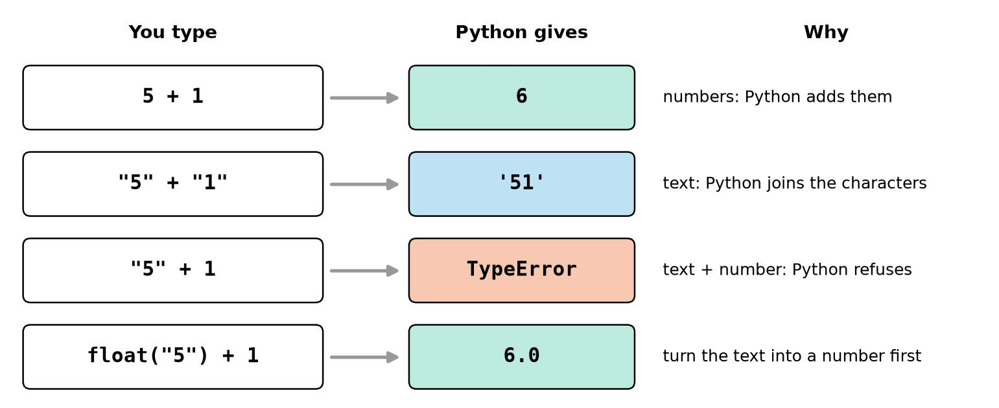
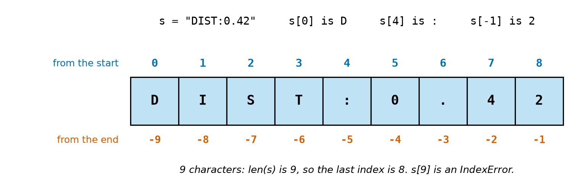
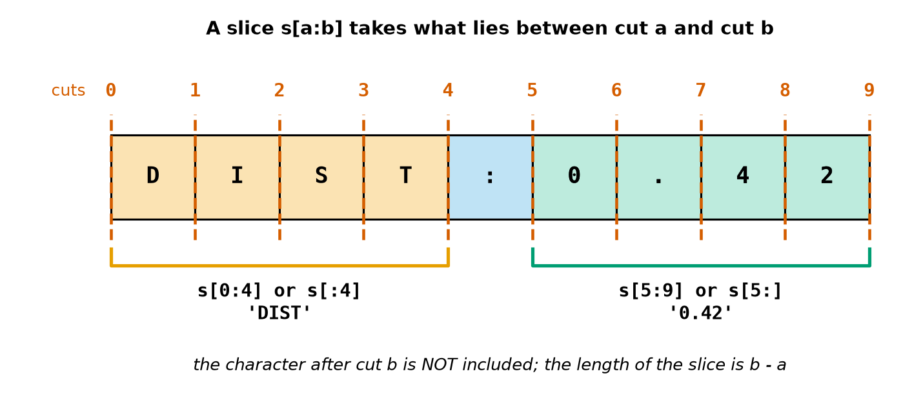
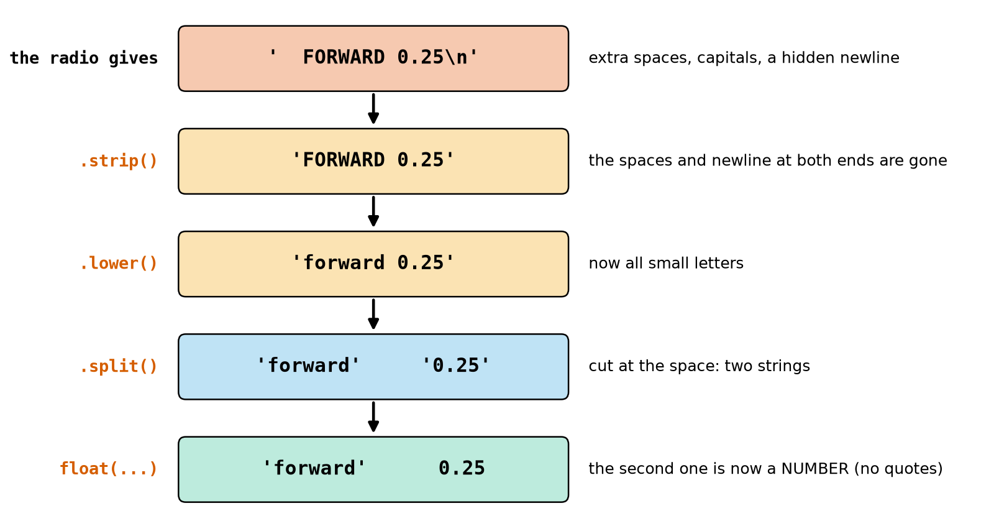
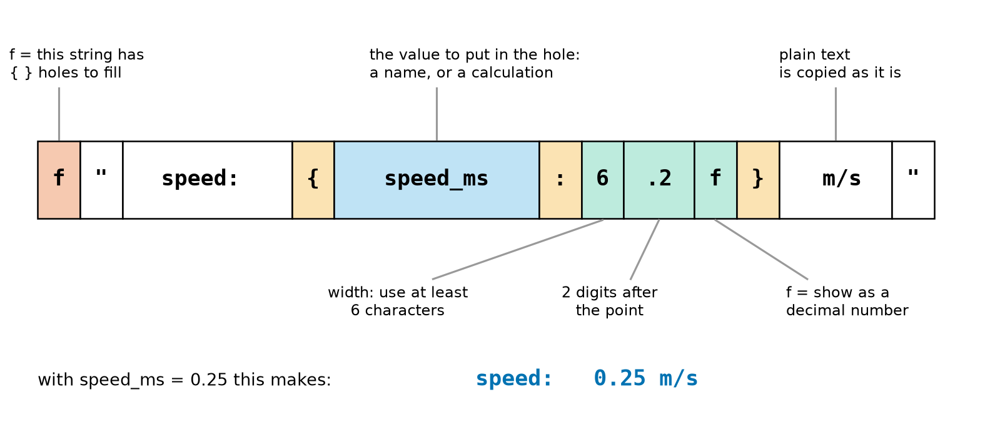
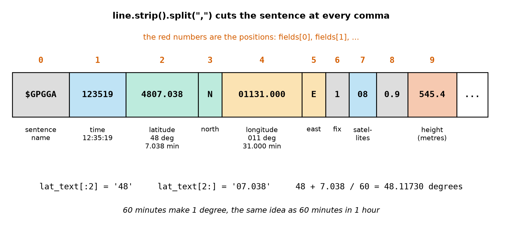

# Chapter 15 — Text: Strings

> **Part 2 · Chapter 15 of 749**
> **You need:** Chapter 13 (numbers) and Chapter 14 (variables). Keep a shell open and try every example.
> **You will make:** a program that understands a radio command, a program that reads the real text a GPS receiver sends, a program that turns Arduino sensor lines into a tidy log, and a status board for several robots.

---

## What you will learn

- What a **string** is, and why `"5"` and `5` are very different things.
- Special characters such as the newline `\n`, which you often cannot see.
- How to **join** strings (`+`), **repeat** them (`*`) and **measure** them (`len`).
- How to take one character (**index**) or a piece (**slice**) of a string.
- The most useful **methods**: `.strip()`, `.lower()`, `.upper()`, `.split()`, `.replace()`, `.startswith()`, `.find()`.
- How to turn text into numbers (`float`, `int`) and numbers into text (`str`).
- How to make tidy output with **f-strings**, such as `f"{speed:.2f} m/s"`.

---

## New words in this chapter

| Word | Simple meaning |
|---|---|
| **string** (`str`) | A piece of text: a row of characters. |
| **character** | One letter, digit, space or sign. |
| **escape sequence** | A backslash code for a special character, such as `\n`. |
| **newline** | The invisible character that ends a line of text. |
| **concatenate** | To join strings end to end. |
| **index** | The position number of a character. The first is 0. |
| **slice** | A piece cut out of a string: `s[2:5]`. |
| **immutable** | Cannot be changed after it is made. |
| **method** | A tool that belongs to a value, used with a dot: `s.upper()`. |
| **parse** | To read text and pull out the parts you need. |
| **f-string** | A string with `{ }` holes that Python fills in. |

---

## 15.1 What is a string?

Until now every value has been a number. But a robot's world is full of text:

- the command `"forward 0.25"` that arrives over a radio,
- the line `"DIST:0.42"` that an Arduino sends to a Raspberry Pi,
- the words on its small screen, and the lines in its log file.

📖 **New word: string** — a piece of text. It is a row of **characters**, written between quotes. Python calls this type `str`.

```
>>> name = "Rover"
>>> name
'Rover'
>>> type(name)
<class 'str'>
```

You may use double quotes `"…"` or single quotes `'…'`. They mean the same thing. The shell usually shows strings with single quotes. Just start and end with the **same** kind. Choose the other kind when the text contains a quote:

```
>>> "It's"
"It's"
```

📖 **New word: character** — one letter, digit, space or sign. `"Rover 2"` has 7 characters, because the space counts.

### `"5"` is not `5`

This is the most important idea in the chapter. Look at Figure 15.1.



*Figure 15.1 — The same-looking digits behave very differently as numbers and as text.*

**How to read this picture:** Each row is one line you could type. The left box is your code, and the middle box is Python's answer. Row 1 adds two numbers. Row 2 has the same digits, but in quotes: Python joins the characters and gives `'51'`. Row 3 mixes text and a number, and Python refuses. Row 4 is the cure: turn the text into a number first.

```
>>> "5" + 1
TypeError: can only concatenate str (not "int") to str
```

(In a real run, `Traceback` lines come first, as you saw in Chapter 14. From now on we show only the last line, because that is the line to read.)

Why does this matter to a robot? **A lot of what arrives from outside comes as text**: radio messages, serial lines from an Arduino (Chapter 111), files (Chapter 27), and what a person types (Chapter 16). The message `"0.25"` looks like a number, but you cannot calculate with it until you convert it (Section 15.6).

---

## 15.2 Special characters

Some characters cannot be typed normally inside quotes. Python uses a backslash `\` to write them.

📖 **New word: escape sequence** — a backslash followed by a letter, which together mean one special character.

| You write | It means | Robot use |
|---|---|---|
| `\n` | **newline**: end of the line | the end of every serial message |
| `\t` | tab: jump to the next column | simple columns in a log |
| `\"` | a double quote inside double quotes | |
| `\\` | one real backslash | Windows folder paths |

```
>>> print("line one\nline two")
line one
line two
>>> print("x\ty")
x	y
```

📖 **New word: newline** — the invisible character that ends a line. It counts as **one** character, even though you type two signs to write it:

```
>>> len("0.25\n")
5
```

⚠️ **Hidden characters cause real bugs.** Almost every line a robot receives ends with `\n`, and you cannot see it when you `print` it. To see exactly what a string holds, use `repr`:

```
>>> message = "0.25\n"
>>> print(message)
0.25

>>> print(repr(message))
'0.25\n'
```

`print` hides the newline by obeying it (see the empty line?). `repr` shows the string as you would write it in code. When text behaves strangely, `print(repr(x))` is your first tool.

⚠️ **The Windows path trap:** `print("C:\new")` prints `C:` and then `ew` on the next line, because Python read `\n` as a newline! Write `"C:\\new"`, or put an `r` in front to turn escapes off: `r"C:\new"`.

**Long text:** three quotes let a string run over several lines:

```python
HELP_TEXT = """Commands:
  forward <speed>
  stop"""
```

---

## 15.3 Joining, repeating, measuring

📖 **New word: concatenate** — to join strings end to end, with `+`.

```
>>> "rover" + "_" + "2"
'rover_2'
>>> "-" * 20
'--------------------'
>>> len("Rover")
5
>>> len("")
0
```

`""` is the **empty string**: a string with no characters. `*` needs a whole number: `"5" * 1.5` is a TypeError. `len` means "length": how many characters.

Python will not join text and a number by itself:

```
>>> "speed: " + 0.25
TypeError: can only concatenate str (not "float") to str
>>> "speed: " + str(0.25)
'speed: 0.25'
```

`str(…)` turns a value into text. Section 15.7 shows a neater way.

---

## 15.4 Taking pieces: index and slice

### One character: the index

📖 **New word: index** — the position number of a character. Look at Figure 15.2.



*Figure 15.2 — Each character has a position number counted from the start (blue, beginning at 0), and another counted from the end (red, beginning at −1).*

**How to read this picture:** The nine boxes are the nine characters of `"DIST:0.42"`. The blue number above each box is its index from the start. The first character is at **0**, not 1. The red number below is its index from the end: −1 is always the last character.

```
>>> s = "DIST:0.42"
>>> s[0]
'D'
>>> s[4]
':'
>>> s[-1]
'2'
>>> s[9]
IndexError: string index out of range
```

There are 9 characters, so the indexes run from 0 to 8. Index 9 does not exist, and Python says so with an **IndexError**.

💡 **Why start at 0?** Think of the index as "how many steps from the start". The first character is 0 steps from the start. Robots use this all the time: motor 0, sensor 0, the first item in a list (Chapter 21).

### A piece: the slice

📖 **New word: slice** — a piece cut out of a string, written `s[a:b]`. Look at Figure 15.3.



*Figure 15.3 — Think of the numbers as cuts **between** the characters. A slice is what lies between two cuts.*

**How to read this picture:** The red dashed lines are cuts, numbered 0 to 9. The orange bracket runs from cut 0 to cut 4, and it holds `DIST`. The green bracket runs from cut 5 to cut 9, and it holds `0.42`. The colon between them, the box from cut 4 to cut 5, is in neither slice.

```
>>> s[0:4]
'DIST'
>>> s[:4]
'DIST'
>>> s[5:]
'0.42'
>>> s[-4:]
'0.42'
```

The rules:

1. `s[a:b]` starts at `a` and stops **just before** `b`. It has `b − a` characters.
2. Leave out `a` and it starts at the beginning. Leave out `b` and it goes to the end.
3. Slices are forgiving. `s[1:99]` simply stops at the end, with no error. `s[100:]` gives the empty string `''`.

Python can also take steps: `s[::2]` takes every second character, and `s[::-1]` gives the string backwards.

```
>>> "Rover"[::-1]
'revoR'
```

### Strings cannot be changed

📖 **New word: immutable** — cannot be changed after it is made.

```
>>> name = "Rover"
>>> name[0] = "M"
TypeError: 'str' object does not support item assignment
```

You cannot change one character inside a string. Instead, you build a **new** string and store it under the name (Chapter 14: replacing a value):

```
>>> name = "M" + name[1:]
>>> name
'Mover'
```

---

## 15.5 Methods: tools that belong to strings

📖 **New word: method** — a tool that belongs to a value. You use it with a dot and brackets: `value.tool()`.

| Method | What it does | Example | Answer |
|---|---|---|---|
| `.strip()` | removes spaces and newlines at both ends | `"  stop\n".strip()` | `'stop'` |
| `.lower()` | all small letters | `"STOP".lower()` | `'stop'` |
| `.upper()` | all capitals | `"stop".upper()` | `'STOP'` |
| `.split()` | cuts into pieces at spaces | `"a  b".split()` | `['a', 'b']` |
| `.split(":")` | cuts at each `:` | `"DIST:0.42".split(":")` | `['DIST', '0.42']` |
| `.replace(a, b)` | changes every `a` into `b` | `"motor_left".replace("left", "right")` | `'motor_right'` |
| `.startswith(x)` | does it begin with `x`? | `"motor_left".startswith("motor")` | `True` |
| `.endswith(x)` | does it end with `x`? | `"motor_left".endswith("left")` | `True` |
| `.find(x)` | where is `x`? (−1 if not there) | `"motor_left".find("left")` | `6` |
| `.count(x)` | how many times is `x` there? | `"motor_left".count("o")` | `2` |

`True` and `False` are the yes/no answers you will study in Chapter 17. There is also the word `in`:

```
>>> "left" in "motor_left"
True
>>> "Left" in "motor_left"
False
```

Strings are case-sensitive too, just like names in Chapter 14.

### What `split` gives you

```
>>> "forward 0.25".split()
['forward', '0.25']
```

The square brackets show a **list**: several values in a row. Lists get their own chapter (Chapter 21). For now, you need only two simple ways to use one:

```
>>> word, value = "forward 0.25".split()     # way 1: give each piece a name (Chapter 14)
>>> word
'forward'
>>> value
'0.25'
>>> "forward 0.25".split()[1]                # way 2: pick a piece by its index
'0.25'
```

With no brackets filled in, `.split()` cuts at any run of spaces. With `.split(" ")` every single space is a cut, so two spaces in a row give an empty piece:

```
>>> "a  b".split(" ")
['a', '', 'b']
```

Prefer `.split()` for words. Use `.split(",")` or `.split(":")` for data with a clear separator.

### Methods do not change the string

Remember: strings are immutable. A method makes a **new** string and leaves the old one alone.

```
>>> x = "abc"
>>> x.upper()
'ABC'
>>> x
'abc'
>>> x = x.upper()
>>> x
'ABC'
```

This is the same bug as `x_m + 0.5` in Chapter 14: the answer was computed but not stored.

### Chaining methods

Each method gives a new string, so you can use another method on it straight away. Python works from **left to right**:

```
>>> "  FORWARD 0.25\n".strip().lower().split()
['forward', '0.25']
```

📖 **New word: parse** — to read text and pull out the parts you need. Look at Figure 15.4.



*Figure 15.4 — A messy radio message cleaned step by step, until the robot has a word and a number.*

**How to read this picture:** Read from top to bottom. The top box is the message as it arrives. Each arrow is one operation, named in red on the left, and each box shows the result. The bottom box has no quotes around 0.25, because it is now a real number. Almost every text message a robot receives goes through these same steps.

---

## 15.6 Text to numbers, and numbers to text

| Tool | What it does | Example | Answer |
|---|---|---|---|
| `float(text)` | text → decimal number | `float("0.25")` | `0.25` |
| `int(text)` | text → whole number | `int("42")` | `42` |
| `str(number)` | number → text | `str(42)` | `'42'` |

The difference is easy to see:

```
>>> value = "0.25"
>>> value * 2
'0.250.25'
>>> float(value) * 2
0.5
```

With text, `* 2` **repeats**. Imagine sending that to a motor!

`float` and `int` ignore spaces and a newline around the number, so `float("  0.25\n")` works. But the text must really be a number of the right kind:

```
>>> int("0.25")
ValueError: invalid literal for int() with base 10: '0.25'
>>> float("abc")
ValueError: could not convert string to float: 'abc'
>>> float("")
ValueError: could not convert string to float: ''
```

A **ValueError** means "the type is right, but this value makes no sense". `int("0.25")` fails because `0.25` is not written as a whole number. Use `int(float("0.25"))` if you really want that (and remember that `int` cuts, Chapter 13).

⚠️ **Real radios send garbage.** A damaged message such as `"forw"` or `"0.2#"` makes your program stop with a ValueError, and a robot whose program has stopped is a danger (the watchdog from Chapter 7). Chapter 25 shows how to catch these errors and carry on safely.

⚠️ **Text compares character by character:** `"10" < "9"` is `True`, because the character `1` comes before `9`. Numbers stored as text sort wrongly. Convert them first (Chapter 17).

---

## 15.7 F-strings: tidy output

Joining with `+` and `str()` gets ugly fast. An **f-string** is much neater.

📖 **New word: f-string** — a string with an `f` in front. Python fills in each `{ }` hole with a value.

```
>>> speed_ms = 0.25
>>> f"speed: {speed_ms} m/s"
'speed: 0.25 m/s'
>>> f"double: {speed_ms * 2} m/s"
'double: 0.5 m/s'
```

The hole can hold a name or a whole calculation. After a `:` you can say **how to show it**. Look at Figure 15.5.



*Figure 15.5 — The parts of `f"speed: {speed_ms:6.2f} m/s"`.*

**How to read this picture:** The row of boxes is the f-string, cut into its parts. White boxes are plain text. The orange `{ }` mark the hole, and the blue box is the value that goes in it. The green boxes come after the `:` and say how to show the value: at least 6 characters wide, 2 digits after the point, as a decimal number. The bottom line shows the finished text.

| You write | Answer (with `x = 3.14159`) | Meaning |
|---|---|---|
| `f"{x:.2f}"` | `'3.14'` | 2 digits after the point |
| `f"{x:8.2f}\|"` | `'    3.14\|'` | at least 8 wide, on the right (the `\|` only shows the edge) |
| `f"{x:<8.2f}\|"` | `'3.14    \|'` | `<` puts it on the left |
| `f"{7:03d}"` | `'007'` | `d` = whole number; fill to 3 places with zeros |
| `f"{0.13:.0%}"` | `'13%'` | show as a percentage |
| `f"{1234567.891:,.1f}"` | `'1,234,567.9'` | commas between thousands |
| `f"{x=}"` | `'x=3.14159'` | the name **and** its value: great for debugging |

Text can be placed too: `f"{'ROVER':<8}|"` puts it on the left, `>` on the right, and `^` in the middle.

🧠 **Remember:** an f-string only changes what you **see**. The variable keeps all its digits. This is rule 1 from Section 13.5: round only for display.

💡 **Tip:** `f"{x:.0f}"` rounds the same way as Chapter 13: `f"{2.5:.0f}"` gives `'2'`.

---

## Code

Now everything together. Rover receives a message from a radio and must work out what to do.

The file is `code/ch015/parse_command.py`. Type it into `my-code/ch015/`.

```python
# parse_command.py - turn a radio message into a word and a number Rover can use
PI = 3.14159
WHEEL_DIAMETER_M = 0.065           # Rover's wheel (Chapter 13)

message = "  FORWARD 0.25\n"       # what arrives: extra spaces, capitals, a newline
clean = message.strip().lower()    # remove the spaces and newline, then make it small letters
word, speed_text = clean.split()   # cut at the space: two strings, two names (Chapter 14)
speed_ms = float(speed_text)       # text to number: now we can calculate with it

turns_per_s = speed_ms / (PI * WHEEL_DIAMETER_M)   # speed / circumference (Chapter 13)
rpm = turns_per_s * 60

print("received:", repr(message))  # repr shows the hidden characters
print("cleaned: ", repr(clean))
print("command: ", word.upper())
print(f"speed:    {speed_ms:.2f} m/s")
print(f"wheels:   {rpm:.1f} rpm")
```

| Line | Code | What it does (simple English) |
|---|---|---|
| 1 | comment | The name of the file and the idea. |
| 2–3 | `PI`, `WHEEL_DIAMETER_M` | Constants in capitals (Chapter 14). |
| 4 | *(empty)* | |
| 5 | `message = "  FORWARD 0.25\n"` | Pretend this came from the radio. In Chapter 111 a real one will. |
| 6 | `clean = message.strip().lower()` | Two methods chained, left to right. The answer is **stored**, because methods do not change `message`. |
| 7 | `word, speed_text = clean.split()` | `split` makes two pieces, and each gets a name. `speed_text` is still **text**. The `_text` in the name is a warning to the reader. |
| 8 | `speed_ms = float(speed_text)` | Now it is a number. |
| 9 | *(empty)* | |
| 10 | `turns_per_s = …` | Wheel turns per second = speed ÷ circumference. |
| 11 | `rpm = turns_per_s * 60` | Turns per minute (Chapter 13). |
| 12 | *(empty)* | |
| 13–14 | `print(… repr(…))` | Show the strings with their hidden characters. |
| 15 | `print("command: ", word.upper())` | Capitals, for display only. |
| 16 | `print(f"speed: …")` | 2 digits after the point. |
| 17 | `print(f"wheels: …")` | 1 digit after the point. |

**Output:**

```
received: '  FORWARD 0.25\n'
cleaned:  'forward 0.25'
command:  FORWARD
speed:    0.25 m/s
wheels:   73.5 rpm
```

**What the output means:**

- Line 1 shows the mess that really arrived, thanks to `repr`.
- Line 2 shows it after cleaning: no extra spaces, no newline, no capitals.
- To drive at 0.25 m/s, Rover's 65 mm wheels must turn at about 73.5 rpm.

🔢 **Maths** — check by hand:

```
Step 1. circumference = 3.14159 × 0.065 ≈ 0.2042 m
Step 2. turns/s = 0.25 ÷ 0.2042 ≈ 1.224
Step 3. rpm = 1.224 × 60 ≈ 73.5   ✓
```

⚠️ **The program does not yet act on the word.** It reads `forward`, but it would treat `backward` exactly the same. Choosing what to do uses `if`, in Chapter 18.

---

## Small examples

### Example 1 — Length with a space

```
>>> len("Rover 2")
7
```

### Example 2 — The last four characters

```
>>> "SHELF-K-0042"[-4:]
'0042'
```

### Example 3 — A number with leading zeros

```
>>> int("0042")
42
```

### Example 4 — Replace

```
>>> "left_knee".replace("left", "right")
'right_knee'
```

### Example 5 — Not found

```
>>> "motor_left".find("up")
-1
```

### Example 6 — Width for columns

```
>>> f"{7:5d}|"
'    7|'
```

### Example 7 — Text repeats, numbers multiply

```
>>> "7.2" * 2
'7.27.2'
>>> float("7.2") * 2
14.4
```

### Example 8 — Clean first

```
>>> "  Arm ".strip()
'Arm'
```

---

## 🏭 Real robot applications

### Application 1 (worked in full) — 🌾🚁 Reading a GPS receiver

**1. The real problem.** A farm robot or a drone needs to know where it is. Its GPS receiver (Chapters 130 and 630) does not send numbers. Once a second it sends **lines of text**, in a format called **NMEA** that has been used for decades, from ships to drones. The robot must read latitude, longitude, height and the number of satellites from this line:

```
$GPGGA,123519,4807.038,N,01131.000,E,1,08,0.9,545.4,M,46.9,M,,*47
```

**2. Why this idea.** The values are separated by commas, so `split(",")` gives every field. Inside a field the digits have fixed positions, so **slices** take them apart. Then `int` and `float` give us numbers. Look at Figure 15.6.



*Figure 15.6 — A GPS sentence cut at its commas. The red numbers are the positions of the fields.*

**How to read this picture:** The boxes are the pieces between the commas, and each red number is the piece's position. Below each box is its meaning. Fields 2 and 3 (green) are the latitude and its direction. Fields 4 and 5 (orange) are the longitude and its direction. The line at the bottom shows how the latitude is cut into degrees and minutes.

**3. The numbers.** The sentence packs its values like this:

| Field | Text | Meaning |
|---|---|---|
| 1 | `123519` | time: hours, minutes, seconds (UTC) |
| 2 | `4807.038` | latitude: 2 digits of degrees, then minutes |
| 4 | `01131.000` | longitude: 3 digits of degrees, then minutes |
| 7 | `08` | satellites in use |
| 9 | `545.4` | height above sea level, in metres |

**4. The maths, step by step.** One degree is 60 minutes, so:

```
Step 1. latitude:  48 + 7.038 ÷ 60  = 48 + 0.1173   = 48.1173 degrees
Step 2. longitude: 11 + 31.000 ÷ 60 = 11 + 0.51667  = 11.51667 degrees
```

**5. The code.** File `code/ch015/gps_line.py`:

```python
# gps_line.py - read one line of text from a GPS receiver (an NMEA "GGA" sentence)
line = "$GPGGA,123519,4807.038,N,01131.000,E,1,08,0.9,545.4,M,46.9,M,,*47\n"

fields = line.strip().split(",")   # cut at every comma; fields[0] is the first piece

time_text = fields[1]              # "123519" means 12:35:19
clock = f"{time_text[:2]}:{time_text[2:4]}:{time_text[4:]}"

lat_text = fields[2]               # "4807.038" means 48 degrees and 7.038 minutes
lat_deg = int(lat_text[:2]) + float(lat_text[2:]) / 60   # 60 minutes = 1 degree

lon_text = fields[4]               # "01131.000" means 11 degrees and 31.000 minutes
lon_deg = int(lon_text[:3]) + float(lon_text[3:]) / 60   # longitude has 3 degree digits

satellites = int(fields[7])        # "08" becomes the whole number 8
altitude_m = float(fields[9])      # height above sea level, in metres

print("time (UTC):", clock)
print(f"latitude:   {lat_deg:.5f} degrees {fields[3]}")
print(f"longitude:  {lon_deg:.5f} degrees {fields[5]}")
print(f"satellites: {satellites}")
print(f"altitude:   {altitude_m:.1f} m")
```

| Line | Code | What it does (simple English) |
|---|---|---|
| 1 | comment | The idea. |
| 2 | `line = …` | One line as the receiver sends it, with its newline. |
| 4 | `fields = line.strip().split(",")` | Clean, then cut at every comma. `fields` is a list; `fields[1]` picks a piece, the same way `s[1]` picks a character. |
| 6 | `time_text = fields[1]` | The time, still as text. |
| 7 | `clock = f"…"` | Three slices, with `:` between them. |
| 9 | `lat_text = fields[2]` | The latitude as text. |
| 10 | `lat_deg = …` | Slice off 2 digits for the degrees and keep the rest as minutes. Minutes ÷ 60 gives degrees. |
| 12–13 | longitude | The same idea, but with **3** digits of degrees, because longitude goes up to 180. |
| 15 | `satellites = int(fields[7])` | `int("08")` is 8. |
| 16 | `altitude_m = float(fields[9])` | Text to number. |
| 18–22 | `print(…)` | The results, with `fields[3]` and `fields[5]` showing N and E. |

**Output:**

```
time (UTC): 12:35:19
latitude:   48.11730 degrees N
longitude:  11.51667 degrees E
satellites: 8
altitude:   545.4 m
```

**6. The result.** One line of text has become usable numbers: the robot is at 48.11730° N, 11.51667° E, 545.4 m above sea level, with 8 satellites. The program used nothing but the tools from this chapter.

**7. Going further.** A real program must do more. `S` and `W` mean the value is negative (`if`, Chapter 18). When the receiver has no position, the fields are **empty**, and `float("")` is the ValueError from Section 15.6 (Chapter 25). The `*47` at the end is a **checksum**, a small code that reveals damaged messages (Chapter 533). Chapter 426 then combines GPS with other sensors.

### Application 2 (worked in full) — 🤖 Arduino lines to a tidy log

**1. The real problem.** Rover's Arduino sends a line to its Raspberry Pi many times a second: time, distance sensor and battery voltage. The Pi must turn each line into numbers and write a log that a person can read after a test.

**2. Why this idea.** Two different cuts do the job: `split(";")` separates the three parts, then a slice removes the two-character labels such as `t=`. F-strings with fixed widths make the columns line up, so that your eye can run down them.

**3. The numbers.**

| Line | Time | Distance | Battery |
|---|---|---|---|
| `t=12.40;d=0.42;v=7.13` | 12.40 s | 0.42 m | 7.13 V |
| `t=105.02;d=1.875;v=6.98` | 105.02 s | 1.875 m | 6.98 V |

Rover has 6 battery cells (Chapter 5), so the voltage per cell is the total ÷ 6.

**4. The maths, step by step.**

```
Step 1. "v=7.13"[2:] = "7.13"         the slice skips 2 characters
Step 2. float("7.13") = 7.13
Step 3. per cell: 7.13 ÷ 6 ≈ 1.188 V
Step 4. second line: 6.98 ÷ 6 ≈ 1.163 V
```

**5. The code.** File `code/ch015/sensor_log.py`:

```python
# sensor_log.py - turn Arduino sensor lines into numbers and a tidy log
CELLS = 6                               # Rover's battery has 6 cells (Chapter 5)

line = "t=12.40;d=0.42;v=7.13\n"        # first line from the Arduino
t_part, d_part, v_part = line.strip().split(";")
time_s = float(t_part[2:])              # skip the first two characters: "t="
distance_m = float(d_part[2:])
battery_v = float(v_part[2:])
print(f"[{time_s:8.2f} s] dist {distance_m:6.3f} m | batt {battery_v:5.2f} V | cell {battery_v / CELLS:.3f} V")

line = "t=105.02;d=1.875;v=6.98\n"      # a later line: the same steps again
t_part, d_part, v_part = line.strip().split(";")
time_s = float(t_part[2:])
distance_m = float(d_part[2:])
battery_v = float(v_part[2:])
print(f"[{time_s:8.2f} s] dist {distance_m:6.3f} m | batt {battery_v:5.2f} V | cell {battery_v / CELLS:.3f} V")
```

| Line | Code | What it does (simple English) |
|---|---|---|
| 2 | `CELLS = 6` | A constant. |
| 4 | `line = …` | One message from the Arduino. |
| 5 | `t_part, d_part, v_part = …` | Clean and cut at `;`. Three pieces, three names. |
| 6–8 | `float(t_part[2:])` and the others | Slice off `t=` and convert the rest. |
| 9 | `print(f"…")` | Widths 8, 6 and 5 keep the columns straight. The last hole holds a calculation. |
| 11–16 | | The same again. A loop will do this in Chapter 20. |

**Output:**

```
[   12.40 s] dist  0.420 m | batt  7.13 V | cell 1.188 V
[  105.02 s] dist  1.875 m | batt  6.98 V | cell 1.163 V
```

**6. The result.** The numbers have different lengths (12.40 and 105.02), yet the columns line up, and the voltage per cell is easy to compare. A cell voltage falling towards 1.0 V is the sign of a nearly empty NiMH battery, and this log shows it at a glance.

**7. Going further.** Chapter 27 saves these lines to a file. Chapter 33 plots them. Chapter 111 reads them from a real Arduino, and Chapter 533 designs better message formats with checksums.

### Application 3 — 🏭📦 Reading a shelf label

A warehouse robot scans the label `"SHELF-K-0042"`. `"SHELF-K-0042".split("-")` gives `['SHELF', 'K', '0042']`, so the row is the letter `K`, and `int("0042")` gives shelf **42**. Labels have a fixed shape on purpose, because a shape makes them easy to parse. Keeping the zeros in the text makes every label the same length on a printed sticker; converting to `int` makes the number usable for calculating a route.

### Application 4 — 🤖 Topic names in a robot fleet

ROS 2 (Chapter 559) names its data channels with strings like `"/rover2/cmd_vel"`. `topic.startswith("/rover2/")` picks out the messages for one robot in a fleet, and `topic.split("/")` gives `['', 'rover2', 'cmd_vel']`. Notice the empty first piece: the text begins with the separator, so there is nothing before the first cut. This surprise catches many programmers.

### Application 5 — 🚶 Mirroring a humanoid's legs

A humanoid (Part 32) has joints named `"left_knee"`, `"left_hip"` and so on. Walking repeats the same motion on the other side, half a step later. A program finds the matching joint with `name.replace("left", "right")`, which turns `"left_knee"` into `"right_knee"`, and `name.startswith("left_")` picks out one side of the body. Clear names turn into useful data: this works only because the joints were named with a regular pattern.

---

## 🔧 Hands-on lab

### Lab 15.1 — Slice detective (shell)

**You need:** the Python shell.

**Steps:** Type `s = "ROVER-07:OK"`. For each line, **predict** the answer on paper, using a drawing like Figure 15.2 if it helps. Then type it.

```
s[0]         s[-1]        s[6:8]        s[:5]         s[9:]
s[-2:]       len(s)       s.lower()     s.split(":")  s.find(":")
"OK" in s    s[100:]      int(s[6:8]) + 1
```

**What you should see:** `'R'`, `'K'`, `'07'`, `'ROVER'`, `'OK'`, `'OK'`, `11`, `'rover-07:ok'`, `['ROVER-07', 'OK']`, `8`, `True`, `''`, `8`.

**If it does not work:**

| Problem | Likely cause | Fix |
|---|---|---|
| Your slice is one character short or long | Counting the stop position as included | Use the cuts of Figure 15.3: the slice stops **before** `b`. |
| `NameError: name 's' is not defined` | The shell was restarted | Type the `s = …` line again. |
| `s[6:8] + 1` gives a TypeError | Text + number | Use `int(s[6:8]) + 1`. |

### Lab 15.2 — Break the parser

**You need:** `parse_command.py` copied into `my-code/ch015/`.

**Steps:** Change the `message` line to each of these in turn. Before each run, predict: will it work? If not, which error?

1. `"forward 0.25"`
2. `"FORWARD   0.5 "`
3. `"stop"`
4. `"forward fast"`
5. `"forward 0,25"`
6. `"forward 0.25 now"`

**What you should see:**

| Message | Result |
|---|---|
| 1 | Works: speed 0.25 m/s. |
| 2 | Works: speed 0.50 m/s. `strip` and `split` handle the extra spaces. |
| 3 | `ValueError: not enough values to unpack (expected 2, got 1)` |
| 4 | `ValueError: could not convert string to float: 'fast'` |
| 5 | `ValueError: could not convert string to float: '0,25'` |
| 6 | `ValueError: too many values to unpack (expected 2, got 3)` |

Message 5 matters in many countries, where people write a decimal comma. Python needs a decimal **point**. Now you know four ways a message can kill this program. Chapter 18 and Chapter 25 will make it survive all four.

**If it does not work:**

| Problem | Likely cause | Fix |
|---|---|---|
| `SyntaxError` | A quote is missing around the message | Start and end with the same quote. |
| Message 2 gives a different number | You also changed another line | Copy the program again from `code/ch015/`. |

### Lab 15.3 — A status board

**You need:** a new file `my-code/ch015/status_board.py`.

**Steps:**

1. Type the program below (`code/ch015/status_board.py`).
2. Run it and check that the columns line up.
3. Add a fourth robot of your own, with a long name and a large number.
4. Change the width `<10` to `<14`. What else must change so that the dashes still fit?

```python
# status_board.py - a tidy table of robots, lined up with f-strings
print(f"{'ROBOT':<10}{'X (m)':>8}{'BATTERY':>10}")
print("-" * 28)

name, x_m, battery_pct = "rover", 2.0, 87.5
print(f"{name.upper():<10}{x_m:>8.2f}{battery_pct:>9.1f}%")

name, x_m, battery_pct = "cleaner", 12.345, 9.0
print(f"{name.upper():<10}{x_m:>8.2f}{battery_pct:>9.1f}%")

name, x_m, battery_pct = "arm", 0.5, 100.0
print(f"{name.upper():<10}{x_m:>8.2f}{battery_pct:>9.1f}%")
```

**What you should see:**

```
ROBOT        X (m)   BATTERY
----------------------------
ROVER         2.00     87.5%
CLEANER      12.35      9.0%
ARM           0.50    100.0%
```

The widths add up: 10 + 8 + 10 = 28, the number of dashes. The last column is 9 wide plus the `%` sign. For step 4 the total becomes 32, so the dashes must become `"-" * 32`.

**If it does not work:**

| Problem | Likely cause | Fix |
|---|---|---|
| The text shows `{name}` | The `f` in front of the quote is missing | Write `f"…"`. |
| `SyntaxError` near `'ROBOT'` | The quotes inside clash with the quotes outside | Use `'…'` inside and `"…"` outside. |
| One row is pushed out of line | The name is longer than the width | Make the width bigger. Python never cuts text to fit. |

---

## Common mistakes

⚠️ **Treating `"5"` as a number.** Text from outside must be converted with `float` or `int`.

⚠️ **Forgetting the quotes.** `name = Rover` gives a NameError, because Python looks for a variable called `Rover`.

⚠️ **Joining text and a number with `+`.** Use an f-string.

⚠️ **Counting from 1.** The first character is `s[0]`.

⚠️ **Thinking `s[a:b]` includes `b`.** It stops just before.

⚠️ **Not storing a method's answer.** `c.lower()` alone changes nothing. Write `c = c.lower()`.

⚠️ **Forgetting the brackets.** `name.upper` without `()` is the tool itself, not its answer.

⚠️ **Not cleaning before comparing.** `"stop\n"` and `"stop"` are different strings. `.strip()` first.

⚠️ **Forgetting the `f`.** Without it, the `{ }` are printed as they are.

⚠️ **`int("0.25")`.** A ValueError. Use `float` for anything with a decimal point.

---

## Practice

🏋️ **1.** What is the type of each? (a) `"3"`; (b) `3`; (c) `"3.0"`; (d) `3.0`.

🏋️ **2.** What does each give? (a) `"4" + "2"`; (b) `4 + 2`; (c) `"4" * 2`; (d) `4 * 2`; (e) `"4" + 2`.

🏋️ **3.** With `t = "GRIPPER"`, find: (a) `t[0]`; (b) `t[-1]`; (c) `t[1:4]`; (d) `t[:3]`; (e) `t[4:]`; (f) `len(t)`.

🏋️ **4.** From `v = "VOLT:7.2"`, get the number 7.2 in two ways: with a slice and with `split`. Then double it.

🏋️ **5.** With `a = "  Arm "`, what are (a) `a.strip()`; (b) `a` afterwards; (c) `len(a)`; (d) `len(a.strip())`?

🏋️ **6.** Write an f-string that shows `battery_v = 7.126` as `battery: 7.13 V`.

🏋️ **7.** What does each give? (a) `f"{12.3456:.1f}"`; (b) `f"{12.3456:8.3f}|"`; (c) `f"{5:04d}"`; (d) `f"{0.875:.1%}"`.

🏋️ **8.** Find the bug. The programmer expects `forward`, but gets `FORWARD`.

```python
c = "FORWARD"
c.lower()
print(c)
```

🏋️ **9.** `print("Battery: " + 7.2 + " V")` gives a TypeError. Fix it in two different ways.

🏋️ **10.** A robot's clock sends `"10:22:05"`. Write the lines that turn it into a total number of seconds. (Hint: `split(":")` and Chapter 13.)

🏋️ **11.** (Harder) A GPS gives the longitude `"12230.500"`. (a) Compute the longitude in degrees, and round it to 4 decimal places. (b) Why must the slice for longitude use 3 digits, when latitude uses 2? (c) A programmer sorted some speeds stored as text and found `"10"` before `"9"`. Why?

---

## Answers

**1.** (a) `str`; (b) `int`; (c) `str`; (d) `float`. The quotes decide.

**2.** (a) `'42'`; (b) `6`; (c) `'44'`; (d) `8`; (e) TypeError.

**3.** (a) `'G'`; (b) `'R'`; (c) `'RIP'`; (d) `'GRI'`; (e) `'PER'`; (f) `7`.

**4.**

```python
v = "VOLT:7.2"
a = float(v[5:])               # slice: skip "VOLT:" (5 characters)
b = float(v.split(":")[1])     # split: take the piece after the colon
print(a * 2, b * 2)            # both give 14.4
```

**5.** (a) `'Arm'`; (b) `'  Arm '`, unchanged, because strings are immutable; (c) `6`; (d) `3`.

**6.** `f"battery: {battery_v:.2f} V"`

**7.** (a) `'12.3'`; (b) `'  12.346|'`; (c) `'0005'`; (d) `'87.5%'`.

**8.** Line 2 makes a new string but does not store it. Write `c = c.lower()`.

**9.** `print("Battery: " + str(7.2) + " V")` or `print(f"Battery: {7.2} V")`. The f-string is neater.

**10.**

```python
clock_text = "10:22:05"
hours, minutes, seconds = clock_text.split(":")
total_s = int(hours) * 3600 + int(minutes) * 60 + int(seconds)
print(total_s)    # 37325
```

**11.** (a) `int("122") + float("30.500") / 60` = 122 + 0.50833… ≈ **122.5083** degrees. (b) Latitude only goes up to 90, so 2 digits are enough. Longitude goes up to 180, so it needs 3. (c) Text compares character by character from the left, and the character `1` comes before `9`, so the comparison ends there. Convert the text to numbers before comparing or sorting.

---

## Summary

🧠 A **string** is a row of characters in quotes. `"5"` is text, and `5` is a number. A lot of what reaches a program from outside arrives as text, and must be converted before you calculate with it.

🧠 `\n` is a hidden newline. `print(repr(x))` shows what a string really holds.

🧠 `+` joins, `*` repeats, `len` counts.

🧠 `s[0]` is the first character and `s[-1]` the last. `s[a:b]` takes the piece between two cuts and stops **before** `b`.

🧠 Strings are **immutable**. Methods return a **new** string, so store the answer: `c = c.strip().lower()`.

🧠 To **parse** a message: clean it (`strip`, `lower`), cut it (`split`), convert it (`float`, `int`).

🧠 `float("abc")` and `int("0.25")` give a **ValueError**. Real messages can be damaged.

🧠 **F-strings** make tidy text: `f"{speed_ms:6.2f} m/s"`: width 6, 2 digits after the point. They change what you see, not the value.

---

## Next chapter

So far your programs only talk: they `print`, and they use values you typed into the code. In **Chapter 16 — Output and input: `print` and `input`**, your program will start to listen. You will learn everything `print` can do (separators, line endings, printing without moving to a new line) and how `input` lets a person type a command while the program runs, so you can drive a simulated Rover from the keyboard.
