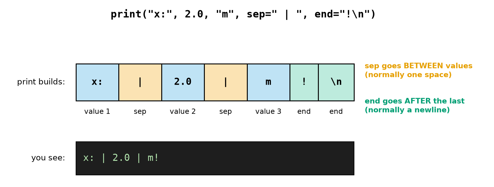
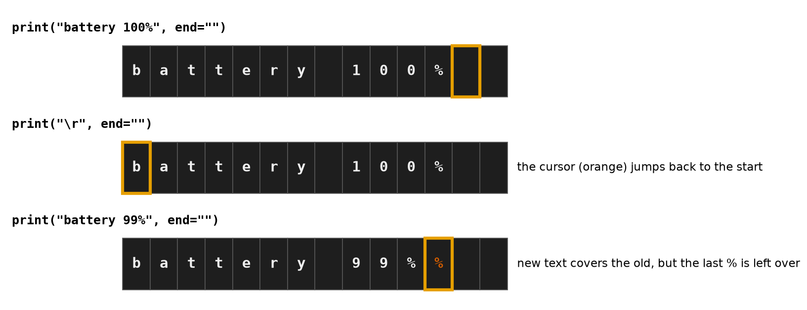
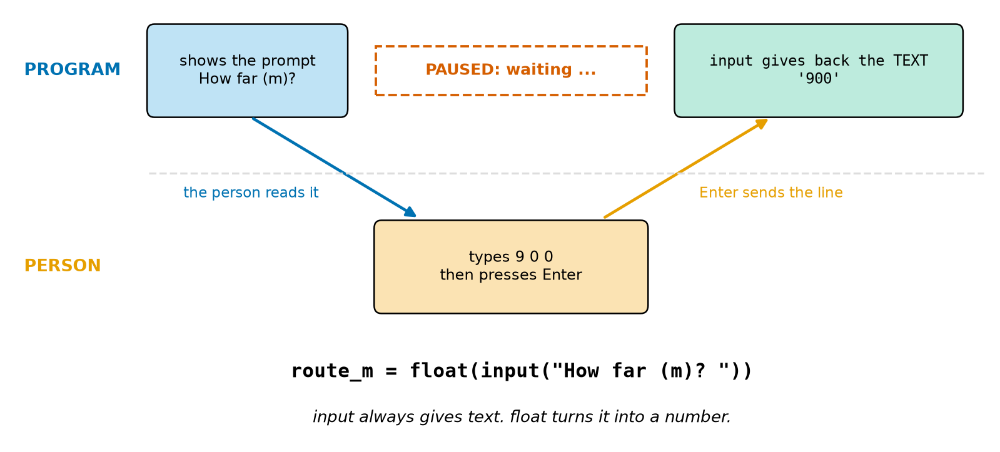
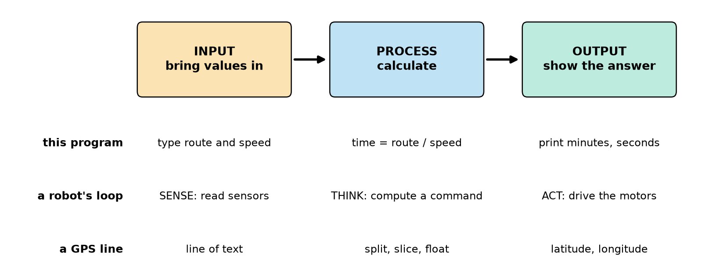
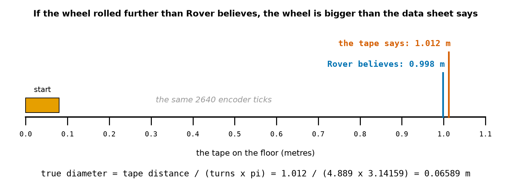
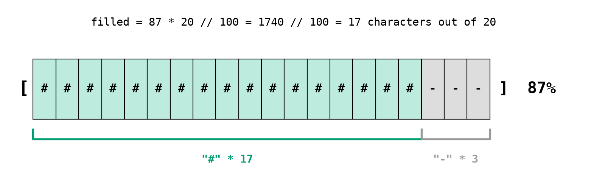

# Chapter 16 — Output and Input: `print` and `input`

> **Part 2 · Chapter 16 of 749**
> **You need:** Chapter 14 (variables) and Chapter 15 (strings, `float`, f-strings). Keep a shell open and try every example.
> **You will make:** a console that drives a simulated Rover from the keyboard, a drone pre-flight checklist that waits for a person, a wheel calibration tool, and a battery gauge drawn out of characters.

---

## What you will learn

- Everything `print` can do: several values, the separator `sep`, the line ending `end`, and blank lines.
- How to stay on the same line, and how to **overwrite** a line with `\r`.
- What `input` does: it **pauses** the program, and it always gives back **text**.
- How to convert and clean what a person types.
- The **input → process → output** pattern, and how it matches a robot's loop.
- What happens when a robot has **no keyboard** at all.

---

## New words in this chapter

| Word | Simple meaning |
|---|---|
| **output** | What a program sends out, such as text on the screen. |
| **input** | What a program takes in, such as what a person types. |
| **argument** | A value you give to a function inside its brackets. |
| **keyword argument** | An argument given with a name: `sep=", "`. |
| **prompt** | The text that tells the person what to type. |
| **cursor** | The place on the screen where the next character will appear. |
| **carriage return** (`\r`) | A character that moves the cursor back to the start of the line. |
| **buffer** | A waiting area where text is held before it is really shown. |
| **CSV** | "Comma-separated values": data in lines, with commas between the values. |
| **calibration** | Measuring a robot's real values, so that its numbers match the real world. |

---

## 16.1 `print` in depth

You have used `print` since Chapter 1. It has more abilities than you have seen.

📖 **New word: output** — what a program sends out. `print` sends text to the screen.

📖 **New word: argument** — a value you give to a function inside its brackets. In `print("x:", 2.0)` there are two arguments.

### Several values

```
>>> print("x:", 2.0, "y:", 1.5)
x: 2.0 y: 1.5
```

`print` shows every argument, with one space between them. It can show any kind of value, so you do not need `str()` here. (Remember that `+` between text and a number was an error in Chapter 15. With commas, `print` handles it for you.)

### Changing the separator: `sep`

📖 **New word: keyword argument** — an argument given with a name and `=`. `sep` stands for "separator".

```
>>> print("x:", 2.0, sep="")
x:2.0
>>> print(2026, 11, 10, sep="-")
2026-11-10
>>> print("a", "b", "c", sep=", ")
a, b, c
>>> print("line one", "line two", sep="\n")
line one
line two
```

### Changing the ending: `end`

Normally `print` finishes by moving to a new line. It does this by adding `\n` (Chapter 15) after the last value. `end` lets you choose something else:

```python
print("no newline", end="")
print(" same line")
```

```
no newline same line
```

Look at Figure 16.1.



*Figure 16.1 — `print` lays out the values (blue), puts `sep` between them (orange) and puts `end` after the last one (green).*

**How to read this picture:** The top line is the code. The row of boxes is the text that `print` builds, from left to right. Blue boxes are your three values. The orange boxes are the separator, and they appear only **between** values. The green boxes are `end`, and they appear once, at the very end. The black box shows what you finally see. The `\n` is not visible: it just ends the line.

The arguments `sep` and `end` must be strings:

```
>>> print(1, 2, sep=5)
TypeError: sep must be None or a string, not int
```

### Blank lines, and lines of dashes

```python
print("=== Rover console ===")
print()                          # no arguments: just an empty line
print("-" * 30)                  # 30 dashes (Chapter 15)
```

### What `print` gives back

`print` **shows** a value, but it does not **give back** one:

```
>>> v = print("hi")
hi
>>> print(v)
None
```

`None` is Python's word for "nothing". So `speed = print(0.5)` shows 0.5 on the screen and stores nothing useful. Chapter 24 explains the difference between showing a value and returning one.

---

## 16.2 Staying on one line

Building a line in several steps is useful when a robot does something that takes time:

```python
print("Checking motors...", end=" ")
print("left OK", end=" ")
print("right OK")
```

```
Checking motors... left OK right OK
```

### Overwriting a line with `\r`

📖 **New word: cursor** — the place on the screen where the next character will appear.

📖 **New word: carriage return** — the character `\r`. It moves the cursor back to the **start** of the same line, without going down. The name comes from old typewriters, whose "carriage" had to return to the left.

Anything printed after `\r` lands on top of the old text. Terminals for robots use this to show a value that keeps changing, such as a battery level, in **one** place, instead of filling the screen with hundreds of lines. Look at Figure 16.2.



*Figure 16.2 — `\r` moves the cursor to the start of the line. New text then covers the old text, but only as far as the new text reaches.*

**How to read this picture:** Each row of dark squares is one line of a terminal, one character per square. The orange frame is the cursor. In row 1, the text has been printed and the cursor sits just after it. In row 2, `\r` has moved the cursor back to the start, and nothing else has changed. In row 3, the new, **shorter** text has covered the first 11 squares. The old last `%` (in red) is still there, because nothing covered it.

⚠️ **The fix for leftovers:** make every update the same width, for example with an f-string: `f"\rbattery {percent:3d}%"` always uses 3 places for the number, so `100` and ` 99` have the same length.

### Why text sometimes appears late

📖 **New word: buffer** — a waiting area. For speed, Python may collect text in a buffer and show it all at once.

In a terminal, Python usually shows the text when a line is finished. So if you print **without** a newline and then the program does something slow, you may see nothing until later. The cure is `flush=True`, which means "show it now":

```python
print("Moving...", end="", flush=True)
```

You will need this when you use the timing tools in Chapter 30. It matters even more when a robot's output goes to a log file and the robot crashes: text still waiting in the buffer is lost, and it may be exactly the text you needed.

---

## 16.3 `input`: the program listens

📖 **New word: input** — what a program takes in. The function `input` waits for a person to type a line.

📖 **New word: prompt** — the text that tells the person what to type.

```
>>> answer = input("Speed? ")
Speed? 0.5
>>> answer
'0.5'
```

(You type `0.5` and press Enter.) Three things happened, as Figure 16.3 shows.



*Figure 16.3 — The program shows the prompt, then stops and waits. When the person presses Enter, `input` gives back what was typed, as text.*

**How to read this picture:** Time runs from left to right. The top lane is the program and the bottom lane is the person. The program shows its question, and the blue arrow goes down to the person. The red dashed box means the program is **paused**: nothing else happens. The person types and presses Enter, and the orange arrow carries the line back up. The green box shows that the program receives the **text** `'900'`, not a number.

### `input` always gives text

```
>>> type(answer)
<class 'str'>
>>> answer * 2
'0.50.5'
```

This is the digits trap from Chapter 15. Even when a person types a number, you get a string. Convert it:

```
>>> speed_ms = float(answer)
>>> speed_ms * 2
1.0
```

Most programmers do both jobs on one line. Python works from the **inside out**: first `input` runs, then `float` converts its answer.

```python
speed_ms = float(input("Speed (m/s)? "))
```

Use `int` for things you count and `float` for things you measure (Chapter 13).

💡 **Tip: write a good prompt.** End it with a space, so that the typed text does not stick to it, and include the unit: `"Speed (m/s)? "`. Otherwise someone will type `25` when you meant 0.25, and the robot will believe them.

### Cleaning what people type

People make small mistakes: extra spaces and capitals. Use the tools from Chapter 15:

```python
command = input("Command: ").strip().lower()
```

`input` removes the newline for you when the person presses Enter, but it keeps spaces. (Lines from a radio or an Arduino still have their `\n`, as in Chapter 15. Do not confuse the two.) `float` and `int` ignore spaces around a number, but string comparisons will not, so `.strip()` matters for words.

### Things that can go wrong

Every person who uses your program will eventually type something unexpected. These are real results:

| The person types | With `float(input(…))` | Why |
|---|---|---|
| `abc` | `ValueError: could not convert string to float: 'abc'` | not a number |
| *(just Enter)* | `ValueError: could not convert string to float: ''` | empty text |
| `2 m` | `ValueError: could not convert string to float: '2 m'` | the unit does not belong |
| `0,25` | `ValueError: could not convert string to float: '0,25'` | Python needs a decimal point |

Chapter 25 will show you how to catch these errors and ask again.

### Pressing Enter as a "go" button

Sometimes you do not care what is typed. You just want the program to **wait** until a person is ready. Call `input` and ignore its answer:

```python
input("Hold the robot off the ground, then press Enter. ")
```

This is useful for safety. The program cannot go on until a human has confirmed the step (Chapter 7).

### Stopping the program, and robots with no keyboard

While a program is waiting, pressing **Ctrl+C** stops it, and Python prints `KeyboardInterrupt`. That is normal.

Now a surprise. Many robots have **no keyboard and no screen**. A Raspberry Pi on a robot (Chapter 112) often starts its program by itself when it is switched on. If that program calls `input`, there is nobody to answer. Here is a real run with no keyboard attached:

```
How far is the route (m)? Traceback (most recent call last):
  File "...trip_ask.py", line 2, in <module>
    route_m = float(input("How far is the route (m)? "))
                    ~~~~~^^^^^^^^^^^^^^^^^^^^^^^^^^^^^^
EOFError: EOF when reading a line
```

**EOF** means "end of file": there is nothing more to read. And a program may also hang for ever if the input is connected but nobody types.

⚠️ **Rule for real robots:** use `input` for setup tools, calibration and consoles on your computer. Never put it in the control loop of a moving robot. While `input` waits, the whole program waits: no sensors are read and no motors are updated. The watchdog of Chapter 7 exists for exactly this kind of frozen program.

---

## 16.4 Input, process, output

Almost every small program has the same three parts. Here is a short one, using Chapter 13's trip:

```python
# trip_ask.py - ask a person for a route and a speed, then show the trip time
route_m = float(input("How far is the route (m)? "))
speed_ms = float(input("How fast is the robot (m/s)? "))

total_s = round(route_m / speed_ms)
print("The trip takes", total_s // 60, "min", total_s % 60, "s")
```

A run:

```
How far is the route (m)? 900
How fast is the robot (m/s)? 1.257
The trip takes 11 min 56 s
```

It is the same answer as Chapter 13, but now it works for **any** route without changing the program. Look at Figure 16.4.



*Figure 16.4 — Three stages, and three examples of them.*

**How to read this picture:** The three coloured boxes are the stages, in order. Each row below is one example. The first row is the program above. The second row is the sense–think–act loop you met in Chapter 2: it is the same pattern, running many times a second. The third row is the GPS program from Chapter 15, where the input came from a device instead of a person.

💡 **Tip:** Keep the three parts in this order in your programs: read everything first, calculate next, show the results last. Programs organised this way are much easier to change. Later, when real sensors replace the keyboard, only the first part changes.

---

## Code

Now we drive a simulated Rover from the keyboard. Each move is a speed and a time, and the program keeps Rover's state (Chapter 14).

The file is `code/ch016/keyboard_rover.py`. Type it into `my-code/ch016/`.

```python
# keyboard_rover.py - drive a simulated Rover with numbers typed on the keyboard
POWER_W = 3.78                     # Rover's power while driving (Chapter 5)
x_m = 0.0                          # STATE: position along the floor
battery_wh = 11.52                 # STATE: usable energy left

print("=== Rover console ===")
print("Type a speed (m/s) and a time (s), for example: 0.25 8")
print("A negative speed drives backwards.")
print()                            # an empty line

text = input("move 1> ")           # the program waits here for the person
speed_text, time_text = text.split()
speed_ms = float(speed_text)
time_s = float(time_text)
x_m += speed_ms * time_s
battery_wh -= POWER_W * time_s / 3600
print(f"   x = {x_m:.2f} m | battery {battery_wh:.4f} Wh")

text = input("move 2> ")           # the same steps again (a loop comes in Chapter 19)
speed_text, time_text = text.split()
speed_ms = float(speed_text)
time_s = float(time_text)
x_m += speed_ms * time_s
battery_wh -= POWER_W * time_s / 3600
print(f"   x = {x_m:.2f} m | battery {battery_wh:.4f} Wh")

print()
print("Rover stopped at", round(x_m, 2), "m")
```

| Line | Code | What it does (simple English) |
|---|---|---|
| 1 | comment | The name of the file and the idea. |
| 2 | `POWER_W = 3.78` | A constant in capitals (Chapter 14). |
| 3–4 | `x_m`, `battery_wh` | Rover's state, with starting values. |
| 5 | *(empty)* | |
| 6–8 | `print(…)` | Instructions for the person. Never make people guess what to type. |
| 9 | `print()` | An empty line. |
| 10 | *(empty)* | |
| 11 | `text = input("move 1> ")` | Show the prompt and **wait**. The typed line is stored as text. |
| 12 | `speed_text, time_text = text.split()` | Cut at the space into two strings (Chapter 15). |
| 13–14 | `float(…)` | Turn each string into a number. |
| 15 | `x_m += speed_ms * time_s` | Distance = speed × time. A negative speed makes `x_m` smaller. |
| 16 | `battery_wh -= …` | Energy used = power × time ÷ 3600 (Chapter 14). |
| 17 | `print(f"…")` | The new state: two decimals for x, four for the battery. |
| 18 | *(empty)* | |
| 19–25 | | The same seven lines for the second move. |
| 26 | *(empty)* | |
| 27 | `print()` | An empty line. |
| 28 | `print("Rover stopped at", …)` | The final position, with commas between the values. |

**A real run** (the person typed `0.25 8` and `-0.1 5`):

```
=== Rover console ===
Type a speed (m/s) and a time (s), for example: 0.25 8
A negative speed drives backwards.

move 1> 0.25 8
   x = 2.00 m | battery 11.5116 Wh
move 2> -0.1 5
   x = 1.50 m | battery 11.5063 Wh

Rover stopped at 1.5 m
```

**What the output means:**

- Move 1 drove forward at 0.25 m/s for 8 s, which is 2.00 m.
- Move 2 drove backward at 0.1 m/s for 5 s, which is −0.50 m, so Rover ended at 1.50 m.
- The battery fell with **time**, not distance: a backward move costs energy too.

🔢 **Maths** — check by hand:

```
Step 1. x = 0 + 0.25 × 8      = 2.00 m
Step 2. energy 1 = 3.78 × 8 ÷ 3600 = 0.0084 Wh  → 11.5116 Wh
Step 3. x = 2.00 + (−0.1 × 5) = 1.50 m
Step 4. energy 2 = 3.78 × 5 ÷ 3600 = 0.00525 Wh → 11.50635 Wh, shown as 11.5063   ✓
```

(Why 11.5063 and not 11.5064? 11.50635 falls almost exactly halfway, and the float stored is a tiny bit below it: the float surprise from Chapter 13.)

⚠️ **The program always does exactly two moves.** A person cannot choose how many, and cannot say "stop". A `while` loop (Chapter 19) and `if` (Chapter 18) will fix both.

---

## Small examples

### Example 1 — Commas handle mixed types

```
>>> print("ticks:", 2000)
ticks: 2000
```

### Example 2 — No space

```
>>> print(5, "m", sep="")
5m
```

### Example 3 — A blank line after

```python
print("x", end="\n\n")
print("y")
```

```
x

y
```

### Example 4 — Both at once

```
>>> print("Robot", "ready", sep="-", end="!\n")
Robot-ready!
```

### Example 5 — A title in the middle

```
>>> print(f"{' ROVER ':=^21}")
======= ROVER =======
```

The `=` before `^` is the character used to fill the space, and 21 is the total width.

### Example 6 — `+` shows a plus sign

```
>>> print(f"{7.5:+.2f} {-7.5:+.2f}")
+7.50 -7.50
```

Useful for errors, where the sign matters.

### Example 7 — The inside runs first

```python
wheels = int(input("How many wheels? "))
print("Tyres to buy:", wheels * 2)
```

Typing `4` prints `Tyres to buy: 8`.

---

## 🏭 Real robot applications

### Application 1 (worked in full) — 🚁 A pre-flight checklist that waits for a person

**1. The real problem.** Before a drone flies, a person must check things that a computer cannot see: a cracked propeller, a child walking towards the take-off area. Airline pilots read checklists aloud for the same reason. We want a program that goes through the steps one at a time, refuses to rush, and then works out how long the drone can fly from the battery voltage.

**2. Why this idea.** `input` **pauses** the program, so each step cannot be skipped by accident. The battery voltage is one number that the pilot reads from a meter, so `float(input(…))` is enough.

**3. The numbers.**

| Fact | Value |
|---|---|
| battery | 4 cells in a row ("4S") |
| empty, per cell | 3.5 V |
| full, per cell | 4.2 V |
| flight time when full | 15 min |
| the pilot reads | 16.2 V |

**4. The maths, step by step.**

```
Step 1. per cell = 16.2 ÷ 4 = 4.05 V
Step 2. charge = (4.05 − 3.5) ÷ (4.2 − 3.5) = 0.55 ÷ 0.7 ≈ 0.786 = 79%
Step 3. flight time = 15 × 0.786 ≈ 11.8 min
```

⚠️ This is a rough estimate. A real battery's voltage does not fall in a straight line, and it sags under load (Chapter 89).

**5. The code.** File `code/ch016/preflight.py`:

```python
# preflight.py - a drone checklist that waits for a person at every step
CELLS = 4                          # a "4S" battery: 4 cells in a row
CELL_EMPTY_V = 3.5                 # volts per cell when we call it empty
CELL_FULL_V = 4.2                  # volts per cell when full
FULL_FLIGHT_MIN = 15.0             # flight time with a full battery, in minutes

print("DRONE PRE-FLIGHT CHECK", "-" * 30, sep="\n")
pilot = input("Pilot name: ").strip()
input("1. Propellers tight, none cracked? Press Enter to confirm. ")
input("2. Nobody near the take-off area? Press Enter to confirm. ")
battery_v = float(input("3. Battery voltage (V): "))

cell_v = battery_v / CELLS
charge = (cell_v - CELL_EMPTY_V) / (CELL_FULL_V - CELL_EMPTY_V)   # 0 = empty, 1 = full
flight_min = FULL_FLIGHT_MIN * charge

print("-" * 30)
print(f"Pilot:        {pilot}")
print(f"Cell voltage: {cell_v:.2f} V")
print(f"Charge:       {charge:.0%}")
print(f"Flight time:  about {flight_min:.1f} min")
```

| Line | Code | What it does (simple English) |
|---|---|---|
| 2–5 | constants | The battery facts, in one place. |
| 7 | `print(…, sep="\n")` | Two values, each on its own line, because the separator is a newline. |
| 8 | `pilot = input(…).strip()` | The name, cleaned of spaces. |
| 9–10 | `input("…")` | The answer is not stored. These lines exist only to **wait**. |
| 11 | `battery_v = float(input(…))` | Inside first: read the text, then convert it. |
| 13 | `cell_v = …` | Voltage per cell. |
| 14 | `charge = …` | How far between empty and full: 0 to 1. The brackets matter (Chapter 13). |
| 15 | `flight_min = …` | Full flight time × charge. |
| 17–21 | `print(…)` | A tidy report. `.0%` shows 0.786 as `79%` (Chapter 15). |

**A real run:**

```
DRONE PRE-FLIGHT CHECK
------------------------------
Pilot name: Asha
1. Propellers tight, none cracked? Press Enter to confirm. 
2. Nobody near the take-off area? Press Enter to confirm. 
3. Battery voltage (V): 16.2
------------------------------
Pilot:        Asha
Cell voltage: 4.05 V
Charge:       79%
Flight time:  about 11.8 min
```

**6. The result.** The pilot has to confirm each step, and gets a flight-time estimate of about 11.8 minutes. But notice what the program **cannot** do yet: if the voltage is too low, it still prints a report. It cannot say "do not fly". That needs a comparison (Chapter 17) and an `if` (Chapter 18).

**7. Going further.** Real flight controllers also run automatic **pre-arm checks** and refuse to start the motors if a sensor is wrong (Chapter 643). The human checklist stays, because no sensor can see a child running towards the field.

### Application 2 (worked in full) — 🤖 Calibrating Rover's wheels

📖 **New word: calibration** — measuring a robot's real values so that its numbers match the real world.

**1. The real problem.** Chapter 13's `encoder.py` believed the wheel was exactly 65 mm. Real wheels are not exact, and a soft tyre squashes a little. After a straight drive, Rover believes it went 0.998 m, but a tape measure says 1.012 m. Over a long route that error keeps growing. We want a small tool: type two measurements, and get the true wheel size.

**2. Why this idea.** Distance = turns × π × diameter. We know the turns (from the encoder) and the real distance (from the tape), so we can solve for the diameter. Only a person with a tape measure knows the real distance, so `input` is the natural tool. Look at Figure 16.5.



*Figure 16.5 — For the same encoder count, Rover's belief (blue) falls short of the real distance on the tape (red).*

**How to read this picture:** The long black line is a tape on the floor, from 0.0 to 1.1 m. Rover starts at the orange box. The blue line marks where Rover believes it stopped. The red line marks where it really stopped. Both come from the same 2640 ticks. Since the real distance is longer, each wheel turn must be longer than we assumed, so the wheel is larger than the data sheet says.

**3. The numbers.**

| Fact | Value |
|---|---|
| encoder ticks per wheel turn | 540 |
| wheel diameter on the data sheet | 0.065 m |
| ticks counted in the test | 2640 |
| distance on the tape | 1.012 m |

**4. The maths, step by step.**

```
Step 1. turns = 2640 ÷ 540 ≈ 4.889
Step 2. Rover believes: 4.889 × 3.14159 × 0.065 ≈ 0.998 m
Step 3. true diameter = 1.012 ÷ (4.889 × 3.14159) ≈ 0.06589 m
Step 4. error = (0.998 − 1.012) ÷ 1.012 × 100 ≈ −1.35 %
```

**5. The code.** File `code/ch016/calibrate_wheel.py`:

```python
# calibrate_wheel.py - find Rover's true wheel diameter from one measured drive
PI = 3.14159
TICKS_PER_TURN = 540
NOMINAL_DIAMETER_M = 0.065         # what the wheel's data sheet says

ticks = int(input("Encoder ticks counted: "))
tape_m = float(input("Distance on the tape (m): "))

turns = ticks / TICKS_PER_TURN
thought_m = turns * PI * NOMINAL_DIAMETER_M        # what Rover believes it drove
true_diameter_m = tape_m / (turns * PI)            # distance = turns x pi x diameter
error_pct = (thought_m - tape_m) / tape_m * 100

print(f"Rover thought: {thought_m:.3f} m")
print(f"Tape says:     {tape_m:.3f} m")
print(f"Error:         {error_pct:+.2f} %")
print(f"Use WHEEL_DIAMETER_M = {true_diameter_m:.5f}")
print(ticks, tape_m, round(true_diameter_m, 5), sep=",")
```

| Line | Code | What it does (simple English) |
|---|---|---|
| 2–4 | constants | Fixed facts. "Nominal" means "the value it is supposed to have". |
| 6 | `ticks = int(…)` | Ticks are counted, so `int` (Chapter 13). |
| 7 | `tape_m = float(…)` | A measurement, so `float`. |
| 9 | `turns = …` | How many wheel turns. |
| 10 | `thought_m = …` | What Rover believed, using the data sheet's size. |
| 11 | `true_diameter_m = …` | The formula turned around to find the diameter. |
| 12 | `error_pct = …` | The error as a percentage of the real distance. |
| 14–15 | `print(f"…")` | The two distances, in lined-up columns. |
| 16 | `print(f"… {error_pct:+.2f} %")` | `+` always shows the sign. |
| 17 | `print(f"Use WHEEL_DIAMETER_M = …")` | A line you can copy straight into your program. |
| 18 | `print(…, sep=",")` | One **CSV** line. |

📖 **New word: CSV** — "comma-separated values": data in lines, with commas between the values. Spreadsheets read it directly (Chapter 27).

**A real run:**

```
Encoder ticks counted: 2640
Distance on the tape (m): 1.012
Rover thought: 0.998 m
Tape says:     1.012 m
Error:         -1.35 %
Use WHEEL_DIAMETER_M = 0.06589
2640,1.012,0.06589
```

**6. The result.** Rover's wheel behaves like a 65.89 mm wheel, not a 65 mm wheel. A 1.35 % error sounds small, but on a 100 m route Rover would be wrong by about 1.35 m. One line changed in the program, and the error is mostly gone.

**7. Going further.** Each wheel can have its own size, and a small difference between them makes the robot drift sideways. Chapter 289 calibrates both wheels and the distance between them. Do the test over a **long** distance: a 1 cm mistake with the tape is 2 % on a 0.5 m test, but only 0.2 % on a 5 m test.

### Application 3 — 🏥 A hospital delivery ticket

A hospital robot carries medicine between floors. A nurse types the room number, and the robot prints a label: `room = int(input("Room: "))`, then `print(f"DELIVER TO ROOM {room:03d}")`. Typing `7` prints `DELIVER TO ROOM 007`. Every label has the same shape, which makes misreading less likely. Because a mistake here affects a patient, a real system would also ask the person to confirm the room on the screen, and would scan a barcode at the door.

### Application 4 — 🏭 One log line per measurement

Factory robots write thousands of measurements. `print(time_s, force_n, position_mm, sep=",")` makes one CSV line, such as `12.4,31.5,102.75`. A spreadsheet or Python (Chapters 27 and 33) can read them directly. Comma-separated lines are longer than packed binary data, but anyone can open and read them, and that is priceless when you are searching for a fault.

### Application 5 — 🌾 A field robot with no keyboard

A weeding robot works alone in a field, with no person near it. Its program cannot use `input`, or it would stop at the first question with the EOFError of Section 16.3, or wait for ever. Instead, its settings are in a file (Chapter 27), and its status goes over a radio to a web page on the farmer's phone. The input → process → output pattern is the same. Only the source of the input has changed, from a person to a file and sensors.

---

## 🔧 Hands-on lab

### Lab 16.1 — `print` detective (paper, then a script)

**You need:** paper and a Python file.

**Steps:** Predict **exactly** what this prints, including spaces and new lines. Then run it.

```python
print("A", "B", sep="")
print("A", "B", sep="\n")
print(1, 2, 3, sep=" + ", end=" = 6\n")
print("x", end="")
print("y", end="-")
print("z")
print()
print("done")
```

**What you should see:**

```
AB
A
B
1 + 2 + 3 = 6
xy-z

done
```

**If it does not work:**

| Problem | Likely cause | Fix |
|---|---|---|
| `x`, `y-` and `z` are on separate lines | `end=` is missing on the `"x"` or `"y"` line | Copy those two lines exactly. |
| `TypeError: sep must be None or a string` | You wrote `sep=5` | Use quotes: `sep="5"`. |
| A `\n` is printed as two characters | You used `/n` by mistake | It is a **back**slash: `\n`. |

### Lab 16.2 — Break the trip program

**You need:** `trip_ask.py` from Section 16.4, typed into `my-code/ch016/`.

**Steps:** Run it several times. Before each run, predict the result.

1. `900` and `1.257`.
2. `abc` as the first answer.
3. Just press Enter as the first answer.
4. `900` and then `0`.
5. Run it again, and press **Ctrl+C** at the first question.

**What you should see:**

| Run | Result |
|---|---|
| 1 | `The trip takes 11 min 56 s` |
| 2 | `ValueError: could not convert string to float: 'abc'` |
| 3 | `ValueError: could not convert string to float: ''` |
| 4 | `ZeroDivisionError: division by zero` |
| 5 | The program stops, and the last line is `KeyboardInterrupt` |

Run 4 is a new error: you cannot divide by zero. A robot that computes `route / speed` while its speed is 0 will crash at exactly the moment it stops. Keep this one in mind for Chapter 18.

**If it does not work:**

| Problem | Likely cause | Fix |
|---|---|---|
| `TypeError: unsupported operand type(s) for /` | A `float(…)` is missing around `input` | Convert the text to a number. |
| The program seems stuck | It is waiting for you | Type an answer and press Enter. |

### Lab 16.3 — A battery gauge from characters

**You need:** a new file `my-code/ch016/battery_bar.py`.

**Steps:**

1. Type this program (`code/ch016/battery_bar.py`):

   ```python
   # battery_bar.py - draw a battery gauge out of characters
   BAR_WIDTH = 20                     # the bar is 20 characters long

   percent = int(input("Battery percent (0-100): "))
   filled = percent * BAR_WIDTH // 100          # how many characters to fill
   bar = "#" * filled + "-" * (BAR_WIDTH - filled)
   print(f"[{bar}] {percent:3d}%")
   ```

2. Run it with 87, then 100, then 5, then 3 and 0.
3. Change `BAR_WIDTH` to 40 and run it again.

Figure 16.6 shows how 87% is built.



*Figure 16.6 — 87% of 20 characters is 17 filled characters and 3 empty ones.*

**How to read this picture:** Each square is one character. The green squares are the `#` characters, 17 of them, and the grey squares are the `-` characters, 3 of them. The two brackets below name the pieces of Python that make them, and the line at the top is the calculation.

**What you should see:**

```
[#################---]  87%
[####################] 100%
[#-------------------]   5%
[--------------------]   3%
[--------------------]   0%
```

Notice that 3% and 0% look the same in the bar. `//` rounds down (Chapter 13), so 3% of 20 is less than one whole character. On a real robot, a bar that looks empty while the battery still has some charge is at least the safe kind of mistake. The number beside the bar tells the truth.

**If it does not work:**

| Problem | Likely cause | Fix |
|---|---|---|
| `TypeError: can't multiply sequence by non-int of type 'float'` | You used `/` instead of `//` | `"#" * 17.4` is impossible. Use `//`. |
| `ValueError: invalid literal for int()` | You typed `87.5` | This program uses `int`. Type a whole number. |
| The bar is longer than 20 | You typed more than 100 | The program does not check yet (Chapter 18). |

---

## Common mistakes

⚠️ **Forgetting to convert `input`.** It always gives text: `input("n: ") * 2` repeats it.

⚠️ **Converting the wrong kind.** `int(input())` fails on `2.5`. Use `float` for measurements.

⚠️ **No unit in the prompt.** Write `"Speed (m/s)? "`.

⚠️ **No space at the end of the prompt.** The typed text sticks to the question.

⚠️ **Writing `sep` or `end` before the values.** They go last: `print(a, b, sep=",")`.

⚠️ **Storing the result of `print`.** `x = print(5)` stores `None`.

⚠️ **Using `input` inside a robot's control loop.** The whole robot freezes while it waits.

⚠️ **Expecting text that has no newline to appear at once.** Use `flush=True`.

⚠️ **Shorter text after `\r`.** Old characters stay. Use a fixed width.

---

## Practice

🏋️ **1.** What does each print? (a) `print("a", "b")`; (b) `print("a", "b", sep="")`; (c) `print(1, 2, 3, sep="-")`.

🏋️ **2.** What do these two lines print together? `print("x", end="")` and then `print("y")`.

🏋️ **3.** Use `sep` to print the date 2026, 11, 10 as `2026-11-10`.

🏋️ **4.** A person runs `x = input("n: ")` and types `5`. What are `x * 2` and `type(x)`?

🏋️ **5.** Write one line that asks for a wheel diameter **in millimetres** and stores it in `wheel_diameter_m` in **metres**.

🏋️ **6.** Find the bug. The person types `0.5` and expects `1.0`.

```python
speed = input("Speed: ")
print(speed * 2)
```

🏋️ **7.** A person types `2 m` into `float(input("Distance: "))`. What happens, and how would you change the prompt to prevent it?

🏋️ **8.** With `t = 12.4`, `d = 0.42`, `v = 7.13`, print the CSV line `12.4,0.42,7.13`.

🏋️ **9.** Write a program in the input → process → output pattern. It asks for a battery's energy in Wh and a robot's power in W, and prints the running time in hours, to 2 decimals, assuming 80% is usable. Test it with 14.4 and 3.78.

🏋️ **10.** Why should `input` never be used inside the control loop of a moving robot?

🏋️ **11.** (Harder) In a calibration drive, Rover counts 5400 ticks and the tape says 2.000 m (540 ticks per turn, nominal diameter 0.065 m, π = 3.14159). (a) What did Rover believe? (b) What is the true diameter? (c) What is the error in percent, with its sign? (d) If your tape reading can be wrong by 1 cm, why is a 5 m drive better than a 0.5 m drive?

---

## Answers

**1.** (a) `a b`; (b) `ab`; (c) `1-2-3`.

**2.** `xy` on one line.

**3.** `print(2026, 11, 10, sep="-")`

**4.** `x * 2` is `'55'`, and `type(x)` is `<class 'str'>`.

**5.** `wheel_diameter_m = float(input("Wheel diameter (mm): ")) / 1000`

**6.** `input` gives text, so `* 2` repeats it: `0.50.5`. Fix: `speed = float(input("Speed: "))`.

**7.** `ValueError: could not convert string to float: '2 m'`. Put the unit in the prompt so people type only the number: `"Distance (m): "`.

**8.** `print(t, d, v, sep=",")`

**9.**

```python
energy_wh = float(input("Battery energy (Wh): "))
power_w = float(input("Robot power (W): "))

hours = 0.8 * energy_wh / power_w

print(f"Running time: {hours:.2f} h")
```

With 14.4 and 3.78 it prints `Running time: 3.05 h`, the same as Chapter 5.

**10.** `input` stops the whole program until a person presses Enter. During that time no sensors are read and no motor commands are updated, so the robot keeps doing its last command without looking at the world. If nobody answers, it never recovers.

**11.** (a) 5400 ÷ 540 = 10 turns; 10 × 3.14159 × 0.065 ≈ **2.042 m**. (b) 2.000 ÷ (10 × 3.14159) ≈ **0.06366 m**. (c) (2.042 − 2.000) ÷ 2.000 × 100 ≈ **+2.10 %**: Rover believes it went further than it did. (d) 1 cm in 0.5 m is 2 %, but 1 cm in 5 m is only 0.2 %. A longer drive makes the same reading mistake ten times less important.

---

## Summary

🧠 `print` shows any values, with `sep` **between** them and `end` **after** them. `print()` gives an empty line.

🧠 `end=""` stays on the same line. `\r` goes back to the start of the line, so new text overwrites old text. Keep the width the same.

🧠 `flush=True` shows text at once, instead of leaving it in a **buffer**.

🧠 `input("prompt ")` **pauses** the program and always gives back **text**. Convert it: `float(input(…))`. Put units in the prompt.

🧠 An empty or wrong answer causes a **ValueError**. With no keyboard you get an **EOFError**.

🧠 Most programs are **input → process → output**. A robot's sense–think–act loop is the same pattern.

🧠 `input` is for tools and consoles. **Never** put it in the control loop of a moving robot.

---

## Next chapter

So far your programs always do the same steps. The drone checklist cannot say "battery too low", and Rover cannot tell whether a wall is close. In **Chapter 17 — True and false: booleans and comparisons**, you will learn how a program asks yes-or-no questions: is the distance less than 0.3? Is the battery above its limit? Is the command equal to `"stop"`? You will also learn `and`, `or` and `not`, and finally the safe way to compare decimal numbers, which Chapter 13 promised.
