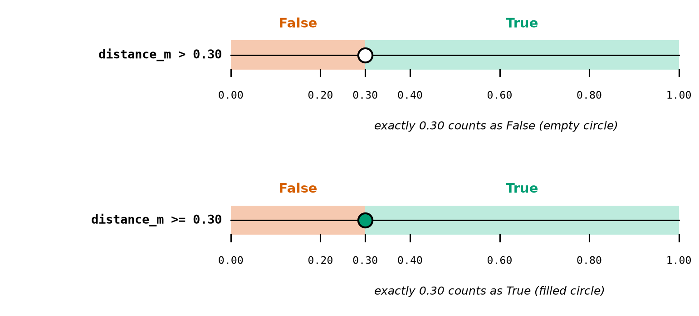
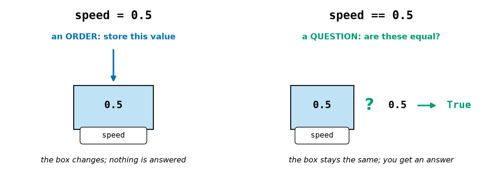
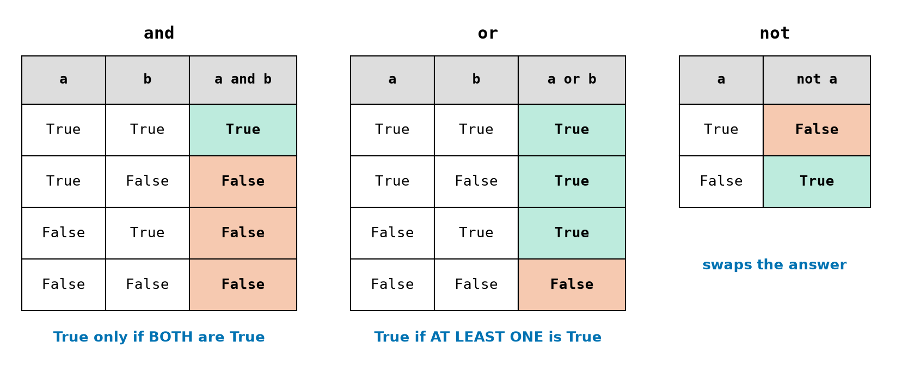
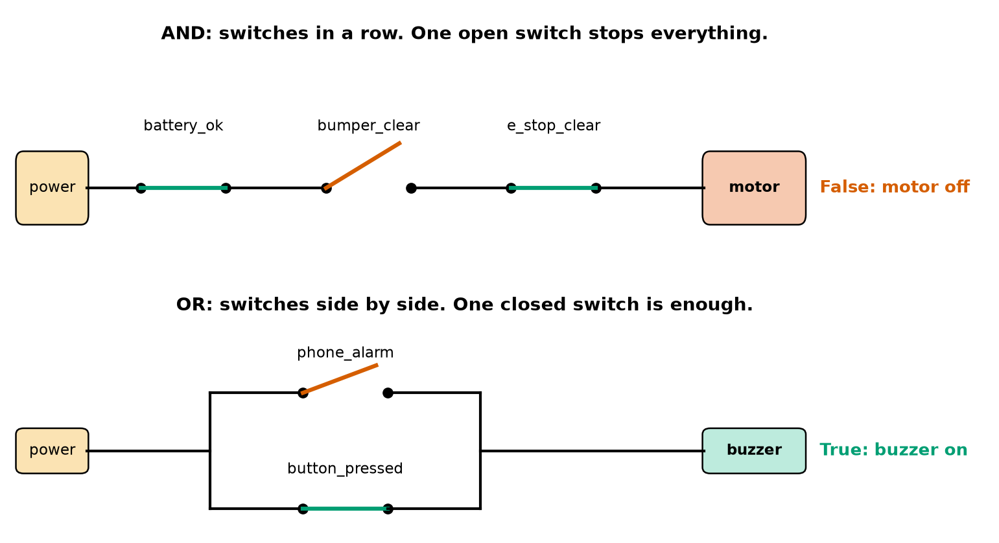
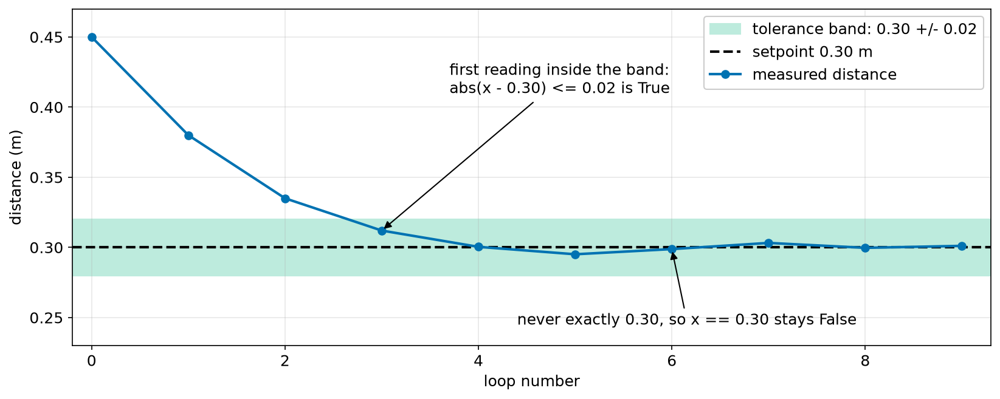
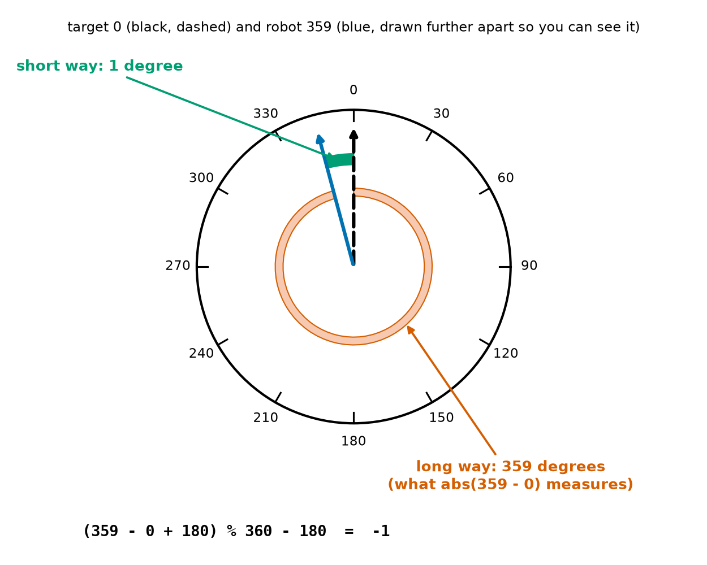

# Chapter 17 — True and False: Booleans and Comparisons

> **Part 2 · Chapter 17 of 749**
> **You need:** Chapters 13–16 (numbers, variables, strings, `input`). Keep a shell open and try every example.
> **You will make:** a safety check that decides whether Rover may drive, a drone go / no-go program, a program that decides whether a robot has reached its charger, and a truth-table printer.

---

## What you will learn

- The two values **True** and **False**, and the type `bool`.
- The six **comparison operators**: `==  !=  <  >  <=  >=`.
- Why `=` and `==` are completely different.
- How to combine yes/no answers with `and`, `or` and `not`.
- Which operator runs first, and a very common `or` bug.
- How to compare **text** safely.
- The safe way to compare **decimal numbers**, which Chapter 13 promised: with a **tolerance**.
- Why a safety check should be **fail-safe**.

---

## New words in this chapter

| Word | Simple meaning |
|---|---|
| **boolean** (`bool`) | A value that is either `True` or `False`. |
| **comparison** | A question about two values, whose answer is True or False. |
| **condition** | Any expression that is True or False. |
| **flag** | A variable holding True or False, such as `bumper_pressed`. |
| **logical operator** | `and`, `or` or `not`: they combine True and False. |
| **truth table** | A table showing the answer for every possible case. |
| **short-circuit** | Python stops working out an `and` / `or` as soon as it knows the answer. |
| **tolerance** | How far from a target still counts as "close enough". |
| **absolute value** | A number without its minus sign: `abs(-3)` is 3. |
| **fail-safe** | Built so that when something goes wrong, the result is the safe one. |

---

## 17.1 True and False

Every decision a robot makes starts with a yes-or-no question. Is the wall too close? Is the battery low? Did the bumper touch something?

📖 **New word: boolean** — a value that can be only `True` or `False`. Python calls this type `bool`. (It is named after George Boole, a 19th-century mathematician who worked out the rules of logic.)

```
>>> type(True)
<class 'bool'>
>>> bumper_pressed = False
>>> bumper_pressed
False
```

⚠️ `True` and `False` have **capital first letters**, and no quotes. `"True"` is just text.

```
>>> true
NameError: name 'true' is not defined. Did you mean: 'True'?
```

📖 **New word: flag** — a variable that holds True or False. It works like a little flag that is either up or down.

---

## 17.2 Comparisons

📖 **New word: comparison** — a question about two values. Its answer is always `True` or `False`.

| Operator | Means | Example | Answer |
|---|---|---|---|
| `==` | equal to? | `5 == 5.0` | `True` |
| `!=` | not equal to? | `3 != 2` | `True` |
| `<` | less than? | `3 < 2` | `False` |
| `>` | greater than? | `0.82 > 0.3` | `True` |
| `<=` | less than or equal to? | `2 <= 2` | `True` |
| `>=` | greater than or equal to? | `2 >= 3` | `False` |

Notice `5 == 5.0`: Python compares the **values**, so an int and a float can be equal (Chapter 13).

### `<` or `<=`? The edge matters

The difference is only one value: the exact edge. Look at Figure 17.1.



*Figure 17.1 — A comparison splits all possible distances into a True part and a False part. `>` and `>=` differ only at the edge.*

**How to read this picture:** Each bar is a number line of possible distances. The red part gives False and the green part gives True. The circle marks the edge at 0.30. An empty circle means the edge belongs to the False side, and a filled circle means it belongs to the True side.

💡 **Tip:** For safety checks, ask which side the edge should fall on. "Exactly 0.30 m" should usually count as the **unsafe** side.

### `=` and `==`

This is the classic beginner mistake. Look at Figure 17.2.



*Figure 17.2 — One `=` is an order. Two `==` are a question.*

**How to read this picture:** On the left, `speed = 0.5` puts a value into the box, and nothing is answered. On the right, `speed == 0.5` looks in the box, compares, and produces an answer. The box does not change.

Mistakes with these signs often give errors. `=>` is not an operator: the `=` always goes **second**, just as you say it, "less than or equal". And you cannot put text and a number in order:

```
>>> ok = 5 => 3
SyntaxError: cannot assign to literal
>>> 1 < "2"
TypeError: '<' not supported between instances of 'int' and 'str'
```

The second error is the digits trap again (Chapter 15). Text and numbers cannot be put in order. (`==` is allowed, but `"2" == 2` is simply `False`.)

### Storing the answer

A comparison gives a value, so you can store it (Chapter 14). This is how robot programs become readable:

```
>>> distance_m = 0.82
>>> wall_too_close = distance_m < 0.3
>>> wall_too_close
False
```

`wall_too_close` is a flag. Reading it later is like reading a sentence.

📖 **New word: condition** — any expression whose answer is True or False.

Arithmetic happens **before** comparison, so you rarely need brackets:

```
>>> distance_m * 2 > 1.5
True
```

### Chained comparisons

Python lets you write a range the way maths does:

```
>>> 0 < distance_m < 1
True
>>> 0 < 1.5 < 1
False
```

`0 < distance_m < 1` means "`distance_m` is between 0 and 1". This is very handy for checking that a sensor reading makes sense.

---

## 17.3 `and`, `or`, `not`

📖 **New word: logical operator** — `and`, `or` or `not`. They combine True and False values.

📖 **New word: truth table** — a table showing the answer for every possible case. Look at Figure 17.3.



*Figure 17.3 — The three logical operators. The coloured column is the answer.*

**How to read this picture:** Each row is one possible case. In the `and` table only the top row is green: both inputs must be True. In the `or` table only the bottom row is red: the answer is False only when both inputs are False. The `not` table simply swaps the value.

These operators also have a physical picture, which you will meet again in electronics. Look at Figure 17.4.



*Figure 17.4 — `and` behaves like switches in a row, and `or` behaves like switches side by side.*

**How to read this picture:** Think of electricity flowing from "power" on the left to the box on the right. A green line is a closed switch (True), and a tilted red line is an open switch (False). In the top drawing the current must pass through **every** switch, and one open switch stops it. In the bottom drawing the current can take either path, so one closed switch is enough.

The top drawing is how a real e-stop works (Chapter 7): the safety switches are wired in a row in the motor's power path.

```
>>> battery_ok = True
>>> bumper_clear = False
>>> battery_ok and bumper_clear
False
>>> battery_ok or bumper_clear
True
>>> not bumper_clear
True
```

### Which runs first?

The order is: **arithmetic → comparisons → `not` → `and` → `or`**.

```
>>> True or False and False
True
>>> (True or False) and False
False
```

In the first line, `and` runs first: `False and False` is False, then `True or False` is True.

💡 **Tip:** When `and` and `or` appear together, always add brackets. Your reader should not need to remember the rule, especially in a safety check.

### The `or` bug

Suppose you want to know whether a command is "stop" or "halt". This looks right, but it is wrong:

```
>>> command = "go"
>>> command == "stop" or "halt"
'halt'
```

Python read it as `(command == "stop") or ("halt")`. Instead of `True` or `False` we got the text `'halt'`, and, as Section 17.6 explains, any non-empty text counts as True. So this "check" passes for **every** command! Each side of `or` must be a complete question:

```
>>> command == "stop" or command == "halt"
False
```

### Stopping early: short-circuit

📖 **New word: short-circuit** — Python stops working out `and` / `or` as soon as it knows the answer. If the left side of `and` is False, the answer must be False, so the right side never runs.

This can save a program from a crash. Remember the ZeroDivisionError in Chapter 16:

```
>>> speed = 0
>>> speed != 0 and 900 / speed > 60
False
>>> 900 / speed > 60 and speed != 0
ZeroDivisionError: division by zero
```

The same two tests are in both lines. Only the order differs. **Put the guard first.**

### Flipping a rule: De Morgan's laws

Robot rules are often written in two ways, and it helps to know that they are the same.

| This | is the same as | In words |
|---|---|---|
| `not (a and b)` | `(not a) or (not b)` | "not both" means "at least one is missing" |
| `not (a or b)` | `(not a) and (not b)` | "neither" means "not this and not that" |

To flip a rule: put `not` on each part and **swap** `and` with `or`. These are called **De Morgan's laws**. For example, "unsafe" is the opposite of "safe":

```python
safe = battery_ok and bumper_clear
unsafe = (not battery_ok) or (not bumper_clear)     # always the opposite of safe
```

Lab 17.2 lets you check this for every case.

---

## 17.4 Comparing text

`==` works on strings too, and it is **exact**:

```
>>> "stop" == "STOP"
False
>>> "stop\n" == "stop"
False
>>> "stop\n".strip() == "stop"
True
>>> "Rover".lower() == "rover"
True
```

The rule for text from outside a program: **clean first, then compare** (Chapter 15).

`<` and `>` compare text character by character, using each character's code number. That is nearly alphabetical, but capitals come before all small letters:

```
>>> "apple" < "banana"
True
>>> "Z" < "a"
True
>>> "10" < "9"
True
```

The last line surprises people. The first characters are `1` and `9`, and `1` comes first, so Python stops there. **Numbers stored as text must be converted before you compare them.**

---

## 17.5 Comparing decimal numbers

Chapter 13 warned you never to use `==` on floats. Here is why, and here is the fix.

```
>>> 0.1 + 0.2 == 0.3
False
>>> 0.1 * 3
0.30000000000000004
```

And on a real robot there is a second, bigger problem. Measurements contain noise, so a distance sensor may read 0.3004, then 0.2951, then 0.2988. It may **never** read exactly 0.30.

📖 **New word: tolerance** — how far from a target still counts as "close enough". Look at Figure 17.5.



*Figure 17.5 — A robot approaching a wall to stop at 0.30 m. It reaches the green band, but it may never hit 0.30 exactly.*

**How to read this picture:** The horizontal axis counts control loops. The black dashed line is the setpoint, 0.30 m (Chapter 6). The blue line is the measured distance. The green band runs from 0.28 to 0.32, the tolerance. The robot enters the band at loop 3 and stays in it, yet the blue line never lands exactly on the dashed line. A test using `==` would wait for ever.

📖 **New word: absolute value** — a number without its minus sign. `abs(-0.25)` is `0.25`. It tells us **how far apart** two numbers are, whichever is bigger.

The safe test is: **is the distance between the two numbers smaller than the tolerance?**

```
>>> abs((0.1 + 0.2) - 0.3)
5.551115123125783e-17
>>> abs((0.1 + 0.2) - 0.3) < 1e-9
True
```

(`5.55e-17` is a tiny number: 0.0000000000000000555. Chapter 13 showed this way of writing numbers.)

🧠 **Remember:** With floats, ask "is it **close enough**?", never "is it **equal**?". Choose the tolerance from the real job: 2 cm for parking, 1e-9 for tiny calculation errors. (Chapter 26 shows `math.isclose`, which does the same thing.)

Comparing floats with `<` or `>` is fine, and robots do it all the time. It is only `==` and `!=` that cause trouble.

---

## 17.6 True and False are secretly 1 and 0

Python treats `True` as 1 and `False` as 0 in arithmetic. This is surprisingly useful:

```
>>> True + True + False
2
>>> 0.25 * True
0.25
>>> 0.25 * False
0.0
```

The first line **counts** how many flags are True. The other two show a way to switch a value off.

### Truthy and falsy

Python can also turn other values into booleans with `bool()`. Values that are "empty" or zero count as False:

| Value | `bool(value)` |
|---|---|
| `0`, `0.0` | `False` |
| `""` (empty text) | `False` |
| `None` | `False` |
| any other number, such as `7` or `-1` | `True` |
| any non-empty text, such as `" "` | `True` |

⚠️ **The trap:** `bool("False")` is `True`, and so is `bool("n")`, because they are non-empty text! To read a yes/no answer from a person, compare it:

```python
people_clear = input("Clear? (y/n): ").strip().lower() == "y"
```

---

## 17.7 Designing safety checks

📖 **New word: fail-safe** — built so that when something goes wrong, the result is the safe one.

Look at the line above. Anything other than `y` gives `False`: `no`, a typing mistake, or an empty line. An unclear answer counts as "not clear", which is the safe side. Compare this version:

```python
people_near = input("People nearby? (y/n): ").strip().lower() == "y"
```

Now if the person types `yes` by mistake, `people_near` becomes False: "nobody is near". The typing mistake has produced the **dangerous** answer.

Three rules for robot safety conditions:

1. **Name each flag for the good state**, such as `wall_clear` or `battery_ok`. Then the final rule is simply `a and b and c`, and every part must be True.
2. **Unknown means unsafe.** If a sensor is missing or its reading makes no sense, the check should come out False.
3. **Decide which side the edge is on.** Use `>` rather than `>=` when "exactly at the limit" is unsafe.

---

## Code

Now we put the conditions together. Rover has to decide whether it may drive.

The file is `code/ch017/safe_to_drive.py`. Type it into `my-code/ch017/`.

```python
# safe_to_drive.py - decide if Rover may drive, using only True and False
MIN_WALL_M = 0.30                  # never drive closer to a wall than this
MIN_BATTERY_V = 6.0                # 6 cells x 1.0 V (Chapter 5)
CRUISE_MS = 0.25                   # normal speed in m/s

distance_m = 0.82                  # from the distance sensor
battery_v = 7.13                   # from the battery monitor
bumper_pressed = False             # is the bumper touching something?
e_stop_pressed = False             # has someone hit the emergency stop?

wall_clear = distance_m > MIN_WALL_M
battery_ok = battery_v >= MIN_BATTERY_V
bumper_clear = not bumper_pressed
e_stop_clear = not e_stop_pressed

safe_to_drive = wall_clear and battery_ok and bumper_clear and e_stop_clear
speed_ms = CRUISE_MS * safe_to_drive    # True counts as 1, False as 0

print("wall clear:   ", wall_clear)
print("battery ok:   ", battery_ok)
print("bumper clear: ", bumper_clear)
print("e-stop clear: ", e_stop_clear)
print("SAFE TO DRIVE:", safe_to_drive)
print("speed command:", speed_ms, "m/s")
```

| Line | Code | What it does (simple English) |
|---|---|---|
| 1 | comment | The name of the file and the idea. |
| 2–4 | constants | The limits, in one place at the top (Chapter 14). |
| 5 | *(empty)* | |
| 6–7 | `distance_m`, `battery_v` | Pretend readings. Real ones come from sensors later. |
| 8–9 | `bumper_pressed`, `e_stop_pressed` | Two flags, as the hardware would report them. |
| 10 | *(empty)* | |
| 11 | `wall_clear = distance_m > MIN_WALL_M` | Comparison. `>` means exactly 0.30 is **not** clear. |
| 12 | `battery_ok = …` | Comparison. Stored as a flag. |
| 13–14 | `not …` | Flip the hardware flags, so that **every** flag now means "good" (rule 1 of Section 17.7). |
| 15 | *(empty)* | |
| 16 | `safe_to_drive = … and … and …` | True only if **all four** are True. |
| 17 | `speed_ms = CRUISE_MS * safe_to_drive` | True acts as 1 and False as 0, so the speed is 0.25 or 0.0. |
| 18 | *(empty)* | |
| 19–24 | `print(…)` | Every flag, then the decision and the speed. |

**Output:**

```
wall clear:    True
battery ok:    True
bumper clear:  True
e-stop clear:  True
SAFE TO DRIVE: True
speed command: 0.25 m/s
```

**What the output means:**

- All four checks pass, so Rover may drive at 0.25 m/s.
- Printing each flag separately means that when Rover refuses to drive, you can see **why**.
- If any single flag were False, the speed would be 0.0.

⚠️ `CRUISE_MS * safe_to_drive` is a neat trick, but it can do only one thing: scale a number. In **Chapter 18** the word `if` will let a program choose between whole blocks of actions, and it reads more clearly.

---

## Small examples

### Example 1 — Equal, across types

```
>>> 7 == 7.0
True
>>> "7" == 7
False
```

### Example 2 — Is it in range?

```
>>> voltage = 7.13
>>> 6.0 <= voltage <= 8.4
True
```

### Example 3 — Not equal

```
>>> "robot" != "rover"
True
```

### Example 4 — Combining

```
>>> x = 5
>>> x > 3 and x < 10
True
>>> x < 3 or x > 10
False
```

### Example 5 — `not` with a comparison

```
>>> not x == 5
False
```

`==` runs first, then `not`.

### Example 6 — Counting flags

```
>>> front, left, right = True, False, True
>>> front + left + right
2
```

### Example 7 — Close enough

```
>>> p = 0.30000000000000004
>>> p == 0.3
False
>>> abs(p - 0.3) < 1e-6
True
```

---

## 🏭 Real robot applications

### Application 1 (worked in full) — 🚁 A drone's go / no-go decision

**1. The real problem.** Chapter 16's pre-flight checklist could report the battery, but it could not say "do not fly". A drone must not take off with a weak battery, too few satellites, too much wind, or people nearby. **Every** condition must pass.

**2. Why this idea.** "All must pass" is exactly `and`. Each check gets its own flag, so the pilot can see which one failed. The count of failures uses True = 1.

**3. The numbers.** (These limits are example values. Real ones depend on the drone.)

| Check | Rule |
|---|---|
| battery | at least 3.7 V per cell, 4 cells |
| satellites | at least 6 |
| wind | at most 10 m/s |
| people | the pilot must answer exactly `y` |

**4. The maths, step by step.** With 16.2 V, 8 satellites, 6 m/s and `y`:

```
Step 1. 16.2 ÷ 4 = 4.05 V;  4.05 >= 3.7  → True
Step 2. 8 >= 6                            → True
Step 3. 6 <= 10                           → True
Step 4. answer == "y"                     → True
Step 5. True and True and True and True   → True: GO
```

**5. The code.** File `code/ch017/go_no_go.py`:

```python
# go_no_go.py - a drone may fly only if EVERY check passes
CELLS = 4                          # a 4S battery (Chapter 16)
MIN_CELL_V = 3.7                   # do not take off below this
MIN_SATELLITES = 6                 # too few satellites means a poor position
MAX_WIND_MS = 10.0                 # too windy above this

battery_v = float(input("Battery voltage (V): "))
satellites = int(input("Satellites: "))
wind_ms = float(input("Wind (m/s): "))
people_clear = input("Area clear of people? (y/n): ").strip().lower() == "y"

battery_ok = battery_v / CELLS >= MIN_CELL_V
gps_ok = satellites >= MIN_SATELLITES
wind_ok = wind_ms <= MAX_WIND_MS

go = battery_ok and gps_ok and wind_ok and people_clear
failed = 4 - (battery_ok + gps_ok + wind_ok + people_clear)   # True counts as 1

print(f"battery {battery_ok} | gps {gps_ok} | wind {wind_ok} | people {people_clear}")
print(f"checks failed: {failed}")
print(f"GO: {go}")
```

| Line | Code | What it does (simple English) |
|---|---|---|
| 2–5 | constants | The limits. |
| 7–9 | `input` lines | Read and convert (Chapter 16). |
| 10 | `people_clear = … == "y"` | Clean the answer, then compare. Anything except `y` is False. |
| 12 | `battery_ok = battery_v / CELLS >= MIN_CELL_V` | Arithmetic runs first, then the comparison. |
| 13–14 | `gps_ok`, `wind_ok` | One comparison each. |
| 16 | `go = … and …` | All four must be True. |
| 17 | `failed = 4 - (…)` | Adding flags counts how many are True, so 4 minus that is the number that failed. |
| 19–21 | `print(…)` | Report. |

**Two real runs:**

```
Battery voltage (V): 16.2
Satellites: 8
Wind (m/s): 6
Area clear of people? (y/n): y
battery True | gps True | wind True | people True
checks failed: 0
GO: True
```

```
Battery voltage (V): 14.4
Satellites: 5
Wind (m/s): 6
Area clear of people? (y/n): yes
battery False | gps False | wind True | people False
checks failed: 3
GO: False
```

**6. The result.** The first drone may fly. The second must not: 14.4 V is 3.6 V per cell, and 5 satellites is too few. Look at the "people" flag. The pilot typed `yes`, not `y`, so it is False. A strict program has refused a good answer, and that is the **fail-safe** direction. The pilot just has to type it again.

**7. Going further.** A real flight controller runs similar checks for itself and refuses to arm the motors (Chapter 643). Chapter 664 covers what a drone should do when a check fails **in the air**, where simply stopping is not safe.

### Application 2 (worked in full) — 🏭🔋 Has the robot reached its charger?

**1. The real problem.** A warehouse robot must back onto its charging station. It reports where it is. The station needs the robot within 2 cm and within 2° of the correct direction. How does the program decide "docked"?

**2. Why this idea.** The position and heading are floats from noisy sensors, so we need **tolerances**, not `==`. Position error is a distance, found with Pythagoras (√(dx² + dy²)). Heading has one extra problem. Look at Figure 17.6.



*Figure 17.6 — A robot at 359° is only 1° from a target at 0°, but plain subtraction says 359°.*

**How to read this picture:** The circle is a compass. The black dashed arrow is the target (0°). The blue arrow is the robot's heading; it is drawn further from the target than 1° so that you can see it. The green arc is the short way between them. The red ring is the long way, all the way round, and that is what `abs(359 - 0)` measures. The formula at the bottom gives the short way, with a sign.

The formula `(a - b + 180) % 360 - 180` uses `%` from Chapter 13 to give an answer from −180 to 179.

**3. The numbers.**

| Fact | Value |
|---|---|
| target | (2.0, 1.5) m, heading 0° |
| robot | (2.012, 1.491) m, heading 359° |
| tolerances | 0.02 m and 2° |

**4. The maths, step by step.**

```
Step 1. dx = 2.012 − 2.0 = 0.012;  dy = 1.491 − 1.5 = −0.009
Step 2. error = √(0.012² + 0.009²) = √0.000225 = 0.015 m;  0.015 <= 0.02 → True
Step 3. heading: (359 − 0 + 180) % 360 − 180 = 539 % 360 − 180 = 179 − 180 = −1
Step 4. abs(−1) = 1;  1 <= 2 → True
Step 5. True and True → docked
```

**5. The code.** File `code/ch017/docking.py`:

```python
# docking.py - has the robot reached its charger? "Close enough" with tolerances
TARGET_X_M, TARGET_Y_M = 2.0, 1.5  # where the charger is
TARGET_HEADING_DEG = 0             # the robot must face north
POSITION_TOL_M = 0.02              # within 2 cm is good enough
HEADING_TOL_DEG = 2.0              # within 2 degrees is good enough

x_m, y_m = 2.012, 1.491            # where the robot says it is
heading_deg = 359                  # just left of north

dx_m = x_m - TARGET_X_M
dy_m = y_m - TARGET_Y_M
position_error_m = (dx_m ** 2 + dy_m ** 2) ** 0.5           # Pythagoras
heading_error_deg = (heading_deg - TARGET_HEADING_DEG + 180) % 360 - 180   # -180 to 179

position_ok = position_error_m <= POSITION_TOL_M
heading_ok = abs(heading_error_deg) <= HEADING_TOL_DEG
docked = position_ok and heading_ok

naive_ok = abs(heading_deg - TARGET_HEADING_DEG) <= HEADING_TOL_DEG   # the wrong way

print(f"position error: {position_error_m:.3f} m -> {position_ok}")
print(f"heading error:  {heading_error_deg} degrees -> {heading_ok}")
print("DOCKED:", docked)
print("exact test x == 2.0:", x_m == TARGET_X_M)
print("heading test without wrapping:", naive_ok)
```

| Line | Code | What it does (simple English) |
|---|---|---|
| 2–5 | constants | The target and the tolerances. |
| 7–8 | state | Where the robot believes it is. |
| 10–11 | `dx_m`, `dy_m` | Errors along each axis. |
| 12 | `position_error_m = …` | `** 0.5` is the square root (Chapter 13). |
| 13 | `heading_error_deg = …` | The short way round, with a sign. |
| 15 | `position_ok = …` | Close enough? No `abs` needed: a distance is never negative. |
| 16 | `heading_ok = …` | `abs` because the error can be negative. |
| 17 | `docked = …` | Both must be True. |
| 19 | `naive_ok = …` | The wrong test, kept to show the bug. |
| 21–25 | `print(…)` | The results. |

**Output:**

```
position error: 0.015 m -> True
heading error:  -1 degrees -> True
DOCKED: True
exact test x == 2.0: False
heading test without wrapping: False
```

**6. The result.** The robot is docked. The last two lines show what would have gone wrong. An exact `==` test on position is False, and it would stay False almost for ever. A heading test without wrapping is False too, although the robot is only 1° away: it would keep turning, trying to fix a problem it does not have.

**7. Going further.** Chapter 50 studies angle wrapping properly, and Chapter 299 drives a robot to a position and heading. Robots also add **hysteresis**, two slightly different limits for "arrived" and "left", so that noise does not make the answer flicker between True and False (Chapter 208).

### Application 3 — 🤖 Is this sensor reading believable?

A cheap ultrasonic sensor (Chapter 119) measures from about 0.02 m to 4 m. Outside that range the number means nothing, and a failed reading may arrive as 0. The check is one line: `reading_ok = 0.02 <= distance_m <= 4.0`. This is rule 2 of Section 17.7. Without it, a reading of 0 could be treated as "something touching the robot", and a huge reading could be treated as "the way is clear". In a safety check, `wall_clear = reading_ok and distance_m > MIN_WALL_M`.

### Application 4 — 🏭 The two-hand control on a press

An industrial press can crush a hand. Many machines use **two-hand control**: the press runs only while the operator holds two buttons that are too far apart to reach with one hand, and the guard is closed: `press_allowed = left_button and right_button and guard_closed`. Both hands must be on the buttons, so neither can be under the press. This is `and` used as physical safety. Real machines do it with special safety circuits, not ordinary software (Chapter 7), but the logic is the same.

### Application 5 — ✈️🚀 Two out of three sensors

If an important sensor can fail, aircraft and spacecraft fit three and take a vote. With three flags: `alarm = (a and b) or (a and c) or (b and c)`, or more simply `alarm = a + b + c >= 2`. One broken sensor can neither raise a false alarm nor hide a real one. Practice 11 asks you to confirm that the two forms always agree. Chapter 664 uses this idea in drones.

---

## 🔧 Hands-on lab

### Lab 17.1 — Comparison detective (shell)

**You need:** the Python shell.

**Steps:** Predict each answer on paper, then type it.

```
7 > 3                  7 == 7.0              "7" == 7             3 != 3
2 <= 2                 2 < 2                 "9" > "10"           9 > 10
True and not False     not True or False     True or False and False
(True or False) and False                    0.1 + 0.2 == 0.3
bool("False")          bool(0)               True + True
```

**What you should see:** `True`, `True`, `False`, `False`, `True`, `False`, `True`, `False`, `True`, `False`, `True`, `False`, `False`, `True`, `False`, `2`.

**If it does not work:**

| Problem | Likely cause | Fix |
|---|---|---|
| `NameError: name 'true'…` | A small first letter | Write `True`. |
| `SyntaxError` on a comparison | You typed `=<` or `=>` | The `=` comes second: `<=`, `>=`. |
| You expected `"9" > "10"` to be False | Text compares character by character | Section 17.4. |

### Lab 17.2 — Print a truth table

**You need:** a new file `my-code/ch017/truth_table.py`.

**Steps:**

1. Type this program (`code/ch017/truth_table.py`):

   ```python
   # truth_table.py - check a rule for all four cases of two True/False values
   print("  a       b      a and b  a or b   not a")

   a, b = True, True
   print(f"{a!s:<7} {b!s:<7} {a and b!s:<8} {a or b!s:<8} {not a!s}")

   a, b = True, False
   print(f"{a!s:<7} {b!s:<7} {a and b!s:<8} {a or b!s:<8} {not a!s}")

   a, b = False, True
   print(f"{a!s:<7} {b!s:<7} {a and b!s:<8} {a or b!s:<8} {not a!s}")

   a, b = False, False
   print(f"{a!s:<7} {b!s:<7} {a and b!s:<8} {a or b!s:<8} {not a!s}")
   ```

   The `!s` means "show it as text". Without it, a width such as `:<8` makes a bool show as `1` or `0`.

2. Run it and compare it with Figure 17.3.
3. Add a column for `not (a and b)`, and another for `(not a) or (not b)`. Are the two columns the same in every row? That is De Morgan's law.

**What you should see:**

```
  a       b      a and b  a or b   not a
True    True    True     True     False
True    False   False    True     False
False   True    False    True     True
False   False   False    False    True
```

For step 3 the two new columns are identical: False, True, True, True.

**If it does not work:**

| Problem | Likely cause | Fix |
|---|---|---|
| The table shows 1 and 0 | `!s` is missing | Put `!s` before the `:`. |
| `NameError: name 'b' is not defined` | The `a, b = …` line is missing or below the print | It must come first. |

### Lab 17.3 — Test the safety check

**You need:** `safe_to_drive.py` from this chapter.

**Steps:** Change the four input lines to each case in turn. Predict `SAFE TO DRIVE` and the speed before you run it.

| Case | `distance_m` | `battery_v` | `bumper_pressed` | `e_stop_pressed` |
|---|---|---|---|---|
| A | 0.82 | 7.13 | False | False |
| B | 0.30 | 7.13 | False | False |
| C | 0.82 | 5.9 | False | False |
| D | 0.82 | 7.13 | True | False |
| E | 0.1 | 5.0 | True | True |

**What you should see:** A gives `True` and `0.25 m/s`. Every other case gives `False` and `0.0 m/s`. Case B is the edge: `>` says exactly 0.30 is not clear. Change `>` to `>=` and case B becomes True. Then change it back and think about which one you would trust.

**If it does not work:**

| Problem | Likely cause | Fix |
|---|---|---|
| `NameError: name 'false' is not defined` | A small first letter | Write `False`. |
| Speed is `0.25` in case D | You used `or`, or removed `not` | Every flag must mean "good", joined with `and`. |

---

## Common mistakes

⚠️ **`=` where you meant `==`.** One stores. Two ask.

⚠️ **`=>` or `=<`.** The `=` always goes second.

⚠️ **`true` or `"True"`.** It is `True`, with a capital and no quotes.

⚠️ **`x == 1 or 2`.** Each side must be a full question: `x == 1 or x == 2`.

⚠️ **Mixing `and` and `or` without brackets.** `and` runs first. Add brackets.

⚠️ **Using `==` on floats.** Use `abs(a - b) < tolerance`.

⚠️ **Comparing numbers as text.** `"10" < "9"` is True. Convert first.

⚠️ **Comparing text without cleaning it.** `"stop\n" == "stop"` is False.

⚠️ **`bool("no")`.** Non-empty text is always True. Compare it with `== "y"`.

⚠️ **Flags that mean "bad".** Mixing `ok` and `failed` flags makes rules hard to read. Make them all mean "good".

---

## Practice

🏋️ **1.** What is each? (a) `7 > 3`; (b) `3 != 3`; (c) `2 <= 2`; (d) `"7" == 7`.

🏋️ **2.** Explain the difference between `a = 5` and `a == 5`.

🏋️ **3.** Write one condition for each: (a) the voltage `v` is between 6.0 and 8.4, edges included; (b) the speed `s` is not zero; (c) the command `c` is "go".

🏋️ **4.** What is each? (a) `True and not False`; (b) `not True or False`; (c) `True or False and False`; (d) `(True or False) and False`.

🏋️ **5.** With `x = 5`, what is each? (a) `x > 3 and x < 10`; (b) `x < 3 or x > 10`; (c) `not x == 5`.

🏋️ **6.** Find the bug. With `command = "go"`, the programmer expects False.

```python
stopping = command == "stop" or "halt"
print(stopping)
```

🏋️ **7.** What is each? (a) `"Rover" == "rover"`; (b) `"Rover".lower() == "rover"`; (c) `"stop\n".strip() == "stop"`; (d) `"9" > "10"`; (e) `9 > 10`.

🏋️ **8.** Write a condition that is True when `position` is within 0.000001 of 0.3. Why not use `==`?

🏋️ **9.** A robot has three flags `front`, `left` and `right`, with values True, False and True. Write one expression that counts how many are True. What does it give?

🏋️ **10.** Use De Morgan's laws to rewrite `not (a and b)` without brackets around `a and b`.

🏋️ **11.** (Harder) (a) Check by trying all 8 cases that `(a and b) or (a and c) or (b and c)` always gives the same answer as `a + b + c >= 2`. (b) A robot's heading is 350° and its target is 10°. Compute the short-way heading error with the formula from Application 2. What would plain subtraction say? (c) Why does a check on a robot's distance sensor need `reading_ok` as well as `distance_m > 0.3`?

---

## Answers

**1.** (a) `True`; (b) `False`; (c) `True`; (d) `False`.

**2.** `a = 5` stores 5 in `a`. It is an order, and it answers nothing. `a == 5` asks whether `a` holds 5, leaves `a` unchanged, and gives True or False.

**3.** (a) `6.0 <= v <= 8.4`; (b) `s != 0`; (c) `c == "go"`.

**4.** (a) `True`; (b) `False`; (c) `True`, because `and` runs first; (d) `False`.

**5.** (a) `True`; (b) `False`; (c) `False`.

**6.** It prints `halt`, not `False`, because `"halt"` is a separate expression on the right of `or`. Fix: `stopping = command == "stop" or command == "halt"`.

**7.** (a) `False`; (b) `True`; (c) `True`; (d) `True`, since text compares `9` with `1` first; (e) `False`.

**8.** `abs(position - 0.3) < 0.000001`. Floats are not exact (`0.1 * 3` is `0.30000000000000004`), and measurements are noisy, so an exact match may never happen.

**9.** `front + left + right` gives `2`.

**10.** `(not a) or (not b)`

**11.** (a) Both are True exactly when at least two of the three flags are True, so they agree in all 8 cases. (b) `(350 - 10 + 180) % 360 - 180` = 520 % 360 − 180 = 160 − 180 = **−20°**. Plain subtraction gives 340°, which is the long way round. (c) A broken sensor can send a huge number, and a huge number passes `distance_m > 0.3`, so a dead sensor would mean "the way is clear". `reading_ok` makes an unknown reading count as unsafe.

---

## Summary

🧠 A **boolean** is `True` or `False`, with a capital and no quotes.

🧠 Six comparisons: `==  !=  <  >  <=  >=`. `=` stores and `==` asks.

🧠 `and` needs **both**, `or` needs **at least one**, `not` swaps. The order is arithmetic → comparisons → `not` → `and` → `or`. Use brackets when mixing.

🧠 Each side of `or` must be a complete question. Put a **guard** first, because Python **short-circuits**.

🧠 Clean text before comparing it, and convert numbers before ordering them.

🧠 Never test floats with `==`. Use a **tolerance**: `abs(a - b) <= tol`.

🧠 Headings need the short way round: `(a - b + 180) % 360 - 180`.

🧠 `True` counts as 1 and `False` as 0. Empty and zero values are False, but `bool("False")` is True.

🧠 Safety checks should be **fail-safe**: flags name the good state, unknown means unsafe, and the edge goes on the safe side.

---

## Next chapter

You can now ask yes-or-no questions, but your programs still do every line, whatever the answer. In **Chapter 18 — Making decisions: `if`, `elif`, `else`**, the answers finally change what the program **does**. Rover will stop at a wall, the drone program will print "DO NOT FLY", and the command parser from Chapter 15 will choose between `forward`, `back` and `stop`. You will also learn **indentation**, the way Python groups lines together.
