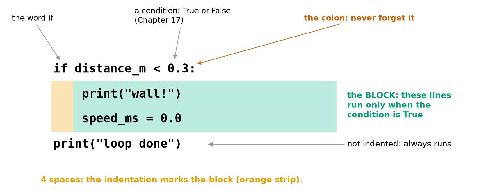
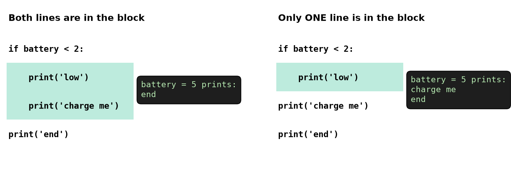
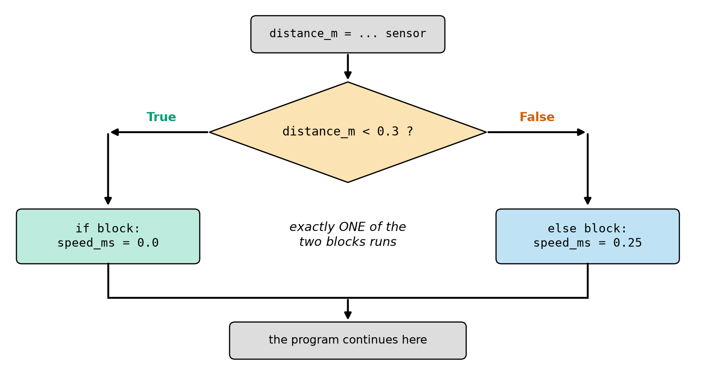
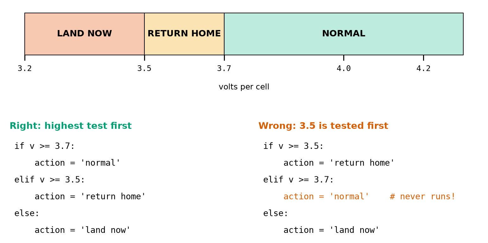
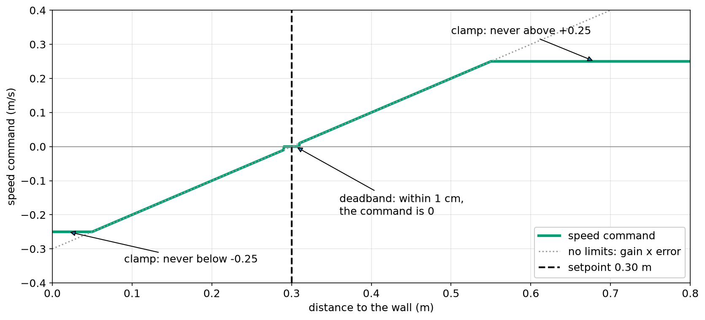

# Chapter 18 — Making Decisions: `if`, `elif`, `else`

> **Part 2 · Chapter 18 of 749**
> **You need:** Chapter 17 (True, False, comparisons). Keep a script open: from now on, most examples are several lines long.
> **You will make:** a command interpreter for Rover, one step of a real wall-stopping controller with a speed limit and a deadband, a drone program that says "DO NOT FLY" and why, and a battery gauge that refuses impossible values.

---

## What you will learn

- How `if` makes a program run some lines only when a condition is True.
- What **indentation** means in Python, and how to fix indentation errors.
- How `else` gives a second path, and `elif` gives many paths.
- Why the **order** of `elif` tests matters.
- When to use several separate `if`s instead of one `elif` chain.
- Nesting one `if` inside another, and when `and` is simpler.
- Three patterns found in nearly all robot programs: the **guard**, the **clamp** and the **deadband**.

---

## New words in this chapter

| Word | Simple meaning |
|---|---|
| **branch** | One of the paths a program can take. |
| **block** | A group of lines that belong together, marked by indentation. |
| **indentation** | The spaces at the start of a line. |
| **nesting** | Putting an `if` inside another `if`. |
| **guard** | A check that stops bad values before they cause trouble. |
| **clamp** | Forcing a value to stay between two limits. |
| **deadband** | A small zone around a target where the robot does nothing. |

---

## 18.1 `if`: do this only when…

Until now every line of your programs has run, every time. Now a program can **choose**.

📖 **New word: branch** — one of the paths a program can take.

```python
distance_m = 0.2

if distance_m < 0.3:
    print("wall!")
    speed_ms = 0.0
print("loop done")
```

Output:

```
wall!
loop done
```

Change the first line to `distance_m = 0.8`, and the output is only:

```
loop done
```

Look at Figure 18.1.



*Figure 18.1 — The word `if`, a condition, a colon, and an indented block.*

**How to read this picture:** The first line has three parts: the word `if`, a condition that is True or False (Chapter 17), and a colon. The green area is the **block**, the two lines that run only when the condition is True. The orange strip is the indentation that marks them as a block. The last line has no indentation, so it is not part of the block and always runs.

📖 **New word: block** — a group of lines that belong together.

📖 **New word: indentation** — the spaces at the start of a line.

### Indentation is part of the language

Many languages use brackets to group lines. Python uses **indentation**. It is not decoration: it changes what the program does. Look at Figure 18.2.



*Figure 18.2 — The same words with different indentation make different programs.*

**How to read this picture:** Both programs have the same four lines. The green area shows which lines are in the block. On the left, `'charge me'` is indented, so it runs only when the battery is low. On the right, it is not indented, so it runs **every time**. The black boxes show the output with `battery = 5`. The right-hand program tells a full robot to charge.

The rules:

1. A line ending in a colon must be followed by an indented block.
2. Every line of the block must have the **same** indentation.
3. The block ends at the first line that is less indented.
4. Use **4 spaces** per level. Your editor (Chapter 8) inserts them when you press Tab.

### Indentation errors

These messages are from real runs:

| Mistake | What Python says |
|---|---|
| The colon is missing: `if x > 0` | `SyntaxError: expected ':'` |
| No indentation after the colon | `IndentationError: expected an indented block after 'if' statement on line 2` |
| A line is indented for no reason | `IndentationError: unexpected indent` |
| A block line has the wrong number of spaces | `IndentationError: unindent does not match any outer indentation level` |
| Tabs mixed with spaces | `TabError: inconsistent use of tabs and spaces in indentation` |
| `if x = 1:` | `SyntaxError: invalid syntax. Maybe you meant '==' or ':=' instead of '='?` |

A comment does not count as a block. If you want an empty block for now, write `pass`, which means "do nothing":

```python
if battery_low:
    pass       # I will fill this in later
```

---

## 18.2 `else`: otherwise…

`else` gives the second path. It has no condition of its own, because it means "in every other case". Look at Figure 18.3.



*Figure 18.3 — An `if` / `else` splits the program into two paths, and exactly one of them runs.*

**How to read this picture:** Start at the top. The orange diamond is the question. If the answer is True, follow the left arrow to the green block. If it is False, follow the right arrow to the blue block. After either block, both paths join again and the program continues.

```python
if distance_m < 0.3:
    speed_ms = 0.0
else:
    speed_ms = 0.25
```

`else` must line up exactly with its `if`, and it cannot appear by itself:

```
SyntaxError: invalid syntax
```

For very short choices, Python has a one-line form:

```python
mode = "fast" if speed_ms > 0.2 else "slow"
```

Use it only for simple values. For anything longer, the normal form is easier to read.

---

## 18.3 `elif`: many paths

`elif` means "else if". Python tests from the top, runs the **first** block whose condition is True, and then skips all the rest.

A drone must react to its battery level. Look at the voltage bands at the top of Figure 18.4.



*Figure 18.4 — Top: three voltage bands. Bottom: the right order, and a wrong order that can never say "normal".*

**How to read this picture:** The bar at the top is a number line of volts per cell, split into three actions. The two programs below use the same tests in a different order. On the left, the highest limit is tested first. On the right, 3.5 is tested first. Any voltage of 3.7 or more is also 3.5 or more, so the first test catches it, and the red line can **never** run.

```python
if cell_v >= 3.7:
    action = "normal"
elif cell_v >= 3.5:
    action = "return home"
else:
    action = "land now"
```

Trace `cell_v = 3.6`: the first test is False, so Python tries the next one. `3.6 >= 3.5` is True, so `action` becomes `"return home"`, and the `else` is skipped.

Notice that the second test does not need to say `cell_v < 3.7`. If Python reached it, the first test has already failed.

⚠️ **Order matters.** When the ranges overlap, put the **most specific** test first. Here is the wrong order running with 3.9 V:

```
return home
```

A nearly full drone goes home. Python gave no error, because the program is perfectly legal. It is just wrong.

⚠️ `else` comes last. `elif` after `else` gives `SyntaxError: 'elif' block follows an 'else' block`.

### `elif` or separate `if`s?

An `elif` chain runs **at most one** block. Separate `if`s are all tested, and **each** can run.

| Use | When | Example |
|---|---|---|
| `if / elif / else` | The cases exclude one another: exactly one is right | battery action |
| separate `if`s | Each check is independent, and several can be true | a list of problems before take-off |

With 3.9 V, two separate `if`s (`>= 3.7` and `>= 3.5`) would both run. That is a bug for the battery action, but exactly what we want when listing problems (Application 2).

---

## 18.4 Nesting

📖 **New word: nesting** — putting an `if` inside another `if`. The inner block is indented again:

```python
if motors_on:
    if distance_m < 0.3:
        print("braking")
```

Two nested tests with nothing else in them are the same as one `and`, and `and` is usually easier to read:

```python
if motors_on and distance_m < 0.3:
    print("braking")
```

Use real nesting when the inner part has its own `else`, or when the outer test protects the inner one. More than three levels is a warning sign: the code has become hard to follow. Functions (Chapter 23) are the cure.

### Truthy conditions

Chapter 17's truthy rules work in `if`. Empty text counts as False, so:

```python
if name:
    print("hello", name)
else:
    print("no name given")
```

---

## 18.5 Three patterns every robot uses

### The guard

📖 **New word: guard** — a check that stops bad values before they cause trouble. Remember the `ZeroDivisionError` in Chapter 16:

```python
if speed_ms == 0:
    print("the robot is not moving: no arrival time")
else:
    print("trip time:", route_m / speed_ms, "s")
```

Guards go **first**, and they handle the bad case. Then the rest of the program can assume that the values are good.

### The clamp

📖 **New word: clamp** — forcing a value to stay between two limits. A controller may calculate any speed, but the motors and the safety rules have limits:

```python
if speed_ms > MAX_SPEED_MS:
    speed_ms = MAX_SPEED_MS
elif speed_ms < -MAX_SPEED_MS:
    speed_ms = -MAX_SPEED_MS
```

### The deadband

📖 **New word: deadband** — a small zone around the target where the robot does nothing. Sensors are noisy (Chapter 17), so a robot that reacts to every tiny error will twitch for ever, wearing out its motors and its battery:

```python
if abs(error_m) < DEADBAND_M:
    speed_ms = 0.0
```

Look at Figure 18.5, which shows all of this at once.



*Figure 18.5 — Rover's speed command for each distance to the wall.*

**How to read this picture:** The horizontal axis is the distance to the wall. The green line is the speed command the program would send. The black dashed line is the setpoint (0.30 m). The grey dotted line is pure `gain × error` with no limits. The green line follows it in the middle, is held flat at the clamp at both ends, and has a tiny flat step at 0 around the setpoint: the deadband. Each kink in the green line comes from one `if`.

---

## Code

Now Rover understands typed commands. This is Chapter 15's parser, and now it can **choose**.

The file is `code/ch018/rover_commands.py`. Type it into `my-code/ch018/`.

```python
# rover_commands.py - Rover chooses what to do from one typed command
MAX_SPEED_MS = 0.5                 # safety limit (Chapter 7)

message = input("command> ").strip().lower()
parts = message.split()            # "forward 0.25" becomes two pieces

if len(parts) == 0:                # the guard comes first: nothing was typed
    print("nothing typed: staying stopped")
elif parts[0] == "stop":
    print("stopping: speed 0.0 m/s")
elif parts[0] == "forward" or parts[0] == "back":
    if len(parts) != 2:            # these two commands need a speed
        print("please give one speed, for example: forward 0.25")
    else:
        speed_ms = float(parts[1])
        if speed_ms > MAX_SPEED_MS:        # never go past the limit
            speed_ms = MAX_SPEED_MS
            print("speed limited")
        if parts[0] == "back":
            speed_ms = -speed_ms           # backwards is a negative speed
        print(f"driving at {speed_ms:.2f} m/s")
else:
    print("unknown command:", parts[0])
```

| Line | Code | What it does (simple English) |
|---|---|---|
| 1 | comment | The name of the file and the idea. |
| 2 | `MAX_SPEED_MS = 0.5` | The limit, as a constant. |
| 3 | *(empty)* | |
| 4 | `message = input(…).strip().lower()` | Read and clean (Chapter 16). |
| 5 | `parts = message.split()` | A list of the words. `len(parts)` counts them. |
| 6 | *(empty)* | |
| 7 | `if len(parts) == 0:` | **Guard**. Without it, `parts[0]` on an empty list would be an IndexError. |
| 8 | `print(…)` | Empty line: do nothing. |
| 9 | `elif parts[0] == "stop":` | Only tried if something was typed. |
| 10 | `print(…)` | The stop action. |
| 11 | `elif parts[0] == "forward" or parts[0] == "back":` | Each side of `or` is a full question (Chapter 17). |
| 12 | `if len(parts) != 2:` | A **nested** guard: this command needs exactly two words. |
| 13 | `print(…)` | Tell the person what is expected. |
| 14 | `else:` | Two words were given. |
| 15 | `speed_ms = float(parts[1])` | Text to number. |
| 16–18 | `if speed_ms > MAX_SPEED_MS:` | **Clamp**, and say so. |
| 19–20 | `if parts[0] == "back":` | Make the speed negative. |
| 21 | `print(f"…")` | The result, with 2 decimals. |
| 22 | `else:` | No earlier test matched. Lines up with the first `if`. |
| 23 | `print("unknown command:", parts[0])` | Never guess what an unknown command means. |

**Real runs:**

```
command> forward 0.25
driving at 0.25 m/s
```

```
command> FORWARD 9
speed limited
driving at 0.50 m/s
```

```
command> back 0.1
driving at -0.10 m/s
```

```
command> jump
unknown command: jump
```

```
command> forward
please give one speed, for example: forward 0.25
```

**What the output means:**

- Capitals and extra spaces do not matter, thanks to the cleaning on line 4.
- `9` is impossible for Rover, so it was limited to 0.50 m/s, and the person was told.
- Lab 15.2 found four ways of crashing the parser. `if` has fixed two of them (`stop` with no speed, and too many words). Two remain: `forward fast` and `forward 0,25` still give a ValueError. Chapter 25 fixes them.

---

## Small examples

### Example 1 — One `if`

```python
ticks = 2000
if ticks > 1000:
    print("more than 1000 ticks")
```

### Example 2 — Even or odd

```python
n = 7
if n % 2 == 0:
    print("even")
else:
    print("odd")
```

Prints `odd` (Chapter 13).

### Example 3 — Three zones

```python
d = 0.5
if d < 0.3:
    print("stop")
elif d < 1.0:
    print("slow")
else:
    print("cruise")
```

Prints `slow`.

### Example 4 — `and` in a condition

```python
if battery_ok and distance_m > 0.3:
    print("drive")
```

### Example 5 — One-line choice

```python
s = 0.3
mode = "fast" if s > 0.2 else "slow"     # mode is "fast"
```

### Example 6 — Doing nothing on purpose

```python
if x > 0:
    pass
```

### Example 7 — Empty text

```python
t = ""
if t:
    print("has text")
else:
    print("empty")          # this one runs
```

---

## 🏭 Real robot applications

### Application 1 (worked in full) — 🤖 Rover's wall-stopping controller

**1. The real problem.** Chapter 6 showed a controller in which the speed is proportional to the error. A real one needs two more things: a speed limit, because a far-away wall must not produce a huge speed; and a deadband, so that Rover does not twitch at the setpoint.

**2. Why this idea.** Proportional control gives `speed = gain × error`. Then `if` statements bend that straight line: a deadband near zero and a clamp at both ends (Figure 18.5).

**3. The numbers.**

| Fact | Value |
|---|---|
| setpoint | 0.30 m |
| gain | 1.0 (m/s per m) |
| speed limit | ±0.25 m/s |
| deadband | ±0.01 m |

**4. The maths, step by step.** Error = distance − setpoint.

```
Distance 1.0:   error +0.70;  1.0 × 0.70 = 0.70  → clamped to +0.25
Distance 0.5:   error +0.20;  speed +0.20        → inside the limits
Distance 0.305: error +0.005; smaller than 0.01  → deadband: 0.00
Distance 0.25:  error −0.05;  speed −0.05        → back away gently
Distance 0.0:   error −0.30;  −0.30              → clamped to −0.25
```

**5. The code.** File `code/ch018/wall_controller.py`:

```python
# wall_controller.py - one step of Rover's wall-stopping controller
SETPOINT_M = 0.30                  # stop this far from the wall
GAIN = 1.0                         # speed command per metre of error (Chapter 6)
MAX_SPEED_MS = 0.25                # never command more than this
DEADBAND_M = 0.01                  # closer than this to the setpoint counts as "there"

distance_m = float(input("Distance to the wall (m): "))
error_m = distance_m - SETPOINT_M  # positive means we are too far away

if abs(error_m) < DEADBAND_M:      # close enough: do not fidget
    speed_ms = 0.0
else:
    speed_ms = GAIN * error_m      # proportional control

if speed_ms > MAX_SPEED_MS:        # clamp: not too fast forwards ...
    speed_ms = MAX_SPEED_MS
elif speed_ms < -MAX_SPEED_MS:     # ... and not too fast backwards
    speed_ms = -MAX_SPEED_MS

print(f"error {error_m:+.3f} m -> speed {speed_ms:+.3f} m/s")
```

| Line | Code | What it does (simple English) |
|---|---|---|
| 2–5 | constants | Everything you might tune, at the top. |
| 7 | `distance_m = …` | Stands in for a real sensor. |
| 8 | `error_m = …` | Chapter 6 used setpoint − measurement. Here it is flipped, because driving forward makes this distance **smaller**: positive now means "too far away, drive forward". |
| 10–13 | `if / else` | Deadband, or proportional control. |
| 15–18 | `if / elif` | Clamp. It has no `else`, because in between nothing needs changing. |
| 20 | `print(f"…")` | `+` shows the sign (Chapter 16). |

**Real runs:**

```
error +0.700 m -> speed +0.250 m/s
error +0.200 m -> speed +0.200 m/s
error +0.005 m -> speed +0.000 m/s
error -0.050 m -> speed -0.050 m/s
error -0.300 m -> speed -0.250 m/s
```

**6. The result.** Five distances give five sensible commands, and each line matches the hand calculation. These few lines are a genuine controller. Run one step every 20 ms (Chapter 5) and Rover would stop at the wall.

**7. Going further.** To run it again and again you need a loop (Chapter 19). Chapter 210 builds proportional control properly, Chapter 212 removes the small error it leaves behind, and clamping causes a famous problem called windup, which comes later in the PID chapters.

### Application 2 (worked in full) — 🚁 "DO NOT FLY", and why

**1. The real problem.** Chapter 17's program printed `GO: False`. A pilot needs a clear instruction and **every** reason, not just the first.

**2. Why this idea.** The checks are independent, and several can fail together. So we use **separate `if`s**, not `elif`: an `elif` chain would stop at the first problem, and the pilot would fix one thing, then discover the next. A counter (Chapter 14) records how many checks failed, and a final `if / else` gives the decision.

**3. The numbers.** The same limits as Chapter 17: at least 3.7 V per cell (4 cells), at least 6 satellites, at most 10 m/s of wind, and the pilot must answer `y`.

**4. The maths, step by step.** With 14.4 V, 5 satellites, 12 m/s and `n`:

```
Step 1. 14.4 ÷ 4 = 3.6;  3.6 < 3.7   → problem, count 1
Step 2. 5 < 6                        → problem, count 2
Step 3. 12 > 10                      → problem, count 3
Step 4. not False = True             → problem, count 4
Step 5. 4 is not 0                   → DO NOT FLY
```

**5. The code.** File `code/ch018/flight_decision.py`:

```python
# flight_decision.py - say GO or DO NOT FLY, and give every reason
CELLS = 4
MIN_CELL_V = 3.7
MIN_SATELLITES = 6
MAX_WIND_MS = 10.0

battery_v = float(input("Battery voltage (V): "))
satellites = int(input("Satellites: "))
wind_ms = float(input("Wind (m/s): "))
people_clear = input("Area clear of people? (y/n): ").strip().lower() == "y"

problems = 0                       # a counter (Chapter 14)

if battery_v / CELLS < MIN_CELL_V:
    print("- battery too low")
    problems += 1
if satellites < MIN_SATELLITES:
    print("- not enough satellites")
    problems += 1
if wind_ms > MAX_WIND_MS:
    print("- too windy")
    problems += 1
if not people_clear:
    print("- area not confirmed clear")
    problems += 1

if problems == 0:
    print("GO")
else:
    print("DO NOT FLY:", problems, "problem(s)")
```

| Line | Code | What it does (simple English) |
|---|---|---|
| 2–5 | constants | The limits. |
| 7–10 | `input` lines | Read and convert. Anything other than `y` is False. |
| 12 | `problems = 0` | The counter starts at 0. |
| 14–25 | four `if`s | Each tests one **bad** condition. All four always run. |
| 27–30 | `if / else` | The final decision depends only on the count. |

**Two real runs:**

```
Battery voltage (V): 16.2
Satellites: 8
Wind (m/s): 6
Area clear of people? (y/n): y
GO
```

```
Battery voltage (V): 14.4
Satellites: 5
Wind (m/s): 12
Area clear of people? (y/n): n
- battery too low
- not enough satellites
- too windy
- area not confirmed clear
DO NOT FLY: 4 problem(s)
```

**6. The result.** The pilot sees all four problems at once. Nothing in the program can answer "GO" unless the counter is still 0, so forgetting a problem cannot lead to a take-off.

**7. Going further.** In the air, the answer cannot be a simple "do not fly". It is the voltage-band ladder of Section 18.3: normal, return home, land now (Chapters 640 and 664).

### Application 3 — 🏭 Sorting parcels by weight

A conveyor robot pushes parcels into bins: `if kg < 1: bin = "A"`, `elif kg < 5: bin = "B"`, `elif kg <= 30: bin = "C"`, `else: bin = "reject"`. The tests run from lightest to heaviest. As with the battery, the order matters: if `kg <= 30` came first, every parcel would land in bin C. The `else` is the fail-safe: anything too heavy, or any strange reading, goes to a person.

### Application 4 — 🌾 A greenhouse robot

A greenhouse robot waters a plant when the soil is dry, but only in the daytime and only if the tank has water: `if soil_dry and is_day and tank_ok:`. Otherwise it reports why not, with separate `if`s, as in Application 2. To stop the pump from flickering on and off near the limit, it starts watering at 30 % moisture and stops at 45 %: two limits, known as hysteresis (Chapter 208).

### Application 5 — 🚶 Is a humanoid falling?

A humanoid compares its body tilt with limits many times a second: below 5° it carries on walking; below 15° it takes a recovery step; above that it switches to a "protect yourself" pose. This is an `if / elif / else` ladder, with the most dangerous case ready at the end. Real humanoids also look at how **fast** the tilt is growing (Chapter 718). This is a decision that must be made in a few milliseconds, every cycle.

---

## 🔧 Hands-on lab

### Lab 18.1 — The indentation doctor

**You need:** a Python file.

**Steps:** Type this correct program, run it, and then break it in each way below. Read each message before you fix it.

```python
battery = 1.5
if battery < 2:
    print("low")
    print("charge me")
print("end")
```

1. Delete the colon.
2. Remove the 4 spaces before `print("low")`.
3. Put only 2 spaces before `print("charge me")`.
4. Put 4 spaces before `print("end")`, then change `battery` to `5` and run it.
5. Put 4 spaces before `battery = 1.5`.

**What you should see:**

| Change | Result |
|---|---|
| 1 | `SyntaxError: expected ':'` |
| 2 | `IndentationError: expected an indented block after 'if' statement on line 2` |
| 3 | `IndentationError: unindent does not match any outer indentation level` |
| 4 | No error at all, but with `battery = 5`, `end` is no longer printed |
| 5 | `IndentationError: unexpected indent` |

Change 4 is the dangerous one. It is a real bug, and Python cannot catch it.

**If it does not work:**

| Problem | Likely cause | Fix |
|---|---|---|
| `TabError` | A tab got mixed with spaces | In VS Code, click "Spaces: 4" at the bottom and choose to convert. |
| The error is on a later line than you changed | Python notices the problem at the next line | Look just above the line it names. |

### Lab 18.2 — Test every edge

**You need:** a new file `my-code/ch018/zones.py`.

**Steps:**

1. Write a program that reads a distance and prints:
   - `invalid` if it is below 0.02 or above 4.0,
   - `stop` if it is below 0.30,
   - `slow` if it is below 1.0,
   - otherwise `cruise`.
2. Test it with **every** edge value: `0.01`, `0.02`, `0.29`, `0.30`, `0.99`, `1.0`, `4.0`, `4.1`.

**What you should see:**

```python
distance_m = float(input("Distance (m): "))

if distance_m < 0.02 or distance_m > 4.0:
    print("invalid")
elif distance_m < 0.30:
    print("stop")
elif distance_m < 1.0:
    print("slow")
else:
    print("cruise")
```

`invalid`, `stop`, `stop`, `slow`, `slow`, `cruise`, `cruise`, `invalid`.

Testing at and next to each edge is called **boundary testing**. Most bugs in decisions live at the edges.

**If it does not work:**

| Problem | Likely cause | Fix |
|---|---|---|
| `0.01` prints `stop` | The `invalid` test is not first | The guard goes first. |
| Everything prints `stop` | You wrote `>` instead of `<` | Read each test aloud. |

### Lab 18.3 — Fix the battery gauge

**You need:** `code/ch018/battery_bar_safe.py`.

Chapter 16's gauge happily accepted 150 %. Here is a version that does not:

```python
# battery_bar_safe.py - the Chapter 16 gauge, now refusing impossible values
BAR_WIDTH = 20

percent = int(input("Battery percent (0-100): "))

if percent < 0 or percent > 100:
    print("That is not a battery percentage.")
else:
    filled = percent * BAR_WIDTH // 100
    bar = "#" * filled + "-" * (BAR_WIDTH - filled)
    if percent <= 20:
        warning = "  LOW!"
    else:
        warning = ""
    print(f"[{bar}] {percent:3d}%{warning}")
```

**Steps:** Run it with 87, 20, 15, 150 and −3. Then change the program so that it says `  CRITICAL!` at 5 % or less. Where does the new test have to go?

**What you should see:**

```
[#################---]  87%
[####----------------]  20%  LOW!
[###-----------------]  15%  LOW!
That is not a battery percentage.
That is not a battery percentage.
```

For the new warning, test 5 **before** 20: `if percent <= 5:` first and then `elif percent <= 20:`.

**If it does not work:**

| Problem | Likely cause | Fix |
|---|---|---|
| `NameError: name 'warning' is not defined` | `warning` is set only in the `if`, and the `else` is missing | Every path must give it a value. |
| 3 % says `LOW!` and not `CRITICAL!` | The 20 test comes first | Put the most specific test first. |

---

## Common mistakes

⚠️ **Forgetting the colon.** Every `if`, `elif` and `else` line ends with `:`.

⚠️ **`=` in a condition.** Use `==`.

⚠️ **Wrong indentation.** It changes the meaning, and sometimes no error appears.

⚠️ **The wrong `elif` order.** Put the most specific test first.

⚠️ **`elif` when you wanted every check.** Use separate `if`s for independent checks.

⚠️ **Separate `if`s when only one should run.** Use `elif`.

⚠️ **Writing `else` with a condition.** `else x > 0:` is an error. Use `elif`.

⚠️ **No `else` for the unknown case.** Handle what you did not expect.

⚠️ **A variable set in only one branch.** Using it later gives a NameError on the other path.

⚠️ **Too much nesting.** Use `and`, or a function (Chapter 23).

---

## Practice

🏋️ **1.** What does this print with `x = 7`? And with `x = 2`?

```python
if x > 5:
    print("big")
print("done")
```

🏋️ **2.** Write an `if / else` that prints `even` or `odd` for `n`.

🏋️ **3.** What does this print with `d = 0.3`?

```python
if d < 0.3:
    print("A")
elif d < 1.0:
    print("B")
else:
    print("C")
```

🏋️ **4.** Why does this program never print `normal`? Fix it.

```python
if v >= 3.5:
    print("return home")
elif v >= 3.7:
    print("normal")
```

🏋️ **5.** Find the two errors.

```python
if x = 5
    print("five")
```

🏋️ **6.** Rewrite this using one `if` and `and`.

```python
if a:
    if b:
        print("both")
```

🏋️ **7.** Write a **clamp** that keeps `power` between 0 and 100.

🏋️ **8.** With `MAX = 0.25`, `DEAD = 0.01`, and a gain of 1, what speed does the wall controller give at a distance of 0.295 m? At 0.40 m? At 2.0 m?

🏋️ **9.** A robot should report a problem for **each** of: low battery, hot motor, blocked wheel. Would you use `elif` or separate `if`s? Why?

🏋️ **10.** Add a guard to this: `print(route_m / speed_ms)`.

🏋️ **11.** (Harder) A sorting robot uses this code. A parcel weighs 3 kg. (a) Which bin does it go to? (b) Reorder the tests so that it works. (c) What should happen to a parcel with a weight of −1?

```python
if kg <= 30:
    bin_name = "C"
elif kg < 5:
    bin_name = "B"
elif kg < 1:
    bin_name = "A"
```

---

## Answers

**1.** With 7: `big` then `done`. With 2: only `done`.

**2.**

```python
if n % 2 == 0:
    print("even")
else:
    print("odd")
```

**3.** `B`. `0.3 < 0.3` is False, and then `0.3 < 1.0` is True.

**4.** Every value of 3.7 or more is also 3.5 or more, so the first test catches it and `elif` never runs. Test `v >= 3.7` first.

**5.** It needs `==` instead of `=`, and a colon at the end: `if x == 5:`.

**6.**

```python
if a and b:
    print("both")
```

**7.**

```python
if power > 100:
    power = 100
elif power < 0:
    power = 0
```

**8.** At 0.295: error −0.005, smaller than the deadband, so **0.0**. At 0.40: error +0.10, so **+0.10**. At 2.0: error +1.70, which is clamped to **+0.25**.

**9.** Separate `if`s. The problems are independent and several can happen at once. `elif` would report only the first.

**10.**

```python
if speed_ms == 0:
    print("not moving")
else:
    print(route_m / speed_ms)
```

**11.** (a) Bin **C**, because the first test catches everything of 30 kg or less. (b) Test `kg < 1` first, then `kg < 5`, then `kg <= 30`. (c) A negative weight is a bad reading, so a guard at the top should send it to a person: `if kg < 0: bin_name = "reject"`, with the other tests as `elif`, and an `else` for parcels over 30 kg.

---

## Summary

🧠 `if condition:` runs the indented **block** only when the condition is True.

🧠 **Indentation** is part of Python: 4 spaces, the same for every line of a block. A wrong indent can change the program with no error.

🧠 `else` is the other path. `elif` gives more paths. Python runs the **first** True branch and skips the rest.

🧠 Put the most specific test first.

🧠 One answer among many: `if / elif / else`. Independent checks: separate `if`s.

🧠 **Guard** first, then **clamp** to limits, and use a **deadband** near the target.

🧠 Test every edge.

---

## Next chapter

Your wall controller makes **one** decision and then ends. A real robot must make the same decision again and again, as long as it is running. In **Chapter 19 — Repeating part 1: `while` loops**, your program will finally loop: Rover will really drive up to the wall and stop, the command console will keep going until you type `stop`, and you will learn to escape from a loop safely with `break`.
