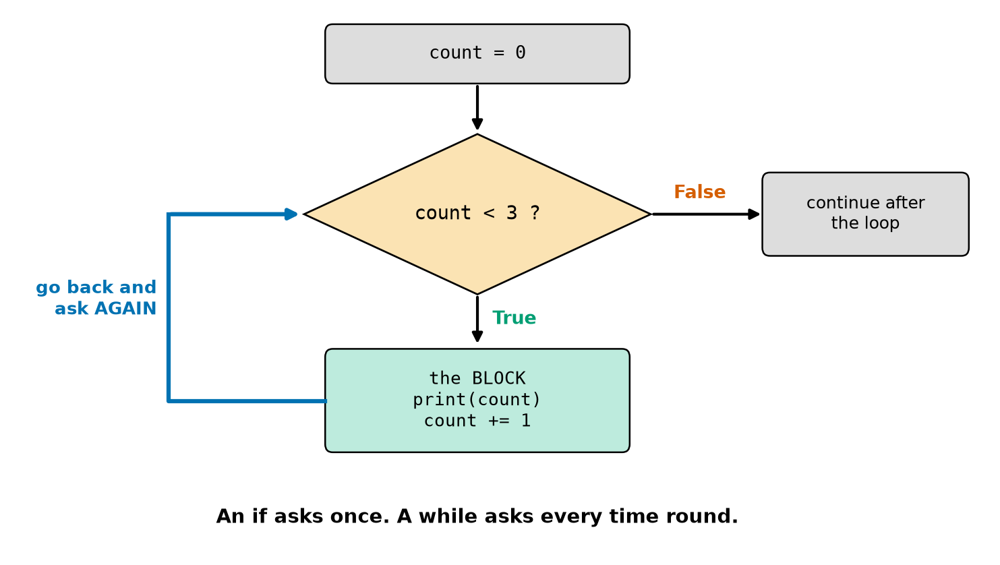
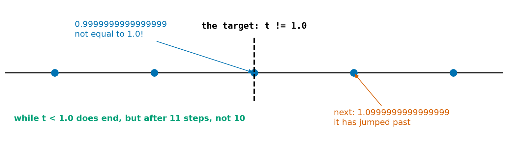
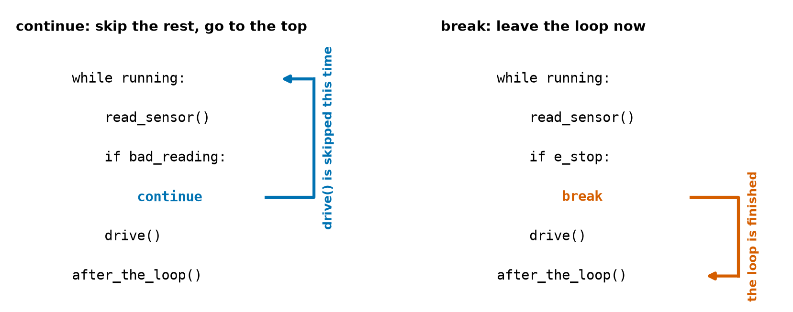
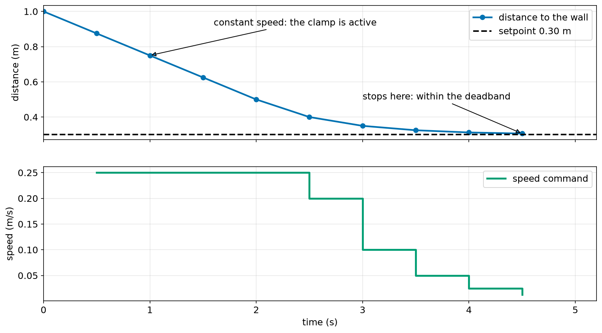
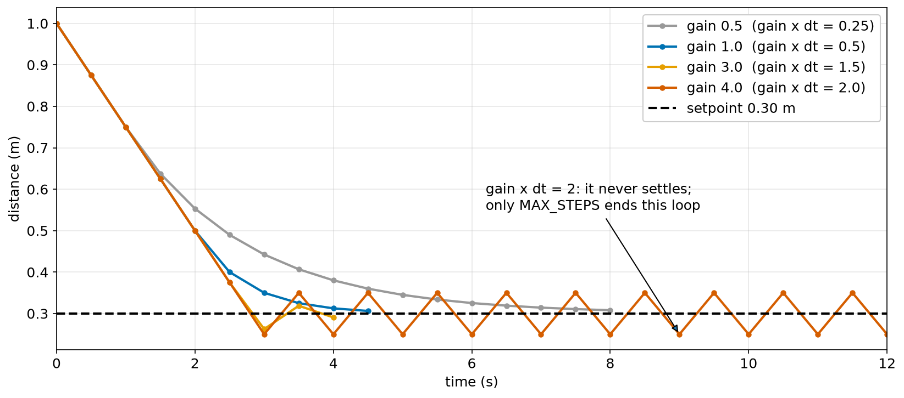

# Chapter 19 — Repeating Part 1: `while` Loops

> **Part 2 · Chapter 19 of 749**
> **You need:** Chapter 18 (`if`, blocks, clamp, deadband). Keep a script open.
> **You will make:** a simulation in which Rover really drives up to a wall and stops, a command console that keeps running until you quit, and a program that homes a robot arm joint safely.

---

## What you will learn

- How `while` repeats a block as long as a condition is True.
- How to trace a loop by hand.
- Why loops sometimes never end, and how to stop one.
- How `break` leaves a loop and `continue` skips to the next pass.
- The **maximum-steps guard** that every robot loop should have.
- Why a float should not decide when a loop stops.
- How to keep asking until the answer is valid.
- How the **gain** changes a control loop.

---

## New words in this chapter

| Word | Simple meaning |
|---|---|
| **loop** | Code that runs again and again. |
| **iteration** | One trip round a loop. |
| **loop condition** | The question asked before each iteration. |
| **infinite loop** | A loop that never ends. |
| **break** | Leave the loop now. |
| **continue** | Skip the rest of this iteration and go to the top. |
| **sentinel** | A special value that means "stop now", such as `quit`. |
| **homing** | Moving a joint to a known position, so that the robot knows where it is. |

---

## 19.1 `while`: keep going as long as…

An `if` asks its question **once**. A `while` asks it **again and again**.

📖 **New word: loop** — code that runs again and again.

📖 **New word: iteration** — one trip round a loop.

```python
count = 0
while count < 3:
    print("count is", count)
    count += 1
print("after", count)
```

Output:

```
count is 0
count is 1
count is 2
after 3
```

Look at Figure 19.1.



*Figure 19.1 — After the block runs, the program goes back and asks the question again.*

**How to read this picture:** Start at the top. The orange diamond is the **loop condition**. If it is True, the green block runs. Then the thick blue arrow leads back to the diamond, and the question is asked again. Only when the answer is False does the program leave to the right.

The rules for the colon and indentation are the same as for `if` (Chapter 18).

### Trace it

A trace table (Chapter 14) shows exactly what a loop does:

| Check | `count` before | `count < 3` | What happens |
|---|---|---|---|
| 1 | 0 | True | prints 0, count becomes 1 |
| 2 | 1 | True | prints 1, count becomes 2 |
| 3 | 2 | True | prints 2, count becomes 3 |
| 4 | 3 | **False** | leave the loop |

Notice two things. The block ran 3 times, but the question was asked **4** times. And the last value printed by the block was 2, while `count` ended at 3.

### The three parts of a counting loop

| Part | Code | If you forget it |
|---|---|---|
| Starting value | `count = 0` | NameError |
| Condition | `while count < 3:` | wrong number of passes |
| Update | `count += 1` | the loop never ends |

### Two everyday uses

**A running total** (Chapter 14), in a loop:

```python
total = 0
n = 1
while n <= 4:
    total += n
    n += 1
print(total)     # 10
```

**Loops that do not count.** Here we do not know the number of passes in advance. How many times must a value of 1 double to pass 1000?

```python
value = 1
doublings = 0
while value < 1000:
    value *= 2
    doublings += 1
print(doublings, value)
```

Output: `10 1024`. This is where `while` really shines: you know the **stopping condition**, but not the count.

---

## 19.2 Loops that never end

📖 **New word: infinite loop** — a loop that never ends. The classic cause is forgetting the update:

```python
count = 0
while count < 3:
    print("count is", count)      # count never changes!
```

It prints `count is 0` for ever. To stop it, click in the terminal and press **Ctrl+C**. Python stops and shows `KeyboardInterrupt`.

⚠️ On a robot this is not a harmless mistake. If a program is stuck in a loop that does not read its sensors, the robot keeps doing its last command. That is exactly why robots have watchdogs and an e-stop (Chapter 7).

Some loops are infinite **on purpose**. A robot's main program should run until it is switched off:

```python
while True:
    # sense, think, act, for ever
    ...
```

Used this way, `while True` is normal. The important thing is that the loop must have a way to stop safely.

### Floats and loop conditions

Look at this short loop, which is supposed to run until `t` reaches 1.0:

```python
t = 0.0
while t != 1.0:
    t += 0.1
```

It **never ends**. Real values of `t`, printed as they change:

```
8 0.7999999999999999
9 0.8999999999999999
10 0.9999999999999999
11 1.0999999999999999
```

Look at Figure 19.2.



*Figure 19.2 — The steps go straight past 1.0 without ever landing on it.*

**How to read this picture:** The blue dots are successive values of `t`. The black dashed line is the target, 1.0. One dot is extremely close but not equal (Chapter 13's float surprise), and the next one has already passed it. Because `t != 1.0` stays True on both, the loop goes on for ever.

Two fixes:

```python
while t < 1.0:      # better: it does end, but after 11 passes, not 10
```

```python
n = 0
while n < 10:       # best: count with an int, and calculate the time
    n += 1
t = n * 0.1
```

🧠 **Remember:** Loop counters should be **ints**. Calculate float values from them (Chapter 13, Practice 11).

---

## 19.3 `break` and `continue`

📖 **New word: break** — leave the loop now.

📖 **New word: continue** — skip the rest of this iteration and go back to the top.

Look at Figure 19.3.



*Figure 19.3 — `continue` jumps up to the top of the loop. `break` jumps out of it.*

**How to read this picture:** Both programs have the same shape. On the left, `continue` skips `drive()` for this pass only, and the loop carries on. On the right, `break` leaves the loop completely and goes to the first line after it.

```python
i = 0
while i < 6:
    i += 1
    if i == 2:
        continue
    if i == 5:
        break
    print("i =", i)
print("end", i)
```

Output:

```
i = 1
i = 3
i = 4
end 5
```

`2` was skipped by `continue`. At 5 the `break` ended the loop, so 6 never happened.

⚠️ **The `continue` trap.** Everything after a `continue` is skipped, **including the update**, if the update comes after it. In the example above, `i += 1` is at the top for this reason.

### The sentinel

📖 **New word: sentinel** — a special value that means "stop now". When you read input until something happens, the `while True` + `break` form is the cleanest:

```python
while True:
    text = input("reading (or done): ").strip()
    if text == "done":
        break
    # ... use the reading ...
```

### Keep asking until the answer is valid

```python
percent = -1
while percent < 0 or percent > 100:
    percent = int(input("Battery percent (0-100): "))
```

The starting value `-1` is deliberately wrong, so that the loop is entered at least once.

---

## 19.4 The maximum-steps guard

A loop whose stopping condition depends on the **real world** may never stop, because the world may not cooperate. The sensor may be broken. The wheel may be stuck.

So robot loops have a **second** way out: a limit on how many passes they can make.

```python
steps = 0
while not arrived and steps < MAX_STEPS:
    ...
    steps += 1
```

If the loop ended because of the limit, something is wrong, and the program must react. You will see this in action in Application 2.

---

## Code

Now we run Chapter 18's controller repeatedly. Rover will finally drive up to the wall. No hardware is needed: the program simulates the wall distance.

The file is `code/ch019/wall_drive.py`. Type it into `my-code/ch019/`.

```python
# wall_drive.py - Rover drives up to a wall and stops: a real control loop in simulation
SETPOINT_M = 0.30                  # stop this far from the wall
GAIN = 1.0                         # speed command per metre of error (Chapter 18)
MAX_SPEED_MS = 0.25                # the clamp
DEADBAND_M = 0.01                  # close enough
DT_S = 0.5                         # time for one trip round the loop, in seconds
MAX_STEPS = 50                     # safety: never loop more than this

distance_m = 1.0                   # STATE: the wall starts 1 m away
time_s = 0.0                       # STATE: the clock
steps = 0                          # STATE: how many times we have gone round

error_m = distance_m - SETPOINT_M
while abs(error_m) >= DEADBAND_M and steps < MAX_STEPS:
    speed_ms = GAIN * error_m      # think
    if speed_ms > MAX_SPEED_MS:    # clamp
        speed_ms = MAX_SPEED_MS
    elif speed_ms < -MAX_SPEED_MS:
        speed_ms = -MAX_SPEED_MS

    distance_m -= speed_ms * DT_S  # act: driving forward makes the distance smaller
    time_s += DT_S
    steps += 1
    error_m = distance_m - SETPOINT_M   # sense again
    print(f"t={time_s:4.1f} s  speed {speed_ms:+.3f}  distance {distance_m:.3f} m")

print("stopped after", steps, "steps at", round(distance_m, 3), "m")
```

| Line | Code | What it does (simple English) |
|---|---|---|
| 1 | comment | The name of the file and the idea. |
| 2–5 | constants | The controller from Chapter 18. |
| 6 | `DT_S = 0.5` | Each pass stands for half a second. (This is slow on purpose, so the output is short. The real Rover loop is 0.02 s.) |
| 7 | `MAX_STEPS = 50` | The safety limit. |
| 9–11 | state | The distance, the clock and the counter. |
| 13 | `error_m = …` | The first measurement. The condition needs it before the loop starts. |
| 14 | `while … and …:` | Keep going while we are **not** close enough **and** the limit is not reached. |
| 15 | `speed_ms = GAIN * error_m` | Proportional control. |
| 16–19 | `if / elif` | The clamp from Chapter 18. |
| 20 | *(empty)* | |
| 21 | `distance_m -= speed_ms * DT_S` | The simulated world: distance = speed × time, and driving forward makes the gap smaller. |
| 22–23 | `time_s += …`, `steps += 1` | The updates. Forgetting `steps += 1` would remove the guard. |
| 24 | `error_m = …` | Measure again. Without this line the condition never changes: an infinite loop. |
| 25 | `print(f"…")` | One line per pass. |
| 26 | *(empty)* | |
| 27 | `print("stopped after", …)` | Not indented, so it runs once, after the loop. |

**Output:**

```
t= 0.5 s  speed +0.250  distance 0.875 m
t= 1.0 s  speed +0.250  distance 0.750 m
t= 1.5 s  speed +0.250  distance 0.625 m
t= 2.0 s  speed +0.250  distance 0.500 m
t= 2.5 s  speed +0.200  distance 0.400 m
t= 3.0 s  speed +0.100  distance 0.350 m
t= 3.5 s  speed +0.050  distance 0.325 m
t= 4.0 s  speed +0.025  distance 0.312 m
t= 4.5 s  speed +0.013  distance 0.306 m
stopped after 9 steps at 0.306 m
```

Look at Figure 19.4, which shows the same run.



*Figure 19.4 — The distance (top) and the speed command (bottom) from one run of `wall_drive.py`.*

**How to read this picture:** Time runs from left to right on both graphs. In the top graph, the blue line is the distance and the black dashed line is the setpoint. In the bottom graph, the green line is the speed command. For the first 2 seconds the speed is held at the clamp, 0.25 m/s, so the distance falls in a straight line. After that, the command shrinks with the error, and the blue line bends and flattens towards the setpoint.

**What the output means:**

- For four passes the error was large, so the clamp held the speed at 0.25 m/s.
- Then the proportional part took over: every pass the error halves. The speed fell 0.200, 0.100, 0.050, 0.025…
- At 0.306 m the error (0.006) was inside the deadband, and the loop ended.

🔢 **Maths** — check two lines by hand:

```
Pass 1: error = 1.0 − 0.30 = 0.70;  1 × 0.70 = 0.70 → clamped to 0.25
        distance = 1.0 − 0.25 × 0.5 = 0.875   ✓
Pass 5: error = 0.50 − 0.30 = 0.20;  speed = 0.20
        distance = 0.50 − 0.20 × 0.5 = 0.400  ✓
```

This is the sense → think → act loop from Chapters 2 and 6, working in real code.

---

## Small examples

### Example 1 — Count down

```python
n = 3
while n > 0:
    print(n)
    n -= 1
print("go")
```

Prints 3, 2, 1, `go`.

### Example 2 — A loop that runs zero times

```python
n = 5
while n < 3:
    print("never")
```

The condition is False at once, so nothing runs.

### Example 3 — Taking digits apart

```python
n = 2047
total = 0
while n > 0:
    total += n % 10     # the last digit
    n //= 10            # remove the last digit
print(total)            # 13
```

### Example 4 — Battery fade

```python
capacity = 100.0
charges = 0
while capacity > 80:
    capacity *= 0.99
    charges += 1
print(charges)
```

### Example 5 — Fibonacci, with the swap trick

```python
a, b = 0, 1
k = 0
while k < 5:
    a, b = b, a + b     # Chapter 14: the right side is worked out first
    k += 1
print(a, b)             # 5 8
```

### Example 6 — Average of readings

Readings `0.31`, `0.29`, `0.33`: `total` becomes about `0.93`, `count` becomes `3`, and the average is about `0.31`.

---

## 🏭 Real robot applications

### Application 1 (worked in full) — 🤖 A console that keeps running

**1. The real problem.** Chapter 18's program understood **one** command and then ended. An operator wants to keep typing commands, ask where the robot is, and finish with `quit`.

**2. Why this idea.** We do not know how many commands will come, so `while True` with a sentinel fits. Bad lines should not end the program, so `continue` goes back to the prompt.

**3. The numbers.** The state is the position `x_m` and a counter `moves`, both starting at 0.

**4. The maths, step by step.** With `forward 1.5` and then `back 0.5`:

```
Step 1. x = 0 + 1.5 = 1.5 m,  moves = 1
Step 2. x = 1.5 − 0.5 = 1.0 m, moves = 2
```

**5. The code.** File `code/ch019/rover_console.py`:

```python
# rover_console.py - keep taking commands until the person types "quit"
x_m = 0.0                          # STATE: position
moves = 0                          # STATE: a counter

print("Commands: forward <m>, back <m>, where, quit")

while True:                        # keep going until a break
    parts = input("rover> ").strip().lower().split()

    if len(parts) == 0:            # an empty line: ask again
        continue
    word = parts[0]

    if word == "quit":
        break                      # leave the loop

    if word == "where":
        print(f"  x = {x_m:.2f} m after {moves} moves")
        continue                   # back to the top

    if word != "forward" and word != "back":
        print("  unknown command:", word)
        continue

    if len(parts) != 2:
        print("  please give a distance")
        continue

    distance_m = float(parts[1])
    if word == "back":
        distance_m = -distance_m
    x_m += distance_m
    moves += 1
    print(f"  moved {distance_m:+.2f} m")

print("Goodbye. Final position:", round(x_m, 2), "m")
```

| Line | Code | What it does (simple English) |
|---|---|---|
| 2–3 | state | Outside the loop, so it is remembered between commands. |
| 7 | `while True:` | Only `break` can end it. |
| 8 | `parts = …` | Read, clean and cut (Chapter 15). |
| 10–11 | `if … continue` | A guard: empty lines go straight back to the prompt. |
| 14–15 | `if word == "quit": break` | The **sentinel**. |
| 17–19 | `where` | Answer and go back. |
| 21–23 | unknown words | `and`, not `or` (De Morgan, Chapter 17). |
| 25–27 | missing number | Another guard. |
| 29–34 | the normal path | Only good commands get this far. |
| 36 | `print("Goodbye…")` | Runs after `break`. |

**A real run:**

```
Commands: forward <m>, back <m>, where, quit
rover> forward 1.5
  moved +1.50 m
rover> 
rover> where
  x = 1.50 m after 1 moves
rover> jump
  unknown command: jump
rover> back
  please give a distance
rover> BACK 0.5
  moved -0.50 m
rover> where
  x = 1.00 m after 2 moves
rover> quit
Goodbye. Final position: 1.0 m
```

**6. The result.** The console survives empty lines, unknown commands and missing numbers. The state is kept across all the commands. Notice the shape of the program: each guard handles a bad case and uses `continue`, so the normal path is flat and easy to read.

**7. Going further.** `forward abc` still crashes it (Chapter 25). Real robots use the same loop, but commands arrive from a radio or a network (Chapters 111 and 559) instead of a keyboard.

### Application 2 (worked in full) — 🦾 Homing a robot arm joint

📖 **New word: homing** — moving a joint to a known position, so that the robot knows where it is.

**1. The real problem.** Many robot arms and 3D printers do not know their joint angles when they are switched on. So they creep slowly towards a **limit switch** (Chapter 115). When the switch is pressed, the joint is at a known place. But if the switch is broken, the joint would push into its mechanical stop until something breaks.

**2. Why this idea.** "Keep stepping until the switch is pressed" is a loop whose length we do not know. A broken switch must not make it infinite, so a maximum-steps guard is **essential**. A flag records why the loop ended.

**3. The numbers.**

| Fact | Value |
|---|---|
| one step | 0.5° |
| limit | 400 steps = 200°, more than the joint can really travel |
| simulated switch | at −37° |

**4. The maths, step by step.**

```
Steps needed = 37 ÷ 0.5 = 74
A broken switch: the loop stops after 400 steps = 200°
```

**5. The code.** File `code/ch019/homing.py`:

```python
# homing.py - move a robot arm joint until it touches its limit switch
STEP_DEG = 0.5                     # how far one motor step moves the joint
MAX_STEPS = 400                    # 200 degrees: the joint cannot honestly travel further
SWITCH_AT_DEG = -37.0              # the simulated switch (the program only sees "pressed")

angle_deg = 0.0                    # where the joint starts (the program does not really know)
steps = 0
homed = False

while steps < MAX_STEPS:
    switch_pressed = angle_deg <= SWITCH_AT_DEG     # read the switch
    if switch_pressed:
        homed = True
        break
    angle_deg -= STEP_DEG          # one small step towards the switch
    steps += 1

if homed:
    print(f"homed after {steps} steps: the joint is at its zero position")
else:
    print(f"FAULT: no switch after {steps} steps. Motor off, call a person.")
```

| Line | Code | What it does (simple English) |
|---|---|---|
| 2–4 | constants | `SWITCH_AT_DEG` only exists because this is a simulation. |
| 6–8 | state | `homed` starts False: the fail-safe default (Chapter 17). |
| 10 | `while steps < MAX_STEPS:` | The guard **is** the loop condition. |
| 11 | `switch_pressed = …` | A pretend sensor. |
| 12–14 | `if … break` | Success: leave at once, **before** taking another step. |
| 15–16 | step and count | The update. |
| 18–21 | `if homed:` | The flag tells us **why** the loop ended. |

**Output:**

```
homed after 74 steps: the joint is at its zero position
```

Now change the switch to `SWITCH_AT_DEG = -999.0`, which behaves like a broken switch:

```
FAULT: no switch after 400 steps. Motor off, call a person.
```

**6. The result.** The joint homes in 74 steps, exactly as predicted. With a broken switch the program **stops and reports a fault** instead of grinding the arm into its stop. The `homed` flag is what lets the program tell these two endings apart.

**7. Going further.** Real homing moves fast to the switch, backs off, and comes back slowly for accuracy. Chapter 115 connects a real switch. Many modern arms use absolute encoders and do not need to home at all.

### Application 3 — 🚁 Waiting for GPS, but not for ever

A drone may not take off until its GPS has at least 6 satellites. It waits in a loop: `while satellites < 6 and wait_s < 120:`. Without the time limit, a drone indoors would wait for ever, with nothing on the screen to say why. After the loop, an `if` either continues or reports `NO GPS: check the antenna`. This wait-with-a-limit shape appears everywhere in robotics: waiting for a sensor to start, a message to arrive, or a motor to reach its speed.

### Application 4 — 🏭 Filling a box

A packing robot adds parts until the box reaches 5 kg: `while box_kg < 5.0 and parts_left > 0:`. Each pass adds one part. There are two exits, and they mean different things: a full box is success, and running out of parts is a problem someone has to fix. Using `<` rather than `!=` is important: the box will almost never weigh **exactly** 5.0 (Section 19.2).

### Application 5 — 🚗 The main loop of everything

The software in a self-driving car, a humanoid or a robot vacuum is, at its heart, one big `while` loop: read the sensors, work out what the world looks like, decide, command the motors, repeat. Rover's will run 50 times a second. A humanoid's balance loop may run 1000 times a second (Part 32). The loop you wrote today is the same shape as all of these. Chapter 30 will make it run on time.

---

## 🔧 Hands-on lab

### Lab 19.1 — Trace it first

**You need:** paper and a Python file.

**Steps:** Make a trace table for each program. Predict the output, then run it.

```python
x = 10
while x > 0:
    x -= 3
print(x)
```

```python
total = 0
n = 1
while n <= 4:
    total += n
    n += 1
print(total, n)
```

**What you should see:** `-2` and `10 5`. In the first program `x` goes 10, 7, 4, 1, −2, and the loop stops only when `x > 0` becomes False. It does not stop at 0.

**If it does not work:**

| Problem | Likely cause | Fix |
|---|---|---|
| The program never ends | The update line is not indented | It must be inside the block. Press Ctrl+C and fix it. |
| The answer is one pass off | You stopped the trace too early | Keep checking until the condition is False. |

### Lab 19.2 — Rescue from an infinite loop

**You need:** a Python file and a terminal.

**Steps:**

1. Type this, run it, and let it scroll for a moment:

   ```python
   n = 0
   while n < 5:
       print(n)
   ```

2. Click in the terminal and press **Ctrl+C**.
3. Add the missing update and run it again.
4. Change the condition to `while n != 5:` and the update to `n += 2`. What happens? Why? Stop it with Ctrl+C.

**What you should see:** Step 1 prints `0` for ever. Step 2 stops it with `KeyboardInterrupt`. Step 3 prints 0 to 4. In step 4, `n` goes 0, 2, 4, 6, 8… and **steps over 5**, so the loop never ends. It is the same mistake as the float in Figure 19.2. `while n < 5:` is safe.

**If it does not work:**

| Problem | Likely cause | Fix |
|---|---|---|
| Ctrl+C does nothing | The focus is in the editor | Click in the terminal first. |
| VS Code copies instead | Text is selected in the terminal | Click once to clear the selection, then press Ctrl+C. |

### Lab 19.3 — Turn the gain up

**You need:** `wall_drive.py`.

**Steps:** Change `GAIN` to each of 0.5, 1.0, 3.0, 4.0 and 6.0. For each, write down the number of steps and the final distance, and look at whether the distance goes **below** 0.30.

**What you should see:**

| Gain | Gain × dt | Steps | Stops at | Behaviour |
|---|---|---|---|---|
| 0.5 | 0.25 | 16 | 0.308 m | slow and smooth |
| 1.0 | 0.5 | 9 | 0.306 m | fast and smooth |
| 3.0 | 1.5 | 8 | 0.291 m | overshoots the setpoint, then settles |
| 4.0 | 2.0 | 50 | 0.25 m | **never settles**: only `MAX_STEPS` ends it |
| 6.0 | 3.0 | 50 | 0.25 m | never settles |

Figure 19.5 shows the first four gains.



*Figure 19.5 — More gain gets there faster, up to a point. Then the loop starts to oscillate.*

**How to read this picture:** Each coloured line is a run with a different gain, and the black dashed line is the setpoint. All the lines start together, because the clamp holds the speed at first. Grey (low gain) arrives slowly. Blue arrives smoothly. Orange dips below the setpoint and comes back. Red bounces above and below it for ever.

This is the rule from Chapter 6: "gain × dt" must be well below 1 for smooth behaviour, and below 2 for stability. And your `MAX_STEPS` guard has just done its job, by ending a loop that would otherwise have run for ever.

**If it does not work:**

| Problem | Likely cause | Fix |
|---|---|---|
| Different numbers | Other constants were changed too | Copy the program again. |
| The program never ends | `steps += 1` was removed | Put it back. |

---

## Common mistakes

⚠️ **Forgetting the update.** The loop never ends.

⚠️ **`continue` before the update.** The update is skipped, and the loop never ends.

⚠️ **Using `==` or `!=` in the condition.** The value can jump over the target. Use `<` or `>=`.

⚠️ **Using a float as the counter.** Count with an int.

⚠️ **Indenting too little or too much.** Lines after the loop run once. Lines inside it run every pass.

⚠️ **Not re-reading the sensor inside the loop.** The condition never changes.

⚠️ **A real-world loop with no limit.** Always add a maximum.

⚠️ **Not checking why the loop ended.** A flag or an `if` afterwards tells success from failure.

---

## Practice

🏋️ **1.** What does this print?

```python
n = 1
while n < 4:
    print(n)
    n += 1
```

🏋️ **2.** Write a loop that prints 10, 8, 6, 4, 2.

🏋️ **3.** How many times does the block run? `n = 0`, then `while n < 7:` with `n += 2` inside. What is `n` afterwards?

🏋️ **4.** Add up the whole numbers from 1 to 100 with a `while` loop.

🏋️ **5.** Find the bug.

```python
ticks = 0
while ticks < 10:
    print(ticks)
ticks += 1
```

🏋️ **6.** What does this print?

```python
i = 0
while i < 5:
    i += 1
    if i == 3:
        continue
    print(i)
```

🏋️ **7.** What does this print, and why?

```python
i = 0
while True:
    i += 1
    if i > 2:
        break
print(i)
```

🏋️ **8.** Write a loop that keeps asking for a speed until it is between 0 and 0.5.

🏋️ **9.** A battery holds 11.52 Wh and the robot uses 0.2 Wh per lap. Using a loop, how many **whole** laps can it do before less than 0.2 Wh remains? Stop with a guard of 1000 laps.

🏋️ **10.** Why should a program that waits for a sensor have a maximum number of tries?

🏋️ **11.** (Harder) In `wall_drive.py` with gain 1.0 and no clamp, each pass multiplies the error by 0.5. Starting from an error of 0.70, how many passes until the error is below 0.01? Write a loop to find out, then explain why a gain × dt of 2 multiplies the error by −1.

---

## Answers

**1.** `1`, `2`, `3`, each on its own line.

**2.**

```python
n = 10
while n > 0:
    print(n)
    n -= 2
```

**3.** 4 times (n = 0, 2, 4, 6). Afterwards `n` is **8**.

**4.**

```python
total = 0
n = 1
while n <= 100:
    total += n
    n += 1
print(total)     # 5050
```

**5.** `ticks += 1` is not indented, so it is not in the loop. `ticks` never changes, and the loop never ends.

**6.** `1`, `2`, `4`, `5`. 3 is skipped.

**7.** `3`. `i` is 1, then 2, then 3. At 3, `i > 2` is True and `break` ends the loop.

**8.**

```python
speed = -1.0
while speed < 0 or speed > 0.5:
    speed = float(input("Speed (0 to 0.5): "))
```

**9.**

```python
energy_wh = 11.52
laps = 0
while energy_wh >= 0.2 and laps < 1000:
    energy_wh -= 0.2
    laps += 1
print(laps)
```

It prints **57**. (11.52 ÷ 0.2 = 57.6.)

**10.** A broken sensor would otherwise make the program wait for ever, while the robot does nothing useful or keeps doing its last command. With a limit, the program can report a fault and stop safely.

**11.** 

```python
error = 0.70
passes = 0
while error >= 0.01:
    error *= 0.5
    passes += 1
print(passes)
```

It prints **7** (0.70 → 0.35 → 0.175 → 0.0875 → 0.04375 → 0.021875 → 0.0109375 → 0.00546875). New error = error − gain × dt × error = (1 − gain × dt) × error. With gain × dt = 2, this is (1 − 2) × error = −error: the error keeps its size and flips its sign at every pass, so it bounces for ever.

---

## Summary

🧠 `while condition:` repeats its block as long as the condition is True. The question is asked before **every** pass.

🧠 A counting loop needs a start, a condition and an update. Forget the update, and it never ends. **Ctrl+C** stops a program.

🧠 Never let `==` or `!=` on a float end a loop. Count with an int.

🧠 `break` leaves the loop. `continue` jumps to the top. `while True` + `break` suits "until something happens".

🧠 Every loop that depends on the real world needs a **maximum-steps guard**, and a way to tell success from failure.

🧠 A control loop is sense → think → act → repeat. Too much gain (gain × dt ≥ 2) makes it bounce for ever.

---

## Next chapter

A `while` loop is at its best when you do not know how many times you will repeat. When you **do** know, or when you want to go through a series of things, there is a simpler tool. In **Chapter 20 — Repeating part 2: `for` loops and `range`**, you will meet `range`, nested loops, and tables of numbers, and Rover will at last drive a whole route without any copied lines.
