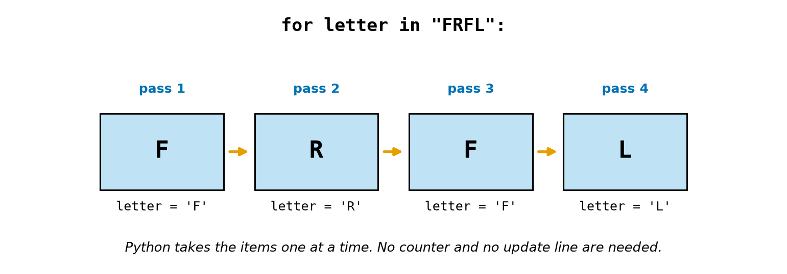
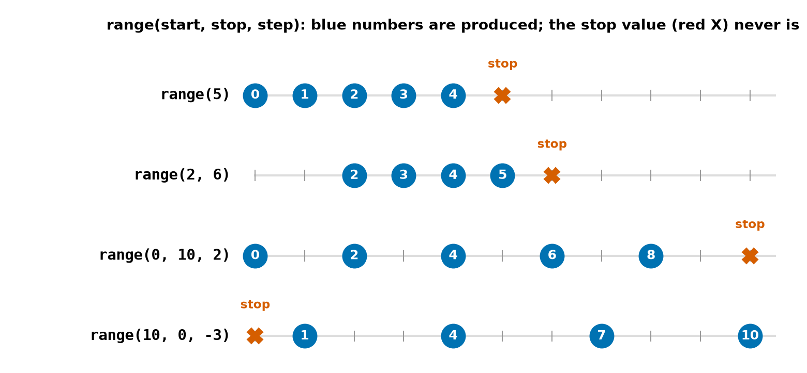
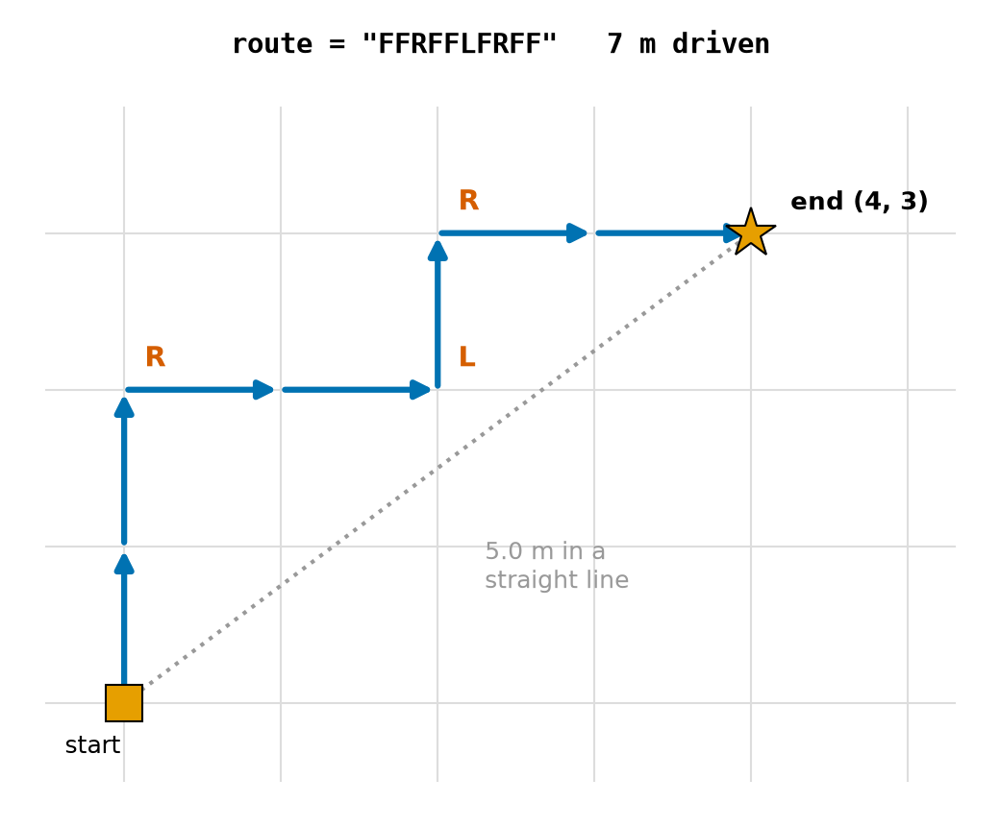
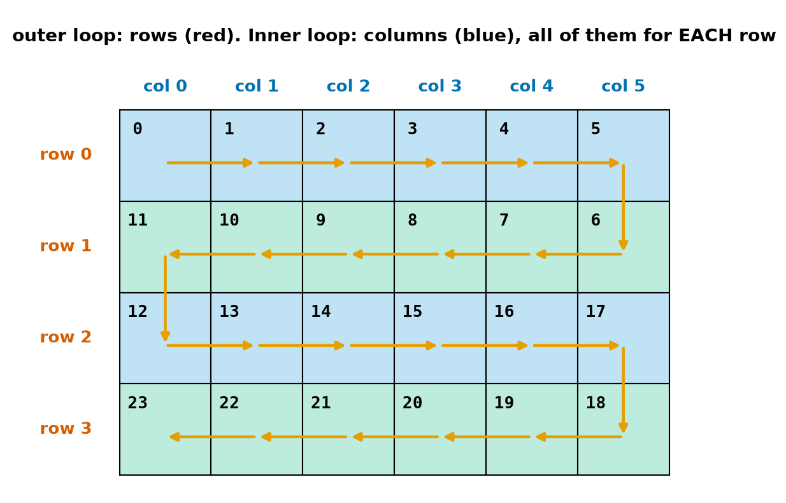
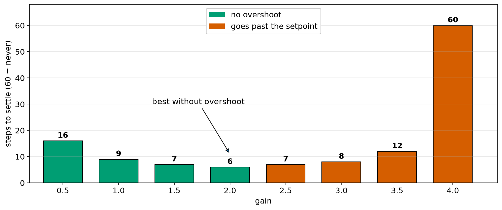

# Chapter 20 — Repeating Part 2: `for` Loops and `range`

> **Part 2 · Chapter 20 of 749**
> **You need:** Chapter 19 (`while`, `break`, `continue`). Keep a script open.
> **You will make:** a program that drives Rover along a route written as letters, a cleaning robot's back-and-forth map, a program that tests many controller gains by itself, and a smooth arm movement.

---

## What you will learn

- How `for` goes through a series of items, one at a time.
- How `range` makes the numbers to count with.
- The off-by-one rule: `range(5)` stops **before** 5.
- When to choose `for` and when to choose `while`.
- How **nested** loops work, and how many times the inner block runs.
- How to run the same experiment many times with different settings.
- How to make equally spaced values without float steps.

---

## New words in this chapter

| Word | Simple meaning |
|---|---|
| **for loop** | A loop that runs once for each item in a series. |
| **loop variable** | The name that holds the current item. |
| **iterable** | Anything that a `for` loop can go through. |
| **range** | A series of whole numbers, made when needed. |
| **off-by-one error** | A loop that runs one time too many or too few. |
| **nested loop** | A loop inside another loop. |
| **parameter sweep** | Running an experiment again and again with different settings. |
| **interpolation** | Working out the values in between two known values. |

---

## 20.1 The `for` loop

Chapter 19 needed three parts for a counting loop: a start, a condition and an update. A `for` loop does this bookkeeping for you.

📖 **New word: for loop** — a loop that runs once for each item in a series.

```python
for letter in "FRFL":
    print(letter)
```

Output:

```
F
R
F
L
```

Look at Figure 20.1.



*Figure 20.1 — The loop takes one item for each pass and stores it in the loop variable.*

**How to read this picture:** The four boxes are the four characters of the string. For pass 1, `letter` holds `'F'`, and the block runs. For pass 2, `letter` holds `'R'`, and so on. When the items run out, the loop ends by itself.

📖 **New word: loop variable** — the name that holds the current item. You choose the name.

📖 **New word: iterable** — anything a `for` loop can go through: a string, a `range`, and later a list or a file. A plain number cannot be gone through:

```
>>> for i in 5:
TypeError: 'int' object is not iterable
```

Count the letters that match something:

```python
count = 0
for ch in "rover robot":
    if ch == "o":
        count += 1
print(count)     # 3
```

---

## 20.2 `range`: numbers to count with

📖 **New word: range** — a series of whole numbers.

```python
for i in range(3):
    print(i)
```

Output: `0`, `1`, `2`. Three passes, and the numbers **start at 0** and stop **before** 3.

`range` makes its numbers only when they are needed. To see them all at once, wrap it in `list(…)` (Chapter 21):

```
>>> list(range(5))
[0, 1, 2, 3, 4]
>>> list(range(2, 6))
[2, 3, 4, 5]
>>> list(range(0, 10, 2))
[0, 2, 4, 6, 8]
>>> list(range(10, 0, -3))
[10, 7, 4, 1]
```

Look at Figure 20.2.



*Figure 20.2 — The three forms of `range`. The stop value is never produced.*

**How to read this picture:** Each line is a number line from 0 to 10. The blue circles are the numbers that `range` produces, and the red X is the stop value. Row 1 starts at 0, because no start was given. Row 2 starts at 2. Row 3 moves in steps of 2. Row 4 counts down. In every row the red X is not included.

| Form | Means | Example |
|---|---|---|
| `range(stop)` | 0 up to just before `stop` | `range(5)` → 0 to 4 |
| `range(start, stop)` | `start` up to just before `stop` | `range(2, 6)` → 2 to 5 |
| `range(start, stop, step)` | jumps of `step`; a negative step counts down | `range(10, 0, -3)` → 10, 7, 4, 1 |

Rules worth noticing:

- `range(5)` gives **5** passes. The last number is 4.
- `range(5, 2)` is empty, so the loop runs zero times. To count down you need a negative step.
- `range` takes **whole numbers only**:

```
>>> range(0, 1, 0.1)
TypeError: 'float' object cannot be interpreted as an integer
```

### Decimal steps: count with an int

Python's refusal is a good thing, because Chapter 19 showed what adding 0.1 again and again does. Count with an int and **calculate** the float:

```python
for n in range(4):
    t = n * 0.1
    print(t)
```

```
0.0
0.1
0.2
0.30000000000000004
```

Each value has at most one tiny rounding error, and errors do not add up. (Adding 0.1 ten times gives 0.9999999999999999, while `10 * 0.1` is exactly 1.0.)

### Off by one

📖 **New word: off-by-one error** — a loop that runs one time too many or too few. It is probably the most common bug in all of programming.

```python
for i in range(1, 100):      # 1 to 99: the 100 is missing!
    ...
for i in range(1, 101):      # 1 to 100
    ...
```

To include the end value, use `stop + 1`. To be sure, test with a tiny case: try `range(1, 4)` and check the numbers it gives.

A useful fact: the number of passes of `range(a, b)` is `b - a`.

---

## 20.3 `for` or `while`?

| Use | When | Example |
|---|---|---|
| `for` | You know how many passes, or you have items to go through | 10 readings; each letter in a route |
| `while` | You stop when something **happens**, and you do not know when | drive until the wall; ask until valid |

`break` and `continue` work in `for` loops just as they do in `while` loops. And a `for` loop cannot accidentally run for ever, because the items eventually run out. That is one more reason to prefer it when you can.

Two small facts:

- The loop variable still exists after the loop, holding its last value. After `for i in range(3):`, `i` is `2`.
- Changing the loop variable inside the block does not affect the next pass. Python hands out the next item anyway.

If you do not need the loop variable at all, the habit is to call it `_`:

```python
for _ in range(2):
    print("beep")
```

---

## 20.4 Nested loops

📖 **New word: nested loop** — a loop inside another loop. For **each** pass of the outer loop, the inner loop runs **completely**.

```python
for a in range(1, 3):
    for b in range(1, 4):
        print(a, b, end=" | ")
    print()
```

Output:

```
1 1 | 1 2 | 1 3 | 
2 1 | 2 2 | 2 3 | 
```

It works like a clock: the minute hand goes all the way round for each single step of the hour hand.

🔢 **Maths** — the block inside runs **outer passes × inner passes** times: here 2 × 3 = 6.

This is why nested loops can get slow. A 1000 × 1000 grid means a million passes. Chapter 35 shows how NumPy avoids that.

Nested loops are natural for anything with rows and columns. Here is a times table:

```python
for r in range(1, 4):
    line = ""
    for c in range(1, 4):
        line += f"{r * c:3d}"
    print(line)
```

```
  1  2  3
  2  4  6
  3  6  9
```

`line` starts empty for each row, grows character by character, and is printed once the row is complete.

---

## 20.5 Four patterns you will use for ever

Nearly every loop you ever write is one of these four. Each one needs a starting value **before** the loop.

For the examples, here are five made-up temperature readings, calculated from the pass number:

```python
for n in range(5):
    reading = 20 + (n * 7) % 5     # 20, 22, 24, 21, 23
```

**1. Counting** — how many readings are above 21?

```python
above = 0
for n in range(5):
    reading = 20 + (n * 7) % 5
    if reading > 21:
        above += 1
print(above)                       # 3
```

**2. Running total** — the average needs the sum:

```python
total = 0
for n in range(5):
    total += 20 + (n * 7) % 5
print(total / 5)                   # 22.0
```

**3. Largest so far** — keep the best value you have seen, and replace it when you see a better one:

```python
largest = 20 + (0 * 7) % 5         # start with the first reading
for n in range(1, 5):
    reading = 20 + (n * 7) % 5
    if reading > largest:
        largest = reading
print(largest)                     # 24
```

Start with the first value, not with 0. If all the readings were negative, a start of 0 would give the wrong answer.

**4. Search** — stop as soon as you find it. A flag or a marker value records the result:

```python
route = "FFRFFLFRFF"
found_at = -1                      # -1 means "not found yet"
for i in range(len(route)):
    if route[i] == "L":
        found_at = i
        break
print(found_at)                    # 5
```

`range(len(route))` gives every valid index of the string: 0 up to its length minus one (Chapter 15).

---

## Code

Rover can now follow a whole route, and there is not a single copied line. The route is a string, with one letter per action.

The file is `code/ch020/route_runner.py`. Type it into `my-code/ch020/`.

```python
# route_runner.py - Rover follows a route written as a string of letters
route = "FFRFFLFRFF"                # F = forward 1 m, L = turn left, R = turn right

x_m, y_m = 0, 0                     # STATE: position on the grid
heading = 0                         # STATE: 0 = north, 1 = east, 2 = south, 3 = west
moves = 0                           # a counter

for letter in route:                # one pass for each letter
    if letter == "L":
        heading = (heading - 1) % 4     # % keeps it between 0 and 3 (Chapter 13)
    elif letter == "R":
        heading = (heading + 1) % 4
    elif letter == "F":
        if heading == 0:
            y_m += 1
        elif heading == 1:
            x_m += 1
        elif heading == 2:
            y_m -= 1
        else:
            x_m -= 1
        moves += 1
    print(f"{letter}: at ({x_m}, {y_m}) facing {heading}")

print("driven:", moves, "m | straight-line distance:", round((x_m ** 2 + y_m ** 2) ** 0.5, 2), "m")
```

| Line | Code | What it does (simple English) |
|---|---|---|
| 1 | comment | The name of the file and the idea. |
| 2 | `route = "FFRFFLFRFF"` | The whole plan, as data. To change the route, change this one line. |
| 3 | *(empty)* | |
| 4–6 | state | Position, heading and a counter (Chapter 14). |
| 7 | *(empty)* | |
| 8 | `for letter in route:` | One pass for each letter. |
| 9–12 | `L` and `R` | Turn. `% 4` wraps the heading, the same idea as `% 360` in Chapter 13. |
| 13 | `elif letter == "F":` | Move forward by one square. |
| 14–21 | nested `if` | Which coordinate changes depends on the heading. |
| 22 | `moves += 1` | Inside the `F` block: turns are not moves. |
| 23 | `print(f"…")` | In the loop, one line per letter, whatever the letter was. |
| 24 | *(empty)* | |
| 25 | `print("driven:", …)` | Not indented: runs once, after the route. Uses Pythagoras (Chapter 14). |

**Output:**

```
F: at (0, 1) facing 0
F: at (0, 2) facing 0
R: at (0, 2) facing 1
F: at (1, 2) facing 1
F: at (2, 2) facing 1
L: at (2, 2) facing 0
F: at (2, 3) facing 0
R: at (2, 3) facing 1
F: at (3, 3) facing 1
F: at (4, 3) facing 1
driven: 7 m | straight-line distance: 5.0 m
```

Look at Figure 20.3.



*Figure 20.3 — The path drawn from the program's output.*

**How to read this picture:** The grey grid has 1 m squares. The orange square is the start, and the star is the end. Each blue arrow is one `F`. The red letters mark the turns. The dotted grey line is the straight line from start to end.

**What the output means:**

- Rover ended at (4, 3), after driving 7 m along the grid.
- The straight-line distance is 5.0 m (a 3-4-5 triangle). The route is longer than the shortcut, just as the odometer and the distance from the start differed in Chapter 14.
- **The program and the route are now separate**: the same code will follow any route you give it. Separating data from code is one of the most powerful ideas in programming.

---

## Small examples

### Example 1 — Sum

```python
total = 0
for n in range(1, 101):
    total += n
print(total)              # 5050
```

### Example 2 — Countdown

```python
for i in range(10, 0, -2):
    print(i, end=" ")     # 10 8 6 4 2
```

### Example 3 — A triangle of stars

```python
for i in range(5):
    print("*" * (i + 1))
```

### Example 4 — `continue` in a `for`

```python
for i in range(0, 5):
    if i % 2 == 0:
        continue
    print(i)              # 1, then 3
```

### Example 5 — Counting nested passes

```python
c = 0
for i in range(3):
    for j in range(4):
        c += 1
print(c)                  # 12
```

### Example 6 — A square route returns home

The route `"FRFRFRFR"` ends at (0, 0), facing north again.

---

## 🏭 Real robot applications

### Application 1 (worked in full) — 🧹 A cleaning robot's back-and-forth path

**1. The real problem.** In Chapter 10 the "lawnmower" pattern cleaned a room far better than wandering at random. Now we can generate that path. A robot covers a room of 6 × 4 cells, going right along one row and left along the next, and it should never repeat a cell.

**2. Why this idea.** A room has rows and columns, so we use a nested loop. On odd rows the direction reverses, and `row % 2` tells us which kind of row we are on.

**3. The numbers.** 6 columns and 4 rows.

**4. The maths, step by step.**

```
Step 1. cells = 6 × 4 = 24
Step 2. moves = 24 − 1 = 23      (each move reaches one new cell)
Step 3. the visit number in an even row = row × 6 + col
Step 4. in an odd row, count from the right: row × 6 + (5 − col)
        for row 1, col 0: 1 × 6 + 5 = 11
```

**5. The code.** File `code/ch020/coverage_grid.py`:

```python
# coverage_grid.py - a cleaning robot's back-and-forth path, printed as a numbered map
WIDTH = 6                           # columns of floor cells
HEIGHT = 4                          # rows of floor cells

for row in range(HEIGHT):           # the outer loop: one row at a time
    line = ""
    for col in range(WIDTH):        # the inner loop: one cell at a time
        if row % 2 == 0:            # even rows run left to right
            order = row * WIDTH + col
        else:                       # odd rows run right to left
            order = row * WIDTH + (WIDTH - 1 - col)
        line += f"{order:4d}"
    print(line)

cells = WIDTH * HEIGHT
moves = cells - 1                   # each move reaches one new cell
print("cells:", cells, "| moves:", moves)
```

| Line | Code | What it does (simple English) |
|---|---|---|
| 2–3 | constants | The room's size. |
| 5 | `for row in range(HEIGHT):` | One pass for each row. |
| 6 | `line = ""` | A new, empty text line for each row. |
| 7 | `for col in range(WIDTH):` | All the columns, for this row. |
| 8–11 | `if / else` | The visit number, by the direction of the row. |
| 12 | `line += f"{order:4d}"` | Add this cell's number, 4 characters wide. |
| 13 | `print(line)` | Indented **once**: after the inner loop, inside the outer. |
| 15–17 | | Runs once, at the end. |

**Output:**

```
   0   1   2   3   4   5
  11  10   9   8   7   6
  12  13  14  15  16  17
  23  22  21  20  19  18
cells: 24 | moves: 23
```

Look at Figure 20.4.



*Figure 20.4 — The robot's path follows the visit numbers.*

**How to read this picture:** Each square is a floor cell, with its visit number in the corner. The outer loop chooses a row (red labels), and the inner loop fills every column (blue labels). The orange arrows connect 0, 1, 2 and so on. The even rows (blue) run to the right, and the odd rows (green) run to the left.

**6. The result.** The robot visits all 24 cells in 23 moves, with no repeats: the shortest possible path. The print shows the plan in numbers.

**7. Going further.** Real rooms have furniture, so the cells are not all free (Chapter 36 adds obstacles). Drones survey fields with the same pattern (Chapter 650), and Chapter 10's missing row reminds us to think about the edges of the room.

### Application 2 (worked in full) — 🤖 Letting the computer tune the gain

📖 **New word: parameter sweep** — running an experiment again and again with different settings.

**1. The real problem.** In Lab 19.3 you changed the gain by hand and ran the program five times. Engineers do this kind of test thousands of times, and they let the computer do it.

**2. Why this idea.** An outer `for` chooses the gain, and an inner `for` runs one whole simulation. We count passes with ints and calculate the gain with `k * 0.5`. An inner `break` ends a run as soon as it settles, and we keep the best result so far.

**3. The numbers.** Gains from 0.5 to 4.0 in steps of 0.5, a limit of 60 steps, and the same wall as Chapter 19.

**4. The maths, step by step.** "No overshoot" means that the lowest distance reached stayed above the setpoint minus the deadband: 0.30 − 0.01 = 0.29. "Best" means the fewest steps among those.

**5. The code.** File `code/ch020/gain_sweep.py`:

```python
# gain_sweep.py - try many gains automatically, and find the fastest one that behaves
SETPOINT_M = 0.30
MAX_SPEED_MS = 0.25
DEADBAND_M = 0.01
DT_S = 0.5
MAX_STEPS = 60

best_gain = 0.0
best_steps = MAX_STEPS

print("gain  steps  lowest distance")
for k in range(1, 9):                     # k = 1, 2, ... 8
    gain = k * 0.5                        # count with an int, then calculate the float
    distance_m = 1.0
    lowest_m = distance_m
    steps = MAX_STEPS

    for step in range(MAX_STEPS):         # one run of the wall simulation (Chapter 19)
        error_m = distance_m - SETPOINT_M
        if abs(error_m) < DEADBAND_M:
            steps = step                  # settled: remember how long it took
            break
        speed_ms = gain * error_m
        if speed_ms > MAX_SPEED_MS:
            speed_ms = MAX_SPEED_MS
        elif speed_ms < -MAX_SPEED_MS:
            speed_ms = -MAX_SPEED_MS
        distance_m -= speed_ms * DT_S
        if distance_m < lowest_m:
            lowest_m = distance_m

    print(f"{gain:4.1f} {steps:6d} {lowest_m:12.3f}")
    no_overshoot = lowest_m >= SETPOINT_M - DEADBAND_M
    if no_overshoot and steps < best_steps:
        best_steps = steps
        best_gain = gain

print("best gain without overshoot:", best_gain, "in", best_steps, "steps")
```

| Line | Code | What it does (simple English) |
|---|---|---|
| 2–6 | constants | The same controller. |
| 8–9 | `best_…` | The best so far. Starts at the worst possible result. |
| 12 | `for k in range(1, 9):` | Eight gains. |
| 13 | `gain = k * 0.5` | Calculate the float (Section 20.2). |
| 14–16 | reset | Each run starts fresh. If you forgot this, each run would continue from the last one. |
| 18 | `for step in range(MAX_STEPS):` | One complete run. |
| 20–22 | `if … break` | Leaves the **inner** loop only. |
| 28–30 | `lowest_m` | Tracks the smallest value seen: a very common pattern. |
| 32 | `print(f"…")` | One table row per gain. |
| 33–36 | best so far | Keep this gain if it is safe and faster. |

**Output:**

```
gain  steps  lowest distance
 0.5     16        0.308
 1.0      9        0.306
 1.5      7        0.305
 2.0      6        0.300
 2.5      7        0.281
 3.0      8        0.262
 3.5     12        0.250
 4.0     60        0.250
best gain without overshoot: 2.0 in 6 steps
```

Look at Figure 20.5.



*Figure 20.5 — More gain helps up to a point. After that, it makes things worse.*

**How to read this picture:** Each bar is one complete run. A lower bar is faster. Green bars never went past the setpoint, and red bars did. The bars fall as the gain rises, reach their lowest at gain 2.0, then climb again, until gain 4.0 never settles.

**6. The result.** The computer found in a blink what took you several runs by hand: gain 2.0 is the fastest gain without overshoot. Two gains give the same number of steps (1.5 and 2.5, both 7), but only the first is safe, so looking at one number would have been misleading.

**7. Going further.** Do not rush to use gain 2.0 on the real Rover. This simulation has no noise and no delay. Chapter 6 showed that delay makes high gains unstable, and Chapter 9 showed how to test against an uncertain robot. A real engineer would back off from the very edge. Part 13 and Chapter 216 tune controllers properly.

### Application 3 — 🦾 Smooth arm motion

An arm should not jump from 20° to 80°. It goes in equal steps. File `code/ch020/joint_path.py`:

```python
start_deg = 20.0
end_deg = 80.0
steps = 6

for i in range(steps + 1):          # + 1 so that we include the last point
    fraction = i / steps            # goes from 0.0 to 1.0
    angle_deg = start_deg + (end_deg - start_deg) * fraction
    print(f"step {i}: {angle_deg:.1f} degrees")
```

It prints 20.0, 30.0, 40.0, 50.0, 60.0, 70.0, 80.0. 📖 **New word: interpolation** — working out the values in between two known values. Notice `steps + 1`: 6 pieces need 7 points. Real arms use the same formula with far more steps and a smoother speed profile (Chapter 394).

### Application 4 — 🌾 Planting in rows

A planting robot places seeds at 0.25 m spacing along 40 m rows, and it has 12 rows. `for row in range(12):` and `for seed in range(161):` give 12 × 161 = 1932 seeds. Why 161? 40 ÷ 0.25 = 160 **gaps**, and 160 gaps need 161 seeds: the fence-post version of an off-by-one error, and a costly one if you order the seed for 1920.

### Application 5 — 🚁 A drone's battery of test flights

Before a software update ships, drone makers fly it in simulation thousands of times, with different winds and starting positions: `for wind in range(0, 16):` and `for run in range(100):`. That gives 16 × 100 = 1600 simulated flights, which cost nothing and never crash a real drone. Chapter 9's Monte Carlo test is the same idea, and Chapter 665 runs a whole mission this way.

---

## 🔧 Hands-on lab

### Lab 20.1 — `range` detective (shell)

**You need:** the Python shell.

**Steps:** Predict each list, then type it.

```
list(range(4))           list(range(1, 4))          list(range(0, 9, 3))
list(range(3, 0, -1))    list(range(5, 2))          list(range(3, 20, 4))
len(range(3, 20, 4))     range(0, 1, 0.5)           range(0, 5, 0)
```

**What you should see:** `[0, 1, 2, 3]`, `[1, 2, 3]`, `[0, 3, 6]`, `[3, 2, 1]`, `[]`, `[3, 7, 11, 15, 19]`, `5`, `TypeError: 'float' object cannot be interpreted as an integer`, and `ValueError: range() arg 3 must not be zero`.

**If it does not work:**

| Problem | Likely cause | Fix |
|---|---|---|
| The output is `range(0, 4)` | `list(…)` is missing | A `range` shows itself like that. Wrap it in `list(…)`. |
| Your list has one extra number | You included the stop value | It is never included. |

### Lab 20.2 — Draw a grid

**You need:** a new Python file.

**Steps:** Using two nested loops, print this room, where `#` is a wall and `.` is floor. Use `WIDTH = 8` and `HEIGHT = 4`.

```
########
#......#
#......#
########
```

Hint: a cell is a wall when `row == 0` or `row == HEIGHT - 1` or `col == 0` or `col == WIDTH - 1`.

**What you should see:** The room above. A solution:

```python
WIDTH = 8
HEIGHT = 4

for row in range(HEIGHT):
    line = ""
    for col in range(WIDTH):
        if row == 0 or row == HEIGHT - 1 or col == 0 or col == WIDTH - 1:
            line += "#"
        else:
            line += "."
    print(line)
```

**If it does not work:**

| Problem | Likely cause | Fix |
|---|---|---|
| One long line | `print(line)` is in the wrong place | It belongs in the outer loop only. |
| The right wall is missing | You used `col == WIDTH` | The last column is `WIDTH - 1`. |
| Every character is on its own line | `print` is inside the inner loop | Build the line, then print it. |

### Lab 20.3 — Write your own route

**You need:** `route_runner.py`.

**Steps:**

1. Change `route` to `"FRFRFRFR"`. Predict where Rover ends and the way it faces. Run it.
2. Write a route that draws a rectangle 3 m wide and 1 m tall and returns home.
3. Add a counter for turns.
4. Add a new letter, `B`, that means one step backwards. Which lines must change?

**What you should see:** For step 1: (0, 0), facing 0. For step 2, one answer is `"FRFFFRFRFFFR"`, and you end at (0, 0). For step 4, `B` is like `F` with the signs flipped: when facing north, `y_m -= 1`, and so on.

**If it does not work:**

| Problem | Likely cause | Fix |
|---|---|---|
| Rover does not return home | Too few turns or moves | Draw the route on squared paper first. |
| `heading` goes negative | `% 4` is missing | Use `(heading - 1) % 4`. |
| `moves` also counts turns | `moves += 1` is outside the `F` block | Indent it to match the `F` block. |

---

## Common mistakes

⚠️ **Off by one.** `range(1, 100)` stops at 99.

⚠️ **Expecting the stop value.** It is never included.

⚠️ **Float steps.** `range` needs ints. Count with an int and calculate.

⚠️ **Counting down without a negative step.** `range(5, 0)` is empty.

⚠️ **`for i in 5:`.** Use `range(5)`.

⚠️ **Wrong indentation in nested loops.** Work out which loop each line belongs to.

⚠️ **Not resetting inside the outer loop.** Each pass needs a fresh start.

⚠️ **`break` only leaves one loop.** It leaves the innermost loop.

⚠️ **`for` when you need `while`.** Waiting for something to happen needs a `while`.

---

## Practice

🏋️ **1.** What numbers does each give? (a) `range(4)`; (b) `range(2, 5)`; (c) `range(1, 10, 3)`; (d) `range(4, 0, -1)`.

🏋️ **2.** Print 1 2 3 4 5 on one line.

🏋️ **3.** How many passes does `range(3, 20, 4)` make?

🏋️ **4.** Write a `for` loop to add up the even numbers from 2 to 20.

🏋️ **5.** Count how many `F` letters there are in `"FFRFFLFRFF"`.

🏋️ **6.** Find the bug. The programmer wants the numbers 1 to 10.

```python
for i in range(1, 10):
    print(i)
```

🏋️ **7.** How many times does `print` run?

```python
for i in range(3):
    for j in range(4):
        print(i, j)
```

🏋️ **8.** Print the times table for 7, from 7 × 1 to 7 × 10, one per line, as `7 x 3 = 21`.

🏋️ **9.** Print a time column from 0.0 to 1.0 s in steps of 0.2, without a float step and without long float tails.

🏋️ **10.** Which loop would you use for each? (a) Read 50 sensor samples. (b) Drive until the battery is below 6 V. (c) Go through each letter of a command. (d) Keep asking until the answer is valid.

🏋️ **11.** (Harder) A fence along a 40 m row has posts every 5 m, one at each end. (a) How many posts? (b) Print the position of each post using `range`. (c) Change the program to work for any length and spacing, as whole numbers, and print the number of posts. (d) What is the general formula, and why is it **not** length ÷ spacing?

---

## Answers

**1.** (a) 0, 1, 2, 3; (b) 2, 3, 4; (c) 1, 4, 7; (d) 4, 3, 2, 1.

**2.**

```python
for i in range(1, 6):
    print(i, end=" ")
```

**3.** 5 passes: 3, 7, 11, 15, 19.

**4.**

```python
total = 0
for n in range(2, 21, 2):
    total += n
print(total)      # 110
```

**5.**

```python
count = 0
for ch in "FFRFFLFRFF":
    if ch == "F":
        count += 1
print(count)      # 7
```

**6.** The stop value is not included, so it ends at 9. Use `range(1, 11)`.

**7.** 3 × 4 = **12** times.

**8.**

```python
for n in range(1, 11):
    print(f"7 x {n} = {7 * n}")
```

**9.**

```python
for n in range(6):
    t = n * 0.2
    print(f"{t:.1f}")
```

**10.** (a) `for`; (b) `while`; (c) `for`; (d) `while`.

**11.** (a) 9 posts. (b) and (c):

```python
length_m = 40
spacing_m = 5
posts = 0
for pos in range(0, length_m + 1, spacing_m):
    print(pos)
    posts += 1
print("posts:", posts)
```

(d) posts = length ÷ spacing + 1. Dividing gives the number of **gaps** (8), and there is always one more post than there are gaps. The `+ 1` in `range` is doing the same job.

---

## Summary

🧠 `for item in series:` runs once per item. No counter or update line is needed, and it cannot run for ever.

🧠 `range(stop)`, `range(start, stop)`, `range(start, stop, step)` make whole numbers. The stop value is **never** included.

🧠 Count with an int and calculate floats: `t = n * 0.1`.

🧠 **Known number of passes or items: `for`. Until something happens: `while`.**

🧠 In a **nested** loop the inner loop runs completely for each outer pass: total passes = outer × inner. Reset what must start fresh.

🧠 A **parameter sweep** runs an experiment with many settings. **Interpolation** computes equal steps between two values. Remember that `n` pieces need `n + 1` points.

🧠 Keep data (a route) separate from code (how to follow one).

---

## Next chapter

So far each variable has held **one** value. The delivery program in Chapter 14 forgot each trip the moment the next one started, and a humanoid has 90 state values to keep. In **Chapter 21 — Lists**, one name will hold a whole series of values: a route of waypoints, a thousand sensor samples, or every joint angle in a robot. You will learn to add to them, remove from them, sort them, slice them, and go through them with `for`.
