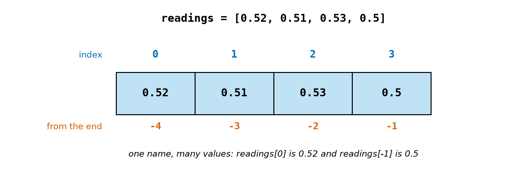
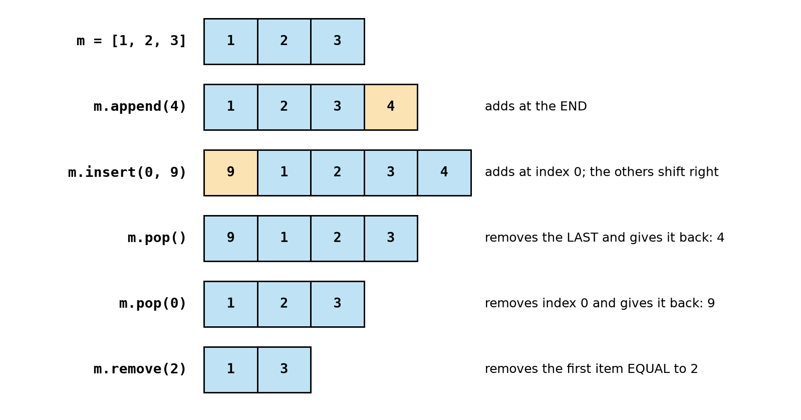
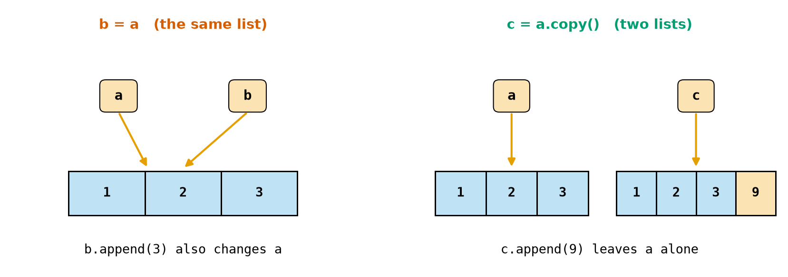
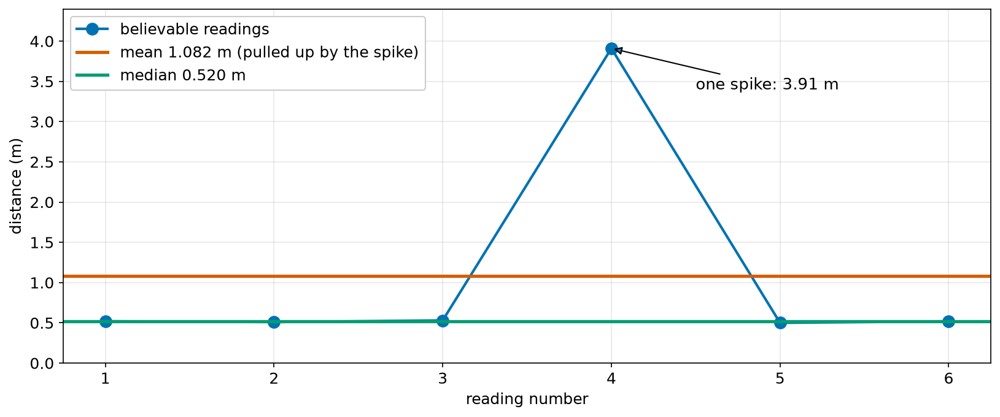
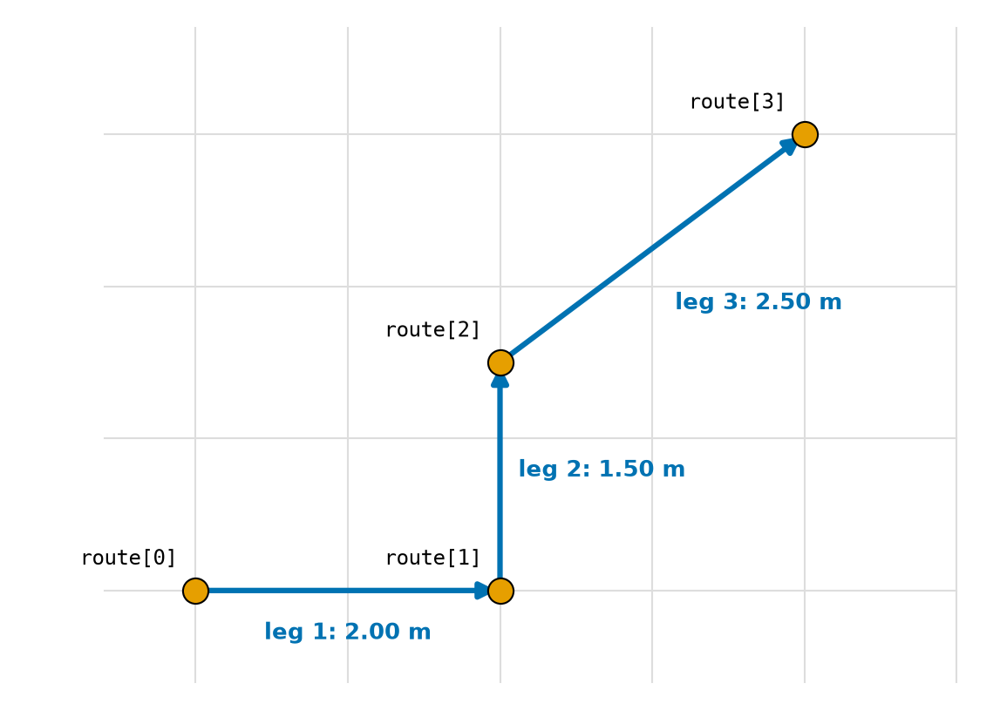
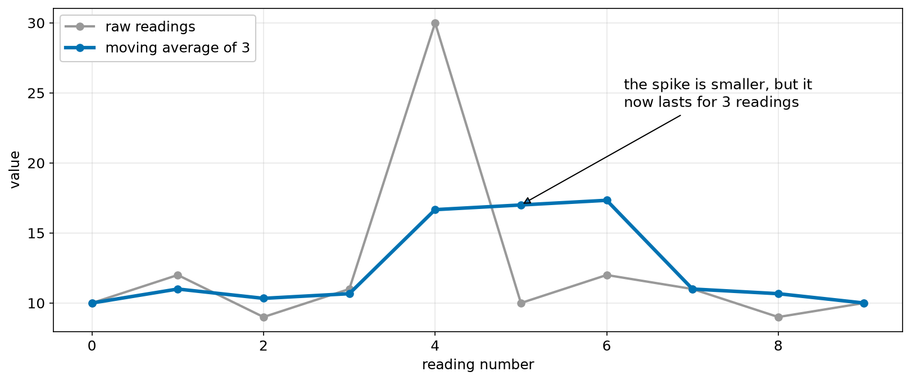

# Chapter 21 — Lists

> **Part 2 · Chapter 21 of 749**
> **You need:** Chapters 15 (index and slice) and 20 (`for`). Keep a shell open.
> **You will make:** a filter that throws out bad sensor readings and finds a value you can trust, a route planner working from a list of waypoints, a moving-average filter, and a delivery log that remembers every trip.

---

## What you will learn

- How one name can hold a whole series of values.
- How to read, change, add and remove items.
- How to go through a list with `for`, `enumerate` and `zip`.
- The useful built-in tools: `len`, `sum`, `min`, `max`, `sorted`.
- Why two names can point to the **same** list, and how to make a real copy.
- How a **list of lists** can hold waypoints or a map.
- The mean and the median, and why robots often prefer the median.

---

## New words in this chapter

| Word | Simple meaning |
|---|---|
| **list** | A numbered series of values, in order, that can change. |
| **item** (element) | One value in a list. |
| **mutable** | Can be changed after it is made. |
| **method** | A tool that belongs to a value (Chapter 15). |
| **alias** | A second name for the same thing. |
| **shallow copy** | A new outer list holding the same items. |
| **nested list** | A list whose items are lists. |
| **waypoint** | A point a robot must pass through on its route. |
| **mean** | The average: add everything up and divide by the count. |
| **median** | The middle value when the values are in order. |
| **outlier** | A value far away from all the others. |
| **list comprehension** | A short way to build a list in one line. |

---

## 21.1 One name, many values

In Chapter 14, each delivery replaced the last one, and the robot forgot it. In Chapter 20 we had to invent a formula just to have some numbers to loop over. A list solves both problems.

📖 **New word: list** — a numbered series of values, in order, written in square brackets.

```
>>> readings = [0.52, 0.51, 0.53, 0.5]
>>> type(readings)
<class 'list'>
>>> len(readings)
4
```

Look at Figure 21.1.



*Figure 21.1 — Each item has an index, starting from 0, and another index counting from the end.*

**How to read this picture:** The four boxes are the four items. The blue numbers are the indexes from the start, and the red numbers are the indexes from the end. It works exactly like the characters of a string in Chapter 15.

Indexing and slicing are the same as for strings:

```
>>> readings[0]
0.52
>>> readings[-1]
0.5
>>> readings[1:3]
[0.51, 0.53]
>>> readings[4]
IndexError: list index out of range
```

A list can start empty and grow:

```
>>> trips = []
>>> len(trips)
0
```

It can hold any kind of value, even several kinds at once: `["rover", 4, 0.25, True]`. In practice, a list usually holds many values of the **same** kind.

Python can make a list for you:

```
>>> list(range(3))
[0, 1, 2]
>>> list("abc")
['a', 'b', 'c']
>>> "DIST:0.42".split(":")
['DIST', '0.42']
>>> [0] * 4
[0, 0, 0, 0]
```

---

## 21.2 Changing a list

Here is the big difference from strings. 📖 **New word: mutable** — can be changed after it is made. Strings are immutable (Chapter 15). Lists are mutable:

```
>>> readings[1] = 0.6
>>> readings
[0.52, 0.6, 0.53, 0.5]
```

Look at Figure 21.2 for the tools that change a list's length.



*Figure 21.2 — The list after each line. The orange boxes are new items.*

**How to read this picture:** Read from top to bottom. Each row shows a line of code and the list **after** that line has run. Notice that `insert` moves the other items along, and that `pop` gives back the item it removes.

| Method | What it does |
|---|---|
| `m.append(x)` | adds `x` at the end |
| `m.insert(i, x)` | adds `x` at index `i` |
| `m.pop()` | removes the last item and gives it back |
| `m.pop(i)` | removes the item at index `i` and gives it back |
| `m.remove(x)` | removes the first item equal to `x` |
| `del m[i]` | removes the item at index `i` (`del` is a Python keyword) |
| `m.clear()` | removes everything |

Some can fail:

```
>>> [1, 3].remove(77)
ValueError: list.remove(x): x not in list
>>> [].pop()
IndexError: pop from empty list
```

⚠️ **Do not store the result of `append` or `sort`.** List methods that change the list give back `None` (the "nothing" from Chapter 16). This is the **opposite** of string methods:

```
>>> q = [3, 1, 2]
>>> x = q.sort()
>>> x
>>> q
[1, 2, 3]
```

(The shell shows nothing for `x`, because it is `None`.) Just write `q.sort()` on its own line.

### Queues and stacks

Two everyday shapes of list use:

- A **queue** is first in, first out: `append` at the end, and `pop(0)` from the front. It is like a line of delivery jobs.
- A **stack** is last in, first out: `append` at the end, and `pop()` from the end. It is like a pile of plates, or the way back through a maze.

---

## 21.3 Going through a list

```python
for r in [0.52, 0.51, 0.53]:
    print(r)
```

That is usually all you need. When you also need the position, use `enumerate`:

```python
for i, letter in enumerate(["F", "L"]):
    print(i, letter)
```

```
0 F
1 L
```

To walk two lists together, use `zip`. It stops at the end of the **shorter** list:

```python
times = [0.0, 0.5, 1.0]
distances = [1.0, 0.875, 0.75]
for t, d in zip(times, distances):
    print(t, d)
```

⚠️ **Never remove items from a list while looping over it.** Python moves along by position, and removing shifts the items, so one gets skipped. A real run:

```python
L = [1, 2, 2, 3]
for v in L:
    if v == 2:
        L.remove(v)
print(L)              # [1, 2, 3]: one 2 survived!
```

Instead, build a **new** list of the items you want to keep. You will do that in the main program of this chapter.

---

## 21.4 Tools for lists

```
>>> q = [3, 1, 2]
>>> sum(q)
6
>>> min(q)
1
>>> max(q)
3
>>> sorted(q)
[1, 2, 3]
>>> q
[3, 1, 2]
>>> 2 in q
True
>>> q.index(1)
1
>>> q.count(1)
1
```

The difference to remember is:

| Tool | The original list | What it gives back |
|---|---|---|
| `sorted(q)` | unchanged | a **new** sorted list |
| `q.sort()` | changed | `None` |

Use `sorted(q, reverse=True)` for largest first. Mixed types cannot be sorted: `sorted([1, "a"])` is a TypeError.

`max([])` is a ValueError, because an empty list has no largest item. Guard against it (Chapter 18). And `sum([]) / len([])` is a ZeroDivisionError.

Joining lists:

```
>>> [1, 2] + [3]
[1, 2, 3]
>>> ",".join(["a", "b"])
'a,b'
```

`join` is the opposite of `split`, and it needs strings: `",".join([1, 2])` is a TypeError. (Convert the numbers first.)

Chapter 20's "largest so far" pattern is built into `max`, but you still need to understand the loop for the times when the rule is more complicated.

### List comprehensions

📖 **New word: list comprehension** — a short way to build a list in one line. This:

```python
doubled = []
for n in range(4):
    doubled.append(n * 2)
```

is the same as this:

```python
doubled = [n * 2 for n in range(4)]      # [0, 2, 4, 6]
```

You can add a filter: `[n for n in range(6) if n % 2 == 0]` gives `[0, 2, 4]`. Use comprehensions for simple cases. If it does not fit on one readable line, use a normal loop.

---

## 21.5 Two names, one list

Chapter 14 said that a name is a label tied to a value, and that the difference from the box picture "only shows with lists". Here it is. Look at Figure 21.3.



*Figure 21.3 — Left: `b = a` ties a second name to the same list. Right: `copy` makes a second list.*

**How to read this picture:** The orange tags are names, and the blue rows are lists. On the left, there is only **one** list, with two tags pointing to it. On the right, there are two separate lists, and appending to one (the orange box) leaves the other alone.

📖 **New word: alias** — a second name for the same thing.

```
>>> a = [1, 2]
>>> b = a
>>> b.append(3)
>>> a
[1, 2, 3]
```

Nobody touched `a`, but it changed, because `a` and `b` are the same list. You can check with `is`:

```
>>> a is b
True
```

To get a separate list, copy it. Either way works:

```
>>> c = a.copy()
>>> d = a[:]
>>> c is a
False
```

📖 **New word: shallow copy** — a new outer list holding the same items. `copy` is enough for a list of numbers. For a list of lists, use `copy.deepcopy` from Chapter 26.

⚠️ **The trap Chapter 14 promised.** `x = y = []` gives you **one** list with two names:

```
>>> x = y = []
>>> x.append(1)
>>> y
[1]
```

And the same thing happens with `*` on a list inside a list:

```
>>> g = [[0] * 3] * 2
>>> g[0][0] = 9
>>> g
[[9, 0, 0], [9, 0, 0]]
```

Both rows are the same row! The right way makes a new row each time:

```python
g = [[0] * 3 for _ in range(2)]
```

---

## 21.6 Lists of lists

📖 **New word: nested list** — a list whose items are lists. This is how we can store a table or a map:

```
>>> p = [[0, 0], [2, 0]]
>>> p[1]
[2, 0]
>>> p[1][0]
2
```

Read `p[1][0]` from left to right: take item 1, then take item 0 of that.

📖 **New word: waypoint** — a point a robot must pass through on its route. A route is naturally a list of `[x, y]` points, and Application 1 uses exactly that.

---

## Code

A distance sensor gives seven readings. One reading dropped out (0.0), and one is a wild spike (3.91). What is the real distance?

The file is `code/ch021/sensor_clean.py`. Type it into `my-code/ch021/`.

```python
# sensor_clean.py - clean a list of distance readings and find a value we can trust
MIN_VALID_M = 0.02                  # the sensor's real limits (Chapter 17)
MAX_VALID_M = 4.0

samples = [0.52, 0.51, 0.0, 0.53, 3.91, 0.50, 0.52]   # one dropout (0.0), one spike (3.91)

good = []                           # an empty list to fill
for s in samples:
    if MIN_VALID_M <= s <= MAX_VALID_M:
        good.append(s)              # keep only believable readings

mean_m = sum(good) / len(good)      # the mean (average)
ordered = sorted(good)              # a new, sorted list
median_m = ordered[len(ordered) // 2]   # the value in the middle

print("all readings:", samples)
print("believable:  ", good)
print("sorted:      ", ordered)
print(f"mean   {mean_m:.3f} m")
print(f"median {median_m:.3f} m")
print(f"rejected {len(samples) - len(good)} of {len(samples)} readings")
```

| Line | Code | What it does (simple English) |
|---|---|---|
| 1 | comment | The name of the file and the idea. |
| 2–3 | constants | The sensor's working range. |
| 4 | *(empty)* | |
| 5 | `samples = […]` | The raw data. |
| 6 | *(empty)* | |
| 7 | `good = []` | An empty list, ready to fill. |
| 8 | `for s in samples:` | Look at each reading once. |
| 9 | `if … <= s <= …:` | A chained comparison (Chapter 17). |
| 10 | `good.append(s)` | Keep it. We build a **new** list rather than removing from the old one (Section 21.3). |
| 11 | *(empty)* | |
| 12 | `mean_m = sum(good) / len(good)` | Add up and divide by the count. |
| 13 | `ordered = sorted(good)` | Leaves `good` as it was. |
| 14 | `median_m = ordered[len(ordered) // 2]` | The item in the middle of the sorted list. |
| 15 | *(empty)* | |
| 16–21 | `print(…)` | The lists and the results. |

**Output:**

```
all readings: [0.52, 0.51, 0.0, 0.53, 3.91, 0.5, 0.52]
believable:   [0.52, 0.51, 0.53, 3.91, 0.5, 0.52]
sorted:       [0.5, 0.51, 0.52, 0.52, 0.53, 3.91]
mean   1.082 m
median 0.520 m
rejected 1 of 7 readings
```

📖 **New words: mean, median, outlier** — the **mean** is the average. The **median** is the middle value when the values are in order. An **outlier** is a value far away from all the others.

Look at Figure 21.4.



*Figure 21.4 — One spike drags the mean far from the truth. The median hardly notices.*

**How to read this picture:** The blue dots are the believable readings. Five of them sit near 0.5 m, and one is at 3.91 m. The red line is the mean: it has been pulled up to 1.08 m, a value that **no reading** was anywhere near. The green line is the median, which sits right on the five good readings.

**What the output means:**

- The range check removed the dropout (0.0), but it could not remove 3.91, because 3.91 m is a possible distance.
- The **mean** says 1.082 m. Rover would think the wall is twice as far away as it really is.
- The **median** says 0.520 m, which is correct. A single wild value can only move the middle by one position.

⚠️ With an even number of values, as here, there are two middle items (0.52 and 0.52). This program takes the upper one, which is close enough for a robot. The textbook median is the average of the two, and Chapter 26 shows `statistics.median`, which does that.

🔢 **Maths** — check the mean:

```
Step 1. sum = 0.52 + 0.51 + 0.53 + 3.91 + 0.50 + 0.52 = 6.49
Step 2. mean = 6.49 ÷ 6 ≈ 1.082   ✓
Step 3. sorted positions 0–5, middle index = 6 // 2 = 3 → 0.52  ✓
```

---

## Small examples

### Example 1 — Grow a list in a loop

```python
evens = []
for n in range(1, 11):
    if n % 2 == 0:
        evens.append(n)
print(evens)      # [2, 4, 6, 8, 10]
```

### Example 2 — The average

```
>>> sum([0.3, 0.31, 0.35]) / 3
0.32
```

### Example 3 — The last two items

```
>>> [1, 2, 3, 4, 5][-2:]
[4, 5]
```

### Example 4 — Reverse a list

```
>>> [1, 2, 3][::-1]
[3, 2, 1]
```

### Example 5 — Is it there?

```
>>> "stop" in ["go", "stop"]
True
```

Compare this with Chapter 17's `or` bug: `command in ["stop", "halt"]` is a clean way to test several values.

### Example 6 — An empty list counts as False

```
>>> bool([])
False
>>> bool([0])
True
```

So `if trips:` means "if the list is not empty".

---

## 🏭 Real robot applications

### Application 1 (worked in full) — 🤖 A route of waypoints

**1. The real problem.** Chapter 20's route was made of grid moves. Real planners output a list of points. Given such a list, how long is the route, how long will it take, and how much energy will it use?

**2. Why this idea.** A list of `[x, y]` lists holds the route. Each leg joins one point to the next, so we need the pairs (0, 1), (1, 2), (2, 3): `range(len(route) - 1)`. Each leg's length comes from Pythagoras.

**3. The numbers.** Look at Figure 21.5.



*Figure 21.5 — Four waypoints and three legs.*

**How to read this picture:** The grey grid has 1 m squares. The orange dots are the waypoints, labelled with their position in the list. The blue arrows are the legs between them. Four points make **three** legs: the same fence-post idea as in Chapter 20.

Rover's speed is 0.25 m/s and its power is 3.78 W.

**4. The maths, step by step.**

```
Step 1. leg 1: from (0, 0) to (2, 0): 2.00 m
Step 2. leg 2: from (2, 0) to (2, 1.5): 1.50 m
Step 3. leg 3: from (2, 1.5) to (4, 3): √(2² + 1.5²) = √6.25 = 2.50 m
Step 4. total = 6.00 m;  time = 6.00 ÷ 0.25 = 24 s
Step 5. energy = 3.78 × 24 ÷ 3600 = 0.0252 Wh
```

**5. The code.** File `code/ch021/waypoints.py`:

```python
# waypoints.py - a route as a list of [x, y] points: length, time and energy
SPEED_MS = 0.25
POWER_W = 3.78                       # Rover (Chapter 5)

route = [[0.0, 0.0], [2.0, 0.0], [2.0, 1.5], [4.0, 3.0]]    # a list of lists

total_m = 0.0
for i in range(len(route) - 1):      # one pass per pair of neighbouring points
    x1, y1 = route[i]                # unpack a point into two names (Chapter 14)
    x2, y2 = route[i + 1]
    leg_m = ((x2 - x1) ** 2 + (y2 - y1) ** 2) ** 0.5
    total_m += leg_m
    print(f"leg {i + 1}: ({x1}, {y1}) to ({x2}, {y2}) = {leg_m:.2f} m")

time_s = total_m / SPEED_MS
energy_wh = POWER_W * time_s / 3600
print(f"total {total_m:.2f} m | time {time_s:.0f} s | energy {energy_wh:.4f} Wh")
```

| Line | Code | What it does (simple English) |
|---|---|---|
| 2–3 | constants | Rover's facts. |
| 5 | `route = […]` | The whole route, as data. |
| 7 | `total_m = 0.0` | A running total. |
| 8 | `for i in range(len(route) - 1):` | Without the `- 1`, `route[i + 1]` would be an IndexError on the last pass. |
| 9–10 | `x1, y1 = route[i]` | Each point has two numbers, and each gets a name. |
| 11 | `leg_m = …` | Pythagoras. |
| 12–13 | total and print | `i + 1` makes a human-friendly number, starting at 1. |
| 15–17 | results | Time, energy, and the report. |

**Output:**

```
leg 1: (0.0, 0.0) to (2.0, 0.0) = 2.00 m
leg 2: (2.0, 0.0) to (2.0, 1.5) = 1.50 m
leg 3: (2.0, 1.5) to (4.0, 3.0) = 2.50 m
total 6.00 m | time 24 s | energy 0.0252 Wh
```

**6. The result.** A planner can now hand this program any list of points, of any length, and get the answer without a single code change. The numbers agree with the hand calculation.

**7. Going further.** Chapter 299 drives a real robot towards such points. Chapter 650 flies a drone through them, and Parts 22 and 23 show how the list of points gets created in the first place.

### Application 2 (worked in full) — 🤖🚁 A moving-average filter

**1. The real problem.** Sensor readings are noisy. A control loop that uses each raw reading will jerk around. Every robot smooths its data somehow, and the simplest way is to average the last few readings.

**2. Why this idea.** A slice gives the most recent values, and `sum / len` averages them. We need to be careful at the start of the list, when fewer readings are available. That is what `max(0, …)` handles.

**3. The numbers.** A window of 3, and ten readings with one spike of 30.

**4. The maths, step by step.**

```
i = 0: [10]              → 10.0
i = 1: [10, 12]          → 11.0
i = 2: [10, 12, 9]       → 10.3
i = 4: [9, 11, 30]       → 16.7     the spike enters
i = 6: [30, 10, 12]      → 17.3     still inside the window
i = 7: [10, 12, 11]      → 11.0     the spike has left
```

**5. The code.** File `code/ch021/moving_average.py`:

```python
# moving_average.py - smooth noisy readings with the average of the last few
WINDOW = 3                           # how many readings to average

readings = [10, 12, 9, 11, 30, 10, 12, 11, 9, 10]    # 30 is a noise spike

smoothed = []
for i in range(len(readings)):
    start = max(0, i - WINDOW + 1)   # never go before the start of the list
    recent = readings[start:i + 1]   # a slice: at most the last WINDOW readings
    smoothed.append(sum(recent) / len(recent))

for raw, avg in zip(readings, smoothed):     # walk both lists together
    print(f"raw {raw:3d}   smoothed {avg:5.1f}")
```

| Line | Code | What it does (simple English) |
|---|---|---|
| 2 | `WINDOW = 3` | The size of the window. |
| 4 | `readings = […]` | The data. |
| 6 | `smoothed = []` | The results will go here. |
| 8 | `start = max(0, i - WINDOW + 1)` | `max` here takes two numbers and gives the larger, so a negative start is impossible. |
| 9 | `recent = readings[start:i + 1]` | `i + 1`, because the slice stops before its end (Chapter 15). |
| 10 | `smoothed.append(…)` | The average of the window. |
| 12–13 | `zip` | Two lists, side by side. |

**Output:**

```
raw  10   smoothed  10.0
raw  12   smoothed  11.0
raw   9   smoothed  10.3
raw  11   smoothed  10.7
raw  30   smoothed  16.7
raw  10   smoothed  17.0
raw  12   smoothed  17.3
raw  11   smoothed  11.0
raw   9   smoothed  10.7
raw  10   smoothed  10.0
```

Look at Figure 21.6.



*Figure 21.6 — The smoothed line is calmer, but a spike still leaves a mark, and it lasts longer.*

**How to read this picture:** The grey line is the raw data, and the blue line is the moving average of 3. Away from the spike, the blue line is smoother and closer to the true value of about 10. At the spike, the raw value is 30, and the blue line only rises to about 17, but it stays high for 3 readings.

**6. The result.** The spike went from 30 to about 17. But a moving average always **delays** the signal and spreads a spike out, and that delay can hurt a control loop (Chapter 6). A larger window is smoother and slower. There is no free lunch.

**7. Going further.** A median of the window would have removed this spike completely. Chapter 134 compares the two on real sensor data, and the Kalman filter in Chapter 416 is a much cleverer way of doing the same job.

### Application 3 — 🏥 A queue of deliveries

A hospital robot takes jobs in the order they arrive: `jobs.append("room 12")`, and when it is free, `next_job = jobs.pop(0)`. An urgent job can jump the line with `jobs.insert(0, "ICU")`. Before popping, a guard `if jobs:` prevents an IndexError on an empty queue. Real systems use the same idea with several levels of priority.

### Application 4 — 🧹 A map of a room

A floor can be stored as a list of lists, with `0` for free and `1` for an obstacle: `room[row][col]`. This **occupancy grid** is how most mobile robots store a map (Part 22). It must be built with a comprehension, not with `* 2` (Section 21.5), or every row will be the same row and one obstacle will appear in all of them.

### Application 5 — 🚶 A humanoid's joints

Chapter 14 worried about 90 state variables. With lists, `angles_deg = [0.0] * 30` holds all 30 joint angles under one name, and `for i in range(30):` updates them all in one loop. A limit check is three lines instead of ninety. The next step is to give each number a name instead of a position: `joints["left_knee"]`, in Chapter 22.

---

## 🔧 Hands-on lab

### Lab 21.1 — List surgery (shell)

**You need:** the Python shell.

**Steps:** Predict the list after **each** line, then type it.

```python
m = [1, 2, 3]
m.append(4)
m.insert(0, 9)
x = m.pop()
y = m.pop(0)
m.remove(2)
m[0] = 7
m.append(5); m.sort(reverse=True)
```

Finally, what are `x`, `y` and `m`?

**What you should see:** `[1, 2, 3, 4]`, `[9, 1, 2, 3, 4]`, `[9, 1, 2, 3]`, `[1, 2, 3]`, `[1, 3]`, `[7, 3]`, and finally `[7, 5, 3]`. `x` is 4 and `y` is 9.

**If it does not work:**

| Problem | Likely cause | Fix |
|---|---|---|
| `ValueError: list.remove(x)` | The value is not in the list | `remove` takes a **value**. `pop` takes an **index**. |
| `m` becomes `None` | You wrote `m = m.sort()` | `sort` gives back `None`. Just write `m.sort()`. |

### Lab 21.2 — The alias experiment

**You need:** the Python shell.

**Steps:** Predict, then check:

1. `t = [5, 3, 8]`, then `u = t`, then `u[0] = 99`, then look at `t`.
2. `v = t.copy()`, then `v[0] = 1`, then look at `t`.
3. `g = [[0] * 3] * 2`, then `g[0][0] = 9`, then look at `g`.
4. Rebuild it as `g = [[0] * 3 for _ in range(2)]`, and repeat.

**What you should see:** `[99, 3, 8]`; still `[99, 3, 8]`; `[[9, 0, 0], [9, 0, 0]]`; `[[9, 0, 0], [0, 0, 0]]`.

**If it does not work:**

| Problem | Likely cause | Fix |
|---|---|---|
| Your first answer is `[5, 3, 8]` | You expected `u` to be a copy | `u = t` only adds a name. See Figure 21.3. |

### Lab 21.3 — A delivery log that remembers

**You need:** a new file `my-code/ch021/delivery_log.py`.

**Steps:** Type this (`code/ch021/delivery_log.py`) and run it. Then add a line that reports how many trips were longer than 100 m.

```python
# delivery_log.py - Chapter 14's deliveries, now remembering every trip
trips_m = []                         # an empty list: nothing delivered yet

trips_m.append(120.0)
trips_m.append(85.5)
trips_m.append(240.0)
trips_m.append(64.5)

print("trips:", trips_m)
print("deliveries:", len(trips_m))
print("total:", sum(trips_m), "m")
print("average:", sum(trips_m) / len(trips_m), "m")
print("longest:", max(trips_m), "m | shortest:", min(trips_m), "m")
print("trip number of the longest:", trips_m.index(max(trips_m)) + 1)
```

**What you should see:**

```
trips: [120.0, 85.5, 240.0, 64.5]
deliveries: 4
total: 510.0 m
average: 127.5 m
longest: 240.0 m | shortest: 64.5 m
trip number of the longest: 3
```

Trips over 100 m: 2. One way: `len([t for t in trips_m if t > 100])`. Chapter 14 could not answer "which was the longest?", because it had thrown the trips away.

**If it does not work:**

| Problem | Likely cause | Fix |
|---|---|---|
| `ZeroDivisionError` | The list is empty | Check the `append` lines, or add a guard. |
| `AttributeError: 'float' object has no attribute 'append'` | You wrote `trips_m = 120.0` | Use `append`. |

---

## Common mistakes

⚠️ **Index off the end.** The last index is `len(m) - 1`.

⚠️ **`m = m.append(x)` or `m = m.sort()`.** These give back `None`, and you lose the list.

⚠️ **Confusing `remove(value)` and `pop(index)`.**

⚠️ **Removing while looping.** Build a new list.

⚠️ **`b = a` when you wanted a copy.** Use `a.copy()`.

⚠️ **`[[0] * 3] * 2`.** Use a comprehension for nested lists.

⚠️ **`max`, `min` or an average on an empty list.** Guard first.

⚠️ **Thinking the mean is always best.** One outlier ruins it.

---

## Practice

🏋️ **1.** With `v = [4, 8, 15, 16, 23, 42]`, find (a) `v[2]`; (b) `v[-2]`; (c) `v[1:4]`; (d) `len(v)`; (e) `sum(v)`; (f) `max(v)`.

🏋️ **2.** Start with the same `v`. After `v.append(50)` and `v.pop(0)`, what is `v`?

🏋️ **3.** Find the average of `[0.30, 0.31, 0.35]` in one line.

🏋️ **4.** What is `t` afterwards?

```python
t = [5, 3, 8]
u = t
u[0] = 99
```

🏋️ **5.** Write a loop that builds a list of the even numbers from 1 to 10.

🏋️ **6.** Find the bug.

```python
scores = [3, 1, 2]
scores = scores.sort()
print(scores[0])
```

🏋️ **7.** What is the median of `[0.5, 0.1, 0.3]`? Write it in Python.

🏋️ **8.** How many values in `[0.2, 0.9, 0.1, 0.5]` are below 0.3? Write a loop.

🏋️ **9.** Write a list comprehension that gives the squares of 1 to 5.

🏋️ **10.** A route has 12 waypoints. How many legs does it have? Why does `range(len(route) - 1)` have a `- 1`?

🏋️ **11.** (Harder) (a) Add a value of 0.52 to `sensor_clean.py`'s `good` list so that there are 7 values. What does the median line give now? (b) Why does the mean get so badly affected by one outlier, and the median not? (c) Write a moving **median** of window 3 for the readings in Application 2. What does it give at the position of the spike?

---

## Answers

**1.** (a) `15`; (b) `23`; (c) `[8, 15, 16]`; (d) `6`; (e) `108`; (f) `42`.

**2.** `[8, 15, 16, 23, 42, 50]`.

**3.** `sum([0.30, 0.31, 0.35]) / 3` gives `0.32`.

**4.** `[99, 3, 8]`. `u` and `t` are the same list.

**5.**

```python
evens = []
for n in range(1, 11):
    if n % 2 == 0:
        evens.append(n)
```

**6.** `sort` gives back `None`, so `scores` becomes `None`, and `scores[0]` fails. Write `scores.sort()` on its own line.

**7.** `sorted([0.5, 0.1, 0.3])[1]` gives `0.3`.

**8.**

```python
count = 0
for v in [0.2, 0.9, 0.1, 0.5]:
    if v < 0.3:
        count += 1
print(count)      # 2
```

**9.** `[n ** 2 for n in range(1, 6)]` gives `[1, 4, 9, 16, 25]`.

**10.** 11 legs. There is one leg fewer than there are points. Without the `- 1`, the last pass would ask for `route[i + 1]`, which does not exist.

**11.** (a) With seven values, sorted `[0.5, 0.51, 0.52, 0.52, 0.52, 0.53, 3.91]`, the index is `7 // 2 = 3`, giving **0.52**. (b) The mean adds every value, so a huge value adds a huge amount. The median only uses **position**, so it does not care how far away an extreme value is. (c)

```python
smoothed = []
for i in range(len(readings)):
    start = max(0, i - 2)
    recent = sorted(readings[start:i + 1])
    smoothed.append(recent[len(recent) // 2])
```

At the spike, the window `[9, 11, 30]` gives **11**: the spike has gone. (The outputs are 10, 12, 10, 11, 11, 11, 12, 11, 11, 10.)

---

## Summary

🧠 A **list** holds a numbered series of values: `[a, b, c]`. Index and slice work as for strings.

🧠 Lists are **mutable**: `m[i] = x`, `append`, `insert`, `pop`, `remove`.

🧠 Changing methods give back `None`. Do not store their result. `sorted(q)` gives a new list, and `q.sort()` changes `q`.

🧠 `for`, `enumerate` and `zip` go through lists. Do not remove items while looping: build a new list.

🧠 `b = a` makes an **alias**. `a.copy()` makes a copy. Beware of `[[0] * 3] * 2`.

🧠 A **list of lists** holds waypoints and maps: `m[row][col]`.

🧠 The **median** resists outliers, and the **mean** does not. A **moving average** smooths data but adds delay.

---

## Next chapter

A list finds things by **position**. But "joint number 14" means nothing to a person, while "left knee" does. In **Chapter 22 — Tuples and dictionaries**, you will meet fixed pairs of values, and the dictionary, which finds a value by a **name** you choose. You will use them to hold a robot's settings, a table of sensors and a command lookup.
