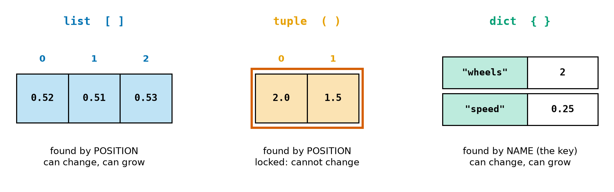
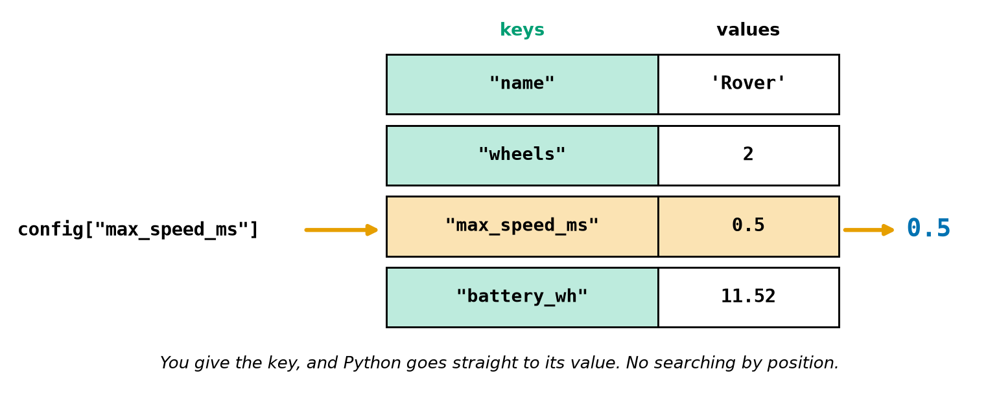
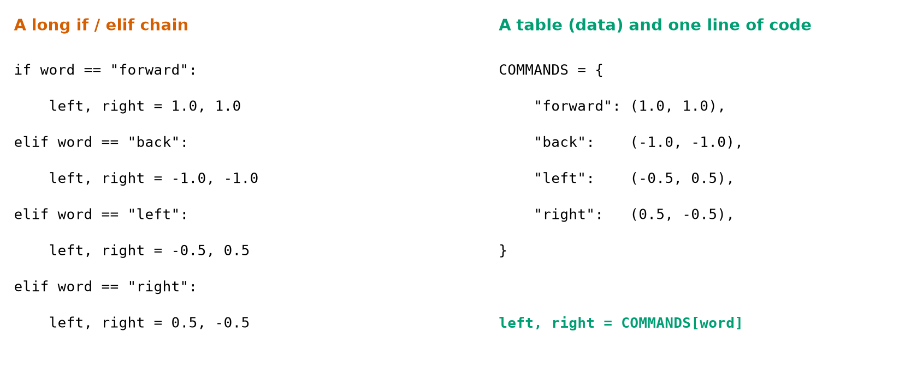
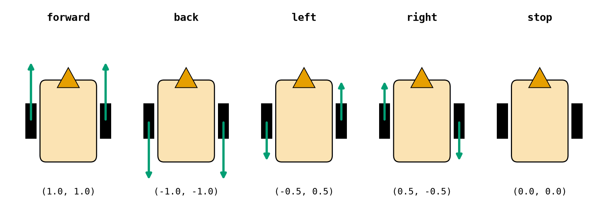
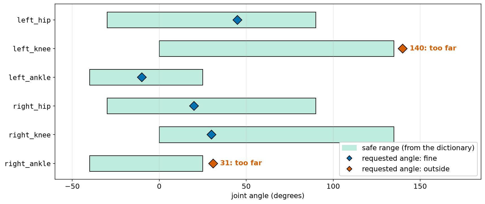

# Chapter 22 — Tuples and Dictionaries

> **Part 2 · Chapter 22 of 749**
> **You need:** Chapter 21 (lists). Keep a shell open.
> **You will make:** a single table holding all of Rover's settings, a command lookup that turns words into wheel speeds, a safety check for a humanoid's joints, and a counter for events in a robot's log.

---

## What you will learn

- What a **tuple** is, and when to use one instead of a list.
- What a **dictionary** is: values found by a name, not a position.
- How to read, add, change and remove entries safely.
- How to go through a dictionary.
- How to replace a long `if / elif` chain with a table.
- How to count things with a dictionary.
- Sets, for keeping track of what you have already seen.

---

## New words in this chapter

| Word | Simple meaning |
|---|---|
| **tuple** | A fixed series of values, written with `( )`. It cannot be changed. |
| **unpacking** | Sharing the items of a tuple or list among several names. |
| **dictionary** (`dict`) | A collection of named values. |
| **key** | The name used to find a value in a dictionary. |
| **value** | The thing stored under a key. |
| **KeyError** | The error you get when you ask for a key that is not there. |
| **lookup table** | A dictionary used in place of a chain of decisions. |
| **set** | A collection without duplicates and without order. |

---

## 22.1 Tuples

📖 **New word: tuple** — a fixed series of values, written with round brackets.

```
>>> p = (2.0, 1.5)
>>> type(p)
<class 'tuple'>
>>> p[0]
2.0
>>> len(p)
2
```

Reading works just like a list. Changing does not:

```
>>> p[0] = 3.0
TypeError: 'tuple' object does not support item assignment
>>> p.append(1)
AttributeError: 'tuple' object has no attribute 'append'
```

Look at Figure 22.1, which compares the three kinds of container in this part of the book.



*Figure 22.1 — A list and a tuple find items by position, and a dictionary finds them by name.*

**How to read this picture:** The blue row is a list, and the numbers above it are positions. The orange row is a tuple. It also has positions, but the red frame means it is locked. On the right, the dictionary has two columns: the green names are the **keys**, and the white boxes are the **values**.

### When to use a tuple

Use a tuple when the items **belong together** as one thing and their number is fixed: a point `(x, y)`, a colour `(red, green, blue)`, a pair of wheel speeds `(left, right)`. Being locked is an advantage: nothing can change a point by accident.

| Use a list when | Use a tuple when |
|---|---|
| the number of items can change | the number of items is fixed |
| the items are all the same kind of thing | each position has its own meaning |
| example: 1000 sensor samples | example: `(x, y)`, `(left, right)` |

### Unpacking

📖 **New word: unpacking** — sharing the items of a tuple or list among several names. You have been doing this since Chapter 14:

```
>>> x, y = p
>>> x
2.0
>>> x, y, z = p
ValueError: not enough values to unpack (expected 3, got 2)
```

In fact, the brackets are optional: `q = 2.0, 1.5` makes a tuple too. That is why `a, b = b, a` works (Chapter 14): the right side builds a tuple.

⚠️ A tuple with one item needs a comma. `(5)` is just the number 5, and `(5,)` is a tuple:

```
>>> type((5))
<class 'int'>
>>> type((5,))
<class 'tuple'>
```

---

## 22.2 Dictionaries

In Chapter 21, a humanoid's joints were `angles_deg[14]`. Which joint is 14? Nobody can remember. It would be far better to write `angles_deg["left_knee"]`.

📖 **New word: dictionary** — a collection of named values. Python calls it `dict`.

📖 **New word: key** — the name used to find a value.

```
>>> d = {"name": "Rover", "wheels": 2}
>>> type(d)
<class 'dict'>
>>> d["name"]
'Rover'
>>> len(d)
2
```

Look at Figure 22.2.



*Figure 22.2 — You give a key, and you get its value back.*

**How to read this picture:** The table has one row per entry. Green cells are keys, and white cells are values. On the left, the code asks for the key `"max_speed_ms"`. Python goes directly to that row (orange) and gives back its value, 0.5.

The name "dictionary" fits well: you look up a word and find its meaning.

### Adding and changing

The same line does both. If the key exists, its value is replaced. If not, a new entry is added:

```
>>> d["speed"] = 0.25
>>> d["wheels"] = 4
>>> d
{'name': 'Rover', 'wheels': 4, 'speed': 0.25}
```

A key can appear only once. Writing `{"a": 1, "a": 2}` silently keeps the last one: `{'a': 2}`.

### When the key is missing

📖 **New word: KeyError** — the error you get when you ask for a key that is not there.

```
>>> d["colour"]
KeyError: 'colour'
```

Two safe ways to deal with that:

```
>>> "colour" in d          # is the key there?
False
>>> d.get("colour", "red")     # the value, or this default
'red'
```

Without the second argument, `get` gives `None`. Note that `in` checks the **keys**, not the values: `"Rover" in d` is False.

### Removing

```
>>> d.pop("wheels")
4
>>> del d["speed"]
>>> d
{'name': 'Rover'}
```

### Going through a dictionary

```python
config = {"a": 1, "b": 2}

for key in config:              # gives the keys
    print(key)

for key, value in config.items():    # gives both: the most useful form
    print(key, value)

for value in config.values():   # gives only the values
    print(value)
```

A dictionary remembers the order in which entries were added. To go through it in alphabetical order, use `sorted(config)`, which gives the keys in order.

⚠️ Do not add or remove keys while looping over a dictionary:

```
RuntimeError: dictionary changed size during iteration
```

(Changing the value of an existing key is fine.)

### What can be a key?

Strings, numbers and tuples can be keys. A list cannot, because it can change:

```
>>> {[1, 2]: 3}
TypeError: cannot use 'list' as a dict key (unhashable type: 'list')
>>> g = {(0, 0): "free"}
>>> g[(0, 0)]
'free'
```

A tuple key like `(x, y)` is a neat way to store a map where most cells are empty (Practice 11).

### Nested dictionaries

A value can be anything, including another dictionary:

```python
sensors = {
    "front": {"pin": 2, "max_m": 4.0},
    "left":  {"pin": 3, "max_m": 2.0},
}
print(sensors["left"]["max_m"])     # 2.0
```

Read it from left to right: find `"left"`, and inside that find `"max_m"`. This shape, dictionaries inside dictionaries, is how JSON files look, and robots use JSON all the time (Chapter 546).

Dictionaries are mutable, so the alias trap of Chapter 21 applies: `b = a` gives two names for one dictionary. Use `a.copy()`.

---

## 22.3 Sets

📖 **New word: set** — a collection without duplicates and without order. It is written with curly brackets but has no keys:

```
>>> s = {1, 2, 2, 3}
>>> s
{1, 2, 3}
>>> 2 in s
True
>>> s.add(9)
>>> s[0]
TypeError: 'set' object is not subscriptable
```

A set answers one question very quickly: **have I seen this before?** `seen = set()` makes an empty one (`{}` would make an empty dictionary).

A robot can record every cell it has visited:

```python
visited = set()
x, y = 0, 0
for letter in "EENWWS":
    visited.add((x, y))
    if letter == "E":
        x += 1
    elif letter == "W":
        x -= 1
    elif letter == "N":
        y += 1
    else:
        y -= 1
visited.add((x, y))
print(len(visited))     # 6
```

It made 6 moves and came back to the start, so it stood on 7 places, but only 6 **different** ones.

---

## 22.4 A list of records

A dictionary is a good way to hold all the facts about **one** thing. A record like this describes one robot:

```python
robot = {"name": "rover", "battery_pct": 87.5, "x_m": 2.0}
```

A **list of dictionaries** then holds many of those things. It is how fleets, parts catalogues and logs are usually held in memory. Chapter 15's status board had to write out each robot by hand. Now the data and the program are separate:

```python
fleet = [
    {"name": "rover",   "battery_pct": 87.5,  "x_m": 2.0},
    {"name": "cleaner", "battery_pct": 9.0,   "x_m": 12.345},
    {"name": "arm",     "battery_pct": 100.0, "x_m": 0.5},
]

for robot in fleet:
    print(f"{robot['name'].upper():<10}{robot['x_m']:>8.2f}{robot['battery_pct']:>9.1f}%")
```

Output:

```
ROVER         2.00     87.5%
CLEANER      12.35      9.0%
ARM           0.50    100.0%
```

Each pass through the loop, `robot` is one whole dictionary. Notice the quotes inside the f-string: they are single quotes, because the f-string itself uses double quotes (Lab 15.3).

Questions about a fleet now need only the loop patterns from Chapter 20. Which robots need charging?

```python
to_charge = []
for robot in fleet:
    if robot["battery_pct"] < 20:
        to_charge.append(robot["name"])
print(to_charge)                # ['cleaner']
```

Which robot has the most charge? This is "largest so far", keeping the whole record:

```python
best = fleet[0]
for robot in fleet:
    if robot["battery_pct"] > best["battery_pct"]:
        best = robot
print(best["name"])             # arm
```

To add a robot to the fleet, you add one line of data. No line of the program has to change.

A trace table for the last loop shows how `best` moves:

| Pass | `robot` | Its battery | Bigger than `best`? | `best` afterwards |
|---|---|---|---|---|
| 1 | rover | 87.5 | no (equal) | rover |
| 2 | cleaner | 9.0 | no | rover |
| 3 | arm | 100.0 | yes | arm |

---

## 22.5 Which container?

| I need… | Use | Robot example |
|---|---|---|
| a series that grows, in order | list | sensor samples, waypoints |
| a fixed group of values | tuple | `(x, y)`, `(left, right)` |
| to find things by name | dict | settings, joint limits |
| to know whether I have seen something | set | cells already cleaned |
| many records | list of dicts | a fleet of robots |

When you are unsure, ask how you will **find** an item later. By position: a list. By name: a dictionary. "Is it there?": a set.

---

## Code

All of Rover's settings have been scattered about as constants. Let us put them in one table.

The file is `code/ch022/rover_config.py`. Type it into `my-code/ch022/`.

```python
# rover_config.py - all of Rover's settings in one dictionary
PI = 3.14159

config = {
    "name": "Rover",
    "wheel_diameter_m": 0.06589,      # from the calibration in Chapter 16
    "ticks_per_turn": 540,
    "max_speed_ms": 0.5,
    "battery_wh": 11.52,
    "power_w": 3.78,
}

for key, value in config.items():     # every setting, name and value
    print(f"{key:<18} {value}")

circumference_m = PI * config["wheel_diameter_m"]
metres_per_tick = circumference_m / config["ticks_per_turn"]
hours = config["battery_wh"] / config["power_w"]
camera_on = config.get("camera", False)     # not in the dictionary: use the default

print(f"one tick = {metres_per_tick * 1000:.3f} mm")
print(f"running time = {hours:.2f} h")
print("camera fitted:", camera_on)
```

| Line | Code | What it does (simple English) |
|---|---|---|
| 1 | comment | The name of the file and the idea. |
| 2 | `PI = 3.14159` | A constant. |
| 3 | *(empty)* | |
| 4 | `config = {` | The dictionary starts. Python lets it run over several lines, until the matching `}`. |
| 5–10 | `"key": value,` | One setting per line, with units in the key names (Chapter 14). |
| 11 | `}` | The end. |
| 12 | *(empty)* | |
| 13 | `for key, value in config.items():` | Each entry gives two values, unpacked into two names. |
| 14 | `print(f"{key:<18} {value}")` | Width 18, on the left (Chapter 15). |
| 15 | *(empty)* | |
| 16–18 | `config["…"]` | Each setting is found by name. |
| 19 | `camera_on = config.get("camera", False)` | The entry does not exist, so the default is used. No crash. |
| 20 | *(empty)* | |
| 21–23 | `print(…)` | The results. |

**Output:**

```
name               Rover
wheel_diameter_m   0.06589
ticks_per_turn     540
max_speed_ms       0.5
battery_wh         11.52
power_w            3.78
one tick = 0.383 mm
running time = 3.05 h
camera fitted: False
```

**What the output means:**

- One encoder tick is 0.383 mm of travel: that is how finely Rover can measure its distance.
- All the settings live in one place, and `get` gives a sensible answer for an optional part.

💡 **Tip:** A dictionary of settings can be loaded from a file (Chapter 27). Robots can then be tuned without changing their code. ROS 2's **parameters** (Chapter 563) work this way.

---

## Small examples

### Example 1 — A tuple as a return of two facts

```python
position = (2.0, 1.5)
x, y = position
```

### Example 2 — Update a count

```python
stock = {"bolt": 40, "nut": 25}
stock["bolt"] -= 3
print(stock["bolt"])       # 37
```

### Example 3 — Total of all values

```python
print(sum({"bolt": 37, "nut": 25}.values()))    # 62
```

### Example 4 — Build a dictionary from two lists

```
>>> dict(zip(["a", "b"], [1, 2]))
{'a': 1, 'b': 2}
```

### Example 5 — A dictionary comprehension

```
>>> {n: n * n for n in range(3)}
{0: 0, 1: 1, 2: 4}
```

### Example 6 — Empty counts as False

```
>>> bool({})
False
```

### Example 7 — Different letters in a route

```
>>> len(set("FFRFFLFRFF"))
3
```

---

## 🏭 Real robot applications

### Application 1 (worked in full) — 🤖 A command table

**1. The real problem.** Rover's console (Chapter 19) uses a chain of `if`s to turn words into actions. Every new command makes the chain longer, and each line is one more chance for a mistake.

**2. Why this idea.** Each command word maps to a fixed pair of wheel speeds. "Word → pair" is exactly a dictionary whose values are tuples. Look at Figures 22.3 and 22.4.



*Figure 22.3 — The same knowledge, as code and as data.*

**How to read this picture:** On the left, each command needs its own test and its own action. On the right, the commands are a table of data, and **one** line of code does the lookup. Adding a new command means adding one line to the table, and the code does not change at all.

📖 **New word: lookup table** — a dictionary used in place of a chain of decisions.



*Figure 22.4 — What each pair of wheel speeds does to a two-wheeled robot.*

**How to read this picture:** Each drawing is Rover from above, pointing up the page. The green arrows show which way each wheel turns, and their length shows how fast. When both go forward, Rover goes forward. When the wheels go in opposite directions, Rover spins on the spot. The numbers below are the pair (left, right).

**3. The numbers.** Top speed 0.2 m/s, with the fractions given in Figure 22.4.

**4. The maths, step by step.** For `left`, `(-0.5, 0.5)`:

```
Step 1. left wheel  = −0.5 × 0.2 = −0.10 m/s
Step 2. right wheel = +0.5 × 0.2 = +0.10 m/s
Step 3. forward speed = (−0.10 + 0.10) ÷ 2 = 0: it spins on the spot (Chapter 4)
```

**5. The code.** File `code/ch022/command_table.py`:

```python
# command_table.py - turn command words into wheel speeds with a lookup table
SPEED_MS = 0.2

COMMANDS = {                 # word: (left wheel, right wheel), as fractions of full speed
    "forward": (1.0, 1.0),
    "back":    (-1.0, -1.0),
    "left":    (-0.5, 0.5),
    "right":   (0.5, -0.5),
    "stop":    (0.0, 0.0),
}

script = ["forward", "left", "FORWARD", "jump", "stop"]

for raw in script:
    word = raw.strip().lower()
    if word in COMMANDS:
        left, right = COMMANDS[word]     # unpack the tuple into two names
        print(f"{word:8} left {left * SPEED_MS:+.2f}  right {right * SPEED_MS:+.2f} m/s")
    else:
        print(f"{word:8} unknown: motors stay stopped")
```

| Line | Code | What it does (simple English) |
|---|---|---|
| 2 | `SPEED_MS = 0.2` | The top speed. |
| 4–10 | `COMMANDS = {…}` | The table, in capitals because it never changes. |
| 12 | `script = […]` | Pretend input, including a word that is unknown. |
| 14 | `for raw in script:` | One command at a time. |
| 15 | `word = …` | Clean it first (Chapter 15). |
| 16 | `if word in COMMANDS:` | A guard against KeyError. |
| 17 | `left, right = COMMANDS[word]` | One lookup replaces the whole chain. |
| 18 | `print(f"…")` | The results, with the sign shown. |
| 19–20 | `else:` | Unknown words do nothing. The fail-safe choice (Chapter 17). |

**Output:**

```
forward  left +0.20  right +0.20 m/s
left     left -0.10  right +0.10 m/s
forward  left +0.20  right +0.20 m/s
jump     unknown: motors stay stopped
stop     left +0.00  right +0.00 m/s
```

**6. The result.** Five commands in five table lines. Adding `"spin_fast": (-1.0, 1.0)` needs a single new line and no change to the logic. The same idea, separating data from code, appeared in Chapter 20's route string.

**7. Going further.** Chapter 286 calculates wheel speeds for any desired motion, instead of a fixed table. And in Chapter 23, the values of such a table can even be functions.

### Application 2 (worked in full) — 🚶 Keeping a humanoid's joints safe

**1. The real problem.** A humanoid's planner asks for joint angles, but it can make mistakes. A knee bent past its limit can break a gearbox or damage the frame, so the last software layer before the motors must check **every** joint against **its own** range.

**2. Why this idea.** Each joint has a name and a range, so a dictionary of tuples fits: `name → (low, high)`. The pose is another dictionary with the same keys. A clamp from Chapter 18 fixes any bad value.

**3. The numbers.** Look at Figure 22.5.



*Figure 22.5 — Each joint's safe range (green) and the angle requested for it (diamond).*

**How to read this picture:** Each row is a joint. The green bar is the range it can safely move through. The diamond is the requested angle: blue if it is inside, and red if it is outside. Two joints are outside their ranges.

**4. The maths, step by step.**

```
left_knee: limits (0, 135), asked 140:  140 > 135 → use 135
right_ankle: limits (−40, 25), asked 31:  31 > 25 → use 25
left_hip: limits (−30, 90), asked 45:  inside → keep 45
```

**5. The code.** File `code/ch022/joint_limits.py`:

```python
# joint_limits.py - check a humanoid's pose against each joint's safe range
LIMITS_DEG = {                # joint name: (lowest, highest) allowed angle
    "left_hip":    (-30, 90),
    "left_knee":   (0, 135),
    "left_ankle":  (-40, 25),
    "right_hip":   (-30, 90),
    "right_knee":  (0, 135),
    "right_ankle": (-40, 25),
}

pose_deg = {                  # the pose a planner has asked for
    "left_hip": 45,
    "left_knee": 140,
    "left_ankle": -10,
    "right_hip": 20,
    "right_knee": 30,
    "right_ankle": 31,
}

safe_pose = {}                # the pose we will really send
problems = 0

for joint, angle in pose_deg.items():
    low, high = LIMITS_DEG[joint]
    safe = angle
    if angle < low:
        safe = low
    elif angle > high:
        safe = high
    if safe != angle:
        problems += 1
        print(f"{joint}: {angle} is outside ({low}, {high}) -> using {safe}")
    safe_pose[joint] = safe

print("problems:", problems)
print("left_knee will go to", safe_pose["left_knee"])
```

| Line | Code | What it does (simple English) |
|---|---|---|
| 2–9 | `LIMITS_DEG` | Name → (low, high). These values are examples. |
| 11–18 | `pose_deg` | The request. |
| 20–21 | `safe_pose`, `problems` | A new dictionary, and a counter. |
| 23 | `for joint, angle in pose_deg.items():` | Every joint in the pose. |
| 24 | `low, high = LIMITS_DEG[joint]` | Find this joint's range and unpack it. |
| 25–29 | clamp | Chapter 18's pattern. |
| 30–32 | report | If the clamp changed it, say so. |
| 33 | `safe_pose[joint] = safe` | Adds a new entry for this joint. |
| 35–36 | `print(…)` | The summary. |

**Output:**

```
left_knee: 140 is outside (0, 135) -> using 135
right_ankle: 31 is outside (-40, 25) -> using 25
problems: 2
left_knee will go to 135
```

**6. The result.** Both bad angles were caught by name and limited, and the planner's request was left untouched in its own dictionary. A log that says `left_knee: 140` is immediately useful, while `joint 14: 140` would need a lookup.

**7. Going further.** Clamping one joint changes the pose, and on a walking robot that may upset its balance. A better response may be to slow down or to replan (Part 32). Real humanoids check speed and torque limits too.

### Application 3 — 🏭 What went wrong today?

A fleet's log is a long list of event words. Counting them shows what breaks most often. File `code/ch022/error_count.py`:

```python
log = "bump ok ok bump lowbatt ok bump stall ok ok bump lowbatt".split()

counts = {}                     # an empty dictionary
for event in log:
    counts[event] = counts.get(event, 0) + 1     # 0 the first time we see it

for event in sorted(counts):    # going through a dictionary gives its keys
    print(f"{event:8} {counts[event]}")

most = max(counts, key=counts.get)
print("most common:", most, "| different kinds:", len(counts))
```

Output: `bump 4`, `lowbatt 2`, `ok 5`, `stall 1`, and `most common: ok | different kinds: 4`. `counts.get(event, 0) + 1` is the standard counting line. `key=counts.get` tells `max` to compare the keys by their counts. Four bumps in one shift is the kind of early warning a technician wants (Chapter 14).

### Application 4 — 🤖 A sensor table

`sensors = {"front": {"pin": 2, "max_m": 4.0}, "left": {"pin": 3, "max_m": 2.0}}` puts each sensor's wiring and limits in one place. A loop over `sensors.items()` can start them all and check each reading against its own limit. Adding a third sensor changes the data, and not the program.

### Application 5 — 🧹 Remembering where it has cleaned

A cleaning robot adds each cell to `cleaned = set()` as a tuple `(x, y)`. `(x, y) in cleaned` is a fast check, however large the room is, and `len(cleaned)` gives the area cleaned so far. It answers the question that Chapter 10's coverage simulations were asking, and Chapter 36 uses this idea.

---

## 🔧 Hands-on lab

### Lab 22.1 — Container detective (shell)

**You need:** the Python shell.

**Steps:** Predict each answer, then type it.

```python
p = (2.0, 1.5)
p[0]
p[0] = 9
d = {"a": 1}
d["b"] = 2
d
d["c"]
d.get("c", 0)
"a" in d
1 in d
len({1, 2, 2, 3})
type({})
```

**What you should see:** `2.0`; a TypeError; `{'a': 1, 'b': 2}`; `KeyError: 'c'`; `0`; `True`; `False` (`in` checks keys); `3`; `<class 'dict'>`.

**If it does not work:**

| Problem | Likely cause | Fix |
|---|---|---|
| `SyntaxError` on the dictionary | A `:` or `,` is missing | The form is `{"key": value, "key2": value2}`. |
| You expected `1 in d` to be True | `in` looks at keys only | Use `1 in d.values()`. |

### Lab 22.2 — Add a command

**You need:** `command_table.py`.

**Steps:**

1. Add `"spin": (-1.0, 1.0)` to the table.
2. Add `"spin"` and `"Forward "` (with a capital and a space) to `script`.
3. Run it. Now change `if word in COMMANDS:` to `if True:`, and run it again. What happens at `jump`?
4. Change it back.

**What you should see:** `spin` prints `left -0.20  right +0.20 m/s`, and `Forward ` works, because it is cleaned first. With `if True:` the program stops at `jump` with `KeyError: 'jump'`. Your guard was preventing a crash.

**If it does not work:**

| Problem | Likely cause | Fix |
|---|---|---|
| `SyntaxError` near the new line | A comma is missing at the end of the previous line | Every entry ends with a comma. |
| `TypeError: cannot unpack non-iterable float` | The value is not a pair | Write `(-1.0, 1.0)`. |

### Lab 22.3 — Count the route

**You need:** a new Python file.

**Steps:** Write a program that counts each letter in `"FFRFFLFRFF"` with a dictionary and prints the dictionary. Then print how many metres the route drives (one per `F`) and how many turns it makes.

**What you should see:**

```python
route = "FFRFFLFRFF"
counts = {}
for letter in route:
    counts[letter] = counts.get(letter, 0) + 1
print(counts)
print("metres:", counts.get("F", 0))
print("turns:", counts.get("L", 0) + counts.get("R", 0))
```

This prints `{'F': 7, 'R': 2, 'L': 1}`, `metres: 7`, and `turns: 3`.

**If it does not work:**

| Problem | Likely cause | Fix |
|---|---|---|
| `KeyError: 'F'` | `counts["F"] += 1` was used on an empty dictionary | Use `get` with a default of 0. |
| Every count is 1 | `+ 1` is applied to a fresh 0 each time | Make sure `counts = {}` is **before** the loop. |

---

## Common mistakes

⚠️ **Asking for a missing key.** Use `in` or `get`.

⚠️ **`in` on a dictionary checks keys, not values.**

⚠️ **Forgetting the comma between entries.**

⚠️ **Using a list as a key.** Use a tuple.

⚠️ **`{}` for an empty set.** It is an empty dictionary. Use `set()`.

⚠️ **`(5)` for a one-item tuple.** Write `(5,)`.

⚠️ **`d["Speed"]` when the key is `"speed"`.** Keys are case-sensitive.

⚠️ **Adding keys while looping over the dictionary.** Loop over a copy, or build a new one.

⚠️ **Expecting `b = a` to copy a dictionary.** Use `a.copy()`.

---

## Practice

🏋️ **1.** Tuple or list? (a) An (x, y) point; (b) 1000 sensor readings; (c) a colour (r, g, b); (d) the deliveries so far.

🏋️ **2.** With `p = (3, 4)`, unpack it into `x` and `y` and print the distance from the origin.

🏋️ **3.** Make a dictionary for a sensor with a `"name"` of `"front"`, a `"pin"` of 2 and a `"max_m"` of 4.0. Print its pin.

🏋️ **4.** With `stock = {"bolt": 40, "nut": 25}`, (a) take away 3 bolts; (b) add `"washer"` with 100; (c) print the total of all values.

🏋️ **5.** What does each give? `d = {"a": 1}`; (a) `d.get("a", 9)`; (b) `d.get("z", 9)`; (c) `"z" in d`; (d) `len(d)`.

🏋️ **6.** Find the bug.

```python
counts = {}
for letter in "FFR":
    counts[letter] += 1
```

🏋️ **7.** Print each key and value of `{"x": 1, "y": 2}`, one pair per line.

🏋️ **8.** Rewrite this as a lookup table.

```python
if color == "red":
    action = "stop"
elif color == "green":
    action = "go"
else:
    action = "wait"
```

🏋️ **9.** How many **different** letters are in `"robotics"`? Use a set.

🏋️ **10.** With `sensors = {"front": {"pin": 2, "max_m": 4.0}}`, write the expression for the front sensor's `max_m`.

🏋️ **11.** (Harder) A robot's map is stored as `grid = {(0, 0): "free", (1, 0): "wall", (2, 0): "free"}`. (a) Write the line that asks what is at (1, 0). (b) What should happen for a cell that is not in the map? Write it with `get`. (c) Why can a dictionary with tuple keys use far less memory than a list of lists for a very large, mostly unknown map? (d) What is wrong with `grid[[1, 0]]`?

---

## Answers

**1.** (a) tuple; (b) list; (c) tuple; (d) list.

**2.**

```python
p = (3, 4)
x, y = p
print((x ** 2 + y ** 2) ** 0.5)     # 5.0
```

**3.**

```python
sensor = {"name": "front", "pin": 2, "max_m": 4.0}
print(sensor["pin"])
```

**4.**

```python
stock = {"bolt": 40, "nut": 25}
stock["bolt"] -= 3
stock["washer"] = 100
print(sum(stock.values()))     # 162
```

**5.** (a) `1`; (b) `9`; (c) `False`; (d) `1`.

**6.** The first `counts[letter] += 1` must read a key that does not exist: KeyError. Use `counts[letter] = counts.get(letter, 0) + 1`.

**7.**

```python
for k, v in {"x": 1, "y": 2}.items():
    print(k, v)
```

**8.**

```python
ACTIONS = {"red": "stop", "green": "go"}
action = ACTIONS.get(color, "wait")
```

**9.** `len(set("robotics"))` gives **7** (r, o, b, t, i, c, s).

**10.** `sensors["front"]["max_m"]`

**11.** (a) `grid[(1, 0)]` (or `grid[1, 0]`). (b) `grid.get((5, 5), "unknown")`: an unknown cell must not be treated as free (Chapter 17's fail-safe rule). (c) A list of lists must hold every cell, even those never visited, while a dictionary only holds the cells that are known. (d) A list cannot be a key: it gives a TypeError. Use a tuple.

---

## Summary

🧠 A **tuple** is a fixed group of values: `(x, y)`. It can be read and unpacked, but not changed.

🧠 A **dictionary** finds values by **key**: `d["speed"]`. Assigning adds or replaces.

🧠 A missing key is a **KeyError**. Use `in` or `d.get(key, default)`.

🧠 `.items()` gives both key and value. `in` checks keys.

🧠 Keys can be strings, numbers or tuples, but not lists.

🧠 A **lookup table** turns a chain of `if`s into data.

🧠 `counts[x] = counts.get(x, 0) + 1` counts anything.

🧠 A **set** has no duplicates and answers "have I seen this?" quickly.

---

## Next chapter

Look back at your programs. The same lines keep coming back, with only the numbers different: drive a leg, clamp a speed, compute a distance. In **Chapter 23 — Functions part 1: making your own commands**, you will give a group of lines a name, and then use it again and again. `clamp`, `drive` and `distance` will become words that Python understands, and your robot programs will start to read like plain English.
