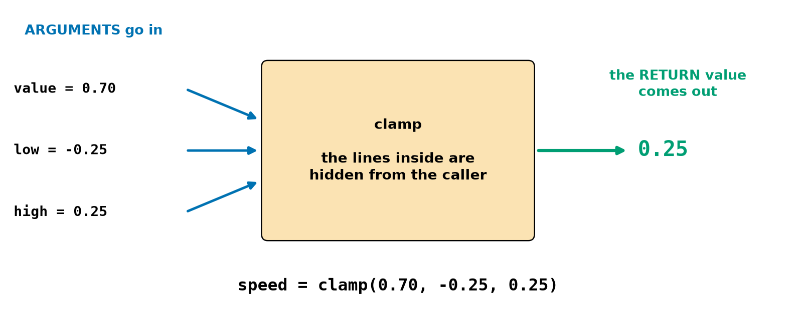
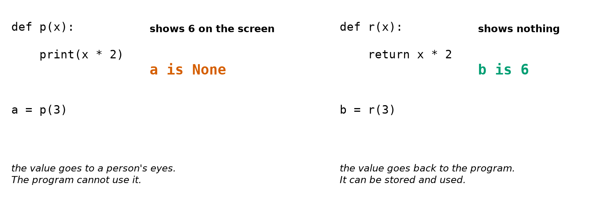
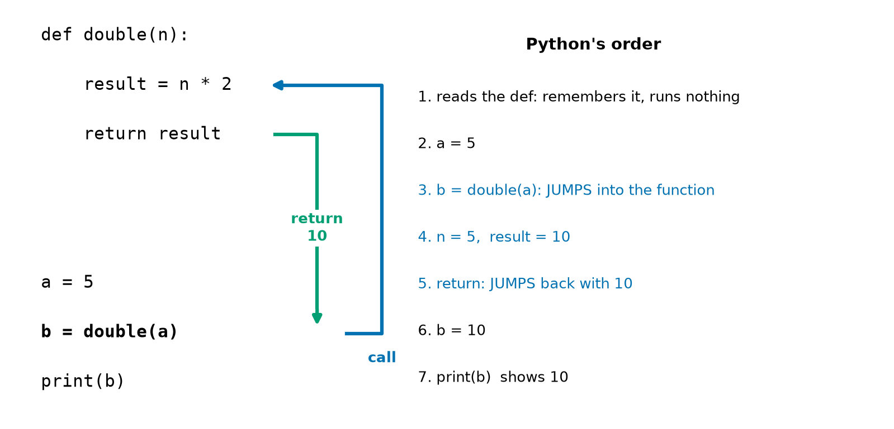
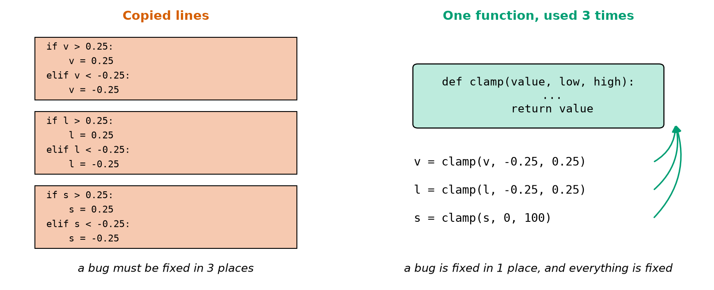

# Chapter 23 — Functions Part 1: Making Your Own Commands

> **Part 2 · Chapter 23 of 749**
> **You need:** Chapters 18–22 (decisions, loops, lists, dictionaries). Keep a script open.
> **You will make:** Rover's control loop built from small named functions, a small library of unit conversions, a command table whose values are functions, and a reusable route follower.

---

## What you will learn

- Why programmers put lines into **functions**.
- How to define a function with `def` and call it.
- What **parameters** and **arguments** are.
- The difference between `return` and `print`.
- How Python jumps into a function and back out again.
- How to write a useful **docstring**.
- How to split a long program into small, well-named pieces.

---

## New words in this chapter

| Word | Simple meaning |
|---|---|
| **function** | A named group of lines that you can run whenever you want. |
| **define** | To create a function, using `def`. |
| **call** | To run a function, using its name and brackets. |
| **parameter** | A name in a function's definition that receives a value. |
| **argument** | The actual value given when calling a function. |
| **return value** | The result a function gives back. |
| **docstring** | Text at the top of a function that explains what it does. |
| **refactor** | To improve how code is organised, without changing what it does. |
| **library** | A collection of functions for reuse. |

---

## 23.1 Your own commands

You have already used many functions: `print`, `len`, `round`, `float`, `abs`, `max`. Someone wrote those so that you could use them without knowing what is inside. Now you can write your own.

📖 **New word: function** — a named group of lines that you can run whenever you want.

```python
def beep():
    print("beep")


beep()
beep()
```

Output:

```
beep
beep
```

📖 **New word: define** — to create a function. `def` is short for "define". The first line has the word `def`, a name, brackets and a colon. The block below it is indented, just like an `if` (Chapter 18).

📖 **New word: call** — to run a function: its name followed by brackets.

Two things catch beginners:

**Defining a function does not run it.** A `def` only teaches Python a new word. Nothing happens until you call it.

**Without brackets, nothing is called:**

```python
beep                 # does nothing at all
print(beep)
```

```
<function beep at 0x00000191FECDBA00>
```

That is the function itself, and not the result of calling it. The brackets are the "go" button.

### Define before you call

Python reads from the top (Chapter 11). Calling a function before its `def` has been reached fails:

```python
beep()

def beep():
    print("beep")
```

```
NameError: name 'beep' is not defined
```

The habit is to put all the `def`s at the top of the program and the main code below them. By convention, leave two empty lines around each one.

---

## 23.2 Parameters: giving it information

A function becomes far more useful when it can work on different values.

📖 **New word: parameter** — a name in a function's definition that receives a value.

📖 **New word: argument** — the actual value given when calling.

```python
def greet(name):            # name is a parameter
    print("Hello,", name)


greet("Rover")              # "Rover" is an argument
greet("Arm")
```

```
Hello, Rover
Hello, Arm
```

With several parameters, the arguments are matched **in order**:

```python
def area(width, height):
    return width * height
```

Python checks the count:

```
TypeError: clamp() missing 1 required positional argument: 'hi'
TypeError: clamp() takes 3 positional arguments but 4 were given
```

---

## 23.3 `return`: giving back an answer

📖 **New word: return value** — the result a function gives back.

Look at Figure 23.1.



*Figure 23.1 — Arguments go in, the hidden lines work, and a return value comes out.*

**How to read this picture:** The blue arrows carry the three arguments into the orange box. The box is the function: to use it you do not need to know what is inside. The green arrow carries the answer out. The line at the bottom is what you write.

Here is the clamp from Chapter 18, as a function:

```python
def clamp(value, low, high):
    if value < low:
        return low
    if value > high:
        return high
    return value
```

`return` does two things: it decides the answer, **and** it leaves the function at once. Anything after it is not run. That is why this function needs no `else`: if the first test is True, we have already left.

Because a call gives back a value, you can use it anywhere you could use a value:

```python
speed = clamp(0.70, -0.25, 0.25)        # stored
print(clamp(0.70, -0.25, 0.25))         # shown
x = 2 * clamp(0.1, 0, 1) + 1            # calculated with
```

### `return` is not `print`

This is the most important idea in the chapter. Look at Figure 23.2.



*Figure 23.2 — `print` talks to the person. `return` talks to the program.*

**How to read this picture:** Both functions double a number. On the left, the result is printed: a person sees 6, but the program gets nothing, so `a` is `None`. On the right, nothing appears on the screen, but the value comes back, so `b` is 6 and can be used.

A real run:

```python
def p(x):
    print(x * 2)

def r(x):
    return x * 2

a = p(3)
b = r(3)
print(a, b)
print(r(3) + 1)
print(p(3) + 1)
```

```
6
None 6
7
6
TypeError: unsupported operand type(s) for +: 'NoneType' and 'int'
```

A function with no `return` gives back `None`. That is the "nothing" you met in Chapters 16 and 21. The last line fails because you cannot add 1 to nothing.

🧠 **Remember:** Almost always, a function should **return** its answer and let the caller decide whether to print it. A calculation that prints cannot be used by the rest of the program.

---

## 23.4 What really happens in a call

Look at Figure 23.3.



*Figure 23.3 — The program jumps into the function and returns to the same place.*

**How to read this picture:** On the left is the program. On the right are the steps in the order Python does them. The `def` is only remembered. At `b = double(a)`, the blue line shows Python jumping into the function, with `n` receiving 5. At `return`, the green line carries 10 back to where the call was made, and `b` receives it.

Functions can call other functions. Python remembers the way back:

```python
def a():
    print("in a, start")
    b()
    print("in a, end")

def b():
    print("in b")

print("top")
a()
print("bottom")
```

```
top
in a, start
in b
in a, end
bottom
```

Notice that `b` is defined **after** `a` and this still works. When the `def` of `a` is read, `b` is not called. By the time `a()` really runs, both definitions exist.

---

## 23.5 Good functions

### Docstrings

📖 **New word: docstring** — text at the top of a function that explains what it does. It is a string in triple quotes (Chapter 15), and it goes on the first line of the block:

```python
def clamp(value, low, high):
    """Return value, but never below low or above high."""
```

Python stores it, so that `help(clamp)` can show it (Chapter 12):

```
Help on function clamp in module __main__:

clamp(value, low, high)
    Return value, but never below low or above high.
```

Describe **what** the function does and what it returns, not how.

### Names

A function does something, so name it with a verb or a question: `clamp`, `read_distance`, `compute_speed`, `is_safe`, `arrived`. A function that returns True or False reads best as a question.

### One job each

A function should do **one** thing that you can describe in one sentence. If you need the word "and", consider splitting it. Short functions are easy to test, easy to name and easy to reuse.

Why bother? Look at Figure 23.4.



*Figure 23.4 — The same clamp written three times, or once.*

**How to read this picture:** On the left, the same four lines are copied three times, each with a different variable. On the right, one function holds the logic, and three short lines use it. If the logic has a bug, the left side needs three fixes, and it is easy to miss one. The right side needs one.

📖 **New word: refactor** — to improve how code is organised, without changing what it does. Moving copied lines into a function is the most common refactoring.

**DRY** is a programmer's saying: **D**on't **R**epeat **Y**ourself.

---

## Code

Here is Chapter 19's control loop, refactored. It does **exactly** the same as before, but compare how it reads.

The file is `code/ch023/wall_drive_v2.py`. Type it into `my-code/ch023/`.

```python
# wall_drive_v2.py - Chapter 19's control loop, now built from small functions
SETPOINT_M = 0.30
GAIN = 1.0
MAX_SPEED_MS = 0.25
DEADBAND_M = 0.01
DT_S = 0.5
MAX_STEPS = 50


def clamp(value, low, high):
    """Return value, but never below low or above high."""
    if value < low:
        return low
    if value > high:
        return high
    return value


def speed_command(distance_m):
    """Work out the speed for this distance to the wall."""
    error_m = distance_m - SETPOINT_M
    return clamp(GAIN * error_m, -MAX_SPEED_MS, MAX_SPEED_MS)


def arrived(distance_m):
    """Return True when Rover is close enough to the setpoint."""
    return abs(distance_m - SETPOINT_M) < DEADBAND_M


distance_m = 1.0
steps = 0
while not arrived(distance_m) and steps < MAX_STEPS:
    speed_ms = speed_command(distance_m)
    distance_m -= speed_ms * DT_S
    steps += 1

print("stopped after", steps, "steps at", round(distance_m, 3), "m")
```

| Line | Code | What it does (simple English) |
|---|---|---|
| 1 | comment | The name of the file and the idea. |
| 2–7 | constants | As in Chapter 19. |
| 8–9 | *(empty)* | Two empty lines before a `def`. |
| 10 | `def clamp(value, low, high):` | A general tool that knows nothing about robots. |
| 11 | docstring | One sentence. |
| 12–16 | `if … return` | Each `return` leaves at once. |
| 19 | `def speed_command(distance_m):` | Knows about **this** controller. |
| 21 | `error_m = …` | A variable that exists only inside this function (Chapter 24). |
| 22 | `return clamp(…)` | One function calling another. Its result is returned. |
| 25 | `def arrived(distance_m):` | Its name reads as a question. |
| 27 | `return abs(…) < DEADBAND_M` | The comparison **is** the True or False answer. No `if` is needed. |
| 30–31 | state | The main program begins here. |
| 32 | `while not arrived(…) and …:` | It almost reads like English. |
| 33–35 | the loop body | Think, act, count. |
| 37 | `print(…)` | The result. |

**Output:**

```
stopped after 9 steps at 0.306 m
```

**What the output means:** It is exactly Chapter 19's result. Nothing about the behaviour has changed, and that is the definition of a refactor.

Look at the `while` loop again. Five lines say what Rover does, and the details are behind names. To change the controller, you would only touch `speed_command`. To test `clamp`, you can call it by itself:

```python
print(clamp(5, 0, 1), clamp(-5, 0, 1), clamp(0.5, 0, 1))     # 1 0 0.5
```

---

## Small examples

### Example 1 — Is it even?

```python
def is_even(n):
    return n % 2 == 0

print(is_even(4), is_even(7))    # True False
```

### Example 2 — An average of three

```python
def average(a, b, c):
    return (a + b + c) / 3

print(average(1, 2, 6))          # 3.0
```

### Example 3 — The bigger of two

```python
def biggest(a, b):
    if a > b:
        return a
    return b

print(biggest(2, 9))             # 9
```

### Example 4 — A function using a function

```python
def cube(x):
    return x ** 3

print(cube(cube(2)))             # 512
```

The inner call runs first: `cube(2)` is 8, then `cube(8)` is 512.

### Example 5 — Returning text

```python
def bar(n):
    return "#" * n

print(bar(3))                    # ###
```

### Example 6 — Doing nothing yet

```python
def later():
    pass
```

A function needs a body, and `pass` (Chapter 18) can be a placeholder.

---

## 🏭 Real robot applications

### Application 1 (worked in full) — 🤖 A library of unit conversions

**1. The real problem.** The same conversions keep appearing: ticks to metres, metres to ticks, speed to rpm. When the wheel was calibrated in Chapter 16, every copy of the formula needed changing. The Mars Climate Orbiter (Chapter 13) reminds us what unit mistakes can cost.

**2. Why this idea.** Each conversion is one small function. All of them share the same two constants, so a new calibration changes **one** line.

📖 **New word: library** — a collection of functions for reuse. Chapter 26 shows how to use one from another file.

**3. The numbers.** The calibrated wheel from Chapter 16: 0.06589 m, with 540 ticks per turn.

**4. The maths, step by step.**

```
ticks → metres:  metres = ticks ÷ 540 × π × 0.06589
   2640 ticks:   4.889 × 0.20700 = 1.012 m      (the tape measure in Chapter 16)

metres → ticks:  ticks = metres ÷ (π × 0.06589) × 540
   1 m:          4.831 × 540 ≈ 2609 ticks

speed → rpm:     0.25 ÷ 0.20700 × 60 ≈ 72.5 rpm
```

**5. The code.** File `code/ch023/units.py`:

```python
# units.py - Rover's unit conversions, each one written once and used everywhere
PI = 3.14159
WHEEL_DIAMETER_M = 0.06589         # calibrated in Chapter 16
TICKS_PER_TURN = 540


def ticks_to_metres(ticks):
    """Return the distance rolled for this many encoder ticks."""
    turns = ticks / TICKS_PER_TURN
    return turns * PI * WHEEL_DIAMETER_M


def metres_to_ticks(metres):
    """Return the whole number of ticks needed to roll this distance."""
    turns = metres / (PI * WHEEL_DIAMETER_M)
    return round(turns * TICKS_PER_TURN)


def speed_to_rpm(speed_ms):
    """Return the wheel speed in rpm for a robot speed in m/s."""
    return speed_ms / (PI * WHEEL_DIAMETER_M) * 60


print(f"2640 ticks = {ticks_to_metres(2640):.3f} m")
print(f"1 m = {metres_to_ticks(1.0)} ticks")
print(f"0.25 m/s = {speed_to_rpm(0.25):.1f} rpm")
print(f"there and back: {ticks_to_metres(metres_to_ticks(1.0)):.4f} m")
```

| Line | Code | What it does (simple English) |
|---|---|---|
| 2–4 | constants | One calibration, in one place. |
| 7–10 | `ticks_to_metres` | Two lines of maths and a clear name. |
| 13–16 | `metres_to_ticks` | The reverse, rounded, because you cannot count half a tick. |
| 19–21 | `speed_to_rpm` | The Chapter 15 calculation, finally with a name. |
| 24–27 | `print(…)` | Function calls inside f-string holes. The last line feeds one function's answer into another. |

**Output:**

```
2640 ticks = 1.012 m
1 m = 2609 ticks
0.25 m/s = 72.5 rpm
there and back: 1.0001 m
```

**6. The result.** The first line agrees with the tape measure from Chapter 16, which is what calibration promised. The last line is a **round-trip test**: going to ticks and back should give the original value. It gives 1.0001 m, not 1.0000, because of rounding to a whole tick. That is a real and honest limit: Rover cannot position itself more finely than about one tick.

**7. Going further.** Chapter 26 moves this into a module which every Rover program can import. Chapter 288 builds proper odometry on `ticks_to_metres`.

### Application 2 (worked in full) — 🤖 A command table of functions

**1. The real problem.** Chapter 22's table could only hold fixed numbers. But some commands need calculation: a spin needs opposite wheel speeds at half the requested speed, and `stop` must ignore the speed altogether.

**2. Why this idea.** In Python, a function is a value like any other. So a dictionary can map a word to a function. Without brackets, you are **naming** the function, and with brackets you are **calling** it. Section 23.1's "mistake" is now useful.

**3. The numbers.** Three commands and one unknown word, with speeds of 0.2, 0.4, 0.3 and 0.1 m/s.

**4. The maths, step by step.**

```
forward 0.2: left = 0.2,  right = 0.2
left 0.4:    left = −0.4 ÷ 2 = −0.2,  right = 0.4 ÷ 2 = 0.2
stop 0.3:    left = 0,  right = 0
jump 0.1:    unknown → treated as stop
```

**5. The code.** File `code/ch023/function_table.py`:

```python
# function_table.py - a lookup table whose values are functions
def forward(speed):
    """Both wheels go the same way."""
    return speed, speed


def spin_left(speed):
    """Wheels go opposite ways, half speed: Rover turns on the spot."""
    return -speed / 2, speed / 2


def stop(speed):
    """Ignore the speed: nothing moves."""
    return 0.0, 0.0


COMMANDS = {"forward": forward, "left": spin_left, "stop": stop}   # no brackets!

for word, speed in [("forward", 0.2), ("left", 0.4), ("stop", 0.3), ("jump", 0.1)]:
    action = COMMANDS.get(word, stop)      # an unknown word safely means stop
    left, right = action(speed)            # now we call it, with brackets
    print(f"{word:8} left {left:+.2f}  right {right:+.2f}")
```

| Line | Code | What it does (simple English) |
|---|---|---|
| 2–14 | three `def`s | Each returns a pair, which is really a tuple (Chapter 22). |
| 17 | `COMMANDS = {…}` | Values are functions, with **no brackets**. |
| 19 | `for word, speed in […]:` | A list of pairs, unpacked. |
| 20 | `action = COMMANDS.get(word, stop)` | `action` is now a name for a function. The default is the safe one. |
| 21 | `left, right = action(speed)` | Call it through the new name. |
| 22 | `print(f"…")` | The result. |

**Output:**

```
forward  left +0.20  right +0.20
left     left -0.20  right +0.20
stop     left +0.00  right +0.00
jump     left +0.00  right +0.00
```

**6. The result.** New behaviours can be added by writing one function and adding one table entry. Unknown commands stop the robot with no special code at all, because `stop` is the default.

**7. Going further.** This pattern is called a **dispatch table**. Chapter 104's state machines use the same idea, and ROS 2 (Chapter 559) calls a function of yours each time a message arrives.

### Application 3 — 🚁 One battery function, many robots

`def cell_voltage(pack_v, cells): return pack_v / cells` looks too small to be worth it. But the drone in Chapter 18 uses it with 4 cells, and Rover with 6, and the name explains the calculation in every place it is used. Small functions are not about saving typing. They are about giving an idea a name.

### Application 4 — 🏭 Checking parts

A factory robot measures each part. `def in_tolerance(measured, target, tol): return abs(measured - target) <= tol` works for every dimension of every part (Chapter 17). Because it returns True or False, it can go straight into an `if`, into a counter, or into a list comprehension. Printing inside it would have made it useless for all three.

### Application 5 — 🦾 Testing the dangerous part first

Before an arm ever moves, an engineer can test the `clamp` function and the limit check on a laptop with no hardware connected. Pure functions, which take values and return values, can be tested thousands of times with no risk. Chapter 25 begins this habit, and it is the main reason that robot software is built from small functions.

---

## 🔧 Hands-on lab

### Lab 23.1 — Follow the jumps

**You need:** paper and a Python file.

**Steps:** Write down what this prints, in order. Then run it.

```python
def inner(x):
    print("inner got", x)
    return x + 1


def outer(y):
    print("outer got", y)
    z = inner(y * 2)
    print("inner gave", z)
    return z * 10


print("start")
answer = outer(1)
print("answer", answer)
```

**What you should see:**

```
start
outer got 1
inner got 2
inner gave 3
answer 30
```

**If it does not work:**

| Problem | Likely cause | Fix |
|---|---|---|
| `answer None` | A `return` is missing | Add `return z * 10`. |
| `NameError: name 'inner'…` | The call runs before the `def` | Put the `def`s at the top. |

### Lab 23.2 — Test `clamp` at the edges

**You need:** a new Python file.

**Steps:** Write `clamp` from memory. Then predict and test these seven calls:

```python
print(clamp(5, 0, 1))
print(clamp(-5, 0, 1))
print(clamp(0.5, 0, 1))
print(clamp(0, 0, 1))
print(clamp(1, 0, 1))
print(clamp(-0.5, -1, 0))
print(clamp(3, 3, 3))
```

Break it on purpose: swap `<` and `>`. Which calls now give the wrong answer?

**What you should see:** `1`, `0`, `0.5`, `0`, `1`, `-0.5`, `3`. With the signs swapped: 5 gives `0`, −5 gives `1`, 0.5 gives `0` (because 0.5 > 0 is True, so `low` is returned), −0.5 gives `-1`, and so on. Test values at both edges and in between. A function that passes only in the middle is not proven.

**If it does not work:**

| Problem | Likely cause | Fix |
|---|---|---|
| Prints `None` | There is a path with no `return` | The last line must be `return value`. |
| Everything is returned as `value` | The tests use `=` or the wrong names | Read each test aloud. |

### Lab 23.3 — Make the route a function

**You need:** `route_function.py`.

**Steps:** Chapter 20's route follower could run only one route. Type this version, and run it:

```python
# route_function.py - Chapter 20's route follower, now reusable
def run_route(route):
    """Follow a route of F, L and R. Return (x, y, heading)."""
    x, y, heading = 0, 0, 0
    for letter in route:
        if letter == "L":
            heading = (heading - 1) % 4
        elif letter == "R":
            heading = (heading + 1) % 4
        elif letter == "F":
            if heading == 0:
                y += 1
            elif heading == 1:
                x += 1
            elif heading == 2:
                y -= 1
            else:
                x -= 1
    return x, y, heading


print(run_route("FFRFFLFRFF"))
print(run_route("FRFRFRFR"))
print(run_route(""))
```

Then use it: write one line that prints `True` if a route comes back to the start.

**What you should see:**

```
(4, 3, 1)
(0, 0, 0)
(0, 0, 0)
```

The check is `print(run_route("FRFRFRFR")[:2] == (0, 0))`. Slicing a tuple gives a tuple.

**If it does not work:**

| Problem | Likely cause | Fix |
|---|---|---|
| Prints `None` | `return` is missing, or indented into the loop | It must be level with `for`. |
| Only the first letter is used | `return` is inside the loop | Move it out one level. |

---

## Common mistakes

⚠️ **Forgetting the brackets.** `beep` names the function. `beep()` runs it.

⚠️ **Forgetting the colon or the indentation.**

⚠️ **Calling before defining.** Put the `def`s at the top.

⚠️ **`print` instead of `return`.** The caller gets `None`.

⚠️ **`return` inside a loop by accident.** The function ends on the first pass.

⚠️ **Code after `return`.** It never runs.

⚠️ **Not using the return value.** `clamp(x, 0, 1)` alone changes nothing. Write `x = clamp(x, 0, 1)`.

⚠️ **Wrong number or order of arguments.** Order decides which value goes where.

⚠️ **Functions that do too much.** One job each.

---

## Practice

🏋️ **1.** Write a function `say_ready()` that prints `ready`. Call it twice.

🏋️ **2.** Write `square(x)` that returns x². Print `square(7)`.

🏋️ **3.** What does this print?

```python
def f(a, b):
    return a - b

print(f(10, 3), f(3, 10))
```

🏋️ **4.** What is `x`, and what appears on the screen?

```python
def g(n):
    print(n + 1)

x = g(1)
```

🏋️ **5.** Find the bug.

```python
def total(numbers):
    s = 0
    for n in numbers:
        s += n
        return s
```

🏋️ **6.** Write `is_safe(distance_m)` that returns True when the distance is more than 0.3.

🏋️ **7.** Write `metres_to_cm(m)`, and `cm_to_metres(cm)`. Check that going there and back gives the original value.

🏋️ **8.** Write `average(values)` that takes a list. Add a guard for the empty list: return 0.0.

🏋️ **9.** Refactor this using a function, so that the formula appears once.

```python
print(3.14159 * 0.065 * 3)
print(3.14159 * 0.065 * 7)
print(3.14159 * 0.065 * 12)
```

🏋️ **10.** Add a docstring to `def wheel_rpm(speed, diameter): return speed / (3.14159 * diameter) * 60`.

🏋️ **11.** (Harder) Write `count_true(flags)` that takes a list of True/False values and returns how many are True. Use it to write `two_of_three(a, b, c)` (Chapter 17). Then write a test: call `two_of_three` with all 8 combinations, using three nested loops over `[True, False]`, and print each result.

---

## Answers

**1.**

```python
def say_ready():
    print("ready")

say_ready()
say_ready()
```

**2.**

```python
def square(x):
    return x ** 2

print(square(7))     # 49
```

**3.** `7 -7`. The order of the arguments matters.

**4.** The screen shows `2`, and `x` is `None`: there is no `return`.

**5.** `return s` is inside the loop, so the function ends after the first number. Move it out one level.

**6.**

```python
def is_safe(distance_m):
    return distance_m > 0.3
```

**7.**

```python
def metres_to_cm(m):
    return m * 100

def cm_to_metres(cm):
    return cm / 100

print(cm_to_metres(metres_to_cm(1.5)))     # 1.5
```

**8.**

```python
def average(values):
    if len(values) == 0:
        return 0.0
    return sum(values) / len(values)
```

**9.**

```python
def roll_distance(turns):
    return 3.14159 * 0.065 * turns

print(roll_distance(3))
print(roll_distance(7))
print(roll_distance(12))
```

**10.**

```python
def wheel_rpm(speed, diameter):
    """Return wheel rpm for a robot speed (m/s) and wheel diameter (m)."""
    return speed / (3.14159 * diameter) * 60
```

**11.**

```python
def count_true(flags):
    return sum(flags)              # True counts as 1 (Chapter 17)

def two_of_three(a, b, c):
    return count_true([a, b, c]) >= 2

for a in [True, False]:
    for b in [True, False]:
        for c in [True, False]:
            print(a, b, c, two_of_three(a, b, c))
```

It prints True in the four rows where at least two are True.

---

## Summary

🧠 A **function** is a named group of lines. `def` defines it, and `name()` calls it.

🧠 **Parameters** receive the **arguments**, in order.

🧠 `return` gives back a value and leaves the function. No `return` means `None`.

🧠 `return` talks to the program, and `print` talks to a person. Prefer `return`.

🧠 Calling jumps into the function, and returning jumps back.

🧠 Give functions verb names, a docstring and one job. **Don't repeat yourself.**

🧠 A function is a value: without brackets, you are naming it; with brackets, you are calling it.

---

## Next chapter

Your functions have only used the simplest kind of parameter, and we have not asked what happens to the variables inside a function when it ends. In **Chapter 24 — Functions part 2: parameters, return values, scope**, you will learn default values, named arguments, returning several results, and the rules that say which code can see which variable: the difference between one robot function quietly working and one quietly breaking another.
