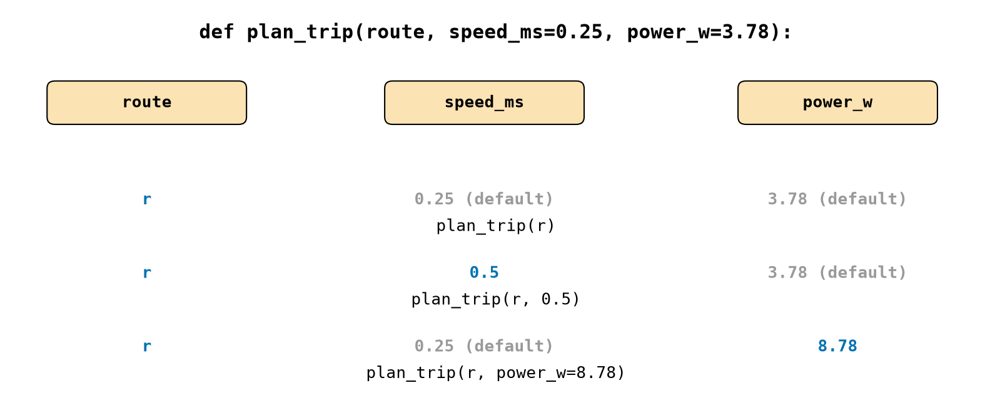
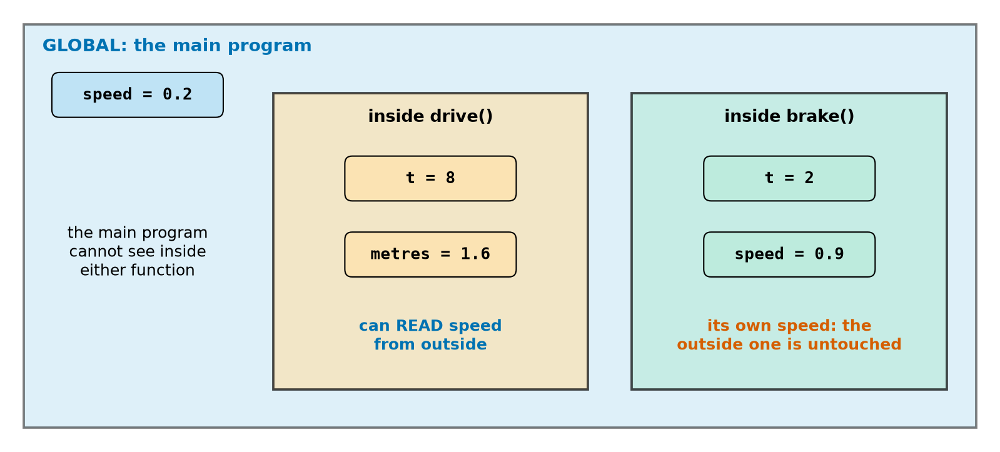
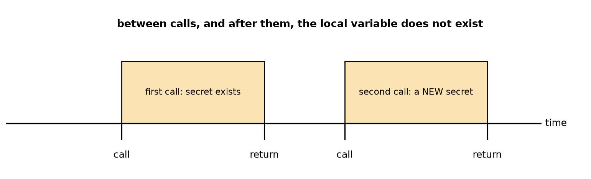
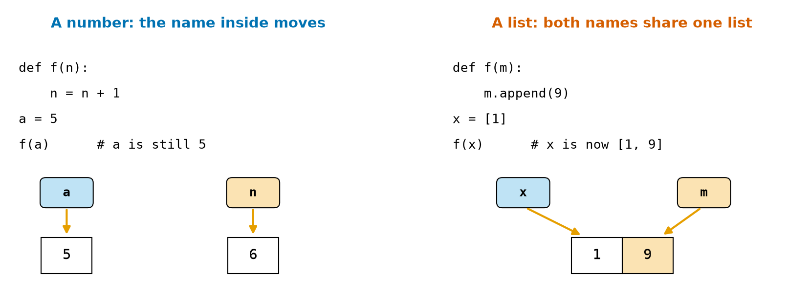

# Chapter 24 — Functions Part 2: Parameters, Return Values, Scope

> **Part 2 · Chapter 24 of 749**
> **You need:** Chapter 23 (`def`, `return`). Keep a script open.
> **You will make:** a trip planner with sensible defaults, a function that returns several facts about sensor data, and one function that moves a whole fleet of robots.

---

## What you will learn

- **Default values**, so that a caller can leave out arguments.
- **Keyword arguments**, so that a call explains itself.
- How to return **several values**.
- **Early returns** and when a function gives back `None`.
- **Scope**: which code can see which variable.
- Why a function can change a list but not a number passed to it.
- The **mutable default** trap.
- Passing a function to a function.

---

## New words in this chapter

| Word | Simple meaning |
|---|---|
| **default value** | The value a parameter uses when no argument is given. |
| **positional argument** | An argument matched by its place in the call. |
| **keyword argument** | An argument matched by its name. |
| **early return** | Leaving a function before the last line. |
| **scope** | The part of a program where a name can be seen. |
| **local variable** | A variable created inside a function. |
| **global variable** | A variable created outside all functions. |
| **side effect** | Anything a function changes besides its return value. |
| **pure function** | A function with no side effects. |
| **lambda** | A tiny function with no name. |

---

## 24.1 Default values

📖 **New word: default value** — the value a parameter uses when no argument is given.

```python
def beep(times=1):
    print("beep" * times)

beep()          # beep
beep(3)         # beepbeepbeep
```

Rover's usual speed is 0.25 m/s, so why make every caller say so? A default covers the usual case and still allows a change.

Parameters with defaults must come **after** those without:

```python
def f(a=1, b):
    return a
```

```
SyntaxError: parameter without a default follows parameter with a default
```

---

## 24.2 Positional and keyword arguments

📖 **New words: positional argument and keyword argument** — a positional argument is matched by its place in the call. A keyword argument is matched by its name.

```python
def set_motors(left, right):
    print(left, right)

set_motors(0.2, -0.2)               # positional
set_motors(right=-0.2, left=0.2)    # by name, in any order
set_motors(0.2, right=-0.2)         # a mix
```

All three print `0.2 -0.2`. You have already seen this: `print(1, 2, sep="-")` and `sorted(q, reverse=True)`.

Why bother? Compare these two calls:

```python
plan(r, 0.5, 8.78, True)
plan(r, speed_ms=0.5, power_w=8.78, avoid_stairs=True)
```

Only the second one can be understood without looking up the definition. In robot code, swapped arguments are a real danger: `set_motors(right, left)` turns the robot the wrong way, and no error appears.

Look at Figure 24.1.



*Figure 24.1 — Three ways of calling one function, and which value each parameter receives.*

**How to read this picture:** The top line is the definition, and the orange chips are its three parameters. Each row below is one call, written under the values it produces. Blue values come from the call, and grey values are defaults. In the last row, the keyword jumps over `speed_ms`, and leaves it at its default.

The rules, with the errors you get from breaking them:

| Rule | Error |
|---|---|
| Positional before keyword: `f(a=1, 2)` | `SyntaxError: positional argument follows keyword argument` |
| A parameter can get only one value: `f(1, a=2)` | `TypeError: f() got multiple values for argument 'a'` |
| The name must exist: `f(z=1)` | `TypeError: f() got an unexpected keyword argument 'z'` |

---

## 24.3 Returning several values

A function can give back several values by returning a tuple (Chapter 22):

```python
def min_max(values):
    return min(values), max(values)

low, high = min_max([3, 1, 2])
print(low, high)                 # 1 3
```

If you do not unpack it, you get the tuple. Chapter 23's `run_route` already did this.

### Early return

📖 **New word: early return** — leaving a function before the last line. It makes guards very clean:

```python
def status(percent):
    if percent < 0 or percent > 100:
        return "invalid"
    if percent < 20:
        return "low"
    return "ok"
```

Each case is finished as soon as it is known, so nothing needs an `else`.

### The missing return

If Python reaches the end of a function without a `return`, the function gives back `None`:

```python
def sign(x):
    if x > 0:
        return 1
    elif x < 0:
        return -1

print(sign(0))       # None
```

The case `x == 0` was forgotten. Make sure **every** path returns something.

`None` is often used on purpose, to mean "no answer". To test for it, use `is`:

```python
result = find_charger()
if result is None:
    print("no charger found")
```

---

## 24.4 Scope: who can see what

📖 **New word: scope** — the part of a program where a name can be seen.

📖 **New words: local and global variable** — a local variable is created inside a function, and a global variable is created outside all functions.

Look at Figure 24.2.



*Figure 24.2 — Each function has its own private area, inside the program's global area.*

**How to read this picture:** The large blue area is the main program. The orange and green boxes are the private areas of two functions. Names in a box can be seen only from inside that box. A function can look **outwards** and read a global such as `speed`, but the main program cannot look **inwards**. Both functions can have their own `t`, and they do not interfere. `brake` has its own `speed`, which is separate from the global one.

The rules, from real runs:

**1. Locals are private.**

```python
def f():
    secret = 5

f()
print(secret)
```

```
NameError: name 'secret' is not defined
```

**2. A local exists only during the call.** Look at Figure 24.3.



*Figure 24.3 — Each call creates its locals, and they vanish when it returns.*

**How to read this picture:** The line is time. Each orange block is one call. The variable exists only inside a block. A function does not remember anything from its previous call in its local variables.

**3. A function can read a global.**

```python
speed = 0.2

def f():
    print(speed)      # 0.2
```

**4. Assigning inside a function makes a new local.** The global is not touched:

```python
speed = 0.2

def f():
    speed = 0.9
    print("inside", speed)

f()
print("outside", speed)
```

```
inside 0.9
outside 0.2
```

**5. Which leads to this surprise.** Because the function assigns to `count`, Python decides that `count` is local everywhere in the function, and then `+=` tries to read it before it has a value:

```python
count = 0

def f():
    count += 1

f()
```

```
UnboundLocalError: cannot access local variable 'count' where it is not associated with a value
```

Python has a keyword, `global`, that says "use the outside one":

```python
def f():
    global count
    count += 1
```

⚠️ **Avoid `global`.** A function that secretly changes a global is hard to test, and two parts of a program can fight over the variable. Pass values in and return values out:

```python
def add_one(count):
    return count + 1

count = add_one(count)
```

Reading constants (`MAX_SPEED_MS`) from a function is fine, because they do not change.

---

## 24.5 What happens to arguments

Look at Figure 24.4.



*Figure 24.4 — Inside a function, the parameter is a new name for the same object.*

**How to read this picture:** The orange chips are names inside the function, and the blue chips are names outside. On the left, `n = n + 1` makes a new number and moves the name `n` to it, and `a` stays on 5. On the right, `m` and `x` are two names for **one** list, so `append` is seen through both.

Remember the labels of Chapter 14 and the aliases of Chapter 21. A parameter is simply another label:

```python
def f(n):
    n = n + 1
    return n

a = 5
b = f(a)
print(a, b)        # 5 6
```

```python
def f(m):
    m.append(9)

x = [1]
f(x)
print(x)           # [1, 9]
```

And assigning a whole new list inside the function only moves the local label:

```python
def f(m):
    m = [0]        # m now points to a new list; x is unaffected
```

This is why a `swap(a, b)` function cannot swap the caller's variables. It must return them: `x, y = swap2(x, y)`.

📖 **New words: side effect and pure function** — a side effect is anything a function changes besides its return value, such as a list it was given, a global, the screen or a motor. A pure function has no side effects.

Pure functions are easy to test, as Chapter 23 said. A function that changes a list should say so in its docstring.

### The mutable default trap

Here is one of Python's most famous surprises:

```python
def add(v, log=[]):
    log.append(v)
    return log

print(add(1))
print(add(2))
```

```
[1]
[1, 2]
```

The default list is created **once**, when the `def` runs, and the same list is used for every call. Results from an earlier call leak into a later one. The fix is to use `None` as the default and create the list inside:

```python
def add(v, log=None):
    if log is None:
        log = []
    log.append(v)
    return log
```

It now prints `[1]` and `[2]`. Never use a list or a dictionary as a default.

---

## 24.6 Functions as arguments

Chapter 23 put functions in a table. You can also hand a function to another function. Remember `max(counts, key=counts.get)`? The `key` says **how to compare**:

```python
def dist(p):
    return (p[0] ** 2 + p[1] ** 2) ** 0.5

points = [(3, 4), (1, 1), (0, 2)]
print(min(points, key=dist))       # (1, 1), the nearest point
print(sorted(points, key=dist))
```

📖 **New word: lambda** — a tiny function with no name, written in one line:

```python
sorted(points, key=lambda p: p[0] ** 2 + p[1] ** 2)
```

`lambda p: …` means "a function taking `p` and returning `…`". Use it only for very short things like this. If it needs a name or a comment, write a `def`.

(You may also see `def avg(*vals):`. The star collects any number of positional arguments into a tuple. `print` itself works this way.)

---

## Code

Here is a trip planner. Almost every caller wants the usual speed and power, so these are defaults. It returns three results.

The file is `code/ch024/trip_planner.py`. Type it into `my-code/ch024/`.

```python
# trip_planner.py - plan a route with defaults, named arguments and several results
DEFAULT_SPEED_MS = 0.25
DEFAULT_POWER_W = 3.78


def distance(a, b):
    """Return the straight-line distance between two (x, y) points."""
    return ((b[0] - a[0]) ** 2 + (b[1] - a[1]) ** 2) ** 0.5


def route_length(route):
    """Return the total length of a list of (x, y) points."""
    total = 0.0
    for i in range(len(route) - 1):
        total += distance(route[i], route[i + 1])
    return total


def plan_trip(route, speed_ms=DEFAULT_SPEED_MS, power_w=DEFAULT_POWER_W):
    """Return (metres, seconds, watt-hours) for driving along a route."""
    metres = route_length(route)
    seconds = metres / speed_ms
    watt_hours = power_w * seconds / 3600
    return metres, seconds, watt_hours


route = [(0.0, 0.0), (2.0, 0.0), (2.0, 1.5), (4.0, 3.0)]

m, s, wh = plan_trip(route)
print(f"normal:     {m:.2f} m  {s:.0f} s  {wh:.4f} Wh")

m, s, wh = plan_trip(route, speed_ms=0.5)
print(f"fast:       {m:.2f} m  {s:.0f} s  {wh:.4f} Wh")

m, s, wh = plan_trip(route, power_w=8.78)
print(f"with Pi:    {m:.2f} m  {s:.0f} s  {wh:.4f} Wh")
```

| Line | Code | What it does (simple English) |
|---|---|---|
| 1 | comment | The name of the file and the idea. |
| 2–3 | constants | The usual values. |
| 6–8 | `distance` | A pure function: points in, a number out. |
| 11–16 | `route_length` | Uses `distance`. `total` is local, so it starts fresh on each call. |
| 19 | `def plan_trip(route, speed_ms=…, power_w=…):` | One required parameter and two with defaults. |
| 20 | docstring | It says what comes back, and in what order. |
| 21–23 | the calculation | Three local variables. |
| 24 | `return metres, seconds, watt_hours` | A tuple of three. |
| 27 | `route = […]` | Waypoints as tuples, because each point is a fixed pair. |
| 29 | `m, s, wh = plan_trip(route)` | Both defaults are used. |
| 32 | `plan_trip(route, speed_ms=0.5)` | Overrides one. |
| 35 | `plan_trip(route, power_w=8.78)` | Skips `speed_ms` by using a keyword. |

**Output:**

```
normal:     6.00 m  24 s  0.0252 Wh
fast:       6.00 m  12 s  0.0126 Wh
with Pi:    6.00 m  24 s  0.0585 Wh
```

**What the output means:**

- The first line agrees with Chapter 21's waypoint program.
- At double the speed, the trip takes half the time, so this simple model says it uses half the energy.
- With the Raspberry Pi and camera on (8.78 W, Chapter 5), the same trip costs more than twice as much.

⚠️ This model uses the same power at every speed. A real robot's motors use more power when driving faster. Chapter 5 gave one number, and Chapter 89 onwards measures it properly.

🔢 **Maths** — check the second line:

```
Step 1. seconds = 6.00 ÷ 0.5 = 12 s
Step 2. energy  = 3.78 × 12 ÷ 3600 = 0.0126 Wh  ✓
```

---

## Small examples

### Example 1 — A default exponent

```python
def power(b, e=2):
    return b ** e

print(power(3), power(3, 3), power(e=4, b=2))    # 9 27 16
```

### Example 2 — A bare `return`

```python
def f():
    return

print(f())       # None
```

### Example 3 — A parameter hides a global

```python
x = 1

def f(x):
    x = x * 10
    return x

print(f(2), x)   # 20 1
```

### Example 4 — Passing a function

```python
def apply_twice(f, x):
    return f(f(x))

def add3(x):
    return x + 3

print(apply_twice(add3, 1))      # 7
```

### Example 5 — Sort by length

```python
print(sorted(["bb", "a", "ccc"], key=len))    # ['a', 'bb', 'ccc']
```

### Example 6 — When defaults are decided

```python
D = 1

def f(a=D):
    return a

D = 2
print(f())       # 1
```

The default was fixed when the `def` ran.

---

## 🏭 Real robot applications

### Application 1 (worked in full) — 🤖🚁 One function, four facts

**1. The real problem.** Robots summarise sensor data constantly: "what were the lowest, highest and typical readings in the last second?" We want one tested function instead of copied code, and it must not crash on an empty list.

**2. Why this idea.** The four results belong together, so the function returns a tuple. An empty list has no answers, so an early return of `None` handles it. This version also gives a true median for an even count, which Chapter 21 skipped.

**3. The numbers.** The six believable readings from Chapter 21.

**4. The maths, step by step.**

```
Sorted: 0.50, 0.51, 0.52, 0.52, 0.53, 3.91   (6 values, an even number)
Step 1. middle index = 6 // 2 = 3
Step 2. median = (item 2 + item 3) ÷ 2 = (0.52 + 0.52) ÷ 2 = 0.52
Step 3. mean = 6.49 ÷ 6 ≈ 1.082
```

**5. The code.** File `code/ch024/summarise.py`:

```python
# summarise.py - one function that returns several facts about a list of readings
def summarise(values):
    """Return (minimum, maximum, mean, median), or None for an empty list."""
    if len(values) == 0:          # a guard: leave early
        return None
    ordered = sorted(values)
    middle = len(ordered) // 2
    if len(ordered) % 2 == 1:
        median = ordered[middle]
    else:
        median = (ordered[middle - 1] + ordered[middle]) / 2
    return ordered[0], ordered[-1], sum(ordered) / len(ordered), median


result = summarise([0.52, 0.51, 0.53, 3.91, 0.50, 0.52])
low, high, mean, median = result
print(f"min {low}  max {high}  mean {mean:.3f}  median {median:.3f}")

result = summarise([])
if result is None:
    print("no readings yet")
```

| Line | Code | What it does (simple English) |
|---|---|---|
| 2–3 | `def`, docstring | It states the order of the results, **and** the `None` case. |
| 4–5 | guard | An early return. |
| 6 | `ordered = sorted(values)` | A new list: the caller's list is not changed (no side effect). |
| 7–11 | median | Odd count: the middle item. Even count: the average of the middle two. |
| 12 | `return …` | Four results. |
| 15–16 | call and unpack | Four names for four results. |
| 19–21 | `is None` | The caller must handle "no answer". |

**Output:**

```
min 0.5  max 3.91  mean 1.082  median 0.520
no readings yet
```

**6. The result.** One line of calling code now gives four useful numbers, and an empty list is handled without a crash. Notice the design choice: `min` and `max` are `ordered[0]` and `ordered[-1]`, so the sort is done only once.

**7. Going further.** Chapter 26's `statistics` module has `mean` and `median` ready-made. But writing them once shows exactly what they do.

### Application 2 (worked in full) — 🏭 Moving a whole fleet

**1. The real problem.** Three warehouse robots each have a position and a speed. With separate global variables for each robot, every new robot means more variables and more copied lines.

**2. Why this idea.** Each robot is a dictionary (Chapter 22). A dictionary passed to a function is shared, not copied (Section 24.5), so `step` can update the robot it is given. This side effect is deliberate, and the docstring says so.

**3. The numbers.** A time step of 0.5 s, for 10 steps (5 s).

| Robot | Start x | Speed |
|---|---|---|
| rover | 0.0 m | 0.2 m/s |
| cart | 5.0 m | −0.1 m/s |
| fast | 0.0 m | 0.5 m/s |

**4. The maths, step by step.**

```
rover: 0.0 + 0.2 × 5 = 1.00 m
cart:  5.0 − 0.1 × 5 = 4.50 m; driven 0.50 m (the odometer uses abs)
fast:  0.0 + 0.5 × 5 = 2.50 m
```

**5. The code.** File `code/ch024/fleet_move.py`:

```python
# fleet_move.py - one function moving many robots, each with its own state
def new_robot(name, x_m=0.0, speed_ms=0.2):
    """Return a dictionary describing a new robot."""
    return {"name": name, "x_m": x_m, "speed_ms": speed_ms, "odometer_m": 0.0}


def step(robot, dt_s):
    """Move one robot forward by one time step. Changes the dictionary."""
    moved = robot["speed_ms"] * dt_s
    robot["x_m"] += moved
    robot["odometer_m"] += abs(moved)


fleet = [new_robot("rover"), new_robot("cart", x_m=5.0, speed_ms=-0.1), new_robot("fast", speed_ms=0.5)]

for _ in range(10):                 # ten time steps
    for robot in fleet:
        step(robot, 0.5)

for robot in fleet:
    print(f"{robot['name']:6} x = {robot['x_m']:5.2f} m   driven {robot['odometer_m']:.2f} m")
```

| Line | Code | What it does (simple English) |
|---|---|---|
| 2–4 | `new_robot` | Builds a fresh dictionary every time it is called. Keeps every robot's layout the same. |
| 7–11 | `step` | Changes the dictionary. The docstring warns about it. |
| 14 | `fleet = […]` | Defaults for most things, and keywords for the rest. |
| 16–18 | nested loops | Ten steps, and each robot in each step. |
| 20–21 | report | One line per robot. |

**Output:**

```
rover  x =  1.00 m   driven 1.00 m
cart   x =  4.50 m   driven 0.50 m
fast   x =  2.50 m   driven 2.50 m
```

**6. The result.** Three robots, each with its own independent state, share one `step` function. A hundred robots would need one more line for each new robot and no new logic. Keeping the state of each robot in its own dictionary, and passing it in, is exactly the idea behind classes in Chapter 28.

**7. Going further.** Chapter 28 turns `new_robot` and `step` into a `Robot` class, so that a robot "owns" its functions.

### Application 3 — 🚁 Keyword arguments prevent accidents

`takeoff(10, 2)`: is that 10 metres at 2 m/s, or 2 metres at 10 m/s? `takeoff(altitude_m=10, climb_ms=2)` cannot be misread. Python can even force callers to use names, with `def takeoff(*, altitude_m, climb_ms):`: everything after the star must be given by keyword. Drone software uses this idea, because a swapped altitude and speed could be expensive.

### Application 4 — 🧹 The nearest charger

A cleaning robot finds its nearest charger with `min(chargers, key=lambda c: distance(here, c))`. One line replaces a whole "smallest so far" loop (Chapter 20), and the same `key` idea sorts waypoints, parts or jobs by any rule you can write.

### Application 5 — 🤖 A driver with sensible defaults

Sensor libraries use defaults everywhere: `read_distance(samples=5, timeout_s=0.1)`. Beginners call `read_distance()` and get reasonable behaviour, and experts can adjust it. When you write functions for other people, including the future you, good defaults are a kindness (Chapter 110).

---

## 🔧 Hands-on lab

### Lab 24.1 — Scope detective

**You need:** paper and a Python file.

**Steps:** Predict the output, then run it.

```python
x = 1

def a():
    x = 2
    print("a sees", x)

def b():
    print("b sees", x)

def c(x):
    x = x + 10
    print("c sees", x)

a()
b()
c(5)
print("main sees", x)
```

**What you should see:**

```
a sees 2
b sees 1
c sees 15
main sees 1
```

Only the main program's `x` is 1 at the end. `a` made its own, and `c` had its own parameter.

**If it does not work:**

| Problem | Likely cause | Fix |
|---|---|---|
| `UnboundLocalError` | You read `x` in a function before assigning to it | Pass it in as a parameter. |

### Lab 24.2 — Spring the default trap

**You need:** a Python file.

**Steps:**

1. Type the `add(v, log=[])` version from Section 24.5, and call it three times with 1, 2 and 3.
2. Replace it with the `log=None` version. Call it three times again.
3. Now pass your own list: `mine = []`, then `add(1, mine)`, then `add(2, mine)`. What is `mine`?

**What you should see:** Step 1: `[1]`, `[1, 2]`, `[1, 2, 3]`. Step 2: `[1]`, `[2]`, `[3]`. Step 3: `[1, 2]`, because the same list is passed each time.

**If it does not work:**

| Problem | Likely cause | Fix |
|---|---|---|
| Step 2 still grows | The old `def` is still in use | Delete it, or run a fresh file. |

### Lab 24.3 — Grow the planner

**You need:** `trip_planner.py`.

**Steps:**

1. Add a default parameter `usable_wh=11.52` to `plan_trip`, and also return the percentage of the battery used.
2. Update the three calls so that they unpack four values.
3. Forget one: leave a call unpacking only three names, and read the error.
4. Add a guard: an empty route, or a route with one point, must return `(0.0, 0.0, 0.0, 0.0)`.

**What you should see:** For the first line, about 0.22 % (0.0252 ÷ 11.52 × 100). The error at step 3 is `ValueError: too many values to unpack (expected 3, got 4)`. Does step 4 need any new code? `route_length` already returns 0.0 for those routes, and the rest of the arithmetic works, so no guard is needed unless `speed_ms` is 0.

**If it does not work:**

| Problem | Likely cause | Fix |
|---|---|---|
| `SyntaxError: parameter without a default…` | The new parameter is before a required one | Defaults go last. |

---

## Common mistakes

⚠️ **Non-default parameters after default ones.**

⚠️ **Swapped positional arguments.** Use keywords when the meaning is not obvious.

⚠️ **Forgetting a return on one path.** You get `None`.

⚠️ **Expecting a local to exist outside.** Return it.

⚠️ **Assigning to a global without `global`.** Better still, return the value.

⚠️ **Using `global` for everything.** It makes bugs hard to find.

⚠️ **`def f(log=[])`.** Use `None`.

⚠️ **Changing a list that the caller did not expect to change.** Work on a copy, or say so in the docstring.

⚠️ **Testing `== None`.** Use `is None`.

---

## Practice

🏋️ **1.** Write `greet(name, greeting="Hello")`. Call it in two ways.

🏋️ **2.** Which calls are legal for `def f(a, b=2)`? (a) `f(1)`; (b) `f()`; (c) `f(1, 3)`; (d) `f(b=3, a=1)`; (e) `f(a=1, 3)`.

🏋️ **3.** Write `min_max_mean(values)` that returns all three. Print them after unpacking.

🏋️ **4.** What does this print?

```python
x = 10

def f():
    x = 20

f()
print(x)
```

🏋️ **5.** Why does this crash? Fix it without `global`.

```python
total = 0

def add(n):
    total += n

add(5)
```

🏋️ **6.** What does this print?

```python
def f(m):
    m.append(1)

a = []
f(a)
f(a)
print(a)
```

🏋️ **7.** What does this print?

```python
def f(n):
    n += 1

a = 1
f(a)
print(a)
```

🏋️ **8.** What is wrong with `def record(r, data=[]):`? Fix it.

🏋️ **9.** Sort `[(3, 4), (1, 1), (0, 2)]` by distance from (0, 0), using a `key` function.

🏋️ **10.** Write `sign(x)` that returns 1, −1 or 0, with no path that returns `None`.

🏋️ **11.** (Harder) Write `nearest(here, places)`, which returns the place in `places` closest to `here`, or `None` if the list is empty. Use the `distance` function from `trip_planner.py` and a `lambda`. Test it with `here = (0, 0)` and `[(3, 4), (1, 1), (0, 2)]`, and with `[]`. Why is it important that `distance` is pure?

---

## Answers

**1.**

```python
def greet(name, greeting="Hello"):
    print(greeting, name)

greet("Rover")
greet("Rover", greeting="Hi")
```

**2.** Legal: (a), (c), (d). (b) has no value for `a`. (e) has a positional argument after a keyword.

**3.**

```python
def min_max_mean(values):
    return min(values), max(values), sum(values) / len(values)

lo, hi, avg = min_max_mean([1, 2, 6])
print(lo, hi, avg)     # 1 6 3.0
```

**4.** `10`. The `x = 20` created a local, which vanished when the function ended.

**5.** `total += n` makes `total` local, and then tries to read it before it has a value. Pass it in and return it:

```python
def add(total, n):
    return total + n

total = 0
total = add(total, 5)
```

**6.** `[1, 1]`. The list is shared.

**7.** `1`. `n += 1` makes a new number and moves only the local name.

**8.** The default list is shared between calls. Fix:

```python
def record(r, data=None):
    if data is None:
        data = []
    data.append(r)
    return data
```

**9.** `sorted(points, key=lambda p: p[0] ** 2 + p[1] ** 2)` gives `[(1, 1), (0, 2), (3, 4)]`.

**10.**

```python
def sign(x):
    if x > 0:
        return 1
    if x < 0:
        return -1
    return 0
```

**11.**

```python
def nearest(here, places):
    if not places:
        return None
    return min(places, key=lambda p: distance(here, p))
```

It gives `(1, 1)`, and `None` for the empty list. Because `distance` is pure, `min` can call it any number of times, in any order, and nothing else can change as a result. And you can test it on its own.

---

## Summary

🧠 **Defaults** cover the usual case, and go last. **Keyword arguments** make calls readable.

🧠 Return several values as a tuple. **Early returns** keep guards simple. Every path must return something, or you get `None`.

🧠 **Scope**: locals are private, and they exist only during a call. Functions can read globals. Assigning inside makes a local. Avoid `global`.

🧠 A parameter is a new label. Numbers cannot be changed from inside a function, but a shared list or dictionary can.

🧠 Never use a list or a dictionary as a default. Use `None`.

🧠 A function can be passed to another function: `key=dist`, or a short `lambda`.

🧠 **Pure functions** are the easiest to test and to trust.

---

## Next chapter

Your programs are now large enough to go wrong in interesting ways. In **Chapter 25 — Errors and debugging: reading error messages**, you will learn to read a full traceback, to catch errors with `try` and `except` so that a bad message no longer crashes a robot, to find bugs methodically, and to test your own functions with `assert`.
