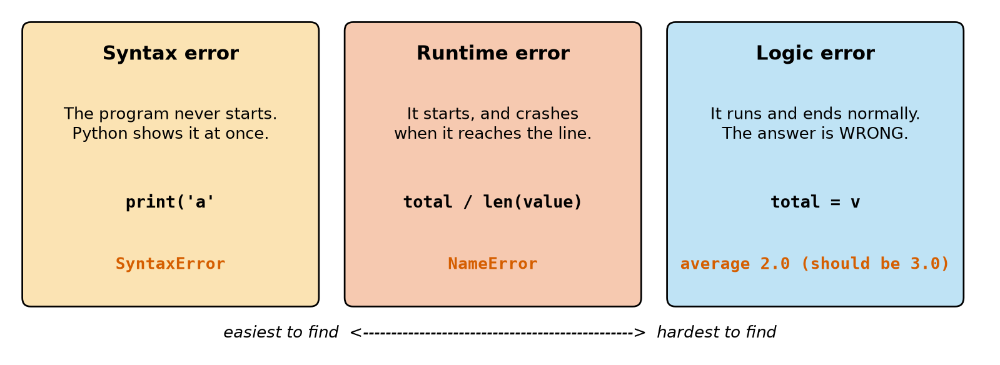
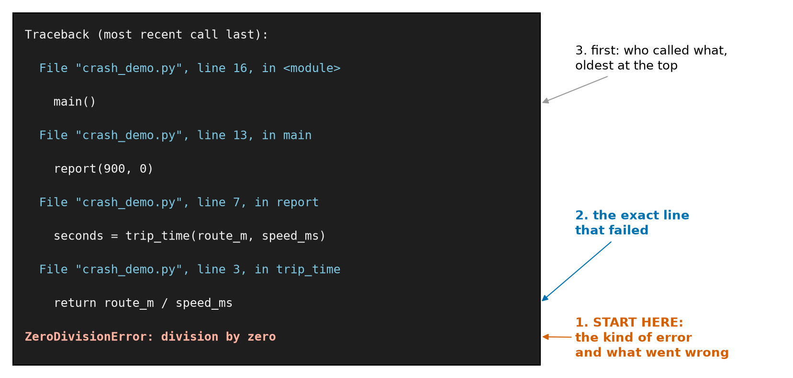
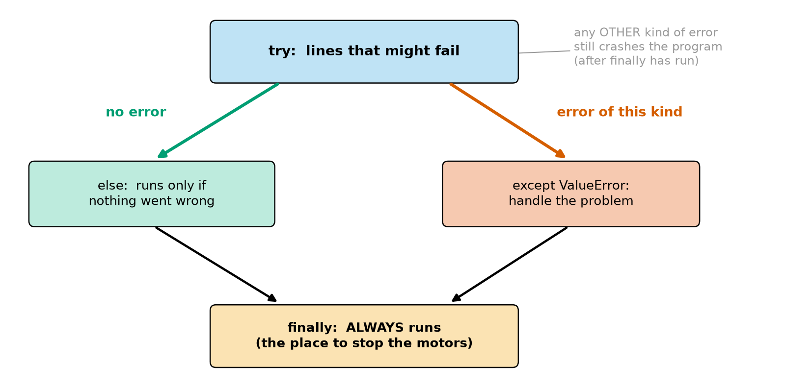
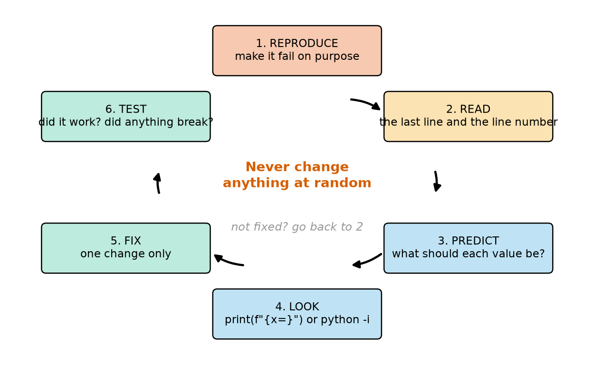

# Chapter 25 — Errors and Debugging: Reading Error Messages

> **Part 2 · Chapter 25 of 749**
> **You need:** Chapters 23–24 (functions). Keep a script open.
> **You will make:** a Rover console that bad input can no longer crash, a reader that survives damaged sensor messages, a program that makes sure the motors stop however it ends, and a set of automatic tests.

---

## What you will learn

- The three kinds of bug, and why one kind is the hardest.
- How to read a full **traceback** in the right order.
- How to handle errors with `try`, `except`, `else` and `finally`.
- Why you should catch only the errors you expect.
- How to raise your own errors, with a helpful message.
- How to test a function automatically with `assert`.
- A step-by-step method for finding any bug.

---

## New words in this chapter

| Word | Simple meaning |
|---|---|
| **bug** | A mistake in a program. |
| **debugging** | Finding and fixing bugs. |
| **exception** | Python's word for an error that happens while the program runs. |
| **traceback** | The report Python prints when a program crashes. |
| **handle** (an exception) | To deal with an error so that the program can carry on. |
| **raise** | To cause an error on purpose. |
| **assertion** | A check that must be True. |
| **test** | Code that checks that other code works. |
| **regression** | A bug that returns, or a new bug caused by a change. |

---

## 25.1 Three kinds of bug

📖 **New word: bug** — a mistake in a program. 📖 **New word: debugging** — finding and fixing bugs.

Look at Figure 25.1.



*Figure 25.1 — Syntax errors stop the program from starting. Runtime errors crash it part-way. Logic errors give a wrong answer without complaint.*

**How to read this picture:** Each box is one kind of bug, with an example and its result. From left to right, they get harder to find. The right-hand box is the frightening one: no message appears at all. On a robot, a logic error means that the robot confidently does the wrong thing.

📖 **New word: exception** — Python's word for an error that happens while the program runs.

You have met most of the common exceptions already:

| Error | Usual cause | Chapter |
|---|---|---|
| `SyntaxError` | Python cannot understand the text (a missing bracket or colon) | 8 |
| `IndentationError` | Wrong spaces at the start of a line | 18 |
| `NameError` | A name is misspelt, or not yet created | 12, 14 |
| `TypeError` | An operation on the wrong kind of value (`"5" + 1`) | 15 |
| `ValueError` | Right type, impossible value (`float("abc")`) | 15 |
| `ZeroDivisionError` | Dividing by zero | 16 |
| `IndexError` | A position that does not exist | 15, 21 |
| `KeyError` | A dictionary key that does not exist | 22 |
| `AttributeError` | A method the value does not have (`x.append` on a number) | 22 |
| `UnboundLocalError` | Reading a local variable before assigning it | 24 |
| `EOFError` | `input` with no keyboard | 16 |
| `KeyboardInterrupt` | You pressed Ctrl+C | 16 |
| `FileNotFoundError` | The file is not there | 27 |
| `ModuleNotFoundError` | The module is not installed, or is misspelt | 8 |
| `RecursionError` | A function that calls itself with no end | below |

Python's newer messages are very helpful. `'(' was never closed` and `Did you mean: 'print'?` often give you the answer directly.

---

## 25.2 Reading a traceback

📖 **New word: traceback** — the report Python prints when a program crashes.

Here is a program that crashes inside three layers of functions:

```python
# crash_demo.py - a crash passes through three functions: read the traceback
def trip_time(route_m, speed_ms):
    return route_m / speed_ms


def report(route_m, speed_ms):
    seconds = trip_time(route_m, speed_ms)
    print("trip takes", seconds, "s")


def main():
    report(900, 1.257)
    report(900, 0)


main()
```

The real output is:

```
trip takes 715.9904534606205 s
Traceback (most recent call last):
  File "...crash_demo.py", line 16, in <module>
    main()
    ~~~~^^
  File "...crash_demo.py", line 13, in main
    report(900, 0)
    ~~~~~~^^^^^^^^
  File "...crash_demo.py", line 7, in report
    seconds = trip_time(route_m, speed_ms)
  File "...crash_demo.py", line 3, in trip_time
    return route_m / speed_ms
           ~~~~~~~~^~~~~~~~~~
ZeroDivisionError: division by zero
```

Look at Figure 25.2.



*Figure 25.2 — Read a traceback from the bottom up.*

**How to read this picture:** The black panel is the crash report. Start at the bottom (1): the last line tells you what kind of error it was and why. The two lines above it (2) show the exact line that failed. Going further up (3) you can see who called it, and who called that. "Most recent call last" means the oldest call is at the top.

In this case:

1. **What?** Division by zero.
2. **Where?** Line 3, in `trip_time`: `speed_ms` must be 0.
3. **Why?** Going up: `report` passed it, and `main` called `report(900, 0)` on line 13. That is where the 0 came from.

The line that crashed (line 3) is not the line with the mistake (line 13). The traceback lets you walk back to find it.

⚠️ The error is often **above** the line Python names. A missing bracket on line 10 is frequently reported on line 11.

---

## 25.3 Handling errors: `try` and `except`

📖 **New word: handle** — to deal with an error so that the program can carry on.

```python
try:
    x = float("abc")
    print("never")
except ValueError:
    print("bad number")
print("continues")
```

```
bad number
continues
```

Python tries the block. At the first error of the named kind, it jumps to the `except` block, skipping the rest of `try`. Then the program carries on. Look at Figure 25.3.



*Figure 25.3 — The possible paths through a `try` statement.*

**How to read this picture:** Start at the top. If no error happens, the green arrow leads to `else`. If an error of the named kind happens, the red arrow leads to `except`. Both paths end at `finally`, which runs whatever happened. Other kinds of error are not handled, and they still crash the program, but `finally` runs first.

To see the message, use `as`:

```python
try:
    int("x")
except ValueError as error:
    print(error)      # invalid literal for int() with base 10: 'x'
```

To catch several kinds: `except (ValueError, IndexError):`.

### Catch only what you expect

Only one kind is caught here, and the division still crashes:

```python
try:
    1 / 0
except ValueError:
    print("E")
```

```
ZeroDivisionError: division by zero
```

That is a good thing. Here is what happens if you catch everything:

```python
try:
    total = totl + 1        # a spelling mistake
except:
    print("something went wrong")
```

```
something went wrong
```

A bare `except:` has just hidden a bug in **your** program, and it would even catch Ctrl+C. Name the error you expect. Your bugs should crash loudly while you are developing the program.

If you list several `except` blocks, Python uses the first that matches. Put the specific ones first: `except Exception` catches nearly everything, so anything after it is never reached.

### `finally`: cleaning up

`finally` always runs, even if the block ended with an unhandled error or a `return`. It is where you put what **must** happen: stop the motors, close a file, release a sensor.

---

## 25.4 Raising your own errors

📖 **New word: raise** — to cause an error on purpose.

Sometimes your function receives something it cannot deal with. Printing a message and carrying on means nobody finds out. Instead, raise an exception with a clear message:

```python
def set_battery(percent):
    if percent < 0:
        raise ValueError("percent cannot be negative")
    return percent
```

```
ValueError: percent cannot be negative
```

The caller can then choose how to respond: with `try`, or by letting it crash.

**Guard or `try`?** Chapter 18 used `if` to avoid errors, and now we can catch them. Use a guard when checking first is easy (`if speed == 0:`). Use `try` when checking would mean doing the work twice. For "is this text a number?", simply trying `float` is the easiest and surest test.

---

## 25.5 Testing with `assert`

📖 **New word: assertion** — a check that must be True. If it is False, Python stops with an `AssertionError`.

```python
assert 1 + 1 == 3
```

```
AssertionError
```

You can add a message to help: `assert x < 5, f"x too big: {x}"` gives `AssertionError: x too big: 7`.

📖 **New word: test** — code that checks that other code works.

A test is a list of known answers, and the program checks them all for you. File `code/ch025/test_tools.py`:

```python
# test_tools.py - automatic checks for our robot functions
def clamp(value, low, high):
    if value < low:
        return low
    if value > high:
        return high
    return value


def heading_error(a, b):
    """Return the short way round from b to a, in degrees (-180 to 179)."""
    return (a - b + 180) % 360 - 180


assert clamp(5, 0, 1) == 1
assert clamp(-5, 0, 1) == 0
assert clamp(0.5, 0, 1) == 0.5
assert clamp(0, 0, 1) == 0              # at the edge
assert clamp(1, 0, 1) == 1              # at the other edge

assert heading_error(359, 0) == -1
assert heading_error(1, 359) == 2
assert heading_error(90, 90) == 0
assert heading_error(350, 10) == -20

print("all tests passed")
```

Output: `all tests passed`. If you break `clamp` by mistake next month, these lines will tell you at once. 📖 **New word: regression** — a bug that returns, or a new bug caused by a change. Running your tests after every change is how you catch them.

⚠️ For tests with floats, remember Chapter 17: use `abs(a - b) < 1e-9`, not `==`.

Do not use `assert` to check things in the running program, such as sensor values or user input: `assert` can be switched off. It is for tests and for "this can never happen" checks. Chapters 576 and 746 build on testing for bigger robot software.

---

## 25.6 A method for finding any bug

Look at Figure 25.4.



*Figure 25.4 — Debugging is a loop of careful steps, and not guessing.*

**How to read this picture:** Start at the top and go clockwise. First make the bug happen reliably. Read what Python tells you. Then say what each value **should** be. Look at what each value **is**. Change one thing. Test again. If it is not fixed, go back to step 2.

Tools for step 4:

- **Print with labels.** `print(f"{x=}")` shows `x=3.14`, the name and the value together (Chapter 15). Use `print(repr(s))` for text.
- **`python -i script.py`** (Chapter 12) leaves you in the shell after a crash, with all global variables still there.
- **`breakpoint()`** stops the program at that line and lets you look around. Type `p x` to print a value, `n` for the next line, `c` to continue. VS Code offers the same thing with clicks (Chapter 8).
- **A trace table** on paper (Chapter 14).
- **Make it small.** Remove everything that is not needed to show the bug. Often you will find the bug while doing this.
- **Halve the program.** Print a value in the middle. Is it right there? Then the bug is later. If not, it is earlier. Each check removes half of the code.
- **Explain it aloud.** Telling someone, or a rubber duck, what each line does often reveals the bug. Programmers call this **rubber duck debugging**.

⚠️ **On real robots:** make sure the bug is not in the hardware. Wires come loose. Is the battery low? Chapter 9 has the reality gap, and Chapter 547 has the instruments.

---

## Code

Here is the fix promised in Chapters 15, 18 and 19. Nothing a person types can crash this console.

The file is `code/ch025/safe_console.py`. Type it into `my-code/ch025/`.

```python
# safe_console.py - a Rover console that bad input can no longer crash
def parse_command(text):
    """Return (word, number). Raise ValueError if the text makes no sense."""
    parts = text.strip().lower().split()
    if len(parts) != 2:
        raise ValueError("please type a word and a number")
    word = parts[0]
    if word != "forward" and word != "back":
        raise ValueError(f"unknown command: {word}")
    return word, float(parts[1])          # float can raise ValueError too


x_m = 0.0
while True:
    text = input("rover> ")
    if text.strip().lower() == "quit":
        break
    try:
        word, distance_m = parse_command(text)
    except ValueError as error:
        print("  not understood:", error)
        continue                          # back to the top: x_m is untouched
    if word == "back":
        distance_m = -distance_m
    x_m += distance_m
    print(f"  x = {x_m:.2f} m")

print("Goodbye")
```

| Line | Code | What it does (simple English) |
|---|---|---|
| 1 | comment | The name of the file and the idea. |
| 2–3 | `def`, docstring | The docstring also says what errors it raises. |
| 4 | `parts = …` | Clean and cut. |
| 5–6 | `raise ValueError(…)` | The wrong number of words: report it. |
| 7–9 | unknown word | The same kind of error, with a message. |
| 10 | `return word, float(parts[1])` | `float` may raise a `ValueError` by itself: it needs no extra code. |
| 13 | `x_m = 0.0` | State. |
| 14 | `while True:` | Runs until `break`. |
| 15–17 | `input`, `quit` | The sentinel, as in Chapter 19. |
| 18–22 | `try / except` | All three kinds of bad input arrive here as one kind of error. |
| 22 | `continue` | Skip the rest, and ask again. |
| 23–26 | the normal path | Only good commands get here. |

**A real run:**

```
rover> forward 0.5
  x = 0.50 m
rover> forward fast
  not understood: could not convert string to float: 'fast'
rover> forward 0,25
  not understood: could not convert string to float: '0,25'
rover> jump 1
  not understood: unknown command: jump
rover> stop
  not understood: please type a word and a number
rover> BACK 0.2
  x = 0.30 m
rover> 
  not understood: please type a word and a number
rover> quit
Goodbye
```

**What the output means:** All six inputs that crashed earlier programs now produce a message, and the state `x_m` is still correct afterwards. There is one design decision worth seeing: `parse_command` knows **what** is wrong, and the main loop decides **what to do about it**.

---

## Small examples

### Example 1 — Ask until it is a number

```python
while True:
    text = input("Speed: ")
    try:
        speed = float(text)
        break
    except ValueError:
        print("please type a number")
```

### Example 2 — `else`

```python
try:
    x = 1
except ValueError:
    print("E")
else:
    print("else")          # runs: there was no error
finally:
    print("finally")       # runs always
```

### Example 3 — A limited number of tries

```python
tries = 0
while tries < 3:
    tries += 1
    try:
        v = float(["x", "y", "1.5"][tries - 1])
        break
    except ValueError:
        print("try", tries, "failed")
print(v)                   # 1.5
```

### Example 4 — `finally` runs even on `return`

```python
def f():
    try:
        return "r"
    finally:
        print("cleanup")

print(f())                 # cleanup, then r
```

### Example 5 — Runaway recursion

A function that calls itself forever stops with `RecursionError: maximum recursion depth exceeded`. Python's limit saves the program from running out of memory.

---

## 🏭 Real robot applications

### Application 1 (worked in full) — 🤖 Surviving damaged messages

**1. The real problem.** Rover's serial cable picks up noise. Some lines arrive cut short or with a damaged character (Chapter 15's format, `t=…;d=…;v=…`). Chapter 15's program would have crashed on the first bad line. One bad message must not stop a robot.

**2. Why this idea.** Every kind of damage shows up as a `ValueError`: too few pieces to unpack, or text that is not a number. So one `except ValueError` covers them all, and a bad line becomes a `None`. Counting the bad lines tells you how healthy the link is.

**3. The numbers.** Five lines, three of them damaged.

**4. The maths, step by step.** Loss = bad ÷ (good + bad) = 3 ÷ 5 = 60%.

**5. The code.** File `code/ch025/sensor_stream.py`:

```python
# sensor_stream.py - survive damaged lines from an Arduino, and count them
def parse_line(line):
    """Return (time_s, distance_m, battery_v), or None if the line is damaged."""
    try:
        t_part, d_part, v_part = line.strip().split(";")
        return float(t_part[2:]), float(d_part[2:]), float(v_part[2:])
    except ValueError:
        return None


stream = [
    "t=12.40;d=0.42;v=7.13\n",
    "t=12.50;d=0.4",               # cut short
    "t=12.60;d=0.4#;v=7.12\n",     # a damaged character
    "\n",                          # an empty line
    "t=12.70;d=0.44;v=7.11\n",
]

good = 0
bad = 0
for line in stream:
    result = parse_line(line)
    if result is None:
        bad += 1
        print("skipped:", repr(line))
    else:
        good += 1
        time_s, distance_m, battery_v = result
        print(f"t={time_s:.2f}  d={distance_m:.2f}  v={battery_v:.2f}")

print(f"good {good}, bad {bad}, loss {bad / (good + bad):.0%}")
```

| Line | Code | What it does (simple English) |
|---|---|---|
| 2–3 | `def`, docstring | Promises either a tuple or `None`. |
| 4–8 | `try / except` | Too few pieces, or a bad number: both are `ValueError`. |
| 11–17 | `stream` | Test data with real kinds of damage. |
| 19–20 | counters | Chapter 14 again. |
| 22–29 | the loop | The caller handles the `None` case. |
| 31 | `print(f"…")` | `.0%` shows a percentage (Chapter 15). |

**Output:**

```
t=12.40  d=0.42  v=7.13
skipped: 't=12.50;d=0.4'
skipped: 't=12.60;d=0.4#;v=7.12\n'
skipped: '\n'
t=12.70  d=0.44  v=7.11
good 2, bad 3, loss 60%
```

**6. The result.** The program survived all three kinds of damage, kept the good readings and reported the loss. A real link should lose well under 1%. A loss of 60% would tell you to check the wiring at once.

**7. Going further.** What about a line whose number is damaged but is still a valid number, such as `d=8.42` instead of `d=0.42`? `float` cannot notice. That is what checksums are for (Chapter 533). And if too many lines are bad in a row, a robot should stop (Chapter 664).

### Application 2 (worked in full) — ⚠️ The motors must stop

**1. The real problem.** A program is driving Rover, and a sensor fails. The exception ends the program, and the motors **keep running at their last speed**: a motor driver does not know that your program has died. This is the danger Chapter 7 warned about.

**2. Why this idea.** `finally` runs however the block ended, so "motors off" goes there. `except` deals with the error we expect, and any error we did not expect still passes through `finally`.

**3. The numbers.** A loop of 5 steps, with a pretend sensor that fails on the third step.

**4. The maths, step by step.** Step 0 and step 1 run normally. At step 2 the sensor raises an error, so steps 2 to 4 never happen.

**5. The code.** File `code/ch025/motor_guard.py`:

```python
# motor_guard.py - whatever goes wrong, the motors must end up off
def set_motors(speed):
    print(f"  motors at {speed:.2f} m/s")


def read_distance(step):
    """A pretend sensor that fails on the third reading."""
    if step == 2:
        raise OSError("sensor not responding")
    return 1.0 - step * 0.2


try:
    for step in range(5):
        distance_m = read_distance(step)
        set_motors(0.25)
        print("  distance", round(distance_m, 2))
except OSError as error:
    print("FAULT:", error)
finally:
    set_motors(0.0)               # this line runs however the block above ended
    print("motors are off")
```

| Line | Code | What it does (simple English) |
|---|---|---|
| 2–3 | `set_motors` | Stands in for the real motor command. |
| 6–10 | `read_distance` | A fake sensor. `OSError` is the kind of error real hardware often raises. |
| 13–17 | `try:` | The whole driving loop. |
| 18–19 | `except OSError` | Report the fault. |
| 20–22 | `finally:` | Stop, always. |

**Output:**

```
  motors at 0.25 m/s
  distance 1.0
  motors at 0.25 m/s
  distance 0.8
FAULT: sensor not responding
  motors at 0.00 m/s
motors are off
```

**6. The result.** The motors stopped even though the program failed in the middle of its loop. Change the sensor to raise a `KeyError`, which the `except` does not catch, and the motors still stop before the crash (Lab 25.2).

**7. Going further.** `finally` protects against errors in your **program**. It cannot help if the computer freezes or loses power, or if the program is killed. That is why robots also have a watchdog and a hardware e-stop (Chapter 7). Software safety is one layer, and never the only one.

### Application 3 — 🚁 Retrying a sensor

A drone's barometer sometimes fails one reading. The driver tries up to 3 times (Example 3) before reporting a fault. Retrying fixes brief glitches, and the limit stops it from waiting forever (Chapter 19). If a sensor keeps failing, the flight controller switches to a backup, or lands (Chapter 664).

### Application 4 — 🏭 Fail loudly in testing, safely in production

During development, a factory robot's software should crash loudly, so that engineers see every bug. In production, the same software catches errors at the top level, stops safely and writes a report. The bare `except` that was bad advice in Section 25.3 has one honest use: at the very top of a program, to log any failure and stop the machine, and then re-raise it with `raise`.

### Application 5 — 🚗 Tests before driving

Self-driving software teams run millions of automated tests and simulated miles for each change. It is the same idea as your nine `assert` lines, at a far larger scale. Every time a bug is found on the road, a new test is added so that the bug can never quietly return (Chapter 9).

---

## 🔧 Hands-on lab

### Lab 25.1 — Read the traceback

**You need:** `crash_demo.py`.

**Steps:**

1. Run it, and answer from the traceback: Which error? On which line did it fail? Which line passed the bad value?
2. Change the `0` on line 13 to the string `"fast"`. Before running, predict the error and where it happens.
3. Fix the program by adding a guard to `report`, so that a speed of 0 prints `not moving` instead of crashing.

**What you should see:** (1) `ZeroDivisionError`; it failed on line 3; the bad value came from line 13. (2) `TypeError: unsupported operand type(s) for /: 'int' and 'str'`, still on line 3. (3) The first line prints the trip, and the second prints `not moving`.

**If it does not work:**

| Problem | Likely cause | Fix |
|---|---|---|
| The line numbers differ | Your file has different empty lines | Count in your own file. |

### Lab 25.2 — Make the motors stop

**You need:** `motor_guard.py`.

**Steps:**

1. Run it as it is.
2. Change `raise OSError(…)` to `raise KeyError("oops")`. Run it. Does the program crash? Do the motors stop?
3. Now delete the `finally` block and put its two lines after the `try` block, without indentation. Run it again.

**What you should see:** In step 2, `motors at 0.00 m/s` and `motors are off` are printed **before** the crash report. In step 3, the crash happens and the two lines never run: the motors would be left running. Two lines in the wrong place have made the robot dangerous, with no change at all in normal operation.

**If it does not work:**

| Problem | Likely cause | Fix |
|---|---|---|
| `SyntaxError: expected 'except' or 'finally' block` | `try` needs at least one of them | In step 3, keep the `except` block, or remove the `try` too. |

### Lab 25.3 — Bug hunt

**You need:** `code/ch025/buggy_average.py`.

```python
# buggy_average.py - this program has THREE bugs. Find them, one at a time.
def average(values):
    total = 0
    for v in values:
        total = v
    return total / len(value)


readings = [1, 2, 6]
print("average: " + average(readings))
```

**Steps:** Run it. Fix **one** bug at a time, using the loop in Figure 25.4. Before you run it each time, say what you expect. The correct answer is 3.0.

**What you should see:**

| Run | Result | Bug |
|---|---|---|
| 1 | `NameError: name 'value' is not defined. Did you mean: 'values'?` | a misspelt name |
| 2 | `TypeError: can only concatenate str (not "float") to str` | `+` with a number; use a comma |
| 3 | `average: 2.0` | a **logic** error: `total = v` should be `total += v` |
| 4 | `average: 3.0` | fixed |

Run 3 gives an answer, and without knowing the right answer you might have believed it. Always have an expected value in mind.

Finally, write two `assert` lines to test `average`: one for `[1, 2, 6]` and one for `[5]`.

**If it does not work:**

| Problem | Likely cause | Fix |
|---|---|---|
| Still 2.0 | `total = v` is unchanged | It must add: `+=`. |
| A wrong answer of 0.0 | `return` is inside the loop | Check the indentation. |

---

## Common mistakes

⚠️ **Reading a traceback from the top.** Start at the bottom.

⚠️ **Changing things at random.** Change one thing, for a reason.

⚠️ **A bare `except:`.** It hides bugs. Name the error.

⚠️ **Too much inside `try`.** Keep it short, so you know what can fail.

⚠️ **`except` that does nothing.** Silently ignoring errors makes faults invisible. At least count or log them.

⚠️ **Assuming the crash line is the mistake.** Walk up the traceback.

⚠️ **Printing errors instead of raising them.** The caller cannot react.

⚠️ **Believing an answer without checking it.** Logic errors look just like right answers.

⚠️ **Motor-off code that is not in `finally`.**

---

## Practice

🏋️ **1.** Which kind of bug (syntax, runtime or logic)? (a) A missing `)`; (b) `average` adds only the last value; (c) `int("x")`; (d) using `<` where `<=` was needed.

🏋️ **2.** What error does each give? (a) `[1, 2][5]`; (b) `{"a": 1}["b"]`; (c) `len(5)`; (d) `"a" + 1`; (e) `prin("x")`.

🏋️ **3.** What does this print?

```python
try:
    print("A")
    x = 1 / 0
    print("B")
except ZeroDivisionError:
    print("C")
print("D")
```

🏋️ **4.** Write `safe_float(text)` that returns the number, or `None` if the text is not a number.

🏋️ **5.** Write a loop that asks for a number until the person types a valid one.

🏋️ **6.** What does this print?

```python
try:
    print(1)
finally:
    print(2)
print(3)
```

🏋️ **7.** Add a `raise ValueError` to `def set_speed(v):` when `v` is over 0.5.

🏋️ **8.** Write three `assert` lines to test `def square(x): return x * x`, including 0 and a negative number.

🏋️ **9.** Why is this bad?

```python
try:
    speed = read_speed()
    command = gain * speed
except:
    pass
```

🏋️ **10.** A traceback shows lines in `main` → `run` → `read`, with the error on the last. Where do you look first, and where might the real mistake be?

🏋️ **11.** (Harder) `parse_line` in Application 1 returns `None` for damage. (a) Add a check: if the distance is not in the range 0.02 to 4.0, the line counts as damaged, even though it is a valid number. (b) Write three `assert` tests for it, for a good line, a damaged line and an out-of-range line. (c) Why can a range check not catch every damaged number?

---

## Answers

**1.** (a) syntax; (b) logic; (c) runtime; (d) logic.

**2.** (a) `IndexError`; (b) `KeyError`; (c) `TypeError`; (d) `TypeError`; (e) `NameError`.

**3.** `A`, `C`, `D`. `B` is skipped.

**4.**

```python
def safe_float(text):
    try:
        return float(text)
    except ValueError:
        return None
```

**5.**

```python
while True:
    try:
        value = float(input("Number: "))
        break
    except ValueError:
        print("try again")
```

**6.** `1`, `2`, `3`.

**7.**

```python
def set_speed(v):
    if v > 0.5:
        raise ValueError(f"speed {v} is above the limit of 0.5")
    return v
```

**8.**

```python
assert square(3) == 9
assert square(0) == 0
assert square(-4) == 16
```

**9.** The bare `except` catches everything, including typing mistakes in your own code, and `pass` hides it. If an error happens, `speed` and `command` may have old values or none, and the program carries on as if nothing had happened.

**10.** Start at the last line (the kind of error) and the line just above it. The real mistake may be further up: `run` or `main` may have passed in a bad value.

**11.** (a)

```python
def parse_line(line):
    try:
        t_part, d_part, v_part = line.strip().split(";")
        t, d, v = float(t_part[2:]), float(d_part[2:]), float(v_part[2:])
    except ValueError:
        return None
    if not 0.02 <= d <= 4.0:
        return None
    return t, d, v
```

(b)

```python
assert parse_line("t=1.0;d=0.5;v=7.0") == (1.0, 0.5, 7.0)
assert parse_line("t=1.0;d=0.") is None
assert parse_line("t=1.0;d=9.5;v=7.0") is None
```

(c) A damaged number can still be inside the range: 0.42 could become 0.12, and the check would pass. Only something like a checksum (Chapter 533) can catch that.

---

## Summary

🧠 Three kinds of bug: **syntax** (will not start), **runtime** (crashes), **logic** (wrong answers without complaint).

🧠 Read a **traceback** from the bottom: what, then where, then who called it.

🧠 `try / except` handles expected errors. Name the error, and keep the block small.

🧠 `finally` always runs. That is where the motors stop.

🧠 `raise` reports a problem to the caller. `assert` writes **tests**.

🧠 Debug in a loop: reproduce, read, predict, look, fix one thing, test.

🧠 Software safety is only one layer. Watchdogs and e-stops remain necessary.

---

## Next chapter

You have been copying `clamp` from program to program. In **Chapter 26 — Modules and the `math` module**, you will put your functions in a file and import them anywhere. You will also meet the libraries that come with Python: `math` for sine and square roots, `statistics` for averages, and the tools that install other people's code.
