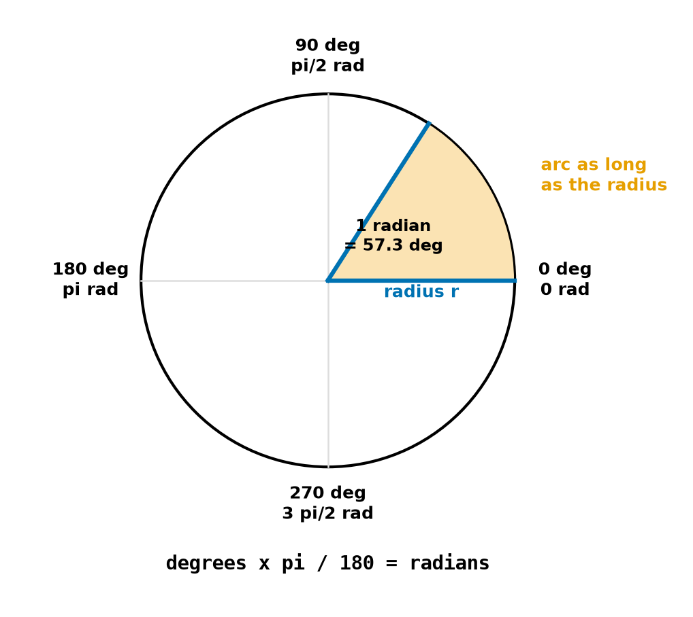
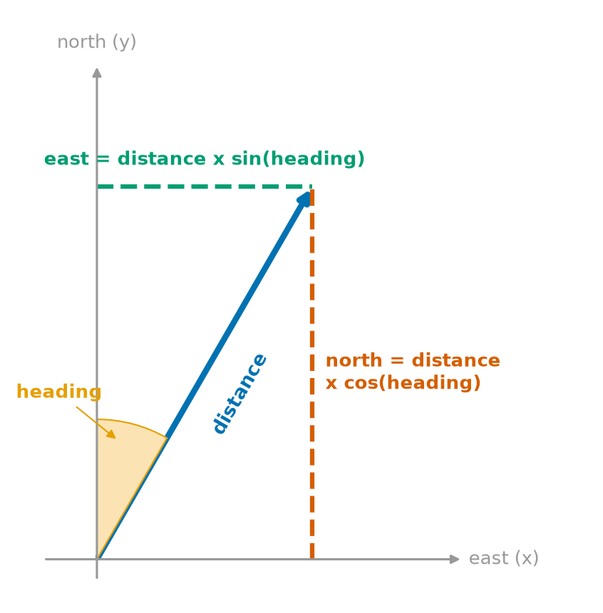
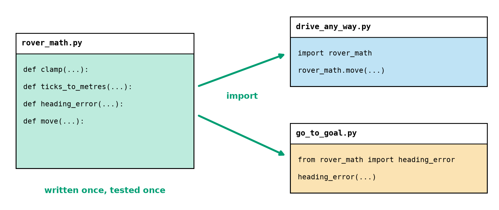
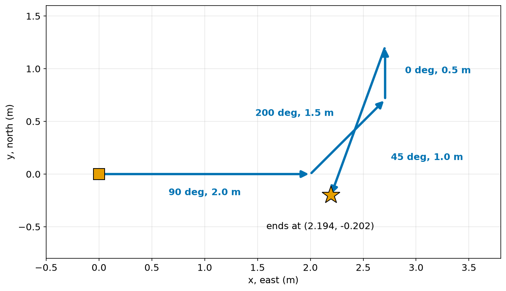
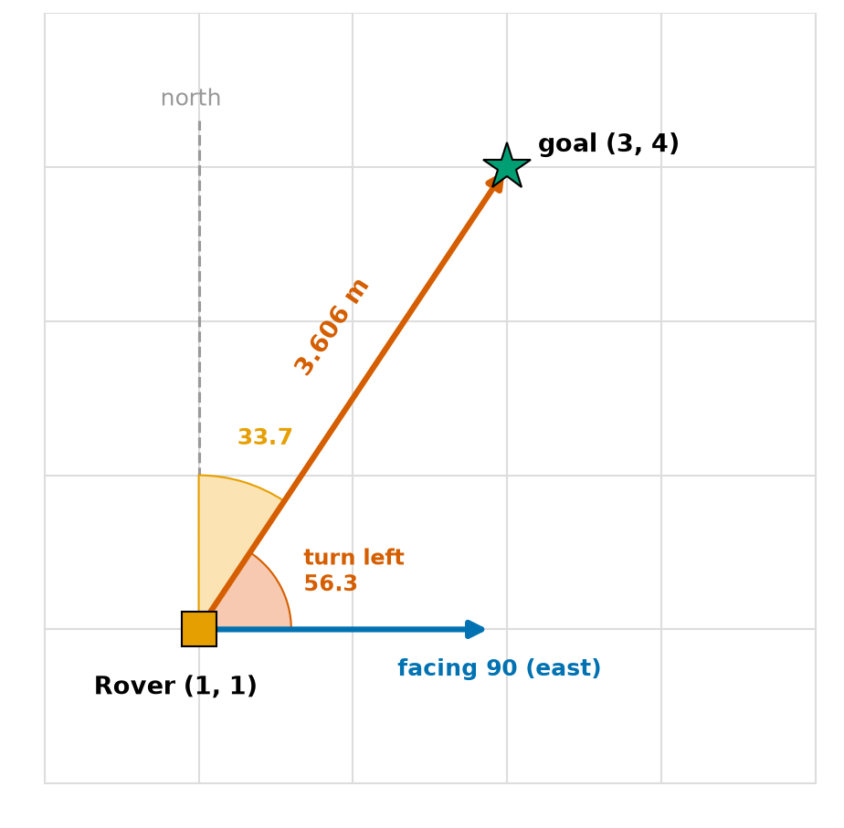

# Chapter 26 — Modules and the `math` Module

> **Part 2 · Chapter 26 of 749**
> **You need:** Chapters 23–25 (functions, errors). Keep a shell open and a folder ready.
> **You will make:** your own library of robot tools in a file, a program that drives Rover in **any** direction, a program that finds which way to turn to reach a goal, and a calculation of the distance between two GPS points.

---

## What you will learn

- What a **module** is, and three ways of importing one.
- The most useful tools in `math`, and the radians trap.
- How sine and cosine turn a heading into a motion.
- How `atan2` finds the direction to something.
- Other useful modules that come with Python.
- How to write and import your **own** module.
- What `if __name__ == "__main__":` is for.
- How `pip` and virtual environments work.

---

## New words in this chapter

| Word | Simple meaning |
|---|---|
| **module** | A file of Python code that other programs can use. |
| **import** | To bring a module into your program. |
| **standard library** | The modules that come with Python. |
| **radian** | The unit of angle used by Python's maths functions. |
| **bearing** | The compass direction from one place towards another. |
| **package** | A folder of modules. |
| **pip** | The tool that installs other people's packages. |
| **virtual environment** | A private set of installed packages for one project. |

---

## 26.1 Importing a module

📖 **New word: module** — a file of Python code that other programs can use.

📖 **New word: import** — to bring a module into your program.

```
>>> import math
>>> math.pi
3.141592653589793
>>> math.sqrt(9)
3.0
```

You write the module's name, a dot and the tool's name. Until you import it, Python does not know the name:

```
>>> sqrt(4)
NameError: name 'sqrt' is not defined
```

There are three ways to import:

| Form | How you use it | When |
|---|---|---|
| `import math` | `math.sqrt(4)` | Normally. It is clear where each name comes from. |
| `from math import sqrt, pi` | `sqrt(4)` | For a few names used very often. |
| `import numpy as np` | `np.array(…)` | To shorten a long name (Chapter 34). |

⚠️ Avoid `from math import *`. It brings in every name, and you can no longer tell where a name came from.

Imports go at the **top** of the file.

To see what a module contains, type `dir(math)` or `help(math)` in the shell (Chapter 12).

---

## 26.2 The `math` module

📖 **New word: standard library** — the modules that come with Python.

| Tool | What it does | Example | Answer |
|---|---|---|---|
| `math.pi` | π | | `3.141592653589793` |
| `math.sqrt(x)` | square root | `math.sqrt(9)` | `3.0` |
| `math.hypot(a, b)` | √(a² + b²) | `math.hypot(3, 4)` | `5.0` |
| `math.floor(x)` | round down | `math.floor(2.7)` | `2` |
| `math.ceil(x)` | round up | `math.ceil(2.1)` | `3` |
| `math.sin(a)`, `cos`, `tan` | trigonometry, angle in **radians** | | |
| `math.radians(d)` | degrees → radians | `math.radians(180)` | `3.14159…` |
| `math.degrees(r)` | radians → degrees | `math.degrees(math.pi)` | `180.0` |
| `math.atan2(y, x)` | the angle of a direction | `math.atan2(1, 1)` | `0.785…` |
| `math.exp(x)` | eˣ | | |
| `math.log(x)`, `log10`, `log2` | logarithms | `math.log10(1000)` | `3.0` |
| `math.isclose(a, b)` | Chapter 17's float comparison | `math.isclose(0.1 + 0.2, 0.3)` | `True` |
| `math.inf` | infinity | | `inf` |
| `math.nan` | "not a number" | | `nan` |

`math.ceil` is the right tool for "how many do I need?": 1000 m of cable on 7 m reels needs `math.ceil(1000 / 7)`, which is 143 reels. (`1000 // 7` gives 142, and you run out.)

### The radians trap

📖 **New word: radian** — the unit of angle used by Python's maths functions. Look at Figure 26.1.



*Figure 26.1 — One radian is the angle whose arc is as long as the radius.*

**How to read this picture:** Around the edge are four angles in both units. A full circle is 360° or 2π radians. The orange slice is exactly 1 radian: its curved edge is as long as the radius (blue). That is about 57.3°.

Chapter 47 explains why radians are the natural unit. For now, remember the trap:

```
>>> math.sin(90)
0.8939966636005579
>>> math.sin(math.radians(90))
1.0
```

The first line is the sine of 90 **radians**: no error, and a wrong answer (Chapter 25's worst kind of bug). Always convert. And name your variables `angle_deg` or `angle_rad` (Chapter 14).

Do not be surprised by tiny tails:

```
>>> math.cos(math.radians(90))
6.123233995736766e-17
```

That is 0.00000000000000006: as close to 0 as a float can get here. The float surprise again. Use `math.isclose`, not `==`.

### Special values

`math.sqrt(-1)` raises a `ValueError`: `expected a nonnegative input, got -1.0`. And `nan` ("not a number") is so strange that it is not equal even to itself:

```
>>> math.nan == math.nan
False
>>> math.isnan(math.nan)
True
```

Sensors and calculations can produce `nan`, and `nan` then spreads through everything it touches. Always test with `math.isnan`.

---

## 26.3 From a heading to a motion

Since Chapter 14, Rover has only been able to go north, south, east or west. Sine and cosine remove that limit. Look at Figure 26.2.



*Figure 26.2 — Any motion can be split into an east part and a north part.*

**How to read this picture:** The blue arrow is a drive of some distance on a compass heading, measured from north. The dashed lines show how far it went east (green) and how far north (red). Together with the arrow they form a right-angled triangle, and sine and cosine give the two sides.

🔢 **Maths** — with compass headings (0 = north, clockwise):

```
east  = distance × sin(heading)
north = distance × cos(heading)
```

Check: heading 90° (east): sin 90° = 1 and cos 90° = 0, so it is all east. ✓ Chapters 49–50 explain why these formulas work.

(Mathematicians measure angles from east, counter-clockwise, and then x uses cos and y uses sin. Robotics software often does the same. Always check which one a program uses.)

---

## 26.4 Your own modules

Any `.py` file is a module. Look at Figure 26.3.



*Figure 26.3 — Tools written once, in one file, and used from many programs.*

**How to read this picture:** The green file holds the tools. The two other files each import it, in two different ways. If `rover_math.py` is improved, both programs get the improvement.

Save this as `rover_math.py` (`code/ch026/rover_math.py`):

```python
# rover_math.py - tools used by many Rover programs: import this file
import math

WHEEL_DIAMETER_M = 0.06589
TICKS_PER_TURN = 540


def clamp(value, low, high):
    """Return value, but never below low or above high."""
    return max(low, min(value, high))


def ticks_to_metres(ticks):
    """Return the distance rolled for this many encoder ticks."""
    return ticks / TICKS_PER_TURN * math.pi * WHEEL_DIAMETER_M


def heading_error(a_deg, b_deg):
    """Return the short way round from b to a, in degrees (-180 to 179)."""
    return (a_deg - b_deg + 180) % 360 - 180


def move(x_m, y_m, heading_deg, distance_m):
    """Return the new (x, y) after driving on a compass heading (0 = north)."""
    h = math.radians(heading_deg)
    return x_m + distance_m * math.sin(h), y_m + distance_m * math.cos(h)


if __name__ == "__main__":             # only when this file is run directly
    assert clamp(5, 0, 1) == 1
    assert heading_error(359, 0) == -1
    assert math.isclose(move(0, 0, 90, 1)[0], 1.0)
    print("rover_math: all tests passed")
```

Rules for it to work:

- Your program must be in the **same folder** as the module, or the module must be installed.
- You import it **without** the `.py`: `import rover_math`.
- Python makes a folder called `__pycache__` to speed up the next run. You can ignore or delete it.

### `if __name__ == "__main__":`

Importing a file **runs** it. Without protection, its tests and prints would run in every program that imports it. Python sets a special variable:

| How the file was started | `__name__` is |
|---|---|
| Run directly: `python rover_math.py` | `"__main__"` |
| Imported by another file | `"rover_math"` |

So the block at the bottom runs only when you run the file directly. A real demonstration, with a one-line module that prints `__name__`:

```
module name is rover_math2     (when imported)
module name is __main__        (when run directly)
```

Running `python rover_math.py` prints `rover_math: all tests passed`. Importing it prints nothing. So each module can carry its own tests.

### The name-clash trap

Never name your file after a module you want to use. A file called `random.py` next to your program hides the real `random`. A real run:

```
AttributeError: module 'random' has no attribute 'randint' (consider renaming '...random.py' since it has the same name as the standard library module named 'random' and prevents importing that standard library module)
```

Python now tells you exactly what is wrong. Rename your file, and delete its `__pycache__` folder.

### Packages

📖 **New word: package** — a folder of modules. `import robot.sensors` would import `sensors.py` from a folder called `robot`. Big projects such as ROS 2 are made of packages (Chapter 557).

---

## 26.5 A tour of the standard library

| Module | What it is for | Chapter |
|---|---|---|
| `math` | maths functions | here |
| `statistics` | mean, median, standard deviation | below |
| `random` | random numbers | 31 |
| `time` | clocks and waiting | 30 |
| `json`, `csv` | data files | 27 |
| `copy` | real copies | below |
| `os`, `pathlib` | files and folders | 27 |
| `sys` | information about Python and the program | below |

```
>>> import statistics
>>> statistics.median([0.52, 0.51, 0.53, 3.91, 0.5, 0.52])
0.52
>>> statistics.stdev([0.5, 0.52, 0.48])
0.020000000000000018
```

`stdev` is the **standard deviation**: how spread out readings are. It is one number that measures a sensor's noise (Chapter 134).

Chapter 21 promised `deepcopy`, for lists of lists:

```
>>> import copy
>>> a = [[1], [2]]
>>> b = a.copy()
>>> c = copy.deepcopy(a)
>>> a[0].append(9)
>>> b
[[1, 9], [2]]
>>> c
[[1], [2]]
```

The plain copy shares the inner lists. The deep copy shares nothing.

`sys.argv` is a list of the words typed after your program's name. It lets you run `python drive.py 0.25`, without `input`, which is useful for robots with no keyboard (Chapter 16).

---

## 26.6 Installing other people's code

📖 **New word: pip** — the tool that installs packages. You used it in Chapter 8: `python -m pip install matplotlib`. A huge number of packages are available, including `numpy` (Chapter 34) and `pyserial` (Chapter 111).

The trouble is that different projects may need different versions of the same package.

📖 **New word: virtual environment** — a private set of installed packages for one project.

```
python -m venv .venv
```

This makes a folder called `.venv` with its own copy of Python's tools. Activate it (Windows: `.venv\Scripts\activate`; macOS and Linux: `source .venv/bin/activate`), and `pip` then installs into that folder only. `python -m pip freeze > requirements.txt` writes down what you have installed, so that someone else can recreate the same setup.

⚠️ Install only packages that you have a reason to trust, and check the spelling. Anybody can publish a package, and installing one runs its code.

---

## Code

Rover can finally drive on any heading, using the tools from your module.

The file is `code/ch026/drive_any_way.py`. Put it in the same folder as `rover_math.py`.

```python
# drive_any_way.py - Rover drives in ANY direction, using sine and cosine
import rover_math

legs = [(90, 2.0), (45, 1.0), (0, 0.5), (200, 1.5)]     # (heading in degrees, metres)

x_m, y_m = 0.0, 0.0
for heading_deg, distance_m in legs:
    x_m, y_m = rover_math.move(x_m, y_m, heading_deg, distance_m)
    print(f"heading {heading_deg:3d}: at ({x_m:.3f}, {y_m:.3f})")

print("clamp from the module:", rover_math.clamp(9, 0, 5))
```

| Line | Code | What it does (simple English) |
|---|---|---|
| 1 | comment | The name of the file and the idea. |
| 2 | `import rover_math` | No `.py`. The file's tests do not run, thanks to the `__name__` check. |
| 4 | `legs = […]` | The route as data: a list of tuples. |
| 6 | `x_m, y_m = 0.0, 0.0` | The start. |
| 7 | `for heading_deg, distance_m in legs:` | Unpack each tuple. |
| 8 | `x_m, y_m = rover_math.move(…)` | The module's function returns a new position. |
| 9 | `print(f"…")` | Three decimals. |
| 11 | `print(…)` | Any name from the module is available. |

**Output:**

```
heading  90: at (2.000, 0.000)
heading  45: at (2.707, 0.707)
heading   0: at (2.707, 1.207)
heading 200: at (2.194, -0.202)
clamp from the module: 5
```

Look at Figure 26.4.



*Figure 26.4 — The four legs of the route, on any heading.*

**How to read this picture:** The orange square is the start. Each blue arrow is one leg, labelled with its heading and length. The star is the end.

🔢 **Maths** — check leg 2 by hand:

```
Step 1. sin 45° = cos 45° ≈ 0.7071
Step 2. east  = 1.0 × 0.7071 = 0.707  → x = 2.000 + 0.707 = 2.707   ✓
Step 3. north = 1.0 × 0.7071 = 0.707  → y = 0.000 + 0.707 = 0.707   ✓
```

This is the idea behind real odometry (Chapter 288), in which a robot adds up thousands of tiny legs like these.

---

## Small examples

### Example 1 — Round up

```
>>> import math
>>> math.ceil(1000 / 7)
143
```

### Example 2 — Rounding down negative numbers

```
>>> math.floor(-2.5)
-3
>>> math.trunc(-2.5)
-2
```

### Example 3 — Hypotenuse

```
>>> math.hypot(3, 4)
5.0
```

### Example 4 — Square root of 2, squared

```
>>> math.sqrt(2) ** 2
2.0000000000000004
```

### Example 5 — Circumference

```
>>> 2 * math.pi * 0.05
0.3141592653589793
```

### Example 6 — Import part of a module

```python
from math import radians, sin
print(sin(radians(30)))       # 0.49999999999999994
```

---

## 🏭 Real robot applications

### Application 1 (worked in full) — 🤖 Which way to the goal?

**1. The real problem.** Rover is somewhere on the floor, facing some direction, and has a goal point. How far away is the goal, and how far must Rover turn to face it?

**2. Why this idea.** `math.hypot` gives the distance. 📖 **New word: bearing** — the compass direction from one place towards another. `atan2` gives the angle from the two sides of the triangle, and it handles every quadrant correctly (plain `atan` cannot). Chapter 17's `heading_error` then gives the short way round. Look at Figure 26.5.



*Figure 26.5 — The bearing of the goal, and the turn that Rover needs.*

**How to read this picture:** Rover is the orange square and the goal is the green star. The blue arrow shows the way Rover faces. The red arrow goes straight to the goal. The orange slice is the bearing, measured from north. The red slice is the turn from the current heading to the goal's bearing.

**3. The numbers.** Rover at (1, 1), facing 90°, with the goal at (3, 4).

**4. The maths, step by step.**

```
Step 1. dx = 3 − 1 = 2;  dy = 4 − 1 = 3
Step 2. distance = √(2² + 3²) = √13 ≈ 3.606 m
Step 3. bearing = atan2(dx, dy) = atan2(2, 3) ≈ 33.7°
Step 4. turn = (33.7 − 90 + 180) % 360 − 180 = −56.3°: left
```

For compass bearings we pass `dx` first. (The maths form is `atan2(dy, dx)`, which measures from east. Chapter 50 explains.)

**5. The code.** File `code/ch026/go_to_goal.py`:

```python
# go_to_goal.py - which way must Rover turn, and how far is the goal?
import math
from rover_math import heading_error

goal_x, goal_y = 3.0, 4.0
x_m, y_m = 1.0, 1.0
heading_deg = 90.0                     # Rover faces east

dx = goal_x - x_m
dy = goal_y - y_m
distance_m = math.hypot(dx, dy)
bearing_deg = math.degrees(math.atan2(dx, dy)) % 360     # compass bearing of the goal
turn_deg = heading_error(bearing_deg, heading_deg)

print(f"distance to goal: {distance_m:.3f} m")
print(f"goal is on bearing {bearing_deg:.1f} degrees")
print(f"turn by {turn_deg:+.1f} degrees ({'left' if turn_deg < 0 else 'right'})")
```

| Line | Code | What it does (simple English) |
|---|---|---|
| 2 | `import math` | The standard library. |
| 3 | `from rover_math import heading_error` | One function from your own module. |
| 5–7 | state | Where things are. |
| 9–10 | `dx`, `dy` | The two sides. |
| 11 | `math.hypot` | Distance. |
| 12 | `atan2`, `degrees`, `% 360` | Angle, then degrees, then 0–359, in one line. |
| 13 | `heading_error(…)` | Chapter 17's formula, now in the library. |
| 17 | `'left' if … else 'right'` | The one-line choice (Chapter 18) with single quotes inside an f-string. |

**Output:**

```
distance to goal: 3.606 m
goal is on bearing 33.7 degrees
turn by -56.3 degrees (left)
```

**6. The result.** Three numbers are all that a go-to-goal controller needs: turn by that much, then drive that far. The output agrees with the working above.

**7. Going further.** A real controller does both at once, steering as it drives, in a loop. Chapter 298 builds this into a working Rover behaviour.

### Application 2 (worked in full) — 🌾🚁 The distance between two GPS points

**1. The real problem.** Chapter 15 read a latitude and longitude. But a farm robot wants metres: how far east and north is the field corner?

**2. Why this idea.** One degree of latitude is always about the same distance. One degree of longitude gets **shorter** as you approach the poles, by a factor of cos(latitude). Over short distances the Earth is nearly flat, so simple multiplication is good enough.

**3. The numbers.**

| Fact | Value |
|---|---|
| Earth's radius | 6,371,000 m |
| home | 48.11730, 11.51667 |
| field corner | 48.11810, 11.51900 |

**4. The maths, step by step.**

```
Step 1. Δlat = 0.00080° = 0.0000140 rad;  north = 0.0000140 × 6371000 ≈ 89 m
Step 2. Δlon = 0.00233° = 0.0000407 rad
Step 3. east = 0.0000407 × 6371000 × cos(48.1°) ≈ 259 × 0.667 ≈ 173 m
Step 4. distance = √(173² + 89²) ≈ 194.5 m
```

**5. The code.** File `code/ch026/gps_distance.py`:

```python
# gps_distance.py - how far apart are two GPS points? (good for short distances)
import math

EARTH_RADIUS_M = 6371000.0


def gps_offset(lat1, lon1, lat2, lon2):
    """Return (east_m, north_m) from point 1 to point 2. Angles in degrees."""
    north_m = math.radians(lat2 - lat1) * EARTH_RADIUS_M
    mean_lat = math.radians((lat1 + lat2) / 2)
    east_m = math.radians(lon2 - lon1) * EARTH_RADIUS_M * math.cos(mean_lat)
    return east_m, north_m


home = (48.11730, 11.51667)           # the GPS fix from Chapter 15
field_corner = (48.11810, 11.51900)

east_m, north_m = gps_offset(home[0], home[1], field_corner[0], field_corner[1])
print(f"east {east_m:.1f} m, north {north_m:.1f} m")
print(f"distance {math.hypot(east_m, north_m):.1f} m")
print(f"bearing {math.degrees(math.atan2(east_m, north_m)) % 360:.1f} degrees")
```

| Line | Code | What it does (simple English) |
|---|---|---|
| 4 | `EARTH_RADIUS_M` | A constant. |
| 7–12 | `gps_offset` | A pure function, as in Chapter 24. Arc length = angle in radians × radius. |
| 10 | `mean_lat` | The latitude halfway between the points, for the cosine. |
| 15–16 | points | Tuples, as these are fixed pairs. |
| 18–21 | use it | Distance and bearing, as in Application 1. |

**Output:**

```
east 173.0 m, north 89.0 m
distance 194.5 m
bearing 62.8 degrees
```

**6. The result.** Two pairs of degrees have become a distance of 194.5 m on a bearing of 62.8°. The robot can now use the same go-to-goal logic as Rover indoors.

**7. Going further.** Over hundreds of kilometres the Earth's curve matters, and a more exact formula is needed. And a plain GPS is only good to a few metres, which is why Chapter 426 fuses it with other sensors.

### Application 3 — 🦾 Where is the gripper?

A two-link arm has an upper arm of 0.3 m at shoulder angle 30° and a forearm of 0.2 m at a further 45°. The gripper is at `x = 0.3 * cos(30°) + 0.2 * cos(75°)` ≈ 0.312 m and `y = 0.3 * sin(30°) + 0.2 * sin(75°)` ≈ 0.343 m. Those two lines are **forward kinematics**, the foundation of all arm control (Chapter 337).

### Application 4 — 🚁 Tilt from gravity

A drone's accelerometer feels gravity. When it is tilted, gravity is shared between two axes, and `math.degrees(math.atan2(4.9, 8.5))` gives a tilt of about 30°. `atan2` is the right tool, as it is correct even when one axis reads 0, where plain division would crash (Chapter 124).

### Application 5 — 🏭 How noisy is this sensor?

Before relying on a sensor, record 100 readings with the sensor held still, and call `statistics.stdev(readings)`. Three standard deviations is a good rule of thumb for how far a reading can stray. Factories use the same statistic to decide whether a machine is drifting out of tolerance (Chapter 134).

---

## 🔧 Hands-on lab

### Lab 26.1 — The radians trap (shell)

**You need:** the Python shell.

**Steps:** Type `import math`. Predict, then check:

```
math.sin(math.radians(30))     math.cos(math.radians(60))     math.tan(math.radians(45))
math.sin(30)                   math.degrees(math.pi / 2)      math.hypot(5, 12)
math.ceil(7 / 2)               math.floor(7 / 2)              math.isclose(0.1 * 3, 0.3)
```

**What you should see:** `0.49999999999999994`, `0.5000000000000001`, `0.9999999999999999`, `-0.9880316240928618`, `90.0`, `13.0`, `4`, `3`, `True`. The fourth is the trap: the sine of 30 **radians**.

**If it does not work:**

| Problem | Likely cause | Fix |
|---|---|---|
| `NameError: name 'math' is not defined` | `import math` is missing | Type it first. |

### Lab 26.2 — Make your own module

**You need:** a new folder with two files.

**Steps:**

1. Create `tools.py` with a function `double(x)`, and the line `print("loading tools, name is", __name__)`.
2. Create `app.py` with `import tools` and `print(tools.double(4))`.
3. Run `python app.py`. Run `python tools.py`.
4. Put the `print` line of `tools.py` under `if __name__ == "__main__":`, and run both again.

**What you should see:** In step 3, `app.py` prints `loading tools, name is tools` and `8`, and `tools.py` prints `loading tools, name is __main__`. In step 4, running `app.py` prints only `8`.

**If it does not work:**

| Problem | Likely cause | Fix |
|---|---|---|
| `ModuleNotFoundError: No module named 'tools'` | The two files are in different folders, or the terminal is elsewhere | Use one folder and `cd` to it. |
| `AttributeError: module 'tools' has no attribute 'double'` | Spelling, or the file was not saved | Save it, and check the name. |

### Lab 26.3 — Spring the name-clash trap

**You need:** a new, empty folder.

**Steps:**

1. Create a file called `random.py` containing `print("this is MY random.py")`.
2. Create `dice.py` containing `import random` and `print(random.randint(1, 6))`.
3. Run `python dice.py`. Read the whole error.
4. Rename `random.py` to `my_random.py`, delete the `__pycache__` folder, and run `dice.py` again.

**What you should see:** Step 3 prints `this is MY random.py`, and then an `AttributeError` that tells you to rename the file. Step 4 prints a number from 1 to 6.

**If it does not work:**

| Problem | Likely cause | Fix |
|---|---|---|
| The error remains after renaming | An old `__pycache__` | Delete that folder. |

---

## Common mistakes

⚠️ **Forgetting the import.** A `NameError` on `math`.

⚠️ **Degrees given to `sin` or `cos`.** No error, and a wrong answer.

⚠️ **`math.atan` instead of `math.atan2`.** `atan` loses the quadrant.

⚠️ **Testing floats with `==`.** Use `math.isclose`.

⚠️ **Naming a file `random.py`, `math.py`, `time.py`.** It hides the real module.

⚠️ **Writing `import rover_math.py`.** Leave out the `.py`.

⚠️ **Running from the wrong folder.** Python looks next to your script.

⚠️ **Top-level code in a module.** Put it under `if __name__ == "__main__":`.

⚠️ **`from module import *`.** You can no longer see where names came from.

---

## Practice

🏋️ **1.** Compute with `math`: (a) the square root of 2; (b) the sine of 30°; (c) 60° in radians.

🏋️ **2.** How many 7 m reels do you need for 1000 m of cable? Why not use `//`?

🏋️ **3.** Why does `math.sin(90)` not give 1?

🏋️ **4.** A robot drives 2 m on heading 60° (compass). How far east and north? Use the formulas from Section 26.3.

🏋️ **5.** Rover at (0, 0), goal at (−1, −1). What is the bearing, in the range 0–359? Use `atan2(dx, dy)`.

🏋️ **6.** A wheel of 0.05 m radius rolls one turn. How far is that, using `math.pi`?

🏋️ **7.** What does this print? Why?

```python
import math
print(math.cos(math.radians(90)) == 0)
```

🏋️ **8.** Why is `import math` usually better than `from math import *`?

🏋️ **9.** What is `__name__` when a file is run directly? And when it is imported?

🏋️ **10.** You make a file called `statistics.py` in your project, and `import statistics` stops working properly. Why? Fix it.

🏋️ **11.** (Harder) Add a function `bearing_deg(x1, y1, x2, y2)` to `rover_math.py` that returns the compass bearing from point 1 to point 2, in the range 0–359. Add two `assert` lines in the `__main__` block: one for a target due east and one for a target due south. Use `math.isclose`. Finally, use the function in a program that prints how far Rover must turn from heading 350 to face a goal at (−1, 1) from (0, 0).

---

## Answers

**1.** (a) `math.sqrt(2)` ≈ 1.41421; (b) `math.sin(math.radians(30))` ≈ 0.5; (c) `math.radians(60)` ≈ 1.0472.

**2.** `math.ceil(1000 / 7)` = **143**. `//` rounds down to 142, which is not enough cable.

**3.** `math.sin` takes radians, so that is the sine of 90 radians. Use `math.radians(90)`.

**4.** East = 2 × sin 60° ≈ **1.732 m**; north = 2 × cos 60° ≈ **1.0 m**.

**5.** `math.degrees(math.atan2(-1, -1)) % 360` = −135 % 360 = **225°** (south-west).

**6.** `2 * math.pi * 0.05` ≈ **0.314 m**.

**7.** `False`. The result is `6.1e-17`, not exactly 0. Use `math.isclose(x, 0, abs_tol=1e-9)`.

**8.** It shows where each name comes from, and it cannot silently replace names you already have.

**9.** `"__main__"` when run directly. The module's own name when imported.

**10.** Your file is found first, and it hides the standard library's module. Rename it, and delete `__pycache__`.

**11.**

```python
def bearing_deg(x1, y1, x2, y2):
    """Return the compass bearing from point 1 to point 2 (0 to 359.99)."""
    return math.degrees(math.atan2(x2 - x1, y2 - y1)) % 360

# in the __main__ block:
assert math.isclose(bearing_deg(0, 0, 1, 0), 90)
assert math.isclose(bearing_deg(0, 0, 0, -1), 180)
```

The bearing to (−1, 1) is 315°. `heading_error(315, 350)` gives **−35**: turn left by 35°.

---

## Summary

🧠 A **module** is a file of code. `import math`, then `math.sqrt`. Imports go at the top.

🧠 `math` has trigonometry, roots, logarithms, `hypot`, `atan2`, `isclose`, `ceil` and `floor`.

🧠 Trigonometry works in **radians**. Convert with `math.radians`. Otherwise you get a wrong answer and no error.

🧠 East = distance × sin(heading), and north = distance × cos(heading), for compass headings. `atan2` finds a direction.

🧠 Any `.py` file can be imported. `if __name__ == "__main__":` keeps its tests from running on import.

🧠 Never name a file after a module you use.

🧠 `pip` installs packages. A **virtual environment** keeps each project's packages separate.

---

## Next chapter

When your program ends, everything in its variables is gone. A robot needs to remember settings between runs and to keep records of what it did. In **Chapter 27 — Files: saving and reading data**, you will read and write text files, CSV logs and JSON settings, deal safely with files that are missing or damaged, and save Rover's trip so that you can analyse it later.
