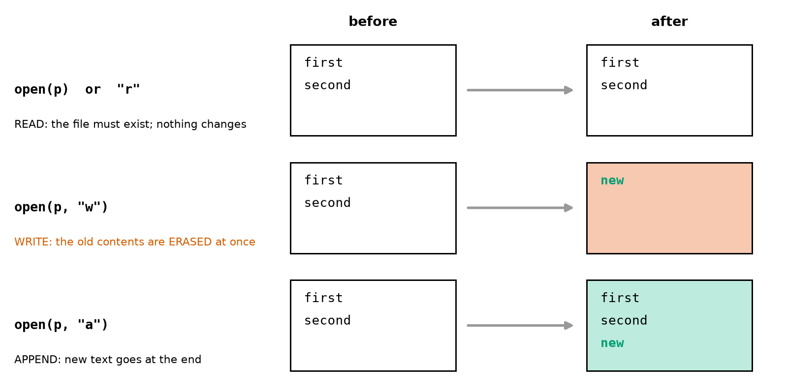
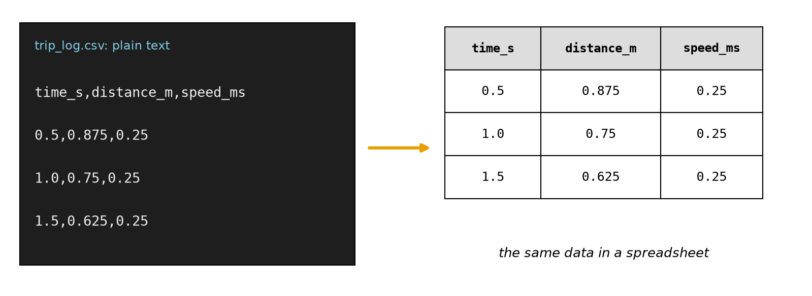
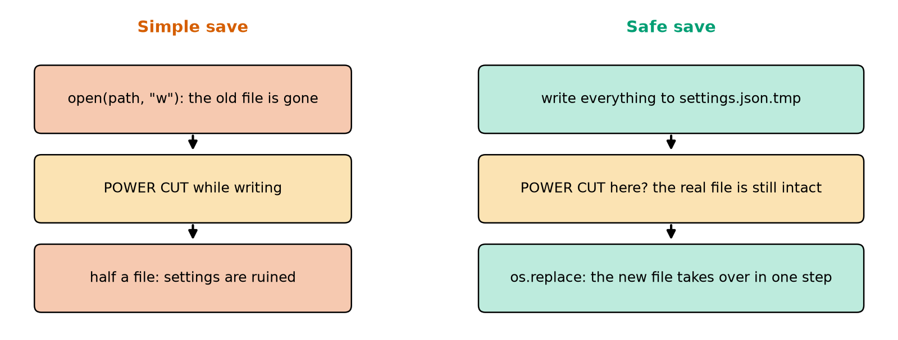
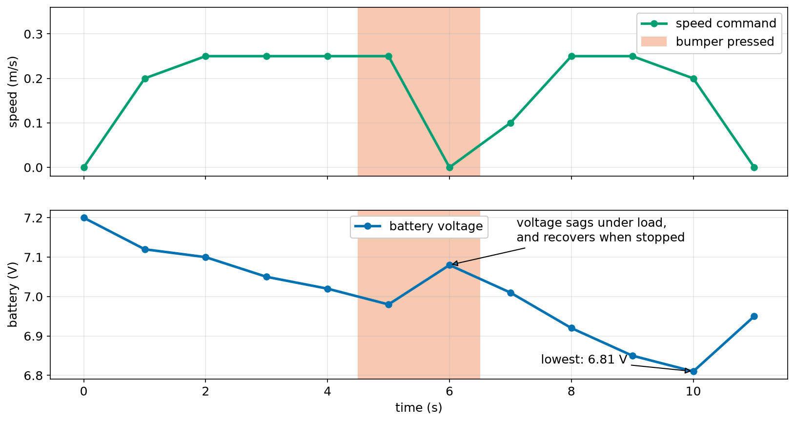

# Chapter 27 — Files: Saving and Reading Data

> **Part 2 · Chapter 27 of 749**
> **You need:** Chapters 22 (dictionaries) and 25 (`try`). Make a new folder for this chapter, because your programs will create files.
> **You will make:** a program that records a drive to a log file and reads it back, a settings file that survives damage and power cuts, and a tool that analyses a robot's test drive.

---

## What you will learn

- How to read and write text files safely, with `with`.
- The three main file modes, and the one that erases everything.
- How to go through a file line by line.
- What **CSV** and **JSON** files are, and how to use them.
- How paths and the current folder work.
- How to deal with missing and damaged files.
- How to save a file so that a power cut cannot ruin it.

---

## New words in this chapter

| Word | Simple meaning |
|---|---|
| **file** | Named data stored on a disk. It stays there after the program ends. |
| **mode** | How a file is opened: for reading, writing or adding. |
| **path** | The address of a file. |
| **context manager** | The `with` statement, which closes a file for you. |
| **log** | A record of what happened, written as it happens. |
| **CSV** | A table stored as lines of text with commas (Chapter 16). |
| **JSON** | A text format for numbers, text, lists and dictionaries. |
| **atomic** | Done in one step that cannot be half finished. |

---

## 27.1 Why files?

Every variable vanishes when a program ends. Chapter 16's wheel calibration gave a number that you had to type into your program by hand. Files give a program a memory that lasts.

📖 **New word: file** — named data stored on a disk.

### Writing

```python
with open("note.txt", "w") as f:
    f.write("hello\n")
```

### Reading

```python
with open("note.txt") as f:
    text = f.read()
print(repr(text))        # 'hello\n'
```

Three new things are here:

- `open(name, mode)` gives you a file object. We name it `f`.
- `f.write(text)` writes text. It needs a string (`f.write(5)` is a `TypeError`), and it does **not** add a newline. Writing `"one"` and then `"two"` gives `onetwo`.
- `with … as f:` is the safe way of using a file.

📖 **New word: context manager** — the `with` statement. When the indented block ends, even with an error, the file is closed. Using a closed file gives:

```
ValueError: I/O operation on closed file.
```

Always use `with`. Text you write often sits in a waiting area (the buffer of Chapter 16) until the file is closed. If a program crashes before that, the text can be lost.

### The modes

📖 **New word: mode** — how a file is opened. Look at Figure 27.1.



*Figure 27.1 — What each mode does to a file that already has two lines.*

**How to read this picture:** Each row is one mode. The white box on the left is the file before, and the box on the right is the file after writing `new`. In read mode nothing changes. Write mode (red) has erased both old lines. Append mode (green) keeps them and adds to the end.

| Mode | Means | If the file exists | If it does not |
|---|---|---|---|
| `"r"` (the default) | read | reads it | `FileNotFoundError` |
| `"w"` | write | **erases it first** | creates it |
| `"a"` | append | adds to the end | creates it |
| `"x"` | create | `FileExistsError` | creates it |

⚠️ **`"w"` erases at the moment of opening**, before you have written anything. If you open your only log with `"w"`, it is gone. A real run:

```python
with open("a.txt", "w") as f:
    f.write("first\n")
with open("a.txt", "w") as f:
    f.write("second\n")          # "first" is gone
with open("a.txt", "a") as f:
    f.write("third\n")           # added to "second"
```

The file now contains `second` and `third`. Use `"x"` when you must never overwrite anything.

📖 **New word: log** — a record of what happened, written as it happens. Logs use `"a"`.

### Reading line by line

```python
with open("a.txt") as f:
    for line in f:
        print(repr(line))
```

```
'one\n'
'two\n'
'three\n'
```

Each line keeps its `\n`, so use `.strip()` (Chapter 15). This is the best way to read large files, because only one line is in memory at a time.

Other ways:

| Code | Gives |
|---|---|
| `f.read()` | the whole file as one string |
| `f.readline()` | the next line |
| `f.readlines()` | a list of lines, with their `\n` |
| `f.read().splitlines()` | a list of lines, without `\n` |

After reading to the end, another `f.read()` gives `''`: the file remembers its position. Open it again to start over.

`print` can write to files too: `print("x", 1, file=f)`, and it adds the spaces and the newline for you.

---

## 27.2 Paths and the current folder

📖 **New word: path** — the address of a file.

`open("note.txt")` looks in the **current folder**, which is the folder your terminal is in, and not necessarily the folder holding your script. It is the most common cause of `FileNotFoundError`:

```
FileNotFoundError: [Errno 2] No such file or directory: 'nope.txt'
```

Check with `os.getcwd()` ("current working directory") and `os.path.exists("nope.txt")`.

To use the folder of the script itself, whatever the terminal is doing:

```python
from pathlib import Path

here = Path(__file__).parent
log_path = here / "data" / "log.txt"
```

`pathlib` joins paths with `/` on every system, including Windows. So use it instead of typing backslashes, which clash with Chapter 15's escapes.

⚠️ Always add `encoding="utf-8"` when text may contain characters beyond plain English: `open(p, "w", encoding="utf-8")`. Otherwise Windows may use a different encoding and a file can come out garbled on another computer.

---

## 27.3 CSV: tables as text

📖 **New word: CSV** — a table stored as lines of text with commas. Look at Figure 27.2.



*Figure 27.2 — A CSV file is a table, written as plain text.*

**How to read this picture:** On the left is the file as it really is, plain text with commas. On the right is the same data, as a spreadsheet shows it. The first line is the **header**, the name of each column.

You could use `split(",")` from Chapter 15, but a value may itself contain a comma. Python's `csv` module deals with that properly:

```python
import csv

with open("a.csv", "w", newline="") as f:
    writer = csv.writer(f)
    writer.writerow(["t", "v"])
    writer.writerow([0.5, "a,b"])
```

The file contains `0.5,"a,b"`, with quotes around the value that has a comma.

Reading with `DictReader` uses the header row as keys, so that each row is a dictionary:

```python
with open("a.csv", newline="") as f:
    for row in csv.DictReader(f):
        print(row["t"], type(row["t"]))    # 0.5 <class 'str'>
```

⚠️ **Everything read from a CSV is text.** Convert with `float` or `int` (Chapter 15).

⚠️ **Always write `newline=""` with `csv`.** On Windows, leaving it out produces an extra blank row after every row. A real run reads `[['1', '2'], [], ['3', '4'], []]`.

---

## 27.4 JSON: settings and structured data

📖 **New word: JSON** — a text format for numbers, text, lists and dictionaries. Its name comes from JavaScript, but every language reads it.

```
>>> import json
>>> json.dumps({"a": 1, "b": [1, 2], "d": True, "e": None})
'{"a": 1, "b": [1, 2], "d": true, "e": null}'
```

`json.dumps` makes a string, and `json.loads` turns one back. For files, use `json.dump(data, f)` and `json.load(f)`. `indent=2` makes the file easy for people to read:

```json
{
  "max_speed_ms": 0.5,
  "gain": 1.0
}
```

Small differences from Python:

| Python | JSON | After reading it back |
|---|---|---|
| `True`, `False`, `None` | `true`, `false`, `null` | `True`, `False`, `None` |
| tuple `(3, 4)` | `[3, 4]` | a **list** |
| key `1` | key `"1"` | a **string** key |
| a set | not possible | `TypeError` |

A file that is not valid JSON raises `json.JSONDecodeError`, and its message says where:

```
json.decoder.JSONDecodeError: Expecting property name enclosed in double quotes: line 1 column 2 (char 1)
```

**Which format?** CSV for tables with many rows of the same shape, such as sensor logs. JSON for settings and for nested data.

---

## Code

Rover records its drive as it goes, and afterwards reads the record back. This is Chapter 19's loop, and now it leaves a trace.

The file is `code/ch027/trip_logger.py`. Type it into your new folder.

```python
# trip_logger.py - record a simulated drive to a CSV file, then read it back
import csv

SETPOINT_M = 0.30
GAIN = 1.0
MAX_SPEED_MS = 0.25
DT_S = 0.5
LOG_FILE = "trip_log.csv"

distance_m = 1.0
time_s = 0.0

with open(LOG_FILE, "w", newline="") as f:      # "w" starts a new, empty file
    writer = csv.writer(f)
    writer.writerow(["time_s", "distance_m", "speed_ms"])     # the header row
    while abs(distance_m - SETPOINT_M) >= 0.01:
        speed_ms = max(-MAX_SPEED_MS, min(MAX_SPEED_MS, GAIN * (distance_m - SETPOINT_M)))
        distance_m -= speed_ms * DT_S
        time_s += DT_S
        writer.writerow([time_s, round(distance_m, 4), round(speed_ms, 4)])

with open(LOG_FILE, newline="") as f:           # no mode means "r": read
    rows = list(csv.DictReader(f))              # a list of dictionaries (Chapter 22)

speeds = [float(row["speed_ms"]) for row in rows]      # everything in a CSV is text
print("rows in the log:", len(rows))
print("first row:", rows[0])
print("top speed:", max(speeds), "m/s")
print("final distance:", rows[-1]["distance_m"], "m at", rows[-1]["time_s"], "s")
```

| Line | Code | What it does (simple English) |
|---|---|---|
| 1 | comment | The name of the file and the idea. |
| 2 | `import csv` | The module for table files. |
| 4–8 | constants | Including the name of the log. |
| 10–11 | state | Where Rover starts. |
| 13 | `with open(LOG_FILE, "w", newline="") as f:` | Each run starts a new log. |
| 14 | `writer = csv.writer(f)` | An object that knows how to write rows. |
| 15 | `writer.writerow([…])` | The header, once, before the loop. |
| 16–20 | the loop | The controller from Chapter 19, using `max` and `min` as a clamp. |
| 20 | `writer.writerow([…])` | One row per pass. Rounded only because it makes the file easy to read. |
| 22–23 | `with open(LOG_FILE, newline="")` | The first `with` has ended, so the file is closed and complete. |
| 25 | `speeds = […]` | A list comprehension converts text into numbers. |
| 26–29 | `print(…)` | What was recorded. |

**Output:**

```
rows in the log: 9
first row: {'time_s': '0.5', 'distance_m': '0.875', 'speed_ms': '0.25'}
top speed: 0.25 m/s
final distance: 0.3063 m at 4.5 s
```

**What the output means:**

- Nine rows, one per pass, the same nine lines as Chapter 19's output.
- In `first row`, every value is in quotes: **text**. `float` was needed before `max`.
- Open `trip_log.csv` in a text editor, and then in a spreadsheet. It has outlived the program.

⚠️ This program keeps the file open during the drive, so a crash could lose the last few rows. Chapter 30 discusses how often to flush a log. A robot's "black box" must flush often.

---

## Small examples

### Example 1 — Count the lines

```python
count = 0
with open("a.txt") as f:
    for line in f:
        count += 1
print(count)
```

### Example 2 — Append to a log

```python
with open("events.log", "a") as f:
    f.write("bump at 12.4 s\n")
```

### Example 3 — A list of numbers from a file

```python
with open("nums.txt") as f:
    numbers = [float(line) for line in f if line.strip()]
```

`if line.strip()` skips empty lines.

### Example 4 — Does a file exist?

```python
import os
print(os.path.exists("a.txt"))
```

### Example 5 — Path parts

```python
from pathlib import Path
p = Path("data") / "log.txt"
print(p.name, p.stem, p.suffix)      # log.txt log .txt
```

---

## 🏭 Real robot applications

### Application 1 (worked in full) — 🤖 A settings file that cannot hurt you

**1. The real problem.** Rover's calibrated wheel diameter should stay with the robot, not in the program. But a file can be missing (first run) or damaged (a power cut), and a robot must still start, with safe values.

**2. Why this idea.** A `try` handles missing and damaged files. Starting from a copy of the defaults and using `update` means that a file with only some of the settings still works. And saving through a temporary file protects against power cuts. Look at Figure 27.3.



*Figure 27.3 — The simple way can leave half a file. The safe way cannot.*

**How to read this picture:** On the left, `"w"` erases the file first, so a power cut while writing leaves a broken file. On the right, the new data goes to a separate file. A power cut at that point leaves the real file untouched. The last step replaces the old file in one go.

📖 **New word: atomic** — done in one step that cannot be half finished. `os.replace` is atomic.

**3. The numbers.** Defaults of 0.5 m/s, gain 1.0, wheel 0.065 m, and a calibrated wheel of 0.06589 m.

**4. The maths, step by step.** There is no arithmetic here. The logic is the merge:

```
Step 1. start with the defaults: gain 1.0, wheel 0.065, speed 0.5
Step 2. the file says: wheel 0.06589
Step 3. after update: gain 1.0, wheel 0.06589, speed 0.5
```

**5. The code.** File `code/ch027/settings_file.py`:

```python
# settings_file.py - load settings from a file, safely, and save them again
import json
import os

SETTINGS_FILE = "rover_settings.json"
DEFAULTS = {"max_speed_ms": 0.5, "gain": 1.0, "wheel_diameter_m": 0.065}


def load_settings(path):
    """Return the settings. Anything missing or damaged falls back to DEFAULTS."""
    settings = DEFAULTS.copy()
    try:
        with open(path) as f:
            settings.update(json.load(f))      # values from the file replace defaults
    except FileNotFoundError:
        print("no settings file: using defaults")
    except json.JSONDecodeError as error:
        print("settings file is damaged:", error)
    return settings


def save_settings(path, settings):
    """Write to a temporary file first, so a power cut cannot ruin the real one."""
    temp_path = path + ".tmp"
    with open(temp_path, "w") as f:
        json.dump(settings, f, indent=2)
    os.replace(temp_path, path)                # one step: old file or new file, never half


settings = load_settings(SETTINGS_FILE)
print("loaded:", settings)

settings["wheel_diameter_m"] = 0.06589         # the Chapter 16 calibration
save_settings(SETTINGS_FILE, settings)

print("again: ", load_settings(SETTINGS_FILE))
```

| Line | Code | What it does (simple English) |
|---|---|---|
| 2–3 | imports | `json` for the format, `os` for the replace. |
| 6 | `DEFAULTS` | The values to use when nothing else is available. |
| 11 | `settings = DEFAULTS.copy()` | A copy, so that the defaults are never changed (Chapter 21). |
| 12–18 | `try / except` | Two different problems, and two different messages. |
| 14 | `settings.update(json.load(f))` | Merges the file over the defaults. |
| 19 | `return settings` | Always returns something usable. |
| 24–27 | `save_settings` | Temporary file first, then replace. |
| 30–36 | the demonstration | Load, change, save, load. |

**Three real runs:**

```
no settings file: using defaults
loaded: {'max_speed_ms': 0.5, 'gain': 1.0, 'wheel_diameter_m': 0.065}
again:  {'max_speed_ms': 0.5, 'gain': 1.0, 'wheel_diameter_m': 0.06589}
```

Running it a second time: the file exists, so the calibration is remembered.

```
loaded: {'max_speed_ms': 0.5, 'gain': 1.0, 'wheel_diameter_m': 0.06589}
again:  {'max_speed_ms': 0.5, 'gain': 1.0, 'wheel_diameter_m': 0.06589}
```

With a damaged file (replaced by `{ bad`):

```
settings file is damaged: Expecting property name enclosed in double quotes: line 1 column 3 (char 2)
loaded: {'max_speed_ms': 0.5, 'gain': 1.0, 'wheel_diameter_m': 0.065}
again:  {'max_speed_ms': 0.5, 'gain': 1.0, 'wheel_diameter_m': 0.06589}
```

**6. The result.** The robot starts in every case, and it says what went wrong. The calibration now survives between runs. Falling back to defaults is safe only if the defaults are safe, so choose gentle ones.

**7. Going further.** A value can also be valid JSON but wrong: `"max_speed_ms": 500`. So check ranges after loading (Chapter 18). ROS 2 (Chapter 563) stores parameters in YAML files in much the same way.

### Application 2 (worked in full) — 🏭 What happened in that test drive?

**1. The real problem.** After a test, an engineer has a log and many questions. How far did it go? What was the top speed? When was the battery lowest? How many times did it bump into something?

**2. Why this idea.** `DictReader` gives each row by column name. Distance is found by adding up (average speed × time) for each interval. Counting bumps needs care: the bumper stays pressed for several rows, so we count only the moment when it **changes** from 0 to 1.

**3. The numbers.** The file `code/ch027/drive_log.csv` has 12 rows, one per second. Look at Figure 27.4.



*Figure 27.4 — The drive log, plotted.*

**How to read this picture:** The top graph is the speed command, and the bottom graph is the battery voltage. The red band marks the time the bumper was pressed: Rover hit something and stopped. Notice the voltage. It falls when the motors work hard, and it rises again when they stop. This effect will matter when you estimate how full a battery is (Chapter 89).

**4. The maths, step by step.**

```
Step 1. interval 0–1 s: (0.00 + 0.20) ÷ 2 × 1 = 0.100 m
Step 2. interval 1–2 s: (0.20 + 0.25) ÷ 2 × 1 = 0.225 m
Step 3. continue to the end: total = 2.00 m
```

This "average of the two ends × width" is the **trapezoid rule**. It is how a robot turns a speed into a distance (Chapter 183).

**5. The code.** File `code/ch027/analyse_log.py`:

```python
# analyse_log.py - after a test drive: what actually happened?
import csv

times = []
speeds = []
volts = []
bumps = 0
previous_bumper = 0

with open("drive_log.csv", newline="") as f:
    for row in csv.DictReader(f):
        times.append(float(row["time_s"]))
        speeds.append(float(row["speed_ms"]))
        volts.append(float(row["battery_v"]))
        bumper = int(row["bumper"])
        if bumper == 1 and previous_bumper == 0:     # count only the moment it goes on
            bumps += 1
        previous_bumper = bumper

distance_m = 0.0
for i in range(len(times) - 1):
    dt = times[i + 1] - times[i]
    distance_m += (speeds[i] + speeds[i + 1]) / 2 * dt   # average speed x time

print(f"duration:   {times[-1] - times[0]:.1f} s")
print(f"distance:   {distance_m:.2f} m")
print(f"top speed:  {max(speeds):.2f} m/s")
print(f"lowest V:   {min(volts):.2f} V at t = {times[volts.index(min(volts))]:.1f} s")
print(f"bumps:      {bumps}")
```

| Line | Code | What it does (simple English) |
|---|---|---|
| 4–8 | empty lists and counters | Ready to collect. |
| 11 | `for row in csv.DictReader(f):` | Each row is a dictionary, with text values. |
| 12–15 | convert | Text to numbers. |
| 16–18 | the edge detector | Counts a change, not a state. |
| 21–23 | trapezoid rule | Uses each pair of neighbouring rows. |
| 25–29 | report | `volts.index(min(volts))` finds where the lowest value occurred. |

**Output:**

```
duration:   11.0 s
distance:   2.00 m
top speed:  0.25 m/s
lowest V:   6.81 V at t = 10.0 s
bumps:      1
```

**6. The result.** A few lines answer all the questions. There is only one bump, although the bumper was pressed in two rows, because the edge detector counts the moment of contact.

📖 This "was it off and now on?" check is called **edge detection**. Buttons, limit switches and bumpers all need it (Chapter 115).

**7. Going further.** Chapter 33 draws this kind of graph automatically, and Chapter 639 reads real drone flight logs, thousands of rows at a time.

### Application 3 — 🌾 A mission file

A farm robot's route is a CSV of waypoints written by a planning program in the office and copied to the robot. The robot's code stays the same from field to field. The route is **data**, the idea from Chapter 20, now stored on a disk.

### Application 4 — 🏥 An audit trail

A hospital robot must prove what it delivered, and when. Each delivery appends one line to a log (`"a"` mode), and it never overwrites old lines. Regulated industries require records like this, and the safest designs write each record immediately and copy the log to another computer.

### Application 5 — 🚁 The black box

Drones and aircraft record their sensors and commands continuously. After a crash, the flight log is often the only evidence of what happened. Flushing to disk frequently means losing, at most, the last moments. Chapter 639 uses such logs to tune a drone, and Application 2 was a small version of the same work.

---

## 🔧 Hands-on lab

### Lab 27.1 — The overwrite trap

**You need:** a new empty folder and a Python file.

**Steps:**

1. Write a program that writes `first` to `lab.txt` using `"w"`, and print the file.
2. Add a second block that writes `second` using `"w"`. Print the file.
3. Change the second block to `"a"`, delete `lab.txt`, and run it again.
4. Run the program a second time. What does the file contain now?

**What you should see:** Step 2 shows only `second`. Step 3 shows `first` and then `second`. Step 4 shows the same thing again, because the first block's `"w"` erased the file at the start of the run.

**If it does not work:**

| Problem | Likely cause | Fix |
|---|---|---|
| The words are on one line | No `\n` | `write` does not add one. |
| `FileNotFoundError` | The file was opened in `"r"` mode before it existed | Write it first. |

### Lab 27.2 — Where is my file?

**You need:** a terminal and a Python file.

**Steps:**

1. Make a file `where.py` containing:

   ```python
   import os
   from pathlib import Path

   print("current folder:", os.getcwd())
   print("script folder: ", Path(__file__).parent)
   print("exists?", os.path.exists("data.txt"))
   ```

2. Create `data.txt` next to the script. Run the script from its own folder.
3. In the terminal, go up one folder (`cd ..`), and run it again by typing the path to the script.

**What you should see:** Step 2 says `exists? True`. In step 3 the current folder has changed, and it says `exists? False`, even though the file is still next to the script. That is why robot programs that are started automatically should use `Path(__file__).parent`.

**If it does not work:**

| Problem | Likely cause | Fix |
|---|---|---|
| `can't open file` | The wrong path to the script | Press Tab to complete it. |

### Lab 27.3 — Waypoints from a file

**You need:** a text editor and a Python file.

**Steps:**

1. Create `route.csv` with the header `x,y` and the rows `0,0`, `2,0`, `2,1.5` and `4,3`.
2. Write a program that reads it into a list of `(x, y)` tuples of floats, and prints the total length (Chapter 24's `route_length`).
3. Add a broken row, `5,abc`, in the middle. Make your program skip bad rows and count them.

**What you should see:** A total of `6.00 m`. With the broken row added, the total stays `6.00 m`, because the bad row is skipped, and the program reports `bad rows: 1`. One solution:

```python
import csv

points = []
bad = 0
with open("route.csv", newline="") as f:
    for row in csv.DictReader(f):
        try:
            points.append((float(row["x"]), float(row["y"])))
        except ValueError:
            bad += 1

total = 0.0
for i in range(len(points) - 1):
    a, b = points[i], points[i + 1]
    total += ((b[0] - a[0]) ** 2 + (b[1] - a[1]) ** 2) ** 0.5

print(f"total {total:.2f} m, bad rows: {bad}")
```

**If it does not work:**

| Problem | Likely cause | Fix |
|---|---|---|
| `KeyError: 'x'` | The header is misspelt or missing | The first line must be exactly `x,y`. |
| `TypeError: unsupported operand` | The values are still text | Convert with `float`. |

---

## Common mistakes

⚠️ **`"w"` on a file you wanted to keep.** It is erased at once.

⚠️ **Not using `with`.** Text may never reach the disk.

⚠️ **Forgetting `\n` in `write`.**

⚠️ **Forgetting that lines end in `\n` when reading.** `.strip()` them.

⚠️ **Treating CSV values as numbers.** They are text.

⚠️ **Leaving out `newline=""` with `csv`.** Blank rows appear on Windows.

⚠️ **Assuming the current folder is the script's folder.**

⚠️ **Backslashes in paths.** Use `pathlib`.

⚠️ **Believing a file's contents.** Check for missing, damaged and silly values.

---

## Practice

🏋️ **1.** Which mode? (a) Add to a log; (b) read settings; (c) start a new report, erasing any old one; (d) create a file, but fail if it exists.

🏋️ **2.** Write `"hello"` and then `"world"` to a file, on separate lines.

🏋️ **3.** Read a file and print each line in capitals, without blank lines between them.

🏋️ **4.** What is printed?

```python
with open("a.txt", "w") as f:
    f.write("x")
with open("a.txt") as f:
    print(f.read())
    print(f.read())
```

🏋️ **5.** Write `safe_read(path)`, which returns the text of a file, or `""` if it does not exist.

🏋️ **6.** A CSV has a column `speed`. Why does `row["speed"] * 2` give the wrong answer? Fix it.

🏋️ **7.** Save the dictionary `{"a": 1}` to `s.json` and load it again.

🏋️ **8.** What is `json.loads(json.dumps({"p": (1, 2)}))`? What has changed?

🏋️ **9.** Why write a settings file to a temporary name first?

🏋️ **10.** A log shows the bumper as `0, 1, 1, 0, 1`. How many bumps are there? Write the loop that counts them.

🏋️ **11.** (Harder) Write `append_reading(path, time_s, value)` that adds one row to a CSV, writing the header only if the file does not yet exist. Call it three times, delete the file, and call it again to test both paths. Then read the file and print the average value.

---

## Answers

**1.** (a) `"a"`; (b) `"r"`; (c) `"w"`; (d) `"x"`.

**2.**

```python
with open("a.txt", "w") as f:
    f.write("hello\n")
    f.write("world\n")
```

**3.**

```python
with open("a.txt") as f:
    for line in f:
        print(line.strip().upper())
```

**4.** `x`, and then an empty line. The second `read` starts at the end of the file and gets `''`.

**5.**

```python
def safe_read(path):
    try:
        with open(path) as f:
            return f.read()
    except FileNotFoundError:
        return ""
```

**6.** The value is text, so `* 2` repeats it. Use `float(row["speed"]) * 2`.

**7.**

```python
import json

with open("s.json", "w") as f:
    json.dump({"a": 1}, f)
with open("s.json") as f:
    print(json.load(f))
```

**8.** `{'p': [1, 2]}`. The tuple has become a list, because JSON has no tuples.

**9.** So that a crash or power cut while writing cannot leave a half-written settings file. The real file is replaced only when the new one is complete.

**10.** 2 bumps.

```python
states = [0, 1, 1, 0, 1]
bumps = 0
previous = 0
for s in states:
    if s == 1 and previous == 0:
        bumps += 1
    previous = s
```

**11.**

```python
import csv
import os


def append_reading(path, time_s, value):
    new_file = not os.path.exists(path)
    with open(path, "a", newline="") as f:
        writer = csv.writer(f)
        if new_file:
            writer.writerow(["time_s", "value"])
        writer.writerow([time_s, value])


append_reading("r.csv", 0.0, 1.0)
append_reading("r.csv", 0.5, 2.0)
append_reading("r.csv", 1.0, 6.0)

with open("r.csv", newline="") as f:
    values = [float(row["value"]) for row in csv.DictReader(f)]
print(sum(values) / len(values))     # 3.0
```

---

## Summary

🧠 Files keep data after a program ends. Always use `with open(…) as f:`.

🧠 `"r"` reads, `"a"` adds, and `"w"` **erases at once**.

🧠 `write` needs a string and adds no newline. Lines read from a file keep their `\n`.

🧠 Paths start from the **current folder**. Use `Path(__file__).parent` to find files next to the script.

🧠 **CSV** is for tables (use `newline=""`; values are text). **JSON** is for settings and nested data.

🧠 Handle missing and damaged files with `try`, and fall back to safe defaults.

🧠 Write to a temporary file and use `os.replace`, so that a power cut cannot ruin your data.

---

## Next chapter

Rover is now described by a pile of variables and functions, and the functions keep needing the same state passed to them. In **Chapter 28 — Classes and objects part 1: a `Robot` class**, you will bundle the data and the functions together into one thing: a `Robot` that knows its own position and knows how to drive itself.
