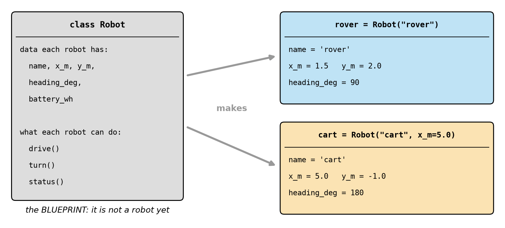
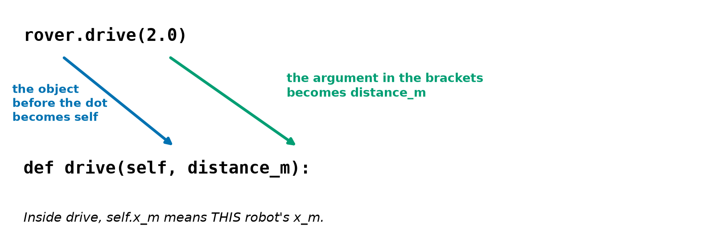
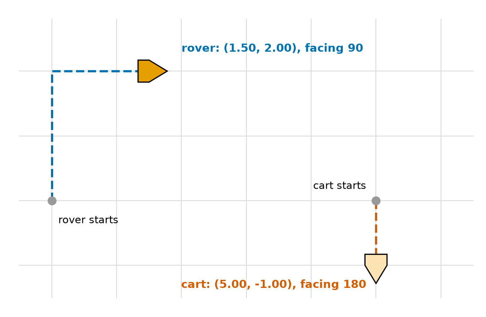
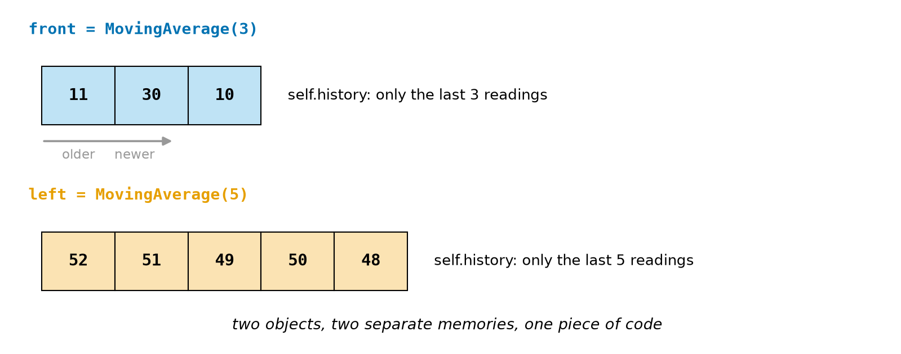

# Chapter 28 — Classes and Objects Part 1: A `Robot` Class

> **Part 2 · Chapter 28 of 749**
> **You need:** Chapters 22–24 (dictionaries, functions, scope). Keep a script open.
> **You will make:** a `Robot` class that knows its own position and battery, a robot that refuses unsafe commands by itself, and a sensor filter object that remembers its own history.

---

## What you will learn

- Why data and the functions that use it belong together.
- What a **class** and an **object** are.
- How `__init__` sets up a new object.
- What `self` really means.
- How **methods** work, and how they read and change an object's data.
- The difference between instance attributes and class attributes.
- How to make an object print itself nicely.
- How to design a class that protects its own data.

---

## New words in this chapter

| Word | Simple meaning |
|---|---|
| **class** | A blueprint that describes a kind of thing. |
| **object** (instance) | One actual thing made from a class. |
| **attribute** | A variable that belongs to an object. |
| **method** | A function that belongs to a class. |
| **constructor** | `__init__`: the method that sets up a new object. |
| **self** | The object that a method is working on. |
| **class attribute** | A variable shared by every object of a class. |
| **encapsulation** | Keeping data and the code that guards it together. |

---

## 28.1 Why classes?

Look at Chapter 24's fleet program. Each robot was a dictionary, and `step(robot, dt)` received it as a parameter. That worked, but there were weaknesses:

- Nothing connects `step` to the dictionaries it needs. Anybody can pass it something else.
- A misspelt key, such as `robot["x_n"]`, silently creates a new entry.
- Any code anywhere can set `robot["battery_wh"] = -5`.

A class puts the data and the functions that use it into one package.

📖 **New word: class** — a blueprint that describes a kind of thing.

📖 **New word: object** — one actual thing made from a class. Also called an **instance**.

Look at Figure 28.1.



*Figure 28.1 — One class, and two objects made from it.*

**How to read this picture:** The grey card is the class. It says what data every robot has, and what every robot can do, but it is not a robot. The blue and orange cards are two real objects, made from that class. Each has its own values.

A class is like a cookie cutter, and objects are the cookies. You have been using objects all along: `"abc"` is an object of class `str`, and `.upper()` is one of its methods. `[1, 2]` is an object of class `list`, and `.append` is one of its methods.

---

## 28.2 Your first class

```python
class Counter:
    def __init__(self):
        self.count = 0

    def tick(self):
        self.count += 1


a = Counter()
a.tick()
a.tick()
b = Counter()
b.tick()
print(a.count, b.count)     # 2 1
```

Let us go through it.

`class Counter:` starts the blueprint. By convention, class names use **CapitalWords** (Chapter 14's snake_case is for variables and functions).

`def __init__(self):` is a special method. 📖 **New word: constructor** — `__init__`: the method that sets up a new object. Python calls it for you when you write `Counter()`. The name has two underscores on each side, and it means "initialise".

📖 **New word: attribute** — a variable that belongs to an object. `self.count` is one.

📖 **New word: method** — a function that belongs to a class. `tick` is one.

`a = Counter()` makes a new object and names it `a`. Note the brackets: as with functions, they are the "go" button.

Finally, `a` and `b` are separate objects, so each has its own `count`.

### What is `self`?

📖 **New word: self** — the object that a method is working on. Look at Figure 28.2.



*Figure 28.2 — Python passes the object before the dot as the first argument.*

**How to read this picture:** The top line is a call, and the second line is the method it runs. The blue arrow shows the object before the dot becoming `self`. The green arrow shows the value in the brackets becoming the next parameter. So one piece of code can work on any robot.

When you write `rover.drive(2.0)`, Python really does `Robot.drive(rover, 2.0)`. Both forms work, and you can see it yourself:

```python
r = R()
r.show(1)
R.show(r, 2)     # exactly the same
```

There is nothing magical about the word `self`. It is just the name of the first parameter, but every Python programmer uses it, so you should too.

### The three `self` mistakes

These are real results:

**1. Forgetting `self` in the definition.** Python passes the object anyway, so there is one argument too many:

```
TypeError: R.go() takes 0 positional arguments but 1 was given
```

**2. Forgetting `self.` when creating an attribute.** `speed = 5` inside `__init__` is only a local variable (Chapter 24), and it disappears:

```
AttributeError: 'R' object has no attribute 'speed'
```

**3. Forgetting `self.` when using an attribute:**

```
NameError: name 'speed' is not defined. Did you mean: 'self.speed'?
```

Python's hints are good. Read them.

---

## 28.3 Parameters in the constructor

`__init__` can take parameters, with defaults and keywords, just like any function (Chapter 24):

```python
class Robot:
    def __init__(self, name, x_m=0.0):
        self.name = name
        self.x_m = x_m


rover = Robot("rover")
cart = Robot("cart", x_m=5.0)
```

`self.name = name` looks odd, but there are two different names: `name` is the parameter (it vanishes when `__init__` ends), and `self.name` is the attribute (it stays with the object).

A class checks the number of arguments as well: `R()` when a `name` is required gives `TypeError: R.__init__() missing 1 required positional argument: 'name'`.

---

## 28.4 Class attributes

📖 **New word: class attribute** — a variable shared by every object of a class. It is written directly in the class, outside any method:

```python
class Robot:
    POWER_W = 3.78        # one value, shared by all robots
```

Use class attributes for constants. A real run shows a trap:

```python
class R:
    WHEELS = 2

a = R()
b = R()
print(a.WHEELS, R.WHEELS)     # 2 2
a.WHEELS = 3                  # makes a NEW attribute on a only
print(a.WHEELS, b.WHEELS, R.WHEELS)     # 3 2 2
```

⚠️ **Never put a list in a class attribute.** It is Chapter 24's mutable default trap again:

```python
class R:
    log = []                  # one list, shared by ALL objects
```

After `a.add(1)`, `b.log` shows `[1]`. Create lists in `__init__` with `self.log = []`, so that every object has its own.

---

## 28.5 Making an object print itself

By default, printing an object tells you very little:

```
<__main__.Robot object at 0x...>
```

Define `__str__`, and Python will use it:

```python
class R:
    def __init__(self):
        self.x = 1

    def __str__(self):
        return f"R at {self.x}"


r = R()
print(r)            # R at 1
```

It must **return** a string (Chapter 23: `return`, not `print`). Otherwise: `TypeError: __str__ returned non-string (type NoneType)`.

Names with double underscores are called **dunder** methods. Python calls them at special moments. Chapter 29 shows more.

---

## 28.6 Objects are shared, not copied

The rules of Chapters 21 and 24 apply: `b = a` gives a second name for one object. Passing an object to a function shares it.

```python
a = R()
b = a
b.x = 9
print(a.x, a is b)      # 9 True
```

`copy.copy(a)` makes a separate object, as in Chapter 26. Most of the time, sharing is exactly what you want: a single `rover` object is passed around, and everyone sees the same robot.

---

## Code

Here is the `Robot` class. It combines the state from Chapter 14, the movement from Chapter 26 and the battery from Chapter 5.

The file is `code/ch028/robot.py`. Type it into `my-code/ch028/`.

```python
# robot.py - a Robot class: one object holds its own state and knows how to move
import math


class Robot:
    """A robot on a flat floor, with a position, a heading and a battery."""

    POWER_W = 3.78                    # a class attribute: the same for every Robot

    def __init__(self, name, x_m=0.0, y_m=0.0, heading_deg=0.0, battery_wh=11.52):
        self.name = name              # instance attributes: each object has its own
        self.x_m = x_m
        self.y_m = y_m
        self.heading_deg = heading_deg
        self.battery_wh = battery_wh
        self.odometer_m = 0.0

    def turn(self, angle_deg):
        """Turn on the spot. Positive angles turn right."""
        self.heading_deg = (self.heading_deg + angle_deg) % 360

    def drive(self, distance_m, speed_ms=0.25):
        """Drive straight ahead, and use energy for the time it takes."""
        h = math.radians(self.heading_deg)
        self.x_m += distance_m * math.sin(h)
        self.y_m += distance_m * math.cos(h)
        self.odometer_m += abs(distance_m)
        self.battery_wh -= self.POWER_W * abs(distance_m) / speed_ms / 3600

    def status(self):
        """Return one line of text describing the robot."""
        return (f"{self.name}: ({self.x_m:.2f}, {self.y_m:.2f}) facing {self.heading_deg:.0f}, "
                f"driven {self.odometer_m:.2f} m, battery {self.battery_wh:.4f} Wh")


if __name__ == "__main__":
    rover = Robot("rover")
    cart = Robot("cart", x_m=5.0, heading_deg=180)

    rover.drive(2.0)
    rover.turn(90)
    rover.drive(1.5)
    cart.drive(1.0, speed_ms=0.5)

    print(rover.status())
    print(cart.status())
```

| Line | Code | What it does (simple English) |
|---|---|---|
| 1–2 | comment, import | `math` for the sine and cosine. |
| 5 | `class Robot:` | The blueprint begins. Everything indented is part of it. |
| 6 | docstring | Says what a `Robot` is. |
| 8 | `POWER_W = 3.78` | Shared by all robots. |
| 10 | `def __init__(self, name, x_m=0.0, …):` | One required parameter, the rest with defaults. |
| 11–16 | `self.… = …` | Each robot's own state. `odometer_m` is not a parameter, because every robot starts at 0. |
| 18–20 | `turn` | A method that changes the object. `% 360` is from Chapter 13. |
| 22–28 | `drive` | Uses and updates attributes. `h` is an ordinary local variable, because nobody needs it afterwards. |
| 28 | `self.POWER_W` | A class attribute is found through the object too. |
| 30–33 | `status` | **Returns** text. The two adjacent f-strings join into one, inside the brackets. |
| 36 | `if __name__ == "__main__":` | The demonstration runs only when this file is run directly (Chapter 26). |
| 37–38 | make two objects | One class, two robots. |
| 40–43 | calls | Each method acts on the object before the dot. |

**Output:**

```
rover: (1.50, 2.00) facing 90, driven 3.50 m, battery 11.5053 Wh
cart: (5.00, -1.00) facing 180, driven 1.00 m, battery 11.5179 Wh
```

Look at Figure 28.3.



*Figure 28.3 — Each object tracks its own position and heading.*

**How to read this picture:** The grey grid has 1 m squares. The blue path is `rover`, which started at the origin facing north, drove 2 m, turned right and drove 1.5 m. The red path is `cart`, which started at (5, 0) facing south and drove 1 m. Neither robot knows about the other.

**What the output means:**

- The rover's battery reading, 11.5053 Wh, is exactly what Chapter 14 got with loose variables for the same 3.5 m trip. The behaviour is the same, but the organisation is far better.
- `cart` drove 1 m at 0.5 m/s, so it used 3.78 × 2 ÷ 3600 = 0.0021 Wh.

🔢 **Maths** — check the cart: 11.52 − 0.0021 = 11.5179 ✓.

Notice how the main part reads: `rover.drive(2.0)`, `rover.turn(90)`. To create a fleet of a hundred robots, you would only need a list of objects.

---

## Small examples

### Example 1 — The smallest class

```python
class Thing:
    pass

t = Thing()
t.size = 3
print(t.size)     # 3
```

Attributes can be added from outside, but it is better to create them all in `__init__`.

### Example 2 — A misspelling

```python
r = R()
print(r.sped)
```

`AttributeError: 'R' object has no attribute 'sped'. Did you mean: 'speed'?` Better than the silent dictionary problem of Section 28.1.

### Example 3 — A stack

```python
class Stack:
    def __init__(self):
        self.items = []

    def push(self, value):
        self.items.append(value)

    def pop(self):
        return self.items.pop()
```

### Example 4 — A tank with a limit

```python
class Tank:
    def __init__(self, capacity):
        self.capacity = capacity
        self.level = 0.0

    def fill(self, amount):
        self.level = min(self.level + amount, self.capacity)

t = Tank(5)
t.fill(3)
t.fill(4)
print(t.level)     # 5
```

### Example 5 — A list of objects

```python
print([r.status() for r in fleet])
```

### Example 6 — Is it that kind of thing?

```python
print(isinstance(rover, Robot))     # True
```

---

## 🏭 Real robot applications

### Application 1 (worked in full) — 🤖 A robot that protects itself

📖 **New word: encapsulation** — keeping data and the code that guards it together.

**1. The real problem.** With loose variables, any line of a program can command an impossible speed, or drive the battery flat. The checks end up scattered, and someone forgets one.

**2. Why this idea.** Put the rules in the class. If every drive must go through the `drive` method, then every drive gets checked, and no caller can forget. The method can also return True or False, so that callers can react.

**3. The numbers.** A speed limit of 0.5 m/s, a reserve of 0.5 Wh that must never be used, and a battery holding 0.6 Wh.

**4. The maths, step by step.**

```
Drive 10 m at 0.25 m/s: 3.78 × 40 ÷ 3600 = 0.042 Wh;  0.6 − 0.042 = 0.558 ≥ 0.5  → allowed
Drive at 2.0 m/s:       above the limit of 0.5                                    → refused
Drive 30 m at 0.25:     3.78 × 120 ÷ 3600 = 0.126 Wh; 0.558 − 0.126 = 0.432 < 0.5 → refused
```

**5. The code.** File `code/ch028/safe_rover.py`:

```python
# safe_rover.py - a Robot that refuses to do unsafe things
import math


class SafeRover:
    MAX_SPEED_MS = 0.5
    POWER_W = 3.78
    RESERVE_WH = 0.5                  # never use this last bit of energy

    def __init__(self, battery_wh):
        self.x_m = 0.0
        self.battery_wh = battery_wh
        self.refused = 0              # a counter that the object keeps for itself

    def energy_needed(self, distance_m, speed_ms):
        """Return the Wh needed for this drive."""
        return self.POWER_W * (abs(distance_m) / speed_ms) / 3600

    def drive(self, distance_m, speed_ms=0.25):
        """Drive if it is safe. Return True if the drive happened."""
        if not 0 < speed_ms <= self.MAX_SPEED_MS:
            print(f"  refused: speed {speed_ms} is not allowed")
            self.refused += 1
            return False
        needed = self.energy_needed(distance_m, speed_ms)
        if self.battery_wh - needed < self.RESERVE_WH:
            print(f"  refused: needs {needed:.3f} Wh, only {self.battery_wh:.3f} Wh left")
            self.refused += 1
            return False
        self.x_m += distance_m
        self.battery_wh -= needed
        print(f"  drove {distance_m} m: x = {self.x_m:.1f}, battery {self.battery_wh:.3f} Wh")
        return True


rover = SafeRover(battery_wh=0.6)
rover.drive(10.0)                     # needs 0.042 Wh: fine
rover.drive(1.0, speed_ms=2.0)        # too fast
rover.drive(30.0)                     # needs 0.126 Wh: would dip into the reserve
print("refused drives:", rover.refused)
```

| Line | Code | What it does (simple English) |
|---|---|---|
| 6–8 | class attributes | The rules of this kind of robot. |
| 10–13 | `__init__` | Each object's state. |
| 15–17 | `energy_needed` | A helper. Methods can call each other with `self.`. |
| 21–24 | speed guard | `not 0 < speed <= max` also catches a speed of 0, which would divide by zero. |
| 25–29 | energy guard | Would this leave enough in reserve? |
| 30–33 | the drive | Reached only if both guards pass. |

**Output:**

```
  drove 10.0 m: x = 10.0, battery 0.558 Wh
  refused: speed 2.0 is not allowed
  refused: needs 0.126 Wh, only 0.558 Wh left
refused drives: 2
```

**6. The result.** The rules live in one place, and no caller can bypass them through `drive`. The object also counts its own refusals. Python does not stop someone from writing `rover.battery_wh = 100` from outside. A leading underscore (`self._battery_wh`) is the convention for "do not touch", and Chapter 29 shows a stronger way.

**7. Going further.** This is the shape of real robot driver software: a `Motor` class that clamps every command. A safety rule inside the class is applied everywhere it is used (Chapter 7).

### Application 2 (worked in full) — 🤖🚁 A filter that remembers

**1. The real problem.** Chapter 21's moving average needed the whole list of readings in advance. A real robot gets one reading at a time and needs an answer immediately. With several sensors, each needs its own memory. Functions forget everything between calls (Chapter 24), so where does the history live?

**2. Why this idea.** An object holds state **between calls**. Each filter object has its own history, so three sensors need three objects and one class.

**3. The numbers.** A front sensor with a window of 3 and a left sensor with a window of 5. The front sensor reads 10, 12, 9, 11, 30, 10.

**4. The maths, step by step.**

```
Front after 12:  (10 + 12) ÷ 2            = 11.0
Front after 9:   (10 + 12 + 9) ÷ 3        = 10.3
Front after 11:  (12 + 9 + 11) ÷ 3        = 10.7     (10 has been forgotten)
```

**5. The code.** File `code/ch028/sensor_filter.py`:

```python
# sensor_filter.py - a filter object remembers its own recent readings
class MovingAverage:
    """Average of the last few readings. Each object keeps its own history."""

    def __init__(self, window):
        self.window = window
        self.history = []             # a new, separate list for every object

    def update(self, value):
        """Add one reading and return the new average."""
        self.history.append(value)
        if len(self.history) > self.window:
            self.history.pop(0)       # forget the oldest reading
        return sum(self.history) / len(self.history)


front = MovingAverage(3)
left = MovingAverage(5)

front_readings = [10, 12, 9, 11, 30, 10]
left_readings = [50, 52, 51, 49, 50, 48]

for f_raw, l_raw in zip(front_readings, left_readings):
    print(f"front {f_raw:3d} -> {front.update(f_raw):5.1f}    left {l_raw:3d} -> {left.update(l_raw):5.1f}")

print("front remembers", front.history)
print("left remembers", left.history)
```

| Line | Code | What it does (simple English) |
|---|---|---|
| 5–7 | `__init__` | The list is created here, once per object. |
| 9–13 | `update` | Add, trim the oldest, and return the average. |
| 16–17 | two objects | Different window sizes. |
| 22–23 | the loop | Each call updates one object's memory. |

**Output:**

```
front  10 ->  10.0    left  50 ->  50.0
front  12 ->  11.0    left  52 ->  51.0
front   9 ->  10.3    left  51 ->  51.0
front  11 ->  10.7    left  49 ->  50.5
front  30 ->  16.7    left  50 ->  50.4
front  10 ->  17.0    left  48 ->  50.0
front remembers [11, 30, 10]
left remembers [52, 51, 49, 50, 48]
```

Look at Figure 28.4.



*Figure 28.4 — Each object has its own memory.*

**How to read this picture:** The blue row is the `front` object's history and the orange row is the `left` object's history, as they stand at the end of the run. Each holds only its most recent readings. The older readings have been dropped.

**6. The result.** The front column matches Chapter 21's results, but here each reading arrives one at a time, which is how real sensors work. `update` is the pattern for every filter and controller in robotics: "here is a new measurement; give me the new answer".

**7. Going further.** A PID controller (Chapter 216) is exactly this shape, with its own memory of past errors. So is a Kalman filter (Chapter 416).

### Application 3 — 🦾 A class for each joint

A `Joint` class holds a name, limits and the current angle, and its `move_to` method clamps every command. An arm is then a list of six `Joint` objects, and a humanoid is a list of thirty. The checks of Chapter 22 now live in one class and apply everywhere.

### Application 4 — 🏭 One object per machine

In a factory, each conveyor, gripper and camera can be represented by an object with `start()`, `stop()` and `status()`. The main program talks to all of them in the same way. If a real conveyor is replaced by a different model, only one class has to change.

### Application 5 — 🧹 Testing without hardware

A `FakeMotor` class has the same methods as a real `Motor`, but it only records what it was asked to do. A test can check that the program commanded the right speeds, with no robot connected. Chapter 29 makes this idea formal, and it is how most robot software is tested.

---

## 🔧 Hands-on lab

### Lab 28.1 — Two robots, one class

**You need:** `robot.py`.

**Steps:**

1. Run it and check the output.
2. Add a third robot, `drone`, starting at (1, 1) facing east (90).
3. Drive it 2 m, turn it right by 90, drive it 2 m, and print its status. Predict its position before running.
4. Change `POWER_W` to 8.78 in the class. Which robots are affected?

**What you should see:** `drone` first moves east to (3, 1). Turning right makes it face 180 (south), so it ends at (3.00, -1.00). In step 4, **every** robot's energy use changes, because the class attribute is shared.

**If it does not work:**

| Problem | Likely cause | Fix |
|---|---|---|
| `TypeError: Robot.__init__() missing…` | No name given | `Robot("drone", x_m=1, y_m=1, heading_deg=90)`. |
| The drone starts at the origin | Positional arguments in the wrong order | Use keywords. |

### Lab 28.2 — Break `self` on purpose

**You need:** a Python file.

**Steps:** Type this class, and check that it works. Then make each change, one at a time, and read the error. Undo each one before the next.

```python
class Lamp:
    def __init__(self):
        self.on = False

    def toggle(self):
        self.on = not self.on


lamp = Lamp()
lamp.toggle()
print(lamp.on)
```

1. In `__init__`, write `on = False` (no `self.`).
2. Remove `self` from `def toggle(self):`.
3. In `toggle`, write `self.on = not on`.
4. Write `lamp.toggle` with no brackets.

**What you should see:**

| Change | Result |
|---|---|
| none | `True` |
| 1 | `AttributeError: 'Lamp' object has no attribute 'on'` |
| 2 | `TypeError: Lamp.toggle() takes 0 positional arguments but 1 was given` |
| 3 | `NameError: name 'on' is not defined. Did you mean: 'self.on'?` |
| 4 | No error, and it prints `False`. Nothing was called (Chapter 23). |

**If it does not work:**

| Problem | Likely cause | Fix |
|---|---|---|
| `IndentationError` | The methods are not indented inside the class | Each `def` needs 4 spaces. |

### Lab 28.3 — Build a `Battery`

**You need:** a new Python file.

**Steps:** Write a class `Battery` with:

- `__init__(self, capacity_wh)`, which starts full;
- `use(self, wh)`, which subtracts energy but never goes below 0;
- `percent(self)`, which returns the charge in percent;
- `__str__`, which returns text such as `Battery 75.0%`.

Test it with a capacity of 10 Wh: use 2.5, print it, use 20, print it.

**What you should see:** `Battery 75.0%` and `Battery 0.0%`. One solution:

```python
class Battery:
    def __init__(self, capacity_wh):
        self.capacity_wh = capacity_wh
        self.level_wh = capacity_wh

    def use(self, wh):
        self.level_wh = max(self.level_wh - wh, 0.0)

    def percent(self):
        return self.level_wh / self.capacity_wh * 100

    def __str__(self):
        return f"Battery {self.percent():.1f}%"


b = Battery(10)
b.use(2.5)
print(b)
b.use(20)
print(b)
```

**If it does not work:**

| Problem | Likely cause | Fix |
|---|---|---|
| Prints `<__main__.Battery object…>` | `__str__` is misspelt or not indented | Two underscores on each side, inside the class. |
| `TypeError: __str__ returned non-string` | It prints instead of returning | Use `return`. |

---

## Common mistakes

⚠️ **Forgetting `self` as the first parameter.**

⚠️ **Forgetting `self.` on attributes.**

⚠️ **Forgetting the brackets:** `r = Robot` names the class. `r = Robot()` makes an object.

⚠️ **One underscore in `__init__`.** `_init_` is just an ordinary name that is never called.

⚠️ **Lists as class attributes.** Create them in `__init__`.

⚠️ **Assigning through an object to change a class attribute.** It makes a new instance attribute.

⚠️ **`print` inside `__str__`.** Return the text.

⚠️ **Classes for everything.** A pure calculation is better as a plain function.

---

## Practice

🏋️ **1.** What is the difference between a class and an object?

🏋️ **2.** Write a class `Sensor` with attributes `name` and `max_m`, and make two objects.

🏋️ **3.** What does this print?

```python
class C:
    def __init__(self):
        self.n = 0

    def up(self):
        self.n += 1


a = C()
b = C()
a.up()
a.up()
b.up()
print(a.n, b.n)
```

🏋️ **4.** Find the bug.

```python
class C:
    def __init__(self, n):
        n = n

    def show(self):
        print(self.n)


C(3).show()
```

🏋️ **5.** Add a method `reset(self)` to `Counter` (Section 28.2).

🏋️ **6.** Add a method `distance_from_start(self)` to `Robot`, returning the straight-line distance from (0, 0).

🏋️ **7.** What is printed?

```python
class C:
    items = []

    def add(self, v):
        self.items.append(v)


a = C()
b = C()
a.add(1)
print(b.items)
```

Fix the class so that each object has its own list.

🏋️ **8.** Add `__str__` to `Tank` (Example 4) to show `Tank 3/5`.

🏋️ **9.** What is `rover.drive(1.0)` really calling, written in the long form?

🏋️ **10.** When should you write a plain function and not a class?

🏋️ **11.** (Harder) Write a class `Ewma` for an **exponential moving average**: `new = alpha * value + (1 - alpha) * old`. The first reading sets `old`. Test it with `alpha=0.5` and the readings 10, 20, 20. Why does it need less memory than `MovingAverage`?

---

## Answers

**1.** A class is the blueprint; an object is one actual thing made from it. There is one class, and there can be many objects.

**2.**

```python
class Sensor:
    def __init__(self, name, max_m):
        self.name = name
        self.max_m = max_m

front = Sensor("front", 4.0)
left = Sensor("left", 2.0)
```

**3.** `2 1`.

**4.** `n = n` only assigns the parameter to itself. It should be `self.n = n`. The error is `AttributeError: 'C' object has no attribute 'n'`.

**5.**

```python
def reset(self):
    self.count = 0
```

**6.**

```python
def distance_from_start(self):
    return math.hypot(self.x_m, self.y_m)
```

**7.** `[1]`, because the list is shared. Fix:

```python
class C:
    def __init__(self):
        self.items = []

    def add(self, v):
        self.items.append(v)
```

**8.**

```python
def __str__(self):
    return f"Tank {self.level}/{self.capacity}"
```

**9.** `Robot.drive(rover, 1.0)`

**10.** When there is no state to remember between calls, such as `clamp` or `distance`. Pure functions are simpler.

**11.**

```python
class Ewma:
    def __init__(self, alpha):
        self.alpha = alpha
        self.value = None

    def update(self, reading):
        if self.value is None:
            self.value = reading
        else:
            self.value = self.alpha * reading + (1 - self.alpha) * self.value
        return self.value
```

It gives 10, 15.0, 17.5. It stores only **one** number, however long it runs, while `MovingAverage` must store a whole window. On small microcontrollers, that is a big advantage (Chapter 134).

---

## Summary

🧠 A **class** is a blueprint, and an **object** is one thing made from it.

🧠 `__init__` sets up each new object. Create every attribute there.

🧠 `self` is the object the method is working on. `obj.method(a)` is really `Class.method(obj, a)`.

🧠 Attributes are per object. **Class attributes** are shared, so use them for constants, never for lists.

🧠 `__str__` gives an object a readable form.

🧠 Objects remember between calls. That is what makes filters and controllers possible.

🧠 **Encapsulation**: put the safety rules inside the class, so that nobody can forget them.

---

## Next chapter

A drone and a rover have much in common, but they also differ. Copying the whole `Robot` class to make a `Drone` would throw away everything Chapter 23 taught about not repeating yourself. In **Chapter 29 — Classes and objects part 2: methods and inheritance**, one class will build on another, a list of different robots will respond to the same call in different ways, and an object will be able to contain other objects.
