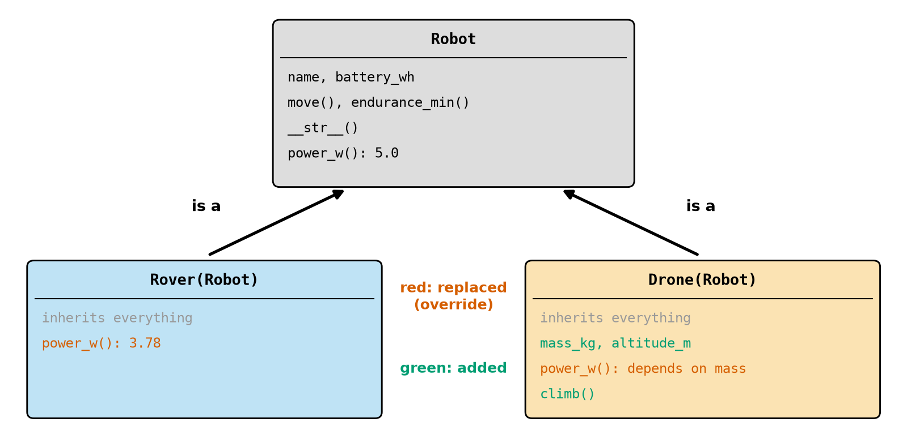
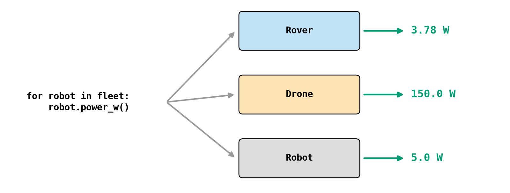
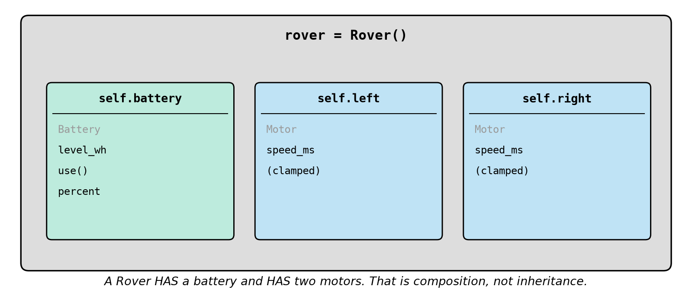

# Chapter 29 — Classes and Objects Part 2: Methods and Inheritance

> **Part 2 · Chapter 29 of 749**
> **You need:** Chapter 28 (classes, `self`). Keep a script open.
> **You will make:** a family of robot classes that share code, a rover built out of a battery and motors that protect themselves, and fake sensors for testing without any hardware.

---

## What you will learn

- How one class can **inherit** from another.
- How to **override** a method, and how to use `super()`.
- How one call can do different things for different objects.
- When to use inheritance and when to build an object out of other objects.
- **Properties**: methods that look like attributes.
- More special methods: `__eq__`, `__lt__`, `__repr__`, `__add__`.
- How fake objects let you test robot software safely.

---

## New words in this chapter

| Word | Simple meaning |
|---|---|
| **inheritance** | Making a new class that automatically has everything from an existing class. |
| **parent class** | The class being inherited from (also: base class). |
| **child class** | The new class (also: subclass). |
| **override** | To replace an inherited method with a new version. |
| **polymorphism** | The same call doing the right thing for different kinds of object. |
| **composition** | Building an object out of other objects. |
| **property** | A method used as if it were an attribute. |
| **duck typing** | If an object has the right methods, it can be used, whatever its class. |
| **dataclass** | A short way to write a class that mainly holds data. |

---

## 29.1 Inheritance

A rover and a drone are both robots. Both have a name and a battery, and both can report how long they will last. But they use power differently, and only one of them can climb.

Copying the whole class would break Chapter 23's rule: don't repeat yourself.

📖 **New word: inheritance** — making a new class that automatically has everything from an existing class.

```python
class A:
    def hi(self):
        return "A hi"


class B(A):                 # B inherits from A
    pass


print(B().hi())             # A hi
```

`B` has no methods of its own, but it can do everything `A` can.

📖 **New words: parent class and child class** — `A` is the parent, and `B` is the child.

### Overriding

📖 **New word: override** — to replace an inherited method with a new version.

```python
class B(A):
    def hi(self):
        return "B hi"
```

Now `A().hi()` gives `A hi`, and `B().hi()` gives `B hi`. When you call a method, Python looks first in the object's own class, and then upwards through its parents. It uses the first one it finds.

Look at Figure 29.1.



*Figure 29.1 — Two child classes inherit from one parent.*

**How to read this picture:** The grey card is the parent, with everything robots share. The arrows mean "is a": a Rover **is a** Robot. Grey text means inherited unchanged, red means replaced, and green means added. `Rover` changes only one thing. `Drone` changes one thing and adds three.

### A surprise that is useful

When a parent's method calls `self.something()`, Python uses the **object's** version, even from code in the parent:

```python
class A:
    def who(self):
        return "A"

    def say(self):
        return "I am " + self.who()


class B(A):
    def who(self):
        return "B"


print(B().say())            # I am B
```

`say` is written only in `A`, yet it uses `B`'s `who`. So the parent can define the general steps, and each child can fill in the details. You will see this in `Robot.move` below.

### `super()`: using the parent's version

Often a child wants to **add** to what the parent does, and not replace it:

```python
class B(A):
    def hi(self):
        return super().hi() + " and B hi"
```

The most common use is in `__init__`:

```python
class Drone(Robot):
    def __init__(self, name, battery_wh, mass_kg):
        super().__init__(name, battery_wh)
        self.mass_kg = mass_kg
```

⚠️ If a child defines its own `__init__` and forgets `super().__init__`, the parent's attributes are never created:

```
AttributeError: 'B' object has no attribute 'name'
```

### `isinstance`

`isinstance(x, A)` is True for objects of `A` and of any child of `A`. A Rover is a Robot:

```python
print(isinstance(B(), A), isinstance(A(), B))     # True False
```

---

## 29.2 One call, many behaviours

📖 **New word: polymorphism** — the same call doing the right thing for different kinds of object. It is Greek for "many forms". Look at Figure 29.2.



*Figure 29.2 — The loop does not need to know what kind of robot each one is.*

**How to read this picture:** The code on the left calls the same method on each robot in a list. Each kind of robot answers using its own version. Adding a new kind of robot needs no change to the loop.

This replaces long chains such as `if kind == "rover": … elif kind == "drone": …`, in the same way as the table in Chapter 22.

### Duck typing

📖 **New word: duck typing** — if an object has the right methods, it can be used, whatever its class. "If it walks like a duck and quacks like a duck, it's a duck."

Python does not check classes when you make a call. It only looks for the method:

```python
class Rover:
    def go(self):
        return "wheels"


class Drone:
    def go(self):
        return "propellers"


print([x.go() for x in [Rover(), Drone()]])    # ['wheels', 'propellers']
```

These two classes are not related at all. An object without the method gives an `AttributeError` at the moment of the call.

A parent can state what its children **must** provide:

```python
class Sensor:
    def read(self):
        raise NotImplementedError
```

A child that forgets to write `read` will fail with `NotImplementedError`, and the name says what is wrong.

---

## 29.3 Inheritance or composition?

📖 **New word: composition** — building an object out of other objects. Look at Figure 29.3.



*Figure 29.3 — A Rover object contains other objects.*

**How to read this picture:** The large grey box is one `Rover` object. Inside it are three other objects, held in its attributes: a battery and two motors. Each one looks after its own data.

The simple test:

| Say it aloud | Use |
|---|---|
| "A Drone **is a** Robot" ✓ | inheritance |
| "A Rover **has a** Battery" ✓ | composition |
| "A Rover is a Battery" ✗ | do not use inheritance here |

Beginners tend to overuse inheritance. Most real robot software uses composition far more, because parts can be swapped easily: `rover.left = FakeMotor()`.

---

## 29.4 Properties

📖 **New word: property** — a method used as if it were an attribute.

Sometimes a value is calculated, but it reads best as a plain value:

```python
class T:
    def __init__(self):
        self.c = 20.0

    @property
    def f(self):
        return self.c * 9 / 5 + 32


t = T()
print(t.f)           # 68.0  (no brackets)
t.c = 100
print(t.f)           # 212.0
```

`@property` is a **decorator**: a line starting with `@` that changes the function below it. Using brackets, `t.f()`, gives `TypeError: 'float' object is not callable`. Assigning to it gives `AttributeError: property 'f' of 'T' object has no setter`.

A **setter** runs whenever someone assigns to the name. It lets a class check every value, and that is the answer to Chapter 28's question about protecting an attribute:

```python
class Motor:
    MAX_SPEED_MS = 0.5

    def __init__(self):
        self._speed_ms = 0.0

    @property
    def speed_ms(self):
        return self._speed_ms

    @speed_ms.setter
    def speed_ms(self, value):
        self._speed_ms = max(-self.MAX_SPEED_MS, min(self.MAX_SPEED_MS, value))
```

Now `motor.speed_ms = 9` silently stores 0.5. The clamp cannot be forgotten. The leading underscore is a polite "do not touch this from outside" (Python does not enforce it).

---

## 29.5 More special methods

| Method | Used by | Example |
|---|---|---|
| `__str__` | `print`, `str`, f-strings | `print(robot)` |
| `__repr__` | the shell, and items in a list | `[robot]` |
| `__eq__` | `==` | `a == b` |
| `__lt__` | `<` and `sorted`, `min`, `max` | `sorted(jobs)` |
| `__len__` | `len` | `len(filter)` |
| `__add__` | `+` | `v1 + v2` |

By default, `==` on objects asks "are they the same object?", so two objects with equal data are not equal. Define `__eq__` to compare the data:

```python
class Q:
    def __init__(self, x):
        self.x = x

    def __eq__(self, other):
        return self.x == other.x


print(Q(1) == Q(1))       # True
```

`__repr__` is what you see when an object is inside a list. Without it, you get `[<__main__.P object at 0x...>]`. Printing shows `__str__` if there is one; otherwise `__repr__` is used.

A 2-D vector needs only a few lines to add naturally:

```python
class V:
    def __init__(self, x, y):
        self.x, self.y = x, y

    def __add__(self, other):
        return V(self.x + other.x, self.y + other.y)

    def __repr__(self):
        return f"V({self.x}, {self.y})"


print(V(1, 2) + V(3, 4))     # V(4, 6)
```

And `sorted` will work on your objects as soon as they have `__lt__`. Without it: `TypeError: '<' not supported between instances of 'J' and 'J'`.

### Dataclasses

📖 **New word: dataclass** — a short way to write a class that mainly holds data. Python writes `__init__`, `__repr__` and `__eq__` for you:

```python
from dataclasses import dataclass


@dataclass
class Pt:
    x: float
    y: float = 0.0


p = Pt(1.0)
print(p, p == Pt(1.0))     # Pt(x=1.0, y=0.0) True
```

Python even catches the mutable default trap of Chapter 24: `x: list = []` gives `ValueError: mutable default <class 'list'> for field x is not allowed: use default_factory`. The cure is `field(default_factory=list)`.

---

## Code

One parent class, and two children. The file is `code/ch029/robots.py`. Type it into `my-code/ch029/`.

```python
# robots.py - one base class, several kinds of robot
import math


class Robot:
    """What every robot has in common."""

    def __init__(self, name, battery_wh):
        self.name = name
        self.battery_wh = battery_wh

    def power_w(self):
        """Return the power this robot uses while moving."""
        return 5.0

    def move(self, seconds):
        """Use energy for some time. Return a sentence about it."""
        used = self.power_w() * seconds / 3600
        self.battery_wh -= used
        return f"{self.name} moved for {seconds} s and used {used:.3f} Wh"

    def endurance_min(self):
        """Return how many minutes the battery will last."""
        return self.battery_wh / self.power_w() * 60

    def __str__(self):
        return f"{type(self).__name__} {self.name}: {self.battery_wh:.2f} Wh, {self.endurance_min():.0f} min left"


class Rover(Robot):
    """A wheeled robot: a Robot with a low power use."""

    def power_w(self):                # replaces the version in Robot
        return 3.78


class Drone(Robot):
    """A flying robot: power depends on how heavy it is."""

    def __init__(self, name, battery_wh, mass_kg):
        super().__init__(name, battery_wh)      # let Robot do its part
        self.mass_kg = mass_kg
        self.altitude_m = 0.0

    def power_w(self):
        return 150.0 * self.mass_kg ** 1.5      # a simple model, not a law of nature

    def climb(self, metres):
        self.altitude_m += metres
        return f"{self.name} is now at {self.altitude_m} m"


if __name__ == "__main__":
    fleet = [Rover("rover", 11.52), Drone("scout", 50.0, 1.0), Robot("generic", 10.0)]

    for robot in fleet:               # the same call, different behaviour
        print(robot.move(60))

    for robot in fleet:
        print(robot)

    print(fleet[1].climb(20))
    print(isinstance(fleet[0], Robot), isinstance(fleet[0], Drone))
```

| Line | Code | What it does (simple English) |
|---|---|---|
| 5 | `class Robot:` | The parent. |
| 8–10 | `__init__` | Data that every robot has. |
| 12–14 | `power_w` | A default that children can replace. |
| 16–20 | `move` | Calls `self.power_w()`: **each object's own version**. |
| 22–24 | `endurance_min` | Written once, and works for every kind. |
| 26–27 | `__str__` | `type(self).__name__` gives the real class of the object. |
| 30 | `class Rover(Robot):` | Inherits everything. |
| 33–34 | `power_w` | Overrides one method. That is the whole class. |
| 37 | `class Drone(Robot):` | Also a child. |
| 40–43 | `__init__` | `super().__init__` sets up the shared part, and two more attributes are added. |
| 45–46 | `power_w` | A heavier drone uses more power. (Chapters 617–618 have the real physics.) |
| 48–50 | `climb` | Only drones have this. |
| 54 | `fleet = […]` | Three different classes in one list. |
| 56–57 | `robot.move(60)` | One line, three different power figures. |

**Output:**

```
rover moved for 60 s and used 0.063 Wh
scout moved for 60 s and used 2.500 Wh
generic moved for 60 s and used 0.083 Wh
Rover rover: 11.46 Wh, 182 min left
Drone scout: 47.50 Wh, 19 min left
Robot generic: 9.92 Wh, 119 min left
scout is now at 20.0 m
True False
```

**What the output means:**

- `move` was written once, but gives a different energy use for each robot.
- For the drone: 150 W × 60 s ÷ 3600 = 2.5 Wh. Flying is expensive, which matches Chapter 4.
- `Rover` has only two lines of real code, yet it works completely.

⚠️ `fleet[1].climb(20)` works only because item 1 is a drone. Calling `climb` on the rover would be an `AttributeError`.

---

## Small examples

### Example 1 — Adding to the parent's method

```python
class B(A):
    def hi(self):
        return super().hi() + " and B hi"

print(B().hi())       # A hi and B hi
```

### Example 2 — What is it?

```python
print(type(B()).__name__)     # B
```

### Example 3 — `__repr__` and `__str__`

```python
class P:
    def __repr__(self):
        return "P()"

    def __str__(self):
        return "a P"

p = P()
print(p, [p])         # a P [P()]
```

### Example 4 — `__len__`

```python
class F:
    def __init__(self):
        self.readings = [1, 2]

    def __len__(self):
        return len(self.readings)

print(len(F()))       # 2
```

### Example 5 — Sorting objects

```python
class Job:
    def __init__(self, priority):
        self.priority = priority

    def __lt__(self, other):
        return self.priority < other.priority

    def __repr__(self):
        return f"Job({self.priority})"

print(sorted([Job(3), Job(1), Job(2)]))     # [Job(1), Job(2), Job(3)]
```

---

## 🏭 Real robot applications

### Application 1 (worked in full) — 🤖 A rover built from parts

**1. The real problem.** Rover has a battery and two motors. Each of those parts has rules of its own: motors have speed limits, and a battery cannot go below zero. Mixing all of that into one class makes it long and hard to change.

**2. Why this idea.** Composition gives each part its own class, and `Rover` just contains them. A property setter makes the speed limit impossible to forget.

**3. The numbers.** A speed limit of ±0.5 m/s, 3.78 W, and two drives of 10 minutes each.

**4. The maths, step by step.**

```
Drive 1: left 0.2, right 0.3 → forward = (0.2 + 0.3) ÷ 2 = 0.25 m/s (Chapter 4)
Drive 2: 9 and −9 are clamped to 0.5 and −0.5 → forward = 0
Energy:  3.78 × 1200 ÷ 3600 = 1.26 Wh
Battery: (11.52 − 1.26) ÷ 11.52 × 100 ≈ 89.1 %
```

**5. The code.** File `code/ch029/composed_rover.py`:

```python
# composed_rover.py - a robot built out of parts: objects inside an object
class Battery:
    def __init__(self, capacity_wh):
        self.capacity_wh = capacity_wh
        self.level_wh = capacity_wh

    def use(self, wh):
        self.level_wh = max(self.level_wh - wh, 0.0)

    @property
    def percent(self):                # used without brackets: battery.percent
        return self.level_wh / self.capacity_wh * 100


class Motor:
    MAX_SPEED_MS = 0.5

    def __init__(self):
        self._speed_ms = 0.0          # the underscore means "private: use the property"

    @property
    def speed_ms(self):
        return self._speed_ms

    @speed_ms.setter
    def speed_ms(self, value):        # runs whenever someone assigns to speed_ms
        self._speed_ms = max(-self.MAX_SPEED_MS, min(self.MAX_SPEED_MS, value))


class Rover:
    POWER_W = 3.78

    def __init__(self):
        self.battery = Battery(11.52)     # a Rover HAS a battery
        self.left = Motor()               # and HAS two motors
        self.right = Motor()

    def drive(self, left_ms, right_ms, seconds):
        self.left.speed_ms = left_ms      # the setter clamps these
        self.right.speed_ms = right_ms
        self.battery.use(self.POWER_W * seconds / 3600)
        return (self.left.speed_ms + self.right.speed_ms) / 2     # forward speed


rover = Rover()
print("forward speed:", rover.drive(0.2, 0.3, 600))
print("forward speed:", rover.drive(9.0, -9.0, 600))
print(f"left motor: {rover.left.speed_ms}   right motor: {rover.right.speed_ms}")
print(f"battery: {rover.battery.percent:.1f} %")
```

| Line | Code | What it does (simple English) |
|---|---|---|
| 2–12 | `Battery` | Knows only about energy. |
| 10–12 | `@property percent` | A calculated value with no brackets. |
| 15–27 | `Motor` | Knows only about its own speed. |
| 25–27 | the setter | Clamps every assignment. |
| 30–36 | `Rover.__init__` | Attributes that are other objects. |
| 39–40 | `self.left.speed_ms = left_ms` | Looks like plain assignment, but runs the clamp. |
| 41 | `self.battery.use(…)` | Asks the battery to do its own job. |

**Output:**

```
forward speed: 0.25
forward speed: 0.0
left motor: 0.5   right motor: -0.5
battery: 89.1 %
```

**6. The result.** A command of ±9 m/s was safely limited, and `Rover` contains no clamping code at all. Each class is short enough to read at a glance, and each can be tested alone.

**7. Going further.** Rover's real program will have a `Motor` class that drives real pins (Chapter 141), with the same methods as this one, so that the rest of the code does not change.

### Application 2 (worked in full) — 🧪 Testing with fake sensors

**1. The real problem.** How do you test what happens when a sensor fails? Pulling a wire out every time is slow, and with a moving robot it can be dangerous. Real sensors also give a different value each time, and that makes results hard to check.

**2. Why this idea.** Duck typing. A class with a `read` method can stand in for a real sensor. A `FakeSensor` returns the exact numbers we choose, and a `BrokenSensor` always fails. The function under test cannot tell the difference.

**3. The numbers.** A limit of 0.3 m. Cases: 0.2 (wall), 0.9 (clear), 0.3 (exactly at the limit), and a broken sensor.

**4. The maths, step by step.** `0.2 < 0.3` is True. `0.9 < 0.3` is False. `0.3 < 0.3` is False. A failure must count as a wall.

**5. The code.** File `code/ch029/fake_sensor.py`:

```python
# fake_sensor.py - any object with a read() method can be used as a sensor
class FakeSensor:
    """Returns numbers from a list: perfect for testing without hardware."""

    def __init__(self, readings):
        self.readings = readings
        self.index = 0

    def read(self):
        value = self.readings[self.index]
        self.index = (self.index + 1) % len(self.readings)     # go round and round
        return value


class BrokenSensor:
    """Always fails, so that we can test what the robot does then."""

    def read(self):
        raise OSError("sensor not responding")


def wall_ahead(sensor, limit_m=0.3):
    """Return True if a wall is close. A failed sensor counts as a wall."""
    try:
        return sensor.read() < limit_m
    except OSError:
        return True                   # fail-safe (Chapter 17)


assert wall_ahead(FakeSensor([0.2])) is True
assert wall_ahead(FakeSensor([0.9])) is False
assert wall_ahead(FakeSensor([0.3])) is False       # exactly at the limit
assert wall_ahead(BrokenSensor()) is True

sensor = FakeSensor([0.9, 0.5, 0.25])
print([wall_ahead(sensor) for _ in range(4)])
print("all tests passed")
```

| Line | Code | What it does (simple English) |
|---|---|---|
| 2–12 | `FakeSensor` | `% len(…)` wraps back to the start (Chapter 13). |
| 15–19 | `BrokenSensor` | One job: fail. |
| 22–27 | `wall_ahead` | Knows nothing about which kind of sensor it has been given. |
| 30–33 | tests | Every case, including the edge and the failure. |
| 35–36 | a sequence | Shows the fake going round. |

**Output:**

```
[False, False, True, False]
all tests passed
```

**6. The result.** Four situations, one of them dangerous, were tested in a fraction of a second, without any hardware. The output shows the list going round: 0.9, 0.5, 0.25, and then 0.9 again.

**7. Going further.** Professional robot teams build whole fake robots this way. A "hardware abstraction layer" gives the program the same methods whether it is talking to a real motor, a fake motor or a simulator (Part 28).

### Application 3 — 🦾 Different grippers

An arm can hold a `SuctionGripper` or a `ClawGripper`. Both have `grab()` and `release()`, and the arm's code calls them without caring which one is fitted. Swapping tools then means changing one line, in the same way that real arms swap physical tools (Chapter 333 onwards).

### Application 4 — 🚁 Flight modes as classes

A drone behaves differently in manual, hold and return-home modes. Each mode can be a class with an `update(state)` method, and the main loop calls `self.mode.update(state)`, whatever the mode is. Changing mode is one assignment. Chapter 104's state machines and Chapter 649's flight modes both work this way.

### Application 5 — 🏭 A priority queue of jobs

With `__lt__` on a `Job` class, `sorted(jobs)` puts urgent jobs first, and `min(jobs)` finds the next job to do. The scheduling code does not need to know what makes one job more urgent than another. Only the `Job` class knows.

---

## 🔧 Hands-on lab

### Lab 29.1 — Add a boat

**You need:** `robots.py`.

**Steps:** Add a class `Boat(Robot)` with a `power_w` of 12 W, and a new method `anchor` that returns `"anchored"`. Put a boat in `fleet` with 24 Wh. Run it. Which lines of the loop had to change?

**What you should see:** `boat moved for 60 s and used 0.200 Wh` and `Boat boat: 23.80 Wh, 119 min left`. Nothing in the loops had to change.

**If it does not work:**

| Problem | Likely cause | Fix |
|---|---|---|
| `TypeError: Boat.power_w() takes 0 positional…` | `self` is missing | `def power_w(self):` |
| `NameError: name 'Robot' is not defined` | `Boat` is above `Robot` | The parent must be defined first. |

### Lab 29.2 — Forget `super()`

**You need:** `robots.py`.

**Steps:**

1. Delete the `super().__init__(name, battery_wh)` line in `Drone`, and run it.
2. Put it back.
3. Remove `Drone.power_w`. What does the drone use now?

**What you should see:** Step 1: `AttributeError: 'Drone' object has no attribute 'battery_wh'`. Step 3: the drone uses the parent's 5 W, `0.083 Wh` per minute. Nothing tells you that the number is now wrong, so this is a logic error (Chapter 25).

**If it does not work:**

| Problem | Likely cause | Fix |
|---|---|---|
| A different error about `name` | `name` is used first in your version | Either way: `super().__init__` is missing. |

### Lab 29.3 — A fake motor

**You need:** a new Python file.

**Steps:** Write a class `FakeMotor` with a method `set_speed(self, v)` that appends `v` to a list `self.commands`. Write a function `stop_all(motors)` that calls `set_speed(0)` on each motor. Test it with an `assert` that both fake motors received exactly `[0]`.

**What you should see:**

```python
class FakeMotor:
    def __init__(self):
        self.commands = []

    def set_speed(self, v):
        self.commands.append(v)


def stop_all(motors):
    for motor in motors:
        motor.set_speed(0)


left, right = FakeMotor(), FakeMotor()
stop_all([left, right])
assert left.commands == [0]
assert right.commands == [0]
print("stop_all works")
```

It prints `stop_all works`. You have tested the most important function of a robot with no robot.

**If it does not work:**

| Problem | Likely cause | Fix |
|---|---|---|
| The lists hold two zeros | The same object was used for both | Make two objects. |
| `commands` is shared | The list is a class attribute | Create it in `__init__`. |

---

## Common mistakes

⚠️ **Forgetting `super().__init__`.** The parent's attributes do not exist.

⚠️ **Using inheritance for "has a".** A Rover is not a Battery.

⚠️ **Very deep inheritance.** Two levels is usually plenty.

⚠️ **Spelling an overriding method differently.** You get a new method, and the parent's is still used, with no error.

⚠️ **Brackets on a property.** `t.f()` is a `TypeError`.

⚠️ **Expecting `==` to compare data.** Define `__eq__`, or use a dataclass.

⚠️ **Checking the type with `if type(x) == Rover`.** Let each class do its own work.

---

## Practice

🏋️ **1.** "Is a" or "has a"? (a) Drone and Robot; (b) Robot and Sensor; (c) Humanoid and Joint; (d) Quadcopter and Drone.

🏋️ **2.** What does this print?

```python
class A:
    def f(self):
        return 1

class B(A):
    def f(self):
        return 2

class C(A):
    pass

print(A().f(), B().f(), C().f())
```

🏋️ **3.** Write a class `Car(Robot)` whose `__init__` takes a name, battery and top speed. Use `super()`.

🏋️ **4.** Find the bug.

```python
class B(A):
    def __init__(self, size):
        self.size = size
```

`A.__init__` sets `self.name`, and later `B(1).name` fails.

🏋️ **5.** What does this print?

```python
class A:
    def who(self):
        return "A"

    def say(self):
        return self.who()

class B(A):
    def who(self):
        return "B"

print(A().say(), B().say())
```

🏋️ **6.** Add a read-only property `is_empty` to `Battery`, True when the level is 0.

🏋️ **7.** What is `P(1) == P(1)` for a class with no `__eq__`? Why?

🏋️ **8.** Add `__repr__` to `Job` so that a list of jobs prints nicely.

🏋️ **9.** Give two advantages of composition.

🏋️ **10.** Write `Temperature` with a property setter that refuses (raises `ValueError` for) anything below −273.15.

🏋️ **11.** (Harder) Create a parent class `Filter` with `update(value)` that raises `NotImplementedError`, and two children, `LastValue` (returns the value it is given) and `Average` (averages everything so far). Write `run(filter_object, readings)`, which returns the list of outputs. Test both with `[2, 4, 9]`. Which feature of Python lets `run` work with both?

---

## Answers

**1.** (a) is a; (b) has a; (c) has a; (d) is a.

**2.** `1 2 1`.

**3.**

```python
class Car(Robot):
    def __init__(self, name, battery_wh, top_speed):
        super().__init__(name, battery_wh)
        self.top_speed = top_speed
```

**4.** `B.__init__` replaces `A.__init__`, and it never calls it. Add `super().__init__(…)` with whatever `A` needs.

**5.** `A B`. `self.who()` uses the object's own class.

**6.**

```python
@property
def is_empty(self):
    return self.level_wh == 0
```

**7.** `False`. By default `==` asks whether they are the same object, and these are two different ones.

**8.**

```python
def __repr__(self):
    return f"Job({self.priority})"
```

**9.** Parts can be replaced easily (even by fakes for testing), and each class stays small and focused.

**10.**

```python
class Temperature:
    def __init__(self, c):
        self.c = c

    @property
    def c(self):
        return self._c

    @c.setter
    def c(self, value):
        if value < -273.15:
            raise ValueError("below absolute zero")
        self._c = value
```

Notice that `self.c = c` in `__init__` uses the setter, so even the first value is checked.

**11.**

```python
class Filter:
    def update(self, value):
        raise NotImplementedError


class LastValue(Filter):
    def update(self, value):
        return value


class Average(Filter):
    def __init__(self):
        self.total = 0.0
        self.count = 0

    def update(self, value):
        self.total += value
        self.count += 1
        return self.total / self.count


def run(filter_object, readings):
    return [filter_object.update(r) for r in readings]


print(run(LastValue(), [2, 4, 9]))     # [2, 4, 9]
print(run(Average(), [2, 4, 9]))       # [2.0, 3.0, 5.0]
```

**Polymorphism** (and duck typing) lets `run` work with both.

---

## Summary

🧠 **Inheritance**: `class Child(Parent):` gets everything from the parent. **Override** a method by defining it again.

🧠 `super()` runs the parent's version. Call `super().__init__` in a child's `__init__`.

🧠 **Polymorphism**: one call, and each object does its own version. It removes chains of `if`.

🧠 Is it "**is a**"? Inheritance. Is it "**has a**"? **Composition**, which is usually the better choice.

🧠 `@property` gives calculated values without brackets, and setters that check every assignment.

🧠 Special methods give objects `==`, `<`, `+`, `len` and a nice printed form.

🧠 **Duck typing** makes fakes possible, so that robot software can be tested without a robot.

---

## Next chapter

Your simulated Rover runs a whole trip in less than a millisecond. A real robot must do things **on time**: read its sensors every 20 ms, no sooner and no later. In **Chapter 30 — Time and loops that run forever: timing a control loop**, you will use clocks, wait correctly, measure how long your code takes, and build a loop that keeps a steady beat.
