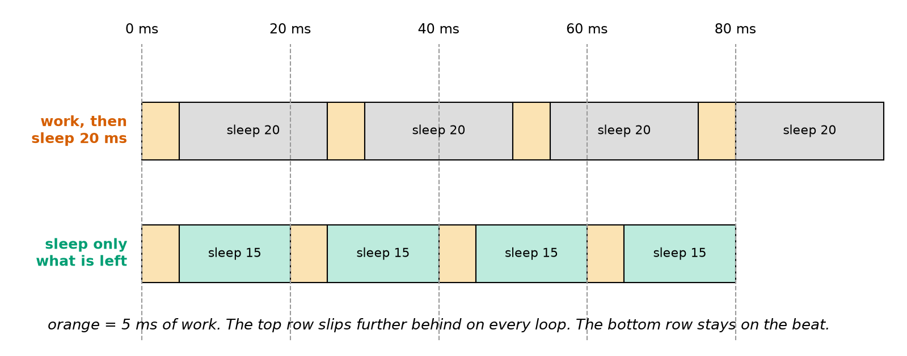
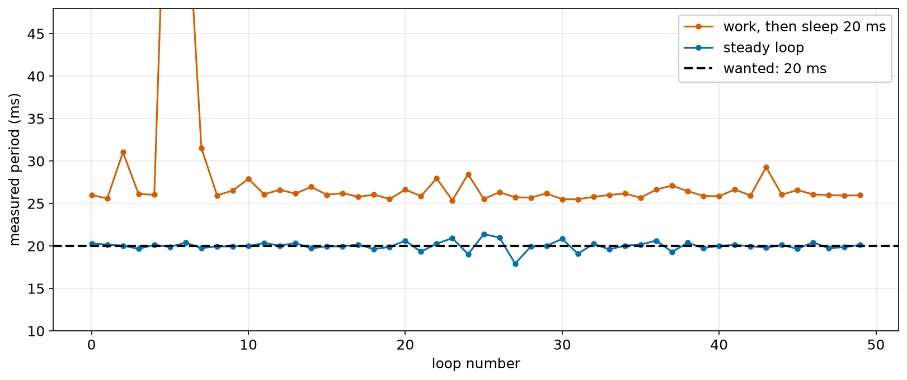
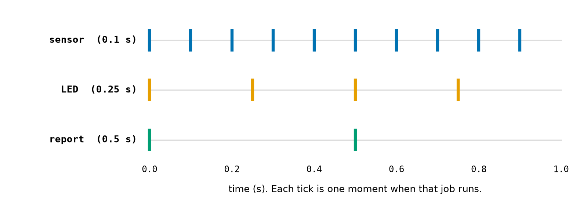
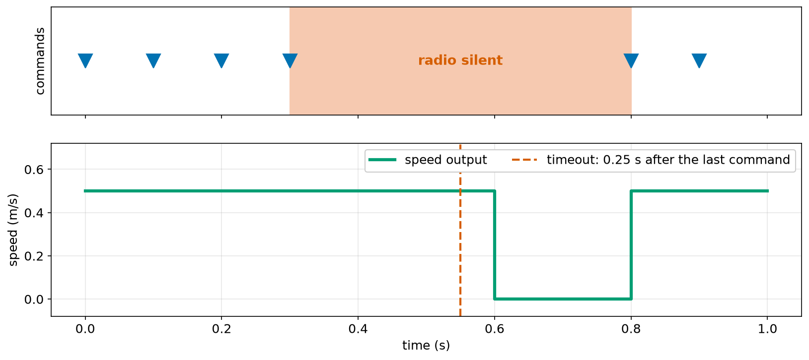

# Chapter 30 — Time and Loops That Run Forever: Timing a Control Loop

> **Part 2 · Chapter 30 of 749**
> **You need:** Chapter 19 (loops), Chapter 28 (classes). Keep a script open.
> **You will make:** a measurement of how long your code takes, a control loop that keeps a steady 50 Hz beat, a scheduler running several jobs at different rates, and a software watchdog that stops the robot when the radio goes quiet.

---

## What you will learn

- How to read the clock, and which clock to use.
- How to measure how long code takes.
- How to make a program wait with `time.sleep`.
- Why "do the work, then sleep" drifts.
- How to build a loop with a steady **period**.
- What **jitter** and **overruns** are.
- How to run several jobs at different rates without blocking.
- Why desktop Python is not a real-time system.

---

## New words in this chapter

| Word | Simple meaning |
|---|---|
| **period** | The time from one loop to the next. |
| **frequency** | How many loops per second, in hertz (Hz). |
| **drift** | Slowly falling further and further behind. |
| **jitter** | Small random variation in the timing. |
| **overrun** | When the work takes longer than one period. |
| **blocking** | When a line makes the whole program wait. |
| **monotonic clock** | A clock that can never go backwards. |
| **real-time system** | A system that must react by a guaranteed deadline. |

---

## 30.1 Reading the clock

Chapter 19's simulated Rover finished its trip in less than a millisecond. A real robot must do things **on time**. Python's `time` module provides the clocks.

```
>>> import time
>>> time.time()
1793980000.123         (a large number, different every moment)
```

`time.time()` gives the seconds since 1 January 1970, called the **epoch**. It is the time of day, and it is fine for labelling a log. But it can jump if the computer adjusts its clock.

📖 **New word: monotonic clock** — a clock that can never go backwards.

Use `time.perf_counter()` to measure a length of time. Python confirms that it is monotonic, and that `time.time()` is not:

```
>>> time.get_clock_info("perf_counter").monotonic
True
>>> time.get_clock_info("time").monotonic
False
```

The number it returns means nothing by itself. Only the **difference** between two readings does.

### Measuring how long code takes

```python
import time

start = time.perf_counter()
total = sum(range(1_000_000))
elapsed = time.perf_counter() - start
print(f"{elapsed * 1000:.1f} ms")
```

These are measurements on one laptop. Your numbers will differ, and that is the point of measuring:

| Job | Time |
|---|---|
| `sum(range(1_000_000))` | about 28 ms |
| a `for` loop adding the same numbers | about 194 ms |
| 1000 empty passes of a `for` loop | about 42 µs |

Plain Python loops are slow compared with built-in tools. Chapter 35 returns to this.

### Waiting

`time.sleep(seconds)` pauses the whole program:

```python
time.sleep(0.1)       # wait a tenth of a second
```

It is never perfectly exact. In a test, asking for 1 ms gave between 1.02 and 1.68 ms. It never returns early, but it may return late. A negative value gives `ValueError: sleep length must be non-negative`.

📖 **New word: blocking** — when a line makes the whole program wait. `sleep` and `input` are both blocking.

### Units

📖 **New words: period and frequency** — the period is the time from one loop to the next. The frequency is how many loops per second, in hertz (Hz).

🔢 **Maths:** period = 1 ÷ frequency. Rover's 50 Hz loop (Chapter 5) has a period of 1 ÷ 50 = 0.02 s = 20 ms.

---

## 30.2 Why the simple loop drifts

The obvious way to run a loop every 20 ms is to do the work and sleep for 20 ms. File `code/ch030/naive_loop.py`:

```python
# naive_loop.py - why "do the work, then sleep" drifts behind
import time

PERIOD_S = 0.02                     # we want 50 loops per second
LOOPS = 50

start = time.perf_counter()
for i in range(LOOPS):
    time.sleep(0.005)               # pretend this is 5 ms of real work
    time.sleep(PERIOD_S)            # then wait for "one period"
elapsed = time.perf_counter() - start

print(f"wanted:  {LOOPS * PERIOD_S:.3f} s")
print(f"got:     {elapsed:.3f} s")
print(f"average period: {elapsed / LOOPS * 1000:.1f} ms")
```

A real run:

```
wanted:  1.000 s
got:     1.299 s
average period: 26.0 ms
```

📖 **New word: drift** — slowly falling further and further behind.

Look at Figure 30.1.



*Figure 30.1 — Sleeping a fixed time ignores how long the work took.*

**How to read this picture:** The dashed lines are the moments when each loop should begin. Orange blocks are the work. In the top row, each loop takes 5 + 20 = 25 ms, so the start of each loop lands further from its line. In the bottom row, the sleep is only as long as what remains, so every loop begins on its line.

A 30% error matters. A controller tuned for 20 ms (Chapter 6) would be running at a different rate, and worse, the rate would change whenever the work took longer or shorter.

---

## 30.3 A steady loop

The fix is to aim for **fixed moments in time**. Keep a schedule:

```
next_time = start + period
loop:
    do the work
    sleep until next_time
    next_time = next_time + period
```

The key idea is `next_time += PERIOD`: you add to the **schedule**, not to the clock. A late loop does not push every later loop back, because the next deadline stays where it always was.

### Jitter

📖 **New word: jitter** — small random variation in the timing. An average of 20 ms is not the whole story. Each loop may take 19 or 21.

Control loops care about jitter, because the maths assumes equal steps. If you want to be more careful, measure the real time since the last loop and use that as `dt`:

```python
now = time.perf_counter()
dt = now - previous
previous = now
```

### Overruns

📖 **New word: overrun** — when the work takes longer than one period. Then there is nothing left to sleep. Your loop should count them, because an overrun means that the robot is no longer in control at the rate it was designed for.

If a loop falls badly behind, adding one period at a time makes it rush through a series of "late" loops to catch up. A common defence is to reset the schedule after a long delay: `next_time = now + PERIOD`.

### Real-time systems

📖 **New word: real-time system** — a system that must react by a guaranteed deadline.

Windows, macOS and desktop Linux may pause your program at any moment to do other things. Python itself sometimes pauses to tidy its memory. So Python on a laptop can keep a good beat on average, and it **cannot guarantee** one. That is why:

- fast, critical loops such as motor control run on a **microcontroller** (Chapter 96 onwards),
- high-level thinking runs in Python on a bigger computer,
- Part 26 teaches real-time systems properly.

---

## Code

The file is `code/ch030/steady_loop.py`. Type it into `my-code/ch030/`.

```python
# steady_loop.py - a loop that keeps a steady beat by aiming at fixed moments
import time

PERIOD_S = 0.02                     # 50 loops per second
LOOPS = 50

start = time.perf_counter()
next_time = start + PERIOD_S        # the moment the next loop should begin
periods_ms = []
overruns = 0
previous = start

for i in range(LOOPS):
    time.sleep(0.005)               # pretend this is 5 ms of real work

    remaining = next_time - time.perf_counter()
    if remaining > 0:
        time.sleep(remaining)       # wait only for what is left
    else:
        overruns += 1               # the work took too long: we are late

    now = time.perf_counter()
    periods_ms.append((now - previous) * 1000)
    previous = now
    next_time += PERIOD_S           # add to the schedule, not to the clock

elapsed = time.perf_counter() - start
print(f"wanted:  {LOOPS * PERIOD_S:.3f} s")
print(f"got:     {elapsed:.3f} s")
print(f"period:  min {min(periods_ms):.2f}  max {max(periods_ms):.2f}  average {sum(periods_ms) / LOOPS:.2f} ms")
print(f"overruns: {overruns}")
```

| Line | Code | What it does (simple English) |
|---|---|---|
| 2 | `import time` | The clocks. |
| 4–5 | constants | 50 Hz, for one second. |
| 7 | `start = …` | The moment we begin. |
| 8 | `next_time = start + PERIOD_S` | The first deadline. |
| 9–11 | measurements | To check how good the timing is. |
| 13 | `for i in range(LOOPS):` | A real robot would use `while True:`. |
| 14 | `time.sleep(0.005)` | Stands in for reading sensors and thinking. |
| 16 | `remaining = …` | How long until the deadline? |
| 17–20 | `if / else` | Sleep if there is time, otherwise count an overrun. Sleeping a negative time would be an error. |
| 22–24 | measure | The real time since the last pass. |
| 25 | `next_time += PERIOD_S` | The key line. |
| 27–31 | report | Total, smallest, largest, average and overruns. |

**A real run:**

```
wanted:  1.000 s
got:     1.000 s
period:  min 19.02  max 20.97  average 20.01 ms
overruns: 0
```

Your numbers will be slightly different each time. Look at Figure 30.2.



*Figure 30.2 — A real measurement of both loops on a laptop.*

**How to read this picture:** Each dot is the measured time of one loop. The black dashed line is the 20 ms we want. The red line is the simple loop: it sits at about 26 ms, and has an occasional spike. The blue line stays around 20 ms. Notice that the blue line still has spikes and dips: those are moments when the operating system did something else. After a late loop, the next one is shorter, so the schedule recovers.

**What the output means:**

- The total time is right: 1.000 s instead of 1.299 s.
- The average period is 20.01 ms.
- The min and max show jitter of about ±1 ms. This is good for a laptop, but no guarantee.

---

## Small examples

### Example 1 — How long does it take?

```python
import time

t0 = time.perf_counter()
time.sleep(0.1)
print(round(time.perf_counter() - t0, 4))     # about 0.1002
```

### Example 2 — Period and frequency

```python
frequency_hz = 50
period_s = 1 / frequency_hz       # 0.02
```

### Example 3 — A timestamp for a log

```python
import datetime

print(datetime.datetime(2026, 1, 2, 3, 4, 5).isoformat())     # 2026-01-02T03:04:05
```

Use `datetime.datetime.now()` for the time now.

### Example 4 — Adding small times

```python
t = 0.0
for _ in range(50):
    t += 0.02
print(t, 50 * 0.02)       # 1.0000000000000004 1.0
```

The float surprise again. Use a loop counter (Chapter 13, Practice 11).

---

## 🏭 Real robot applications

### Application 1 (worked in full) — 🤖 Doing several jobs at different rates

**1. The real problem.** A robot must read a sensor 10 times a second, flash an LED 4 times a second, and report twice a second. If each job used `sleep`, the whole robot would stop during every wait.

**2. Why this idea.** Never wait inside a job. A timer object remembers when its job is next due. The main loop goes round quickly, and asks each timer: are you due? This is the same idea as Arduino's `millis()` (Chapter 103).

**3. The numbers.** Periods of 0.1, 0.25 and 0.5 s, simulated for 1 s in steps of 10 ms.

**4. The maths, step by step.** In one second: sensor 1 ÷ 0.1 = 10 times; LED 1 ÷ 0.25 = 4 times; report 1 ÷ 0.5 = 2 times.

**5. The code.** File `code/ch030/multi_rate.py`:

```python
# multi_rate.py - several jobs, each at its own rate, with no waiting inside them
class Every:
    """Tells you when a job is due. It never makes the program wait."""

    def __init__(self, period_s):
        self.period_s = period_s
        self.next_time = 0.0

    def due(self, now):
        if now >= self.next_time:
            self.next_time += self.period_s
            return True
        return False


sensor_timer = Every(0.1)           # read the sensor 10 times a second
report_timer = Every(0.5)           # report twice a second
led_timer = Every(0.25)             # flip the LED 4 times a second

sensor_count = report_count = led_flips = 0

for tick in range(100):             # 100 ticks of 10 ms: one second of pretend time
    now = tick * 0.01               # count with an int (Chapter 13)
    if sensor_timer.due(now):
        sensor_count += 1
    if report_timer.due(now):
        report_count += 1
        print(f"t = {now:.2f} s: {sensor_count} readings so far")
    if led_timer.due(now):
        led_flips += 1

print("sensor:", sensor_count, "| reports:", report_count, "| LED flips:", led_flips)
```

| Line | Code | What it does (simple English) |
|---|---|---|
| 2–13 | `Every` | One object per job. |
| 9–13 | `due` | True at most once per period. Like Section 30.3, it adds to the schedule. |
| 16–18 | three timers | One line per job. |
| 20 | counters | `a = b = c = 0` is safe with numbers (Chapter 14). |
| 22–23 | the loop | A simulated clock, so that the result is exact and quick. |
| 24–31 | checks | No job ever waits. |

**Output:**

```
t = 0.00 s: 1 readings so far
t = 0.50 s: 6 readings so far
sensor: 10 | reports: 2 | LED flips: 4
```

Look at Figure 30.3.



*Figure 30.3 — Each job runs at its own rate.*

**How to read this picture:** Each row is one job, and each tick is a moment when it runs. All three run at time 0, and after that they move at their own rates. None of them waits for the others.

**6. The result.** Three jobs ran the expected 10, 4 and 2 times. To use this on a real robot, replace the pretend clock with `now = time.perf_counter() - start`. Using a pretend clock during testing is the fake-object idea of Chapter 29: it is exact and instant.

**7. Going further.** The jobs must be short, because a slow job delays all the others. Chapter 103 does this on an Arduino. Chapter 524 onwards introduces proper schedulers, and ROS 2 has timers that work this way (Chapter 558).

### Application 2 (worked in full) — ⚠️ A software watchdog

**1. The real problem.** A robot is driving under radio control, and the radio link drops out. Its last command was "forward". Without protection, it carries on. Chapter 7 demanded a watchdog: if commands stop arriving, **stop**.

**2. Why this idea.** Each command "feeds" the watchdog by recording the time. On every loop, the program compares the time now with the last feed. If the gap is larger than the timeout, the robot stops. It must be checked in the loop, because a stopped radio cannot tell you that it has stopped.

**3. The numbers.** A timeout of 0.25 s, and commands at 0.0, 0.1, 0.2, 0.3, 0.8 and 0.9 s.

**4. The maths, step by step.**

```
t = 0.5: last command at 0.3; gap 0.2 ≤ 0.25  → keep going
t = 0.6: gap 0.3 > 0.25                        → STOP
t = 0.8: a command arrives; gap 0              → carry on
```

**5. The code.** File `code/ch030/watchdog.py`:

```python
# watchdog.py - if commands stop arriving, the robot must stop by itself
class Watchdog:
    def __init__(self, timeout_s):
        self.timeout_s = timeout_s
        self.last_feed = 0.0

    def feed(self, now):
        """Call this every time a good command arrives."""
        self.last_feed = now

    def expired(self, now):
        return now - self.last_feed > self.timeout_s


dog = Watchdog(timeout_s=0.25)
command_ticks = [0, 1, 2, 3, 8, 9]    # the radio drops out after tick 3

speed_ms = 0.5
for tick in range(11):              # pretend clock: one step every 0.1 s
    now = tick / 10
    if tick in command_ticks:         # compare ints, not floats (Chapter 17)
        dog.feed(now)
    if dog.expired(now):
        output = 0.0                # no recent command: STOP
    else:
        output = speed_ms
    print(f"t = {now:.1f} s  fed {now - dog.last_feed:.1f} s ago  speed {output}")
```

| Line | Code | What it does (simple English) |
|---|---|---|
| 2–12 | `Watchdog` | Stores one time, and answers one question. |
| 15 | `dog = Watchdog(…)` | A 0.25 s timeout. |
| 16 | `command_ticks` | Pretend radio traffic with a gap in it. |
| 19–20 | the loop | A pretend clock. |
| 21–22 | `feed` | Only a good command resets the timer. |
| 23–26 | `if dog.expired(now):` | The fail-safe choice. |

**Output:**

```
t = 0.0 s  fed 0.0 s ago  speed 0.5
t = 0.1 s  fed 0.0 s ago  speed 0.5
t = 0.2 s  fed 0.0 s ago  speed 0.5
t = 0.3 s  fed 0.0 s ago  speed 0.5
t = 0.4 s  fed 0.1 s ago  speed 0.5
t = 0.5 s  fed 0.2 s ago  speed 0.5
t = 0.6 s  fed 0.3 s ago  speed 0.0
t = 0.7 s  fed 0.4 s ago  speed 0.0
t = 0.8 s  fed 0.0 s ago  speed 0.5
t = 0.9 s  fed 0.0 s ago  speed 0.5
t = 1.0 s  fed 0.1 s ago  speed 0.5
```

Look at Figure 30.4.



*Figure 30.4 — The output drops to zero soon after the commands stop.*

**How to read this picture:** The top row shows when commands arrive, and the red band is the gap in the radio. The bottom row is the speed output. The red dashed line marks the timeout, 0.25 s after the last command. The output falls at the next loop after that, and it recovers when commands return.

**6. The result.** The robot stopped by itself within one loop of the timeout, and it needed no signal from the radio to do so. With a real clock and a real radio, this is exactly the code of Chapter 7's idea.

**7. Going further.** A software watchdog cannot help if the program itself freezes. For that, a microcontroller has a hardware watchdog timer that restarts it if it is not fed (Chapter 524 onwards). Drones decide what to do after losing the radio link (Chapter 640).

### Application 3 — 🚁 Different loops at different speeds

A flight controller may read its gyroscope and correct its motors thousands of times a second, update its position estimate a hundred times a second, and talk to its ground station a few times a second. Critical loops run fast and are kept simple, and slow jobs are kept out of their way (Chapter 641).

### Application 4 — 🏭 Measuring is the only way to know

An industrial arm's vendor states a cycle time. An engineer measures it anyway, using exactly the method in Section 30.1, because a software update, or even a longer log message, can change it. A `print` inside a fast loop is a classic cause of mysterious overruns (Lab 30.3).

### Application 5 — 🛰️ Timestamps tie everything together

A self-driving car fuses a camera, a lidar and radars. Their measurements arrive at different moments, so each one carries a precise timestamp. A car moving at 30 m/s travels 3 cm in a single millisecond, so timing errors become position errors (Chapter 523).

---

## 🔧 Hands-on lab

### Lab 30.1 — Time your computer

**You need:** a Python file.

**Steps:** Measure each with `time.perf_counter()`, and write down the result:

1. `sum(range(1_000_000))`
2. A `for` loop adding the same numbers.
3. 1000 calls of `print(end="")`.
4. `time.sleep(0.001)`, 20 times. Record the smallest and the largest.

**What you should see:** Numbers of your own. On the test laptop: about 28 ms, 194 ms, 0.5 ms, and 1.02 to 1.68 ms. Built-ins are several times faster than your own loop, and `sleep(0.001)` always takes more than 1 ms.

**If it does not work:**

| Problem | Likely cause | Fix |
|---|---|---|
| The times are 0.0 | Using `round` too early, or a too-short job | Print more digits, in milliseconds. |
| Very different results each time | Other programs are busy | Run it a few times and use the smallest. |

### Lab 30.2 — See the drift

**You need:** `naive_loop.py` and `steady_loop.py`.

**Steps:**

1. Run both, three times each. Write down the totals.
2. In both, change the 5 ms of work to 15 ms. Predict the new totals before you run them.

**What you should see:** Step 1: the naive loop takes about 1.3 s, and the steady loop about 1.00 s. Step 2: the naive loop rises to about 1.8 s, and the steady loop stays at 1.00 s, because it adjusts its sleep. You changed the workload, and the timing did not change: that is what a steady loop is for.

**If it does not work:**

| Problem | Likely cause | Fix |
|---|---|---|
| `ValueError: sleep length must be non-negative` | The `if remaining > 0` check is missing | Put it back. |
| The steady loop takes 1.3 s | `next_time` is set from the clock | Use `next_time += PERIOD_S`. |

### Lab 30.3 — Cause an overrun

**You need:** `steady_loop.py`.

**Steps:**

1. Change the work to `time.sleep(0.03)`, which is longer than the 20 ms period. Run it.
2. Change it back to 5 ms, and put `print("working on the loop, number", i)` in the loop. Compare the jitter with before.

**What you should see:** Step 1, in a real run: `got: 1.531 s`, the average period about 30.6 ms, and `overruns: 50`. Every loop was late. Step 2: the loop usually still keeps up, but the maximum period grows, particularly in slower terminals. Printing takes real time.

**If it does not work:**

| Problem | Likely cause | Fix |
|---|---|---|
| Still 0 overruns in step 1 | The work was not changed | Check the line that says 5 ms. |

---

## Common mistakes

⚠️ **`time.time()` for measuring.** Use `time.perf_counter()`.

⚠️ **"Work, then sleep the whole period."** It drifts.

⚠️ **`next_time = now + period`, every time.** It drifts too. Add to the schedule, except after a long delay.

⚠️ **Sleeping a negative time.** Check first.

⚠️ **`sleep` inside a job.** The whole program stops.

⚠️ **`print` inside a fast loop.** It takes real time.

⚠️ **Assuming a desktop computer is real-time.** It is not.

⚠️ **Assuming a fixed `dt` when the timing varies.** Measure it, or use a microcontroller.

---

## Practice

🏋️ **1.** What is the period of a 100 Hz loop? What is the frequency of a 5 ms loop?

🏋️ **2.** Which clock would you use for (a) a timestamp in a log file; (b) timing a control loop?

🏋️ **3.** Write the code that prints how long `sorted(list(range(100000)))` takes.

🏋️ **4.** A loop does 5 ms of work and then sleeps 20 ms. What is its period and frequency?

🏋️ **5.** A loop has 8 ms of work, with a 20 ms period. How long should it sleep?

🏋️ **6.** Why is `next_time += PERIOD` better than `next_time = now + PERIOD`?

🏋️ **7.** What is an overrun? What should a robot do about one?

🏋️ **8.** Using the `Every` class, how many times in 2 seconds does a 0.2 s job run?

🏋️ **9.** Why must the watchdog be checked in the main loop, and not when a command arrives?

🏋️ **10.** Why do motor control loops usually run on a microcontroller instead of in Python on a laptop?

🏋️ **11.** (Harder) Write a class `Rate` with `__init__(self, hz)` and a method `sleep(self)`, which waits until the next deadline and returns the number of seconds it was late (0 if on time). Use it to run a 10 Hz loop 5 times. It should reset its schedule if it is more than one whole period behind. (ROS 2's `Rate` class works like this.)

---

## Answers

**1.** 1 ÷ 100 = **0.01 s** (10 ms). 1 ÷ 0.005 = **200 Hz**.

**2.** (a) `time.time()` or `datetime.now()`; (b) `time.perf_counter()` (or `time.monotonic()`).

**3.**

```python
import time

t0 = time.perf_counter()
sorted(list(range(100000)))
print((time.perf_counter() - t0) * 1000, "ms")
```

**4.** The period is 25 ms; the frequency is 1 ÷ 0.025 = **40 Hz**. (A little less in reality, because `sleep` runs slightly long.)

**5.** 20 − 8 = **12 ms**.

**6.** With `now + PERIOD`, each late loop pushes all later ones back, and the delays add up. With `+= PERIOD`, the schedule stays fixed, so that lateness does not build up.

**7.** The work took longer than one period. The robot should count and report it, and if overruns continue, it should slow down or stop safely, because its control loop is no longer running at the designed rate.

**8.** 10 times.

**9.** If no command arrives, the code that handles commands never runs, so nothing would ever notice. The main loop runs regardless.

**10.** A microcontroller can guarantee its timing: it runs one program, with no operating system interrupting it. A laptop can pause Python at any moment.

**11.**

```python
import time


class Rate:
    def __init__(self, hz):
        self.period_s = 1 / hz
        self.next_time = time.perf_counter() + self.period_s

    def sleep(self):
        now = time.perf_counter()
        remaining = self.next_time - now
        late_s = 0.0
        if remaining > 0:
            time.sleep(remaining)
        else:
            late_s = -remaining
        if late_s > self.period_s:
            self.next_time = now + self.period_s    # too far behind: start again
        else:
            self.next_time += self.period_s
        return late_s


rate = Rate(10)
for i in range(5):
    print(i, f"late by {rate.sleep():.4f} s")
```

---

## Summary

🧠 `time.perf_counter()` measures durations. `time.time()` is the time of day.

🧠 Period = 1 ÷ frequency. Rover: 50 Hz = 20 ms.

🧠 "Work, then sleep the period" **drifts**. Aim for fixed moments: `next_time += period`, and sleep only for what is left.

🧠 **Jitter** is random timing variation. An **overrun** means the work took longer than a period. Measure both.

🧠 Do not block. Use timers that ask "is it due?", so that different jobs can run at different rates.

🧠 A **watchdog** stops the robot when commands stop arriving.

🧠 Desktop Python is not **real-time**. Critical loops belong on a microcontroller.

---

## Next chapter

Every simulated sensor so far has been perfect, so your programs have had an easy life. Real sensors are noisy, and a program that has only seen clean numbers is untested. In **Chapter 31 — Random numbers: simulating noisy sensors**, you will add realistic noise, roll dice to test a robot thousands of times, and see how filters behave when the data is not so kind.
