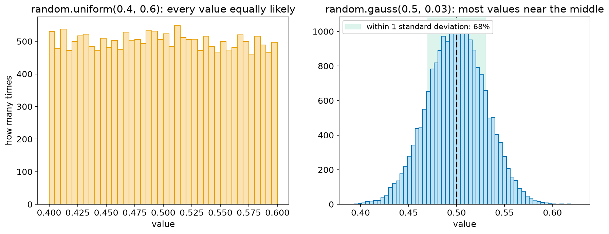
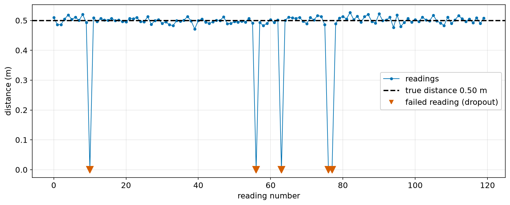
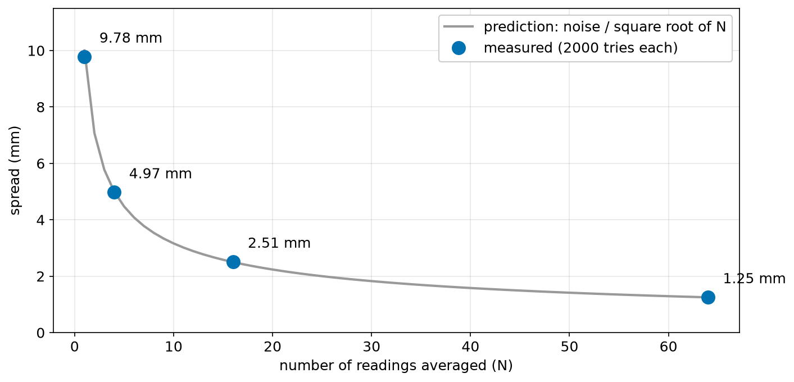
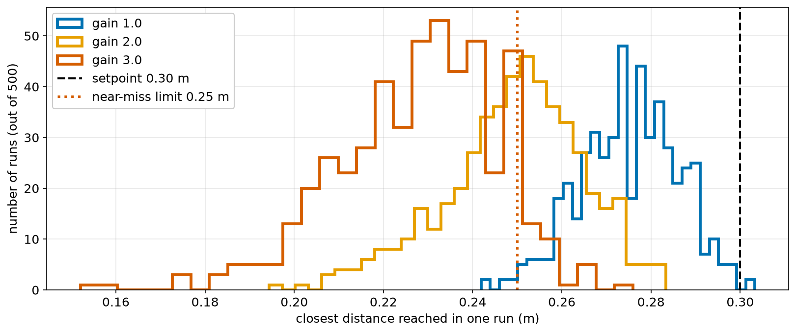
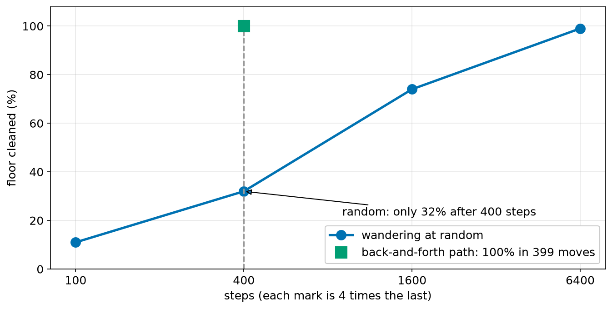

# Chapter 31 — Random Numbers: Simulating Noisy Sensors

> **Part 2 · Chapter 31 of 749**
> **You need:** Chapters 21 (lists), 26 (`statistics`), 28 (classes). Keep a script open.
> **You will make:** a realistic fake sensor with noise and failures, an experiment showing how averaging reduces noise, a Monte Carlo test of a controller, and a robot cleaner that wanders at random.

---

## What you will learn

- How to get random numbers in Python.
- The difference between a **uniform** and a **normal** (bell-curve) distribution.
- What a **seed** does, and why a test needs one.
- How to turn a perfect simulated sensor into a realistic one.
- Why averaging N readings shrinks the noise by √N.
- How to test a robot thousands of times with **Monte Carlo** simulation.

---

## New words in this chapter

| Word | Simple meaning |
|---|---|
| **random number** | A number that cannot be predicted in advance. |
| **pseudo-random** | Looks random, but is calculated by a formula. |
| **seed** | The starting value that decides a whole series of random numbers. |
| **distribution** | Which values are likely, and how likely each one is. |
| **uniform** | Every value is equally likely. |
| **normal** (Gaussian) | Most values are near the middle, with a bell-shaped curve. |
| **standard deviation** | A measure of how spread out the values are. |
| **histogram** | A chart that counts how many values fall in each range. |
| **Monte Carlo** | Testing by running many random trials. |

---

## 31.1 Random numbers in Python

📖 **New word: random number** — a number that cannot be predicted in advance.

```
>>> import random
>>> random.random()
0.13436424411240122
```

| Tool | Gives | Example |
|---|---|---|
| `random.random()` | a float from 0.0 up to (not including) 1.0 | `0.1343…` |
| `random.uniform(a, b)` | a float from `a` to `b` | `random.uniform(0, 1)` |
| `random.randint(a, b)` | a whole number from `a` to `b`, **both included** | `random.randint(1, 6)` |
| `random.randrange(a, b, s)` | like `range`, so `b` is not included | `random.randrange(0, 10, 2)` |
| `random.choice(seq)` | one item picked from a list or string | `random.choice("NSEW")` |
| `random.shuffle(m)` | mixes a list **in place** (returns `None`) | |
| `random.sample(m, k)` | `k` different items | |
| `random.gauss(mean, sd)` | a float from a bell curve | `random.gauss(0, 1)` |

Mind the difference: `randint(1, 6)` includes the 6, unlike `range` (Chapter 20).

Some mistakes:

```
>>> random.choice([])
IndexError: Cannot choose from an empty sequence
>>> random.sample([1], 2)
ValueError: Sample larger than population or is negative
>>> random.randint(1, 2.5)
TypeError: 'float' object cannot be interpreted as an integer
```

### "Something happens with probability p"

`random.random()` is below 0.3 about 30% of the time. So:

```python
if random.random() < 0.3:
    print("this happens about 3 times in 10")
```

A test with 10,000 tries gave 0.3045.

### Pseudo-random, and the seed

📖 **New words: pseudo-random and seed** — computers calculate these numbers with a formula, so they only look random. The **seed** is the starting value that decides the whole series.

```
>>> random.seed(1)
>>> random.random()
0.13436424411240122
>>> random.seed(1)
>>> random.random()
0.13436424411240122
```

The same seed gives the same "random" numbers. That sounds like a flaw, but for testing it is a great gift: when a simulated robot crashes on run 847, you can run exactly the same case again and debug it.

⚠️ Set the seed **once**, at the start of a program. Calling it inside a loop gives you the same number every time.

⚠️ `random` is not suitable for passwords or security. Python's `secrets` module is for that.

Every program in this chapter uses a seed, so that your output should match the book's exactly.

---

## 31.2 Distributions

📖 **New word: distribution** — which values are likely, and how likely each one is.

📖 **New word: histogram** — a chart that counts how many values fall in each range.

Look at Figure 31.1.



*Figure 31.1 — The two most common shapes of randomness.*

**How to read this picture:** Each chart is a histogram of 20,000 random numbers. On the left the bars are all roughly the same height: every value is equally likely. On the right most values are close to 0.5, and values far from it are rare. The green band shows the range within one standard deviation.

📖 **New words: uniform and normal** — **uniform** means every value is equally likely, like a fair die. **Normal** (or Gaussian) means most values are near the middle, with a bell-shaped curve.

Why does sensor noise look like the bell curve? Noise is usually the sum of many tiny independent disturbances, and sums of many small random things tend to form a bell curve. Two dice already show the beginning of this: 7 is the most common total. In 10,000 throws it came up 16.5% of the time. The exact chance is 6 ÷ 36 = 16.7%.

📖 **New word: standard deviation** — a measure of how spread out the values are (Chapter 26). In a bell curve:

| Within | Share of the values | Measured (10,000 values) |
|---|---|---|
| 1 standard deviation | about 68% | 68.3% |
| 2 standard deviations | about 95% | 95.6% |
| 3 standard deviations | about 99.7% | 99.8% |

Data-sheets quote noise this way. A sensor "±1 cm (1σ)" will be within 1 cm about two times in three, and it will still sometimes be 3 cm off. σ (sigma) is the Greek letter used for the standard deviation. Chapter 197 goes further.

---

## Code

So far, every simulated reading has been perfect. Real sensors have noise and sometimes fail. We can build that into a class (Chapter 28).

The file is `code/ch031/noisy_sensor.py`. Type it into `my-code/ch031/`.

```python
# noisy_sensor.py - a pretend distance sensor that behaves like a real one
import random
import statistics

random.seed(1)                       # the same "random" numbers on every run


class NoisySensor:
    """Returns the true distance plus noise, with an occasional failed reading."""

    def __init__(self, noise_m=0.01, dropout_chance=0.02):
        self.noise_m = noise_m
        self.dropout_chance = dropout_chance

    def read(self, true_m):
        if random.random() < self.dropout_chance:
            return 0.0                # a failed reading
        return true_m + random.gauss(0, self.noise_m)


sensor = NoisySensor()
readings = [sensor.read(0.50) for _ in range(1000)]
good = [r for r in readings if r > 0.02]

print("first five:", [round(r, 3) for r in readings[:5]])
print(f"failed readings: {len(readings) - len(good)} of {len(readings)}")
print(f"mean  {statistics.mean(good):.4f} m")
print(f"stdev {statistics.stdev(good):.4f} m")

print("histogram:")
for low_cm in range(47, 53):
    count = len([r for r in good if low_cm / 100 <= r < (low_cm + 1) / 100])
    print(f"{low_cm:3d} cm {'#' * (count // 8)} {count}")
```

| Line | Code | What it does (simple English) |
|---|---|---|
| 1 | comment | The name of the file and the idea. |
| 2–3 | imports | `random` and `statistics` (Chapter 26). |
| 5 | `random.seed(1)` | Same results every run. |
| 8–18 | `NoisySensor` | A fake sensor, as in Chapter 29, but realistic. |
| 15–16 | dropout | About 2% of readings are 0.0. |
| 17 | `return true_m + random.gauss(0, self.noise_m)` | The truth, plus a bit of noise. A mean of 0 means the noise is equally likely to be above or below. |
| 21 | `sensor = NoisySensor()` | The defaults: 1 cm of noise, 2% dropouts. |
| 22 | `readings = […]` | 1000 readings of a wall at exactly 0.50 m. |
| 23 | `good = […]` | Filter out failures, as in Chapter 21. |
| 25–28 | report | What the data looks like. |
| 30–33 | a text histogram | Counts the readings in each 1 cm range, and draws one `#` per 8 readings. |

**Output:**

```
first five: [0.51, 0.486, 0.486, 0.505, 0.519]
failed readings: 28 of 1000
mean  0.4997 m
stdev 0.0102 m
histogram:
 47 cm ### 26
 48 cm ################ 132
 49 cm ############################################ 357
 50 cm ##################################### 299
 51 cm ################ 135
 52 cm ## 22
```

Look at Figure 31.2.



*Figure 31.2 — 120 simulated readings of a wall at exactly 0.50 m.*

**How to read this picture:** The black dashed line is the true distance. The blue line is what the sensor reports. It wobbles close to the truth, and every so often a reading drops to 0 (red triangle). A program that has only seen perfect data has never met any of this.

**What the output means:**

- We asked for 2% dropouts, and got 2.8% (28 in 1000). Chance is not exact.
- The mean is almost exactly 0.50: averaging cancels the noise. The standard deviation comes out at 0.0102, close to the 0.01 we asked for.
- The histogram has the bell shape. Printed sideways, it needs no graphics at all.

---

## 31.3 Averaging reduces noise

If one reading is uncertain, several readings together are better. By how much? File `code/ch031/average_helps.py`:

```python
# average_helps.py - how much does averaging N readings reduce the noise?
import random
import statistics

random.seed(2)
NOISE_M = 0.01

for n in (1, 4, 16, 64):
    averages = []
    for _ in range(2000):                # repeat the experiment many times
        samples = [0.50 + random.gauss(0, NOISE_M) for _ in range(n)]
        averages.append(sum(samples) / n)
    spread = statistics.stdev(averages)
    print(f"average of {n:2d}: spread {spread * 1000:5.2f} mm   predicted {NOISE_M / n ** 0.5 * 1000:5.2f} mm")
```

**Output:**

```
average of  1: spread  9.78 mm   predicted 10.00 mm
average of  4: spread  4.97 mm   predicted  5.00 mm
average of 16: spread  2.51 mm   predicted  2.50 mm
average of 64: spread  1.25 mm   predicted  1.25 mm
```

🔢 **Maths** — averaging N independent readings divides the noise by √N:

```
N = 4:   10 ÷ √4  = 5 mm
N = 16:  10 ÷ √16 = 2.5 mm
N = 64:  10 ÷ √64 = 1.25 mm
```

Look at Figure 31.3.



*Figure 31.3 — Averaging helps a lot at first, and then less and less.*

**How to read this picture:** The grey curve is the formula, and the blue dots are the measurements from the program. They agree closely. The curve falls steeply at first and then flattens out.

To halve the noise you need **four times** the readings. And more readings take more time, so the robot reacts more slowly (the delay of Chapter 21's moving average). Good engineering is a compromise between the two.

---

## Small examples

### Example 1 — Roll a die

```python
print(random.randint(1, 6))
```

### Example 2 — Six thousand throws

```python
random.seed(6)
counts = [0] * 7
for _ in range(6000):
    counts[random.randint(1, 6)] += 1
print(counts[1:])        # [1073, 991, 980, 971, 954, 1031]
```

About 1000 each, but never exactly 1000.

### Example 3 — A random direction

```python
direction = random.choice("NSEW")
```

### Example 4 — A fair order

```python
jobs = [1, 2, 3, 4, 5]
random.shuffle(jobs)     # jobs itself is changed
```

### Example 5 — Your own generator

```python
r = random.Random(42)
print(r.random())        # 0.6394267984578837
```

A separate `Random` object has its own sequence, which is useful when several simulated parts should not disturb each other.

---

## 🏭 Real robot applications

### Application 1 (worked in full) — 🤖 Is that gain really safe?

📖 **New word: Monte Carlo** — testing by running many random trials. (It is named after the famous casino.)

**1. The real problem.** Chapter 20's sweep found that gain 2.0 was the "best gain without overshoot". But that simulation had a perfect sensor. Rover's real distance sensor has noise. Is gain 2.0 still safe?

**2. Why this idea.** One noisy run tells you very little, because a different run would be different. So run it hundreds of times and count how often something bad happens. That is Chapter 9's Monte Carlo idea, and now you can write it yourself.

**3. The numbers.** Sensor noise 3 cm, setpoint 0.30 m, and a "near miss" is getting closer than 0.25 m. 500 runs for each of three gains.

**4. The maths, step by step.** At each loop, the measured distance is the true distance plus noise. The controller then acts on the measurement, not on the truth:

```
speed = clamp(gain × (true distance + noise − setpoint))
```

A noise of 3 cm with gain 2 changes the speed by 0.06 m/s, and over a 0.5 s step that is 3 cm of real movement. The higher the gain, the more the noise is amplified into motion.

**5. The code.** File `code/ch031/monte_carlo_wall.py`:

```python
# monte_carlo_wall.py - drive at the wall 500 times with noise: how often is it close?
import random

random.seed(3)
SETPOINT_M = 0.30
MAX_SPEED_MS = 0.25
DT_S = 0.5
DANGER_M = 0.25                       # closer than this counts as a near miss


def one_run(gain, noise_m):
    """Simulate one approach. Return the closest distance reached."""
    distance_m = 1.0
    closest_m = distance_m
    for _ in range(20):
        measured_m = distance_m + random.gauss(0, noise_m)   # the sensor is noisy
        speed_ms = max(-MAX_SPEED_MS, min(MAX_SPEED_MS, gain * (measured_m - SETPOINT_M)))
        distance_m -= speed_ms * DT_S
        closest_m = min(closest_m, distance_m)
    return closest_m


print("gain  worst run   near misses out of 500")
for gain in (1.0, 2.0, 3.0):
    results = [one_run(gain, noise_m=0.03) for _ in range(500)]
    misses = len([c for c in results if c < DANGER_M])
    print(f"{gain:4.1f}  {min(results):.3f} m     {misses}")
```

| Line | Code | What it does (simple English) |
|---|---|---|
| 3 | `random.seed(3)` | Repeatable results. |
| 10–19 | `one_run` | A single trial, as a function (Chapter 23). |
| 15 | `measured_m = …` | The controller sees this, and never sees the true value. |
| 18 | `closest_m = min(…)` | The closest it got: "smallest so far" (Chapter 20). |
| 22–25 | the sweep | 500 trials per gain. |

**Output:**

```
gain  worst run   near misses out of 500
 1.0  0.242 m     6
 2.0  0.194 m     231
 3.0  0.152 m     442
```

Look at Figure 31.4.



*Figure 31.4 — How close each run came, for three gains.*

**How to read this picture:** Each outline is a histogram of the closest distance reached in 500 runs. The black dashed line is the setpoint, and the dotted line is the near-miss limit. Runs to the left of the dotted line are too close. Gain 1 (blue) is almost all to the right of it. Gain 3 (red) is mostly to the left.

**6. The result.** Chapter 20 said gain 2.0 was best. With a realistic sensor, it has a near miss in **231 of 500** runs: nearly half! Gain 1.0 has 6. The conclusion from perfect data was wrong. Chapter 20 warned you not to rush to use gain 2.0, and this is the reason why.

**7. Going further.** A filter on the sensor would reduce the noise, but it would add delay. Chapter 134 adds filters, and Chapter 416's Kalman filter combines the sensor with a model of the motion. Chapter 9 has more on testing with uncertainty.

### Application 2 (worked in full) — 🧹 A cleaner that wanders

**1. The real problem.** Chapter 10 compared random cleaning with a planned path. Let us simulate random cleaning ourselves on a 20 × 20 room.

**2. Why this idea.** Each step, the robot picks a random direction with `random.choice`. A set (Chapter 22) records the cells it has visited, so that repeat visits are not counted.

**3. The numbers.** A 20 × 20 room is 400 cells. A back-and-forth path needs 399 moves (Chapter 20).

**4. The maths, step by step.** Coverage = cells visited ÷ 400. Each run is different, so we average 30 runs.

**5. The code.** File `code/ch031/random_cleaner.py`:

```python
# random_cleaner.py - a robot that wanders at random: how much floor does it clean?
import random

random.seed(4)
WIDTH, HEIGHT = 20, 20
MOVES = {"N": (0, 1), "S": (0, -1), "E": (1, 0), "W": (-1, 0)}


def clean(steps):
    """Wander for some steps. Return the fraction of the floor visited."""
    x, y = WIDTH // 2, HEIGHT // 2
    visited = {(x, y)}                # a set: Chapter 22
    for _ in range(steps):
        dx, dy = MOVES[random.choice("NSEW")]
        if 0 <= x + dx < WIDTH and 0 <= y + dy < HEIGHT:     # stay inside the room
            x, y = x + dx, y + dy
        visited.add((x, y))
    return len(visited) / (WIDTH * HEIGHT)


for steps in (100, 400, 1600, 6400):
    runs = [clean(steps) for _ in range(30)]
    print(f"{steps:5d} steps: {sum(runs) / len(runs):.0%} cleaned on average")
```

| Line | Code | What it does (simple English) |
|---|---|---|
| 5 | `MOVES = {…}` | A lookup table (Chapter 22). |
| 8–16 | `clean` | One simulated cleaning run. |
| 11 | `visited = {(x, y)}` | A set of tuples. |
| 13 | `dx, dy = MOVES[random.choice("NSEW")]` | A random direction. |
| 14–15 | the walls | A guard: a move into a wall is simply not made. |
| 19–21 | the experiment | Four durations, 30 trials each. |

**Output:**

```
  100 steps: 11% cleaned on average
  400 steps: 32% cleaned on average
 1600 steps: 74% cleaned on average
 6400 steps: 99% cleaned on average
```

Look at Figure 31.5.



*Figure 31.5 — Wandering at random is far slower than following a plan.*

**How to read this picture:** The blue line shows how much of the floor gets cleaned against the number of steps. Each mark on the bottom axis is four times the last. The green square is the planned path, which finishes the job in 399 moves.

**6. The result.** After the 399 moves a planned path needs, random wandering has cleaned about a third of the room. It takes 6400 steps, 16 times longer, to reach 99%. Yet random cleaning needs no map and almost no sensors, and early robot vacuums used it.

**7. Going further.** Part 22 gives a robot a map, and Part 23 plans paths through it.

### Application 3 — 🚗 Finding rare failures

A self-driving system might fail once in a million situations. No road test can find that reliably. Simulation can: thousands of computers run random variations of situations such as a child running out. The seed of any failed run is saved, so that engineers can replay it exactly (Chapter 9).

### Application 4 — 🧠 Random starting points for learning

Machine learning starts a neural network with random numbers, and it trains a walking robot with randomly varied floors and masses, so that what it learns will work on the real robot. This is called **domain randomization** (Chapter 600, and the machine learning chapters in Part 25).

### Application 5 — 📍 Particle filters

A robot unsure of where it is can keep thousands of random guesses of its position, and throw away those that disagree with its sensors. Random numbers then become the robot's way of holding several ideas at once (Chapters 423–424).

---

## 🔧 Hands-on lab

### Lab 31.1 — Fair dice?

**You need:** a Python file.

**Steps:**

1. Roll one die 60 times and count each face. Do it again with 60,000 rolls.
2. Roll two dice 10,000 times and draw a text histogram of the totals from 2 to 12.

**What you should see:** With 60 rolls, the counts are uneven: this is normal. With 60,000, each is close to 10,000. For two dice, the shape is a triangle that peaks at 7. One way to draw it:

```python
import random

counts = [0] * 13
for _ in range(10000):
    counts[random.randint(1, 6) + random.randint(1, 6)] += 1
for total in range(2, 13):
    print(f"{total:2d} {'#' * (counts[total] // 40)}")
```

**If it does not work:**

| Problem | Likely cause | Fix |
|---|---|---|
| `IndexError` | The list is too short | It needs 13 slots, for totals up to 12. |
| A flat shape | One die rolled and doubled | Use two separate calls. |

### Lab 31.2 — The power of the seed

**You need:** a Python file.

**Steps:**

1. Print three random numbers. Run the program twice. Are they the same?
2. Add `random.seed(5)` at the top and run it twice.
3. Move the seed into a loop, just before each random number. What happens?

**What you should see:** Step 1: different numbers. Step 2: the same numbers both times. Step 3: the **same** number three times. Seed once.

**If it does not work:**

| Problem | Likely cause | Fix |
|---|---|---|
| `AttributeError: module 'random' has no attribute…` | A file of yours is called `random.py` | Rename it (Chapter 26). |

### Lab 31.3 — Filters on realistic data

**You need:** `noisy_sensor.py`, and the `MovingAverage` class from Chapter 28.

**Steps:**

1. Make a list of 100 readings from `NoisySensor` at 0.50 m.
2. Pass them through `MovingAverage(5)`, with no check for failed readings.
3. Find the lowest value that comes out. Then fix the problem by skipping readings below 0.02.

**What you should see:** Each failed reading (0.0) pulls the average down to about 0.40 for 5 readings, since one of the five values is 0. After the check, the output stays near 0.50. Your filter was doing its job correctly, and it still gave a wrong answer: bad data needs to be rejected **before** averaging (Chapter 21).

**If it does not work:**

| Problem | Likely cause | Fix |
|---|---|---|
| No low values appear | Your run had no dropouts | Increase `dropout_chance`. |

---

## Common mistakes

⚠️ **Testing only with perfect data.** Add noise.

⚠️ **`randint(1, 6)` versus `range(1, 6)`.** The first includes the 6.

⚠️ **Setting the seed inside a loop.**

⚠️ **Expecting exact results.** 2% does not mean exactly 20 in 1000.

⚠️ **Trusting a single random run.** Run many.

⚠️ **`x = random.shuffle(m)`.** It returns `None`.

⚠️ **Forgetting that a distribution has tails.** Rare values happen.

---

## Practice

🏋️ **1.** Write the call for: (a) a die roll; (b) a float from 0 to 5; (c) a random item from `["a", "b"]`.

🏋️ **2.** Write an `if` that runs about 10% of the time.

🏋️ **3.** What is special about `random.seed(5)`? Why would a tester use it?

🏋️ **4.** A sensor has σ = 2 cm. About what share of readings are within 4 cm of the truth?

🏋️ **5.** By how much does averaging 25 readings reduce the noise? How many readings would you need to reduce it to one tenth?

🏋️ **6.** Write a function `noisy(value, sd)` that returns the value with bell-curve noise added.

🏋️ **7.** What is wrong with this?

```python
for _ in range(3):
    random.seed(1)
    print(random.random())
```

🏋️ **8.** Why does averaging make a robot react more slowly?

🏋️ **9.** Using `random`, estimate the chance of rolling two sixes in one throw of two dice, with 100,000 tries. What is the exact chance?

🏋️ **10.** In Application 1, why does a higher gain cause more near misses?

🏋️ **11.** (Harder) A robot arrives at a charger with position error given by `random.gauss(0, 0.012)` in each of x and y. The charger needs the total error to be less than 2 cm. (a) Write a Monte Carlo program to find what fraction of dockings succeed, using 100,000 tries and a seed. (b) What fraction would succeed if the standard deviation were halved?

---

## Answers

**1.** (a) `random.randint(1, 6)`; (b) `random.uniform(0, 5)`; (c) `random.choice(["a", "b"])`.

**2.** `if random.random() < 0.1:`

**3.** The same sequence of numbers on every run. A tester can repeat a failure exactly.

**4.** 4 cm is 2σ, so about **95%**.

**5.** √25 = 5, so to **one fifth**. For one tenth: N = 10² = **100** readings.

**6.**

```python
def noisy(value, sd):
    return value + random.gauss(0, sd)
```

**7.** The seed is reset each time, so the same number is printed three times.

**8.** Each output depends on older readings, so a change in the world shows up only gradually.

**9.**

```python
hits = 0
for _ in range(100000):
    if random.randint(1, 6) == 6 and random.randint(1, 6) == 6:
        hits += 1
print(hits / 100000)
```

About 0.03 (one run gave 0.029). The exact chance is 1 ÷ 36 ≈ 0.0278.

**10.** The noise is multiplied by the gain, so a higher gain turns the same sensor noise into a larger movement.

**11.**

```python
import random

random.seed(11)
TRIES = 100000


def success_rate(sd):
    good = 0
    for _ in range(TRIES):
        ex = random.gauss(0, sd)
        ey = random.gauss(0, sd)
        if (ex ** 2 + ey ** 2) ** 0.5 < 0.02:
            good += 1
    return good / TRIES


print(success_rate(0.012))
print(success_rate(0.006))
```

About **75%** with σ = 12 mm, and about **99.6%** with σ = 6 mm. Halving the noise has a big effect when the limit is close to the noise level.

---

## Summary

🧠 `random.random`, `uniform`, `randint`, `choice`, `shuffle`, `sample` and `gauss` make random values.

🧠 Random numbers from a computer are **pseudo-random**. A **seed** makes a run repeatable.

🧠 **Uniform**: all values equally likely. **Normal**: a bell curve, which fits sensor noise.

🧠 68%, 95% and 99.7% of values lie within 1, 2 and 3 standard deviations.

🧠 Averaging N readings divides the noise by √N, and it adds delay.

🧠 **Monte Carlo**: run many random trials and count the results.

🧠 Tuning on perfect data can give the wrong answer. Always test with realistic noise.

---

## Next chapter

All your results so far have come out as text. A picture of a robot moving is much easier to understand. In **Chapter 32 — Drawing with `turtle`: a robot on the screen**, you will draw on the screen with a little turtle, the original programming robot, and watch your routes being driven.
