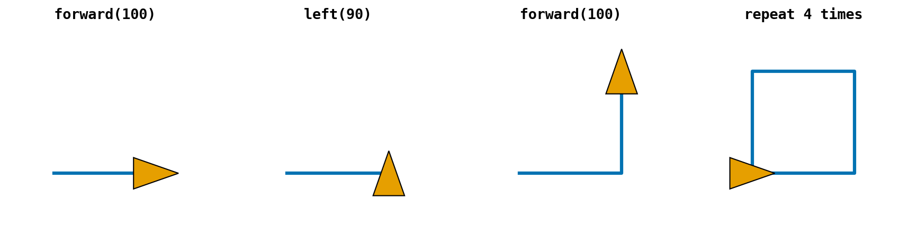
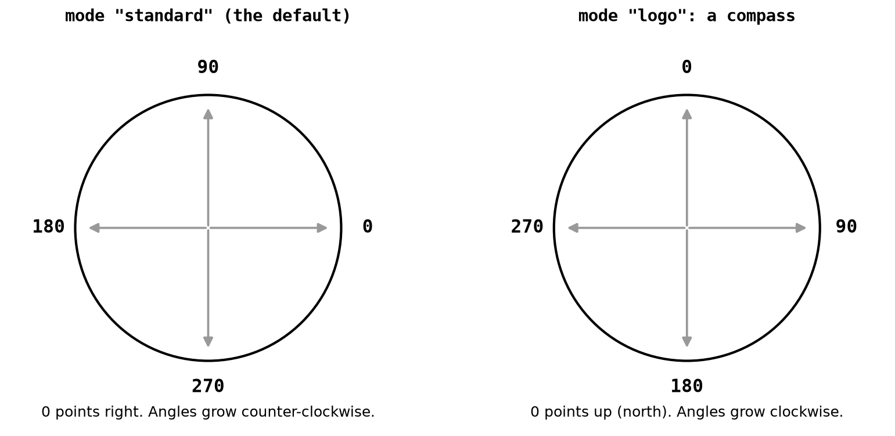
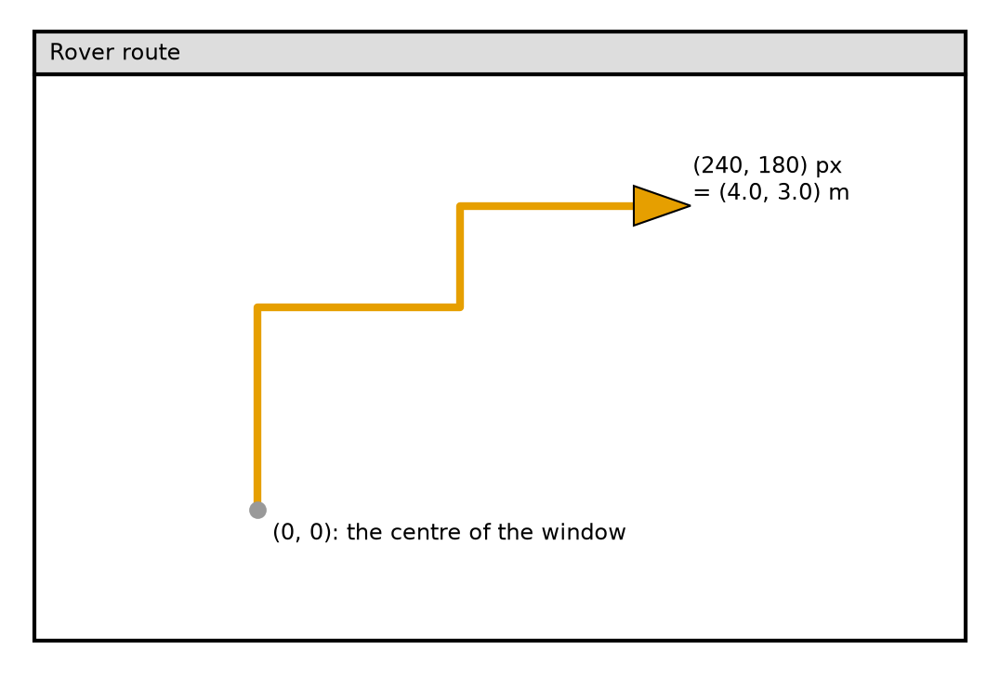
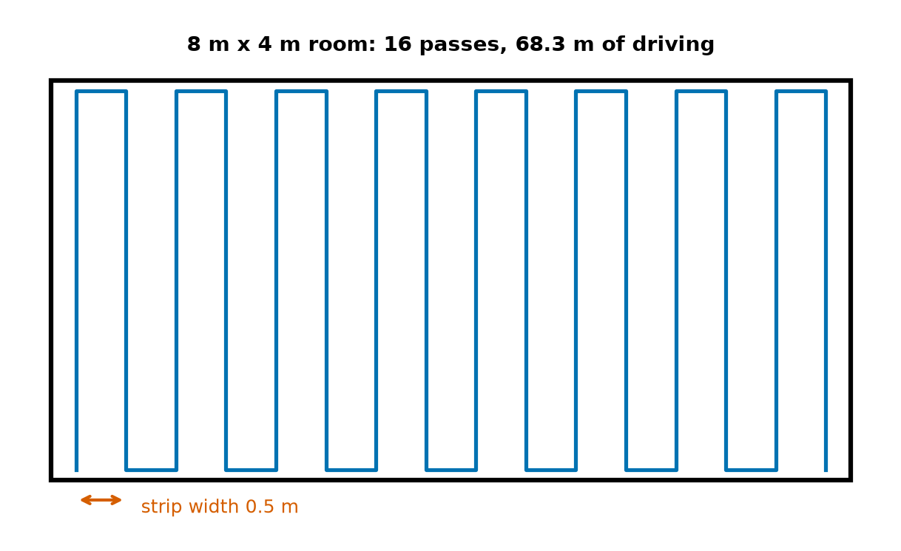
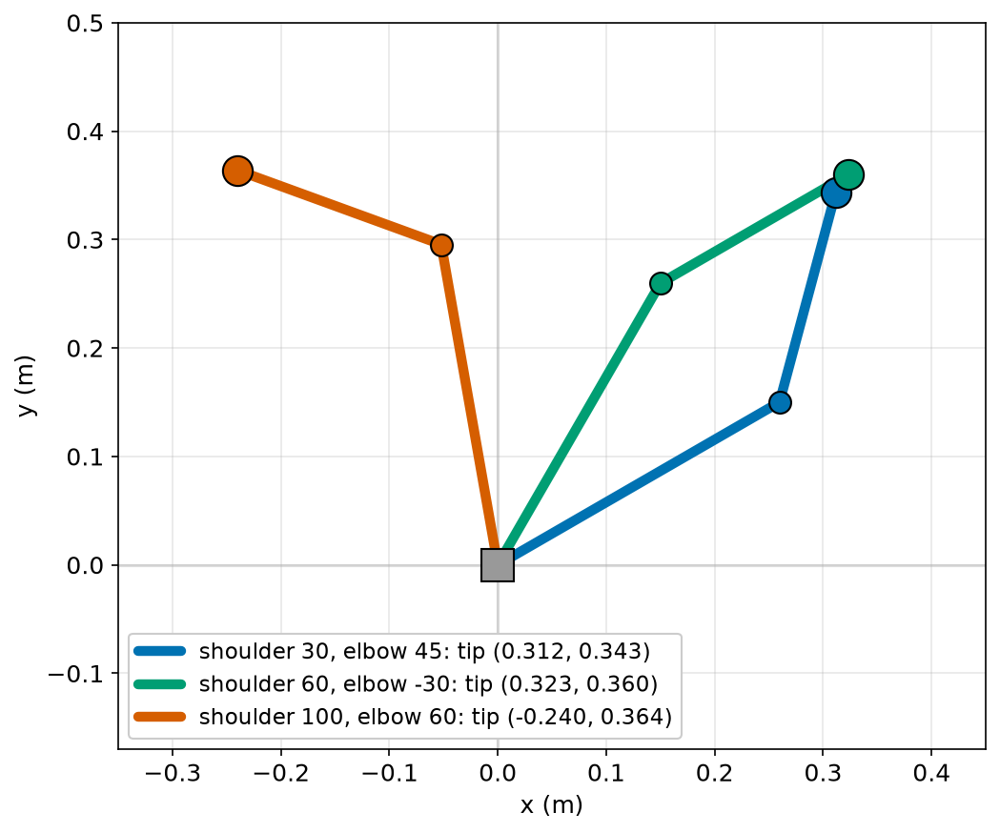

# Chapter 32 — Drawing with `turtle`: A Robot on the Screen

> **Part 2 · Chapter 32 of 749**
> **You need:** Chapters 20 (loops), 23 (functions), 26 (`math`). Your computer needs a screen: `turtle` opens a window.
> **You will make:** a window showing Rover driving a route, a picture of a cleaning robot's path, a robot you can drive with the arrow keys, and a two-link robot arm you can pose.

---

## What you will learn

- How to command a turtle: forward, left, right.
- How the turtle's position and heading work.
- How to use compass headings with `"logo"` mode.
- How to convert metres to pixels.
- How to control the pen, colours and speed.
- How to make a program react to the keyboard.
- Why `turtle` must not freeze, and what to do instead of `sleep`.

---

## New words in this chapter

| Word | Simple meaning |
|---|---|
| **turtle** | A small on-screen robot that draws as it moves. |
| **pixel** | One dot on the screen. |
| **coordinates** | Numbers that say where something is: (x, y). |
| **scale** | How many pixels stand for one metre. |
| **event** | Something that happens, such as a key press. |
| **callback** | A function given to something else, to be called later. |
| **event loop** | The loop inside a program that waits for events. |

---

## 32.1 The first robot you can program

In Chapter 3 you met Grey Walter's robot tortoises. In the late 1960s and the 1970s, children learned programming using a language called Logo, by sending commands to a small robot "turtle" that crawled over paper with a pen. Python's `turtle` module is that same idea, on your screen.

📖 **New word: turtle** — a small on-screen robot that draws as it moves.

```python
import turtle

t = turtle.Turtle()         # make a turtle object (Chapter 28)
t.forward(100)              # move 100 pixels
t.left(90)                  # turn left by 90 degrees
t.forward(50)
turtle.done()               # keep the window open
```

A window opens and the turtle draws two lines. It starts at the centre of the window, facing right. Without the last line, the window may vanish as soon as the program ends.

| Command | What it does |
|---|---|
| `t.forward(d)` | move forward `d` pixels |
| `t.backward(d)` | move backward |
| `t.left(a)`, `t.right(a)` | turn on the spot |
| `t.goto(x, y)` | go straight to that point |
| `t.setheading(a)` | face a direction |
| `t.position()` | where is it? |
| `t.heading()` | which way does it face? |
| `t.distance(x, y)` | how far away is that point? |
| `t.towards(x, y)` | which direction is that point? |

📖 **New word: pixel** — one dot on the screen.

Notice how much this looks like Rover: position, heading, forward, turn. Look at Figure 32.1.



*Figure 32.1 — A square is drawn by repeating "forward, turn".*

**How to read this picture:** Each panel shows what is on the screen after the command above it. The orange triangle is the turtle, and it points the way it faces. A `left` moves the turtle nowhere: it only changes the way it faces.

### Loops draw shapes

```python
for _ in range(4):
    t.forward(100)
    t.right(90)
```

Checking the turtle afterwards gives the position `[0, 0]` and heading `0`: back where it started.

For a shape with `n` equal sides, the turtle must turn by a total of 360° as it goes round, so each corner is 360 ÷ n degrees:

| Shape | Sides | Turn |
|---|---|---|
| triangle | 3 | 120° |
| square | 4 | 90° |
| pentagon | 5 | 72° |
| hexagon | 6 | 60° |

Any time you write `forward` and `turn` in a loop, you are writing a robot path.

---

## 32.2 Where is the turtle?

📖 **New word: coordinates** — numbers that say where something is: (x, y). The turtle's coordinates have (0, 0) in the **centre** of the window, x growing to the right and y growing **upward**, as in maths.

This is unusual on computers. Nearly every other graphics system has (0, 0) in a corner, with y growing downward, and a robot's camera does too (Chapter 478).

### Compass headings

Rover uses compass headings: 0 is north, and they grow clockwise. The turtle normally does not. Look at Figure 32.2.



*Figure 32.2 — The turtle has two ways of measuring direction.*

**How to read this picture:** Each circle shows the direction that each heading number points. On the left, 0 is to the right, and numbers grow counter-clockwise: the mathematician's way. On the right, 0 is up and numbers grow clockwise: a compass. The change is one line.

```python
screen = turtle.Screen()
screen.mode("logo")         # 0 = north, clockwise
```

A real test: after `mode("logo")`, `forward(100)` went to (0, 100), and `right(90)` gave a heading of 90.

Chapter 26 warned you to check which convention a program uses. Here is a real example of two conventions in a single tool.

### From metres to pixels

📖 **New word: scale** — how many pixels stand for one metre.

A screen knows nothing about metres. Choose a scale, and use it everywhere:

```python
SCALE = 60                  # pixels per metre
rover.forward(1.5 * SCALE)  # drive 1.5 m
```

To go back: `x_m = x_px / SCALE`.

---

## 32.3 Pen, colour and speed

| Command | What it does |
|---|---|
| `t.penup()`, `t.pendown()` | stop or start drawing |
| `t.pensize(3)` | the width of the line |
| `t.color("orange")` | the colour |
| `t.dot(10)` | a dot |
| `t.write("hello")` | text on the screen |
| `t.shape("turtle")` | what it looks like: `"turtle"`, `"arrow"`, `"circle"`, `"classic"` |
| `t.speed(n)` | 1 is slow, 10 is fast, 0 is the fastest |
| `t.hideturtle()` | hide it |
| `screen.tracer(0)` and `screen.update()` | draw everything at once |

An unknown colour gives `TurtleGraphicsError: bad color string: not_a_colour`. Misspelling a method gives the `AttributeError` that you know from Chapter 28.

⚠️ **Name clash.** A file called `turtle.py` hides the real module (Chapter 26), with the same long message. It is a very common first mistake, because `turtle.py` is such a natural name for a first program.

⚠️ Closing the window while the program is still drawing raises a `Terminator` error. It is harmless.

---

## 32.4 Reacting to events

Until now, a program has been in charge of what happens next. A game or a robot console has to wait for the world.

📖 **New word: event** — something that happens, such as a key press.

📖 **New word: callback** — a function given to something else, to be called later.

```python
def forward():
    rover.forward(20)


screen.onkey(forward, "Up")     # the function's name, with no brackets!
screen.listen()
screen.mainloop()
```

`screen.onkey(forward, "Up")` says: "when the Up key is pressed, call this function". You hand over the function itself (Chapter 23). If you write `forward()`, it is called once immediately, and `onkey` receives its result, which is `None`.

📖 **New word: event loop** — the loop inside a program that waits for events. `screen.mainloop()` is one. It runs until the window closes.

⚠️ **Do not use `time.sleep` in a turtle program.** While the program sleeps, the window freezes. Use `screen.ontimer(function, milliseconds)`, which is the non-blocking idea from Chapter 30:

```python
def tick():
    rover.forward(5)
    screen.ontimer(tick, 50)    # do it again in 50 ms


tick()
```

Robot software works in the same way. ROS 2 calls your function when a message arrives (Chapter 559), and your code must return quickly.

---

## Code

Here is Chapter 20's route, this time driven on the screen.

The file is `code/ch032/route_on_screen.py`. Type it into `my-code/ch032/`.

```python
# route_on_screen.py - watch Rover drive a route on the screen
import turtle

SCALE = 60                          # pixels per metre
route = "FFRFFLFRFF"                # the route from Chapter 20

screen = turtle.Screen()
screen.title("Rover route")
screen.mode("logo")                 # 0 = north, angles grow clockwise, like a compass

rover = turtle.Turtle()
rover.shape("turtle")
rover.color("orange")
rover.pensize(3)
rover.speed(3)

for letter in route:
    if letter == "F":
        rover.forward(SCALE)
    elif letter == "L":
        rover.left(90)
    elif letter == "R":
        rover.right(90)

x_px, y_px = rover.position()
print(f"Rover ended at ({x_px / SCALE:.1f}, {y_px / SCALE:.1f}) m, facing {rover.heading():.0f}")
screen.mainloop()                   # keep the window open until you close it
```

| Line | Code | What it does (simple English) |
|---|---|---|
| 1 | comment | The name of the file and the idea. |
| 2 | `import turtle` | The module. Do not call your file `turtle.py`! |
| 4 | `SCALE = 60` | 1 m is drawn as 60 pixels. |
| 5 | `route = …` | Data, as in Chapter 20. |
| 7–9 | `screen` | The window, its title, and compass headings. |
| 11–15 | `rover` | One `Turtle` object and its appearance. |
| 17–23 | the loop | Almost the same as Chapter 20's, but the turtle keeps its own position and heading. |
| 25 | `x_px, y_px = rover.position()` | Two numbers, unpacked. |
| 26 | `print(…)` | Pixels back to metres. |
| 27 | `screen.mainloop()` | Keeps the window open. |

**Output in the terminal:**

```
Rover ended at (4.0, 3.0) m, facing 90
```

And in the window, as shown in Figure 32.3:



*Figure 32.3 — What the window shows when the route has been driven.*

**How to read this picture:** The frame is the window, with its title at the top. The grey dot is the centre of the window, where the turtle starts. The orange line is the path, and the triangle is the turtle where it ended, 4 m east and 3 m north, facing east.

**What the output means:** The same position and heading as Chapter 20's arithmetic: (4, 3) m, facing 90 (east). Two different programs, one that keeps its own state and one that uses the turtle's, agree. That is a good kind of check.

---

## Small examples

### Example 1 — A triangle

```python
for _ in range(3):
    t.forward(100)
    t.left(120)
```

### Example 2 — Moving without drawing

```python
t.penup()
t.goto(50, 50)
t.pendown()
```

### Example 3 — Which way, and how far?

```python
print(t.distance(30, 40))     # 50.0 from the origin
```

### Example 4 — A spiral

```python
for i in range(60):
    t.forward(i * 3)
    t.right(91)
```

### Example 5 — Instant drawing

```python
screen.tracer(0)
# ... draw lots of things ...
screen.update()
```

---

## 🏭 Real robot applications

### Application 1 (worked in full) — 🧹 Picture a cleaning plan

**1. The real problem.** A cleaning plan as a list of numbers is hard to check. Is every strip covered? Do the passes overlap correctly? Seeing the path shows errors at a glance, and Chapter 10's "missing row" was exactly the kind of mistake you can spot this way.

**2. Why this idea.** `goto` follows a list of points. Functions separate the room from the path. Metres stay in the calculations, and only the drawing commands use pixels.

**3. The numbers.** A room of 8 m × 4 m and a cleaning width of 0.5 m. Rover travels at 0.25 m/s and stays 0.1 m from the end walls.

**4. The maths, step by step.**

```
Step 1. passes = 8 ÷ 0.5 = 16
Step 2. each pass = 4 − 0.2 = 3.8 m;  16 × 3.8 = 60.8 m
Step 3. moving across between passes: 15 × 0.5 = 7.5 m
Step 4. total = 68.3 m;  time = 68.3 ÷ 0.25 = 273 s ≈ 4.6 min
```

**5. The code.** File `code/ch032/lawnmower.py`:

```python
# lawnmower.py - draw a cleaning robot's back-and-forth path in a room
import turtle

SCALE = 60                          # pixels per metre
WIDTH_M, HEIGHT_M = 8.0, 4.0        # the room
ROW_M = 0.5                         # the width of the strip cleaned on each pass

screen = turtle.Screen()
screen.mode("logo")
pen = turtle.Turtle()
pen.hideturtle()
pen.speed(0)


def draw_room():
    """Draw the walls, with the bottom-left corner at (0, 0)."""
    pen.penup()
    pen.goto(0, 0)
    pen.setheading(0)
    pen.pendown()
    for side_m in [HEIGHT_M, WIDTH_M, HEIGHT_M, WIDTH_M]:
        pen.forward(side_m * SCALE)
        pen.right(90)


def draw_path():
    """Drive up and down the room. Return the number of passes and the length."""
    passes = int(WIDTH_M / ROW_M)
    length_m = 0.0
    pen.color("blue")
    pen.penup()
    pen.goto(ROW_M / 2 * SCALE, 0.1 * SCALE)
    pen.pendown()
    for i in range(passes):
        y_end_m = HEIGHT_M - 0.1 if i % 2 == 0 else 0.1      # up on even passes, down on odd
        x_m = ROW_M / 2 + i * ROW_M
        pen.goto(x_m * SCALE, y_end_m * SCALE)
        length_m += HEIGHT_M - 0.2
        if i < passes - 1:
            pen.goto((x_m + ROW_M) * SCALE, y_end_m * SCALE)
            length_m += ROW_M
    return passes, length_m


draw_room()
passes, length_m = draw_path()
print(f"{passes} passes, {length_m:.1f} m of driving, {length_m / 0.25 / 60:.1f} minutes at 0.25 m/s")
screen.mainloop()
```

| Line | Code | What it does (simple English) |
|---|---|---|
| 4–6 | constants | Metres everywhere, and one scale. |
| 15–22 | `draw_room` | The list gives the side lengths in order. |
| 25–40 | `draw_path` | Both draws and calculates. |
| 34 | `y_end_m = … if … else …` | A one-line choice (Chapter 18). Even passes go up. |
| 35 | `x_m = …` | The centre of this strip. |
| 38–40 | move across | The last pass has no move after it. Forgetting that would drive into the wall. |
| 43–45 | the main part | Two calls and a report. |

**Output:**

```
16 passes, 68.3 m of driving, 4.6 minutes at 0.25 m/s
```

Look at Figure 32.4.



*Figure 32.4 — The path that the program draws.*

**How to read this picture:** The black rectangle is the room, and the blue line is the path. Each up or down line is one pass. The red arrow shows the width of one strip. The left and right strips reach to 0.25 m from the walls, so that their cleaned width touches the wall.

**6. The result.** The picture and the calculation agree: 16 passes and 68.3 m. Because the width and the room are constants, changing the strip to 0.4 m takes one edit, and the picture updates.

**7. Going further.** A real robot is not a dot: Chapter 458's configuration space accounts for its size. Chapter 339 animates arms in Python, and Chapter 33 draws graphs.

### Application 2 (worked in full) — 🦾 Posing a robot arm

**1. The real problem.** Chapter 26 calculated where an arm's tip is. A picture shows whether a pose makes sense: does the arm fold the way we expected? Can it reach?

**2. Why this idea.** Forward kinematics gives the elbow and the tip. `goto` draws the two links. Each pose is one call of one function.

**3. The numbers.** An upper arm of 0.3 m and a forearm of 0.2 m. Angles here are measured from the x-axis (the maths convention), so the program stays in the turtle's default mode.

**4. The maths, step by step.** For a shoulder of 30° and elbow of 45°:

```
elbow x = 0.3 × cos 30°  = 0.260
elbow y = 0.3 × sin 30°  = 0.150
tip x = 0.260 + 0.2 × cos 75° = 0.260 + 0.052 = 0.312
tip y = 0.150 + 0.2 × sin 75° = 0.150 + 0.193 = 0.343
```

The elbow angle is measured from the upper arm, so the forearm's direction is 30 + 45 = 75°.

**5. The code.** File `code/ch032/two_link_arm.py`:

```python
# two_link_arm.py - draw a two-link robot arm for any pair of joint angles
import math
import turtle

SCALE = 300                         # pixels per metre
UPPER_M, FORE_M = 0.3, 0.2


def elbow_and_tip(shoulder_deg, elbow_deg):
    """Return the (x, y) of the elbow and of the tip. Angles from the x axis."""
    a = math.radians(shoulder_deg)
    b = math.radians(shoulder_deg + elbow_deg)
    ex, ey = UPPER_M * math.cos(a), UPPER_M * math.sin(a)
    tx, ty = ex + FORE_M * math.cos(b), ey + FORE_M * math.sin(b)
    return (ex, ey), (tx, ty)


def draw_arm(pen, shoulder_deg, elbow_deg, colour):
    elbow, tip = elbow_and_tip(shoulder_deg, elbow_deg)
    pen.color(colour)
    pen.penup()
    pen.goto(0, 0)
    pen.pendown()
    pen.goto(elbow[0] * SCALE, elbow[1] * SCALE)
    pen.dot(10)
    pen.goto(tip[0] * SCALE, tip[1] * SCALE)
    pen.dot(14)
    return tip


screen = turtle.Screen()
pen = turtle.Turtle()
pen.hideturtle()
pen.speed(0)
pen.pensize(5)

for shoulder, elbow, colour in [(30, 45, "blue"), (60, -30, "green"), (100, 60, "red")]:
    tip_x, tip_y = draw_arm(pen, shoulder, elbow, colour)
    print(f"shoulder {shoulder:3d}, elbow {elbow:3d}: tip at ({tip_x:.3f}, {tip_y:.3f}) m")

screen.mainloop()
```

| Line | Code | What it does (simple English) |
|---|---|---|
| 9–15 | `elbow_and_tip` | Pure maths, with no drawing. It can be tested alone. |
| 18–28 | `draw_arm` | Drawing only. It uses the maths function. |
| 37–39 | the loop | Three poses from one list. |

**Output:**

```
shoulder  30, elbow  45: tip at (0.312, 0.343) m
shoulder  60, elbow -30: tip at (0.323, 0.360) m
shoulder 100, elbow  60: tip at (-0.240, 0.364) m
```

Look at Figure 32.5.



*Figure 32.5 — Three poses of the same arm.*

**How to read this picture:** The grey square is the shoulder. Each colour is one pose: the small dot is the elbow, and the large dot is the tip. Blue and green end up almost at the same place, by very different routes. So different joint angles can reach nearly the same point.

**6. The result.** The first line matches Chapter 26's numbers. Keeping the maths and the drawing in separate functions means that the same `elbow_and_tip` can later drive a real arm.

**7. Going further.** Chapter 337 studies this arm properly, including the opposite question: which angles put the tip at a given point (inverse kinematics)?

### Application 3 — 🎮 Driving with the keyboard

`code/ch032/drive_with_keys.py` is a small driving game. The arrow keys call `forward`, `turn_left` and `turn_right`, and after each step `inside` checks the arena. If the robot goes out, the move is undone and the program prints `bump!`. Its structure, an event that calls a function that checks a rule, is the structure of most interactive robot consoles.

### Application 4 — 🏫 Teaching

Logo turtles introduced many children to programming through a robot. Educational robots still use the idea today: forward, turn and a pen.

### Application 5 — 🐞 Debug by drawing

Whenever a robot's route looks wrong, draw it. Drawing every waypoint (Chapter 21), the ones the planner made and the ones the robot reached, makes differences obvious in a way that a table of numbers cannot. Professional tools like RViz (Chapter 572) exist for exactly this reason.

---

## 🔧 Hands-on lab

### Lab 32.1 — Shapes and the 360° rule

**You need:** a Python file named something other than `turtle.py`.

**Steps:**

1. Write a function `polygon(t, sides, length)`.
2. Draw shapes with 3, 5 and 8 sides.
3. What happens with 36 sides and a length of 10?

**What you should see:** Closed shapes that return to the start. With 36 sides it looks like a circle. Robots draw circles the same way: a tiny step and a tiny turn, again and again.

```python
import turtle


def polygon(t, sides, length):
    for _ in range(sides):
        t.forward(length)
        t.left(360 / sides)


t = turtle.Turtle()
polygon(t, 3, 100)
polygon(t, 5, 80)
polygon(t, 36, 10)
turtle.done()
```

**If it does not work:**

| Problem | Likely cause | Fix |
|---|---|---|
| `AttributeError: module 'turtle' has no attribute…` | Your file is called `turtle.py` | Rename it, and delete `__pycache__`. |
| The window closes at once | `turtle.done()` is missing | Add it as the last line. |
| The shape does not close | The turn is wrong | Use `360 / sides`. |

### Lab 32.2 — Two ways to look at a heading

**You need:** a Python file.

**Steps:** In default mode, print `t.heading()` and call `t.forward(100)`. Print `t.position()`. Then do the same after `turtle.Screen().mode("logo")`, with a new turtle. Then turn right by 90 in each mode, and print the heading.

**What you should see:** Default: heading 0, position (100, 0), and after `right(90)`, heading 270. Logo: heading 0, position (0, 100), and after `right(90)`, heading 90.

**If it does not work:**

| Problem | Likely cause | Fix |
|---|---|---|
| Logo results look like the default | The mode was set after the turtle moved | Set the mode first. |

### Lab 32.3 — Drive your own

**You need:** `drive_with_keys.py`.

**Steps:**

1. Run it, click on the window, and drive around with the arrow keys.
2. Drive into the edge of the arena. Watch the terminal.
3. Add a `Down` key that reverses by one step.
4. Add a counter of the steps taken, and print it after every move.

**What you should see:** The robot moves and turns as you press keys, and it stops at the edge, printing `bump!`. In a test, 12 forward steps from the centre got the robot to the edge at 200 pixels, with the last two blocked.

**If it does not work:**

| Problem | Likely cause | Fix |
|---|---|---|
| Keys do nothing | The window does not have focus, or `listen()` is missing | Click on the window. |
| The robot moves once when the program starts, and then never | You wrote `forward()` in `onkey` | Remove the brackets. |
| `UnboundLocalError` for the counter | You assign to a global inside a function | Use `global` (a rare good use) or a class (Chapter 28). |

---

## Common mistakes

⚠️ **Naming your file `turtle.py`.**

⚠️ **Forgetting `turtle.done()` or `mainloop()`.**

⚠️ **Brackets on a callback.** `onkey(forward, "Up")`, not `forward()`.

⚠️ **`time.sleep` in a GUI.** The window freezes. Use `ontimer`.

⚠️ **Mixing metres and pixels.** Keep calculations in metres.

⚠️ **Forgetting `listen()`.**

⚠️ **Assuming the heading convention.**

---

## Practice

🏋️ **1.** How large is each turn for a regular polygon with 9 sides?

🏋️ **2.** Write the loop that draws a square of side 50.

🏋️ **3.** Where does the turtle end? It starts at the centre, facing right: `forward(100)`, `left(90)`, `forward(50)`.

🏋️ **4.** With 80 pixels per metre, how many pixels is 2.5 m? How many metres is 160 pixels?

🏋️ **5.** In `"logo"` mode, what is the heading after `right(45)` and `left(90)`, starting at 0?

🏋️ **6.** Why does `screen.onkey(go(), "Up")` not do what you expected?

🏋️ **7.** Write the lines that move the turtle to (50, 50) without drawing a line.

🏋️ **8.** Why should you not use `time.sleep` in a turtle program?

🏋️ **9.** Draw a five-pointed star. (Hint: turn by 144°.)

🏋️ **10.** In Application 1, why is there no move across after the last pass?

🏋️ **11.** (Harder) Write a function `draw_waypoints(t, points, scale)` that draws a route through a list of `(x, y)` points in metres, with a dot at each one, and returns the total length in metres. Test it on Chapter 21's route. It should return 6.0.

---

## Answers

**1.** 360 ÷ 9 = **40°**.

**2.**

```python
for _ in range(4):
    t.forward(50)
    t.right(90)
```

**3.** (100, 50), facing up.

**4.** 2.5 × 80 = **200 pixels**. 160 ÷ 80 = **2 m**.

**5.** `right(45)` gives 45; then `left(90)` gives (45 − 90) % 360 = **315**.

**6.** `go()` runs immediately and passes its result (`None`) to `onkey`. Pass the function itself: `onkey(go, "Up")`.

**7.**

```python
t.penup()
t.goto(50, 50)
t.pendown()
```

**8.** While it sleeps, the program cannot redraw the window or respond to keys. Use `screen.ontimer`.

**9.**

```python
for _ in range(5):
    t.forward(150)
    t.right(144)
```

**10.** After the last pass, the robot is finished. A move across would take it towards the wall, or past it.

**11.**

```python
import math


def draw_waypoints(t, points, scale):
    t.penup()
    t.goto(points[0][0] * scale, points[0][1] * scale)
    t.pendown()
    t.dot(8)
    total = 0.0
    for i in range(len(points) - 1):
        x, y = points[i + 1]
        t.goto(x * scale, y * scale)
        t.dot(8)
        total += math.hypot(x - points[i][0], y - points[i][1])
    return total
```

For `[(0, 0), (2, 0), (2, 1.5), (4, 3)]` it returns **6.0**.

---

## Summary

🧠 A **turtle** is a robot on the screen: `forward`, `left`, `right`, `goto`.

🧠 A closed shape with `n` sides turns by 360 ÷ n at each corner.

🧠 (0, 0) is the centre of the window. `screen.mode("logo")` gives compass headings.

🧠 Use a **scale** to convert metres to pixels, and keep calculations in metres.

🧠 `onkey` registers a **callback**: pass the function, without brackets. `mainloop` is the **event loop**.

🧠 Never `sleep` in a GUI. Use `ontimer`.

🧠 Draw a route to check it. It is the fastest way of finding mistakes.

---

## Next chapter

A turtle is good for pictures of a path. But the most useful pictures in robotics are graphs: speed against time, error against time, sensor readings against distance. In **Chapter 33 — Plotting data with `matplotlib`**, you will make the graphs that every chapter from now on depends on, and save them as images.
