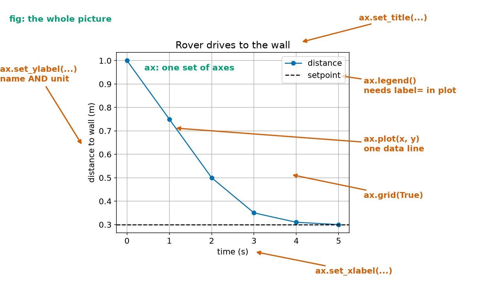
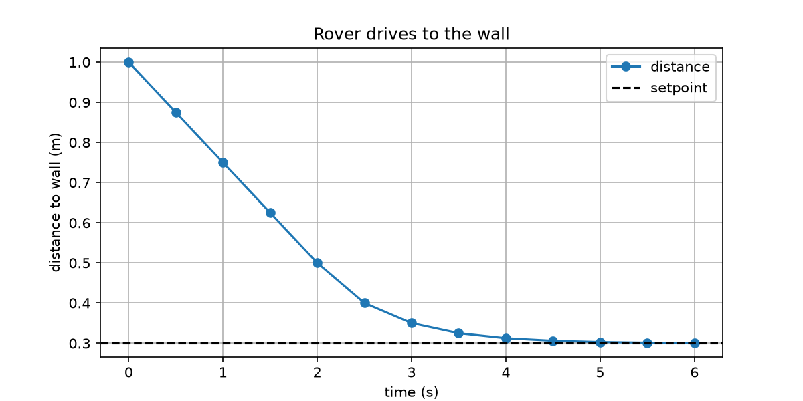
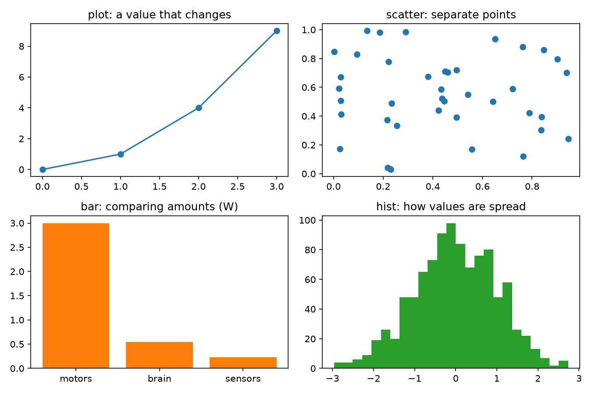
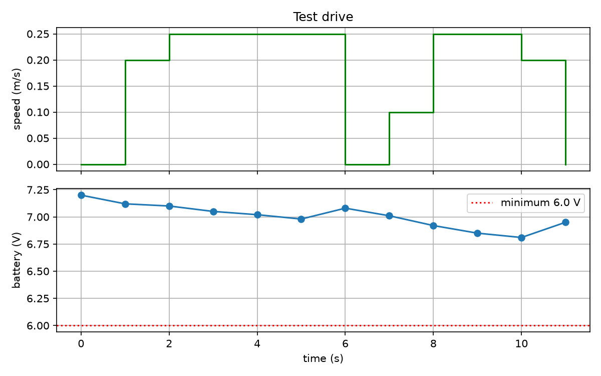
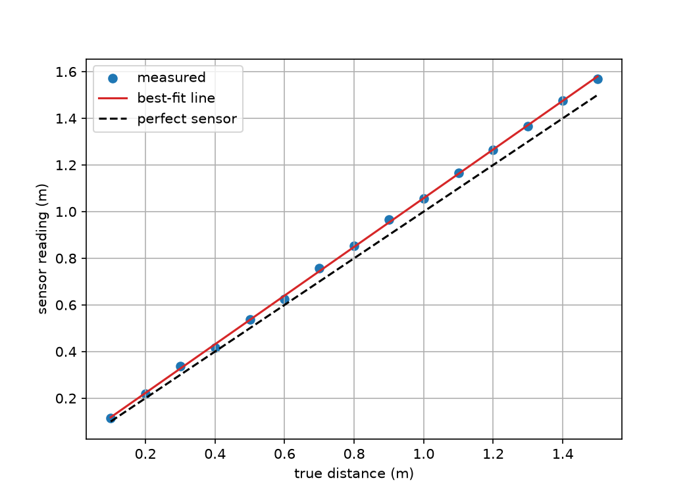

# Chapter 33 — Plotting Data with `matplotlib`

> **Part 2 · Chapter 33 of 749**
> **You need:** Chapters 21 (lists), 26 (modules), 27 (files). `matplotlib` must be installed (Chapter 8).
> **You will make:** a graph of Rover's drive to the wall, a two-part graph of a real log file, a sensor calibration with a best-fit line, and a set of the four most useful kinds of chart.

---

## What you will learn

- Why a graph tells you more than a table.
- How to draw a line graph and save it as an image.
- The parts of a figure, and the difference between `fig` and `ax`.
- How to put several graphs in one figure.
- When to use a line, scatter, bar, histogram or step chart.
- The rules for a graph that other people can read.
- How to fit a straight line to measurements.

---

## New words in this chapter

| Word | Simple meaning |
|---|---|
| **figure** | The whole picture, which can hold one or more graphs. |
| **axes** | One graph inside a figure. |
| **axis** | One of the two number lines of a graph. |
| **legend** | The small box that says what each line is. |
| **subplot** | One of several graphs arranged in a figure. |
| **scatter plot** | Separate points, with no line joining them. |
| **step plot** | A line that stays flat, then jumps. |
| **best-fit line** | The straight line that passes as close as possible to all the points. |
| **calibration** | Finding the correction that makes a sensor's numbers true. |

---

## 33.1 Your first graph

Look at the wall-drive numbers from Chapter 19. There were nine lines of numbers, and you had to read every one. A graph shows the shape at once.

`matplotlib` is the standard plotting library for Python. If it is not yet installed: `python -m pip install matplotlib` (Chapter 26).

```python
import matplotlib.pyplot as plt

fig, ax = plt.subplots()
ax.plot([0, 1, 2, 3], [0, 1, 4, 9])
fig.savefig("first.png")
```

Run it and open `first.png`. Four things happened:

1. `import matplotlib.pyplot as plt` brings in the plotting tools, under the short name that everybody uses.
2. `plt.subplots()` makes a blank figure and one set of axes.
3. `ax.plot(x_values, y_values)` draws a line through the points.
4. `fig.savefig(name)` writes an image file.

The `x` list and the `y` list must be the same length:

```
ValueError: x and y must have same first dimension, but have shapes (3,) and (2,)
```

To open a window instead of a file, call `plt.show()`. It blocks until you close the window. Call `savefig` **before** `show`, because after the window is closed, the figure is empty.

---

## 33.2 The parts of a figure

📖 **New words: figure, axes and axis** — the **figure** is the whole picture. **Axes** means one graph in it (it is a confusing word, because it does not mean two axis lines). An **axis** is one of a graph's two number lines.

Look at Figure 33.1.



*Figure 33.1 — Each part of a graph comes from one line of code.*

**How to read this picture:** The green words name the two main objects. The orange labels show the command that made each part. The title goes at the top. The labels on the two axes say what is being measured, and in what unit. The legend says what each line is, and it needs `label=` in each `plot` call.

Matplotlib has two styles. In this book we use the **object style**, `fig, ax = plt.subplots()` and `ax.…`, because it works cleanly with several graphs (Chapter 28's objects). You may also see `plt.plot(…)` in other people's code. It does the same job, but on "the current graph".

| Command | What it does |
|---|---|
| `ax.plot(x, y)` | draw a line |
| `ax.set_xlabel("time (s)")` | name the bottom axis |
| `ax.set_ylabel("speed (m/s)")` | name the left axis |
| `ax.set_title("…")` | the title |
| `ax.grid(True)` | the background grid |
| `ax.legend()` | show the labels |
| `ax.set_xlim(a, b)`, `ax.set_ylim(a, b)` | set the range shown |
| `ax.axhline(y)`, `ax.axvline(x)` | a straight line across the graph |
| `ax.annotate("text", xy=(x, y), xytext=(a, b), arrowprops={…})` | a note with an arrow |

### Styling a line

`ax.plot(x, y, "o-", color="tab:blue", linewidth=2, label="distance")`

The short string is a **format**: `"o-"` is dots joined by a line, `"--"` is dashes, `":"` is dots only. An invalid format or colour gives a `ValueError`.

---

## Code

The file is `code/ch033/first_plot.py`. Type it into `my-code/ch033/`.

```python
# first_plot.py - Rover's drive to the wall as a graph
import matplotlib.pyplot as plt

SETPOINT_M = 0.30
MAX_SPEED_MS = 0.25
DT_S = 0.5

times, distances = [0.0], [1.0]
distance_m = 1.0
for step in range(1, 13):
    speed_ms = min(MAX_SPEED_MS, distance_m - SETPOINT_M)     # gain 1, with the clamp
    distance_m -= speed_ms * DT_S
    times.append(step * DT_S)
    distances.append(distance_m)

fig, ax = plt.subplots(figsize=(8, 4))
ax.plot(times, distances, "o-", label="distance")
ax.axhline(SETPOINT_M, color="black", linestyle="--", label="setpoint")
ax.set_xlabel("time (s)")
ax.set_ylabel("distance to wall (m)")
ax.set_title("Rover drives to the wall")
ax.grid(True)
ax.legend()
fig.savefig("first_plot.png", dpi=150)
print("saved first_plot.png")
print("final distance:", round(distances[-1], 3), "m")
```

| Line | Code | What it does (simple English) |
|---|---|---|
| 1 | comment | The name of the file and the idea. |
| 2 | `import matplotlib.pyplot as plt` | The plotting tools. |
| 4–6 | constants | From Chapter 19. |
| 8 | `times, distances = [0.0], [1.0]` | Two lists, starting with the first point. |
| 10–14 | the loop | Simulate, and **append** to both lists, so that they stay the same length. |
| 16 | `fig, ax = plt.subplots(figsize=(8, 4))` | A figure 8 inches wide and 4 high. |
| 17 | `ax.plot(…)` | The data. `label=` is for the legend. |
| 18 | `ax.axhline(…)` | A horizontal line across the whole graph. |
| 19–23 | labels and grid | Every graph needs these. |
| 24 | `fig.savefig("first_plot.png", dpi=150)` | Save. `dpi` is the sharpness, in dots per inch. |
| 25–26 | `print(…)` | Say what happened. |

**Output:**

```
saved first_plot.png
final distance: 0.301 m
```

And the file `first_plot.png`:



*Figure 33.2 — The image that the program saved.*

**How to read this picture:** Each blue dot is one pass through the loop. For the first two seconds, the distance falls in a straight line: the speed clamp is active. After that, the line curves and flattens as it approaches the black dashed setpoint. At the end it is 0.301 m, as in Chapter 6.

You can see the two phases of the controller directly. In a table of numbers, you would have to work that out.

---

## 33.3 Several graphs in one figure

📖 **New word: subplot** — one of several graphs arranged in a figure.

```python
fig, (top, bottom) = plt.subplots(2, 1, figsize=(8, 5), sharex=True)
```

`2, 1` means 2 rows and 1 column. It returns the figure and a pair of axes, which we unpack. `sharex=True` makes both use the same time axis, which is what you want when comparing two signals over time.

For a grid, `plt.subplots(2, 2)` gives a two-dimensional array, used as `axes[row, col]`.

`fig.tight_layout()` stops labels from overlapping.

---

## 33.4 Kinds of chart

Look at Figure 33.3, made by `code/ch033/chart_kinds.py`.



*Figure 33.3 — The right chart depends on the question.*

**How to read this picture:** Each panel is a different kind of chart, and its title says what it is good for.

| Question | Chart | Command |
|---|---|---|
| How does a value change over time? | line | `ax.plot` |
| How does one measurement relate to another? | scatter | `ax.scatter` |
| How do several amounts compare? | bar | `ax.bar` |
| How are values spread out? | histogram | `ax.hist` |
| What did a value hold between updates? | step | `ax.step` |

📖 **New words: scatter plot and step plot** — a scatter plot shows separate points. A step plot stays flat and then jumps, which is the true shape of a command that is updated once per loop (Figure 19.4 used one).

```python
ax.bar(["motors", "brain", "sensors"], [3.0, 0.55, 0.23])    # Rover's power (Chapter 5)
ax.hist(readings, bins=25)                                   # as in Chapter 31
```

### The rules of a good graph

1. **Name both axes, with units.** A graph with no units is decoration.
2. **Say what each line is**, with a legend or a label.
3. **Show the target** (the setpoint) as a dashed line.
4. **Start from a sensible range.** A graph that does not start at zero can make a tiny difference look huge.
5. **Plot one thing per question.** Two graphs are better than one crowded graph.
6. **Do not rely on colour alone.** Use dashes and markers too, for people who see colour differently and for black-and-white printing.

---

## Small examples

### Example 1 — Two lines on one graph

```python
ax.plot(t, left, label="left wheel")
ax.plot(t, right, "--", label="right wheel")
ax.legend()
```

### Example 2 — A path on the floor

```python
ax.plot(xs, ys)
ax.set_aspect("equal")     # 1 m looks the same in both directions
```

Without `set_aspect("equal")`, a square route looks like a rectangle.

### Example 3 — A note with an arrow

```python
ax.annotate("overshoot", xy=(3.0, 0.26), xytext=(4, 0.5), arrowprops=dict(arrowstyle="->"))
```

### Example 4 — Clearing up

```python
plt.close(fig)
```

Close figures when a program makes many of them, or memory runs out. Matplotlib keeps them open until told otherwise.

---

## 🏭 Real robot applications

### Application 1 (worked in full) — 🤖 Graph a test drive

**1. The real problem.** Chapter 27 analysed a drive log with numbers. An engineer would look at a graph first: a glance at the speed and battery together shows what happened and when.

**2. Why this idea.** Two signals share one time axis, so two subplots with `sharex=True` fit best. The speed is a command that stays constant between updates, so a step plot is the honest choice. The battery is a measurement, so dots joined by a line fit.

**3. The numbers.** The 12 rows of `drive_log.csv` from Chapter 27, and a minimum voltage of 6.0 V (Chapter 17).

**4. The maths, step by step.** There is nothing to calculate here: the job is reading and drawing. `float()` is still needed, because CSV values are text.

**5. The code.** File `code/ch033/plot_drive_log.py`:

```python
# plot_drive_log.py - turn the Chapter 27 log file into a two-part graph
import csv
from pathlib import Path

import matplotlib.pyplot as plt

log_path = Path(__file__).parent.parent / "ch027" / "drive_log.csv"

times, speeds, volts = [], [], []
with open(log_path, newline="") as f:
    for row in csv.DictReader(f):
        times.append(float(row["time_s"]))
        speeds.append(float(row["speed_ms"]))
        volts.append(float(row["battery_v"]))

fig, (top, bottom) = plt.subplots(2, 1, figsize=(8, 5), sharex=True)

top.step(times, speeds, where="post", color="green")
top.set_ylabel("speed (m/s)")
top.set_title("Test drive")
top.grid(True)

bottom.plot(times, volts, "o-", color="tab:blue")
bottom.axhline(6.0, color="red", linestyle=":", label="minimum 6.0 V")
bottom.set_xlabel("time (s)")
bottom.set_ylabel("battery (V)")
bottom.legend()
bottom.grid(True)

fig.tight_layout()
fig.savefig("drive_log.png", dpi=150)
print("saved drive_log.png from", len(times), "rows")
```

| Line | Code | What it does (simple English) |
|---|---|---|
| 2–5 | imports | Standard library first, and then installed packages. |
| 7 | `log_path = …` | Finds the file relative to this script (Chapter 27). |
| 9–14 | read | Three lists, converted to numbers. |
| 16 | `fig, (top, bottom) = …` | Two graphs, stacked. |
| 18 | `top.step(…, where="post")` | Each value holds until the next one. |
| 23–24 | bottom graph | The data, and the limit as a dotted line. |
| 30–31 | finish | Tidy the spacing and save. |

**Output:**

```
saved drive_log.png from 12 rows
```



*Figure 33.4 — Speed and battery on one time axis.*

**How to read this picture:** The top graph is the speed command. Notice the flat steps. The bottom graph is the battery. The red dotted line is the limit. Reading down from the top, each time the speed drops to zero, the voltage rises.

**6. The result.** One glance shows that the battery stays well above the limit, and that it recovers each time the robot stops. Whenever you plot data, things appear that you were not looking for. That is the main reason to plot it.

**7. Going further.** Chapter 639 reads real flight logs in the same way, and Chapter 217 reads the shape of a response graph to judge a controller.

### Application 2 (worked in full) — 📏 Calibrating a sensor

📖 **New words: calibration and best-fit line** — **calibration** is finding the correction that makes a sensor's numbers true. A **best-fit line** is the straight line that passes as close as possible to all the points.

**1. The real problem.** A cheap distance sensor reads slightly wrong in a consistent way: too high by a few percent, plus a small constant error. We can hold it at known distances, compare, and correct it in software.

**2. Why this idea.** A scatter plot of "reading" against "true distance" shows the pattern. If the points fall on a straight line, then two numbers, the **slope** and the **offset**, describe the whole error. The maths is called **least squares**.

**3. The numbers.** 15 test distances from 0.1 to 1.5 m. The pretend sensor reads 4% high, plus 2 cm, with 8 mm of noise.

**4. The maths, step by step.** With xᵢ the true values and yᵢ the readings, and x̄ and ȳ their means:

```
slope  = Σ (xᵢ − x̄)(yᵢ − ȳ) ÷ Σ (xᵢ − x̄)²
offset = ȳ − slope × x̄
corrected = (reading − offset) ÷ slope
```

You are not expected to know why this works yet (Chapter 171). The code does the sums.

**5. The code.** File `code/ch033/sensor_calibration.py`:

```python
# sensor_calibration.py - compare a sensor with a ruler, and fit a straight line
import random

import matplotlib.pyplot as plt

random.seed(5)
true_m = [0.1 * i for i in range(1, 16)]
# this sensor reads 4% too high, 2 cm too high, with some noise
measured_m = [1.04 * t + 0.02 + random.gauss(0, 0.008) for t in true_m]

n = len(true_m)
mean_t = sum(true_m) / n
mean_m = sum(measured_m) / n
top = sum((t - mean_t) * (m - mean_m) for t, m in zip(true_m, measured_m))
bottom = sum((t - mean_t) ** 2 for t in true_m)
slope = top / bottom                  # the best straight line: least squares
offset = mean_m - slope * mean_t

corrected_m = [(m - offset) / slope for m in measured_m]
worst_before = max(abs(m - t) for m, t in zip(measured_m, true_m))
worst_after = max(abs(c - t) for c, t in zip(corrected_m, true_m))

print(f"measured = {slope:.4f} x true + {offset:.4f}")
print(f"worst error before: {worst_before * 100:.1f} cm")
print(f"worst error after:  {worst_after * 100:.1f} cm")

fig, ax = plt.subplots(figsize=(7, 5))
ax.scatter(true_m, measured_m, color="tab:blue", label="measured")
ax.plot(true_m, [slope * t + offset for t in true_m], color="tab:red", label="best-fit line")
ax.plot(true_m, true_m, color="black", linestyle="--", label="perfect sensor")
ax.set_xlabel("true distance (m)")
ax.set_ylabel("sensor reading (m)")
ax.grid(True)
ax.legend()
fig.savefig("calibration.png", dpi=150)
```

| Line | Code | What it does (simple English) |
|---|---|---|
| 6 | `random.seed(5)` | Repeatable (Chapter 31). |
| 7–9 | data | Comprehensions make the true and measured lists. |
| 11–16 | the fit | The formula, in Python. `sum(… for …)` adds without a list. |
| 18 | `corrected_m = …` | Undo the error: subtract the offset and divide by the slope. |
| 19–20 | worst errors | `max` of `abs`. |
| 26–33 | the graph | Points, the fitted line, and what perfect would look like. |

**Output:**

```
measured = 1.0439 x true + 0.0137
worst error before: 7.7 cm
worst error after:  1.4 cm
```



*Figure 33.5 — A sensor that reads consistently high.*

**How to read this picture:** Each blue dot compares one reading with the truth. The black dashed line is a perfect sensor. The dots fall on a straight line (red) that sits above the dashed line, and the gap grows with the distance.

**6. The result.** The fit found a slope of 1.0439 and an offset of 0.0137, close to the 1.04 and 0.02 that were built in. The worst error fell from 7.7 cm to 1.4 cm with two numbers and one line of code. What is left is noise, which no calibration can remove.

**7. Going further.** Chapter 133 calibrates real sensors, and a robot would keep these two numbers in its settings file (Chapter 27).

### Application 3 — 🏭 Spotting a tired motor

Plotting the current of a factory motor over several months shows a slow climb that nobody would notice in a table of numbers. It is an early warning of worn bearings. This is **predictive maintenance**, and it starts with a simple line graph.

### Application 4 — 🚁 Graphs in tuning

To tune a drone, an engineer plots the commanded angle against the measured angle. Overshoot and oscillation can be seen at once. Chapter 217 shows how to read these shapes.

### Application 5 — 🧪 Before and after

Whenever you change a robot, plot the old and new behaviour on the same axes. A claim such as "the new gain is better" means nothing compared with two lines on one graph.

---

## 🔧 Hands-on lab

### Lab 33.1 — Plot your own function

**You need:** a Python file.

**Steps:** Plot `y = 0.5 × t²` from t = 0 to 4 s, in steps of 0.1 s. Add a title, both axis labels and a grid. Save it as a PNG.

**What you should see:** A curve that starts flat and gets steeper, ending at y = 8. One solution:

```python
import matplotlib.pyplot as plt

times = [n * 0.1 for n in range(41)]
values = [0.5 * t ** 2 for t in times]

fig, ax = plt.subplots()
ax.plot(times, values)
ax.set_xlabel("time (s)")
ax.set_ylabel("distance (m)")
ax.set_title("Constant acceleration")
ax.grid(True)
fig.savefig("curve.png")
```

**If it does not work:**

| Problem | Likely cause | Fix |
|---|---|---|
| `ModuleNotFoundError: No module named 'matplotlib'` | It is not installed | `python -m pip install matplotlib`. |
| `ValueError: x and y must have same first dimension` | The lists have different lengths | Build them together. |
| The saved image is blank | `savefig` was after `show` | Save first. |

### Lab 33.2 — Make a bad graph good

**You need:** a Python file.

**Steps:** Plot `[1, 2, 3, 4]` against `[0.50, 0.49, 0.51, 0.50]`, with nothing else. Look at it. Now fix it: add labels with units, and use `ax.set_ylim(0, 1)`.

**What you should see:** The first graph shows wild up-and-down movement, because matplotlib zooms in on the data. With the y-axis from 0 to 1, it is a flat line. Both are correct. Which one you should show depends on the question you are asking.

**If it does not work:**

| Problem | Likely cause | Fix |
|---|---|---|
| The limits have no effect | `set_ylim` was called on another graph | Use the same `ax`. |

### Lab 33.3 — See the noise

**You need:** `noisy_sensor.py` from Chapter 31.

**Steps:** Use `NoisySensor` to make 300 readings at 0.50 m. In one figure, draw (a) the readings against their number, and (b) a histogram of the good readings. Use `subplots(1, 2)`.

**What you should see:** On the left, a noisy band around 0.50 with a few drops to 0. On the right, a bell shape around 0.50. If you forget to filter the bad readings, the histogram will have a separate bar at 0, and the bell will look very narrow.

**If it does not work:**

| Problem | Likely cause | Fix |
|---|---|---|
| `ModuleNotFoundError: No module named 'noisy_sensor'` | The file is in another folder | Copy it next to your script. |
| Everything is printed and no graph appears | You never save or show the figure | Add `savefig`. |

---

## Common mistakes

⚠️ **No axis labels or units.**

⚠️ **`x` and `y` of different lengths.**

⚠️ **`savefig` after `show`.** Save first.

⚠️ **Forgetting `legend()`.** `label=` alone shows nothing.

⚠️ **`legend()` without any `label=`.** The box is empty.

⚠️ **Plotting text instead of numbers.** CSV values must be converted, or the axis treats them as names.

⚠️ **Assuming two scales are comparable.** Check the axis numbers.

⚠️ **A robot's path without `set_aspect("equal")`.** It looks distorted.

---

## Practice

🏋️ **1.** What is the difference between `fig` and `ax`?

🏋️ **2.** Write the lines that plot `[1, 2, 3]` against `[2, 4, 8]`, and save the result as `a.png`.

🏋️ **3.** Which chart would you use? (a) battery voltage over a drive; (b) how often each error occurred; (c) readings against true distance; (d) the spread of 1000 readings; (e) a motor command updated once per loop.

🏋️ **4.** Add a dashed horizontal line at y = 0.3.

🏋️ **5.** Why does `plt.subplots(2, 1)` return something you can unpack into two names?

🏋️ **6.** Why should a graph have units on its axes?

🏋️ **7.** Why might a graph of `[0.50, 0.49, 0.51]` look very wobbly? How do you change that?

🏋️ **8.** What does `sharex=True` do?

🏋️ **9.** A sensor has a slope of 1.1 and an offset of 0.05. A reading is 0.60. What is the corrected value?

🏋️ **10.** What does `set_aspect("equal")` do, and when do you need it?

🏋️ **11.** (Harder) Write a function `plot_compare(t, a, b, title, filename)` that plots two signals on the same axes with a legend, and saves the file. Then use it to compare the distance curves for gains 1 and 3 from Chapter 19's wall drive.

---

## Answers

**1.** `fig` is the whole picture. `ax` is one graph in it.

**2.**

```python
fig, ax = plt.subplots()
ax.plot([1, 2, 3], [2, 4, 8])
fig.savefig("a.png")
```

**3.** (a) line; (b) bar; (c) scatter; (d) histogram; (e) step.

**4.** `ax.axhline(0.3, linestyle="--")`

**5.** It returns a figure and an array of two axes, and an array can be unpacked (Chapter 22).

**6.** Without units, nobody can tell what the numbers mean: 0.5 metres or 0.5 millimetres.

**7.** Matplotlib zooms in so that the data fill the graph. Use `ax.set_ylim(0, 1)`.

**8.** Both graphs use the same x-axis, so that the signals line up in time.

**9.** (0.60 − 0.05) ÷ 1.1 = **0.50**.

**10.** It makes one unit the same length on both axes. You need it for anything that is a real shape, such as a robot's path.

**11.**

```python
import matplotlib.pyplot as plt


def plot_compare(t, a, b, title, filename):
    fig, ax = plt.subplots()
    ax.plot(t, a, label="first")
    ax.plot(t, b, "--", label="second")
    ax.set_xlabel("time (s)")
    ax.set_title(title)
    ax.grid(True)
    ax.legend()
    fig.savefig(filename, dpi=150)
    plt.close(fig)
```

---

## Summary

🧠 `fig, ax = plt.subplots()`, then `ax.plot(x, y)`, then `fig.savefig("name.png")`.

🧠 Every graph needs axis labels with **units**, a legend when there are several lines, and usually a grid.

🧠 Save before you `show`.

🧠 `plt.subplots(rows, cols)` makes several graphs. `sharex=True` lines them up.

🧠 Line for change over time, scatter for relationships, bar for amounts, histogram for spread, step for commands.

🧠 A **best-fit line** turns many measurements into two numbers: a slope and an offset. Calibration then corrects the readings.

---

## Next chapter

Your plots and simulations have used Python lists and loops, and Chapter 30 showed how slow those can be. In **Chapter 34 — NumPy part 1: arrays**, you will meet the array, a list designed for numbers. One short line will do what a whole loop did, and it will do it dozens of times faster.
