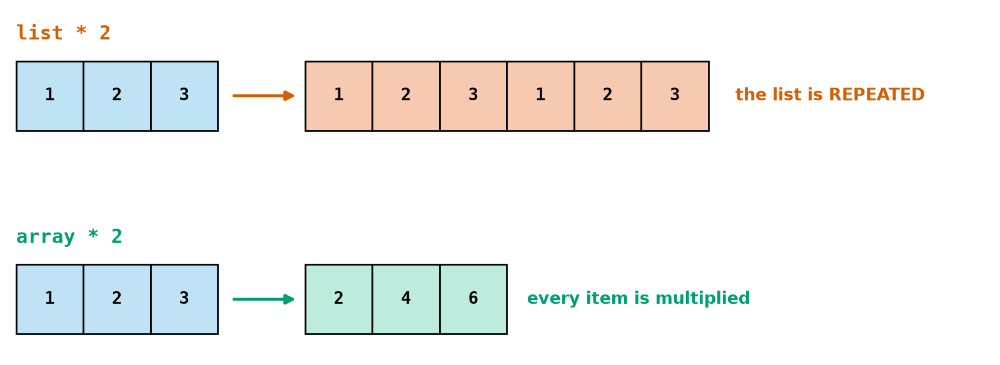
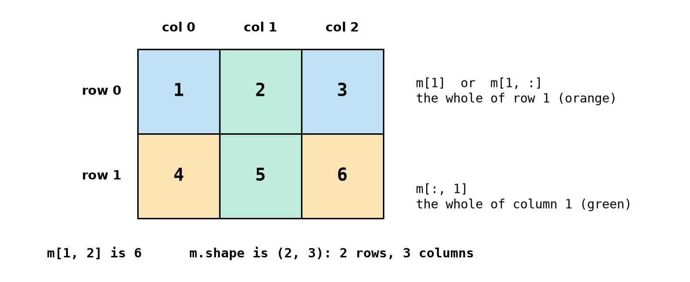
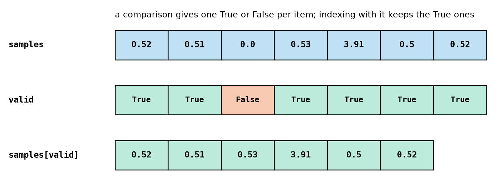
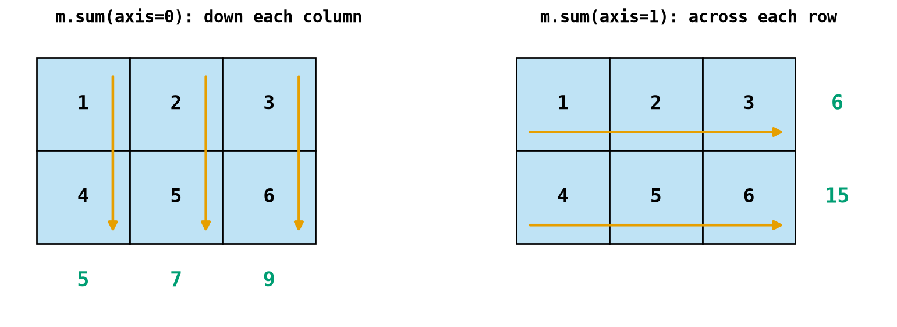
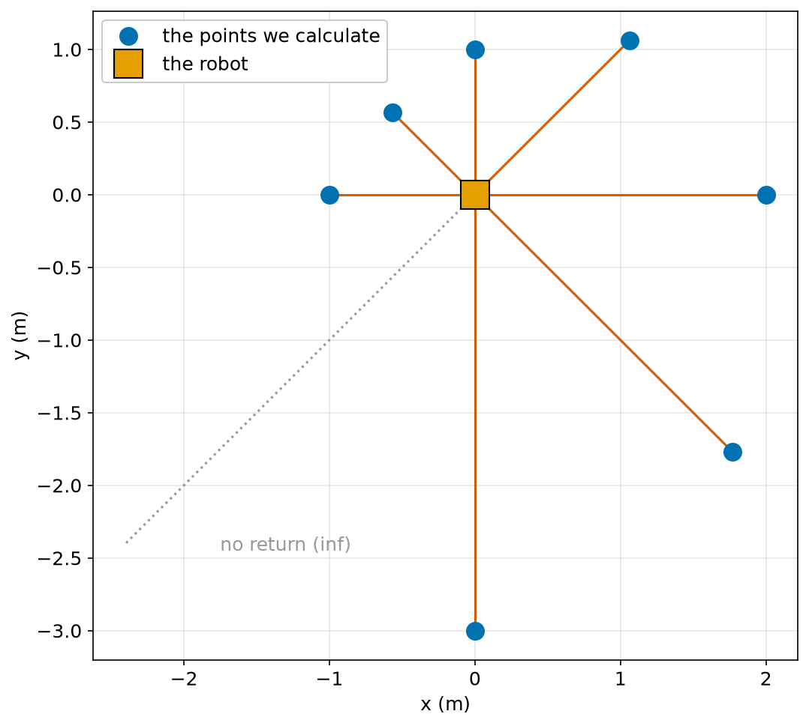

# Chapter 34 — NumPy Part 1: Arrays

> **Part 2 · Chapter 34 of 749**
> **You need:** Chapters 21 (lists), 26 (modules), 33 (graphs). `numpy` must be installed (`python -m pip install numpy`).
> **You will make:** a one-line sensor filter, a program that turns a laser scan into points on the floor, and a study of a whole log file in a single 2-D array.

---

## What you will learn

- What a NumPy **array** is, and how it differs from a list.
- How to create arrays: `array`, `zeros`, `ones`, `arange`, `linspace`.
- How arithmetic works on a whole array at once.
- How to use `shape`, `size`, `dtype` and two-dimensional arrays.
- How to index rows and columns.
- How to filter with a **mask**.
- How to use statistics along an **axis**.
- How arrays share memory, and how to make a copy.

---

## New words in this chapter

| Word | Simple meaning |
|---|---|
| **array** | A grid of numbers, all of one type. |
| **element** | One item in an array. |
| **vectorised** | Done on a whole array at once, with no written loop. |
| **shape** | The size of an array along each direction. |
| **dimension** | One direction of an array: a list has 1, a table has 2. |
| **dtype** | The type of number stored in the array. |
| **mask** | An array of True and False used to pick items. |
| **view** | A slice that shares its memory with the original array. |

---

## 34.1 Why arrays?

Lists are flexible, but a list does not know about maths. A list multiplied by 2 is repeated (Chapter 15's strings do the same). And Chapter 30 showed that a Python loop is slow. Robots handle thousands of numbers at a time: a laser scan, a camera image, a matrix.

NumPy is the library for this. Nearly all scientific and robotics Python is built on it.

```python
import numpy as np         # "np" is the name everybody uses
```

📖 **New word: array** — a grid of numbers, all of one type.

```
>>> a = np.array([1.0, 2.0, 3.0])
>>> a
array([1., 2., 3.])
>>> type(a)
<class 'numpy.ndarray'>
```

Look at Figure 34.1.



*Figure 34.1 — The same operator means different things.*

**How to read this picture:** The top row is a Python list, and `* 2` repeats it, as in Chapter 21. The bottom row is an array, and `* 2` multiplies each item. That is usually what you want when you have numbers.

📖 **New word: vectorised** — done on a whole array at once, with no written loop.

```
>>> a * 2
array([2., 4., 6.])
>>> a + 1
array([2., 3., 4.])
>>> a + a
array([2., 4., 6.])
>>> a ** 2
array([1., 4., 9.])
>>> a * a
array([1., 4., 9.])
>>> np.sqrt(a)
array([1.        , 1.41421356, 1.73205081])
```

`a * a` multiplies matching items. Two arrays need matching sizes:

```
>>> np.array([1, 2]) + np.array([1, 2, 3])
ValueError: operands could not be broadcast together with shapes (2,) (3,)
```

Use NumPy's functions on arrays: `np.sqrt`, `np.sin`, `np.abs`. `math.sqrt` only handles single numbers.

### Indexing

The same as lists, including negative indexes and slices. Assigning changes the array:

```
>>> a[0]
np.float64(1.0)
>>> a[1:]
array([2., 3.])
>>> a[0] = 9
```

`np.float64(1.0)` is just NumPy's way of showing a single number. It behaves like a float.

Going out of range gives `IndexError: index 5 is out of bounds for axis 0 with size 3`.

### All one type

📖 **New word: dtype** — the type of number stored in the array.

```
>>> np.array([1, 2, 3]).dtype
dtype('int64')
>>> np.array([1.0, 2.0]).dtype
dtype('float64')
>>> np.array([1, 2.5])
array([1. , 2.5])
```

Mixing int and float makes everything a float. Beware of an array of ints, because putting a float in it **cuts the decimals** with no warning:

```
>>> i = np.array([1, 2])
>>> i[0] = 2.7
>>> i
array([2, 2])
```

Use `np.zeros(n)` or floats from the start if you intend to store decimals.

### Making arrays

| Function | Example | Result |
|---|---|---|
| `np.array(list)` | `np.array([1, 2])` | from a list |
| `np.zeros(n)` | `np.zeros(3)` | `[0., 0., 0.]` |
| `np.ones(n)` | `np.ones(2)` | `[1., 1.]` |
| `np.full(n, v)` | `np.full(2, 7.5)` | `[7.5, 7.5]` |
| `np.arange(a, b, s)` | `np.arange(0, 1, 0.25)` | `[0., 0.25, 0.5, 0.75]` |
| `np.linspace(a, b, n)` | `np.linspace(0, 1, 5)` | `[0., 0.25, 0.5, 0.75, 1.]` |

`arange` is like `range`, and it allows floats: the stop value is left out, and float steps can give one item more or fewer than you expect. `linspace` is usually safer: you say exactly how many points you want, and it includes the end.

---

## 34.2 Two dimensions

📖 **New words: dimension and shape** — a **dimension** is one direction of an array. A list of numbers has one, a table has two. The **shape** gives the size in each direction.

```
>>> m = np.array([[1, 2, 3], [4, 5, 6]])
>>> m.shape
(2, 3)
>>> m.ndim
2
>>> m.size
6
```

Look at Figure 34.2.



*Figure 34.2 — A two-dimensional array: rows first, then columns.*

**How to read this picture:** The grid has 2 rows and 3 columns. An index gives the row and then the column. The orange row is what `m[1]` picks, and the green column is what `m[:, 1]` picks. A colon alone means "all of this direction".

```
>>> m[1, 2]
np.int64(6)
>>> m[1]
array([4, 5, 6])
>>> m[:, 1]
array([2, 5])
>>> m[:, 1:]
array([[2, 3],
       [5, 6]])
```

Compare with lists of lists (Chapter 21): `m[1, 2]` here, against `m[1][2]` there. And selecting a column in a list of lists needs a loop.

Other useful things:

| Code | Result |
|---|---|
| `np.zeros((2, 3))` | 2 rows and 3 columns of zeros (note the double brackets) |
| `np.eye(2)` | the identity matrix (Chapter 162) |
| `m.T` | rows become columns |
| `m.reshape(3, 2)` | the same numbers, in a new shape |
| `m.flatten()` | one long line |

`m.reshape(4, 2)` gives `ValueError: cannot reshape array of size 6 into shape (4,2)`, because 4 × 2 is not 6.

---

## 34.3 Masks: asking questions of every item

A comparison on an array gives one answer per item:

```
>>> b = np.array([1.0, 5.0, 3.0])
>>> b > 2
array([False,  True,  True])
```

📖 **New word: mask** — an array of True and False used to pick items. Look at Figure 34.3.



*Figure 34.3 — A mask picks out the items you want, with no loop.*

**How to read this picture:** The top row is the data. The middle row is the mask, with one True or False per item. Indexing with the mask (bottom row) keeps only the items marked True. Notice that the result is shorter.

```
>>> b[b > 2]
array([5., 3.])
>>> np.sum(b > 2)
np.int64(2)
```

`np.sum` of a mask counts the True items (Chapter 17: True is 1).

⚠️ To combine conditions, use `&` for and, `|` for or and `~` for not, and **put brackets around each condition**:

```python
valid = (b > 2) & (b < 4)
```

Python's `and` cannot be used on whole arrays:

```
>>> b > 2 and b < 4
ValueError: The truth value of an array with more than one element is ambiguous. Use a.any() or a.all()
```

The same error appears in `if b > 2:`. Do you mean "if **all** are" or "if **any** is"? Say which: `if (b > 2).all():`.

Other useful tools:

| Code | What it does |
|---|---|
| `np.where(b > 2, 1.0, 0.0)` | one value where True, another where False |
| `np.clip(b, 2, 4)` | Chapter 18's clamp, for a whole array |
| `b.argmax()`, `b.argmin()` | the **position** of the largest or smallest |
| `np.isnan(b)`, `np.isfinite(b)` | which values are real numbers |

---

## 34.4 Statistics

```
>>> b.max()
np.float64(5.0)
>>> b.mean()
np.float64(3.0)
>>> b.std()
np.float64(1.632993161855452)
>>> np.median(b)
np.float64(3.0)
```

⚠️ A single `nan` (Chapter 26) ruins these: `np.array([1.0, np.nan]).mean()` is `nan`. Use `np.nanmean` to ignore them.

With two dimensions, the `axis` argument says which way to work. Look at Figure 34.4.



*Figure 34.4 — `axis=0` goes down each column, and `axis=1` goes across each row.*

**How to read this picture:** The orange arrows show the direction of the adding. On the left, each column is added up, and three answers come out (5, 7, 9). On the right, each row is added up, and two answers come out (6, 15).

```
>>> m.sum(axis=0)
array([5, 7, 9])
>>> m.sum(axis=1)
array([ 6, 15])
```

A log with one row per moment and one column per signal fits this exactly: `data.mean(axis=0)` gives the mean of each signal.

`np.cumsum` gives running totals, and `np.diff` gives the differences between neighbours. They are the array versions of adding up and of finding the change.

---

## 34.5 Copies and views

📖 **New word: view** — a slice that shares its memory with the original array.

Here is an important difference from lists. A list slice is a new list. A NumPy slice is a view:

```
>>> c = np.array([1, 2, 3])
>>> e = c[1:]
>>> e[0] = 7
>>> c
array([1, 7, 3])
```

Changing the slice changed the original! This saves memory and time on huge arrays. When you want an independent array, use `.copy()`. The rule that `d = c` gives a second name for the same array is the same as ever (Chapter 21).

---

## Code

Here is Chapter 21's sensor filter again, without any loops.

The file is `code/ch034/sensor_array.py`. Type it into `my-code/ch034/`.

```python
# sensor_array.py - the same sensor cleaning as Chapter 21, now with a NumPy array
import numpy as np

MIN_VALID_M, MAX_VALID_M = 0.02, 4.0

samples = np.array([0.52, 0.51, 0.0, 0.53, 3.91, 0.50, 0.52])

valid = (samples >= MIN_VALID_M) & (samples <= MAX_VALID_M)     # True or False for each item
good = samples[valid]                                           # keep only the True ones

print("valid:  ", valid)
print("good:   ", good)
print("in cm:  ", good * 100)
print(f"mean   {good.mean():.3f} m")
print(f"median {np.median(good):.3f} m")
print(f"rejected {samples.size - good.size} of {samples.size}")
```

| Line | Code | What it does (simple English) |
|---|---|---|
| 1 | comment | The name of the file and the idea. |
| 2 | `import numpy as np` | The library. |
| 4 | constants | The sensor limits. |
| 6 | `samples = np.array([…])` | Readings as an array. |
| 8 | `valid = … & …` | A mask, with brackets around each comparison. |
| 9 | `good = samples[valid]` | One line replaces the whole loop of Chapter 21. |
| 11–12 | prints | An array prints neatly. |
| 13 | `good * 100` | Every item, converted to cm, in one expression. |
| 14–15 | mean and median | NumPy gives the true median, with even counts handled for you. |
| 16 | `samples.size - good.size` | How many items were removed. |

**Output:**

```
valid:   [ True  True False  True  True  True  True]
good:    [0.52 0.51 0.53 3.91 0.5  0.52]
in cm:   [ 52.  51.  53. 391.  50.  52.]
mean   1.082 m
median 0.520 m
rejected 1 of 7
```

**What the output means:** The same answers as Chapter 21: the mean is pulled up to 1.082 by the spike, and the median is unaffected. The loop of Chapter 21 has become two lines.

---

## Small examples

### Example 1 — Time values

```python
t = np.arange(0, 5) * 0.5        # [0.  0.5 1.  1.5 2. ]
```

### Example 2 — Five evenly spaced values

```python
np.linspace(0, 1, 5)             # 0, 0.25, 0.5, 0.75, 1
```

### Example 3 — Clamp every value

```python
np.clip(np.array([1.0, 5.0, 3.0]), 2, 4)      # [2. 4. 3.]
```

### Example 4 — Running total and changes

```python
b = np.array([1.0, 6.0, 9.0])
b.cumsum()                       # [ 1.  7. 16.]
np.diff(b)                       # [5. 3.]
```

### Example 5 — Are two arrays the same?

```python
np.array_equal(np.array([1, 2]), np.array([1, 2]))     # True
```

`==` gives one answer per item, not one answer overall.

### Example 6 — Back to a list

```python
np.array([1, 2]).tolist()        # [1, 2]
```

---

## 🏭 Real robot applications

### Application 1 (worked in full) — 🤖 From a laser scan to points

**1. The real problem.** A LiDAR (Chapter 132) spins and reports one distance per angle. To build a map, the robot must convert each (angle, distance) into an (x, y) point on the floor. A real scan has hundreds of beams, many times a second.

**2. Why this idea.** The conversion uses cos and sin, the same formula for each beam, which is exactly what vectorised arithmetic is for. A mask removes beams that hit nothing.

**3. The numbers.** 8 beams, 45° apart. Beam 5 returned nothing, which is represented as infinity.

**4. The maths, step by step.** For beam 1, at 45° with a range of 1.5 m (angles measured from the x-axis here):

```
x = 1.5 × cos 45° = 1.06 m
y = 1.5 × sin 45° = 1.06 m
```

**5. The code.** File `code/ch034/lidar_scan.py`:

```python
# lidar_scan.py - turn a laser scan (angle and range) into points on the floor
import numpy as np

angles_deg = np.arange(0, 360, 45)          # 8 beams, 45 degrees apart
ranges_m = np.array([2.0, 1.5, 1.0, 0.8, 1.0, np.inf, 3.0, 2.5])   # inf = nothing was hit

hit = np.isfinite(ranges_m)                 # True where the beam hit something
angles_rad = np.radians(angles_deg[hit])    # the maths functions need radians
r = ranges_m[hit]

x_m = r * np.cos(angles_rad)                # one line for every beam at once
y_m = r * np.sin(angles_rad)

for px, py in zip(x_m, y_m):
    print(f"({px:6.2f}, {py:6.2f})")

nearest = r.argmin()                        # the POSITION of the smallest range
print(f"beams that hit: {hit.sum()} of {hit.size}")
print(f"nearest object: {r[nearest]} m at {angles_deg[hit][nearest]} degrees")
```

| Line | Code | What it does (simple English) |
|---|---|---|
| 4 | `angles_deg = np.arange(…)` | 0, 45, … 315. |
| 5 | `ranges_m = …` | `np.inf` is infinity (Chapter 26). |
| 7 | `hit = np.isfinite(ranges_m)` | The mask. |
| 8–9 | apply the mask | The same mask on both arrays keeps them matched up. |
| 11–12 | the conversion | Two lines, for any number of beams. |
| 17 | `r.argmin()` | **Where** the smallest value is. |
| 19 | `angles_deg[hit][nearest]` | Mask, and then index. |

**Output:**

```
(  2.00,   0.00)
(  1.06,   1.06)
(  0.00,   1.00)
( -0.57,   0.57)
( -1.00,   0.00)
( -0.00,  -3.00)
(  1.77,  -1.77)
beams that hit: 7 of 8
nearest object: 0.8 m at 135 degrees
```

Look at Figure 34.5.



*Figure 34.5 — Each beam becomes one point, unless it returned nothing.*

**How to read this picture:** The orange square is the robot at the origin. Each red line is one beam, ending at the blue point it hit. The grey dotted line is the beam that found nothing, so it produces no point.

**6. The result.** Each beam became a point, the empty beam was dropped, and the nearest object was found. With 720 beams, exactly the same lines of code would work, and run almost as fast.

**7. Going further.** Chapter 132 reads a real LiDAR, and Chapter 430 builds maps from these points. Chapter 35 moves the points from the robot's frame into the world's.

### Application 2 (worked in full) — 🏭 A whole log in one array

**1. The real problem.** Chapter 27 read a log one row at a time and built four lists. If you think of the log as a table of numbers, you can ask questions of whole columns at once.

**2. Why this idea.** `np.loadtxt` reads a numeric table into a 2-D array in one line. Each column is then `data[:, n]`, and `np.diff` and slicing give the neighbouring pairs for the trapezoid rule.

**3. The numbers.** The same 12-row log, with columns time, speed, voltage and bumper.

**4. The maths, step by step.** `speed[:-1]` is all but the last value, and `speed[1:]` is all but the first. Adding them and dividing by two gives the average of each neighbouring pair: the trapezoid rule of Chapter 27, with no loop.

**5. The code.** File `code/ch034/drive_log_stats.py`:

```python
# drive_log_stats.py - load a whole log into one 2-D array and study its columns
from pathlib import Path

import numpy as np

log_path = Path(__file__).parent.parent / "ch027" / "drive_log.csv"
data = np.loadtxt(log_path, delimiter=",", skiprows=1)    # skip the header row

print("shape:", data.shape)                  # rows, columns
t = data[:, 0]                               # every row, column 0
speed = data[:, 1]
volts = data[:, 2]

dt = np.diff(t)                              # the differences between neighbours
mean_speed = (speed[:-1] + speed[1:]) / 2    # the average of each neighbouring pair
distance = np.sum(mean_speed * dt)           # the trapezoid rule of Chapter 27

print(f"distance: {distance:.2f} m")
print(f"lowest voltage: {volts.min():.2f} V at t = {t[volts.argmin()]:.1f} s")
print(f"rows at full speed: {np.sum(speed >= 0.25)}")
print("mean of each column:", data.mean(axis=0).round(3))
```

| Line | Code | What it does (simple English) |
|---|---|---|
| 7 | `np.loadtxt(…)` | Reads numbers into a 2-D array. |
| 9 | `data.shape` | 12 rows, 4 columns. |
| 10–12 | columns | `[:, n]` picks one. |
| 14 | `np.diff(t)` | The time between rows. |
| 15 | `mean_speed = …` | The average of each pair. |
| 16 | `np.sum(mean_speed * dt)` | The sum of (average speed × time). |
| 20 | `np.sum(speed >= 0.25)` | Count with a mask. |
| 21 | `data.mean(axis=0)` | The mean of each column. |

**Output:**

```
shape: (12, 4)
distance: 2.00 m
lowest voltage: 6.81 V at t = 10.0 s
rows at full speed: 6
mean of each column: [5.5   0.167 7.008 0.167]
```

**6. The result.** Exactly the same answers as Chapter 27's program, with less code, and it would handle a million rows easily.

**7. Going further.** `loadtxt` needs a table that holds only numbers. For mixed data, engineers use the `pandas` library. Chapter 35 makes this even faster.

### Application 3 — 📷 Images are arrays

A camera image is a 2-D array of brightness values, or 3-D with colour. "Make it brighter" is `image * 1.2`, and "find the bright pixels" is `image > 200`. Every operation in this chapter is an image-processing operation (Chapter 478).

### Application 4 — 🦾 Joint angles in one array

A six-joint arm's limits become two arrays, `lows` and `highs`. Then `np.clip(angles, lows, highs)` applies Chapter 22's limit check in one line, and `np.any(angles > highs)` asks if any joint is out of range.

### Application 5 — 🌾 Sensor grids

A farm robot scans a field and stores soil moisture in a 2-D array, one value per square metre. `np.mean(field[:, 10:20])` averages a strip of it, and `field < 0.2` marks the areas that need water.

---

## 🔧 Hands-on lab

### Lab 34.1 — Array detective (shell)

**You need:** the Python shell, with `import numpy as np`.

**Steps:** With `a = np.array([2, 4, 6, 8])`, predict and check:

```
a * 3       a + a        a[1:3]       a[a > 4]       a.sum()       a.mean()
a > 4       np.sum(a > 4)             a.argmax()     a.shape       a.dtype
```

**What you should see:** `[6 12 18 24]`, `[4 8 12 16]`, `[4 6]`, `[6 8]`, `20`, `5.0`, `[False False True True]`, `2`, `3`, `(4,)`, `int64`. Numbers print with `np.int64(…)` around them in the shell, and this is normal.

**If it does not work:**

| Problem | Likely cause | Fix |
|---|---|---|
| `ModuleNotFoundError: No module named 'numpy'` | It is not installed | `python -m pip install numpy`. |
| `NameError: name 'np' is not defined` | The import is missing | `import numpy as np`. |

### Lab 34.2 — Views and copies

**You need:** the Python shell.

**Steps:** Predict, then check:

1. `c = np.array([1, 2, 3])`, `e = c[1:]`, `e[0] = 7`, then look at `c`.
2. `f = c.copy()`, `f[0] = 0`, then look at `c`.
3. With a list: `L = [1, 2, 3]`, `s = L[1:]`, `s[0] = 7`, then look at `L`.

**What you should see:** Step 1: `[1 7 3]`. Step 2: unchanged, `[1 7 3]`. Step 3: `[1, 2, 3]`, because a list slice is a copy. Arrays behave differently here.

**If it does not work:**

| Problem | Likely cause | Fix |
|---|---|---|
| `c` was not what you expected | You repeated an earlier step | Start again with a new `c`. |

### Lab 34.3 — Rewrite with NumPy

**You need:** a Python file.

**Steps:** Chapter 28 averaged readings one at a time. Take the readings `[10, 12, 9, 11, 30, 10, 12, 11, 9, 10]`. Using NumPy, find: (a) the mean; (b) the median; (c) how many are more than 3 standard deviations from the mean; (d) the mean without the values above 25.

**What you should see:** (a) 12.4; (b) 10.5; (c) 0; (d) 10.44…, about 10.4. Part (c) is a surprise: with only ten values, a single spike of 30 raises the standard deviation so much that it does not stand out by this test.

```python
import numpy as np

r = np.array([10, 12, 9, 11, 30, 10, 12, 11, 9, 10])
print(r.mean(), np.median(r))
print(np.sum(np.abs(r - r.mean()) > 3 * r.std()))
print(r[r <= 25].mean())
```

**If it does not work:**

| Problem | Likely cause | Fix |
|---|---|---|
| `ValueError: The truth value…` | `and` used on arrays | Use `&` and brackets. |

---

## Common mistakes

⚠️ **`and`, `or`, `not` on arrays.** Use `&`, `|`, `~` with brackets.

⚠️ **`if array > 2:`.** Say `.any()` or `.all()`.

⚠️ **`math.sin` on an array.** Use `np.sin`.

⚠️ **Float values in an int array.** They are cut.

⚠️ **Assuming a slice is a copy.** It is a view. Use `.copy()`.

⚠️ **Mismatched shapes.** Print `.shape` first.

⚠️ **`arange` with float steps.** Use `linspace`.

⚠️ **`==` for a whole array.** Use `np.array_equal`.

⚠️ **`nan` in your data.** Use `np.nanmean`.

---

## Practice

🏋️ **1.** Create an array of 0.0, 0.5, 1.0, 1.5, 2.0 in two ways.

🏋️ **2.** What is `np.array([1, 2, 3]) * np.array([2, 2, 2])`?

🏋️ **3.** With `m = np.array([[1, 2], [3, 4], [5, 6]])`, what are `m.shape`, `m[2, 0]`, `m[:, 1]`?

🏋️ **4.** Convert the array `d` from metres to centimetres, in one line.

🏋️ **5.** Pick the values in `r` that lie between 1 and 2.

🏋️ **6.** Count how many values in `r` are negative.

🏋️ **7.** Why does `if r > 0:` fail? How do you fix it?

🏋️ **8.** With `m` from Practice 3, what are `m.sum(axis=0)` and `m.sum(axis=1)`?

🏋️ **9.** What is printed?

```python
a = np.array([1, 2, 3])
b = a[:2]
b[0] = 100
print(a)
```

🏋️ **10.** Given `xs` and `ys`, arrays of the same length, write one line to find the distance of each point from the origin.

🏋️ **11.** (Harder) A robot records its speed every 0.1 s in the array `v`. Write one expression each for (a) the total distance, using the rectangle rule (`v * dt`); (b) the position at every moment (use `cumsum`); (c) the acceleration between readings (use `diff`). Test with `v = np.array([0.0, 0.1, 0.2, 0.2, 0.1])`.

---

## Answers

**1.** `np.array([0.0, 0.5, 1.0, 1.5, 2.0])`, `np.linspace(0, 2, 5)` (or `np.arange(5) * 0.5`).

**2.** `array([2, 4, 6])`.

**3.** `(3, 2)`; `5`; `[2 4 6]`.

**4.** `d * 100`.

**5.** `r[(r > 1) & (r < 2)]`.

**6.** `np.sum(r < 0)`.

**7.** An array of answers has no single truth value. Use `(r > 0).all()` or `(r > 0).any()`.

**8.** `[ 9 12]` and `[ 3  7 11]`.

**9.** `[100   2   3]`. The slice is a view.

**10.** `np.hypot(xs, ys)` or `np.sqrt(xs ** 2 + ys ** 2)`.

**11.**

```python
import numpy as np

v = np.array([0.0, 0.1, 0.2, 0.2, 0.1])
dt = 0.1
print(np.sum(v * dt))          # 0.06
print(np.cumsum(v * dt))       # [0.   0.01 0.03 0.05 0.06]
print(np.diff(v) / dt)         # [ 1.  1.  0. -1.]
```

---

## Summary

🧠 An **array** holds numbers of one type, and maths works on every item at once.

🧠 `np.array`, `zeros`, `ones`, `arange`, `linspace` make arrays.

🧠 `shape` gives the size. In 2-D: `m[row, col]`, and `:` means "all".

🧠 A comparison gives a **mask**. `a[a > 2]` keeps the True items. Combine with `&` and `|`, in brackets.

🧠 `axis=0` goes down the columns, and `axis=1` goes across the rows.

🧠 Slices are **views**. Use `.copy()` for independence.

🧠 Almost all robot data, including scans, images and logs, is an array.

---

## Next chapter

Arrays do simple maths on matching items. But a robot also has to rotate points, combine many sensors and solve equations. In **Chapter 35 — NumPy part 2: array maths and speed**, you will see how much faster arrays really are, how smaller arrays stretch to fit larger ones, and how matrices let you rotate a robot's whole view of the world in one line.
