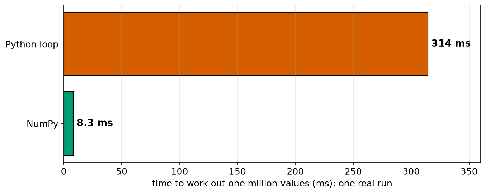
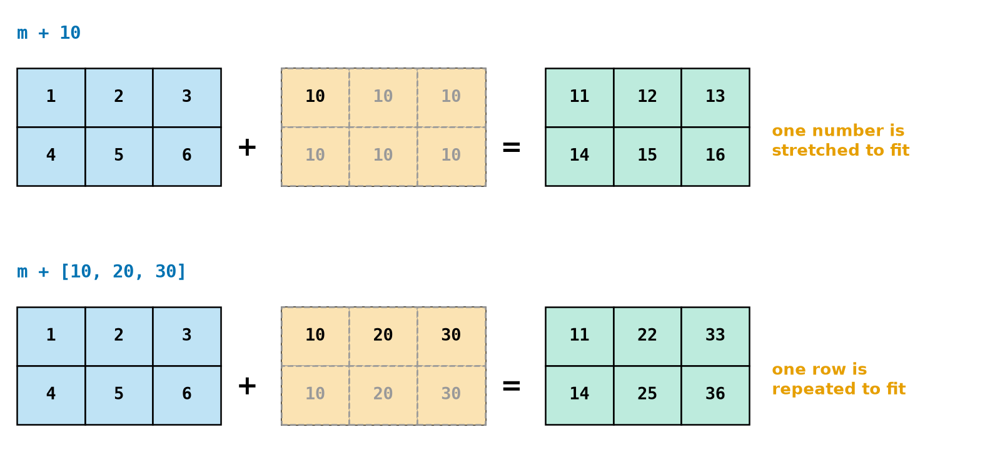
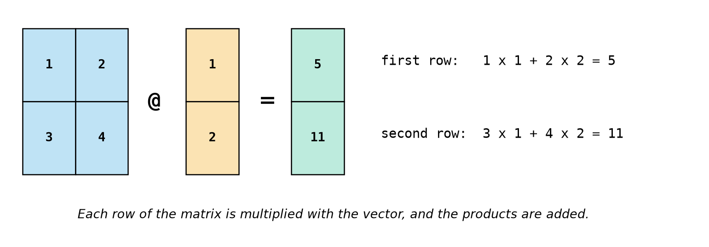
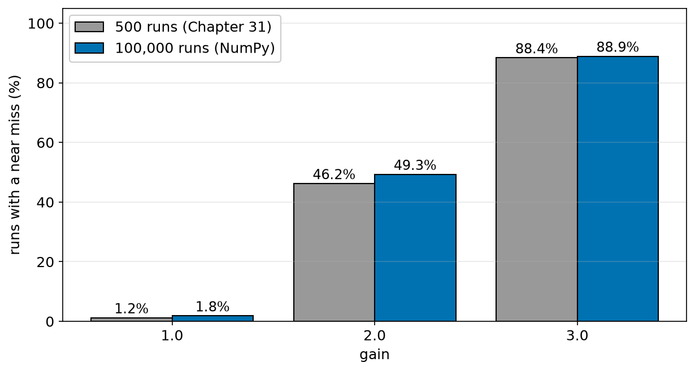
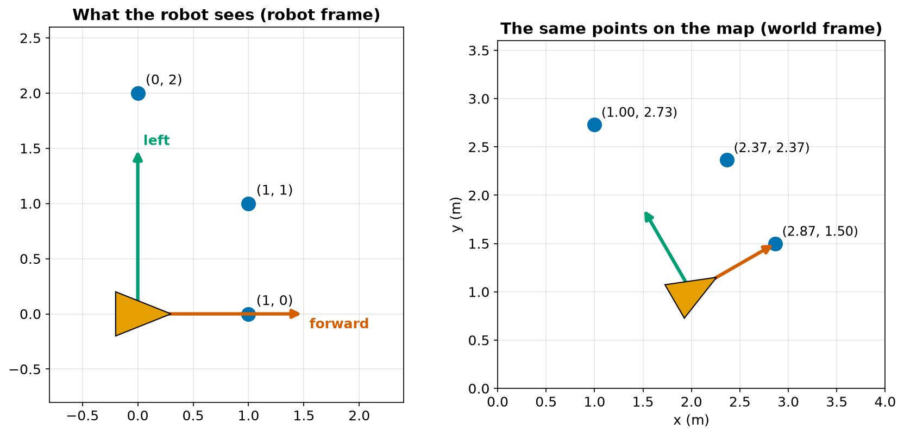

# Chapter 35 — NumPy Part 2: Array Maths and Speed

> **Part 2 · Chapter 35 of 749**
> **You need:** Chapter 34 (arrays). Keep a script open.
> **You will make:** a speed test of loops against arrays, a Monte Carlo test with 100,000 runs in under a second, a program that moves a laser scan onto a map, and the matrix that turns wheel speeds into robot motion, and back.

---

## What you will learn

- How much faster arrays really are, and why.
- **Broadcasting**: how arrays of different shapes work together.
- The difference between `*` and `@`.
- What a **matrix** does to a point.
- How to rotate points with a **rotation matrix**.
- How to solve equations with `np.linalg`.
- NumPy's random generator, and how to run thousands of simulations at once.

---

## New words in this chapter

| Word | Simple meaning |
|---|---|
| **broadcasting** | NumPy's rule for making arrays of different shapes fit together. |
| **vector** | A list of numbers treated as one quantity, such as (x, y). |
| **matrix** | A table of numbers that can act on a vector. |
| **matrix multiplication** | Rows of one times columns of another, written `@`. |
| **dot product** | Multiply matching items and add them up. |
| **norm** | The length of a vector. |
| **rotation matrix** | A matrix that turns points around the origin. |
| **frame** | A point of view from which positions are measured. |
| **inverse matrix** | The matrix that undoes another. |
| **singular** | A matrix that has no inverse. |

---

## 35.1 How much faster?

File `code/ch035/speed_test.py`:

```python
# speed_test.py - the same sum, done with a Python loop and with NumPy
import time

import numpy as np

N = 1_000_000

start = time.perf_counter()
total = 0.0
for i in range(N):
    total += i * i * 0.5
loop_s = time.perf_counter() - start

start = time.perf_counter()
values = np.arange(N, dtype=float)
numpy_total = np.sum(values * values * 0.5)
numpy_s = time.perf_counter() - start

print(f"loop:  {total:.6e} in {loop_s * 1000:7.1f} ms")
print(f"numpy: {numpy_total:.6e} in {numpy_s * 1000:7.1f} ms")
print(f"numpy was {loop_s / numpy_s:.0f} times faster")
```

One real run (your numbers will differ):

```
loop:  1.666664e+17 in   314.4 ms
numpy: 1.666664e+17 in     8.3 ms
numpy was 38 times faster
```



*Figure 35.1 — The same million calculations.*

**How to read this picture:** The length of each bar is the measured time. The Python loop took 314 ms, and the array operation 8.3 ms.

Why? A Python loop works out each step one at a time, and it has to check the type of each value every time. A NumPy array is one block of numbers of one type, and its loop is written in a fast compiled language.

At 50 Hz, Rover has 20 ms per loop (Chapter 30). A task that takes 314 ms is hopeless, while one that takes 8 ms can fit.

---

## 35.2 Broadcasting

📖 **New word: broadcasting** — NumPy's rule for making arrays of different shapes fit together. Look at Figure 35.2.



*Figure 35.2 — The smaller array is stretched to fit, without copying any data.*

**How to read this picture:** Each row is one sum. The grey numbers do not really exist: NumPy behaves as if they did. In the first row, a single number is applied to every item. In the second, one row is applied to every row.

```
>>> m = np.array([[1, 2, 3], [4, 5, 6]])
>>> m + 10
array([[11, 12, 13],
       [14, 15, 16]])
>>> m + np.array([10, 20, 30])
array([[11, 22, 33],
       [14, 25, 36]])
```

The rule: compare the shapes **from the right**. Two sizes fit if they are equal, or if one of them is 1.

| `m` shape | other shape | Fits? |
|---|---|---|
| (2, 3) | single number | yes |
| (2, 3) | (3,) | yes: 3 = 3 |
| (2, 3) | (2,) | **no**: 3 and 2 |
| (2, 3) | (2, 1) | yes: 3 and 1, and 2 = 2 |

```
>>> m + np.array([10, 20])
ValueError: operands could not be broadcast together with shapes (2,3) (2,)
```

Read the shapes in the message. It almost always tells you what to fix. Printing `.shape` is the first step of debugging NumPy.

---

## 35.3 Vectors and matrices

📖 **New words: vector and matrix** — a **vector** is a list of numbers treated as one quantity, such as a position (x, y). A **matrix** is a table of numbers that can act on a vector. Part 9 teaches them properly. Here we just need enough to use them.

`*` multiplies matching items. `@` is **matrix multiplication**:

```
>>> v = np.array([1.0, 2.0])
>>> w = np.array([3.0, 4.0])
>>> v * w
array([3., 8.])
>>> v @ w
np.float64(11.0)
```

For two vectors, `@` is the **dot product**: 1 × 3 + 2 × 4 = 11. 📖 **New word: dot product** — multiply matching items and add them up.

📖 **New word: norm** — the length of a vector. `np.linalg.norm(w)` is 5.0, the same as Pythagoras.

A matrix times a vector gives a new vector. Look at Figure 35.3.



*Figure 35.3 — Each row of the matrix combines with the vector.*

**How to read this picture:** Each row of the blue matrix pairs with the orange vector: multiply matching items and add. The results go, in order, into the green vector.

```
>>> A = np.array([[1.0, 2.0], [3.0, 4.0]])
>>> A @ v
array([ 5., 11.])
>>> A * A
array([[ 1.,  4.],
       [ 9., 16.]])
>>> A @ A
array([[ 7., 10.],
       [15., 22.]])
```

⚠️ `A * A` and `A @ A` are completely different, and neither gives an error. Use `@` for matrices.

Sizes must fit. A 2 × 2 matrix cannot act on a 3-long vector:

```
ValueError: matmul: Input operand 1 has a mismatch in its core dimension 0, with gufunc signature (n?,k),(k,m?)->(n?,m?) (size 3 is different from 2)
```

That is long, but the end of it says what you need to know: `size 3 is different from 2`.

### Solving equations

Robots constantly have this problem: "I know what the matrix does. What input gives this output?" In other words, solve A x = b for x.

```
>>> np.linalg.solve(A, v)
array([0. , 0.5])
```

📖 **New words: inverse matrix and singular** — the **inverse** is the matrix that undoes another, `np.linalg.inv(A)`. A matrix with no inverse is **singular**:

```
>>> S = np.array([[1.0, 2.0], [2.0, 4.0]])
>>> np.linalg.inv(S)
LinAlgError: Singular matrix
```

Here the second row is just double the first, so the two equations are really one. Robots can land in such singular situations: an arm stretched out straight, for example (Chapter 359).

---

## 35.4 Other useful tools

| Tool | What it does |
|---|---|
| `np.minimum(a, b)` | the smaller of each pair |
| `np.maximum(a, b)` | the larger of each pair |
| `np.convolve(x, np.ones(n) / n, mode="valid")` | a moving average in one line |
| `np.vstack`, `np.hstack`, `np.column_stack` | join arrays |
| `np.allclose(a, b)` | Chapter 17's "close enough" for whole arrays |
| `np.save("x.npy", a)`, `np.load("x.npy")` | save and load arrays quickly |

⚠️ `min(a, b)` on arrays gives the "truth value is ambiguous" error. Use `np.minimum`.

⚠️ NumPy does **not** raise an error for dividing by zero. It prints a `RuntimeWarning`, and gives `inf` or `nan`: `np.array([1, 2]) / 0` is `[inf inf]`. These values then spread silently through the rest of your calculation (Chapter 26).

### NumPy's random generator

```python
rng = np.random.default_rng(3)          # a seed, as in Chapter 31
rng.random(3)                           # three uniform numbers
rng.normal(0, 0.03, 1000)               # 1000 bell-curve numbers
rng.integers(1, 7, 5)                   # 5 dice: note that 7 is NOT included
```

---

## Code

In Chapter 31, 1,500 runs took a noticeable time. Now we treat a whole set of runs as one array.

The file is `code/ch035/vector_monte_carlo.py`. Type it into `my-code/ch035/`.

```python
# vector_monte_carlo.py - Chapter 31's test, for 100,000 runs at once
import time

import numpy as np

SETPOINT_M, MAX_SPEED_MS, DT_S, DANGER_M = 0.30, 0.25, 0.5, 0.25
RUNS, STEPS = 100_000, 20
NOISE_M = 0.03
rng = np.random.default_rng(3)        # NumPy's random number generator, with a seed


def near_misses(gain):
    """Return how many of the runs came closer than the danger limit."""
    distance = np.full(RUNS, 1.0)     # one distance for every run
    closest = distance.copy()
    for _ in range(STEPS):
        measured = distance + rng.normal(0, NOISE_M, RUNS)            # RUNS random numbers
        speed = np.clip(gain * (measured - SETPOINT_M), -MAX_SPEED_MS, MAX_SPEED_MS)
        distance -= speed * DT_S
        closest = np.minimum(closest, distance)                       # item by item
    return int(np.sum(closest < DANGER_M))


start = time.perf_counter()
for gain in (1.0, 2.0, 3.0):
    misses = near_misses(gain)
    print(f"gain {gain}: {misses:6d} near misses out of {RUNS}  ({misses / RUNS:.1%})")
print(f"total time: {time.perf_counter() - start:.3f} s")
```

| Line | Code | What it does (simple English) |
|---|---|---|
| 1 | comment | The name of the file and the idea. |
| 2–4 | imports | Clock and NumPy. |
| 6–8 | constants | The same test as Chapter 31. |
| 9 | `rng = …` | A seeded generator. |
| 14 | `distance = np.full(RUNS, 1.0)` | **The key idea:** one array, one number for each run. |
| 15 | `closest = distance.copy()` | A real copy (Chapter 34). |
| 16 | `for _ in range(STEPS):` | Only the time steps need a Python loop. |
| 17 | `measured = …` | A different noise value for every run. |
| 18 | `speed = np.clip(…)` | One clamp, for 100,000 robots. |
| 19 | `distance -= speed * DT_S` | Each robot moves. |
| 20 | `closest = np.minimum(…)` | "Smallest so far", for every run. |
| 21 | `return int(np.sum(…))` | Count with a mask. |
| 24–27 | run it | Three gains, and the time. |

**Output:**

```
gain 1.0:   1849 near misses out of 100000  (1.8%)
gain 2.0:  49306 near misses out of 100000  (49.3%)
gain 3.0:  88922 near misses out of 100000  (88.9%)
total time: 0.371 s
```

Look at Figure 35.4.



*Figure 35.4 — More runs give more reliable percentages.*

**How to read this picture:** Each pair of bars is one gain. The grey bars are Chapter 31's 500 runs and the blue bars are this program's 100,000 runs. The answers are similar, but not the same. The blue figures are far more trustworthy.

**What the output means:**

- 300,000 complete simulated approaches took under half a second.
- Chapter 31's estimate for gain 1.0, 1.2%, was only based on 6 near misses. With 1849 near misses, we can now trust the figure of 1.8%.

⚠️ The array replaces the *runs* and not the *time steps*. Time steps depend on one another, so that loop has to stay.

---

## Small examples

### Example 1 — Shifting a set of points

```python
pts = np.array([[1.0, 2.0], [3.0, 4.0]])
pts + np.array([10.0, 20.0])      # broadcasting moves them all
```

### Example 2 — Distance from each point to one place

```python
np.linalg.norm(pts - np.array([1.0, 2.0]), axis=1)     # [0.  2.82842712]
```

### Example 3 — A moving average in one line

```python
np.convolve([1.0, 2.0, 3.0, 4.0], np.ones(2) / 2, mode="valid")     # [1.5 2.5 3.5]
```

### Example 4 — Two signals side by side

```python
np.column_stack([np.array([1.0, 2.0]), np.array([3.0, 4.0])])
```

Gives rows `[1. 3.]` and `[2. 4.]`.

### Example 5 — Item by item

```python
np.maximum(1, np.array([0, 5]))     # [1 5]
```

---

## 🏭 Real robot applications

### Application 1 (worked in full) — 🤖 From the robot's view to the map

📖 **New word: frame** — a point of view from which positions are measured.

**1. The real problem.** A LiDAR reports what it sees relative to the **robot**: "something 1 m ahead of me". A map needs positions relative to the **room**. If the robot is at (2, 1), and has turned by 30°, where is that point on the map?

**2. Why this idea.** Two steps: **rotate** the point by the robot's heading, and then **shift** it by the robot's position. 📖 **New word: rotation matrix** — a matrix that turns points around the origin. All this works on a whole array of points at once.

**3. The numbers.** The robot is at (2, 1), facing 30° from the x-axis. It sees three points: (1, 0), (1, 1) and (0, 2), as (forward, left).

**4. The maths, step by step.**

```
R = [ cos 30°   −sin 30° ]  =  [ 0.866  −0.5   ]
    [ sin 30°    cos 30° ]     [ 0.5     0.866 ]

Point (1, 0):
Step 1. rotate: (0.866 × 1 − 0.5 × 0, 0.5 × 1 + 0.866 × 0) = (0.866, 0.5)
Step 2. shift:  (0.866 + 2, 0.5 + 1) = (2.866, 1.5)
```

Chapters 49–50 give the trigonometry behind R.

**5. The code.** File `code/ch035/scan_to_world.py`:

```python
# scan_to_world.py - move laser points from the robot's view to the map's view
import numpy as np

# where the robot is on the map (maths angle: 0 = along +x, counter-clockwise)
robot_x, robot_y, robot_deg = 2.0, 1.0, 30.0

# three points the robot sees, as (forward, left) in its OWN frame
points_robot = np.array([[1.0, 0.0],
                         [1.0, 1.0],
                         [0.0, 2.0]])

th = np.radians(robot_deg)
R = np.array([[np.cos(th), -np.sin(th)],      # the rotation matrix
              [np.sin(th),  np.cos(th)]])

# R @ each point, then shift by where the robot is
points_world = (R @ points_robot.T).T + np.array([robot_x, robot_y])

print("rotation matrix:")
print(R.round(3))
print("points on the map:")
print(points_world.round(3))
print("distances are unchanged:",
      np.allclose(np.linalg.norm(points_robot, axis=1),
                  np.linalg.norm(points_world - [robot_x, robot_y], axis=1)))
```

| Line | Code | What it does (simple English) |
|---|---|---|
| 5 | `robot_x, robot_y, robot_deg` | The robot's pose. |
| 8–10 | `points_robot` | One row per point. |
| 12–14 | `th`, `R` | The rotation matrix. |
| 17 | `(R @ points_robot.T).T + …` | Each point is a row, but `R @` wants columns, so we transpose (`.T`), multiply and transpose back. Then broadcasting shifts them all. |
| 22–24 | a check | Rotating must not change any point's distance from the robot. |

**Output:**

```
rotation matrix:
[[ 0.866 -0.5  ]
 [ 0.5    0.866]]
points on the map:
[[2.866 1.5  ]
 [2.366 2.366]
 [1.    2.732]]
distances are unchanged: True
```

Look at Figure 35.5.



*Figure 35.5 — The same three points seen from two points of view.*

**How to read this picture:** On the left, the robot is at the origin, and its forward direction is along the horizontal axis. On the right, the same arrangement is placed on the map: rotated by 30° and shifted to (2, 1). The shape of the three points and the robot has not changed. Only the numbers have.

**6. The result.** The first point agrees with the hand calculation. The same line would convert a scan of 720 points, and the check confirms that the rotation did not distort anything.

**7. Going further.** Part 16 builds all of this into **transforms**, and ROS 2's `tf2` tracks them for a whole robot (Chapter 570).

### Application 2 (worked in full) — 🤖 Wheel speeds and robot motion

**1. The real problem.** A controller thinks in terms of "go forward at 0.25 m/s, and turn at 0.5 rad/s". The motors need left and right wheel speeds. We need to convert both ways.

**2. Why this idea.** Chapter 4 gave forward speed = (left + right) ÷ 2. The turning rate is (right − left) ÷ track width. Both are linear, so a matrix captures them, and the matrix's **inverse** gives the reverse direction.

**3. The numbers.** Rover's wheels are 0.15 m apart.

**4. The maths, step by step.**

```
forward = 0.5 × left + 0.5 × right
turn    = −(1/0.15) × left + (1/0.15) × right

left 0.20, right 0.30:
forward = 0.5 × 0.20 + 0.5 × 0.30 = 0.25 m/s
turn    = (0.30 − 0.20) ÷ 0.15    = 0.667 rad/s
```

**5. The code.** File `code/ch035/wheel_mixer.py`:

```python
# wheel_mixer.py - from wheel speeds to robot motion, and back, with a matrix
import numpy as np

TRACK_M = 0.15                        # the distance between Rover's two wheels

# [forward speed, turn rate] = A @ [left wheel speed, right wheel speed]
A = np.array([[0.5,            0.5],
              [-1 / TRACK_M,   1 / TRACK_M]])

wheels = np.array([0.20, 0.30])
motion = A @ wheels
print(f"wheels {wheels} m/s -> forward {motion[0]:.3f} m/s, turn {motion[1]:.3f} rad/s")

wanted = np.array([0.25, 0.5])        # we want this motion: what must the wheels do?
needed = np.linalg.solve(A, wanted)
print(f"wanted {wanted} -> wheels {needed.round(4)} m/s")

print("A inverse:")
print(np.linalg.inv(A).round(4))
print("check:", (A @ needed).round(4))
```

| Line | Code | What it does (simple English) |
|---|---|---|
| 4 | `TRACK_M = 0.15` | The geometry of the robot. |
| 7–8 | `A` | Two lines of maths, as a table. |
| 10–11 | forward direction | Wheels to motion: **forward kinematics**. |
| 14–15 | backward direction | Motion to wheels: **inverse kinematics**. |
| 18 | `np.linalg.inv(A)` | The inverse, printed so you can see it. |
| 19 | `check` | Multiply back: it must return what we wanted. |

**Output:**

```
wheels [0.2 0.3] m/s -> forward 0.250 m/s, turn 0.667 rad/s
wanted [0.25 0.5 ] -> wheels [0.2125 0.2875] m/s
A inverse:
[[ 1.    -0.075]
 [ 1.     0.075]]
check: [0.25 0.5 ]
```

**6. The result.** Wheel speeds became motion, and motion became wheel speeds. The inverse's numbers reveal a formula: left = forward − 0.075 × turn, and 0.075 is half the track width. The matrix found it for us.

**7. Going further.** Chapters 285 and 286 derive these properly. A drone uses a larger version of the same idea, a mixing matrix, to share its thrust and turning commands between four motors (Chapter 641).

### Application 3 — 📷 Whole-image operations

Brightening, thresholding or subtracting two images are single-line array operations (Chapter 478). With a Python loop over a million pixels, a camera could never keep up.

### Application 4 — 🗺️ Nearest obstacle

`np.linalg.norm(points - robot_position, axis=1).min()` finds the closest of thousands of LiDAR points in one line. It uses broadcasting and an axis together, and it is fast enough to run on every scan.

### Application 5 — 🚶 Robot dynamics

A humanoid's balance controller multiplies matrices hundreds of times a second. Its programs use the same `@` and `solve` as you did here. Part 14 shows how a whole controller can be written as matrices.

---

## 🔧 Hands-on lab

### Lab 35.1 — Race the loop

**You need:** `speed_test.py`.

**Steps:** Run it with `N` set to 1,000, then 100,000, and then 10,000,000. Note the "times faster" figure.

**What you should see:** With a small N, NumPy's advantage is smaller, because creating an array takes some time. For large N, the ratio is large. The last run takes a few seconds for the loop, and well under a second for the array.

**If it does not work:**

| Problem | Likely cause | Fix |
|---|---|---|
| `MemoryError` | N is too large for your computer | Use a smaller N. |
| `numpy was 0 times faster` | N is tiny | The times are too short to compare. |

### Lab 35.2 — Broadcast detective

**You need:** the Python shell.

**Steps:** With `m = np.ones((2, 3))`, predict which will work, then try them:

```
m + 1
m + np.array([1, 2, 3])
m + np.array([1, 2])
m + np.array([[1], [2]])
m @ np.array([1, 2, 3])
m @ np.array([1, 2])
```

**What you should see:** Works, works, error, works, works (gives `[6. 6.]`), error. Reading the shapes in each error tells you why.

**If it does not work:**

| Problem | Likely cause | Fix |
|---|---|---|
| You expected `m + [1, 2]` to work | Shapes are compared from the right | 3 and 2 do not match. |

### Lab 35.3 — Rotate a square

**You need:** a Python file and matplotlib.

**Steps:** Make the array of the four corners of a square, plus the first corner again to close it. Rotate it by 30° around the origin. Plot the original and the rotated shape on one graph, using `set_aspect("equal")`.

**What you should see:** Two squares of the same size. One solution:

```python
import numpy as np
import matplotlib.pyplot as plt

square = np.array([[1, 1], [-1, 1], [-1, -1], [1, -1], [1, 1]], dtype=float)
th = np.radians(30)
R = np.array([[np.cos(th), -np.sin(th)], [np.sin(th), np.cos(th)]])
turned = (R @ square.T).T

fig, ax = plt.subplots()
ax.plot(square[:, 0], square[:, 1], label="original")
ax.plot(turned[:, 0], turned[:, 1], label="rotated 30 degrees")
ax.set_aspect("equal")
ax.legend()
fig.savefig("rotated.png")
```

**If it does not work:**

| Problem | Likely cause | Fix |
|---|---|---|
| `ValueError: matmul…` | `.T` is missing | Points are in rows, and `R @` needs them in columns. |
| The square looks squashed | `set_aspect` is missing | Add it. |

---

## Common mistakes

⚠️ **`*` when you mean `@`.** No error, and a wrong answer.

⚠️ **Not printing `.shape`.** It is the first step of NumPy debugging.

⚠️ **Forgetting `.T` when points are in rows.**

⚠️ **`min` and `max` on two arrays.** Use `np.minimum` and `np.maximum`.

⚠️ **Dividing by zero silently.** You get `inf` or `nan`, with only a warning.

⚠️ **Inverting when you could solve.** `np.linalg.solve` is faster and more accurate.

⚠️ **Writing a loop over an array.** Look for the array way first.

⚠️ **Assuming all loops can go.** A simulation's time steps depend on each other.

---

## Practice

🏋️ **1.** Why is NumPy faster than a Python loop?

🏋️ **2.** Which of these shapes can be added to one of shape (4, 3)? (a) (3,); (b) (4,); (c) (4, 1); (d) (1, 3).

🏋️ **3.** What is `np.array([1, 2]) @ np.array([3, 4])`?

🏋️ **4.** With `A = np.array([[2, 0], [0, 3]])` and `v = np.array([1, 1])`, what are `A @ v` and `A * v`?

🏋️ **5.** Write the rotation matrix for 90°. What does it do to the point (1, 0)?

🏋️ **6.** A robot is at (1, 2), with no rotation, and sees a point at (3, 4) in its frame. Where is that on the map?

🏋️ **7.** Solve x + y = 3, x − y = 1 using `np.linalg.solve`.

🏋️ **8.** Why does `np.linalg.inv` fail on `[[1, 2], [2, 4]]`?

🏋️ **9.** Write one line for the distance of each point in `pts` (N rows, 2 columns) from the origin.

🏋️ **10.** Using `wheel_mixer`, what wheel speeds make Rover spin on the spot at 1 rad/s?

🏋️ **11.** (Harder) Use NumPy to run 100,000 simulated dockings from Chapter 31's Practice 11 (error in x and y, each with σ = 12 mm; success below 20 mm), without a Python loop. Check that you get about 75%.

---

## Answers

**1.** A NumPy array stores numbers of one type in one block, and the looping is done in compiled code, with no type-checking at each step.

**2.** (a) yes; (b) no; (c) yes; (d) yes.

**3.** 1 × 3 + 2 × 4 = **11**.

**4.** `A @ v` is `[2 3]`. `A * v` is `[[2 0] [0 3]]`, because `v` is broadcast and multiplied item by item.

**5.** `[[0, -1], [1, 0]]`. It turns (1, 0) into (0, 1), a quarter-turn counter-clockwise.

**6.** (1 + 3, 2 + 4) = **(4, 6)**.

**7.**

```python
A = np.array([[1.0, 1.0], [1.0, -1.0]])
b = np.array([3.0, 1.0])
print(np.linalg.solve(A, b))       # [2. 1.]
```

**8.** The second row is just double the first, so the matrix is singular.

**9.** `np.linalg.norm(pts, axis=1)`

**10.** Solving with `wanted = [0.0, 1.0]` gives `[-0.075, 0.075]` m/s.

**11.**

```python
import numpy as np

rng = np.random.default_rng(11)
N = 100_000
ex = rng.normal(0, 0.012, N)
ey = rng.normal(0, 0.012, N)
print(np.mean(np.hypot(ex, ey) < 0.02))
```

It prints about 0.75. `np.mean` of a mask is the fraction that are True.

---

## Summary

🧠 Array operations can be tens of times faster than a Python loop.

🧠 **Broadcasting** stretches smaller arrays: shapes are compared from the right, and sizes must be equal or 1.

🧠 `*` is item by item. `@` is **matrix multiplication**.

🧠 A **rotation matrix** turns points, and a shift moves them. Together they change the **frame**.

🧠 `np.linalg.solve(A, b)` finds x in A x = b. A **singular** matrix has no inverse.

🧠 One array can hold thousands of simulations, with a loop only over the time steps.

🧠 Print `.shape`.

---

## Next chapter

You now have every tool that Part 2 set out to teach. It is time to use them all at once. In **Chapter 36 — Project: GridBot, a text robot simulator on a grid**, you will build a complete small robot simulator: a world loaded from text, a robot with sensors, a controller that explores, tests that prove it works, a log file and a picture of the result.
