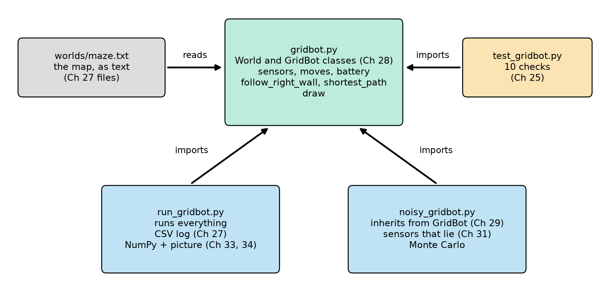
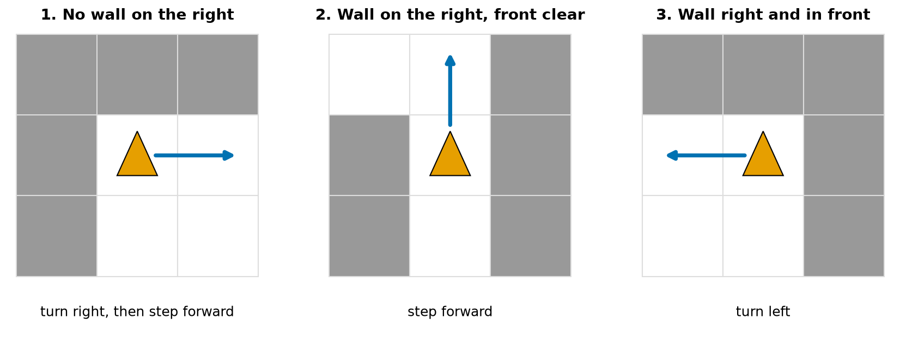
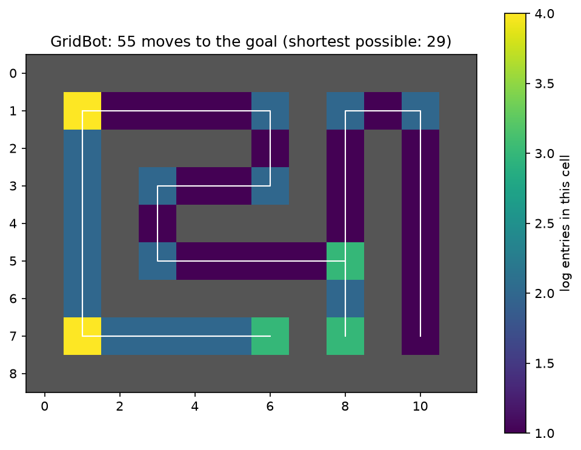
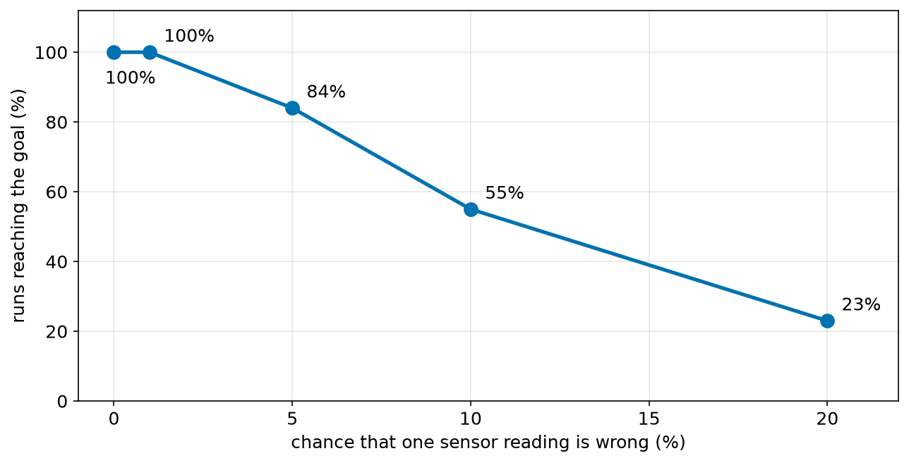

# Chapter 36 — Project: GridBot, a Text Robot Simulator on a Grid

> **Part 2 · Chapter 36 of 749 · The final chapter of Part 2**
> **You need:** everything from Chapters 11–35.
> **You will make:** a complete small robot simulator, built from a map file, a robot with sensors and a battery, an exploring controller, a path planner, automatic tests, a log file, a picture of the result, and a test of what happens when its sensors lie.

---

## What you will learn

- How to plan a program made of several files.
- How the tools of Part 2 fit together.
- How to build and test a program step by step.
- The wall-following algorithm.
- Your first path planner: breadth-first search.
- How to judge a robot's behaviour with numbers.

---

## New words in this chapter

| Word | Simple meaning |
|---|---|
| **simulator** | A program that behaves like a robot and its world. |
| **wall following** | Exploring by keeping one side next to a wall. |
| **breadth-first search** | Exploring outwards in rings, to find the shortest path. |
| **queue** | A first-in, first-out line (Chapter 21). |
| **class method** | A method that belongs to the class, used to make objects. |
| **refactoring** | Improving a program's structure without changing its behaviour (Chapter 23). |

---

## 36.1 The plan

📖 **New word: simulator** — a program that behaves like a robot and its world. Chapter 9 gave the reasons for using one.

GridBot lives in a maze made of text. It knows only what its sensors tell it. Its job is to find the goal. Before typing anything, look at how the project divides up, in Figure 36.1.



*Figure 36.1 — Five files, each with one job.*

**How to read this picture:** The green box in the centre is the module with the simulator in it. The others use it, and the arrows show which file needs which. Each box notes the chapter whose ideas it uses. The map is a separate data file, so changing the maze needs no change to the code.

| File | Its job |
|---|---|
| `worlds/maze.txt` | the maze: data, not code |
| `gridbot.py` | the world, the robot, the controllers |
| `test_gridbot.py` | proves it works |
| `run_gridbot.py` | runs it, and saves a log and a picture |
| `noisy_gridbot.py` | tests it with sensors that sometimes lie |

The map uses `#` for a wall, `.` for floor, `S` for the start and `G` for the goal:

```
############
#S.....#...#
#.####.#.#.#
#.#....#.#.#
#.#.####.#.#
#.#......#.#
#.######.#.#
#......#.#G#
############
```

Save that as `my-code/ch036/worlds/maze.txt`.

---

## 36.2 Stage 1: the world

Build a project in small stages, and test each one before you start the next. The first part of `gridbot.py` (the whole file is `code/ch036/gridbot.py`):

```python
# gridbot.py - a small robot simulator: a world, a robot, and a way to explore
from collections import deque
from pathlib import Path

NORTH, EAST, SOUTH, WEST = 0, 1, 2, 3
STEP = {NORTH: (0, -1), EAST: (1, 0), SOUTH: (0, 1), WEST: (-1, 0)}     # (dx, dy); y grows downward
ARROW = {NORTH: "^", EAST: ">", SOUTH: "v", WEST: "<"}


class World:
    """A grid of walls and floor, loaded from lines of text."""

    def __init__(self, lines):
        self.rows = [line.rstrip("\n") for line in lines if line.strip()]
        self.height = len(self.rows)
        self.width = max(len(row) for row in self.rows)
        self.start = self._find("S")
        self.goal = self._find("G")

    @classmethod
    def from_file(cls, path):
        """Make a World from a text file."""
        with open(path) as f:
            return cls(f.readlines())

    def _find(self, letter):
        for y, row in enumerate(self.rows):
            x = row.find(letter)
            if x != -1:
                return x, y
        raise ValueError(f"the map has no {letter}")

    def is_free(self, x, y):
        """Return True if the cell is inside the map and is not a wall."""
        if not (0 <= y < self.height and 0 <= x < len(self.rows[y])):
            return False
        return self.rows[y][x] != "#"
```

| Part | What it does | Chapter |
|---|---|---|
| `NORTH, EAST, … = 0, 1, 2, 3` | Names instead of mystery numbers. | 14 |
| `STEP = {…}` | A lookup table from heading to movement. In a text map, y grows **downward**, so north is −1. | 22 |
| `self.rows = […]` | A comprehension that cleans the lines and skips blank ones. | 15, 21 |
| `@classmethod` / `from_file` | A method that receives the class (`cls`) rather than an object, and makes a new `World`. It is the usual way of offering a second way to build an object. | 28 |
| `_find` | A search. The leading underscore means "for internal use". | 20, 29 |
| `raise ValueError` | A map with no goal is a mistake: say so at once. | 25 |
| `is_free` | A guard first, so that it can never run off the edge of the map. | 18 |

⚠️ Notice the order of the coordinates: `self.rows[y][x]`. A text map is rows of columns, so y comes first. Mixing them up is one of the most common bugs in grid programs.

---

## 36.3 Stage 2: the robot

```python
class GridBot:
    """A robot that lives on the grid. It can only do what its sensors allow."""

    BATTERY_START = 300

    def __init__(self, world, heading=EAST):
        self.world = world
        self.x, self.y = world.start
        self.heading = heading
        self.battery = self.BATTERY_START
        self.moves = 0
        self.bumps = 0
        self.visited = {(self.x, self.y)}
        self.log = [(0, self.x, self.y, self.heading)]

    def _record(self):
        self.battery -= 1
        self.log.append((len(self.log), self.x, self.y, self.heading))

    def left(self):
        self.heading = (self.heading - 1) % 4
        self._record()

    def right(self):
        self.heading = (self.heading + 1) % 4
        self._record()

    def _cell_towards(self, heading):
        dx, dy = STEP[heading]
        return self.x + dx, self.y + dy

    def forward(self):
        """Move one cell. Hitting a wall costs a bump and the robot stays put."""
        x, y = self._cell_towards(self.heading)
        if self.world.is_free(x, y):
            self.x, self.y = x, y
            self.moves += 1
            self.visited.add((x, y))
        else:
            self.bumps += 1
        self._record()

    def wall_at(self, side):
        """Sensor: is there a wall to the 'front', 'left' or 'right'?"""
        offset = {"front": 0, "right": 1, "left": -1}[side]
        return not self.world.is_free(*self._cell_towards((self.heading + offset) % 4))

    def at_goal(self):
        return (self.x, self.y) == self.world.goal

    def __str__(self):
        return (f"at ({self.x}, {self.y}) facing {ARROW[self.heading]}, moves {self.moves}, "
                f"bumps {self.bumps}, battery {self.battery}, cells {len(self.visited)}")
```

| Part | What it does | Chapter |
|---|---|---|
| `self.world = world` | Composition: a robot **has** a world to live in. | 29 |
| `self.visited = {…}` | A set of tuples: every cell seen, without duplicates. | 22 |
| `_record` | One place that both uses battery and writes the log, so that no action can forget to. | 23 |
| `% 4` | Wrap the heading. | 13 |
| `forward` | The robot cannot walk through a wall. A bump is counted. | 18 |
| `wall_at` | The only way the robot knows about the world. | 17 |
| `*self._cell_towards(…)` | The `*` spreads a tuple out into separate arguments: `is_free(x, y)`. | 24 |
| `__str__` | A readable status line. | 28 |

A design rule is hidden here: the controller is given **only** `wall_at`, `forward`, `left` and `right`. It cannot look at the map. A real robot does not get a map for free either.

---

## 36.4 Stage 3: exploring by following a wall

📖 **New word: wall following** — exploring by keeping one side next to a wall. In a maze whose walls are all connected, keeping your right hand on the wall will take you round to the exit. Look at Figure 36.2.



*Figure 36.2 — The three cases of the right-hand rule.*

**How to read this picture:** In each panel the orange triangle is the robot, pointing up the page, and grey squares are walls. The blue arrow shows its next action. The cases are tested in order, from left to right.

```python
def follow_right_wall(bot, max_steps=1000):
    """Keep a hand on the right-hand wall until the goal. Return True on success."""
    steps = 0
    while not bot.at_goal() and steps < max_steps and bot.battery > 0:
        if not bot.wall_at("right"):
            bot.right()
            bot.forward()
        elif not bot.wall_at("front"):
            bot.forward()
        else:
            bot.left()
        steps += 1
    return bot.at_goal()
```

Three lines of decisions, one loop with a maximum-steps guard (Chapter 19), and a battery check. This is the sense → think → act loop from Chapter 2.

---

## 36.5 Stage 4: planning the best route

Following a wall finds **a** way, but not the best. With the map available, we can plan.

📖 **New word: breadth-first search** — exploring outwards in rings, to find the shortest path. Starting from S, it visits all the cells 1 step away, then all the cells 2 steps away, and so on. The first time it reaches G must be by a shortest route.

📖 **New word: queue** — a first-in, first-out line (Chapter 21). `collections.deque` is a list designed for this, as it removes from the front quickly.

```python
def shortest_path(world):
    """Breadth-first search: return the list of cells from start to goal, or None."""
    came_from = {world.start: None}
    queue = deque([world.start])
    while queue:
        cell = queue.popleft()
        if cell == world.goal:
            path = []
            while cell is not None:
                path.append(cell)
                cell = came_from[cell]
            return path[::-1]
        for dx, dy in STEP.values():
            neighbour = (cell[0] + dx, cell[1] + dy)
            if world.is_free(*neighbour) and neighbour not in came_from:
                came_from[neighbour] = cell
                queue.append(neighbour)
    return None
```

| Line | What it does |
|---|---|
| `came_from = {start: None}` | A dictionary that records how we reached each cell, and also which cells we have seen. |
| `queue = deque([...])` | The cells waiting to be looked at. |
| `while queue:` | An empty queue counts as False (Chapter 21): nothing is left to try. |
| `cell = queue.popleft()` | Take the oldest cell. That is what makes the search spread evenly. |
| `if cell == world.goal:` | Found it. Now walk backwards through `came_from` to rebuild the route. |
| `return path[::-1]` | The backwards walk gave the path in reverse. |
| `for dx, dy in STEP.values():` | Try all four neighbours. |
| `and neighbour not in came_from` | Never visit a cell twice. |
| `return None` | The queue ran out, so there is no route. |

Part 23 builds a whole family of planners from this idea, including A* (Chapter 454).

---

## 36.6 Stage 5: testing it

📖 Tests are not an optional extra. File `code/ch036/test_gridbot.py` has ten checks, in the style of Chapter 25, on a tiny map:

```python
TINY = ["#####",
        "#S.G#",
        "#####"]


def test_forward_and_bump():
    bot = GridBot(World(TINY), heading=EAST)
    bot.forward()
    assert (bot.x, bot.y, bot.moves, bot.bumps) == (2, 1, 1, 0)
    bot.heading = SOUTH
    bot.forward()
    assert (bot.x, bot.y, bot.moves, bot.bumps) == (2, 1, 1, 1)    # did not move


def test_no_route():
    blocked = ["#####", "#S#G#", "#####"]
    assert shortest_path(World(blocked)) is None
```

Using a tiny map means that you know the right answers. The last lines of the file find every function whose name starts with `test_` and run them:

```python
if __name__ == "__main__":
    tests = [value for name, value in sorted(globals().items()) if name.startswith("test_")]
    for test in tests:
        test()
        print("ok  ", test.__name__)
    print(len(tests), "tests passed")
```

`globals()` is a dictionary of every global name in the file, and functions are values (Chapter 23). This is a very small version of what the `pytest` tool does.

**Output:**

```
ok   test_battery_runs_down
ok   test_forward_and_bump
ok   test_missing_goal
ok   test_no_route
ok   test_reaches_goal
ok   test_sensors
ok   test_shortest_path
ok   test_turning_wraps
ok   test_walls_and_edges
ok   test_world_loads
10 tests passed
```

---

## Code

Finally, we run it. The last function in `gridbot.py` is `draw`, which returns the map as text. It marks visited cells with `o`, a planned path with `*`, and the robot with an arrow. Then the file `code/ch036/run_gridbot.py` brings everything together:

```python
# run_gridbot.py - explore the maze, save a log, and draw a picture of the result
import csv

import matplotlib.pyplot as plt
import numpy as np

from gridbot import GridBot, draw, follow_right_wall, load_default_world, shortest_path

world = load_default_world()
print(draw(world))
print()

bot = GridBot(world)
reached = follow_right_wall(bot)
print(draw(bot=bot, world=world))
print("reached the goal:", reached)
print(bot)

best = shortest_path(world)
print("shortest path:", len(best) - 1, "moves")
print(draw(world, path=best))

with open("gridbot_log.csv", "w", newline="") as f:      # Chapter 27
    writer = csv.writer(f)
    writer.writerow(["step", "x", "y", "heading"])
    writer.writerows(bot.log)

visits = np.zeros((world.height, world.width))           # Chapter 34
for _, x, y, _ in bot.log:
    visits[y, x] += 1

fig, ax = plt.subplots(figsize=(8, 6))                   # Chapter 33
image = ax.imshow(np.ma.masked_equal(visits, 0), cmap="viridis")
walls = np.array([[1 if not world.is_free(x, y) else np.nan for x in range(world.width)] for y in range(world.height)])
ax.imshow(walls, cmap="gray_r", vmin=0, vmax=1.5)
xs = [row[1] for row in bot.log]
ys = [row[2] for row in bot.log]
ax.plot(xs, ys, color="white", linewidth=1)
fig.colorbar(image, label="log entries in this cell")
ax.set_title(f"GridBot: {bot.moves} moves to the goal (shortest possible: {len(best) - 1})")
fig.savefig("gridbot_result.png", dpi=150, bbox_inches="tight")
print("saved gridbot_log.csv and gridbot_result.png")
```

| Lines | What they do | Chapter |
|---|---|---|
| 2–7 | Imports: standard library, installed packages, and our own module. | 26 |
| 9–11 | Load the map and print it. | 27 |
| 13–17 | Explore, and report. | 28 |
| 19–21 | Plan the shortest path. | 22 |
| 23–26 | Save every step. `writerows` writes a whole list of rows. | 27 |
| 28–30 | Count the visits to each cell in a 2-D array. `visits[y, x]`: rows first. | 34 |
| 32–40 | The picture. `imshow` draws an array as an image, and `masked_equal` hides cells never visited. | 33 |

**Output:**

```
############
#S.....#...#
#.####.#.#.#
#.#....#.#.#
#.#.####.#.#
#.#......#.#
#.######.#.#
#......#.#G#
############

############
#Sooooo#ooo#
#o####o#o#o#
#o#oooo#o#o#
#o#o####o#o#
#o#oooooo#o#
#o######o#o#
#oooooo#o#v#
############
reached the goal: True
at (10, 7) facing v, moves 55, bumps 0, battery 230, cells 43
shortest path: 29 moves
############
#S*****#***#
#.####*#*#*#
#.#****#*#*#
#.#*####*#*#
#.#******#*#
#.######.#*#
#......#.#G#
############
saved gridbot_log.csv and gridbot_result.png
```

And the picture:



*Figure 36.3 — The route that the robot took, and how often it passed through each cell.*

**How to read this picture:** Grey cells are walls. The white line is the robot's path. The colours show how many log entries each cell has: darker means fewer. The brightest cells, at the start and the bottom-left corner, are where the robot both moved and turned. The dead end along the bottom row is visible because it was driven twice.

**What the output means:**

- The explorer reached the goal in **55 moves**, without one bump, knowing nothing about the map.
- With the full map, the planner needs only **29 moves**. The explorer's first turn was the wrong way, down the left-hand corridor and along a dead end, and that is the price of not having a map.
- The `*` path shows the route the explorer could have taken had it known.

---

## 36.7 Stage 6: when the sensors lie

Everything so far has assumed perfect sensors. Chapter 31 taught you not to trust that. File `code/ch036/noisy_gridbot.py`:

```python
# noisy_gridbot.py - what happens to the explorer when its sensors sometimes lie?
import random

from gridbot import GridBot, follow_right_wall, load_default_world

random.seed(7)


class NoisyBot(GridBot):
    """A GridBot whose wall sensor gives the wrong answer some of the time."""

    def __init__(self, world, error_chance):
        super().__init__(world)
        self.error_chance = error_chance

    def wall_at(self, side):
        truth = super().wall_at(side)
        if random.random() < self.error_chance:
            return not truth                  # the sensor lies
        return truth


world = load_default_world()
RUNS = 300

print("sensor error   reached goal   average bumps   average moves")
for error_chance in (0.0, 0.01, 0.05, 0.1, 0.2):
    wins = bumps = moves = 0
    for _ in range(RUNS):
        bot = NoisyBot(world, error_chance)
        wins += follow_right_wall(bot)        # True counts as 1 (Chapter 17)
        bumps += bot.bumps
        moves += bot.moves
    print(f"{error_chance:10.0%} {wins / RUNS:14.0%} {bumps / RUNS:15.1f} {moves / RUNS:15.1f}")
```

Notice what we did **not** have to change: `follow_right_wall` and `GridBot` remain untouched. Inheritance replaced the one method that matters (Chapter 29), and polymorphism did the rest.

**Output:**

```
sensor error   reached goal   average bumps   average moves
        0%           100%             0.0            55.0
        1%           100%             0.8            66.6
        5%            84%             6.7           110.0
       10%            55%            16.5           127.5
       20%            23%            36.1           120.8
```

Look at Figure 36.4.



*Figure 36.4 — How quickly performance falls as a sensor gets worse.*

**How to read this picture:** Along the bottom is how often a single reading is wrong, and up the side is how often the robot reaches the goal within its battery. At 1% nothing much is lost. At 10% only about half the runs succeed.

This is what most robotics really is. A clever algorithm that assumes perfect sensors falls apart in the real world, and the rest of this book is largely about what to do about that: filters (Chapter 134), estimators (Chapter 416) and better control.

---

## 🏭 Real robot applications

### Application 1 — 🧹 Robot vacuums

Cleaning robots really do combine these ideas: they follow walls to find the edges of a room, build a grid map, and plan back-and-forth routes across it. The `visited` set is a tiny version of their cleaning map.

### Application 2 — 🏭 Warehouses

Warehouses are laid out as grids, and fleets of robots follow planned paths on them. The search in Section 36.5 is the ancestor of the planners that are used for this, which must also stop robots from colliding with each other (Part 23).

### Application 3 — 🚁 Search and rescue

A drone exploring a collapsed building has no map, like GridBot. It must explore and build one as it goes. Chapter 657 does this in three dimensions.

### Application 4 — 🌾 Field coverage

A planner for a farm treats the field as a grid, and marks cells as done, just as in `visited`, so that a robot that stops to recharge can come back and finish the job.

### Application 5 — 🧪 Virtual testing

The structure you built, a world, a robot and a controller with tests, is how professional simulators are organised. Part 28 uses Gazebo, Webots, MuJoCo and Isaac Sim, and the ideas are the same.

---

## 🔧 Hands-on lab

### Lab 36.1 — Run it, then change the maze

**You need:** all the files from `code/ch036/`.

**Steps:**

1. Run `python test_gridbot.py`, and then `python run_gridbot.py`.
2. Edit `worlds/maze.txt`: remove one wall, to open a shortcut. Run it again.
3. Now completely block the route to the goal. What does each controller do?

**What you should see:** Step 1 gives the output above. In step 2 the shortest path gets shorter, and the explorer may or may not benefit, because it follows walls. In step 3, `follow_right_wall` runs until its step limit and returns False, and `shortest_path` returns `None`, so `len(best)` crashes with a `TypeError`. A good fix is a guard: `if best is None: print("no route")`.

**If it does not work:**

| Problem | Likely cause | Fix |
|---|---|---|
| `FileNotFoundError` | `worlds/maze.txt` is not where the program looks | The `worlds` folder must sit next to `gridbot.py`. |
| `ValueError: the map has no G` | You removed the goal | Each map needs one `S` and one `G`. |
| `ModuleNotFoundError: No module named 'gridbot'` | You are in the wrong folder | `cd` to the folder with the files. |

### Lab 36.2 — Add a left-hand explorer

**You need:** `gridbot.py` and `run_gridbot.py`.

**Steps:** Copy `follow_right_wall` to make `follow_left_wall`, swapping "right" and "left" throughout. Run it on the same maze. Which is better here? Add a test for it, using the tiny map.

**What you should see:** A different number of moves. On some mazes the left hand wins, and on others the right hand does. On this maze, the left-hand explorer goes east first and reaches the goal in 29 moves, which is the shortest possible. That is luck, and not skill: on another maze the right hand could win.

**If it does not work:**

| Problem | Likely cause | Fix |
|---|---|---|
| The robot spins in place | Only some of the swaps were made | Swap every `left` and `right`, including `bot.left()` and `bot.right()`. |

### Lab 36.3 — Make the robot cope

**You need:** `noisy_gridbot.py`.

**Steps:** Improve `NoisyBot.wall_at`: read the sensor **three times** and take the majority (Chapter 17's voting). Run the experiment again.

**What you should see:** The success rates rise considerably. In a test run, success at 10% sensor errors rose from 55% to 96%, and at 20% from 23% to 57%. At 10% errors, a majority of three is wrong only about 2.8% of the time. That is Chapter 31's lesson about repeating measurements, and Chapter 17's voting, at work.

```python
def wall_at(self, side):
    votes = 0
    truth = GridBot.wall_at(self, side)
    for _ in range(3):
        reading = truth if random.random() >= self.error_chance else not truth
        votes += reading
    return votes >= 2
```

**If it does not work:**

| Problem | Likely cause | Fix |
|---|---|---|
| `RecursionError` | The method calls `self.wall_at` | Call the parent's: `GridBot.wall_at(self, side)`. |

---

## Common mistakes

⚠️ **Writing everything before testing anything.** Build it in stages.

⚠️ **Mixing up x and y.** `rows[y][x]`.

⚠️ **Letting the controller read the map.** Then you are testing nothing.

⚠️ **A hard-coded path to the map file.** Use `Path(__file__).parent`.

⚠️ **Testing only on one map.** Try small, blocked and open ones.

⚠️ **Not checking `None`.** `shortest_path` can fail.

---

## Practice

🏋️ **1.** In `World.is_free`, why is the range check done first?

🏋️ **2.** Why does `follow_right_wall` have a `max_steps` limit?

🏋️ **3.** What does `self.rows[y][x]` mean, and why does y come first?

🏋️ **4.** Why does the code count `moves` and `bumps` separately?

🏋️ **5.** What is the job of `came_from` in `shortest_path`?

🏋️ **6.** Why does breadth-first search find a shortest path?

🏋️ **7.** Add a method `distance_to_goal(self)` to `GridBot`, returning the straight-line distance. Why must a controller not be allowed to use it, if we want to simulate a robot with no knowledge of the goal?

🏋️ **8.** Write a test showing that the robot cannot move through a wall when it faces north on the tiny map.

🏋️ **9.** Why was it easy to add `NoisyBot` without changing the controller?

🏋️ **10.** Three readings each have a 10% chance of being wrong. What is the chance that the majority is wrong?

🏋️ **11.** (Harder) Add a "coverage" statistic to `run_gridbot.py`: what percentage of the free floor cells did the explorer visit? Calculate the number of free cells from the map.

---

## Answers

**1.** Otherwise `self.rows[y]` could raise an `IndexError` for a position off the map.

**2.** A robot can get stuck going round in circles. The limit stops an infinite loop (Chapter 19).

**3.** Row number `y` of the map, and then character number `x` of that row. The map is a list of rows, so the row is chosen first.

**4.** They mean different things: `moves` is progress, and `bumps` is trouble. A single number would hide which was happening.

**5.** It records how each cell was reached, which lets us rebuild the route, and it marks which cells have already been seen.

**6.** It looks at all cells at distance 1, then all at distance 2, and so on. So the first time it reaches the goal, no shorter route can exist.

**7.**

```python
def distance_to_goal(self):
    gx, gy = self.world.goal
    return ((self.x - gx) ** 2 + (self.y - gy) ** 2) ** 0.5
```

A controller using it would be getting information that a real, map-less robot could not have.

**8.**

```python
def test_wall_north():
    bot = GridBot(World(TINY), heading=NORTH)
    bot.forward()
    assert (bot.x, bot.y, bot.bumps) == (1, 1, 1)
```

**9.** The controller only calls `wall_at`, and inheritance replaced that one method. Polymorphism means that the controller does not need to know which robot it has.

**10.** The majority is wrong if 2 or 3 are wrong: 3 × 0.1² × 0.9 + 0.1³ = 0.027 + 0.001 = **2.8%**.

**11.**

```python
free = sum(world.is_free(x, y) for y in range(world.height) for x in range(world.width))
print(f"coverage: {len(bot.visited) / free:.0%}")
```

On this maze it prints **100%**: all 43 free cells. The right-hand wall happens to pass every floor cell here. The left-hand explorer of Lab 36.2 visits only 30.

---

## Part 2 Review

You started this part not knowing what a variable was. Look at what you can do now.

### Checklist

Tick each item. If you are unsure of one, go back to its chapter and run the example again.

| I can… | Chapter |
|---|---|
| explain what a program is, and trace one by hand | 11 |
| use the shell and scripts | 12 |
| use `int` and `float`, `//`, `%` and order of operations | 13 |
| use variables, updates and good names, with units | 14 |
| slice and clean strings, and format them with f-strings | 15 |
| use `print` and `input`, and say why `input` has no place in a control loop | 16 |
| write conditions, and compare floats safely | 17 |
| write `if` / `elif` / `else` with correct indentation | 18 |
| write `while` loops with a maximum-steps guard | 19 |
| write `for` loops and use `range` without an off-by-one error | 20 |
| use lists, and tell an alias from a copy | 21 |
| choose between lists, tuples, dictionaries and sets | 22 |
| write functions that return values | 23 |
| use default arguments, and explain scope | 24 |
| read a traceback, use `try`, and write `assert` tests | 25 |
| import modules, including my own, and use radians correctly | 26 |
| read and write text, CSV and JSON files safely | 27 |
| write classes with methods | 28 |
| use inheritance and composition | 29 |
| keep a loop on time, and write a watchdog | 30 |
| simulate noise, and run Monte Carlo tests | 31 |
| draw with `turtle`, and respond to events | 32 |
| plot with `matplotlib`, with labels and units | 33 |
| use NumPy arrays, masks and axes | 34 |
| use broadcasting and matrix multiplication | 35 |
| plan and build a multi-file project with tests | 36 |

### Quiz

🏋️ **R1.** What do these give? (a) `7 // 2`; (b) `7 % 2`; (c) `-7 % 360`; (d) `2 ** 3 ** 2`.

🏋️ **R2.** Why is `0.1 + 0.2 == 0.3` False, and what should you write instead?

🏋️ **R3.** What is printed?

```python
a = [1, 2]
b = a
b.append(3)
print(len(a))
```

🏋️ **R4.** Find the bug.

```python
def average(values):
    total = 0
    for v in values:
        total += v
        return total / len(values)
```

🏋️ **R5.** What is wrong with `def log(item, items=[]):`?

🏋️ **R6.** Which is better for timing a loop, `time.time()` or `time.perf_counter()`? Why?

🏋️ **R7.** A loop has 5 ms of work and a 20 ms period. How long should it sleep?

🏋️ **R8.** Why must motor-stop code be in a `finally` block?

🏋️ **R9.** What does `np.array([1, 2, 3]) * 2` give? And `[1, 2, 3] * 2`?

🏋️ **R10.** A robot's gain was tuned on perfect simulated data. Why might it be unsafe on a real robot, and how would you test it?

### Quiz answers

**R1.** (a) `3`; (b) `1`; (c) `353`; (d) `512` (powers work from the right).

**R2.** Floats cannot store 0.1 exactly. Use `abs(a - b) < tolerance`, or `math.isclose`.

**R3.** `3`. `a` and `b` are the same list.

**R4.** The `return` is inside the loop, so the function stops after the first item.

**R5.** The default list is created once and shared by all calls. Use `None` and create the list inside.

**R6.** `perf_counter`: it is monotonic and precise. `time.time()` can jump.

**R7.** 15 ms, and it should aim for a fixed schedule.

**R8.** `finally` runs even if an error happens, so the motors stop whatever went wrong.

**R9.** `[2 4 6]`, and `[1, 2, 3, 1, 2, 3]`.

**R10.** Noise is multiplied by the gain. Test it with realistic noise over thousands of random runs (Chapters 31 and 35).

---

## Summary

🧠 A real program is planned first, divided into files with one job each, and built in small tested stages.

🧠 Data (the map) stays separate from code.

🧠 The robot's controller may only use what its sensors report.

🧠 **Wall following** explores without a map. **Breadth-first search** finds the shortest route when you have one.

🧠 Tests on tiny worlds prove that the parts are correct.

🧠 Sensor errors can defeat a perfect algorithm. Measure how much they hurt, and repeat measurements to reduce them.

---

## Next chapter

You can now program. To make robots move correctly you also need the mathematics they obey. **Part 3 begins with Chapter 37**, where we start the maths you need for robotics, one small step at a time, and always with a robot to apply it to.
