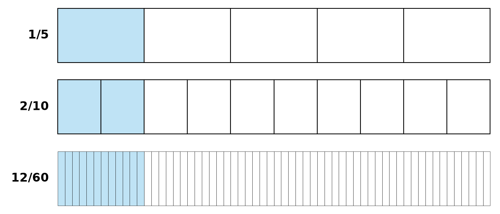
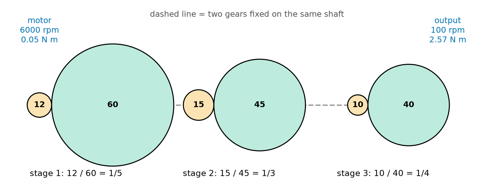
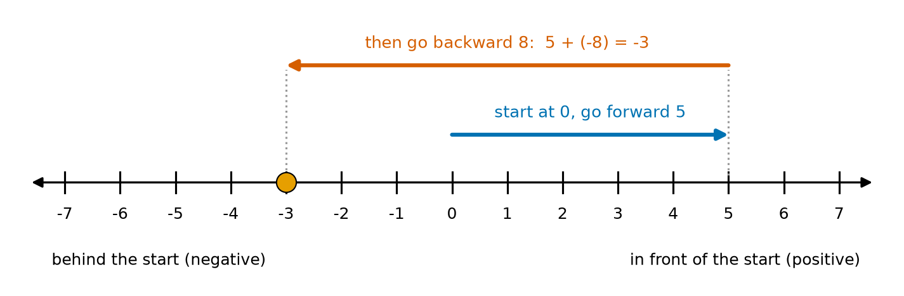
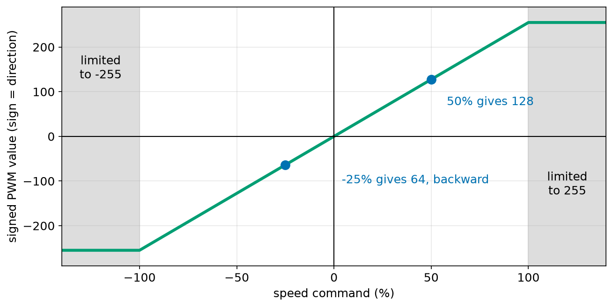
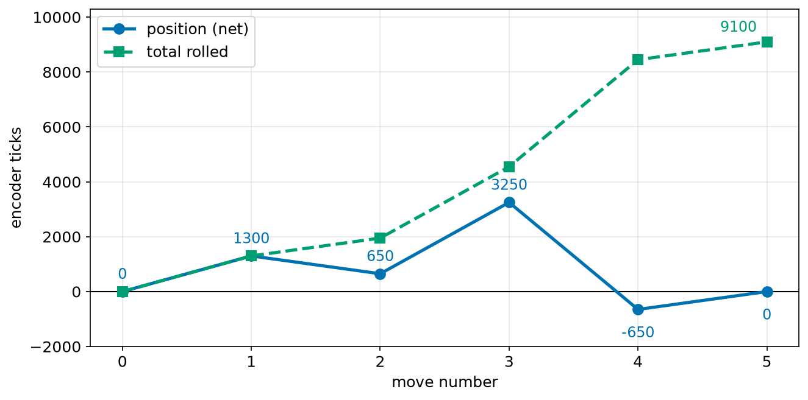

# Chapter 37 — Numbers: Whole Numbers, Decimals, Fractions, Negative Numbers

> **Part 3 · Chapter 37 of 749**
> **You need:** Chapter 13 (arithmetic in Python) and Chapter 23 (functions). A pencil and paper help a lot in this part.
> **You will make:** your own fraction calculator, a motor command function that handles forward and backward, a gear train calculator, and a position tracker that works with negative numbers.

---

## What you will learn

- The four kinds of number a robot uses, and when each one is the right choice.
- How place value works, and why 2,640 and 0.26 are built the same way.
- How to simplify, add, multiply and divide fractions, by hand and in Python.
- How to read a gear ratio as a fraction.
- How to work out percentages, and how a motor uses them.
- How negative numbers work, using a number line.
- What the **absolute value** is, and why robots use it all the time.
- The order in which a calculation is done.

---

## New words in this chapter

| Word | Simple meaning |
|---|---|
| **whole number** | A number with no parts after the point: 0, 1, 2, 3 … |
| **integer** | A whole number that may also be negative: … −2, −1, 0, 1, 2 … |
| **digit** | One of the ten signs 0 to 9. |
| **place value** | What a digit is worth because of where it stands. |
| **decimal** | A number with a point, such as 0.25. |
| **fraction** | A part of something, written top over bottom, such as 3/4. |
| **numerator** | The top number of a fraction. |
| **denominator** | The bottom number of a fraction. |
| **simplify** | Write a fraction with the smallest numbers that keep its value. |
| **greatest common divisor (gcd)** | The biggest number that divides two numbers exactly. |
| **ratio** | A comparison of two amounts, such as 60 teeth to 12 teeth. |
| **percent (%)** | "Out of one hundred". |
| **negative number** | A number below zero. |
| **number line** | A straight line with every number in its place. |
| **absolute value** | How far a number is from zero, without its sign. |
| **gear train** | Several gears joined together, one after another. |

---

## 37.1 Why a robot needs different kinds of number

You already typed numbers into Python in Chapter 13. Now we look at what those numbers **mean**.

Think about one small trip by Rover:

```
Encoder ticks counted    : 2640        (a whole number. You cannot count half a tick.)
Distance travelled       : 1.012 m     (a decimal. Distance has parts of a metre.)
Gear ratio               : 1/48        (a fraction. An exact comparison.)
Battery left             : 73%         (a percentage. A part out of 100.)
Wheel turned backward    : -540 ticks  (a negative number. It shows direction.)
```

Five kinds of writing, one robot. Each one fits a different job. In this chapter we learn all of them properly.

🧠 **Remember:** Counting gives whole numbers. Measuring gives decimals. Comparing gives fractions and percentages. Direction gives negative numbers.

---

## 37.2 Whole numbers and place value

The **whole numbers** are 0, 1, 2, 3, and so on, with no end. We write them with ten **digits**: 0 1 2 3 4 5 6 7 8 9.

📖 **New word: place value** — what a digit is worth because of where it stands.

Look at the number 2,640:

```
    2        6       4       0
    |        |       |       |
 thousands hundreds tens   ones
   1000     100     10      1
```

🔢 **Maths.** Multiply each digit by what its place is worth, and add:

```
2 × 1000 = 2000
6 × 100  =  600
4 × 10   =   40
0 × 1    =    0
           ----
           2640
```

Each place is worth **10 times** the place on its right. This is called **base 10**, because we have ten digits. A zero is important: it keeps the other digits in the right place. 2,640 and 264 are very different numbers.

💡 **Tip.** Computers use the same idea, but with only two digits, 0 and 1, so each place is worth 2 times the place on its right. Chapter 54 shows why this matters.

🤖 **Robot link.** An encoder gives whole numbers because it counts marks going past a sensor. Motors, sensors and people all come in whole numbers too: "2 motors", "6 sensors". In Python these are `int` values.

---

## 37.3 Decimals

A whole number cannot say "a bit more than one metre". For that we need places to the **right** of the point.

📖 **New word: decimal** — a number with a point, such as 0.25.

Place value keeps going. Each step to the right is worth **one tenth** of the place before it:

```
    1   .   0      1      2
    |       |      |      |
   ones   tenths hundredths thousandths
    1      1/10   1/100   1/1000
```

🔢 **Maths.** The number 1.012 means:

```
1 × 1      = 1
0 × 1/10   = 0
1 × 1/100  = 0.01
2 × 1/1000 = 0.002
             -----
             1.012
```

So 1.012 m is one metre, one centimetre and two millimetres. The places match real sizes.

### Adding and subtracting decimals

Line up the **points**, then work as usual.

```
  1.012
+ 0.350
-------
  1.362
```

Writing 0.35 as 0.350 helps you to keep the columns straight. The extra zero changes nothing.

### Multiplying by 10, 100, 1000

Multiplying by 10 moves every digit one place to the left. Dividing by 10 moves every digit one place to the right.

| Calculation | Answer | Meaning |
|---|---|---|
| 1.012 × 10 | 10.12 | digits move 1 place |
| 1.012 × 1000 | 1012 | metres become millimetres |
| 73 ÷ 100 | 0.73 | 73% written as a decimal |

### Multiplying decimals

Forget the points. Multiply. Then count how many digits were after the points in the question, and put that many in the answer.

🔢 **Maths.** Work out 0.3 × 1.2.

```
Without points:  3 × 12 = 36
Digits after the point in the question:  1 (in 0.3) + 1 (in 1.2) = 2
So the answer has 2 digits after the point:  0.36
```

Check it with sense: 0.3 is a bit less than a third, and a third of 1.2 is 0.4. So 0.36 is reasonable.

---

## 37.4 Fractions

Cut a chocolate bar into 4 equal pieces and eat 3. You ate three quarters, **3/4**.

📖 **New word: fraction** — a part of something, written top over bottom.

```
 3   <- numerator:   how many pieces we take
---
 4   <- denominator: how many equal pieces the whole has
```

A fraction is also a **division**: 3/4 means 3 ÷ 4 = 0.75.

⚠️ **Careful.** The denominator can never be 0. "Cut into zero pieces" has no meaning. Python gives you `ZeroDivisionError` (Chapter 25).

### Equal fractions

Look at Figure 37.1. The three bars have the same amount shaded.



*Figure 37.1 — 1/5, 2/10 and 12/60 are the same amount.*

**How to read this picture:** Each bar is one whole. The numbers on the left say how it was cut. The blue part ends at the same place on all three bars. More pieces, each one smaller, can still make the same amount.

The rule is: **multiply or divide the top and the bottom by the same number, and the value does not change.**

```
1/5 = (1×2)/(5×2) = 2/10
1/5 = (1×12)/(5×12) = 12/60
```

### Simplifying

To **simplify** a fraction, divide the top and the bottom by the biggest number that goes into both. That number is the **greatest common divisor**, or **gcd**.

🔢 **Maths.** Simplify 12/60.

```
Numbers that divide 12:  1, 2, 3, 4, 6, 12
Numbers that divide 60:  1, 2, 3, 4, 5, 6, 10, 12, 15, 20, 30, 60
The biggest in both lists: 12

12 ÷ 12 = 1
60 ÷ 12 = 5
So 12/60 = 1/5
```

Listing the divisors is slow for big numbers. Over 2,000 years ago, the Greek writer Euclid described a faster way. Replace the pair (a, b) by (b, a % b), and repeat until b is 0. Then a is the answer. You met `%` in Chapter 13.

```
(12, 60)  ->  12 % 60 = 12  ->  (60, 12)
(60, 12)  ->  60 % 12 = 0   ->  (12, 0)
b is 0, so the gcd is 12.
```

### Multiplying fractions

Top times top. Bottom times bottom.

🔢 **Maths.** Half of a third:

```
1/2 × 1/3 = (1×1)/(2×3) = 1/6
```

⚠️ **Careful.** Multiplying by a fraction smaller than 1 makes a number **smaller**. This surprises many people.

### Dividing fractions

Turn the second fraction upside down, then multiply. The upside-down fraction is called its **reciprocal**.

🔢 **Maths.** How many pieces of 1/8 m can we cut from 3/4 m of wire?

```
3/4 ÷ 1/8 = 3/4 × 8/1 = 24/4 = 6
```

Six pieces. Check: 6 × 1/8 = 6/8 = 3/4. It is correct.

### Adding fractions

You can only add pieces of the **same size**. So first make the bottoms the same.

🔢 **Maths.** Work out 1/2 + 1/3.

```
Make the bottoms the same.  2 × 3 = 6, so use sixths.
1/2 = 3/6     (top and bottom × 3)
1/3 = 2/6     (top and bottom × 2)
3/6 + 2/6 = 5/6
```

The general rule is:

```
a/b + c/d = (a×d + c×b) / (b×d)
```

In words: cross-multiply and add for the top, and multiply the bottoms for the bottom. Then simplify.

⚠️ **Careful.** 1/2 + 1/3 is **not** 2/5. A wrong answer like that is smaller than 1/2, which we started with. Adding a positive amount must make it bigger.

### Fractions and decimals

To turn a fraction into a decimal, divide:

| Fraction | Decimal | Note |
|---|---|---|
| 1/2 | 0.5 | exact |
| 1/4 | 0.25 | exact |
| 1/8 | 0.125 | exact |
| 1/5 | 0.2 | exact |
| 1/3 | 0.3333… | never ends |
| 1/60 | 0.016666… | never ends |

Some fractions never end as decimals. If a computer stores 1/3 as 0.3333, it has already lost something. A fraction stored as a top and a bottom loses nothing. That is why, for gears, we often keep the fraction.

---

## 37.5 Ratios and gears

📖 **New word: ratio** — a comparison of two amounts. Gears are the best example.

Picture a small gear with 12 teeth pushing a big gear with 60 teeth. Each tooth of the small gear pushes one tooth of the big gear. When the small gear makes one full turn, 12 teeth have gone past. The big gear has 60 teeth, so it has moved only 12/60 of a turn.

```
big gear turns = small gear turns × 12/60 = small gear turns × 1/5
```

In words: **the output speed is the input speed times the driving teeth, divided by the driven teeth.** The motor turns 5 times to turn the wheel once. Engineers call this a **5:1 reduction** ("five to one").

The gear gives something back for the lost speed. The same power goes through, so the slower gear has more **torque**, or turning strength. (Chapter 65 explains torque properly, and Chapter 68 returns to gears.) Five times slower means about five times stronger.



*Figure 37.2 — Three pairs of gears, one after another.*

**How to read this picture:** Orange gears do the driving. Green gears are driven. A dashed line means two gears sit on the same shaft, so they turn together. The speed falls at each stage: 6000 rpm goes in on the left and 100 rpm comes out on the right.

When gears are joined, the fractions **multiply**:

```
1/5 × 1/3 × 1/4 = 1/60
```

This is exactly why you need to be able to multiply fractions.

---

## 37.6 Percentages

📖 **New word: percent** — "out of one hundred". The sign is %.

So 73% means 73/100 = 0.73.

To find a percentage **of** something, multiply:

🔢 **Maths.** Rover's battery holds 22 Wh. How much is 73% of it?

```
73% of 22 = 0.73 × 22 = 16.06 Wh
```

To find **what percentage** one number is of another, divide and multiply by 100:

🔢 **Maths.** Rover used 3 Wh out of 22 Wh.

```
3 ÷ 22 = 0.1364      0.1364 × 100 = 13.6%
```

### Percentage error

In Chapter 16, we measured the wheel. The percentage error tells us how wrong a number is compared with its size:

```
percentage error = (measured − true) ÷ true × 100
```

🔢 **Maths.** The sensor says 1.03 m. The true distance is 1.00 m.

```
(1.03 − 1.00) ÷ 1.00 × 100 = +3%
```

A 3 cm mistake is small on a 1 m measurement. On a 10 cm measurement it would be 30%. The percentage tells you which mistakes matter.

⚠️ **Careful.** Adding 10% and then taking away 10% does not bring you back. 100 + 10% = 110. 110 − 10% = 99. The second 10% is 10% of a bigger number.

### PWM: how a robot uses percentages

A small motor driver controls speed by switching the power on and off very quickly. The share of time it is on is called the **duty cycle**, given as a percentage. Chapter 102 teaches it in full. On an Arduino, the number you send goes from 0 (always off) to 255 (always on). So we have to convert:

```
pwm value = percent ÷ 100 × 255
```

50% becomes 0.5 × 255 = 127.5. A driver only takes whole numbers, so we round it to 128.

---

## 37.7 Negative numbers

📖 **New word: negative number** — a number below zero, written with a minus sign.

Where do we need them? Temperatures below zero. Depth below the sea surface. A robot that drives **backward**. An error when the robot has gone **too far**.

A negative number shows **direction**: the opposite way from the one we chose as positive.



*Figure 37.3 — Forward is positive, backward is negative.*

**How to read this picture:** Every number has one place on the line. Zero is the start. Positive numbers are on the right. Negative numbers are on the left. The blue arrow moves 5 places to the right. The red arrow then moves 8 places to the left. The orange dot shows where we end: at −3.

📖 **New word: number line** — a straight line with every number in its place.

### Adding and subtracting

Think of Rover on the line.

| Calculation | On the number line | Answer |
|---|---|---|
| 5 + 3 | at 5, go 3 forward | 8 |
| 5 − 8 | at 5, go 8 backward | −3 |
| 5 + (−8) | adding a backward move: the same thing | −3 |
| −3 + 5 | at −3, go 5 forward | 2 |
| −3 − 2 | at −3, go 2 backward | −5 |
| −3 − (−5) | taking away a backward move means going forward | 2 |

The last one needs an idea. If someone **cancels** a backward move of 5, you end up 5 further forward than you would have been. So:

```
subtracting a negative number is the same as adding a positive one
a − (−b) = a + b
```

🤖 **Robot link.** Every controller in this course starts with the sum `error = setpoint − output` (Chapter 209). If the setpoint is 2 and the output is −1, the error is 2 − (−1) = 3. Getting this sign wrong makes a robot run away from where it should go.

### Multiplying and dividing

Multiply as usual, then fix the sign:

| Signs | Result | Example |
|---|---|---|
| plus × plus | plus | 3 × 2 = 6 |
| plus × minus | minus | 3 × (−2) = −6 |
| minus × plus | minus | (−3) × 2 = −6 |
| minus × minus | plus | (−3) × (−2) = 6 |

The same table works for division.

**Why is minus times minus a plus?** Multiplying by −1 means "turn round and face the other way". Do it twice and you are facing the way you started.

```
    3   ->   ×(−1)   ->   −3   ->   ×(−1)   ->   3
```

🤖 **Robot link.** A motor spinning backward (−) that pushes on a gear which reverses direction (−) makes the wheel go forward (+). Each pair of gears in contact reverses direction.

---

## 37.8 Absolute value

📖 **New word: absolute value** — how far a number is from zero, without its sign. We write it with two straight lines: |−3| = 3 and |3| = 3.

In Python it is `abs(-3)`.

A robot uses it whenever **only the size matters**.

| Question | Calculation |
|---|---|
| How far did the wheel roll, ignoring direction? | `abs(ticks)` |
| How big is the error? | `abs(setpoint - output)` |
| Is the heading close enough? | `abs(error) < 2` |
| How much PWM does the motor need? | `abs(percent)` |

The distance between two numbers on the number line is `abs(a - b)`. It does not matter which one comes first:

```
abs(2 − 7)  = abs(−5) = 5
abs(7 − 2)  = abs(5)  = 5
```

---

## 37.9 Order of operations

What is 2 + 3 × 4? If you add first, you get 20. If you multiply first, you get 14. Everybody must get the same answer, so there is a rule:

```
1. Brackets
2. Powers       (Chapter 38)
3. × and ÷, from left to right
4. + and −, from left to right
```

So 2 + 3 × 4 = 2 + 12 = 14. Python follows the same rule (Chapter 13).

🔢 **Maths.** Rover's average speed over two parts of a trip:

```
total distance ÷ total time = (1.2 + 0.8) ÷ (4 + 2) = 2.0 ÷ 6 = 0.333 m/s
```

Without brackets, `1.2 + 0.8 / 4 + 2` means something else: 1.2 + 0.2 + 2 = 3.4. When you are not sure, **use brackets**. They cost nothing.

⚠️ **Careful.** In Python, `-2 ** 2` is −4, because the power happens first and the minus is applied after it. If you mean "(−2) squared", write `(-2) ** 2`, which is 4.

---

## Code

First we build fractions by hand. The rule of this book is: first by hand, then the library.

File `code/ch037/fractions_by_hand.py`:

```python
# fractions_by_hand.py - simplify, add and multiply fractions the way you do on paper


def gcd(a, b):
    while b != 0:
        a, b = b, a % b
    return a


def simplify(top, bottom):
    divisor = gcd(top, bottom)
    return top // divisor, bottom // divisor


def add(a, b, c, d):
    return simplify(a * d + c * b, b * d)


def multiply(a, b, c, d):
    return simplify(a * c, b * d)


def divide(a, b, c, d):
    return multiply(a, b, d, c)


print("gcd of 12 and 60:", gcd(12, 60))
print("12/60 simplified:", simplify(12, 60))
print("1/2 + 1/3       :", add(1, 2, 1, 3))
print("1/5 x 1/3       :", multiply(1, 5, 1, 3))
print("3/4 / 1/8       :", divide(3, 4, 1, 8))
```

| Line | Code | What it does (simple English) |
|---|---|---|
| 1 | `# fractions_by_hand.py …` | A comment that says what the file does. |
| 2–3 | (blank) | Blank lines make the file easier to read. |
| 4 | `def gcd(a, b):` | Starts a function for the greatest common divisor (Chapter 23). |
| 5 | `while b != 0:` | Repeat until `b` is zero. |
| 6 | `a, b = b, a % b` | Euclid's step. The new `a` is the old `b`. The new `b` is what is left after dividing. Both change at the same time (Chapter 14). |
| 7 | `return a` | When `b` is zero, `a` is the answer. |
| 8–9 | (blank) | Spacing. |
| 10 | `def simplify(top, bottom):` | A function that takes a fraction as two whole numbers. |
| 11 | `divisor = gcd(top, bottom)` | Finds the biggest number that divides both. |
| 12 | `return top // divisor, bottom // divisor` | Divides both by it. `//` is whole-number division, so the answers stay as integers. Returns two values (Chapter 24). |
| 13–14 | (blank) | Spacing. |
| 15 | `def add(a, b, c, d):` | Adds a/b and c/d. |
| 16 | `return simplify(a * d + c * b, b * d)` | Uses the rule from section 37.4, and simplifies the answer. |
| 17–18 | (blank) | Spacing. |
| 19 | `def multiply(a, b, c, d):` | Multiplies a/b by c/d. |
| 20 | `return simplify(a * c, b * d)` | Top times top. Bottom times bottom. Simplify. |
| 21–22 | (blank) | Spacing. |
| 23 | `def divide(a, b, c, d):` | Divides a/b by c/d. |
| 24 | `return multiply(a, b, d, c)` | Swaps `c` and `d`, which is the upside-down rule, and uses `multiply`. |
| 25–26 | (blank) | Spacing. |
| 27–31 | `print(…)` | Tests each function on the examples we worked by hand. |

Output:

```
gcd of 12 and 60: 12
12/60 simplified: (1, 5)
1/2 + 1/3       : (5, 6)
1/5 x 1/3       : (1, 15)
3/4 / 1/8       : (6, 1)
```

Every line agrees with what we did on paper. The answer `(6, 1)` means 6/1, which is 6.

Next, a function that uses percentages, negative numbers and absolute value together.

File `code/ch037/motor_command.py`:

```python
# motor_command.py - turn a signed speed percentage into what the motor driver needs
MAX_PWM = 255


def motor_command(percent):
    if percent > 100:
        percent = 100
    if percent < -100:
        percent = -100
    if percent >= 0:
        direction = "forward"
    else:
        direction = "backward"
    pwm = round(abs(percent) / 100 * MAX_PWM)
    return direction, pwm


for speed in [0, 25, 50, 100, -25, -100, 140, -300]:
    direction, pwm = motor_command(speed)
    print(f"{speed:5d}%  {direction:<9} pwm {pwm:3d}")
```

| Line | Code | What it does (simple English) |
|---|---|---|
| 1 | `# motor_command.py …` | A comment. |
| 2 | `MAX_PWM = 255` | The largest number the motor driver accepts. Capitals mean a value that does not change (Chapter 14). |
| 3–4 | (blank) | Spacing. |
| 5 | `def motor_command(percent):` | The speed command goes in, from −100 to 100. |
| 6 | `if percent > 100:` | Is the command too high? |
| 7 | `percent = 100` | Limit it to 100. A motor cannot give more than full power. |
| 8 | `if percent < -100:` | Is it too low? |
| 9 | `percent = -100` | Limit it to −100. |
| 10 | `if percent >= 0:` | Zero or more means forward. |
| 11 | `direction = "forward"` | Stores the direction as text. |
| 12 | `else:` | Otherwise the number is negative. |
| 13 | `direction = "backward"` | Stores the other direction. |
| 14 | `pwm = round(abs(percent) / 100 * MAX_PWM)` | `abs` drops the sign, because the direction is already stored. Then percent ÷ 100 × 255. `round` makes a whole number. |
| 15 | `return direction, pwm` | Gives back both values. |
| 16–17 | (blank) | Spacing. |
| 18 | `for speed in [0, 25, 50, 100, -25, -100, 140, -300]:` | Tests normal values and values that are too big. |
| 19 | `direction, pwm = motor_command(speed)` | Calls the function and unpacks the two answers. |
| 20 | `print(f"{speed:5d}%  {direction:<9} pwm {pwm:3d}")` | Prints a neat row (Chapter 15). `5d` makes room for 5 digits, and `<9` lines up the words on the left. |

Output:

```
    0%  forward   pwm   0
   25%  forward   pwm  64
   50%  forward   pwm 128
  100%  forward   pwm 255
  -25%  backward  pwm  64
 -100%  backward  pwm 255
  140%  forward   pwm 255
 -300%  backward  pwm 255
```



*Figure 37.4 — The command, the direction, and the limits.*

**How to read this picture:** Across the bottom is the command. Up the side is the PWM value, with its sign showing the direction. The green line goes through zero. It is a straight line between −100 and 100. In the grey parts the command is too big, so the line goes flat.

Notice that +25% and −25% give the same PWM, 64. The size is the same, only the direction differs. That is exactly what `abs` is for.

---

## Small examples

**Example 1: Place value.** Rover's wheel has 540 ticks per turn. 540 = 5 × 100 + 4 × 10 + 0 × 1.

**Example 2: Decimals and units.** 0.75 m × 100 = 75 cm. The digits move two places.

**Example 3: Fraction of a length.** A rod is 20 cm long. We cut off 3/4 of it. 3/4 × 20 = 60/4 = 15 cm.

**Example 4: Simplify a ratio.** A gearbox has 48 motor turns to 2 wheel turns. 48/2 = 24, so it is a 24:1 reduction.

**Example 5: Percentage used.** A mission planned 40 minutes and has flown 10. 10 ÷ 40 × 100 = 25%.

**Example 6: Negative sums.** The temperature was −4 °C and it rises by 7 degrees. −4 + 7 = 3 °C.

**Example 7: Error with a sign.** The setpoint is 100 ticks and the encoder reads 130. Error = 100 − 130 = −30. The robot has gone 30 ticks too far.

**Example 8: Absolute value.** The heading error is −7°. `abs(-7)` is 7. Is it below 10? Yes, so it is close enough.

**Example 9: Whole-number division with negatives.** In Python, `7 // 2` is 3, but `-7 // 2` is −4. Python rounds **down**, towards the left of the number line. `int(-7 / 2)` is −3, because `int` cuts off the part after the point. These two differ, so be careful when ticks can be negative.

---

## 🏭 Real robot applications

### Application 1 (worked in full) — 🏭 The joint of a factory arm

**1. The real problem.** A factory arm must lift a part. The elbow joint needs a lot of turning strength, but only moves slowly. Electric motors are the opposite. They spin fast but are not strong. How do we match them?

**2. Why this theory.** A gear train is a chain of fractions. When the fractions multiply, the speed falls and the torque rises. If we keep the numbers as exact fractions, we do not build up any small rounding errors.

**3. The numbers.** In this example the motor runs at 6000 rpm and gives 0.05 N m (newton metres, the unit of torque). There are three stages: 12 to 60 teeth, 15 to 45 teeth, and 10 to 40 teeth. Each stage wastes about 5% as friction, so each passes on 95%.

**4. The maths.** Look at Figure 37.2 again.

```
Stage 1:  12/60 = 1/5
Stage 2:  15/45 = 1/3
Stage 3:  10/40 = 1/4

Total:    1/5 × 1/3 × 1/4 = 1/60

Output speed  = 6000 × 1/60 = 100 rpm

Efficiency    = 0.95 × 0.95 × 0.95 = 0.857  (85.7%)

Output torque = 0.05 × 60 × 0.857 = 2.57 N m
```

Dividing by the fraction 1/60 is the same as multiplying by 60. Without any losses the torque would be 3.00 N m. Friction takes away 0.43 N m of it.

**5. The code.** File `code/ch037/gear_train.py`:

```python
# gear_train.py - exact speed and torque through a chain of gears
from fractions import Fraction

stages = [(12, 60), (15, 45), (10, 40)]    # (driving teeth, driven teeth)
motor_rpm = 6000
motor_torque_nm = 0.05
efficiency_per_stage = 0.95

speed_ratio = Fraction(1, 1)
for driving, driven in stages:
    stage = Fraction(driving, driven)
    speed_ratio = speed_ratio * stage
    print(f"{driving:>3} drives {driven:<3} stage {str(stage):<5} total {speed_ratio}")

efficiency = efficiency_per_stage ** len(stages)
output_rpm = motor_rpm * speed_ratio
output_torque = motor_torque_nm / speed_ratio * efficiency

print(f"output speed : {float(output_rpm):.1f} rpm")
print(f"efficiency   : {efficiency:.1%}")
print(f"output torque: {float(output_torque):.2f} N m")
```

| Line | Code | What it does (simple English) |
|---|---|---|
| 1 | `# gear_train.py …` | A comment. |
| 2 | `from fractions import Fraction` | Python's own fraction type. It does what we wrote by hand. |
| 3 | (blank) | Spacing. |
| 4 | `stages = […]` | A list of tuples (Chapter 22). Each tuple holds one pair of gears. |
| 5 | `motor_rpm = 6000` | Motor speed, in turns per minute. |
| 6 | `motor_torque_nm = 0.05` | Motor torque. |
| 7 | `efficiency_per_stage = 0.95` | Each stage passes on 95%. |
| 8 | (blank) | Spacing. |
| 9 | `speed_ratio = Fraction(1, 1)` | Starts at 1/1: no gears, no change. |
| 10 | `for driving, driven in stages:` | Goes through the stages and unpacks each tuple. |
| 11 | `stage = Fraction(driving, driven)` | Makes an exact fraction. Python simplifies it for us: 12/60 becomes 1/5. |
| 12 | `speed_ratio = speed_ratio * stage` | Multiplies the fractions together. |
| 13 | `print(f"…")` | Shows the working. `>3` lines up on the right, and `<3` on the left. `str(stage)` makes text from the fraction, so that it can be padded. |
| 14 | (blank) | Spacing. |
| 15 | `efficiency = efficiency_per_stage ** len(stages)` | 0.95 multiplied by itself once per stage. |
| 16 | `output_rpm = motor_rpm * speed_ratio` | Speed falls by the ratio. |
| 17 | `output_torque = motor_torque_nm / speed_ratio * efficiency` | Torque rises by the same ratio, then we take off the losses. |
| 18 | (blank) | Spacing. |
| 19 | `print(f"output speed : …")` | `float(…)` turns the exact fraction into a decimal for printing. |
| 20 | `print(f"efficiency   : …")` | `.1%` shows a number as a percentage with one decimal place. |
| 21 | `print(f"output torque: …")` | Two decimal places. |

Output:

```
 12 drives 60  stage 1/5   total 1/5
 15 drives 45  stage 1/3   total 1/15
 10 drives 40  stage 1/4   total 1/60
output speed : 100.0 rpm
efficiency   : 85.7%
output torque: 2.57 N m
```

**6. The result.** The small motor can now hold 2.57 N m, about 51 times what it gives alone. Without the gears it could not lift the arm at all. With too much reduction, the arm would be too slow. The fraction lets the designer pick the right balance.

**7. Going further.** Real factory arms mostly use a compact type of gear called a **strain wave gear**, or harmonic drive (Chapter 694), with ratios of about 50:1 to 160:1 in one stage. Each joint of a real arm is designed with this same sum. Direction also matters: every pair of gears that touch reverses the direction, so three pairs reverse it three times, and the output spins opposite to the motor. Minus × minus × minus = minus.

### Application 2 (worked in full) — 🏥 A hospital delivery robot that backs up

**1. The real problem.** A delivery robot in a hospital drives forward along a corridor. It must often reverse to let a bed go past. It needs two answers: **where is it now**, and **how much have its wheels worn**?

**2. Why this theory.** Position uses signed numbers, because a backward move cancels a forward one. Wear ignores direction, so it uses the absolute value. One list of moves gives two different totals.

**3. The numbers.** The wheel gives 2600 ticks per metre. That is a round number we use to make the sums easy. Rover's measured value is close to 2609. The moves are +1300, −650, +2600, −3900 and +650 ticks.

**4. The maths.** Start at 0. Position adds each move **with** its sign. Distance rolled adds each move **without** its sign.

```
Position:   0 + 1300 − 650 + 2600 − 3900 + 650 = 0
Rolled:     1300 + 650 + 2600 + 3900 + 650 = 9100

In metres:  0 ÷ 2600 = 0.00 m
            9100 ÷ 2600 = 3.50 m
```

**5. The code.** File `code/ch037/signed_ticks.py`:

```python
# signed_ticks.py - forward is plus, backward is minus
TICKS_PER_METRE = 2600

moves = [1300, -650, 2600, -3900, 650]    # encoder ticks for each move

position = 0
travelled = 0

print("  move  position  travelled")
for move in moves:
    position = position + move
    travelled = travelled + abs(move)
    print(f"{move:6d} {position:9d} {travelled:10d}")

print(f"ended {position / TICKS_PER_METRE:+.2f} m from the start")
print(f"wheels rolled {travelled / TICKS_PER_METRE:.2f} m in total")
```

| Line | Code | What it does (simple English) |
|---|---|---|
| 1 | `# signed_ticks.py …` | A comment. |
| 2 | `TICKS_PER_METRE = 2600` | The wheel's conversion number. |
| 3 | (blank) | Spacing. |
| 4 | `moves = […]` | One entry per move. Negative means backward. |
| 5 | (blank) | Spacing. |
| 6 | `position = 0` | Starts at zero. |
| 7 | `travelled = 0` | Also starts at zero. |
| 8 | (blank) | Spacing. |
| 9 | `print("  move  position  travelled")` | The table heading. |
| 10 | `for move in moves:` | Takes each move in turn. |
| 11 | `position = position + move` | Adds the move with its sign. |
| 12 | `travelled = travelled + abs(move)` | Adds only its size. |
| 13 | `print(f"{move:6d} …")` | Prints one row, with fixed widths so the columns line up. |
| 14 | (blank) | Spacing. |
| 15 | `print(f"ended {position / TICKS_PER_METRE:+.2f} m …")` | `+` in the format always shows a sign. |
| 16 | `print(f"wheels rolled …")` | The total distance rolled. |

Output:

```
  move  position  travelled
  1300      1300       1300
  -650       650       1950
  2600      3250       4550
 -3900      -650       8450
   650         0       9100
ended +0.00 m from the start
wheels rolled 3.50 m in total
```



*Figure 37.5 — Two different totals from the same five moves.*

**How to read this picture:** Across the bottom is the move number. Blue is the position, which goes up and down and even goes below zero. Green is the distance rolled, which can only go up. At the end the position is back at 0, but the wheels have rolled 9100 ticks.

**6. The result.** The robot is back where it began, yet its wheels rolled 3.5 m. If the service schedule used the position, the wheels would look brand new. If the map used the distance rolled, the robot would believe it was 3.5 m away.

**7. Going further.** Real encoders store the count in a number with limited size, which can **overflow**. Chapter 54 shows what happens then. Real drive software also combines position with other sensors, because wheels slip (Chapter 426).

### Application 3 — 🩺 Motion scaling in a surgical robot

A surgical robot can scale the surgeon's hand motion by a fraction. With a 5:1 setting, the tool moves 1/5 of what the hand moves. A hand movement of 10 mm becomes 10 × 1/5 = 2 mm. A small shake of 0.5 mm becomes 0.1 mm. The same simple multiplication makes a surgeon's hand more exact. Real systems also filter out the shake (Chapter 412).

### Application 4 — 🚁 Battery reserve on a delivery drone

A delivery drone has a 500 Wh battery. The company's rule says that it must land with at least 25% left. So it can use 75%: 0.75 × 500 = 375 Wh. If the flight uses 18 Wh per kilometre, the greatest total distance is 375 ÷ 18 = 20.8 km. Going there and back, the delivery can be at most 10.4 km away. These are example numbers, but the sums are the ones a real flight planner does (Chapter 621).

### Application 5 — 🌊 Depth and temperature on an underwater robot and a planet rover

An underwater robot often stores depth as a negative height: −120 m. To rise to −35 m it must move −35 − (−120) = +85 m, which is up. With a mistake in the sign it would go to −155 m, which may be deeper than it can survive.

A planet rover uses signed numbers in the same way. Imagine a night temperature of −90 °C and electronics that must stay above −40 °C. The heaters must keep the difference, −40 − (−90) = 50 degrees. Fractions join in as well: if the heaters take 1/4 of the power and the rest is shared by two other systems equally, each gets (1 − 1/4) ÷ 2 = 3/8 of the power. These are example numbers. Every real mission has its own values and limits.

---

## 🔧 Hands-on lab

### Lab 37.1 — Bicycle gears (hardware, no tools)

You need a bicycle, or a photo of its gears, and a piece of tape.

1. Count the teeth on the front chain ring (the part with the pedals) and on the rear sprocket that the chain is on.
2. Write the fraction: front teeth ÷ rear teeth. For example, 42 ÷ 14 = 3.
3. Put tape on the rear tyre. Turn the pedals by hand for exactly one turn while someone lifts the back wheel. Count how many times the wheel goes round.
4. Add one line of Python to compare: `print(42 / 14)`, using your own numbers.

**What you should see:** The wheel turns as many times as your fraction says. Here the fraction is more than 1, so the bicycle gears go **up** in speed, which is the opposite of the robot gear.

| If it does not work | Likely cause | Fix |
|---|---|---|
| The wheel turns far too many times | The wheel kept spinning after you stopped | Hold the tyre lightly |
| The count is a little off | You did not stop exactly after one pedal turn | Mark the pedal and repeat |
| The fraction is below 1 | You divided rear by front | Use front ÷ rear |

**Challenge:** Change gears. Which gear would you choose to climb a hill? Explain using the fraction.

### Lab 37.2 — Design a gearbox (simulation)

Copy `gear_train.py`.

1. Remove the third stage from `stages`. Run it and write down the speed and the torque.
2. Put the third stage back. Add a fourth stage, `(10, 30)`.
3. Change `efficiency_per_stage` to `0.80`.

**What you should see:** With two stages you get 400 rpm and about 0.68 N m. With four stages you get about 33.3 rpm and 7.33 N m. At 0.80 and four stages, torque falls to about 3.69 N m, because more stages mean more loss.

| If it does not work | Likely cause | Fix |
|---|---|---|
| `ValueError` at a `for` line | A tuple does not have two numbers | Each stage must look like `(10, 30)` |
| `TypeError` about float and Fraction formatting | You printed the Fraction with `.1f` | Use `float(output_rpm)` |
| `ZeroDivisionError` | One gear has 0 teeth | Check your list |

**Challenge:** Find a set of stages with a total ratio of exactly 1/100, using no gear with more than 60 teeth or fewer than 10.

### Lab 37.3 — Walk the number line (hardware, floor)

Put a strip of tape on the floor. Mark 0 and then 1 to 5 in steps of one big step in both directions.

1. Stand on 0. Do the moves +3, −5, +1, −2, +4.
2. Write down where you end.
3. Change `moves` in `signed_ticks.py` to the same numbers. Run it.

**What you should see:** You end at +1. The program's `position` column shows 3, −2, −1, −3, 1. `travelled` ends at 15.

| If it does not work | Likely cause | Fix |
|---|---|---|
| You ended somewhere else | You stepped the wrong way | Always face the same way, and step backward for negative moves |
| The program shows a huge number | The conversion was not used | Look at the ticks columns, not the metres line |

**Challenge:** Make a list of moves that ends at 0 but rolls more than 50.

---

## Common mistakes

⚠️ **Adding the tops and the bottoms of fractions.** 1/2 + 1/3 is not 2/5. Make the bottoms equal first.

⚠️ **Dividing by zero.** Check any denominator that comes from a sensor before you divide.

⚠️ **Mixing up which gear is on top.** It is driving teeth ÷ driven teeth for speed. A wrong way round gives a robot that is far too fast and far too weak.

⚠️ **Losing the sign.** `error = setpoint - output` is not the same as `output - setpoint`. The two have opposite signs.

⚠️ **Using position when you need distance.** A signed sum can be zero even after a long trip. Use `abs` to add up distance.

⚠️ **Treating a percentage as a whole number.** 25% of 200 is 0.25 × 200, not 25 × 200.

⚠️ **Forgetting brackets.** `a + b / c` is not `(a + b) / c`.

⚠️ **Assuming `//` cuts off the part after the point.** `-7 // 2` is −4, not −3.

---

## Practice

🏋️ **1.** Write 3,508 as a sum using place value.

🏋️ **2.** Work out 2.35 + 0.8, and 0.4 × 0.6, without a computer.

🏋️ **3.** Simplify 18/48 by hand.

🏋️ **4.** Use Euclid's method to find the gcd of 84 and 36. Show every step.

🏋️ **5.** Work out 2/3 + 1/4, and 2/3 × 1/4, and 2/3 ÷ 1/4.

🏋️ **6.** A motor runs at 3000 rpm through stages 10→30 and 12→48. What is the output speed?

🏋️ **7.** A battery of 40 Wh shows 35%. How many Wh are left?

🏋️ **8.** Work out: −6 + 2, −6 − 2, −6 − (−2), and (−6) × (−2).

🏋️ **9.** The setpoint is −10 and the output is 4. What is the error? What is its size?

🏋️ **10.** Which is bigger, 7/8 or 0.87? Explain how you know.

🏋️ **11.** Add a function `is_valid_ratio(driving, driven)` that returns `False` if either number is 0 or negative, and `True` otherwise. Test it.

---

## Answers

**1.** 3 × 1000 + 5 × 100 + 0 × 10 + 8 × 1.

**2.** Line up the points: 2.35 + 0.80 = 3.15. For the product: 4 × 6 = 24, and there are 2 digits after the points, so 0.24.

**3.** The gcd is 6. 18 ÷ 6 = 3 and 48 ÷ 6 = 8, so the answer is 3/8.

**4.** (84, 36) → 84 % 36 = 12 → (36, 12) → 36 % 12 = 0 → (12, 0). The gcd is 12.

**5.** 2/3 + 1/4 = 8/12 + 3/12 = 11/12. Next, 2/3 × 1/4 = 2/12 = 1/6. Finally, 2/3 ÷ 1/4 = 2/3 × 4/1 = 8/3, which is about 2.67.

**6.** 10/30 = 1/3 and 12/48 = 1/4. The total is 1/12. 3000 × 1/12 = 250 rpm.

**7.** 0.35 × 40 = 14 Wh.

**8.** −4, then −8, then −4 (because −6 + 2), then 12.

**9.** Error = −10 − 4 = −14. Its size is |−14| = 14.

**10.** 7/8 = 0.875, and 0.875 is more than 0.87. So 7/8 is bigger. Turning both into decimals lets you compare them.

**11.**

```python
def is_valid_ratio(driving, driven):
    return driving > 0 and driven > 0

print(is_valid_ratio(12, 60))   # True
print(is_valid_ratio(0, 60))    # False
print(is_valid_ratio(12, -5))   # False
```

The expression `driving > 0 and driven > 0` is already True or False, so we can return it directly (Chapter 17).

---

## Summary

🧠 Counting gives whole numbers. Measuring gives decimals. Comparing gives fractions and percentages. Direction gives negative numbers.

🧠 Each place in a number is worth 10 times the place on its right.

🧠 To simplify a fraction, divide the top and bottom by their gcd.

🧠 Fractions need the same bottom before you add them. For multiplying, go top × top and bottom × bottom.

🧠 Gear ratios are fractions. Stages multiply. Speed falls and torque rises.

🧠 A percentage is a number out of 100. Multiply by the percent ÷ 100 to find a part.

🧠 Subtracting a negative number is adding. Minus times minus is plus.

🧠 `abs` gives the size without the sign. Use it when only the size matters.

---

## Next chapter

In Chapter 38 we learn **powers, roots and scientific notation**. They let us write very big and very small numbers quickly, from the millions of ticks in a long trip to the tiny time a single sensor pulse takes.
