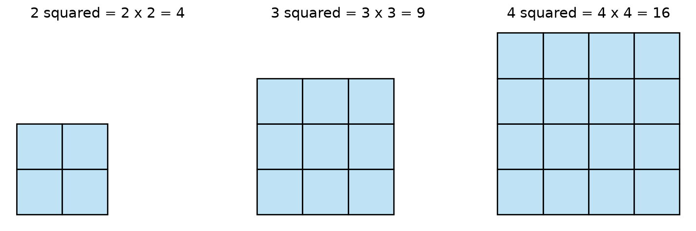
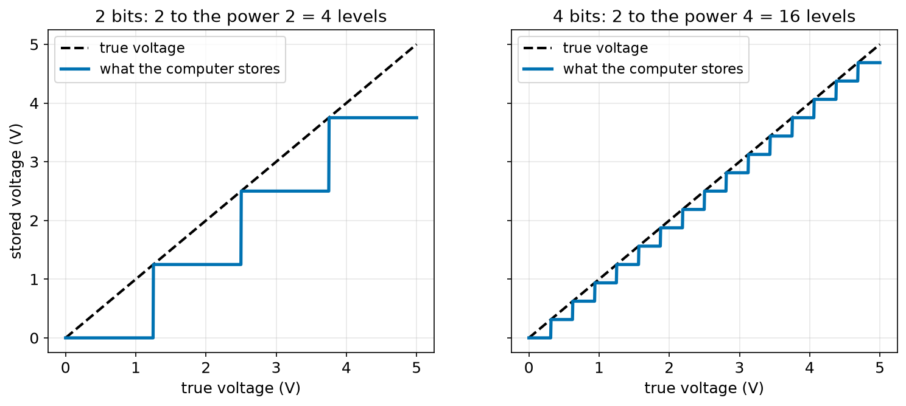
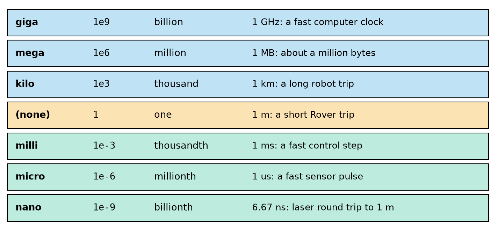
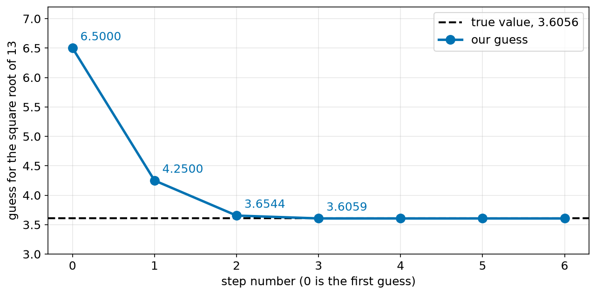
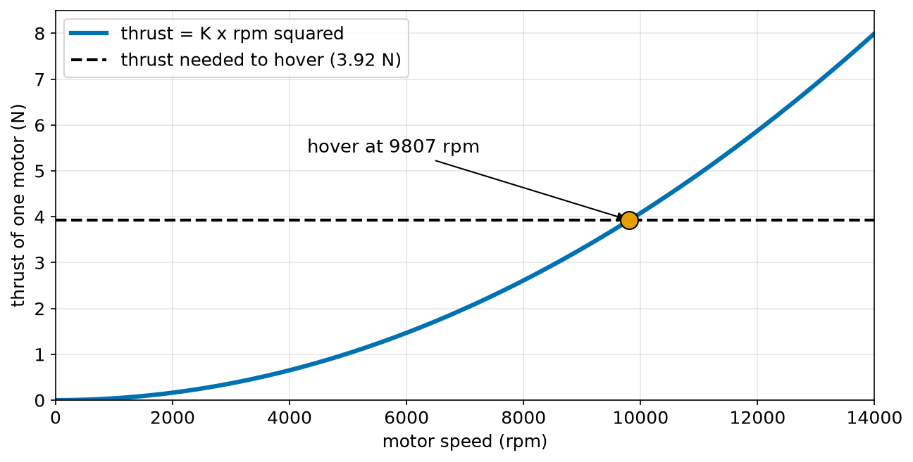

# Chapter 38 — Powers, Roots and Scientific Notation

> **Part 3 · Chapter 38 of 749**
> **You need:** Chapter 37 (numbers) and Chapter 20 (`for` loops).
> **You will make:** a table of what bits can hold, your own square root function, a sensor timing calculator, an encoder comparison for a robot arm, and a hover calculator for a drone.

---

## What you will learn

- What a power is, and how to read 2⁸.
- The five rules that make powers easy.
- Why powers of 2 appear everywhere in robot electronics.
- What a square root is, and how a computer can find one by improving a guess.
- How to write very large and very small numbers with **scientific notation**.
- The prefixes kilo, mega, milli, micro and nano.
- Why a law with a "square" in it matters so much for robots.

---

## New words in this chapter

| Word | Simple meaning |
|---|---|
| **power** | A number multiplied by itself a certain number of times. |
| **base** | The number being multiplied, such as the 2 in 2⁸. |
| **exponent** | The small raised number that says how many times, such as the 8 in 2⁸. |
| **squared** | Multiplied by itself once: 5² = 5 × 5. |
| **cubed** | Used three times: 5³ = 5 × 5 × 5. |
| **square root** | The number that gives this number when it is squared. |
| **bit** | One binary digit, either 0 or 1. |
| **resolution** | The smallest change that a sensor or converter can show. |
| **scientific notation** | Writing a number as a small number times a power of 10. |
| **prefix** | A word in front of a unit that multiplies it, such as kilo in kilometre. |
| **square law** | A rule where doubling one thing makes another four times bigger. |

---

## 38.1 What a power is

In Chapter 37 we multiplied gear stages one after another. What if every stage is the same? Three stages of 1/4 give 1/4 × 1/4 × 1/4. Writing the same thing many times is slow. Powers are a short way to write it.

Imagine a piece of paper. Fold it once and you have 2 layers. Fold it again and you have 4. Then 8. Every fold doubles the layers.

| Folds | Layers | Written as a multiplication |
|---|---|---|
| 1 | 2 | 2 |
| 2 | 4 | 2 × 2 |
| 3 | 8 | 2 × 2 × 2 |
| 4 | 16 | 2 × 2 × 2 × 2 |
| 8 | 256 | 2 × 2 × 2 × 2 × 2 × 2 × 2 × 2 |

📖 **New word: power** — a number multiplied by itself a certain number of times.

We write it with a small raised number:

```
          8    <- exponent: how many times we use the base
         2
         ^
         base: the number we multiply

2⁸ = 2 × 2 × 2 × 2 × 2 × 2 × 2 × 2 = 256
```

We read this as "two to the power eight". In Python we write `2 ** 8` (Chapter 13).

⚠️ **Careful.** 2⁸ does **not** mean 2 × 8. That is 16. The power is 256.

### Squares and cubes

A power of 2 has a special name: **squared**. The reason is in Figure 38.1.



*Figure 38.1 — A number squared is the number of small squares in a large square.*

**How to read this picture:** Each large square has the same number of small squares across and up. Count them. Making the side one unit longer adds a whole new row and a new column.

A power of 3 is called **cubed**, because 3³ = 27 is the number of small blocks in a cube with 3 blocks along each side.

🔢 **Maths.** Common squares are worth learning:

| n | 1 | 2 | 3 | 4 | 5 | 6 | 7 | 8 | 9 | 10 | 12 | 15 |
|---|---|---|---|---|---|---|---|---|---|---|---|---|
| n² | 1 | 4 | 9 | 16 | 25 | 36 | 49 | 64 | 81 | 100 | 144 | 225 |

### Negative bases

Remember from Chapter 37: minus times minus is plus.

```
(−3)² = (−3) × (−3) = 9
(−3)³ = (−3) × (−3) × (−3) = −27
```

An even power is always positive. An odd power keeps the sign.

🤖 **Robot link.** This is why robots often square an error. The size of the mistake is what counts, whether the robot is left or right of the line. Squaring turns −3 and +3 into the same 9. We will use this idea for fitting lines (Chapter 171) and for the cost in LQR control (Chapter 267).

---

## 38.2 The five rules of powers

Each rule comes from just writing out what a power means. You do not need to memorise them blindly.

### Rule 1: multiply: add the exponents

```
2³ × 2² = (2 × 2 × 2) × (2 × 2) = 2⁵

a^m × a^n = a^(m+n)
```

In words: multiplying powers of the same base means adding their exponents. (The sign `^` is a common way to write "to the power" in plain text.)

### Rule 2: divide: subtract the exponents

```
2⁵ ÷ 2² = (2 × 2 × 2 × 2 × 2) ÷ (2 × 2) = 2 × 2 × 2 = 2³

a^m ÷ a^n = a^(m−n)
```

Each 2 on the bottom cancels one 2 on the top.

### Rule 3: power of a power: multiply the exponents

```
(2³)² = 2³ × 2³ = 2⁶

(a^m)^n = a^(m×n)
```

### Rule 4: anything to the power zero is 1

Use rule 2 with equal exponents:

```
2³ ÷ 2³ = 2^(3−3) = 2⁰
But any number divided by itself is 1.
So 2⁰ = 1.
```

⚠️ **Careful.** The answer is 1, not 0. In Python `5 ** 0` is `1`.

### Rule 5: a negative exponent means "one over"

Use rule 2 again:

```
2² ÷ 2⁵ = 2^(2−5) = 2⁻³

But written out:   (2 × 2) ÷ (2 × 2 × 2 × 2 × 2) = 1 ÷ (2 × 2 × 2) = 1/2³ = 1/8

So 2⁻³ = 1/8.

a^(−n) = 1 / a^n
```

A negative exponent does **not** make the answer negative. It makes it small. `2 ** -3` is `0.125`.

🔢 **Maths.** Try all five with 10:

| Calculation | Rule | Answer |
|---|---|---|
| 10³ × 10⁴ | add | 10⁷ |
| 10⁶ ÷ 10² | subtract | 10⁴ |
| (10²)³ | multiply | 10⁶ |
| 10⁰ | zero | 1 |
| 10⁻³ | "one over" | 1/1000 = 0.001 |

---

## 38.3 Powers of 2 and bits

A computer stores everything as tiny switches, each either off or on. We write them as 0 and 1.

📖 **New word: bit** — one binary digit, either 0 or 1.

How many different patterns can a few bits make?

```
1 bit:   0  1                              -> 2 patterns
2 bits:  00  01  10  11                    -> 4 patterns
3 bits:  000 001 010 011 100 101 110 111   -> 8 patterns
```

Each extra bit **doubles** the number of patterns, just as each fold doubled the layers of paper.

```
number of patterns = 2^(number of bits)
```

Here is why 255 appeared in Chapter 37. A PWM value uses 8 bits. 2⁸ = 256 patterns, and they stand for the numbers 0 to 255.

### Analog to digital

A real voltage can take any value. A computer can only store patterns. A part called an **ADC** (Chapter 101) changes a voltage into a whole number. The number of bits decides how fine the steps are.



*Figure 38.2 — More bits means smaller steps.*

**How to read this picture:** Across the bottom is the real voltage. Up the side is what the computer stores. The black dashed line would be perfect. The blue line is a staircase, because only some values can be stored. With 4 bits, the steps are much smaller than with 2 bits.

📖 **New word: resolution** — the smallest change that a sensor or converter can show.

🔢 **Maths.** Rover's Arduino has a 10-bit ADC, and it measures from 0 to 5 V.

```
levels = 2¹⁰ = 1024
step   = 5 V ÷ 1024 = 0.00488 V, or about 4.9 thousandths of a volt
```

Any change in voltage smaller than this step cannot be seen.

💡 **Tip.** Learn these: 2⁸ = 256, 2¹⁰ = 1024, 2¹² = 4096, 2¹⁶ = 65536. You will meet them for the rest of your robotics life.

---

## 38.4 Square roots

A square has an area of 25 square metres. How long is its side? We need the number that, multiplied by itself, gives 25. That number is 5.

📖 **New word: square root** — the number that gives this number when it is squared. We write √25 = 5.

```
√25 = 5     because 5 × 5 = 25
√2  = 1.41421…   and it never ends
```

Squaring and taking a square root **undo** each other. It is like turning left and then turning right.

⚠️ **Careful.** Both 5 and −5 give 25 when squared. The sign √ always means the **positive** root. In robotics, a negative answer may still be real. For example, an arm may have two answers (Chapter 353).

⚠️ **Careful.** There is no ordinary number whose square is negative. `math.sqrt(-1)` gives a `ValueError`. Inside a robot this usually means a bug, or a point that the arm cannot reach (Chapter 351).

### A root is a fractional power

Rule 3 says (a^m)^n = a^(m×n). What is the power that, squared, gives power 1?

```
(a^(1/2))² = a^(1/2 × 2) = a¹ = a
So a^(1/2) = √a
```

In Python, `25 ** 0.5` is `5.0`. In the same way, 8^(1/3) = 2 is the **cube root** of 8.

### Rules that work, and one that does not

```
√(a × b) = √a × √b        √(4 × 9) = 6 = 2 × 3     yes
√(a + b) ≠ √a + √b        √(9 + 16) = 5, but 3 + 4 = 7     no!
```

This mistake is one of the most common in all of mathematics. Be careful about it in Chapter 48.

### How does a computer find a square root?

A nice old method improves a guess. Suppose you want √13 and you guess 6.5.

- If 6.5 is too big, then 13 ÷ 6.5 = 2 will be too small.
- The real answer lies somewhere between the two.
- So take their average: (6.5 + 2) ÷ 2 = 4.25. This is a better guess.
- Repeat.

This is called **Heron's method**. It is about 2,000 years old, but the idea is modern. Many robot methods start with a guess and improve it step by step (numerical inverse kinematics in Chapter 361 works this way).

---

## 38.5 Very big and very small numbers

Light moves at about 300,000,000 metres each second. A laser sensor measures times like 0.0000000067 seconds. Counting zeros is slow, and it is easy to get wrong.

📖 **New word: scientific notation** — writing a number as a small number times a power of 10.

```
300,000,000   = 3 × 10⁸
0.0000000067  = 6.7 × 10⁻⁹
```

The rule is: the first part is between 1 and 10, and the exponent says how many places the point moved.

- A big number: the point moved **left**. The exponent is positive.
- A small number: the point moved **right**. The exponent is negative.

🔢 **Maths.** Write 4,500 in scientific notation.

```
4500. → move the point 3 places to the left → 4.5
So 4500 = 4.5 × 10³
```

🔢 **Maths.** Write 0.0023.

```
0.0023 → move the point 3 places to the right → 2.3
So 0.0023 = 2.3 × 10⁻³
```

### In Python

Python writes `× 10` as the letter `e`.

| On paper | In Python |
|---|---|
| 3 × 10⁸ | `3e8` |
| 6.7 × 10⁻⁹ | `6.7e-9` |

⚠️ **Careful.** `e` here has nothing to do with the special number e of Chapter 52.

The format `.3e` prints a number in this form, with three digits after the point: `f"{0.0023:.3e}"` gives `2.300e-03`.

### Multiplying and dividing

Multiply the front numbers. Add the exponents. This is rule 1.

🔢 **Maths.** Time for light to go 600 m:

```
(6 × 10²) ÷ (3 × 10⁸) = (6 ÷ 3) × 10^(2−8) = 2 × 10⁻⁶ s
```

That is two millionths of a second.

### Prefixes

📖 **New word: prefix** — a word in front of a unit that multiplies it.



*Figure 38.3 — Each row is a thousand times smaller than the row above.*

**How to read this picture:** The rows go from a billion down to a billionth. The orange row is the plain unit. The second column shows the size in Python's way of writing it. The last column gives a robot example. On paper micro is written as the Greek letter μ, so a microsecond is 1 μs. On a keyboard people often write `us` instead.

Short names you will use a lot:

| Name | Short | Size |
|---|---|---|
| kilo | k | 10³ |
| mega | M | 10⁶ |
| giga | G | 10⁹ |
| milli | m | 10⁻³ |
| micro | μ | 10⁻⁶ |
| nano | n | 10⁻⁹ |

⚠️ **Careful.** Capital M (mega) and small m (milli) differ by a factor of a thousand million. 1 MΩ and 1 mΩ are very different resistors. Write these letters clearly.

Chapter 39 uses these prefixes all the time when we convert units.

---

## 38.6 Square laws

📖 **New word: square law** — a rule where doubling one thing makes another four times bigger.

| Thing | Rule | Double the input, and … |
|---|---|---|
| Area of a square | side² | 4 times the area |
| Braking distance | speed² | 4 times the distance |
| Propeller thrust | rpm² | 4 times the thrust |
| Air drag | speed² | 4 times the drag |

The opposite is an **inverse square law**: double the distance, and you get one quarter. Light from a lamp and solar power from the Sun both follow it.

⚠️ **Careful.** Our minds think in straight lines. "Twice the speed" feels like "twice the stopping distance". It is four times. Many accidents happen because of this.

---

## Code

File `code/ch038/bits_table.py`:

```python
# bits_table.py - how many values can n bits hold, and how fine is each step?
FULL_SCALE_V = 5.0

print("bits     levels  smallest step (V)")
for bits in [1, 2, 3, 8, 10, 12, 16]:
    levels = 2 ** bits
    step = FULL_SCALE_V / levels
    print(f"{bits:4d} {levels:10d} {step:18.6f}")
```

| Line | Code | What it does (simple English) |
|---|---|---|
| 1 | `# bits_table.py …` | A comment. |
| 2 | `FULL_SCALE_V = 5.0` | The largest voltage the converter measures. |
| 3 | (blank) | Spacing. |
| 4 | `print("bits     levels  smallest step (V)")` | Heading of the table. |
| 5 | `for bits in [1, 2, 3, 8, 10, 12, 16]:` | Tries common sizes. |
| 6 | `levels = 2 ** bits` | Number of patterns: 2 to the power of the bits. |
| 7 | `step = FULL_SCALE_V / levels` | One step of the staircase. |
| 8 | `print(f"…")` | Prints a row. `.6f` gives six digits after the point. |

Output:

```
bits     levels  smallest step (V)
   1          2           2.500000
   2          4           1.250000
   3          8           0.625000
   8        256           0.019531
  10       1024           0.004883
  12       4096           0.001221
  16      65536           0.000076
```

Each extra bit halves the step. Going from 10 to 12 bits gives steps 4 times smaller.

Now the square root by hand. File `code/ch038/my_sqrt.py`:

```python
# my_sqrt.py - find a square root by improving a guess (Heron's method)
import math


def my_sqrt(number, steps=6):
    if number < 0:
        raise ValueError("no real square root of a negative number")
    if number == 0:
        return 0.0
    guess = number / 2
    for step in range(1, steps + 1):
        guess = (guess + number / guess) / 2
        print(f"step {step}: guess = {guess:.10f}")
    return guess


answer = my_sqrt(13)
print("mine      :", answer)
print("math.sqrt :", math.sqrt(13))
print("difference:", abs(answer - math.sqrt(13)))
```

| Line | Code | What it does (simple English) |
|---|---|---|
| 1 | `# my_sqrt.py …` | A comment. |
| 2 | `import math` | We only use `math.sqrt` at the end, to compare. |
| 3–4 | (blank) | Spacing. |
| 5 | `def my_sqrt(number, steps=6):` | `steps` has a default value of 6 (Chapter 24). |
| 6 | `if number < 0:` | Negative numbers have no real root. |
| 7 | `raise ValueError("…")` | Stops with a clear error (Chapter 25). |
| 8 | `if number == 0:` | Zero would cause a divide by zero later. |
| 9 | `return 0.0` | The root of 0 is 0. |
| 10 | `guess = number / 2` | Our first guess: half the number. |
| 11 | `for step in range(1, steps + 1):` | Repeats, counting 1, 2, … 6. |
| 12 | `guess = (guess + number / guess) / 2` | Heron's step: the average of the guess and number ÷ guess. |
| 13 | `print(f"step {step}: …")` | Shows the guess with ten decimal places. |
| 14 | `return guess` | Gives back the last guess. |
| 15–16 | (blank) | Spacing. |
| 17 | `answer = my_sqrt(13)` | Calls the function for √13. |
| 18 | `print("mine      :", answer)` | Our answer. |
| 19 | `print("math.sqrt :", math.sqrt(13))` | Python's answer. |
| 20 | `print("difference:", abs(answer - math.sqrt(13)))` | How far apart they are, ignoring the sign. |

Output:

```
step 1: guess = 4.2500000000
step 2: guess = 3.6544117647
step 3: guess = 3.6058779145
step 4: guess = 3.6055512903
step 5: guess = 3.6055512755
step 6: guess = 3.6055512755
mine      : 3.6055512754639896
math.sqrt : 3.605551275463989
difference: 4.440892098500626e-16
```



*Figure 38.4 — The guess reaches the true value in a few steps.*

**How to read this picture:** Across the bottom is the step number. Up the side is the guess. The black dashed line is the true value. The blue guess falls quickly, and from step 3 you can no longer see the difference.

The last line is written in scientific notation. The difference is 4.44 × 10⁻¹⁶, which is 0.000000000000000444. Chapter 54 explains why it is not exactly zero. In Chapter 26 we saw a robot 3.606 m from a goal at (2, 3). That number was √13.

Next, very small times. File `code/ch038/sci_notation.py`:

```python
# sci_notation.py - how long does a sensor signal take to come back from 1 metre?
SPEED_OF_LIGHT = 3e8        # metres per second
SPEED_OF_SOUND = 343        # metres per second, in air at about 20 degrees C

distance_m = 1.0

laser_time_s = 2 * distance_m / SPEED_OF_LIGHT
sound_time_s = 2 * distance_m / SPEED_OF_SOUND

print(f"laser: {laser_time_s:.3e} s = {laser_time_s * 1e9:.2f} ns")
print(f"sound: {sound_time_s:.3e} s = {sound_time_s * 1e3:.2f} ms")
print(f"sound takes {sound_time_s / laser_time_s:.2e} times longer")
```

| Line | Code | What it does (simple English) |
|---|---|---|
| 1 | `# sci_notation.py …` | A comment. |
| 2 | `SPEED_OF_LIGHT = 3e8` | 3 × 10⁸ metres per second. |
| 3 | `SPEED_OF_SOUND = 343` | The speed of sound in air. |
| 4 | (blank) | Spacing. |
| 5 | `distance_m = 1.0` | The object is 1 m away. |
| 6 | (blank) | Spacing. |
| 7 | `laser_time_s = 2 * distance_m / SPEED_OF_LIGHT` | Time = distance ÷ speed. The factor 2 is there because the signal goes out **and** comes back. |
| 8 | `sound_time_s = 2 * distance_m / SPEED_OF_SOUND` | The same sum for sound. |
| 9 | (blank) | Spacing. |
| 10 | `print(f"laser: {laser_time_s:.3e} s = {laser_time_s * 1e9:.2f} ns")` | Multiplying by 10⁹ converts seconds into nanoseconds. |
| 11 | `print(f"sound: …")` | Multiplying by 10³ converts seconds into milliseconds. |
| 12 | `print(f"sound takes …")` | The ratio of the two times. |

Output:

```
laser: 6.667e-09 s = 6.67 ns
sound: 5.831e-03 s = 5.83 ms
sound takes 8.75e+05 times longer
```

A laser needs electronics that can measure billionths of a second. An ultrasonic sensor needs only thousandths, so a cheap Arduino is fast enough. That is one reason an ultrasonic sensor is so much cheaper.

---

## Small examples

**Example 1.** 3⁴ = 3 × 3 × 3 × 3 = 81.

**Example 2.** 4^(1/2) = √4 = 2.

**Example 3.** 2⁻¹ = 1/2 = 0.5.

**Example 4.** A 3-bit counter can count from 0 to 2³ − 1 = 7.

**Example 5.** √144 = 12. Check: 12 × 12 = 144.

**Example 6.** 2,640 ticks = 2.64 × 10³ ticks.

**Example 7.** 2.5 ms = 2.5 × 10⁻³ s = 0.0025 s.

**Example 8.** (2 × 10³) × (4 × 10⁴) = 8 × 10⁷.

**Example 9.** A robot goes twice as fast. Its air drag becomes 2² = 4 times bigger.

---

## 🏭 Real robot applications

### Application 1 (worked in full) — 🏭 How many bits does an arm joint need?

**1. The real problem.** A factory arm has a link 0.8 m long. The motor's encoder tells the computer the angle of the joint. A tiny step in angle moves the far end of the link by a much bigger distance. How many bits does the encoder need?

**2. Why this theory.** The number of positions an encoder reports is 2 to the power of its bits. Each extra bit halves the step.

**3. The numbers.** The link is 0.8 m long. We want a step at the tip of well under 0.1 mm. Encoders with 10, 12, 14, 17 and 20 bits are compared.

**4. The maths.** One full turn is 360°. As the tip moves all the way round, it moves along a circle of length 2 × π × 0.8 = 5.027 m. (You met this in Chapter 13, and Chapter 48 explains it.)

```
For 12 bits:
  counts  = 2¹²  = 4096
  step    = 360 ÷ 4096 = 0.08789°
  tip     = 5.027 m ÷ 4096 = 0.001227 m = 1.227 mm

For 17 bits:
  counts  = 2¹⁷ = 131072
  step    = 360 ÷ 131072 = 0.00275°
  tip     = 5.027 m ÷ 131072 = 0.0000383 m = 0.0383 mm
```

**5. The code.** File `code/ch038/encoder_resolution.py`:

```python
# encoder_resolution.py - how much do more bits help the tip of an arm?
import math

ARM_LENGTH_M = 0.8

print("bits     counts  step (deg)  tip step (mm)")
for bits in [10, 12, 14, 17, 20]:
    counts = 2 ** bits
    step_deg = 360 / counts
    tip_step_mm = 2 * math.pi * ARM_LENGTH_M / counts * 1000
    print(f"{bits:4d} {counts:10d} {step_deg:11.5f} {tip_step_mm:14.4f}")
```

| Line | Code | What it does (simple English) |
|---|---|---|
| 1 | `# encoder_resolution.py …` | A comment. |
| 2 | `import math` | For `math.pi`. |
| 3 | (blank) | Spacing. |
| 4 | `ARM_LENGTH_M = 0.8` | The distance from the joint to the tip. |
| 5 | (blank) | Spacing. |
| 6 | `print("bits …")` | The table heading. |
| 7 | `for bits in [10, 12, 14, 17, 20]:` | Tries five encoders. |
| 8 | `counts = 2 ** bits` | Positions in one turn. |
| 9 | `step_deg = 360 / counts` | Degrees in one step. |
| 10 | `tip_step_mm = 2 * math.pi * ARM_LENGTH_M / counts * 1000` | Circle length ÷ counts, then × 1000 to get millimetres. |
| 11 | `print(f"…")` | Prints one row. |

Output:

```
bits     counts  step (deg)  tip step (mm)
  10       1024     0.35156         4.9087
  12       4096     0.08789         1.2272
  14      16384     0.02197         0.3068
  17     131072     0.00275         0.0383
  20    1048576     0.00034         0.0048
```

**6. The result.** A 10-bit encoder would put the tip in steps of nearly 5 mm, which is useless for careful work. 17 bits gives steps of 0.04 mm, and that meets our goal. Without this sum, you could buy the wrong sensor. You would find out only when the arm could not hit the target.

**7. Going further.** A real joint often has a gear between the motor and the link, so an encoder on the motor gets extra steps for free (Chapter 37: a 50:1 gear gives 50 times finer steps at the link). Some robots add a second encoder on the link itself. Resolution is also different from accuracy. Chapter 114 explains why, and backlash in gears adds more error. Bits alone do not make an accurate robot.

### Application 2 (worked in full) — 🚁 How fast must a drone spin to hover?

**1. The real problem.** A quadcopter must make enough lift to hold itself up. What motor speed is needed? And what happens if we add a heavy camera?

**2. Why this theory.** The thrust of a propeller follows a square law: `thrust = K × rpm²`. Going from a required thrust back to a speed needs a square root. The number K is so small that scientific notation is the natural way to write it.

**3. The numbers.** The drone has a mass of 1.6 kg, and 4 motors. On a test stand, one motor gives 8 N at its top speed of 14,000 rpm. Gravity pulls with 9.81 N on each kilogram (Chapter 62). These are example numbers, close to those of a small camera drone.

**4. The maths.**

```
Find K from the test:
  K = thrust ÷ rpm² = 8 ÷ 14000² = 8 ÷ 196,000,000 = 4.08 × 10⁻⁸

Thrust each motor must give:
  1.6 × 9.81 ÷ 4 = 3.92 N

Rearranged rule (Chapter 41 teaches this properly):
  rpm = √(thrust ÷ K)
  rpm = √(3.92 ÷ 0.0000000408) = √96,200,000 ≈ 9,807 rpm

Heaviest possible drone:
  total thrust = 4 × 8 N = 32 N
  32 ÷ 9.81 = 3.26 kg
```



*Figure 38.5 — Thrust grows with the square of the motor speed.*

**How to read this picture:** Across the bottom is the motor speed. Up the side is the thrust. The blue curve is the rule. It starts flat and then gets steeper. The dashed line is the thrust needed. The orange dot is where they meet, at 9,807 rpm.

**5. The code.** File `code/ch038/hover_rpm.py`:

```python
# hover_rpm.py - motor speed needed to hover, from thrust = K x rpm squared
import math

K = 4.08e-8        # newtons per (rpm squared), from a test: 8 N at 14000 rpm
GRAVITY = 9.81
MOTORS = 4
MAX_RPM = 14000

print("mass (kg)  thrust each (N)    rpm   % of max")
for mass_kg in [1.6, 1.92, 2.4, 3.2]:
    thrust_each = mass_kg * GRAVITY / MOTORS
    rpm = math.sqrt(thrust_each / K)
    print(f"{mass_kg:9.2f} {thrust_each:16.2f} {rpm:6.0f} {rpm / MAX_RPM:9.0%}")

max_total_thrust = MOTORS * K * MAX_RPM ** 2
print(f"maximum total thrust: {max_total_thrust:.1f} N")
print(f"heaviest it can hover: {max_total_thrust / GRAVITY:.2f} kg")
```

| Line | Code | What it does (simple English) |
|---|---|---|
| 1 | `# hover_rpm.py …` | A comment. |
| 2 | `import math` | For `math.sqrt`. |
| 3 | (blank) | Spacing. |
| 4 | `K = 4.08e-8` | The propeller's number, 4.08 × 10⁻⁸. |
| 5 | `GRAVITY = 9.81` | Newtons of weight per kilogram. |
| 6 | `MOTORS = 4` | The number of motors. |
| 7 | `MAX_RPM = 14000` | Fastest motor speed. |
| 8 | (blank) | Spacing. |
| 9 | `print("mass (kg) …")` | The heading. |
| 10 | `for mass_kg in [1.6, 1.92, 2.4, 3.2]:` | Tries four weights. |
| 11 | `thrust_each = mass_kg * GRAVITY / MOTORS` | Weight shared between the motors. |
| 12 | `rpm = math.sqrt(thrust_each / K)` | The square law, turned round. |
| 13 | `print(f"… {rpm / MAX_RPM:9.0%}")` | `.0%` prints a percentage with no decimals. |
| 14 | (blank) | Spacing. |
| 15 | `max_total_thrust = MOTORS * K * MAX_RPM ** 2` | Thrust at full speed. The power is done before the multiplying (Chapter 37). |
| 16 | `print(f"maximum total thrust: …")` | Shows it. |
| 17 | `print(f"heaviest it can hover: …")` | Thrust ÷ gravity gives mass. |

Output:

```
mass (kg)  thrust each (N)    rpm   % of max
     1.60             3.92   9807       70%
     1.92             4.71  10743       77%
     2.40             5.89  12011       86%
     3.20             7.85  13869       99%
maximum total thrust: 32.0 N
heaviest it can hover: 3.26 kg
```

**6. The result.** A camera that adds 20% to the mass (1.92 kg) needs only about 9.5% more rpm. That is a great feature of a square root. But at 3.2 kg the drone hovers at 99% of top speed, so it has nothing left for steering. It would be impossible to control.

**7. Going further.** Designers want the total thrust to be at least twice the weight (Chapter 622). Real K values come from measured thrust tables (Chapter 619), and they change with air density and battery voltage. Chapter 618 shows the full propeller maths.

### Application 3 — 🗺️ How exact must a LiDAR's clock be?

A LiDAR measures distance by timing light (Chapter 132). To tell the difference of 1 cm, it must notice a change in the round trip of 2 × 0.01 ÷ (3 × 10⁸) = 6.67 × 10⁻¹¹ s. That is 66.7 trillionths of a second, or **66.7 picoseconds**. A normal computer loop could never do this, so real LiDARs use special chips, and many use clever tricks with the wave shape of the light.

### Application 4 — 🚜 Why a heavy farm robot must slow down near people

A farm robot brakes at 1.5 m/s². Its stopping distance follows the square law v² ÷ (2 × 1.5). At 1 m/s it stops in 0.33 m. At 2 m/s it needs 1.33 m. At 4 m/s it needs 5.33 m. Going 4 times faster takes 16 times the distance. This is why safety systems make the safe zone around a robot grow quickly as its speed rises (Chapter 59 derives the formula, and Chapter 744 covers safety rules).

### Application 5 — 🛰️ Solar power far from the Sun

Solar power follows the inverse square law. Mars is about 1.52 times further from the Sun than Earth. So a solar panel on Mars gets 1 ÷ 1.52² = 0.43 of its Earth power at best, which is 43%. Jupiter is 5.2 times as far away. There, the panel gets 1 ÷ 5.2² = 0.037, or 3.7%. A power budget (Chapter 151) must include this square law, or a mission will run out of energy. This is why spacecraft going so far need huge solar panels, or nuclear power sources.

---

## 🔧 Hands-on lab

### Lab 38.1 — Fold paper (hardware, one sheet)

1. Fold a sheet of paper in half as many times as you can. Write down how many folds you managed.
2. Compute the number of layers: `print(2 ** folds)`.
3. A sheet is about 0.1 mm thick. Compute the height of the fold: `print(2 ** folds * 0.1, "mm")`.
4. Compute how tall a stack would be after 30 folds: `print(2 ** 30 * 0.1 / 1000 / 1000, "km")`.

**What you should see:** Most people manage 6 to 8 folds, which is 64 to 256 layers. The 30-fold stack is about 107 km high. Doubling grows very fast.

| If it does not work | Likely cause | Fix |
|---|---|---|
| You get 0 | You typed `2 * 30` or you wrote the wrong order | Use `2 ** 30` |
| The stack answer is very large | You forgot one conversion | Divide by 1000 twice: mm to m, then m to km |

**Challenge:** How many folds would it take to reach the Moon, 384,400 km away? Use a loop that doubles until the height is large enough.

### Lab 38.2 — Race Heron's method (simulation)

Copy `my_sqrt.py`.

1. Change the call to `my_sqrt(2)`.
2. Change it to `my_sqrt(1000000)` and watch how many steps it needs.
3. Add `steps=15`.
4. Change the first guess to `guess = 1.0` and repeat.

**What you should see:** √2 settles within a few steps at 1.4142135624. For 1,000,000, six steps are **not enough** with a first guess of half the number, but 15 steps settle at 1000. With `guess = 1.0` the result for 1,000,000 is almost the same, because the first step jumps to about 500,000 anyway. A poor starting guess costs extra steps, but the method still works.

| If it does not work | Likely cause | Fix |
|---|---|---|
| `TypeError` about `steps` | You wrote `my_sqrt(1000000, step=15)` | The name is `steps` |
| `ZeroDivisionError` | The first guess became 0 | Use a non-zero first guess |

**Challenge:** Change the function so that it stops by itself when two guesses in a row differ by less than 1e-9, and returns the number of steps used.

### Lab 38.3 — Sound and light timing (simulation)

Change `distance_m` in `sci_notation.py` to 0.02, then 4, then 40.

**What you should see:** At 4 m the sound takes about 23.3 ms and the laser about 26.7 ns. The ratio does not change at all. At 40 m the sound takes 233 ms, which means an ultrasonic sensor could give only about 4 readings each second.

| If it does not work | Likely cause | Fix |
|---|---|---|
| The times look too small | You forgot the `2 *` | Round trip means twice the distance |
| `nan` or `inf` | The speed is 0 | Do not change the speed constants to 0 |

**Challenge:** Your robot needs 20 readings each second from an ultrasonic sensor. What is the greatest distance it can measure before the next pulse must leave?

---

## Common mistakes

⚠️ **Thinking 2⁸ means 2 × 8.** Powers multiply the base by itself.

⚠️ **Thinking x⁰ = 0.** It is 1.

⚠️ **Thinking a negative exponent gives a negative number.** 2⁻³ = 0.125.

⚠️ **Splitting a root over a sum.** √(a + b) is not √a + √b.

⚠️ **Forgetting about the round trip.** For sensors that send and receive, the signal travels twice the distance.

⚠️ **Confusing m and M.** Milli and mega differ by a factor of 10⁹.

⚠️ **Using `^` for a power in Python.** In Python, `2 ^ 8` is something completely different. It gives 10, because `^` is an operator for working with bits. Use `**`.

⚠️ **Believing that resolution is accuracy.** A sensor may show 6 digits and still be wrong.

---

## Practice

🏋️ **1.** Work out 3³, 2⁷ and 10⁵.

🏋️ **2.** Simplify using the rules: 5⁴ × 5², 7⁹ ÷ 7⁶, (2³)⁴.

🏋️ **3.** Work out 2⁻², 10⁻¹ and 9⁰.

🏋️ **4.** A 14-bit ADC measures 0 to 3.3 V. How big is each step?

🏋️ **5.** Without a calculator, what is √81 and √(0.25)?

🏋️ **6.** Start from a guess of 3 and do two steps of Heron's method for √10.

🏋️ **7.** Write 72,000,000 and 0.000045 in scientific notation.

🏋️ **8.** How many microseconds are in 2.5 ms?

🏋️ **9.** A propeller gives 2 N at 5,000 rpm. Using the square law, what does it give at 10,000 rpm? At 15,000 rpm?

🏋️ **10.** An ultrasonic echo comes back after 3.5 ms. The speed of sound is 343 m/s. How far away is the wall?

🏋️ **11.** Write a function `bits_needed(levels)` that returns the smallest number of bits able to hold that number of levels. Use a `while` loop. Test it with 2, 256, 257 and 1000.

---

## Answers

**1.** 27, 128 and 100,000.

**2.** 5⁶; 7³; 2¹².

**3.** 1/4 = 0.25; 0.1; 1.

**4.** 2¹⁴ = 16384. 3.3 ÷ 16384 = 0.000201 V, about 0.2 millivolts.

**5.** √81 = 9. √0.25 = 0.5, because 0.5 × 0.5 = 0.25. A root of a number below 1 is bigger than the number.

**6.** Step 1: (3 + 10/3) ÷ 2 = (3 + 3.3333) ÷ 2 = 3.1667. Step 2: (3.1667 + 10/3.1667) ÷ 2 = (3.1667 + 3.1579) ÷ 2 = 3.1623. The true value is 3.16228.

**7.** 7.2 × 10⁷ and 4.5 × 10⁻⁵.

**8.** 2.5 ms = 2.5 × 10⁻³ s = 2,500 × 10⁻⁶ s, which is 2,500 μs.

**9.** Twice the speed: 2² = 4 times, so 8 N. Three times the speed: 3² = 9 times, so 18 N.

**10.** Total path = 343 × 0.0035 = 1.2005 m. The wall is half of that: about 0.60 m.

**11.**

```python
def bits_needed(levels):
    bits = 0
    while 2 ** bits < levels:
        bits = bits + 1
    return bits

for levels in [2, 256, 257, 1000]:
    print(levels, bits_needed(levels))
```

The results are 1, 8, 9 and 10. 256 levels fit exactly into 8 bits, but one more level needs a whole extra bit.

---

## Summary

🧠 A power is repeated multiplication. 2⁸ means eight 2s multiplied together.

🧠 Multiply powers by adding exponents. Divide by subtracting. x⁰ = 1. x⁻ⁿ = 1/xⁿ.

🧠 n bits hold 2ⁿ different patterns. Each extra bit halves the step.

🧠 A square root undoes a square, and a computer can find it by improving a guess.

🧠 Scientific notation writes 3 × 10⁸ as `3e8`. Multiply the front numbers, and add the exponents.

🧠 Kilo, mega and giga make things bigger. Milli, micro and nano make them smaller. Each step is 1000.

🧠 In a square law, doubling one thing makes the other four times bigger.

---

## Next chapter

In Chapter 39 we turn to **units and measurement**. A number on its own means very little to a robot. A spacecraft was once lost because two teams used different units, and we will make sure that your robot never does that.
