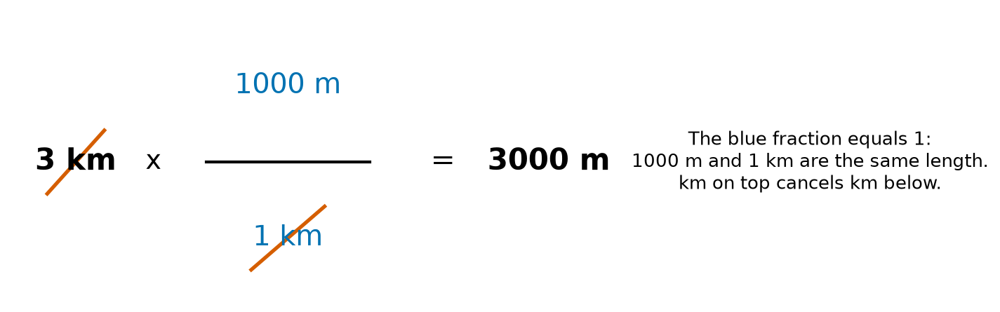
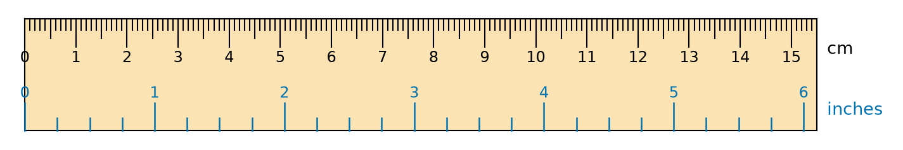
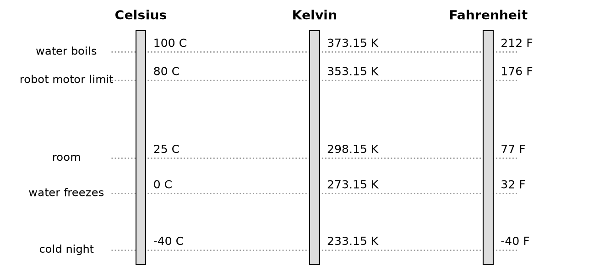
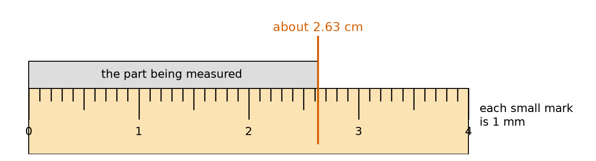
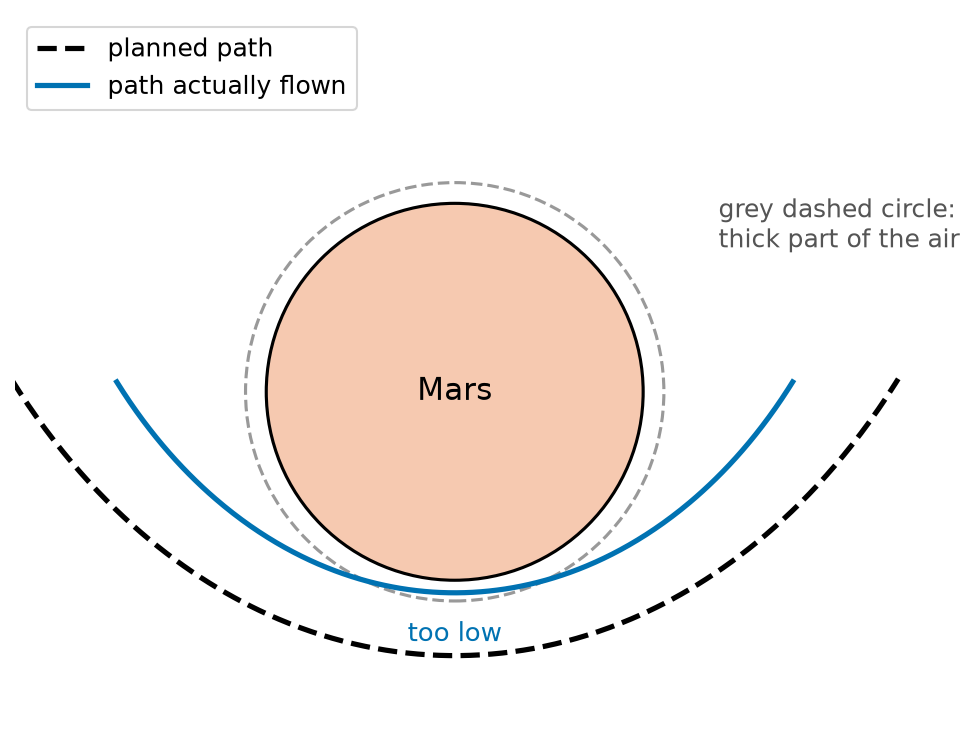
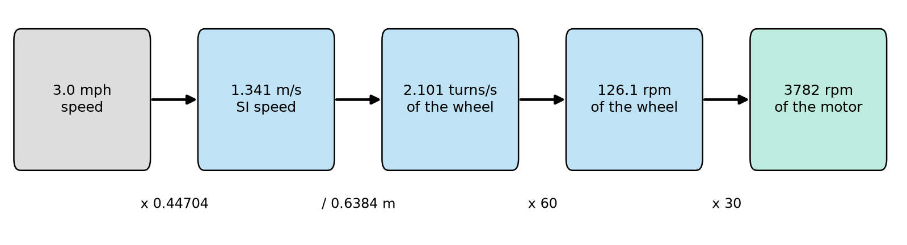

# Chapter 39 — Units and Measurement: SI Units, Converting Units

> **Part 3 · Chapter 39 of 749**
> **You need:** Chapter 37 (fractions) and Chapter 38 (powers and prefixes). A ruler or tape measure helps.
> **You will make:** a unit converter, a set of everyday robot conversions, a number that knows its own unit, and a program that reads a mixed-unit data sheet and tells you what motor to buy.

---

## What you will learn

- Why a number alone means nothing.
- The basic units of the **SI** system, and the units built from them.
- A way of converting units that always works.
- How to use units to check whether a formula can be right.
- The trap with temperature conversions.
- How to measure something properly and how to report how sure you are.

---

## New words in this chapter

| Word | Simple meaning |
|---|---|
| **unit** | The agreed size that we measure with, such as the metre. |
| **quantity** | Something that can be measured: a number and a unit together. |
| **SI** | The International System of Units, used all over the world in science. |
| **base unit** | One of the seven SI units that the others are built from. |
| **derived unit** | A unit made from base units, such as metres per second. |
| **conversion factor** | A number that changes one unit into another. |
| **dimensional check** | Using units to test if a formula makes sense. |
| **tolerance** | How far a real size may differ from the planned size. |
| **uncertainty** | How far a measurement might be from the true value. |
| **significant figures** | The digits of a number that really carry information. |

---

## 39.1 A number alone means nothing

Someone says: "The wall is 40 away."

40 what? 40 millimetres is almost touching. 40 metres is across a playing field. 40 kilometres is in another town. A robot which mixes these up will crash or will stop for nothing.

📖 **New word: unit** — the agreed size that we measure with.

📖 **New word: quantity** — something that can be measured. It is a number and a unit together.

```
       40 cm
       ^  ^
  number  unit
```

🧠 **Remember:** Always keep the unit with the number. When you write code, put the unit in the name of the variable: `distance_m`, `time_s`, `speed_rpm`. You have been doing this since Chapter 14.

---

## 39.2 The SI system

Long ago, a "foot" was the length of someone's foot, so it changed from town to town. Today nearly the whole world uses one agreed system.

📖 **New word: SI** — the International System of Units. It is built from seven **base units**:

| Quantity | Unit | Short | Where robots use it |
|---|---|---|---|
| length | metre | m | wheels, arms, maps |
| mass | kilogram | kg | robot weight, payload |
| time | second | s | loops, speed |
| electric current | ampere | A | motors, batteries |
| temperature | kelvin | K | motor and battery heat |
| amount of substance | mole | mol | chemistry, rarely in robots |
| light intensity | candela | cd | lamps, rarely in robots |

All other units are built by multiplying and dividing these. They are called **derived units**:

| Quantity | Unit | Built from | Chapter |
|---|---|---|---|
| speed | metre per second, m/s | m ÷ s | 57 |
| acceleration | m/s² | m ÷ s ÷ s | 58 |
| force | newton, N | kg × m ÷ s² | 61 |
| torque | newton metre, N m | N × m | 65 |
| energy | joule, J | N × m | 67 |
| power | watt, W | J ÷ s | 67 |
| frequency | hertz, Hz | one per second | 30 |
| voltage | volt, V | W ÷ A | 74 |
| resistance | ohm, Ω | V ÷ A | 74 |

⚠️ **Careful.** Mass and weight are different things (Chapter 62). Mass is measured in kilograms. Weight is a force, measured in newtons.

💡 **Tip.** Some units are not SI, but are very common with robots. Hours, milliamp-hours, rpm (turns per minute), degrees and inches all appear on data sheets. So you will be converting them often.

---

## 39.3 The conversion method that always works

Here is the idea. 1 km and 1000 m are the **same length**. So this fraction is equal to 1:

```
1000 m
------ = 1
 1 km
```

Multiplying by 1 changes nothing. But it does change the **unit**. Look at Figure 39.1.



*Figure 39.1 — The unit cancels just like a number in a fraction.*

**How to read this picture:** The blue fraction is equal to 1, because its top and bottom are the same length. The red lines show that km on top cancels km on the bottom. Only m remains.

📖 **New word: conversion factor** — a number that changes one unit into another.

### The method

1. Write down what you have.
2. Multiply by a fraction equal to 1.
3. Choose it so that the old unit is on the **bottom** and the new unit is on the **top**.
4. Check that the old unit cancels.

🔢 **Maths.** Change 75 cm into metres.

```
         1 m
75 cm × ------- = 0.75 m
         100 cm
```

🔢 **Maths.** Change 2 hours into seconds. Use two steps.

```
         60 min     60 s
2 h  ×  -------- × ------- = 7200 s
          1 h       1 min
```

🔢 **Maths.** Change 6 km/h into m/s.

```
6 km     1000 m      1 h
----- × -------- × -------- = 6000 m / 3600 s = 1.667 m/s
 1 h      1 km      3600 s
```

So the short rule is: to get m/s, divide km/h by 3.6.

🤖 **Robot link.** A walking person goes at about 5 km/h, which is 1.4 m/s. Remember this number. Robots that share a corridor with people usually move at or below it.

⚠️ **Careful.** If the unit does not cancel, your fraction is upside down. Try `75 cm × 100 cm / 1 m`. The result would be in cm²/m, which is nonsense, so you know that something is wrong. The units themselves caught the mistake.

### Converting areas and volumes

An area has **two** lengths in it, so we must convert twice.

🔢 **Maths.** A sheet of metal is 3,500 cm². How many square metres is that?

```
                1 m       1 m
3500 cm²  ×   ------- × -------  = 3500 ÷ 10000 = 0.35 m²
               100 cm    100 cm
```

So 1 m² is 10,000 cm², and **not** 100 cm². Volumes have three lengths: 1 m³ is 1,000,000 cm³. Chapter 38 helps: (10²)² = 10⁴ and (10²)³ = 10⁶.

### Non-metric units

Data sheets from some countries use inches, feet and pounds. Figure 39.2 compares a centimetre and an inch.



*Figure 39.2 — 1 inch is exactly 2.54 cm.*

**How to read this picture:** The black marks above are centimetres. The blue marks below are inches. The blue "1" lines up with 2.54 on the black scale. The numbers do not match, but the ruler is the same length.

Useful exact values are: 1 in = 2.54 cm, 1 ft = 0.3048 m, 1 mile = 1609.344 m, and 1 lb = 0.45359237 kg.

---

## 39.4 Checking a formula with units

Units follow the same rules as numbers. This gives us a free way to catch mistakes.

📖 **New word: dimensional check** — using units to test if a formula makes sense.

Suppose you are not sure if distance = speed × time, or speed ÷ time. Try the units:

```
speed × time:  (m / s) × s = m       a distance, correct
speed ÷ time:  (m / s) ÷ s = m / s²  an acceleration, wrong
```

🔢 **Maths.** Does the rule `stopping distance = v² ÷ (2 × a)` from Chapter 38 have correct units?

```
(m/s)² ÷ (m/s²) = (m²/s²) × (s²/m) = m
```

Yes, it gives metres.

There is one strict rule: **you can only add and subtract things with the same unit.** 3 m + 2 s has no meaning. Multiplying different units is fine, and it makes a new unit.

⚠️ **Careful.** A correct unit does not prove that a formula is right. `distance = 2 × speed × time` has correct units but the wrong number. A wrong unit, though, always proves that a formula is wrong.

---

## 39.5 Temperature is different

Most conversions just multiply. Temperature also **shifts** the zero point. Look at Figure 39.3.



*Figure 39.3 — The same temperatures on three scales.*

**How to read this picture:** Each dotted line is one temperature. Follow it across and read off its value on each scale. Kelvin is the Celsius value plus 273.15. At −40, the Celsius and Fahrenheit scales happen to agree.

```
K = °C + 273.15
°F = °C × 9/5 + 32
```

Kelvin starts at **absolute zero**, the coldest temperature possible.

🔢 **Maths.** A motor is at 80 °C.

```
80 + 273.15 = 353.15 K
80 × 9/5 + 32 = 144 + 32 = 176 °F
```

⚠️ **Careful.** A **change** in temperature does not use the shift. A rise of 10 °C is a rise of 10 K, and a rise of 18 °F. If you convert a change with the formula above, you get a wrong answer.

---

## 39.6 Measuring properly

Look at Figure 39.4. A small part is placed against a ruler.



*Figure 39.4 — Between two marks, we must estimate.*

**How to read this picture:** The grey part starts at 0. The red line shows where it ends. That is between 2.6 and 2.7 cm. We estimate that it is about 2.63 cm. The last digit is a guess.

### Uncertainty

📖 **New word: uncertainty** — how far a measurement might be from the true value.

We write it with ±, which means "plus or minus":

```
2.63 ± 0.05 cm  means the true length is probably between 2.58 and 2.68 cm.
```

A simple guide: with a basic scale, the uncertainty is about half of the smallest mark. Here that is 0.5 mm.

### Tolerance

📖 **New word: tolerance** — how far a real size may differ from the planned size.

A shaft designed as 6.00 mm ± 0.02 mm may be from 5.98 to 6.02 mm. Tolerance is about what you **allow**. Uncertainty is about what you **know**.

### Measure several times

Measurements differ. Measure a few times and use the average, as we did in Chapter 21. A single measurement can have a large error.

Also check for:

- **Parallax:** looking at a scale from the side makes it seem to shift. Look straight on.
- **The zero:** a worn ruler may not start at exactly 0. Start at a mark like 1 cm and subtract.
- **Wrong tool:** do not measure a 0.1 mm gap with a school ruler.

### Significant figures

📖 **New word: significant figures** — the digits of a number that really carry information.

| Number | Significant figures | Why |
|---|---|---|
| 2.63 | 3 | all the digits count |
| 0.0045 | 2 | leading zeros only place the point |
| 0.00450 | 3 | the last zero says that we measured that far |
| 1200 | unclear | write 1.2 × 10³ or 1.20 × 10³ to be clear |

A calculator gives many digits, but they are not all real. If your input is good to 2 digits, your answer is good to about 2 digits as well. A speed of `0.4142857142` m/s is silly when the wheel size is only known to 3 digits. Round it to 0.414 m/s.

🤖 **Robot link.** In Chapter 16 you calibrated Rover's wheel. A wheel that is 1.35% off puts the robot 13.5 cm out after 10 m. Calibration is a careful measurement that replaces a data sheet value (Chapter 133).

---

## Code

File `code/ch039/convert.py`:

```python
# convert.py - change a length from any unit to any other unit
TO_METRES = {
    "mm": 0.001,
    "cm": 0.01,
    "m": 1.0,
    "km": 1000.0,
    "in": 0.0254,
    "ft": 0.3048,
}


def convert(value, from_unit, to_unit):
    metres = value * TO_METRES[from_unit]
    return metres / TO_METRES[to_unit]


print(f"1.012 m  = {convert(1.012, 'm', 'mm'):.1f} mm")
print(f"8 in     = {convert(8, 'in', 'cm'):.2f} cm")
print(f"5280 ft  = {convert(5280, 'ft', 'km'):.4f} km")
print(f"65.89 mm = {convert(65.89, 'mm', 'in'):.3f} in")
```

| Line | Code | What it does (simple English) |
|---|---|---|
| 1 | `# convert.py …` | A comment. |
| 2 | `TO_METRES = {` | Starts a dictionary (Chapter 22). Each unit is a key. |
| 3 | `"mm": 0.001,` | One millimetre is 0.001 metres. |
| 4 | `"cm": 0.01,` | One centimetre is 0.01 metres. |
| 5 | `"m": 1.0,` | One metre is one metre. |
| 6 | `"km": 1000.0,` | One kilometre is 1000 metres. |
| 7 | `"in": 0.0254,` | One inch, exactly. |
| 8 | `"ft": 0.3048,` | One foot, exactly. |
| 9 | `}` | Ends the dictionary. |
| 10–11 | (blank) | Spacing. |
| 12 | `def convert(value, from_unit, to_unit):` | Three inputs: the number and the two unit names. |
| 13 | `metres = value * TO_METRES[from_unit]` | First convert into metres. |
| 14 | `return metres / TO_METRES[to_unit]` | Then convert from metres to the unit wanted. |
| 15–16 | (blank) | Spacing. |
| 17 | `print(f"1.012 m  = …")` | Metres to millimetres. The inner text uses `'` because the outer uses `"`. |
| 18 | `print(f"8 in     = …")` | Inches to centimetres. |
| 19 | `print(f"5280 ft  = …")` | Feet to kilometres. 5280 feet is one mile. |
| 20 | `print(f"65.89 mm = …")` | Millimetres to inches. |

Output:

```
1.012 m  = 1012.0 mm
8 in     = 20.32 cm
5280 ft  = 1.6093 km
65.89 mm = 2.594 in
```

Why go through metres? With 6 units there are 30 possible pairs. Writing 30 factors would invite mistakes. With one common unit, we need just 6 numbers. Adding a new unit needs only one more line.

File `code/ch039/speed_and_temperature.py`:

```python
# speed_and_temperature.py - conversions a robot meets every day
import math


def kmh_to_ms(kmh):
    return kmh * 1000 / 3600


def wheel_speed_ms(rpm, diameter_m):
    turns_per_second = rpm / 60
    return turns_per_second * math.pi * diameter_m


def celsius_to_kelvin(celsius):
    return celsius + 273.15


def celsius_to_fahrenheit(celsius):
    return celsius * 9 / 5 + 32


print(f"6 km/h is {kmh_to_ms(6):.3f} m/s")
print(f"Rover at 120 rpm: {wheel_speed_ms(120, 0.06589):.3f} m/s")
print(f"25 C is {celsius_to_kelvin(25):.2f} K")
print(f"25 C is {celsius_to_fahrenheit(25):.1f} F")
```

| Line | Code | What it does (simple English) |
|---|---|---|
| 1 | `# speed_and_temperature.py …` | A comment. |
| 2 | `import math` | For `math.pi`. |
| 3–4 | (blank) | Spacing. |
| 5 | `def kmh_to_ms(kmh):` | Starts a conversion. |
| 6 | `return kmh * 1000 / 3600` | Times 1000 metres per km, divided by 3600 seconds per hour. |
| 7–8 | (blank) | Spacing. |
| 9 | `def wheel_speed_ms(rpm, diameter_m):` | From wheel speed to robot speed. |
| 10 | `turns_per_second = rpm / 60` | 60 seconds in a minute. |
| 11 | `return turns_per_second * math.pi * diameter_m` | One turn rolls π × diameter (Chapter 48). |
| 12–13 | (blank) | Spacing. |
| 14 | `def celsius_to_kelvin(celsius):` | Starts a conversion. |
| 15 | `return celsius + 273.15` | A shift, with no multiplying. |
| 16–17 | (blank) | Spacing. |
| 18 | `def celsius_to_fahrenheit(celsius):` | Starts a conversion. |
| 19 | `return celsius * 9 / 5 + 32` | Multiplying is done first, then the shift. |
| 20–21 | (blank) | Spacing. |
| 22–25 | `print(f"…")` | Tests each function. |

Output:

```
6 km/h is 1.667 m/s
Rover at 120 rpm: 0.414 m/s
25 C is 298.15 K
25 C is 77.0 F
```

---

## Small examples

**Example 1.** 450 mm × (1 m ÷ 1000 mm) = 0.45 m.

**Example 2.** 90 minutes × (1 h ÷ 60 min) = 1.5 h.

**Example 3.** A 2.2 kg robot in grams: 2.2 × 1000 = 2200 g.

**Example 4.** Sensor reading in millimetres to metres: 815 mm ÷ 1000 = 0.815 m.

**Example 5.** 20 m/s in km/h: 20 × 3.6 = 72 km/h.

**Example 6.** A 50 Hz loop has a period of 1 ÷ 50 = 0.02 s = 20 ms (Chapter 30).

**Example 7.** Check F = m × a: the unit is kg × m/s², which is exactly the definition of a newton.

**Example 8.** The answer to a 3 × 1.2 m calculation is 3.6 m. If you got 3.6 kg, then something went wrong.

---

## 🏭 Real robot applications

### Application 1 (worked in full) — 🛰️ The spacecraft lost to a unit mistake

**1. The real problem.** In 1999, NASA's Mars Climate Orbiter flew for nine months to Mars and was then lost. One team's software reported the effect of the small thruster firings in **pound-force seconds**. The navigation software that read these numbers expected **newton seconds**. Nobody noticed that the two did not match.



*Figure 39.5 — A sketch of the planned path and the path flown. It is not to scale.*

**How to read this picture:** The black dashed curve is the planned path. The blue curve is what really happened. It passes much closer to Mars. The grey dashed circle marks the part of the atmosphere too thick to survive.

**2. Why this theory.** A conversion factor was missing. The two units differ by a factor of 4.448, so each number looked sensible on its own. No error message appears when a program uses a number in the wrong unit.

**3. The numbers.** 1 pound-force = 4.448 newtons. The final error placed the spacecraft at about 57 km above Mars, below the height of about 80 km which it could survive. The thruster numbers in our example are made up, to show the size of the effect.

**4. The maths.**

```
Firings:             12.0 + 11.5 + 12.5 + 13.0 = 49.0 lbf s
Correct value:       49.0 lbf s × 4.448 N/lbf = 218.0 N s
What the software used:  49.0 N s
The effect was underestimated by a factor of 4.448
```

**5. The code.** Here a small class (Chapter 28) makes the computer check units. File `code/ch039/orbiter_units.py`:

```python
# orbiter_units.py - a number that knows its unit, and refuses a wrong sum
LBF_S_TO_N_S = 4.448


class Quantity:
    def __init__(self, value, unit):
        self.value = value
        self.unit = unit

    def __add__(self, other):
        if self.unit != other.unit:
            raise ValueError(f"cannot add {self.unit} to {other.unit}")
        return Quantity(self.value + other.value, self.unit)

    def __str__(self):
        return f"{self.value:.1f} {self.unit}"


firings_lbf_s = [12.0, 11.5, 12.5, 13.0]     # invented numbers for this example

total_number = sum(firings_lbf_s)
true_n_s = total_number * LBF_S_TO_N_S

print(f"number in the file      : {total_number:.1f}")
print(f"used as if in N s       : {total_number:.1f} N s")
print(f"what really happened    : {true_n_s:.1f} N s")
print(f"the effect was too small by a factor of {true_n_s / total_number:.3f}")

ground = Quantity(49.0, "N s")
spacecraft = Quantity(12.0, "lbf s")
print("same units:", ground + Quantity(1.0, "N s"))
try:
    print(ground + spacecraft)
except ValueError as error:
    print("refused:", error)
```

| Line | Code | What it does (simple English) |
|---|---|---|
| 1 | `# orbiter_units.py …` | A comment. |
| 2 | `LBF_S_TO_N_S = 4.448` | The conversion factor. |
| 3–4 | (blank) | Spacing. |
| 5 | `class Quantity:` | A new type: a number together with its unit. |
| 6 | `def __init__(self, value, unit):` | Runs when a `Quantity` is made. |
| 7 | `self.value = value` | Stores the number. |
| 8 | `self.unit = unit` | Stores the unit as text. |
| 9 | (blank) | Spacing. |
| 10 | `def __add__(self, other):` | 📖 A special name. Python calls this when you write `a + b` with these objects. |
| 11 | `if self.unit != other.unit:` | Do the units differ? |
| 12 | `raise ValueError(…)` | Refuse. This is the check the spacecraft software did not have. |
| 13 | `return Quantity(self.value + other.value, self.unit)` | If they match, add the numbers and keep the unit. |
| 14 | (blank) | Spacing. |
| 15 | `def __str__(self):` | Python calls this when an object is printed (Chapter 28). |
| 16 | `return f"{self.value:.1f} {self.unit}"` | Shows the number and the unit. |
| 17–18 | (blank) | Spacing. |
| 19 | `firings_lbf_s = […]` | Four firings, with the unit in the name. |
| 20 | (blank) | Spacing. |
| 21 | `total_number = sum(firings_lbf_s)` | Adds them. The result is only a number. The unit is not stored anywhere. |
| 22 | `true_n_s = total_number * LBF_S_TO_N_S` | Converts correctly. |
| 23 | (blank) | Spacing. |
| 24–27 | `print(f"…")` | Show the number, how it was misread, the truth, and the ratio. |
| 28 | (blank) | Spacing. |
| 29 | `ground = Quantity(49.0, "N s")` | A number with a unit. |
| 30 | `spacecraft = Quantity(12.0, "lbf s")` | A number with a different unit. |
| 31 | `print("same units:", ground + Quantity(1.0, "N s"))` | The units match, so the sum works. |
| 32 | `try:` | Be ready for an error (Chapter 25). |
| 33 | `print(ground + spacecraft)` | This calls `__add__`, which raises the error. |
| 34 | `except ValueError as error:` | Catches it. |
| 35 | `print("refused:", error)` | Shows the message. |

Output:

```
number in the file      : 49.0
used as if in N s       : 49.0 N s
what really happened    : 218.0 N s
the effect was too small by a factor of 4.448
same units: 50.0 N s
refused: cannot add N s to lbf s
```

**6. The result.** Plain numbers carry no units, so the mistake passed through in silence. The `Quantity` version would have stopped immediately. A single conversion cost a whole mission.

**7. Going further.** Real robot software has clear rules for this. ROS 2 uses SI units in its standard messages, as written in the guide REP 103 (Chapter 555). Some languages and Python libraries check units automatically. Careful teams also compare numbers against what is physically possible.

### Application 2 (worked in full) — 🌱 A mixed-unit data sheet for a garden robot

**1. The real problem.** A garden robot has a top speed given in miles per hour, and wheels given in inches. We need to order a motor, and motors are sold by rpm. What motor speed do we need?

**2. Why this theory.** It is a chain of conversions. If each one is correct and cancels properly, the answer must be correct.

**3. The numbers.** Top speed is 3.0 mph. The wheel diameter is 8.0 in. The gearbox has a ratio of 30 (the motor turns 30 times for each wheel turn, Chapter 37).

**4. The maths.** Follow Figure 39.6.



*Figure 39.6 — Five values, and four simple steps.*

**How to read this picture:** Read from left to right. Each arrow is one step, with its number below it. The grey box is the data sheet value, and the green box is the answer.

```
Speed:          3.0 mph × 0.44704 = 1.341 m/s
Wheel:          8.0 in × 0.0254   = 0.2032 m
One wheel turn: π × 0.2032        = 0.6384 m
Wheel speed:    1.341 ÷ 0.6384    = 2.101 turns/s
Wheel rpm:      2.101 × 60        = 126.1 rpm
Motor rpm:      126.1 × 30        ≈ 3782 rpm
```

**5. The code.** File `code/ch039/spec_sheet.py`:

```python
# spec_sheet.py - from a mixed-unit data sheet to the motor speed we must order
import math

MPH_TO_MS = 0.44704
INCH_TO_M = 0.0254

top_speed_mph = 3.0
wheel_diameter_in = 8.0
gear_ratio = 30

speed_ms = top_speed_mph * MPH_TO_MS
diameter_m = wheel_diameter_in * INCH_TO_M
wheel_circle_m = math.pi * diameter_m
wheel_turns_per_s = speed_ms / wheel_circle_m
wheel_rpm = wheel_turns_per_s * 60
motor_rpm = wheel_rpm * gear_ratio

print(f"top speed     : {speed_ms:.3f} m/s")
print(f"wheel diameter: {diameter_m:.4f} m")
print(f"one wheel turn: {wheel_circle_m:.4f} m")
print(f"wheel speed   : {wheel_turns_per_s:.3f} turns/s = {wheel_rpm:.1f} rpm")
print(f"motor speed   : {motor_rpm:.0f} rpm")
```

| Line | Code | What it does (simple English) |
|---|---|---|
| 1 | `# spec_sheet.py …` | A comment. |
| 2 | `import math` | For `math.pi`. |
| 3 | (blank) | Spacing. |
| 4 | `MPH_TO_MS = 0.44704` | Exactly how many m/s make 1 mph. |
| 5 | `INCH_TO_M = 0.0254` | Exactly how many metres make an inch. |
| 6 | (blank) | Spacing. |
| 7 | `top_speed_mph = 3.0` | From the data sheet. |
| 8 | `wheel_diameter_in = 8.0` | From the data sheet. |
| 9 | `gear_ratio = 30` | Motor turns per wheel turn. |
| 10 | (blank) | Spacing. |
| 11 | `speed_ms = top_speed_mph * MPH_TO_MS` | Into SI at the start. |
| 12 | `diameter_m = wheel_diameter_in * INCH_TO_M` | Into SI at the start. |
| 13 | `wheel_circle_m = math.pi * diameter_m` | Distance of one wheel turn. |
| 14 | `wheel_turns_per_s = speed_ms / wheel_circle_m` | (m/s) ÷ m leaves "per second". |
| 15 | `wheel_rpm = wheel_turns_per_s * 60` | From per second to per minute. |
| 16 | `motor_rpm = wheel_rpm * gear_ratio` | The motor is faster than the wheel. |
| 17 | (blank) | Spacing. |
| 18–22 | `print(f"…")` | Show each step, so a mistake is easy to find. |

Output:

```
top speed     : 1.341 m/s
wheel diameter: 0.2032 m
one wheel turn: 0.6384 m
wheel speed   : 2.101 turns/s = 126.1 rpm
motor speed   : 3782 rpm
```

**6. The result.** The motor must run at about 3,800 rpm at full speed. If we forgot the gearbox, we would look for a 126 rpm motor. If we had read 8 in as 8 cm, we would order a motor that is far too fast. Notice that we changed everything to SI **first**, and converted only at the end.

**7. Going further.** A real design adds a margin, typically 20–30% above the required speed. It also checks the torque. Chapter 150 goes through full motor sizing.

### Application 3 — 🚁 Drone battery in three units

A drone battery says 5000 mAh and 14.8 V. Multiply: 5 Ah × 14.8 V = 74 Wh. In joules, 74 Wh × 3600 s/h = 266,400 J. If flying takes an average of 200 W, the flight lasts 266,400 ÷ 200 = 1332 s, or about 22 minutes. Real flight times are shorter, because you must never empty a battery (Chapter 621).

### Application 4 — 🩺 A medical robot and blood pressure

Doctors measure blood pressure in millimetres of mercury, mmHg. A robot's pressure sensor usually reports in kilopascals, kPa. 1 mmHg is 0.1333 kPa. A pressure of 120 mmHg is 120 × 0.1333 = 16.0 kPa. In a medical device, one wrong unit on a display could harm someone. This is why each value on the display shows its unit clearly.

### Application 5 — 🚜 Spraying a field at the correct rate

A farm robot must spray 200 litres per **hectare** (1 hectare = 10,000 m²). The spray bar is 2 m wide and the robot moves at 1.5 m/s. It covers 2 × 1.5 = 3 m² each second. It needs 200 ÷ 10,000 = 0.02 L per m². So the pump must deliver 0.02 × 3 = 0.06 L/s, which is 0.06 × 60 = 3.6 litres per minute. If the speed changes, the pump must change too, so real sprayers link the two.

---

## 🔧 Hands-on lab

### Lab 39.1 — How long is a table? (hardware, ruler)

You need a ruler or tape measure, and a table or a door.

1. Ask three people to measure the same length, one after another, without showing each other.
2. Write down each result in millimetres.
3. Work out the average and the difference between the largest and smallest.
4. Convert the average to metres and to inches using `convert.py`.

**What you should see:** The results differ, often by a few millimetres, even with care. The average is your best value. Half the spread is a fair uncertainty.

| If it does not work | Likely cause | Fix |
|---|---|---|
| The results differ by centimetres | Different start or end points | Mark exactly where to measure |
| All three are exactly equal | People saw each other's answers, or the tool is coarse | Measure independently, read to the nearest mm |

**Challenge:** Measure the width of a hair by measuring 20 hairs side by side. Why does this work better?

### Lab 39.2 — Extend the converter (simulation)

Copy `convert.py`.

1. Add `"yd": 0.9144` to the dictionary.
2. Add a line that prints `convert(1, "yd", "cm")`.
3. Try a unit which does not exist: `convert(1, "furlong", "m")`.

**What you should see:** 1 yd = 91.44 cm. The unknown unit gives `KeyError: 'furlong'`. The program has refused to guess, which is exactly what we want.

| If it does not work | Likely cause | Fix |
|---|---|---|
| `SyntaxError` near the dictionary | A missing comma | Each line ends in a comma |
| Wrong answer by a factor of 1000 | You put a value in the wrong unit | Every value must be metres per unit |

**Challenge:** Make `convert` raise a `ValueError` with a helpful message for an unknown unit, and add a separate dictionary for mass.

### Lab 39.3 — Change the design (simulation)

Copy `spec_sheet.py`, then change one value at a time.

1. Set the top speed to 6.0 mph.
2. Put it back to 3.0, then set the wheel diameter to 10 in.
3. Put it back to 8.0, and change the gear ratio to 20.

**What you should see:** 7563 rpm, then 3025 rpm, then 2521 rpm. Double the speed needs double the motor rpm. A bigger wheel needs fewer turns.

| If it does not work | Likely cause | Fix |
|---|---|---|
| The numbers are all the same | The file was not saved | Save, then run again |
| The numbers are 25.4 times too big | The inch conversion was changed | `INCH_TO_M` should be 0.0254 |

**Challenge:** Your motor can only reach 3000 rpm. Find three different combinations of wheel size and gear ratio that still give 3 mph.

---

## Common mistakes

⚠️ **Dropping the unit.** Write it down at every step.

⚠️ **Turning the fraction upside down.** The old unit goes on the bottom.

⚠️ **Forgetting to square for areas.** 1 m² is 10,000 cm², not 100.

⚠️ **Adding quantities with different units.** Convert first.

⚠️ **Converting a temperature change with the full formula.** A change has no shift.

⚠️ **Mixing up mass and weight.** Mass is in kg, and weight is in N.

⚠️ **Writing too many digits.** Your answer cannot be better than your measurements.

⚠️ **Converting in the middle of a calculation.** Go to SI first, then stay there until the end.

---

## Practice

🏋️ **1.** Change 2.5 km into metres.

🏋️ **2.** Change 450 mm into metres.

🏋️ **3.** Change 72 km/h into m/s.

🏋️ **4.** How many seconds are in 2 hours and 15 minutes?

🏋️ **5.** How many centimetres are in 12 inches?

🏋️ **6.** Change 3500 cm² into m², and then 0.5 m³ into cm³.

🏋️ **7.** Change −40 °C into kelvin.

🏋️ **8.** Check the units of `distance = speed × time` and of `distance = speed ÷ time`. Which one is possible?

🏋️ **9.** Rover's wheels have a diameter of 6.589 cm and they turn at 200 rpm. How fast is Rover going in m/s?

🏋️ **10.** How many significant figures are in 0.00450 and in 3.60 × 10⁴?

🏋️ **11.** Add a function `convert_area(value, from_unit, to_unit)` to `convert.py` which uses the `TO_METRES` values. Test it with 3500 cm² to m².

---

## Answers

**1.** 2.5 × 1000 = 2500 m.

**2.** 450 ÷ 1000 = 0.45 m.

**3.** 72 ÷ 3.6 = 20 m/s.

**4.** 2 × 3600 + 15 × 60 = 7200 + 900 = 8100 s.

**5.** 12 × 2.54 = 30.48 cm.

**6.** 3500 ÷ 10,000 = 0.35 m². 0.5 × 1,000,000 = 500,000 cm³.

**7.** −40 + 273.15 = 233.15 K.

**8.** (m/s) × s = m, which is a distance, and is possible. (m/s) ÷ s = m/s², which is not a distance.

**9.** 200 ÷ 60 = 3.333 turns/s. One turn is π × 0.06589 = 0.2070 m. 3.333 × 0.2070 = 0.690 m/s.

**10.** 3 (4, 5 and the final 0). Also 3 (3, 6 and 0).

**11.**

```python
def convert_area(value, from_unit, to_unit):
    factor = (TO_METRES[from_unit] / TO_METRES[to_unit]) ** 2
    return value * factor

print(f"{convert_area(3500, 'cm', 'm'):.2f} m2")      # 0.35 m2
```

An area contains two lengths, so the length factor is squared.

---

## Summary

🧠 A number without a unit means nothing to a robot.

🧠 SI has seven base units, and everything else is built from them.

🧠 To convert, multiply by a fraction equal to 1, with the old unit on the bottom.

🧠 Units behave like numbers, so they can catch mistakes in your formulas.

🧠 Areas convert twice, and volumes three times.

🧠 Temperature conversions also shift the zero, so a change in temperature is handled differently.

🧠 Every measurement has an uncertainty. Measure more than once, and do not write digits you do not know.

---

## Next chapter

In Chapter 40 we start **algebra**. We write rules with letters, like the formulas in this chapter, so that one rule can work for every robot.
