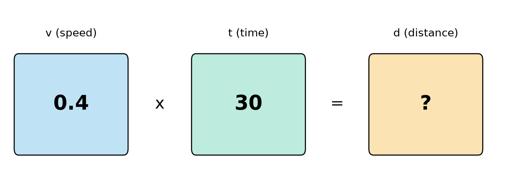
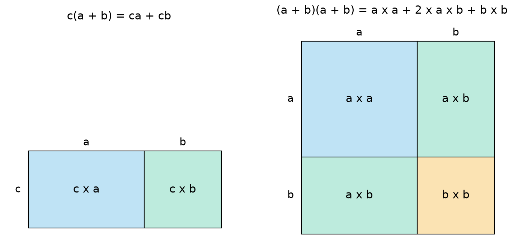
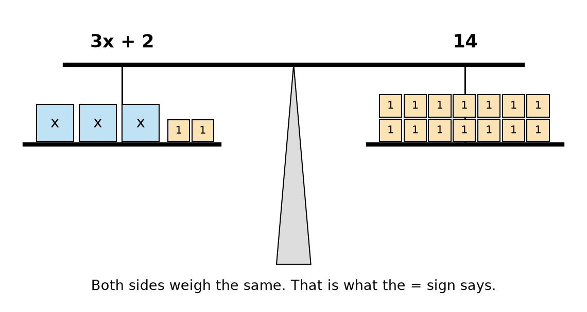
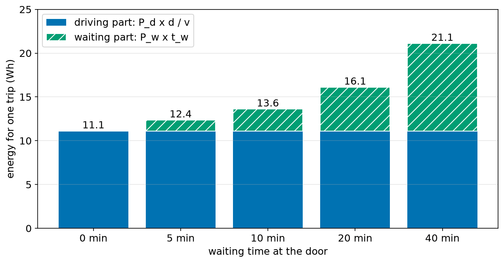
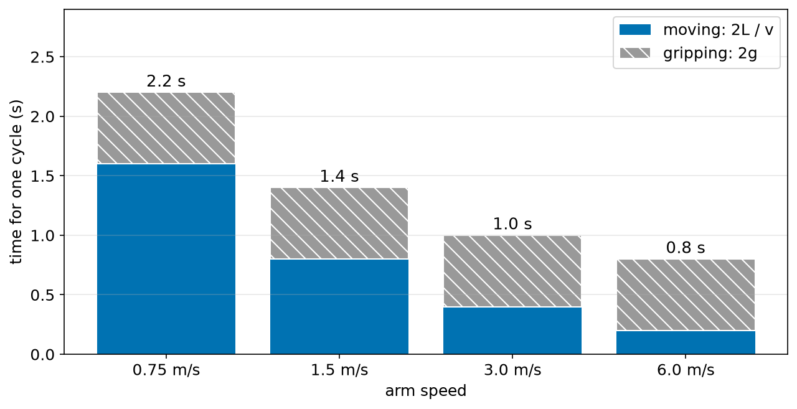

# Chapter 40 — Algebra Part 1: Letters for Numbers, Equations

> **Part 3 · Chapter 40 of 749**
> **You need:** Chapter 14 (variables), Chapter 23 (functions), Chapter 38 (powers) and Chapter 39 (units).
> **You will make:** a formula that works for any robot, a program that tests algebra rules on a thousand cases, a balance search, a delivery robot's energy planner, and a factory arm's cycle time calculator.

---

## What you will learn

- Why mathematicians and engineers use letters for numbers.
- How to read a formula such as `d = v × t`.
- How to put numbers into a formula, including negative numbers.
- What terms and coefficients are, and how to collect like terms.
- How to expand brackets and how to factorise.
- What the equals sign really means.
- How to check whether a value solves an equation.

---

## New words in this chapter

| Word | Simple meaning |
|---|---|
| **algebra** | Maths that uses letters to stand for numbers. |
| **variable** | A letter that stands for a number that can change. |
| **constant** | A value that does not change, such as π. |
| **expression** | Letters and numbers joined by operations, with no equals sign. |
| **term** | One part of an expression, between the plus and minus signs. |
| **coefficient** | The number multiplying a letter, such as the 3 in 3x. |
| **like terms** | Terms with exactly the same letters and powers. |
| **substitute** | Replace letters with numbers. |
| **expand** | Multiply out the brackets. |
| **factorise** | Put brackets back in, by finding what the terms share. |
| **equation** | Two expressions joined with an equals sign. |
| **solution** | A value that makes an equation true. |
| **formula** | An equation that states a general rule. |

---

## 40.1 Why use letters?

You work out the time for Rover's trip: 12 m at 0.4 m/s takes 12 ÷ 0.4 = 30 s. Tomorrow the trip is 20 m. Next week it is a different robot, with a different speed. Each time, you do the same steps with different numbers.

So we write the **steps themselves**, using letters:

```
t = d ÷ v
```

In words: time equals distance divided by speed. This one short line replaces every example, for every robot, forever.

📖 **New word: algebra** — maths that uses letters to stand for numbers.

You have already been doing this. In Python, `trip_time = distance / speed` is the same idea with longer names. A function with parameters (Chapter 23) is a formula that the computer can use.

### A letter is a labelled box



*Figure 40.1 — Each letter is a box that holds a number.*

**How to read this picture:** Each box has a name above it and a number inside it. We know the numbers in `v` and `t`. The rule tells us what goes into the box `d`.

📖 **New word: variable** — a letter that stands for a number that can change.

📖 **New word: constant** — a value that does not change, such as π or the number 9.81.

### How algebra is written

| On paper | Means | In Python |
|---|---|---|
| 3x | 3 × x | `3 * x` |
| ab | a × b | `a * b` |
| 2(x + 1) | 2 × (x + 1) | `2 * (x + 1)` |
| x² | x × x | `x ** 2` |
| x/2 or ½x | x ÷ 2 | `x / 2` |

⚠️ **Careful.** On paper, writing two letters next to each other means multiply. In Python, `ab` is one variable called `ab`. You must write `a * b`.

Letters often have small labels, like `v_max` or `t_w`. The small part is called a **subscript**, and it is part of the name. `P_d` might be "the power used while driving" and `P_w` "the power used while waiting". They are two different boxes.

### Common letters in robotics

| Letter | Usually means |
|---|---|
| x, y, z | positions |
| v | velocity (speed) |
| a | acceleration |
| t | time |
| m | mass |
| F | force |
| r, d | radius, diameter or distance |
| θ (theta) | an angle |
| ω (omega) | angular speed |

Greek letters are simply more letters. Chapter 47 uses them for angles.

---

## 40.2 Substitution

📖 **New word: substitute** — replace letters with numbers.

🔢 **Maths.** Use `E = P × t` with P = 12 W and t = 2 h.

```
E = 12 × 2 = 24 Wh
```

🔢 **Maths.** Work out `3a − 2b` when a = 4 and b = −5.

```
3a − 2b = 3 × 4 − 2 × (−5)
        = 12 − (−10)
        = 12 + 10
        = 22
```

💡 **Tip.** When you substitute a negative number, put it in brackets. Chapter 37 showed how easy it is to lose a minus sign.

🔢 **Maths.** Work out `x² + 2x` when x = −3.

```
(−3)² + 2 × (−3) = 9 − 6 = 3
```

⚠️ **Careful.** Python agrees with the brackets version: `(-3) ** 2 + 2 * (-3)` gives 3. If `x = -3` is already stored in a variable, `x ** 2` also gives 9. The trap is only when you type `-3 ** 2` by hand.

### Writing a rule from words

Most real problems arrive as words. Turn them into letters like this:

1. Pick a letter for each unknown, and write down what it means, **with its unit**.
2. Write the sum as you would with real numbers.
3. Replace the numbers with letters.

🔢 **Maths.** "A robot's battery costs 80 dollars. Each motor costs 12 dollars. What is the cost for a robot with n motors?"

```
With 2 motors:  80 + 12 × 2
With 3 motors:  80 + 12 × 3
With n motors:  C = 80 + 12n
```

🔢 **Maths.** "A robot travels a distance d at speed v. It stops n times, for s seconds each time."

```
Time driving:   d ÷ v
Time stopped:   n × s
Total:          T = d/v + ns
```

---

## 40.3 Terms and like terms

📖 **New word: expression** — letters and numbers joined by operations, with no equals sign.

📖 **New word: term** — one part of an expression, between the plus and minus signs.

📖 **New word: coefficient** — the number multiplying a letter.

```
          4x  +  3y  −  7
          |      |      |
    term 1    term 2   term 3

   4 is the coefficient of x.   3 is the coefficient of y.
   −7 is a plain number, called the constant term.
```

📖 **New word: like terms** — terms with exactly the same letters and powers.

We can only combine like terms. Think of fruit: 4 apples and 3 apples are 7 apples, but 4 apples and 3 oranges cannot be written as 7 of anything.

| Expression | Simplified | Why |
|---|---|---|
| 4x + 3x | 7x | same letter |
| 5y − 2y | 3y | same letter |
| 4x + 3y | 4x + 3y | different letters, no change |
| x² + x | x² + x | different powers, no change |
| 2a + 3b + a − b | 3a + 2b | collect a's and b's |

🔢 **Maths.** Rover makes 2 forward moves of length x and 3 forward moves of length y, then reverses a distance x.

```
2x + 3y − x = x + 3y
```

---

## 40.4 Expanding brackets

📖 **New word: expand** — multiply out the brackets.

The rule is called the **distributive law**: the number outside multiplies **everything** inside.

```
c(a + b) = ca + cb
```

Figure 40.2 (left side) shows why. One large rectangle has the same area as two smaller ones.



*Figure 40.2 — Expanding brackets is just adding up areas.*

**How to read this picture:** On the left, a rectangle c tall and (a + b) wide is cut into two pieces. On the right, a square with sides (a + b) is cut into four pieces. There are two pieces of size a × b, shown in green. That is where the 2ab comes from.

🔢 **Maths.**

```
3(x + 4) = 3x + 12
−2(a − 5) = −2a + 10       (minus times minus is plus)
x(x + 2) = x² + 2x
```

⚠️ **Careful.** 3(x + 4) is **not** 3x + 4. Multiply every term inside.

### Two brackets

Multiply every term in the first by every term in the second:

```
(x + 2)(x + 3) = x × x + x × 3 + 2 × x + 2 × 3
               = x² + 3x + 2x + 6
               = x² + 5x + 6
```

Three rules are used so much that it pays to learn them:

```
(a + b)² = a² + 2ab + b²
(a − b)² = a² − 2ab + b²
(a + b)(a − b) = a² − b²
```

⚠️ **Careful.** (a + b)² is **not** a² + b². If a = 3 and b = 4, then (3 + 4)² = 49, but 9 + 16 = 25. The two green squares in Figure 40.2 are missing. This is the same mistake as √(a + b) in Chapter 38.

---

## 40.5 Factorising

📖 **New word: factorise** — put brackets back in, by finding what the terms share.

It is expanding in reverse.

🔢 **Maths.** Factorise 6x + 9.

```
Both terms can be divided by 3.
6x + 9 = 3(2x + 3)
Check by expanding:  3 × 2x + 3 × 3 = 6x + 9.
```

🔢 **Maths.** Factorise 4ab + 8a.

```
Both have 4 and a in them.
4ab + 8a = 4a(b + 2)
```

🤖 **Robot link.** Factorising often saves real work on a small processor. For the sum `k*a + k*b + k*c`, there are three multiplications. For `k*(a + b + c)`, there is one. It also makes things clearer. In Chapter 216 the output of a PID controller is written with one common gain in just this way.

---

## 40.6 Equations

📖 **New word: equation** — two expressions joined with an equals sign.

The equals sign means something very simple: **the two sides have the same value.** Picture a balance scale.



*Figure 40.3 — The equation 3x + 2 = 14, as a balance.*

**How to read this picture:** The left side holds three boxes of unknown weight x and two small weights of 1. The right side holds fourteen weights of 1. The scale is level, so both sides weigh the same.

📖 **New word: solution** — a value that makes an equation true.

To test a value, substitute it into both sides. For `3x + 2 = 14`:

| x | Left side, 3x + 2 | Equal to 14? |
|---|---|---|
| 3 | 11 | no |
| 4 | 14 | **yes** |
| 5 | 17 | no |

So x = 4 is the solution.

### Keep the scale level

Do the same thing to both sides, and the scale stays level. This gives simple steps:

| Equation | Do this to both sides | Result |
|---|---|---|
| x + 5 = 12 | subtract 5 | x = 7 |
| x − 3 = −1 | add 3 | x = 2 |
| 4x = 28 | divide by 4 | x = 7 |
| x/5 = 6 | multiply by 5 | x = 30 |

Each step **undoes** one operation. Chapter 41 builds this into a full method.

### Three kinds of equals

The sign is used for three different ideas. It helps to know which one you are reading.

| Kind | Example | Meaning |
|---|---|---|
| Equation to solve | 3x + 2 = 14 | true only for some values |
| Identity | 2(x + 1) = 2x + 2 | true for all values |
| Formula | d = v × t | a rule that links quantities |

📖 **New word: formula** — an equation that states a general rule.

### Maths equals against Python equals

```python
x = x + 1
```

In maths this is impossible: no number is one more than itself. In Python, `=` does not mean "is equal to". It means "work out the right side, then **store** it in the box on the left" (Chapter 14). To **ask** if two values are equal, Python uses `==` (Chapter 17).

---

## Code

File `code/ch040/formula.py`:

```python
# formula.py - one rule written with letters works for every robot
def trip_time_s(distance_m, speed_ms, stops, stop_s):
    return distance_m / speed_ms + stops * stop_s


print("robot     distance  speed  stops  stop time  total time")
robots = [
    ("Rover", 12, 0.4, 2, 5),
    ("Courier", 800, 1.2, 4, 30),
    ("Mower", 450, 0.5, 0, 0),
]
for name, d, v, n, s in robots:
    t = trip_time_s(d, v, n, s)
    print(f"{name:<9} {d:8d} {v:6.1f} {n:6d} {s:10d} {t:9.1f} s")
```

| Line | Code | What it does (simple English) |
|---|---|---|
| 1 | `# formula.py …` | A comment. |
| 2 | `def trip_time_s(distance_m, speed_ms, stops, stop_s):` | The letters of the formula are the parameters. |
| 3 | `return distance_m / speed_ms + stops * stop_s` | T = d/v + ns, exactly as we wrote it. |
| 4–5 | (blank) | Spacing. |
| 6 | `print("robot …")` | The heading. |
| 7 | `robots = [` | Starts a list of tuples. |
| 8 | `("Rover", 12, 0.4, 2, 5),` | Name, distance, speed, stops, seconds per stop. |
| 9 | `("Courier", 800, 1.2, 4, 30),` | Another robot, with the same five values. |
| 10 | `("Mower", 450, 0.5, 0, 0),` | A robot which never stops. |
| 11 | `]` | Ends the list. |
| 12 | `for name, d, v, n, s in robots:` | Unpacks each tuple into short letters. |
| 13 | `t = trip_time_s(d, v, n, s)` | Substitutes these numbers into the formula. |
| 14 | `print(f"…")` | Prints one row. |

Output:

```
robot     distance  speed  stops  stop time  total time
Rover           12    0.4      2          5      40.0 s
Courier        800    1.2      4         30     786.7 s
Mower          450    0.5      0          0     900.0 s
```

Check the first one by hand: 12/0.4 + 2 × 5 = 30 + 10 = 40. Three robots, one rule.

Next, a program that **tests** rules. A rule that fails on just one example is false. If a rule passes a thousand tests, that is not a proof, but it is strong evidence. File `code/ch040/check_rules.py`:

```python
# check_rules.py - test algebra rules with many random whole numbers
import random

random.seed(1)


def distributive_left(a, b, c):
    return c * (a + b)


def distributive_right(a, b, c):
    return c * a + c * b


def square_left(a, b, c):
    return (a + b) ** 2


def square_right(a, b, c):
    return a ** 2 + 2 * a * b + b ** 2


def wrong_right(a, b, c):
    return a ** 2 + b ** 2


def check(name, left, right, trials=1000):
    for _ in range(trials):
        a = random.randint(-20, 20)
        b = random.randint(-20, 20)
        c = random.randint(-20, 20)
        if left(a, b, c) != right(a, b, c):
            print(f"{name}: FAILS at a={a}, b={b}, c={c}")
            return
    print(f"{name}: passed {trials} tests")


check("c(a + b) = ca + cb        ", distributive_left, distributive_right)
check("(a + b)^2 = a^2 + 2ab + b^2", square_left, square_right)
check("(a + b)^2 = a^2 + b^2      ", square_left, wrong_right)
```

| Line | Code | What it does (simple English) |
|---|---|---|
| 1 | `# check_rules.py …` | A comment. |
| 2 | `import random` | For random whole numbers (Chapter 31). |
| 3 | (blank) | Spacing. |
| 4 | `random.seed(1)` | Makes the random numbers the same on each run. |
| 5–6 | (blank) | Spacing. |
| 7–8 | `def distributive_left…` | The left side of c(a + b) = ca + cb. |
| 9–10 | (blank) | Spacing. |
| 11–12 | `def distributive_right…` | The right side of the same rule. |
| 13–14 | (blank) | Spacing. |
| 15–16 | `def square_left…` | (a + b)². |
| 17–18 | (blank) | Spacing. |
| 19–20 | `def square_right…` | The correct expansion. |
| 21–22 | (blank) | Spacing. |
| 23–24 | `def wrong_right…` | The wrong version. |
| 25–26 | (blank) | Spacing. |
| 27 | `def check(name, left, right, trials=1000):` | `left` and `right` are **functions** passed in as inputs (Chapter 24). |
| 28 | `for _ in range(trials):` | Repeats. `_` shows that we do not need the counter. |
| 29–31 | `a = random.randint(-20, 20)` and so on | Picks three whole numbers between −20 and 20. |
| 32 | `if left(a, b, c) != right(a, b, c):` | Do the two sides disagree? We use whole numbers, so `!=` is safe here (Chapter 13 warned about decimals). |
| 33 | `print(f"{name}: FAILS at …")` | Reports the example that broke the rule. |
| 34 | `return` | One failure is enough. Stop testing. |
| 35 | `print(f"{name}: passed {trials} tests")` | Only reached if every test passed. |
| 36–37 | (blank) | Spacing. |
| 38–40 | `check(…)` | Tests three rules. The extra spaces keep the output lined up. |

Output:

```
c(a + b) = ca + cb        : passed 1000 tests
(a + b)^2 = a^2 + 2ab + b^2: passed 1000 tests
(a + b)^2 = a^2 + b^2      : FAILS at a=-4, b=-16, c=9
```

Check the failure by hand: (−4 − 16)² = 400, but 16 + 256 = 272.

Finally, the balance search. File `code/ch040/balance.py`:

```python
# balance.py - which x makes 3x + 2 equal to 14?
def left_side(x):
    return 3 * x + 2


RIGHT_SIDE = 14

for x in range(0, 8):
    value = left_side(x)
    if value < RIGHT_SIDE:
        result = "left side too light"
    elif value > RIGHT_SIDE:
        result = "left side too heavy"
    else:
        result = "balanced"
    print(f"x = {x}:  3x + 2 = {value:2d}   {result}")
```

| Line | Code | What it does (simple English) |
|---|---|---|
| 1 | `# balance.py …` | A comment. |
| 2 | `def left_side(x):` | The left side of the equation. |
| 3 | `return 3 * x + 2` | 3x + 2 in Python. |
| 4–5 | (blank) | Spacing. |
| 6 | `RIGHT_SIDE = 14` | The right side of the equation. |
| 7 | (blank) | Spacing. |
| 8 | `for x in range(0, 8):` | Tries x = 0 to 7. |
| 9 | `value = left_side(x)` | Substitutes x. |
| 10 | `if value < RIGHT_SIDE:` | Is it too small? |
| 11 | `result = "left side too light"` | Remember the answer. |
| 12 | `elif value > RIGHT_SIDE:` | Is it too big? |
| 13 | `result = "left side too heavy"` | Remember the answer. |
| 14 | `else:` | Otherwise they are equal. |
| 15 | `result = "balanced"` | We have found the solution. |
| 16 | `print(f"x = {x}: …")` | Prints the row. |

Output:

```
x = 0:  3x + 2 =  2   left side too light
x = 1:  3x + 2 =  5   left side too light
x = 2:  3x + 2 =  8   left side too light
x = 3:  3x + 2 = 11   left side too light
x = 4:  3x + 2 = 14   balanced
x = 5:  3x + 2 = 17   left side too heavy
x = 6:  3x + 2 = 20   left side too heavy
x = 7:  3x + 2 = 23   left side too heavy
```

Testing every value works for small problems. It cannot handle decimals like 3.7294, and that is why we need algebra.

---

## Small examples

**Example 1.** If v = 0.5 and t = 8, then d = vt = 4.

**Example 2.** 3x + 2x − x = 4x.

**Example 3.** 5(y − 2) = 5y − 10.

**Example 4.** 10a + 15 = 5(2a + 3).

**Example 5.** Is x = 2 a solution of x² = 4? Yes, because 2² = 4. So is x = −2.

**Example 6.** "Twice a number, plus three" is 2n + 3.

**Example 7.** If L is in metres and v is in m/s, then L/v is in seconds, so the units fit.

**Example 8.** (x − 1)(x + 1) = x² − 1. Test with x = 5: 4 × 6 = 24, and 25 − 1 = 24.

---

## 🏭 Real robot applications

### Application 1 (worked in full) — 🏙️ How much battery does a delivery trip use?

**1. The real problem.** A small sidewalk delivery robot goes to a house and waits for the customer. It must have enough energy to come back. How does the waiting time change how many trips it can make on one charge?

**2. Why this theory.** The energy has two parts, and each part follows its own simple rule. With letters, we can write the rule once, and then try any robot or any route.

**3. The numbers.** Driving uses `P_d` = 60 W. Waiting uses `P_w` = 15 W. The trip is `d` = 800 m at `v` = 1.2 m/s. The battery is 200 Wh, and 20% must stay unused as a reserve. These are example values.

**4. The maths.** Energy is power × time (Chapter 67). The driving time is d/v.

```
E = P_d × d/v + P_w × t_w

With t_w = 10 min = 600 s:

Driving time  = 800 ÷ 1.2 = 666.7 s
Driving part  = 60 × 666.7 = 40,000 J
Waiting part  = 15 × 600   =  9,000 J
Total         = 49,000 J
In watt-hours = 49,000 ÷ 3600 = 13.6 Wh

Usable battery = 200 × (1 − 0.20) = 160 Wh
Whole trips    = 160 ÷ 13.6 = 11.76, so 11 trips
```

**5. The code.** File `code/ch040/mission_energy.py`:

```python
# mission_energy.py - E = P_d * d / v + P_w * t_w, for a delivery robot
JOULES_PER_WH = 3600


def trip_energy_wh(drive_w, wait_w, distance_m, speed_ms, wait_s):
    drive_time_s = distance_m / speed_ms
    energy_j = drive_w * drive_time_s + wait_w * wait_s
    return energy_j / JOULES_PER_WH


BATTERY_WH = 200
RESERVE = 0.20
usable_wh = BATTERY_WH * (1 - RESERVE)

print("wait (min)  energy (Wh)  whole trips")
for wait_min in [0, 5, 10, 20, 40]:
    energy = trip_energy_wh(60, 15, 800, 1.2, wait_min * 60)
    trips = int(usable_wh // energy)
    print(f"{wait_min:10d} {energy:12.1f} {trips:12d}")
```

| Line | Code | What it does (simple English) |
|---|---|---|
| 1 | `# mission_energy.py …` | The comment states the formula. |
| 2 | `JOULES_PER_WH = 3600` | 1 Wh is 3600 J, because an hour has 3600 seconds. |
| 3–4 | (blank) | Spacing. |
| 5 | `def trip_energy_wh(drive_w, wait_w, distance_m, speed_ms, wait_s):` | The letters of the formula. |
| 6 | `drive_time_s = distance_m / speed_ms` | d/v. |
| 7 | `energy_j = drive_w * drive_time_s + wait_w * wait_s` | The whole formula, in joules. |
| 8 | `return energy_j / JOULES_PER_WH` | Converts to Wh. |
| 9–10 | (blank) | Spacing. |
| 11 | `BATTERY_WH = 200` | Battery size. |
| 12 | `RESERVE = 0.20` | The part we must not use. |
| 13 | `usable_wh = BATTERY_WH * (1 - RESERVE)` | 80% of the battery. |
| 14 | (blank) | Spacing. |
| 15 | `print("wait (min) …")` | The heading. |
| 16 | `for wait_min in [0, 5, 10, 20, 40]:` | Tries five waiting times. |
| 17 | `energy = trip_energy_wh(60, 15, 800, 1.2, wait_min * 60)` | Minutes × 60 gives seconds. |
| 18 | `trips = int(usable_wh // energy)` | `//` gives the number of complete trips. `int` removes the `.0`. |
| 19 | `print(f"…")` | Prints the row. |

Output:

```
wait (min)  energy (Wh)  whole trips
         0         11.1           14
         5         12.4           12
        10         13.6           11
        20         16.1            9
        40         21.1            7
```



*Figure 40.4 — The two parts of the formula, shown as bars.*

**How to read this picture:** Each bar is one trip. The blue part is the same in all of them, because the route is the same. The green part grows with the waiting time. The total is above the bar.

**6. The result.** A customer who takes 40 minutes to come to the door halves the number of trips. Planning with only the driving part of the rule would be badly wrong.

**7. Going further.** Real planners add a term for hills (Chapter 67), for heating or cooling, and for the loss of battery capacity as it ages (Chapter 89). Each new effect is simply one more term in the expression.

### Application 2 (worked in full) — 🏭 Why a faster arm is not twice as productive

**1. The real problem.** A factory arm moves parts from a belt into a box. The manager wants twice as many parts per hour and proposes doubling the arm's speed. Will that work?

**2. Why this theory.** Writing the cycle time as an expression shows which term the speed affects, and which it does not.

**3. The numbers.** One way is L = 0.6 m. Closing or opening the gripper takes g = 0.3 s. The arm goes there and back, so it moves 2L in total, and it uses the gripper twice. We ignore the time needed to speed up and slow down for now (Chapter 59).

**4. The maths.**

```
T = 2L/v + 2g

At v = 1.5 m/s:  T = 2 × 0.6 ÷ 1.5 + 2 × 0.3 = 0.8 + 0.6 = 1.4 s
Parts per hour = 3600 ÷ 1.4 = 2571

At v = 3.0 m/s:  T = 2 × 0.6 ÷ 3.0 + 0.6 = 0.4 + 0.6 = 1.0 s
Parts per hour = 3600 ÷ 1.0 = 3600
```

Doubling the speed gives 3600 ÷ 2571 = 1.4 times as many parts. Only 1.4 times.

**5. The code.** File `code/ch040/cycle_time.py`:

```python
# cycle_time.py - T = 2L/v + 2g for a pick-and-place arm
def cycle_time_s(length_m, speed_ms, grip_s):
    return 2 * length_m / speed_ms + 2 * grip_s


LENGTH_M = 0.6
GRIP_S = 0.3

print("speed (m/s)  cycle (s)  parts per hour")
for speed in [0.75, 1.5, 3.0, 6.0]:
    cycle = cycle_time_s(LENGTH_M, speed, GRIP_S)
    per_hour = 3600 / cycle
    print(f"{speed:11.2f} {cycle:10.2f} {per_hour:15.0f}")
```

| Line | Code | What it does (simple English) |
|---|---|---|
| 1 | `# cycle_time.py …` | The formula is in the comment. |
| 2 | `def cycle_time_s(length_m, speed_ms, grip_s):` | The letters become parameters. |
| 3 | `return 2 * length_m / speed_ms + 2 * grip_s` | T = 2L/v + 2g. |
| 4–5 | (blank) | Spacing. |
| 6 | `LENGTH_M = 0.6` | One-way distance. |
| 7 | `GRIP_S = 0.3` | Gripper time. |
| 8 | (blank) | Spacing. |
| 9 | `print("speed (m/s) …")` | The heading. |
| 10 | `for speed in [0.75, 1.5, 3.0, 6.0]:` | Four speeds, each double the last. |
| 11 | `cycle = cycle_time_s(LENGTH_M, speed, GRIP_S)` | Uses the rule. |
| 12 | `per_hour = 3600 / cycle` | 3600 seconds in an hour ÷ seconds per part. |
| 13 | `print(f"…")` | Prints the row. |

Output:

```
speed (m/s)  cycle (s)  parts per hour
       0.75       2.20            1636
       1.50       1.40            2571
       3.00       1.00            3600
       6.00       0.80            4500
```



*Figure 40.5 — Faster moves only shrink one part of the cycle.*

**How to read this picture:** The blue part (moving) halves each time the speed doubles. The grey part (gripping) stays at 0.6 s. As the speed rises, the grey part takes up more and more of the cycle.

**6. The result.** At high speed, gripping is the bottleneck. Even at infinite speed, the cycle cannot be shorter than 2g = 0.6 s, which limits the arm to 6000 parts each hour. A faster gripper may be cheaper than a faster arm. The expression shows this without any testing at all.

**7. Going further.** Real arms need time to speed up and slow down (Chapter 397), which makes short moves even slower than this formula predicts. Factories use exactly this kind of analysis to find which step is holding up the whole line.

### Application 3 — 🚁 Counting the mass of a drone

The total mass of a quadcopter is a sum of terms: `m = m_f + 4 m_m + m_b + m_p`, where the letters stand for the frame, a motor, the battery and the payload. With a frame of 0.25 kg, motors of 0.06 kg, a battery of 0.45 kg and a payload of 0.3 kg, we get m = 0.25 + 0.24 + 0.45 + 0.3 = 1.24 kg. Adding an expression like this to a spreadsheet lets a designer see at once what any change does (Chapter 622).

### Application 4 — 🌊 Making an underwater robot float at the right depth

A body in water is pushed up with a force equal to the weight of the water it displaces. For an underwater robot to float at one depth, its mass must equal `m = ρV`, where ρ (the Greek letter rho) is the density of the water and V is the robot's volume. With V = 0.012 m³ and sea water at ρ = 1025 kg/m³, m = 12.3 kg. The same robot in fresh water, at ρ = 1000 kg/m³, needs just 12.0 kg. So it must be re-weighted before moving from the sea to a lake.

### Application 5 — 🛰️ Talking to a robot on Mars

A radio signal travels at the speed of light, c. The round-trip delay is `T = 2d/c`. At a distance of d = 225 million km (2.25 × 10¹¹ m), T = 2 × 2.25 × 10¹¹ ÷ (3 × 10⁸) = 1500 s, or 25 minutes. The actual distance changes as the planets move, so the formula is used with a new d each day. No one can steer a Mars rover by remote control with such a delay. So it must do many things by itself.

---

## 🔧 Hands-on lab

### Lab 40.1 — A real balance (hardware, ruler and coins)

You need a ruler, a pencil, and some identical coins. Put the ruler across the pencil, at the middle, so that it balances.

1. Put three small identical objects (for example three erasers) and two coins on one side.
2. Put coins on the other side, one at a time, until the ruler balances.
3. Write the equation, with x as the mass of an object in coins: 3x + 2 = (number of coins).
4. Remove 2 coins from each side. Does it stay balanced?
5. Solve for x.

**What you should see:** The ruler stays level when you take the same amount from both sides. That is the rule of equations, made visible. Then x equals (coins − 2) ÷ 3.

| If it does not work | Likely cause | Fix |
|---|---|---|
| It never balances exactly | The coins are too big | Try paper clips, or accept "nearly level" |
| It tips, even when empty | The pencil is not at the middle | Move it until the empty ruler balances |
| Items slide | The pencil is too round | Tape it down, or use a triangular pencil |

**Challenge:** Weigh one coin, and then use your equation to find the real mass of an object in grams.

### Lab 40.2 — Be a rule tester (simulation)

Copy `check_rules.py`, then add these rules as new functions and test each one:

1. (a − b)(a + b) = a² − b²
2. (a + b)³ = a³ + b³
3. a(b + c) + b(a + c) = 2ab + ac + bc

**What you should see:** The first and third pass. The second fails, with a set of values that you can check on paper.

| If it does not work | Likely cause | Fix |
|---|---|---|
| `TypeError` about arguments | The function does not have three parameters | Keep `(a, b, c)` even if you do not use them |
| A correct rule fails | A wrong sign or a missing `*` | Compare it with what you wrote on paper |

**Challenge:** Change the numbers to decimals with `random.uniform(-20, 20)`. Why might a correct rule now "fail"? Change `check` to fix this, using the method from Chapter 17.

### Lab 40.3 — Plan a fleet (simulation)

Copy `mission_energy.py`.

1. Change `BATTERY_WH` to 300.
2. Put it back to 200, and set `RESERVE` to 0.10.
3. Put it back to 0.20, and change the speed from 1.2 to 0.6 m/s.

**What you should see:** With 300 Wh there are 21, 19, 17, 14 and 11 trips. With a reserve of 0.10 there are 16, 14, 13, 11 and 8 trips. At half the speed, the trip with 10 minutes of waiting uses 24.7 Wh. Moving slowly costs energy, because in this model the motor power stays the same for longer.

| If it does not work | Likely cause | Fix |
|---|---|---|
| The results do not change | You changed a copy but ran the original | Check the file name |
| `ZeroDivisionError` | A speed of 0 | A speed of 0 cannot finish the trip |

**Challenge:** In reality, driving power also falls when speed falls. Replace the fixed 60 W with `drive_w = 20 + 33 * speed`. What happens to the energy per trip as the speed rises? Show with algebra why it can never fall below 33 × 800 ÷ 3600 = 7.3 Wh.

---

## Common mistakes

⚠️ **Multiplying only the first term.** 3(x + 4) means 3x + 12.

⚠️ **Combining unlike terms.** 2x + 3y is not 5xy.

⚠️ **Believing (a + b)² = a² + b².** Do not forget the 2ab.

⚠️ **Losing a sign with a substitution.** Use brackets around negative numbers.

⚠️ **Writing `ab` in Python.** It must be `a * b`.

⚠️ **Mixing up `=` and `==`.** One stores a value. The other asks a question.

⚠️ **Forgetting units in letters.** Write down what each letter means, and in what unit.

⚠️ **Doing different things to each side.** Whatever you do to one side, do to the other.

---

## Practice

🏋️ **1.** A robot's body has mass m. It carries n batteries, each of mass b. Write the total mass M.

🏋️ **2.** If a = 3 and b = −2, work out 2a + b, a² − b, ab and (a + b)².

🏋️ **3.** Simplify: 4x + 3x − 2; 2a + 3b + a − b; 5y − 5y.

🏋️ **4.** Expand: 3(x + 4); −2(a − 5); (x + 2)(x + 3).

🏋️ **5.** Factorise: 6x + 9; 4ab + 8a.

🏋️ **6.** Is x = 3 a solution of 2x + 5 = 11? Is x = 4?

🏋️ **7.** Solve: x + 7 = 20; x − 3 = −1; 4x = 28; x/5 = 6.

🏋️ **8.** Use T = d/v + ns with d = 240 m, v = 0.6 m/s, n = 3, s = 20 s.

🏋️ **9.** A kit costs 80 dollars, and each motor is 12 dollars. Write the rule, and find the cost with 5 motors.

🏋️ **10.** Use numbers to show that (a + b)² is not a² + b².

🏋️ **11.** Write `parts_in_shift(hours, length_m, speed_ms, grip_s)`, which returns the number of whole parts made in a shift. Use `cycle_time_s`. Test with 8 hours, 0.6 m, 1.5 m/s and 0.3 s.

---

## Answers

**1.** M = m + nb.

**2.** 2 × 3 + (−2) = 4. Next, 9 − (−2) = 11. Next, 3 × (−2) = −6. Finally, (3 − 2)² = 1.

**3.** 7x − 2; 3a + 2b; 0.

**4.** 3x + 12; −2a + 10; x² + 5x + 6.

**5.** 3(2x + 3); 4a(b + 2).

**6.** 2 × 3 + 5 = 11, so x = 3 is a solution. 2 × 4 + 5 = 13, so x = 4 is not.

**7.** x = 13; x = 2; x = 7; x = 30.

**8.** T = 240/0.6 + 3 × 20 = 400 + 60 = 460 s.

**9.** C = 80 + 12n. With n = 5: C = 80 + 60 = 140 dollars.

**10.** Take a = 3, b = 4. (3 + 4)² = 49, but 3² + 4² = 25.

**11.**

```python
def cycle_time_s(length_m, speed_ms, grip_s):
    return 2 * length_m / speed_ms + 2 * grip_s

def parts_in_shift(hours, length_m, speed_ms, grip_s):
    seconds = hours * 3600
    return int(seconds // cycle_time_s(length_m, speed_ms, grip_s))

print(parts_in_shift(8, 0.6, 1.5, 0.3))     # 20571
```

8 hours is 28,800 seconds, and 28,800 ÷ 1.4 = 20,571.4, so the shift completes 20,571 whole parts.

---

## Summary

🧠 Algebra uses letters so that one rule works for every case.

🧠 Substitute to go from a rule to a number. Use brackets for negative numbers.

🧠 Only like terms can be combined.

🧠 Multiply everything inside the brackets. Do not forget the 2ab.

🧠 Factorising is expanding in reverse.

🧠 The equals sign says that the two sides have the same value, like a level balance.

🧠 Do the same thing to both sides, and the equation stays true.

---

## Next chapter

In Chapter 41 we solve equations step by step and **rearrange formulas**. Given `d = v × t`, you will be able to make any of the three letters the subject of the formula in seconds.
