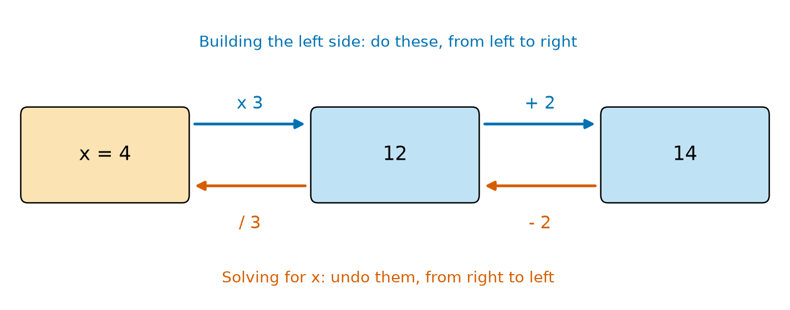
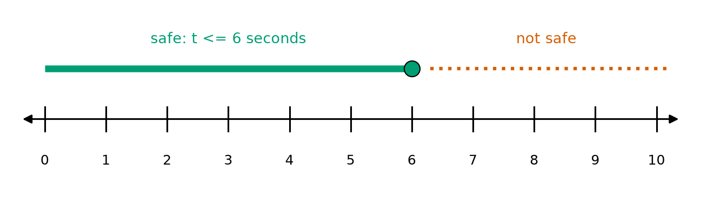
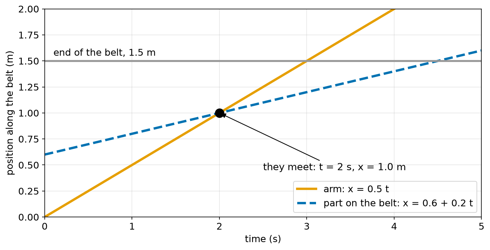
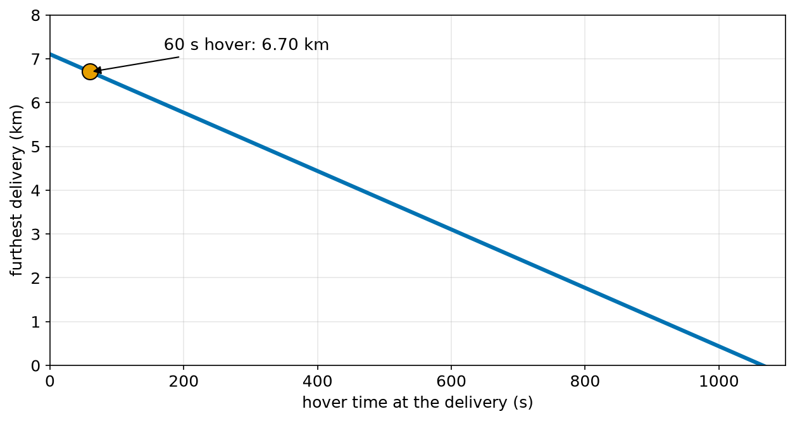

# Chapter 41 — Algebra Part 2: Solving Equations, Rearranging Formulas

> **Part 3 · Chapter 41 of 749**
> **You need:** Chapter 40 (letters, expanding, balance). Pencil and paper.
> **You will make:** a solver for a whole family of equations, a test that catches mistakes in rearranged formulas, a program that decides when a moving arm can catch a part, and a drone range calculator.

---

## What you will learn

- A method for solving any equation of the first kind, in the same order every time.
- What to do with brackets, fractions, and letters on both sides.
- What it means when an equation has no solution, or every value is a solution.
- How to make any letter in a formula the subject.
- How to solve **inequalities**, and the one rule that catches everybody.
- How to check your answer, so that you always know if it is right.

---

## New words in this chapter

| Word | Simple meaning |
|---|---|
| **linear equation** | An equation in which the unknown has no power above 1. |
| **inverse operation** | The operation that undoes another one. |
| **subject** | The letter a formula gives on its own, such as `d` in `d = v × t`. |
| **rearrange** | Change a formula so that a different letter is the subject. |
| **lowest common denominator** | The smallest number that all the bottoms divide into. |
| **inequality** | A statement using <, >, ≤ or ≥. |
| **intercept** | To catch something that is moving, by meeting it. |

---

## 41.1 Undoing, in reverse order

In Chapter 40 we saw that an equation is a balance. Now look at how an equation was built.



*Figure 41.1 — To solve, undo each step, starting from the last one.*

**How to read this picture:** The blue arrows at the top show how to make 14 from x: multiply by 3, then add 2. The red arrows underneath go backward: first take away 2, then divide by 3. Each red arrow undoes the blue arrow above it.

📖 **New word: inverse operation** — the operation that undoes another one.

| Operation | Inverse |
|---|---|
| add a | subtract a |
| subtract a | add a |
| multiply by a | divide by a |
| divide by a | multiply by a |
| square (positive number) | square root |

Think about putting on socks and then shoes. To undo this, you must take off the shoes first. Solving is the same: **undo the last thing that was done, first.**

🔢 **Maths.** Solve 3x + 2 = 14.

```
3x + 2 = 14
3x     = 12        subtract 2 from both sides
 x     = 4         divide both sides by 3
```

**Check:** 3 × 4 + 2 = 14. Yes.

🧠 **Remember:** Always check by putting the answer back into the **original** equation. It takes seconds, and it catches almost every mistake.

---

## 41.2 The full method

📖 **New word: linear equation** — an equation in which the unknown has no power above 1. There is no x² and no √x in it.

For every linear equation, follow these steps in this order:

```
1. Clear fractions    (multiply both sides by a common bottom)
2. Expand brackets
3. Collect like terms on each side
4. Move all the x terms to one side, and the numbers to the other
5. Divide by the number in front of x
6. Check in the original equation
```

### Letters on both sides

🔢 **Maths.** Solve 5x − 4 = 2x + 8.

```
5x − 4       = 2x + 8
5x − 2x − 4  = 8           subtract 2x from both sides
3x − 4       = 8
3x           = 12          add 4 to both sides
x            = 4           divide by 3
```

**Check.** Left: 5 × 4 − 4 = 16. Right: 2 × 4 + 8 = 16. They are equal.

💡 **Tip.** "Moving a term to the other side and changing its sign" is a popular shortcut. It is only a fast way to subtract from both sides. Use the long way until you are confident.

### Brackets

🔢 **Maths.** Solve 3(x − 2) = 12 by expanding.

```
3x − 6 = 12         expand
3x     = 18         add 6
x      = 6          divide by 3
```

There is a second way. Divide first: x − 2 = 4, so x = 6. Both ways are correct.

🔢 **Maths.** Solve 2(x + 3) − (x − 1) = 10.

```
2x + 6 − x + 1 = 10     the minus in front of the bracket changes both signs
x + 7          = 10
x              = 3
```

⚠️ **Careful.** −(x − 1) means −x + 1. A minus in front of a bracket changes the sign of **everything** inside.

### Fractions

📖 **New word: lowest common denominator** — the smallest number that all the bottoms divide into.

Multiply **every term** on both sides by this number, and the fractions disappear.

🔢 **Maths.** Solve x/4 + 1 = 3.

```
x/4 + 1 = 3
x + 4   = 12        multiply everything by 4
x       = 8         subtract 4
```

🔢 **Maths.** Solve (x + 1)/2 = (x − 1)/3.

```
Common bottom: 6.

3(x + 1) = 2(x − 1)     multiply both sides by 6
3x + 3   = 2x − 2       expand
x        = −5           subtract 2x, then subtract 3
```

**Check.** Left: (−5 + 1)/2 = −2. Right: (−5 − 1)/3 = −2. They are equal.

### The two special cases

Sometimes the x terms all vanish.

🔢 **Maths.** Solve 2x + 1 = 2x + 5.

```
Subtract 2x:  1 = 5
```

This is false, whatever x is. So there is **no solution**.

🔢 **Maths.** Solve 2x + 1 = 2x + 1.

```
Subtract 2x:  1 = 1
```

This is always true. So **every x** is a solution. It is an identity (Chapter 40).

🤖 **Robot link.** Your code must think about these cases as well. Dividing by a number that happens to be 0 will crash the program, or give nonsense. If two robots travel at the same speed, one will never catch the other. That is a "no solution" case, and it happens in real life.

---

## 41.3 Rearranging formulas

📖 **New word: subject** — the letter a formula gives on its own. In `d = v × t`, `d` is the subject.

📖 **New word: rearrange** — change a formula so that a different letter is the subject.

Why do this? Because you can then write the rule that you need into your code. The method is exactly the same as solving, except that the answer is still made of letters.

🔢 **Maths.** Make t the subject of d = v × t.

```
d = v × t
d ÷ v = t          divide both sides by v
t = d / v
```

🔢 **Maths.** Make v the subject of d = v × t.

```
d = v × t
v = d / t
```

One formula has now given us three.

| Rule | Find d | Find v | Find t |
|---|---|---|---|
| d = vt | d = vt | v = d/t | t = d/v |

The electrical formulas P = VI and V = IR (Chapter 75) work in the same way.

### A two-step rearrangement

🔢 **Maths.** Make n the subject of T = d/v + ns.

```
T          = d/v + ns
T − d/v    = ns               subtract d/v from both sides
(T − d/v)/s = n               divide both sides by s
```

In words: the time left after driving, divided by the time per stop, tells us how many stops we can make.

### With a square

🔢 **Maths.** Make v the subject of E = ½ m v². (This is the energy of motion, Chapter 67.)

```
E    = ½ m v²
2E   = m v²               multiply both sides by 2
2E/m = v²                 divide both sides by m
v    = √(2E/m)            take the square root
```

Checking with the thrust rule from Chapter 38: from `F = K × rpm²` we get `rpm = √(F/K)`. That is exactly what we used to find the hover speed.

### When the letter appears twice

🔢 **Maths.** Make x the subject of ax + b = cx + d.

```
ax − cx   = d − b             collect x on the left
x(a − c)  = d − b             factorise (Chapter 40)
x         = (d − b) / (a − c)
```

This only works if a − c is not 0. That is exactly the "no solution" and "every x" cases above. We put this formula into code below.

### When the letter is on the bottom

🔢 **Maths.** Make v the subject of t = d/v.

```
t × v = d                     multiply both sides by v
v     = d / t                 divide both sides by t
```

Bring the letter up first. Then treat it as usual.

⚠️ **Careful.** Divide **each whole side**. A common error is to cancel part of a sum: (x + 3)/x is **not** 3. You may only cancel something that multiplies the whole top and the whole bottom.

---

## 41.4 Inequalities

📖 **New word: inequality** — a statement using <, >, ≤ or ≥.

| Sign | Meaning |
|---|---|
| < | less than |
| > | greater than |
| ≤ | less than or equal to |
| ≥ | greater than or equal to |

Real robots are full of inequalities: the current must be **no more than** the limit, the arm must arrive **before** the part leaves. You have written these in Python since Chapter 17.

You can solve an inequality just like an equation.

🔢 **Maths.** The motor may run for at most 15 s, including a 3 s start. Each cycle lasts 2 s. How many cycles, t, can it do?

```
2t + 3 ≤ 15
2t     ≤ 12
t      ≤ 6
```



*Figure 41.2 — The answer to an inequality is a whole range of values.*

**How to read this picture:** The green bar covers all the values that are allowed. The filled circle at 6 means that 6 itself is allowed. The red dots show the values that are not allowed.

### The one rule that catches everybody

**When you multiply or divide by a negative number, you must flip the sign.**

Why? Look at a true statement, and multiply by −1.

```
 2 <  5     true
−2 < −5     FALSE
−2 > −5     true (we flipped it)
```

On the number line, multiplying by −1 reflects everything about zero, so the order is reversed.

🔢 **Maths.** Solve −2x < 6.

```
−2x < 6
x > −3              divide by −2, and flip the sign
```

**Check.** Try x = 0, which is greater than −3. Then −2 × 0 = 0, and 0 < 6 is true.

---

## 41.5 Solving word problems

The same method handles problems in words.

1. Say what the unknown is, with its unit.
2. Write the equation, using the units as a guide.
3. Solve it.
4. Check it, and ask: **does this make sense?**

🔢 **Maths.** Rover drives at 0.4 m/s. The battery lasts 15 minutes. It has to come back. How far can it go?

```
Let d be the distance out (m).
Time out + time back = 900 s

d/0.4 + d/0.4 = 900
2d / 0.4      = 900
5d            = 900
d             = 180 m
```

Check: 180 m each way at 0.4 m/s is 450 s each way, so 900 s in total. That is correct.

---

## Code

File `code/ch041/solve_linear.py`. It uses the rearranged formula from section 41.3.

```python
# solve_linear.py - solve a*x + b = c*x + d, the same way we do on paper
def solve_linear(a, b, c, d):
    coefficient = a - c
    number = d - b
    if coefficient == 0:
        if number == 0:
            return "every x works"
        return "no solution"
    return number / coefficient


tests = [(3, 2, 0, 14), (5, -4, 2, 8), (2, 1, 2, 5), (2, 1, 2, 1)]

for a, b, c, d in tests:
    answer = solve_linear(a, b, c, d)
    print(f"{a}x + {b} = {c}x + {d}   ->   {answer}")
```

| Line | Code | What it does (simple English) |
|---|---|---|
| 1 | `# solve_linear.py …` | A comment. |
| 2 | `def solve_linear(a, b, c, d):` | The four numbers describe the equation. |
| 3 | `coefficient = a - c` | The number in front of x, after collecting x terms. |
| 4 | `number = d - b` | The number on the right, after collecting the plain numbers. |
| 5 | `if coefficient == 0:` | The x terms have vanished, so we cannot divide. |
| 6 | `if number == 0:` | The equation has become 0 = 0. |
| 7 | `return "every x works"` | An identity. |
| 8 | `return "no solution"` | The equation has become something like 0 = 4. |
| 9 | `return number / coefficient` | The normal case: x = (d − b) / (a − c). |
| 10–11 | (blank) | Spacing. |
| 12 | `tests = […]` | Four equations from this chapter, each as (a, b, c, d). |
| 13 | (blank) | Spacing. |
| 14 | `for a, b, c, d in tests:` | Takes each test. |
| 15 | `answer = solve_linear(a, b, c, d)` | Solves it. |
| 16 | `print(f"…")` | Prints the equation and the answer. |

Output:

```
3x + 2 = 0x + 14   ->   4.0
5x + -4 = 2x + 8   ->   4.0
2x + 1 = 2x + 5   ->   no solution
2x + 1 = 2x + 1   ->   every x works
```

The first two match what we did by hand. The last two are the special cases. A good function handles the difficult cases too.

Rearranging is easy to get wrong, so let us test it. Start with known values, compute T, then see if each rearranged formula gives back the value we began with. File `code/ch041/rearrange_check.py`:

```python
# rearrange_check.py - every rearranged formula must give back the value we started with
d = 240.0      # metres
v = 0.6        # metres per second
n = 3          # stops
s = 20.0       # seconds per stop

T = d / v + n * s

print(f"T from the formula: {T:.3f} s")
print(f"d = (T - n s) v    : {(T - n * s) * v:.3f}")
print(f"v = d / (T - n s)  : {d / (T - n * s):.3f}")
print(f"n = (T - d/v) / s  : {(T - d / v) / s:.3f}")
print(f"s = (T - d/v) / n  : {(T - d / v) / n:.3f}")
```

| Line | Code | What it does (simple English) |
|---|---|---|
| 1 | `# rearrange_check.py …` | A comment. |
| 2–5 | `d = 240.0` and so on | Known values, with their units in comments. |
| 6 | (blank) | Spacing. |
| 7 | `T = d / v + n * s` | The original formula. |
| 8 | (blank) | Spacing. |
| 9 | `print(f"T from …")` | Shows T. |
| 10 | `print(f"d = …")` | Rearranged for d. It should give 240. |
| 11 | `print(f"v = …")` | Rearranged for v. It should give 0.6. |
| 12 | `print(f"n = …")` | Rearranged for n. It should give 3. |
| 13 | `print(f"s = …")` | Rearranged for s. It should give 20. |

Output:

```
T from the formula: 460.000 s
d = (T - n s) v    : 240.000
v = d / (T - n s)  : 0.600
n = (T - d/v) / s  : 3.000
s = (T - d/v) / n  : 20.000
```

All four come back. This test takes seconds to write, and it protects you from wrong signs and upside-down fractions.

---

## Small examples

**Example 1.** x + 9 = 4, so x = −5.

**Example 2.** 7x = 3, so x = 3/7, about 0.429. An answer need not be a whole number.

**Example 3.** 10 − x = 4. Add x to both sides: 10 = 4 + x. So x = 6.

**Example 4.** F = ma, so a = F/m. With F = 12 N and m = 3 kg, a = 4 m/s².

**Example 5.** A = LW, so W = A/L. An area of 6 m² and a length of 3 m give a width of 2 m.

**Example 6.** C = πd, so d = C/π. A wheel that rolls 0.207 m in one turn has d = 0.0659 m.

**Example 7.** 3x ≥ 12 gives x ≥ 4.

**Example 8.** −x ≤ 2 gives x ≥ −2. (We divided by −1, so we flipped the sign.)

---

## 🏭 Real robot applications

### Application 1 (worked in full) — 🏭 Catching a part on a moving belt

**1. The real problem.** A part moves along a conveyor belt. An arm slides along a rail and must meet the part before it reaches the end of the belt. When and where will they meet?

**2. Why this theory.** Both positions are expressions with the time t in them. "They meet" means that the two positions are equal, which gives an equation with t on both sides.

**3. The numbers.** The arm starts at p = 0 m and moves at u = 0.5 m/s. The part starts at q = 0.6 m and moves at v = 0.2 m/s. The belt ends at L = 1.5 m.

**4. The maths.**

```
Arm position:   x = p + ut
Part position:  x = q + vt

They meet when:   p + ut = q + vt
                  ut − vt = q − p
                  t(u − v) = q − p
                  t = (q − p) / (u − v)
                    = 0.6 / 0.3 = 2 s

Meeting position:  x = 0 + 0.5 × 2 = 1.0 m     (this is less than 1.5, so it works)
```

The word for this is **intercept**. Figure 41.3 draws it.



*Figure 41.3 — The meeting point is where the two lines cross.*

**How to read this picture:** Across the bottom is time. Up the side is position along the belt. The orange line is the arm. The blue dashed line is the part. They cross at t = 2 s, below the grey line that marks the end of the belt.

How fast can the belt go? We want the meeting point at or before L. With p = 0:

```
u × t ≤ L
u × q / (u − v) ≤ L
u q ≤ L (u − v)                multiply by (u − v), which is positive, so no flip
L v ≤ L u − u q
v ≤ u (1 − q/L)
v ≤ 0.5 × (1 − 0.6/1.5) = 0.5 × 0.6 = 0.30 m/s
```

**5. The code.** File `code/ch041/intercept.py`:

```python
# intercept.py - when does a moving arm catch a part on a moving belt?
ARM_START = 0.0
ARM_SPEED = 0.5
PART_START = 0.6
BELT_END = 1.5


def meet_time(arm_start, arm_speed, part_start, part_speed):
    if arm_speed <= part_speed:
        return None
    return (part_start - arm_start) / (arm_speed - part_speed)


print("belt speed  meet time (s)  meet position (m)  on the belt?")
for belt_speed in [0.10, 0.20, 0.25, 0.35, 0.45, 0.60]:
    t = meet_time(ARM_START, ARM_SPEED, PART_START, belt_speed)
    if t is None:
        print(f"{belt_speed:10.2f}  the arm can never catch it")
        continue
    x = ARM_START + ARM_SPEED * t
    print(f"{belt_speed:10.2f} {t:14.2f} {x:18.2f}  {x <= BELT_END}")

limit = ARM_SPEED * (1 - (PART_START - ARM_START) / (BELT_END - ARM_START))
print(f"fastest belt that still works: {limit:.2f} m/s")
```

| Line | Code | What it does (simple English) |
|---|---|---|
| 1 | `# intercept.py …` | A comment. |
| 2 | `ARM_START = 0.0` | p, in metres. |
| 3 | `ARM_SPEED = 0.5` | u, in m/s. |
| 4 | `PART_START = 0.6` | q, in metres. |
| 5 | `BELT_END = 1.5` | L, in metres. |
| 6–7 | (blank) | Spacing. |
| 8 | `def meet_time(arm_start, arm_speed, part_start, part_speed):` | The formula as a function. |
| 9 | `if arm_speed <= part_speed:` | An arm that is too slow never catches the part. |
| 10 | `return None` | None means "no answer" (Chapter 24). It also prevents a divide by zero. |
| 11 | `return (part_start - arm_start) / (arm_speed - part_speed)` | t = (q − p) / (u − v). |
| 12–13 | (blank) | Spacing. |
| 14 | `print("belt speed …")` | The heading. |
| 15 | `for belt_speed in […]:` | Tries six speeds of the belt. |
| 16 | `t = meet_time(…)` | Solves for the time. |
| 17 | `if t is None:` | Checks the special case first. |
| 18 | `print(f"… the arm can never catch it")` | Reports it. |
| 19 | `continue` | Goes on to the next speed (Chapter 20). |
| 20 | `x = ARM_START + ARM_SPEED * t` | Where they meet. |
| 21 | `print(f"… {x <= BELT_END}")` | Prints True or False, depending on the inequality. |
| 22 | (blank) | Spacing. |
| 23 | `limit = ARM_SPEED * (1 - (PART_START - ARM_START) / (BELT_END - ARM_START))` | The inequality's answer: v ≤ u(1 − q/L), written so that it also works when p is not 0. |
| 24 | `print(f"fastest belt …")` | Prints the limit. |

Output:

```
belt speed  meet time (s)  meet position (m)  on the belt?
      0.10           1.50               0.75  True
      0.20           2.00               1.00  True
      0.25           2.40               1.20  True
      0.35           4.00               2.00  False
      0.45          12.00               6.00  False
      0.60  the arm can never catch it
fastest belt that still works: 0.30 m/s
```

**6. The result.** The rearranged formula tells the controller when and where to go. It also says that the belt must run at no more than 0.30 m/s. At 0.35 m/s, every part would fall off the end. At 0.60 m/s the time would have come out negative, because the part would be running away. That is why the special case is checked first.

**7. Going further.** Real systems read the belt's speed from an encoder and update the target continually, because a belt can slip. They also include the time the arm takes to speed up (Chapter 397). Chapter 499 builds a real sorting arm with a camera.

### Application 2 (worked in full) — 🚁 How far can a delivery drone go?

**1. The real problem.** A drone flies out, hovers for a while to lower a parcel, and comes home. We know the battery. What is the greatest distance we can accept for a delivery?

**2. Why this theory.** The energy formula has the distance inside it. We want the distance, so we rearrange.

**3. The numbers.** The battery is 74 Wh and we use only 80% of it. Flying forward needs `P_f` = 180 W. Hovering needs `P_h` = 200 W. The speed is v = 12 m/s. These are example numbers for a small drone.

**4. The maths.**

```
Usable energy:   E = 74 × 0.80 × 3600 = 213,120 J

Energy used:     E = P_f × (2d/v) + P_h × t_h

Rearrange for d:
                 E − P_h t_h = P_f × 2d/v
                 (E − P_h t_h) × v = 2 P_f d
                 d = (E − P_h t_h) × v / (2 P_f)

With t_h = 60 s:
                 d = (213,120 − 12,000) × 12 / 360
                   = 201,120 / 30
                   = 6704 m
```

**5. The code.** File `code/ch041/drone_range.py`:

```python
# drone_range.py - how far out can a drone fly and still come home?
BATTERY_WH = 74
USABLE = 0.80
FLY_W = 180
HOVER_W = 200
SPEED_MS = 12

energy_j = BATTERY_WH * USABLE * 3600


def max_distance_m(hover_s):
    return (energy_j - HOVER_W * hover_s) * SPEED_MS / (2 * FLY_W)


print(f"usable energy: {energy_j:.0f} J")
print("hover (s)  furthest delivery (km)")
for hover_s in [0, 60, 120, 300, 600, 1100]:
    d = max_distance_m(hover_s)
    print(f"{hover_s:9d} {d / 1000:18.2f}")
```

| Line | Code | What it does (simple English) |
|---|---|---|
| 1 | `# drone_range.py …` | A comment. |
| 2 | `BATTERY_WH = 74` | Battery size. |
| 3 | `USABLE = 0.80` | The share we allow ourselves to use. |
| 4 | `FLY_W = 180` | P_f. |
| 5 | `HOVER_W = 200` | P_h. |
| 6 | `SPEED_MS = 12` | v. |
| 7 | (blank) | Spacing. |
| 8 | `energy_j = BATTERY_WH * USABLE * 3600` | Wh × 3600 gives joules. |
| 9–10 | (blank) | Spacing. |
| 11 | `def max_distance_m(hover_s):` | Takes the hover time. It reads the constants from outside (Chapter 23). |
| 12 | `return (energy_j - HOVER_W * hover_s) * SPEED_MS / (2 * FLY_W)` | The rearranged formula. |
| 13–14 | (blank) | Spacing. |
| 15 | `print(f"usable energy: …")` | Shows the energy. |
| 16 | `print("hover (s) …")` | The heading. |
| 17 | `for hover_s in […]:` | Tries six hover times. |
| 18 | `d = max_distance_m(hover_s)` | Uses the formula. |
| 19 | `print(f"…")` | Dividing by 1000 gives kilometres. |

Output:

```
usable energy: 213120 J
hover (s)  furthest delivery (km)
        0               7.10
       60               6.70
      120               6.30
      300               5.10
      600               3.10
     1100              -0.23
```



*Figure 41.4 — Every second of hovering shortens the furthest delivery.*

**How to read this picture:** Across the bottom is the hover time. Up the side is the furthest delivery. The line slopes down steadily. The orange dot shows our 60-second example. At about 1066 s, the line reaches zero.

**6. The result.** A 60-second hover costs only 0.4 km of range. But look at the last row: a negative distance. The formula is doing its job, by telling us that a 1100 s hover uses more energy than the drone has. **A negative answer can be a message.** The code should treat it as "this mission is impossible".

**7. Going further.** Real drones work out continuously how much energy they need to get home, and turn back automatically when that matches what is left (Chapter 664). Wind changes the speed over the ground, which adds further terms to the formula.

### Application 3 — 🤖 Choosing a resistor for a headlight

An LED needs a resistor to limit its current. With a supply of V_s = 5 V, an LED that drops V_f = 2 V and a desired current I = 0.02 A, the rule is V_s = V_f + IR. Rearranged: R = (V_s − V_f)/I = 3/0.02 = 150 Ω. You will use this formula many times (Chapter 82).

### Application 4 — 🚗 Finding air temperature from an ultrasonic sensor

The speed of sound in air depends on temperature: v = 331.3 + 0.606T, with T in °C. Rearranged: T = (v − 331.3)/0.606. If a parking sensor measures a known distance and finds v = 349.0 m/s, then T = 29.2 °C. It works the other way too: between 0 °C and 30 °C the speed changes by about 5.5%, so a sensor without this correction is wrong by a few centimetres at 1 m (Chapter 119).

### Application 5 — 🩺 Setting an infusion pump

A medical pump pushes a syringe at a steady rate. The flow is Q = A × v, where A is the area of the plunger and v is its speed. Rearranged: v = Q/A. For Q = 5 mL/hour and A = 2 cm², v = 2.5 cm/hour, which is 0.0417 cm/minute. The motor must move extremely slowly and very accurately. A mistake in a rearrangement here could be dangerous, which is why real medical devices are checked and tested so carefully.

---

## 🔧 Hands-on lab

### Lab 41.1 — Your walking speed (hardware, phone stopwatch)

1. Measure a straight path of 10 m with a tape measure.
2. Walk it at a normal speed and time it. Repeat three times, and take the average.
3. Calculate your speed: v = d/t.
4. Rearrange to predict: how long to walk 25 m? Then how far in 30 s?
5. Test one prediction.

**What you should see:** A walking speed of about 1.2 to 1.5 m/s. The prediction should be within a few percent.

| If it does not work | Likely cause | Fix |
|---|---|---|
| The speed seems far too high | You divided t by d | Use v = d/t |
| The time for each try is very different | You sped up or slowed down | Start walking before the first line |
| The prediction is far off | The path was different | Use the same kind of floor |

**Challenge:** Do the same with a toy car rolling down a ramp. Why does this rule fail for it? (Chapter 59 explains.)

### Lab 41.2 — Attack the solver (simulation)

Copy `solve_linear.py`.

1. Add a test for 0.5x + 1.5 = 2.5.
2. Add a test for 0x + 3 = 0x + 3.
3. Add a test where the coefficient is tiny but not zero: `(1e-20, 1, 0, 2)`.

**What you should see:** The first gives 2.0. The second gives "every x works". The third gives 1e+20. It is the correct answer mathematically, but a value that large from a sensor would almost certainly mean something is wrong.

| If it does not work | Likely cause | Fix |
|---|---|---|
| `TypeError` about unpacking | A test does not have four numbers | Each test needs (a, b, c, d) |
| A wrong sign in the answer | You typed a sign differently from the equation | Test by putting the answer back in |

**Challenge:** Add a final check inside `solve_linear`: compute both sides at the answer and raise an error if they differ by more than 1e-9.

### Lab 41.3 — Redesign the factory (simulation)

Copy `intercept.py`.

1. Set `ARM_SPEED` to 0.8.
2. Put it back to 0.5, and set `PART_START` to 0.9.

**What you should see:** With the faster arm, the limit rises to 0.48 m/s, and more of the rows say True. With the later start, the limit falls to 0.20 m/s. The rule v ≤ u(1 − q/L) predicts both.

| If it does not work | Likely cause | Fix |
|---|---|---|
| All rows are False | `BELT_END` is too small | Check that it is 1.5 |
| The limit differs from the rule | A wrong bracket in `limit` | Compare it with the listing |

**Challenge:** The arm cannot start until 0.5 s after the part has appeared. Change the equation, solve it again on paper, and then change the code.

---

## Common mistakes

⚠️ **Doing something to only one side.** Each step must be done to both sides.

⚠️ **Undoing in the wrong order.** Undo the last step first.

⚠️ **Forgetting to change every sign after a minus and a bracket.**

⚠️ **Multiplying only some terms when clearing fractions.** Multiply every term.

⚠️ **Forgetting to flip the inequality** when multiplying or dividing by a negative number.

⚠️ **Dividing by something that might be zero.** Check first, as in `meet_time`.

⚠️ **Cancelling part of a sum.** (x + 3)/x does not equal 3.

⚠️ **Skipping the check.** A check takes seconds, and it can save hours.

---

## Practice

🏋️ **1.** Solve 2x + 3 = 11.

🏋️ **2.** Solve 5x − 7 = 3x + 9.

🏋️ **3.** Solve 3(x − 2) = 12.

🏋️ **4.** Solve x/4 + 1 = 3.

🏋️ **5.** Solve (x + 1)/2 = (x − 1)/3, then check.

🏋️ **6.** From d = vt, write formulas for v and for t.

🏋️ **7.** From P = VI, make V the subject. From F = ma, make a the subject.

🏋️ **8.** From v² = u² + 2as, make a the subject. Then make u the subject.

🏋️ **9.** Solve −2x < 6.

🏋️ **10.** A 12 V supply drives an LED with V_f = 3 V at 20 mA. What resistor is needed?

🏋️ **11.** Write a function `max_hover_s(distance_m)` for the drone in Application 2. It should return the longest possible hover at that distance, or `None` if the drone cannot make the trip at all. Test it with 3000 m and with 8000 m.

---

## Answers

**1.** 2x = 8, so x = 4.

**2.** 2x − 7 = 9, then 2x = 16, so x = 8.

**3.** x − 2 = 4, so x = 6.

**4.** x + 4 = 12, so x = 8.

**5.** 3(x + 1) = 2(x − 1), so 3x + 3 = 2x − 2, so x = −5. The check is shown in section 41.2.

**6.** v = d/t and t = d/v.

**7.** V = P/I. a = F/m.

**8.** v² − u² = 2as, so a = (v² − u²)/(2s). Then u² = v² − 2as, so u = √(v² − 2as).

**9.** x > −3. We divided by a negative number, so we flipped the sign.

**10.** R = (12 − 3)/0.02 = 450 Ω.

**11.** Start with the energy equation and rearrange for t_h:

```
E = P_f × 2d/v + P_h × t_h
t_h = (E − P_f × 2d/v) / P_h
```

```python
BATTERY_WH = 74
USABLE = 0.80
FLY_W = 180
HOVER_W = 200
SPEED_MS = 12
energy_j = BATTERY_WH * USABLE * 3600

def max_hover_s(distance_m):
    hover = (energy_j - FLY_W * 2 * distance_m / SPEED_MS) / HOVER_W
    if hover < 0:
        return None
    return hover

print(max_hover_s(3000))     # 615.6
print(max_hover_s(8000))     # None
```

At 8000 m, the flying alone needs 240,000 J, which is more than the 213,120 J we have.

---

## Summary

🧠 To solve an equation, undo each step, starting with the last.

🧠 The order is: clear fractions, expand, collect, move, divide, check.

🧠 If the x terms vanish, there is either no solution or every value works.

🧠 Rearranging a formula is the same as solving, but the answer stays in letters.

🧠 When you multiply or divide an inequality by a negative number, flip the sign.

🧠 Never divide by something that could be zero.

🧠 A strange answer, such as a negative distance, is often telling you something.

---

## Next chapter

In Chapter 42 we give every point on the floor a pair of numbers. With **coordinates**, we can describe exactly where a robot is, and where it needs to go.
