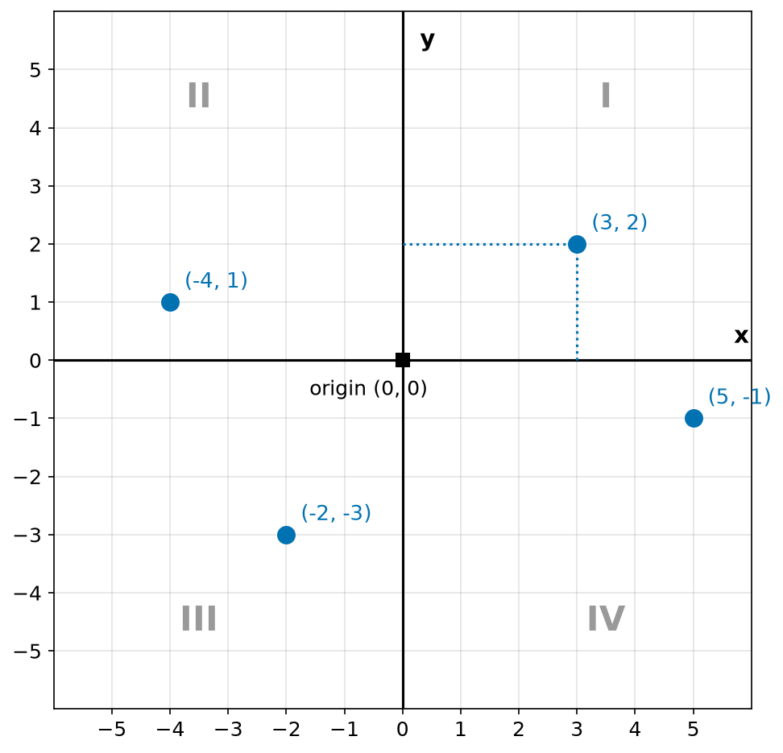
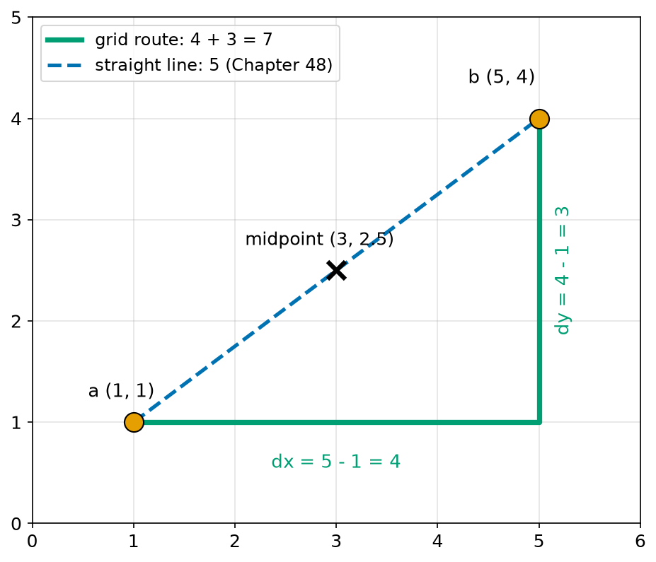
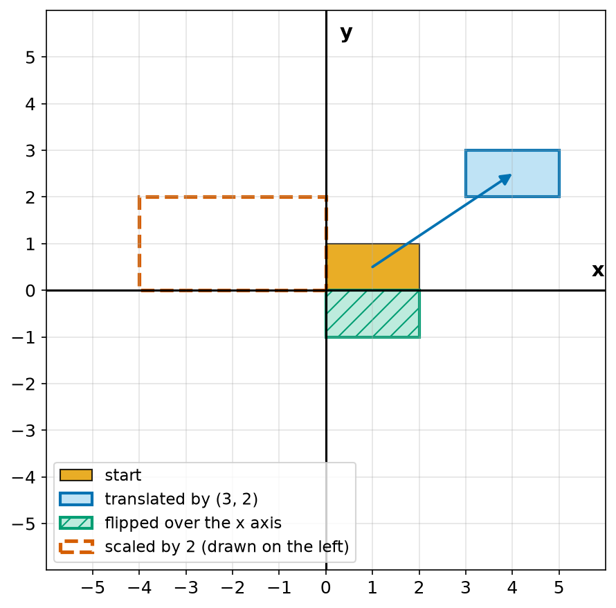
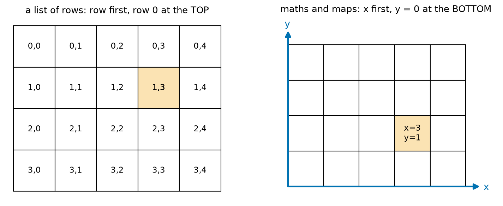
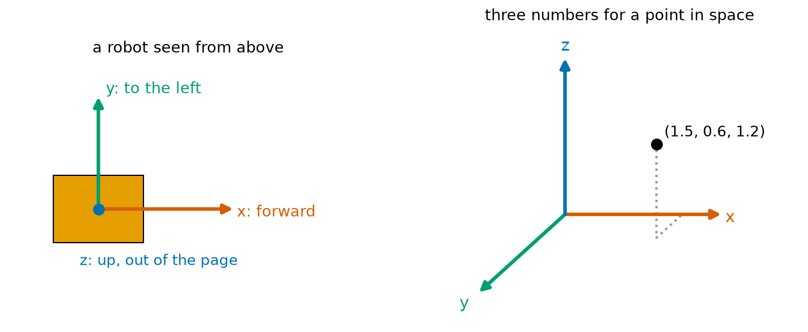
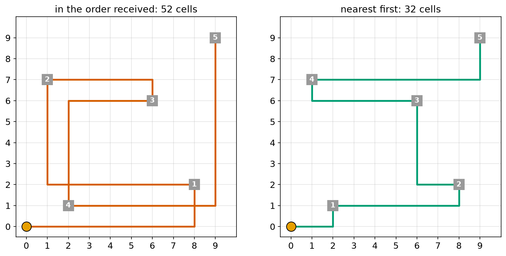

# Chapter 42 — Coordinates and the Number Plane

> **Part 3 · Chapter 42 of 749**
> **You need:** Chapter 37 (negative numbers), Chapter 21 (lists) and Chapter 36 (GridBot). Squared paper helps.
> **You will make:** a program that finds quadrants, midpoints and grid distances, a shape mover, a warehouse route planner, and the code that every robot map uses to change metres into map squares and back.

---

## What you will learn

- How two number lines make a **plane**, and how two numbers fix any point on it.
- The four **quadrants**, and how to tell where a point is from its signs.
- How to find the change in x and y between two points, the midpoint, and the grid distance.
- How to slide, flip and resize a shape by changing its coordinates.
- Why maps in a computer count rows from the top, and how to avoid the mix-up.
- How robots use three coordinates, and which way each axis points.
- How to change a position in metres into a square of a map, and back.

---

## New words in this chapter

| Word | Simple meaning |
|---|---|
| **plane** | A flat surface that goes on for ever in every direction. |
| **axis** (plural **axes**) | One of the number lines used to measure position. |
| **origin** | The point where the axes cross, (0, 0). |
| **coordinates** | The numbers that give the position of a point. |
| **ordered pair** | Two numbers in a fixed order, such as (3, 2). |
| **quadrant** | One of the four quarters of the plane. |
| **midpoint** | The point exactly halfway between two points. |
| **grid distance** | The distance when you can only move along the grid lines. |
| **translate** | Slide a shape without turning it. |
| **reflect** | Flip a shape over a line, like a mirror. |
| **scale** | Make a shape bigger or smaller. |
| **cell** | One square of a grid map. |
| **resolution** (of a map) | The size of one cell. |

---

## 42.1 From a line to a plane

In Chapter 37 one number was enough. Rover drove on a line, and its position was a single number such as +3 or −2.

But a real floor is flat and wide. To say where a robot is in a room, one number is not enough. "3 metres" — 3 metres in which direction?

The answer, found by the French thinker René Descartes almost 400 years ago, is to use **two** number lines that cross at a right angle.

📖 **New word: axis** — one of the number lines used to measure position. The plural is **axes**.

📖 **New word: origin** — the point where the axes cross. It is the point (0, 0).

📖 **New word: plane** — a flat surface that goes on for ever in every direction.



*Figure 42.1 — Two number lines, crossing at the origin, give every point on the plane its own address.*

**How to read this picture:** The line across is the x axis. The line going up is the y axis. They cross at the origin, the black square. Each blue dot has its coordinates written beside it. The dotted lines show how to reach (3, 2): 3 along, then 2 up. The large grey numbers name the four quarters.

### Coordinates

📖 **New word: coordinates** — the numbers that give the position of a point.

We write them in brackets, x first, then y:

```
(3, 2)
 ^  ^
 |  └── y: how far up (or down, if negative)
 └───── x: how far right (or left, if negative)
```

📖 **New word: ordered pair** — two numbers in a fixed order. (3, 2) and (2, 3) are different points.

💡 **Tip.** A way to remember the order: "along the corridor, then up the stairs". First x, then y.

🔢 **Maths.** To plot (−4, 1):

```
start at the origin
go 4 to the LEFT  (x is negative)
go 1 UP           (y is positive)
```

You have already used this. In Chapter 26, Rover drove to a goal at (2, 3). In Chapter 34, the laser scan gave points with x and y. In Python we store a point as a tuple: `goal = (2, 3)`, so that `goal[0]` is x and `goal[1]` is y.

---

## 42.2 The four quadrants

📖 **New word: quadrant** — one of the four quarters of the plane.

The axes cut the plane into four parts. They are numbered with Roman numerals, starting at top right and going round **anticlockwise**.

| Quadrant | Sign of x | Sign of y | Example |
|---|---|---|---|
| I | + | + | (3, 2) |
| II | − | + | (−4, 1) |
| III | − | − | (−2, −3) |
| IV | + | − | (5, −1) |

A point with x = 0 or y = 0 lies on an axis, and is not in any quadrant.

🤖 **Robot link.** The signs tell the robot which way to look. If a goal is at (−1, 2) from the robot, then it is behind and to the left (we will see in section 42.6 that in the robot's own coordinates, x points forward and y points left). Chapter 50 uses the quadrant to find the exact angle.

---

## 42.3 Change, midpoint and grid distance

### The change in x and y

Moving from point a to point b, how far did we go in each direction? Subtract: **end minus start**.

```
dx = x_b − x_a
dy = y_b − y_a
```

`d` here stands for "difference". 

🔢 **Maths.** From a = (1, 1) to b = (5, 4):

```
dx = 5 − 1 = 4      four to the right
dy = 4 − 1 = 3      three up
```

From b back to a, both changes are negative: dx = −4, dy = −3. The sign shows the direction, just as on the number line (Chapter 37).

### The midpoint

📖 **New word: midpoint** — the point exactly halfway between two points.

Take the average of the x values and the average of the y values:

```
midpoint = ( (x_a + x_b)/2 , (y_a + y_b)/2 )
```

🔢 **Maths.** The midpoint of (1, 1) and (5, 4):

```
( (1 + 5)/2 , (1 + 4)/2 ) = (3, 2.5)
```

### Grid distance

📖 **New word: grid distance** — the distance when you can only move along the grid lines.

A city with square blocks, a warehouse with straight aisles, and GridBot in Chapter 36 all move only along x or along y. Then the distance is simply:

```
grid distance = |dx| + |dy|
```

We use the absolute value (Chapter 37) because a distance cannot be negative.



*Figure 42.2 — Along the grid it is 7. In a straight line it is 5.*

**How to read this picture:** The orange dots are a and b. The green path goes 4 to the right and then 3 up, which makes 7. The blue dashed line goes straight there, and it is shorter. The cross marks the midpoint, which lies on the straight line.

How long is the straight line? That needs Pythagoras, which we will meet in Chapter 48. The answer here is exactly 5. Grid distance is also called **Manhattan distance**, after the city where most streets meet at right angles.

---

## 42.4 Moving shapes with coordinates

A shape is just a list of points. Change the points, and you move the shape. Look at Figure 42.3.



*Figure 42.3 — The orange rectangle, translated, reflected and scaled.*

**How to read this picture:** The orange rectangle is the start. The blue one has been slid 3 to the right and 2 up, as the arrow shows. The green one with lines has been flipped below the x axis. The red dashed one is twice as big. It is drawn on the left so it does not hide the others.

📖 **New word: translate** — slide a shape without turning it. Add the same amount to every point:

```
(x, y)  →  (x + dx, y + dy)
```

📖 **New word: reflect** — flip a shape over a line, like a mirror. To flip over the x axis, change the sign of y:

```
(x, y)  →  (x, −y)
```

To flip over the y axis, change the sign of x instead: (x, y) → (−x, y).

📖 **New word: scale** — make a shape bigger or smaller. Multiply every coordinate by the same factor:

```
(x, y)  →  (k·x, k·y)
```

⚠️ **Careful.** Scaling is done **about the origin**. A shape far from the origin also moves away from it when you scale it. If you want to grow a shape in place, first translate it so its centre is at the origin, then scale it, then translate it back.

Turning a shape (rotation) is the fourth kind of move. It needs sin and cos, so it waits until Chapter 49, and Chapter 167 does it with matrices. Together these moves are the start of **frames**, the subject of Part 13 (Chapter 314 onwards).

---

## 42.5 Rows and columns, x and y

Here is a mix-up that has caused countless bugs in robot software. Look at Figure 42.4.



*Figure 42.4 — The same square, numbered two different ways.*

**How to read this picture:** On the left is a list of rows in Python, like the GridBot world in Chapter 36. A square is named by row first, and row 0 is at the top. On the right is the maths way, x first, with y = 0 at the bottom. The orange square is the same square in both pictures. On the left it is (row 1, column 3). On the right it is (x = 3, y = 1).

| | List of rows | Number plane |
|---|---|---|
| order | `grid[row][col]` | (x, y) |
| first number | going down | going across |
| zero at | top | bottom |

So `grid[row][col]` means "y first, then x". And for a screen or an image, y also grows **downward** (Chapter 478). This is why a map program has to be very clear about which way it counts.

🧠 **Remember:** For a list of rows, `row` matches y, and `col` matches x. Write the names out in full — `grid[row][col]` — instead of `grid[a][b]`.

📖 **New word: cell** — one square of a grid map.

📖 **New word: resolution** (of a map) — the size of one cell, for example 5 cm.

To go from a position in metres to a cell, we subtract where the map begins, divide by the cell size, and round **down**:

```
col = floor( (x − x_origin) / cell_size )
row = floor( (y − y_origin) / cell_size )
```

`floor` means "round down to the whole number below". In Python it is `math.floor`. To go back, we use the **centre** of the cell, which is the best guess for the position:

```
x = x_origin + (col + 0.5) × cell_size
y = y_origin + (row + 0.5) × cell_size
```

Here, unlike in the list of rows, row 0 is at the bottom of the map, so that y and row grow the same way. Real robot maps work like this (Chapter 430).

---

## 42.6 Three coordinates

A drone or a robot arm moves in space, not just on a floor. Then a point needs **three** numbers: (x, y, z). The third axis, z, points up.



*Figure 42.5 — How robots name their axes.*

**How to read this picture:** On the left is a robot seen from above. x points forward, y points to its left, and z points up out of the page. On the right is a drawing of three axes in space. The dotted line shows how to reach the point (1.5, 0.6, 1.2): along x, then along y, then up z.

Robots almost everywhere use the same rule:

| Axis | Points | Colour usually drawn |
|---|---|---|
| x | forward | red |
| y | left | green |
| z | up | blue |

This is called a **right-handed** set of axes. Chapter 320 explains the rule with your hand.

⚠️ **Careful.** Not everyone uses z up. Many drones use **NED**: x north, y east, z **down**. A height of 10 m is then z = −10 (Chapter 625). Always check which set a sensor or a program uses.

---

## Code

File `code/ch042/plane_basics.py`:

```python
# plane_basics.py - quadrants, midpoints and grid distance for points on a plane
def quadrant(x, y):
    if x == 0 or y == 0:
        return "on an axis"
    if x > 0 and y > 0:
        return "I"
    if x < 0 and y > 0:
        return "II"
    if x < 0 and y < 0:
        return "III"
    return "IV"


def midpoint(a, b):
    return ((a[0] + b[0]) / 2, (a[1] + b[1]) / 2)


def grid_distance(a, b):
    return abs(a[0] - b[0]) + abs(a[1] - b[1])


for point in [(3, 2), (-4, 1), (-2, -3), (5, -1), (0, 4)]:
    print(f"{point} is in quadrant: {quadrant(point[0], point[1])}")

a = (1, 1)
b = (5, 4)
print("midpoint of a and b :", midpoint(a, b))
print("grid distance a to b:", grid_distance(a, b))
```

| Line | Code | What it does (simple English) |
|---|---|---|
| 1 | `# plane_basics.py …` | A comment. |
| 2 | `def quadrant(x, y):` | Takes the two coordinates. |
| 3 | `if x == 0 or y == 0:` | A zero means the point is on an axis. We test this first. |
| 4 | `return "on an axis"` | It is in no quadrant. |
| 5 | `if x > 0 and y > 0:` | Both positive. |
| 6 | `return "I"` | Top right. |
| 7 | `if x < 0 and y > 0:` | x negative, y positive. |
| 8 | `return "II"` | Top left. |
| 9 | `if x < 0 and y < 0:` | Both negative. |
| 10 | `return "III"` | Bottom left. |
| 11 | `return "IV"` | The only case left: x positive, y negative. |
| 12–13 | (blank) | Spacing. |
| 14 | `def midpoint(a, b):` | Each point is a tuple (x, y). |
| 15 | `return ((a[0] + b[0]) / 2, (a[1] + b[1]) / 2)` | The average of the x values, and the average of the y values. |
| 16–17 | (blank) | Spacing. |
| 18 | `def grid_distance(a, b):` | Distance along grid lines. |
| 19 | `return abs(a[0] - b[0]) + abs(a[1] - b[1])` | \|dx\| + \|dy\|. |
| 20–21 | (blank) | Spacing. |
| 22 | `for point in […]:` | One point in each quadrant, and one on an axis. |
| 23 | `print(f"{point} is in quadrant: …")` | `point[0]` is x and `point[1]` is y. |
| 24 | (blank) | Spacing. |
| 25 | `a = (1, 1)` | The first point. |
| 26 | `b = (5, 4)` | The second point. |
| 27 | `print("midpoint …", midpoint(a, b))` | Prints the midpoint. |
| 28 | `print("grid distance …", grid_distance(a, b))` | Prints the grid distance. |

Output:

```
(3, 2) is in quadrant: I
(-4, 1) is in quadrant: II
(-2, -3) is in quadrant: III
(5, -1) is in quadrant: IV
(0, 4) is in quadrant: on an axis
midpoint of a and b : (3.0, 2.5)
grid distance a to b: 7
```

These match Figures 42.1 and 42.2.

File `code/ch042/move_points.py`. It uses list comprehensions (Chapter 21).

```python
# move_points.py - slide, flip and resize a shape made of points
SHAPE = [(0, 0), (2, 0), (2, 1), (0, 1)]


def translate(points, dx, dy):
    return [(x + dx, y + dy) for x, y in points]


def flip_x_axis(points):
    return [(x, -y) for x, y in points]


def scale(points, factor):
    return [(x * factor, y * factor) for x, y in points]


print("start     :", SHAPE)
print("translated:", translate(SHAPE, 3, 2))
print("flipped   :", flip_x_axis(SHAPE))
print("scaled    :", scale(SHAPE, 2))
```

| Line | Code | What it does (simple English) |
|---|---|---|
| 1 | `# move_points.py …` | A comment. |
| 2 | `SHAPE = [(0, 0), (2, 0), (2, 1), (0, 1)]` | The four corners of a rectangle 2 wide and 1 tall. |
| 3–4 | (blank) | Spacing. |
| 5 | `def translate(points, dx, dy):` | Slides a shape. |
| 6 | `return [(x + dx, y + dy) for x, y in points]` | For each corner, add dx to x and dy to y. |
| 7–8 | (blank) | Spacing. |
| 9 | `def flip_x_axis(points):` | Mirrors a shape over the x axis. |
| 10 | `return [(x, -y) for x, y in points]` | Keeps x, changes the sign of y. |
| 11–12 | (blank) | Spacing. |
| 13 | `def scale(points, factor):` | Resizes a shape. |
| 14 | `return [(x * factor, y * factor) for x, y in points]` | Multiplies both coordinates. |
| 15–16 | (blank) | Spacing. |
| 17–20 | `print(…)` | Shows the start and each changed shape. |

Output:

```
start     : [(0, 0), (2, 0), (2, 1), (0, 1)]
translated: [(3, 2), (5, 2), (5, 3), (3, 3)]
flipped   : [(0, 0), (2, 0), (2, -1), (0, -1)]
scaled    : [(0, 0), (4, 0), (4, 2), (0, 2)]
```

Look at the flipped corner (0, 0). It becomes (0, −0), but a whole-number zero has no sign, so Python shows it as `0`. Each function returns a **new** list and leaves `SHAPE` unchanged (Chapter 24 called such functions pure).

---

## Small examples

**Example 1.** The point (0, 0) is the origin.

**Example 2.** (−3, 5) is 3 to the left and 5 up, in quadrant II.

**Example 3.** From (2, 7) to (6, 1): dx = 4, dy = −6. The grid distance is 4 + 6 = 10.

**Example 4.** The midpoint of (−2, 4) and (6, 0) is (2, 2).

**Example 5.** Translating (1, 1) by (−3, 2) gives (−2, 3).

**Example 6.** Reflecting (4, −2) over the y axis gives (−4, −2).

**Example 7.** In `grid = ["#####", "#S.G#", "#####"]`, the S is at `grid[1][1]`, so row 1, column 1.

**Example 8.** A drone using NED, 15 m above the ground, has z = −15.

---

## 🏭 Real robot applications

### Application 1 (worked in full) — 📦 A warehouse robot visiting shelves

**1. The real problem.** In many large warehouses, small robots drive under shelves and carry them to people who pack orders. They drive only along a grid, often following codes printed on the floor. A robot has 5 shelves to collect. In which order should it visit them?

**2. Why this theory.** Every shelf has grid coordinates. The driving needed between two shelves is the grid distance, |dx| + |dy|. The total for a route is the sum for each leg.

**3. The numbers.** One cell is 1.2 m. The robot starts at (0, 0). The shelves, in the order the orders arrived, are at (8, 2), (1, 7), (6, 6), (2, 1) and (9, 9).

**4. The maths.** In the order received:

```
(0,0) → (8,2):   8 + 2 = 10
(8,2) → (1,7):   7 + 5 = 12
(1,7) → (6,6):   5 + 1 =  6
(6,6) → (2,1):   4 + 5 =  9
(2,1) → (9,9):   7 + 8 = 15
                 total = 52 cells = 62.4 m
```

A simple better rule is **nearest first**: always go next to the closest shelf not yet visited.

```
from (0,0): closest is (2,1), distance 3
from (2,1): (8,2) and (1,7) are both 7; take the first in the list, (8,2)
from (8,2): closest is (6,6), distance 6
from (6,6): (1,7) and (9,9) are both 6; take (1,7)
from (1,7): last one is (9,9), distance 10
                 total = 3 + 7 + 6 + 6 + 10 = 32 cells = 38.4 m
```

**5. The code.** File `code/ch042/warehouse_route.py`:

```python
# warehouse_route.py - how much driving do two visiting orders need on a grid?
CELL_M = 1.2


def grid_distance(a, b):
    return abs(a[0] - b[0]) + abs(a[1] - b[1])


def route_cells(start, stops):
    total = 0
    here = start
    for stop in stops:
        total = total + grid_distance(here, stop)
        here = stop
    return total


def nearest_first(start, stops):
    left = list(stops)
    ordered = []
    here = start
    while left:
        best = min(left, key=lambda stop: grid_distance(here, stop))
        ordered.append(best)
        left.remove(best)
        here = best
    return ordered


start = (0, 0)
orders = [(8, 2), (1, 7), (6, 6), (2, 1), (9, 9)]

as_given = route_cells(start, orders)
better = nearest_first(start, orders)
better_cells = route_cells(start, better)

print(f"orders as given: {as_given} cells = {as_given * CELL_M:.1f} m")
print(f"nearest first  : {better}")
print(f"nearest first  : {better_cells} cells = {better_cells * CELL_M:.1f} m")
```

| Line | Code | What it does (simple English) |
|---|---|---|
| 1 | `# warehouse_route.py …` | A comment. |
| 2 | `CELL_M = 1.2` | The size of one grid cell, in metres. |
| 3–4 | (blank) | Spacing. |
| 5–6 | `def grid_distance…` | \|dx\| + \|dy\|, as before. |
| 7–8 | (blank) | Spacing. |
| 9 | `def route_cells(start, stops):` | Total cells for visiting the stops in the order given. |
| 10 | `total = 0` | Nothing driven yet. |
| 11 | `here = start` | Where the robot is now. |
| 12 | `for stop in stops:` | Each stop in turn. |
| 13 | `total = total + grid_distance(here, stop)` | Adds this leg. |
| 14 | `here = stop` | The robot is now at that stop. |
| 15 | `return total` | The total, in cells. |
| 16–17 | (blank) | Spacing. |
| 18 | `def nearest_first(start, stops):` | Builds a new order. |
| 19 | `left = list(stops)` | A **copy**, so that we do not damage the caller's list (Chapter 21). |
| 20 | `ordered = []` | The new order, empty at first. |
| 21 | `here = start` | Start position. |
| 22 | `while left:` | Repeats while there are stops left. An empty list counts as False (Chapter 17). |
| 23 | `best = min(left, key=lambda stop: grid_distance(here, stop))` | The stop with the smallest distance from here (Chapter 24). In a tie, `min` keeps the first. |
| 24 | `ordered.append(best)` | Adds it to the route. |
| 25 | `left.remove(best)` | It is no longer waiting. |
| 26 | `here = best` | Move there. |
| 27 | `return ordered` | The new order. |
| 28–29 | (blank) | Spacing. |
| 30 | `start = (0, 0)` | The robot's start cell. |
| 31 | `orders = […]` | Shelves, in the order received. |
| 32 | (blank) | Spacing. |
| 33 | `as_given = route_cells(start, orders)` | The first plan. |
| 34 | `better = nearest_first(start, orders)` | The new order. |
| 35 | `better_cells = route_cells(start, better)` | Its length. |
| 36 | (blank) | Spacing. |
| 37–39 | `print(…)` | Shows the results, in cells and metres. |

Output:

```
orders as given: 52 cells = 62.4 m
nearest first  : [(2, 1), (8, 2), (6, 6), (1, 7), (9, 9)]
nearest first  : 32 cells = 38.4 m
```



*Figure 42.6 — The same five shelves, in two orders.*

**How to read this picture:** The orange dot is the start. The grey squares are the shelves, numbered in the order visited. The red route on the left criss-crosses the floor. The green route on the right moves outward more neatly.

**6. The result.** A simple rule cut the driving by 38%. Over thousands of trips a day, that is a large saving in time and battery. But nearest first is not perfect. Trying all 120 possible orders on a computer shows that the best route here is 30 cells: (2, 1), (1, 7), (6, 6), (8, 2), (9, 9). The tie at the second step sent our rule the less good way.

**7. Going further.** Real warehouses must also stop robots from crashing into each other, and they plan routes on a grid with obstacles (Chapters 451–454). Trying every order works for 5 stops (120 orders), but for 20 stops there are about 2.4 × 10¹⁸ orders (Chapter 38), so clever methods are needed.

### Application 2 (worked in full) — 🧹 A cleaning robot's map

**1. The real problem.** A cleaning robot keeps a map of a room as a grid of small squares. Each square says "free", "wall" or "not yet seen". When the robot's sensor sees a wall at a position in metres, the robot must know **which square** to mark. When the planner picks a square to visit, the robot must know **where** in metres to drive.

**2. Why this theory.** It is a translation (move the origin of the map), a scaling (divide by the cell size), and a rounding down. Then the same steps in reverse.

**3. The numbers.** Each cell is 5 cm (0.05 m). The map's corner (row 0, column 0) is at x = −2.0 m, y = −1.0 m, because the robot started 2 m from the left wall and 1 m from the bottom wall. The map is 120 columns by 80 rows, so it covers 6 m by 4 m.

**4. The maths.** For the point (0.97, 0.13):

```
col = floor( (0.97 − (−2.0)) / 0.05 ) = floor( 2.97 / 0.05 ) = floor(59.4) = 59
row = floor( (0.13 − (−1.0)) / 0.05 ) = floor( 1.13 / 0.05 ) = floor(22.6) = 22

Back to the centre of that cell:
x = −2.0 + (59 + 0.5) × 0.05 = −2.0 + 2.975 = 0.975
y = −1.0 + (22 + 0.5) × 0.05 = −1.0 + 1.125 = 0.125
```

The centre is less than 2.5 cm away from the real point, which is as good as a 5 cm map can do.

**5. The code.** File `code/ch042/world_and_cell.py`:

```python
# world_and_cell.py - from metres on the floor to a square on the map, and back
import math

CELL_M = 0.05
ORIGIN_X = -2.0
ORIGIN_Y = -1.0
ROWS = 80
COLS = 120


def world_to_cell(x, y):
    col = math.floor((x - ORIGIN_X) / CELL_M)
    row = math.floor((y - ORIGIN_Y) / CELL_M)
    if 0 <= row < ROWS and 0 <= col < COLS:
        return row, col
    return None


def cell_to_world(row, col):
    x = ORIGIN_X + (col + 0.5) * CELL_M
    y = ORIGIN_Y + (row + 0.5) * CELL_M
    return x, y


for point in [(0.0, 0.0), (0.97, 0.13), (-2.0, -1.0), (3.99, 2.99), (4.0, 0.0)]:
    cell = world_to_cell(point[0], point[1])
    if cell is None:
        print(f"{point} is outside the map")
        continue
    back = cell_to_world(cell[0], cell[1])
    print(f"{point} -> cell {cell} -> centre ({back[0]:.3f}, {back[1]:.3f})")
```

| Line | Code | What it does (simple English) |
|---|---|---|
| 1 | `# world_and_cell.py …` | A comment. |
| 2 | `import math` | For `math.floor`. |
| 3 | (blank) | Spacing. |
| 4 | `CELL_M = 0.05` | The map resolution: 5 cm. |
| 5 | `ORIGIN_X = -2.0` | x of the map's corner. |
| 6 | `ORIGIN_Y = -1.0` | y of the map's corner. |
| 7 | `ROWS = 80` | 80 × 0.05 = 4 m tall. |
| 8 | `COLS = 120` | 120 × 0.05 = 6 m wide. |
| 9–10 | (blank) | Spacing. |
| 11 | `def world_to_cell(x, y):` | Metres in, cell out. |
| 12 | `col = math.floor((x - ORIGIN_X) / CELL_M)` | Translate, scale, round down. Columns follow x. |
| 13 | `row = math.floor((y - ORIGIN_Y) / CELL_M)` | The same for y. Rows follow y. |
| 14 | `if 0 <= row < ROWS and 0 <= col < COLS:` | Is the cell inside the map? (Chained comparisons, Chapter 17.) |
| 15 | `return row, col` | Row first, like `grid[row][col]`. |
| 16 | `return None` | Outside the map: no cell. |
| 17–18 | (blank) | Spacing. |
| 19 | `def cell_to_world(row, col):` | Cell in, metres out. |
| 20 | `x = ORIGIN_X + (col + 0.5) * CELL_M` | The 0.5 moves us to the centre of the cell. |
| 21 | `y = ORIGIN_Y + (row + 0.5) * CELL_M` | The same for y. |
| 22 | `return x, y` | x first, the maths way. |
| 23–24 | (blank) | Spacing. |
| 25 | `for point in […]:` | Five test points, including two corners of the map. |
| 26 | `cell = world_to_cell(point[0], point[1])` | Finds the cell. |
| 27 | `if cell is None:` | Outside? |
| 28 | `print(f"{point} is outside the map")` | Says so. |
| 29 | `continue` | Next point. |
| 30 | `back = cell_to_world(cell[0], cell[1])` | Converts back. |
| 31 | `print(f"…")` | Shows the round trip. |

Output:

```
(0.0, 0.0) -> cell (20, 40) -> centre (0.025, 0.025)
(0.97, 0.13) -> cell (22, 59) -> centre (0.975, 0.125)
(-2.0, -1.0) -> cell (0, 0) -> centre (-1.975, -0.975)
(3.99, 2.99) -> cell (79, 119) -> centre (3.975, 2.975)
(4.0, 0.0) is outside the map
```

**6. The result.** The robot's start position, (0, 0), is cell (20, 40). The two corner points land in the first and the last cell. x = 4.0 m is exactly on the right edge, so it falls outside, which is correct, because the last column covers 3.95 up to (but not including) 4.0 m. Without the check on line 14, the program would try to write outside the list and crash, or, worse, with a negative number, it would quietly mark a cell on the other side of the map (Chapter 21 showed that `-1` means the last item).

**7. Going further.** Python's `//` looks like it should do the same job as `math.floor(… / …)`, but try `2.0 // 0.05` in the shell. It gives `39.0`, not 40, because 0.05 cannot be stored exactly (Chapter 54). Real map code is very careful about this. Chapter 430 builds full occupancy grids, where each cell holds a probability rather than just "free" or "wall".

### Application 3 — 🖨️ A 3D printer moves to coordinates

A 3D printer is a robot that moves its nozzle to (x, y, z) positions read from a file, one after another, in millimetres. A layer is printed at one z height, by moving through many (x, y) points. Then z rises by one layer, perhaps 0.2 mm, and the next layer starts. Translating a whole model to the middle of the bed means adding the same dx and dy to every point, exactly as in `translate`.

### Application 4 — 🚁 Height in a drone's coordinates

In the NED system used by many drones, x points north, y east and z down. A drone that must climb from 2 m to 30 m must change z from −2 to −30, so dz = −28, a negative change for an upward move. Software that mixes NED and a z-up system can send a drone into the ground instead of the sky, which is why flight software checks this very carefully (Chapter 625).

### Application 5 — 🌾 A farm robot's field map

A weeding robot works along crop rows 0.75 m apart. If the rows run along the x axis and the first row is at y = 0, then row number n is at y = 0.75n. To move to row 12, the robot drives to y = 9.0 m. If GPS gives positions in metres east and north of a corner post, the robot first translates and turns these into field coordinates (Chapter 331), and then uses the simple rule above.

---

## 🔧 Hands-on lab

### Lab 42.1 — A coordinate floor (hardware, tape)

You need masking tape, a tape measure and a toy or robot.

1. Make an x axis and a y axis with tape on the floor, crossing at a right angle. Mark every 50 cm along each one.
2. Choose 4 places in the room, and measure their coordinates in metres.
3. Write them in Python as a list of tuples, and use `grid_distance` and `midpoint` on them.
4. Walk the grid route between two of them and check the distance with the tape.

**What you should see:** The grid distance from Python matches the distance you walk along the axes, within a few centimetres.

| If it does not work | Likely cause | Fix |
|---|---|---|
| The numbers do not match | The axes are not at a right angle | Use the corner of a large book or a floor tile to set it |
| A point has the wrong sign | You measured from the wrong side of an axis | Left of the y axis is negative x |

**Challenge:** Add a z coordinate for a point on a table. What is the midpoint between a point on the floor and the table top?

### Lab 42.2 — Shape mover (simulation)

Copy `move_points.py`.

1. Add a function `flip_y_axis(points)`.
2. Translate the shape by (−1, −0.5), scale it by 2, then translate it back by (1, 0.5).
3. Plot the shapes with matplotlib (Chapter 33), using `plt.fill` with the x values and the y values.

**What you should see:** The flipped shape is on the left of the y axis. The three-step version grows the rectangle **about its own centre**, (1, 0.5), so the centre stays in the same place.

| If it does not work | Likely cause | Fix |
|---|---|---|
| `TypeError: cannot unpack` | `plt.fill` was given a list of tuples | Make two lists: `xs = [p[0] for p in shape]` and `ys = [p[1] for p in shape]` |
| The shape looks squashed | The axes have different scales | Use `plt.axis("equal")` |

**Challenge:** Write `scale_about(points, centre, factor)` which does all three steps.

### Lab 42.3 — Break the map (simulation)

Copy `world_and_cell.py`.

1. Add the point `(-2.01, 0.0)`, which is just off the left edge.
2. Remove the check on line 14 (always return `row, col`) and run it again.
3. Change line 12 to use `//` instead of `math.floor` and `/`, and test the point `(0.0, 0.0)`.

**What you should see:** With the check, the point is "outside the map". Without it, you get column −1, which in a list means the **last** column — a silent bug. With `//`, (0.0, 0.0) goes into column 39 instead of 40.

| If it does not work | Likely cause | Fix |
|---|---|---|
| The `//` test still gives 40 | You changed only the row line | Change the column line |
| `IndentationError` | You deleted lines unevenly | Re-indent the `return` |

**Challenge:** Make `world_to_cell` safe against this rounding problem by adding a very small number before rounding down. Then explain why this fix also has a danger.

---

## Common mistakes

⚠️ **Swapping x and y.** (3, 2) is not (2, 3). x is always first.

⚠️ **Using `grid[x][y]` instead of `grid[row][col]`.** In a list of rows, row matches y.

⚠️ **Forgetting that screen and image y goes down.**

⚠️ **Subtracting the wrong way round.** dx is end minus start.

⚠️ **Forgetting the absolute value in grid distance.**

⚠️ **Scaling a shape that is far from the origin**, and being surprised that it moves.

⚠️ **Not checking the edges of a map.** A negative index does not crash. It quietly uses the wrong cell.

⚠️ **Mixing z-up and z-down systems.**

---

## Practice

🏋️ **1.** In which quadrant is each point: (−3, −7), (4, 9), (−1, 6), (8, −2)?

🏋️ **2.** Find dx and dy from (2, −1) to (−3, 5).

🏋️ **3.** Find the midpoint of (−4, 2) and (6, 8).

🏋️ **4.** Find the grid distance from (−2, −3) to (4, 1).

🏋️ **5.** Translate the triangle (0, 0), (3, 0), (0, 2) by (−1, 4).

🏋️ **6.** Reflect the point (5, −3) over the x axis and then over the y axis. What single move would give the same answer?

🏋️ **7.** Scale (2, 3) by 1.5.

🏋️ **8.** In `world = ["#####", "#S..#", "#..G#", "#####"]`, give the row and column of G, and then its (x, y) with y counting rows from the top.

🏋️ **9.** With the map from Application 2, which cell holds the point (1.234, −0.5)?

🏋️ **10.** A drone using NED is at z = −12. It climbs 5 m. What is its new z?

🏋️ **11.** Write `bounding_box(points)`, which returns the smallest and largest x and y of a list of points as `(x_min, y_min, x_max, y_max)`. Test it with the triangle from question 5.

---

## Answers

**1.** III, I, II, IV.

**2.** dx = −3 − 2 = −5. dy = 5 − (−1) = 6.

**3.** ((−4 + 6)/2, (2 + 8)/2) = (1, 5).

**4.** |4 − (−2)| + |1 − (−3)| = 6 + 4 = 10.

**5.** (−1, 4), (2, 4), (−1, 6).

**6.** Over the x axis: (5, 3). Then over the y axis: (−5, 3). The single move is to change the sign of both coordinates. (This is the same as turning by half a turn about the origin, which Chapter 49 shows.)

**7.** (3, 4.5).

**8.** G is in row 2, column 3. So x = 3, y = 2 (y counted downward from the top row).

**9.** col = floor((1.234 + 2.0)/0.05) = floor(64.68) = 64. row = floor((−0.5 + 1.0)/0.05) = floor(10.0) = 10. Cell (10, 64). Be careful here: 0.5/0.05 might come out as 9.999…, as Application 2 warned. In Python, `0.5 / 0.05` gives exactly 10.0, so the answer is row 10.

**10.** Climbing in NED makes z more negative: −12 − 5 = −17.

**11.**

```python
def bounding_box(points):
    xs = [p[0] for p in points]
    ys = [p[1] for p in points]
    return min(xs), min(ys), max(xs), max(ys)

print(bounding_box([(-1, 4), (2, 4), (-1, 6)]))   # (-1, 4, 2, 6)
```

A bounding box is the smallest rectangle, along the axes, that holds a shape. Robots use it as a quick first test of whether two objects might touch.

---

## Summary

🧠 Two number lines at right angles make a plane. A point's address is (x, y), with x first.

🧠 The signs of x and y tell you the quadrant.

🧠 The change between two points is end minus start. The midpoint is the average.

🧠 Grid distance is |dx| + |dy|. The straight-line distance comes in Chapter 48.

🧠 Translate by adding, reflect by changing a sign, and scale by multiplying.

🧠 A list of rows uses `grid[row][col]`, so row matches y. Images count y downward.

🧠 Robots use x forward, y left, z up, but many drones use z down.

🧠 To go from metres to a map cell: translate, divide by the cell size, round down, and check the edges.

---

## Next chapter

In Chapter 43 we join points with **straight lines**. You will learn the slope, the famous `y = mx + c`, and how a robot uses a straight line to turn a sensor's raw reading into a real distance.
