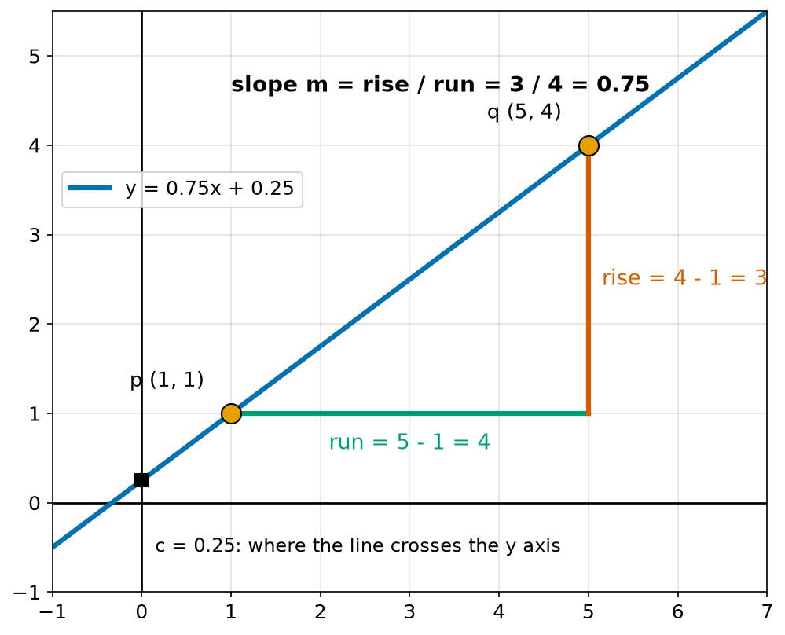
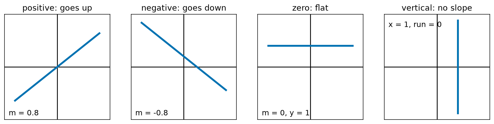
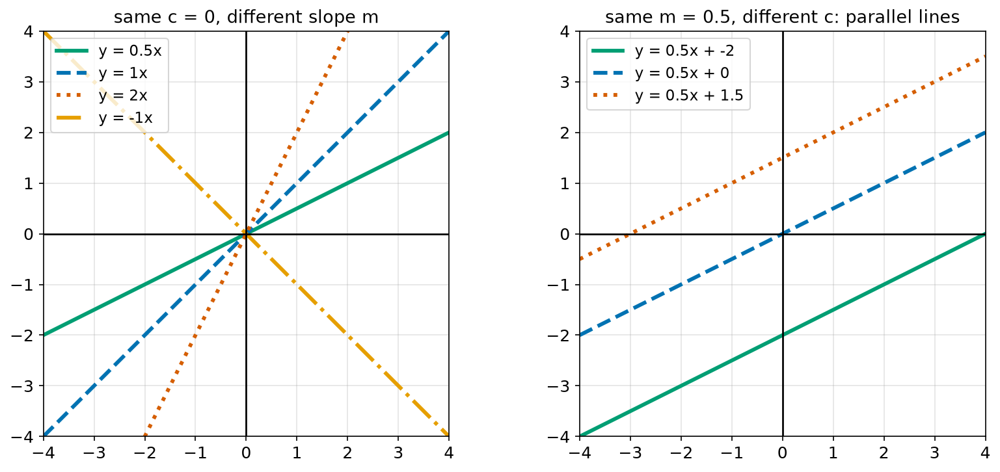
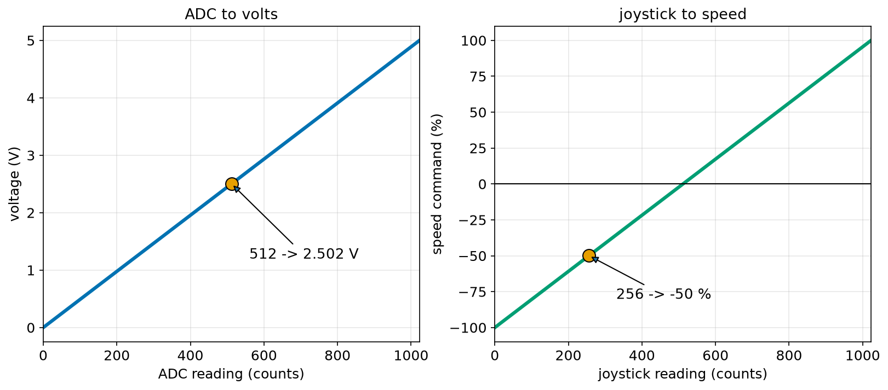
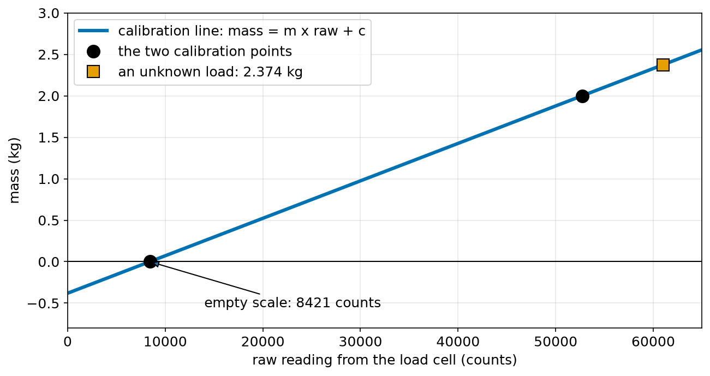
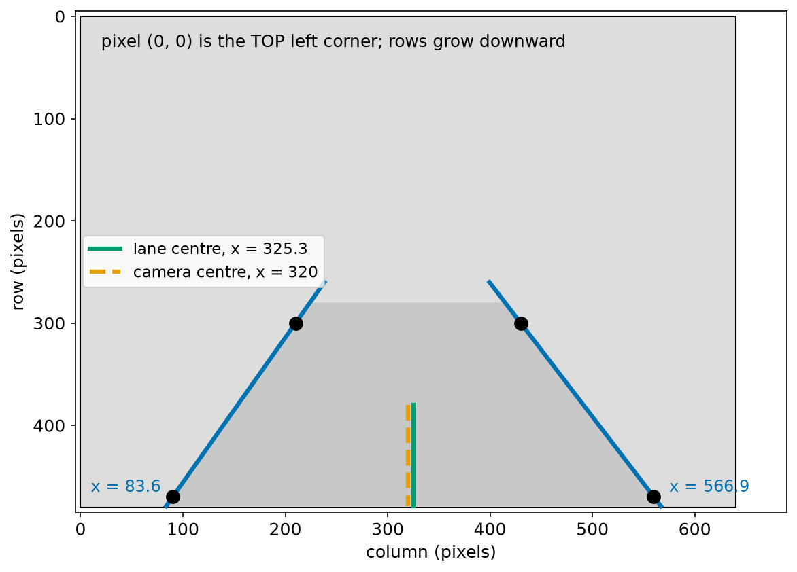

# Chapter 43 — Straight Lines: Slope and y = mx + c

> **Part 3 · Chapter 43 of 749**
> **You need:** Chapter 41 (rearranging) and Chapter 42 (coordinates). Squared paper and a ruler help.
> **You will make:** a program that finds the line through two points, the "map one range onto another" function that almost every robot uses, a two-point calibration for a weighing sensor, and a lane finder for a car camera.

---

## What you will learn

- What the **slope** of a line is, and how to find it from two points.
- What positive, negative, zero and "no slope" look like.
- How to read and use `y = mx + c`.
- How to find the equation of the line through two points.
- How to tell if two lines are parallel or perpendicular.
- How to change a value from one range into another range.
- How a two-point calibration works.

---

## New words in this chapter

| Word | Simple meaning |
|---|---|
| **slope** (or **gradient**) | How steep a line is: how much it goes up for each step across. |
| **rise** | The change in y between two points. |
| **run** | The change in x between two points. |
| **y-intercept** | Where a line crosses the y axis. Written c. |
| **x-intercept** | Where a line crosses the x axis. |
| **linear** | Making a straight line when drawn. |
| **parallel** | Going in the same direction and never meeting. |
| **perpendicular** | Meeting at a right angle (90°). |
| **interpolation** | Finding a value between two known points. |
| **extrapolation** | Guessing a value outside the known points. |
| **calibration** | Finding the rule that turns a raw sensor reading into a real quantity. |

---

## 43.1 How steep is it?

Walk up a gentle hill and then a steep staircase. Both go up, but the staircase goes up much more for each step forward. We want a number for "how steep".

📖 **New word: slope** — how much a line goes up for each step across. It is also called the **gradient**.

```
           rise
slope  =  ------
           run
```

📖 **New word: rise** — the change in y. 📖 **New word: run** — the change in x. These are the dy and dx of Chapter 42.



*Figure 43.1 — The slope of the line through p and q.*

**How to read this picture:** The blue line passes through the two orange points. The green line shows the run, 4 steps across. The red line shows the rise, 3 steps up. The slope is 3 ÷ 4 = 0.75. The black square is where the line crosses the y axis.

🔢 **Maths.** The slope from p = (1, 1) to q = (5, 4):

```
rise = 4 − 1 = 3
run  = 5 − 1 = 4
m    = 3 / 4 = 0.75
```

We use the letter **m** for slope. A slope of 0.75 means: for every 1 step to the right, the line goes up 0.75.

💡 **Tip.** It does not matter which point you call p and which you call q, as long as you do the same for the rise and the run. From q to p: rise = 1 − 4 = −3, run = 1 − 5 = −4, and −3 ÷ −4 = 0.75 again (Chapter 37: minus divided by minus is plus).

💡 **Tip.** On a straight line the slope is the same everywhere. Pick any two points on it, and you get 0.75. That is what "straight" means.

### Four kinds of slope



*Figure 43.2 — Up, down, flat, and straight up.*

**How to read this picture:** Read each line from left to right. The first goes up, so its slope is positive. The second goes down, so its slope is negative. The third is flat, with slope 0. The last one goes straight up. Its run is 0, so the slope would need a division by zero.

| The line | Slope | Example |
|---|---|---|
| goes up | positive | m = 0.8 |
| goes down | negative | m = −0.8 |
| flat | 0 | y = 1 |
| vertical | has no slope | x = 1 |

A vertical line cannot be written as y = something. It is written **x = 1**: every point on it has x equal to 1.

### Slope as a percentage

Roads and ramps give the slope as a percentage. A 10% slope means the rise is 10 for every 100 across: m = 0.10.

🔢 **Maths.** A ramp rises 0.3 m over 4 m.

```
m = 0.3 / 4 = 0.075 = 7.5%
```

🤖 **Robot link.** A slope has units: the units of y divided by the units of x. On a graph of distance (m) against time (s), the slope is in m/s. It is the **speed**. On a graph of a battery's voltage against time, the slope tells you how fast it is going flat. Reading the slope of a graph is one of the most useful skills in robotics, and it leads straight to the derivative (Chapter 177).

---

## 43.2 The equation y = mx + c

📖 **New word: linear** — making a straight line when drawn.

Every straight line that is not vertical can be written:

```
y = m x + c
    |     |
    |     └── c: the y-intercept, where the line crosses the y axis
    └──────── m: the slope
```

In words: start at c, and go up by m for every step in x.

📖 **New word: y-intercept** — where a line crosses the y axis. There, x = 0, so y = m × 0 + c = c.

(The word "intercept" here means "where it cuts the axis". In Chapter 41 it meant catching a moving part. Same word, two uses.)

🔢 **Maths.** For y = 0.75x + 0.25:

```
x = 0:  y = 0.25          (the y-intercept)
x = 1:  y = 1.00
x = 5:  y = 4.00
x = −1: y = −0.50
```

The points (1, 1) and (5, 4) are on it. This is the line in Figure 43.1.



*Figure 43.3 — m sets the steepness. c moves the line up or down.*

**How to read this picture:** On the left, every line goes through the origin, because c = 0. The bigger m is, the steeper the line. The orange one has a negative m, so it falls. On the right, every line has m = 0.5, but each has a different c. They are parallel: they never meet.

### The x-intercept

📖 **New word: x-intercept** — where a line crosses the x axis. There, y = 0. Use Chapter 41 to solve:

```
0 = m x + c
x = −c / m
```

🔢 **Maths.** For y = 2x − 6, the line crosses the x axis at x = 6 ÷ 2 = 3.

🤖 **Robot link.** Robots often ask "when will this reach zero?". The battery voltage falls along a line: when does it reach the cut-off? A robot drives towards a wall: when will the distance reach 0? Each is an x-intercept.

---

## 43.3 The line through two points

Two points fix exactly one straight line. To find its equation:

```
1. Slope:      m = (y2 − y1) / (x2 − x1)
2. Intercept:  put one point into y = mx + c, and solve for c:
               c = y1 − m × x1
```

🔢 **Maths.** The line through (0, 3) and (4, 1):

```
m = (1 − 3) / (4 − 0) = −2 / 4 = −0.5
c = 3 − (−0.5)(0) = 3
y = −0.5x + 3
```

**Check with the other point:** −0.5 × 4 + 3 = 1. That is correct.

🔢 **Maths.** The line through (2, 7) and (6, 9):

```
m = (9 − 7) / (6 − 2) = 0.5
c = 7 − 0.5 × 2 = 6
y = 0.5x + 6
```

### Another way to write it

Sometimes it is easier to start from a known point (x1, y1):

```
y − y1 = m (x − x1)
```

In words: from the known point, the change in y is m times the change in x. Expanding it gives y = mx + c again.

---

## 43.4 Parallel and perpendicular lines

📖 **New word: parallel** — going in the same direction and never meeting. Parallel lines have the **same slope**.

📖 **New word: perpendicular** — meeting at a right angle.

For perpendicular lines:

```
m1 × m2 = −1      so      m2 = −1 / m1
```

Why? Imagine a line going "4 across, 3 up". Turn it by a right angle to the left. It now goes "3 to the **left**, 4 up", so its run is −3 and its rise is 4.

```
first line:   m1 = 3 / 4
turned line:  m2 = 4 / (−3) = −4/3
check:        (3/4) × (−4/3) = −1
```

Chapter 49 shows this turning with sin and cos.

🔢 **Maths.** Which line, through (1, 1), is parallel to y = 2x + 5? Same slope, 2: c = 1 − 2 × 1 = −1. So y = 2x − 1.

🔢 **Maths.** Which slope is perpendicular to m = 2? −1/2 = −0.5.

🤖 **Robot link.** A robot that follows a wall must stay parallel to it. If it finds the wall's line from two distance readings, it can compare its own direction with the wall's slope (Chapter 295). A robot that wants to drive straight towards the wall needs the perpendicular direction.

---

## 43.5 Mapping one range onto another

A robot is full of numbers in the "wrong" range:

- The ADC gives 0 to 1023. We want volts, 0 to 5 (Chapter 38).
- A joystick gives 0 to 1023. We want a speed from −100% to +100%.
- A servo needs a pulse from 1000 to 2000 microseconds for an angle of 0° to 180° (Chapter 143).

Each of these is a straight line through two known points: (in_low, out_low) and (in_high, out_high).

```
m   = (out_high − out_low) / (in_high − in_low)
out = out_low + m × (value − in_low)
```

This is the "point and slope" form from section 43.3, with the known point (in_low, out_low).



*Figure 43.4 — Two everyday maps: ADC to volts and joystick to speed.*

**How to read this picture:** Each plot is a straight line between two known ends. On the left, a reading of 512 gives 2.502 V. On the right, the line starts at −100% and ends at +100%. A reading of 256 gives −50%. The line crosses zero near the middle.

📖 **New word: interpolation** — finding a value between two known points. 📖 **New word: extrapolation** — guessing a value outside the known points.

Interpolation on a straight line is usually safe. Extrapolation is risky, because the real behaviour may stop being straight outside the range you measured.

---

## Code

File `code/ch043/slope_and_line.py`:

```python
# slope_and_line.py - the slope between two points, and the line y = mx + c through them
def slope(p, q):
    run = q[0] - p[0]
    rise = q[1] - p[1]
    if run == 0:
        return None
    return rise / run


def line_through(p, q):
    m = slope(p, q)
    if m is None:
        return None
    c = p[1] - m * p[0]
    return m, c


pairs = [((1, 1), (5, 4)), ((0, 3), (4, 1)), ((-2, 2), (3, 2)), ((2, -1), (2, 5))]

for p, q in pairs:
    line = line_through(p, q)
    if line is None:
        print(f"{p} to {q}: vertical line, x = {p[0]}")
    else:
        m, c = line
        print(f"{p} to {q}: slope {m:+.3f}, y = {m:.3f}x + {c:.3f}")
```

| Line | Code | What it does (simple English) |
|---|---|---|
| 1 | `# slope_and_line.py …` | A comment. |
| 2 | `def slope(p, q):` | Each point is a tuple (x, y). |
| 3 | `run = q[0] - p[0]` | Change in x. |
| 4 | `rise = q[1] - p[1]` | Change in y. |
| 5 | `if run == 0:` | A vertical line. We must not divide by zero. |
| 6 | `return None` | "There is no slope." |
| 7 | `return rise / run` | The slope. |
| 8–9 | (blank) | Spacing. |
| 10 | `def line_through(p, q):` | Finds m and c. |
| 11 | `m = slope(p, q)` | Step 1. |
| 12 | `if m is None:` | A vertical line has no y = mx + c form. |
| 13 | `return None` | Passes that on. |
| 14 | `c = p[1] - m * p[0]` | Step 2: c = y1 − m × x1. |
| 15 | `return m, c` | Both numbers. |
| 16–17 | (blank) | Spacing. |
| 18 | `pairs = […]` | Four pairs: up, down, flat and vertical. |
| 19 | (blank) | Spacing. |
| 20 | `for p, q in pairs:` | Takes each pair. |
| 21 | `line = line_through(p, q)` | Finds the line. |
| 22 | `if line is None:` | The vertical case. |
| 23 | `print(f"… vertical line, x = {p[0]}")` | Writes it as x = number. |
| 24 | `else:` | The normal case. |
| 25 | `m, c = line` | Unpacks the tuple. |
| 26 | `print(f"… slope {m:+.3f}, y = …")` | `+` shows the sign of the slope. |

Output:

```
(1, 1) to (5, 4): slope +0.750, y = 0.750x + 0.250
(0, 3) to (4, 1): slope -0.500, y = -0.500x + 3.000
(-2, 2) to (3, 2): slope +0.000, y = 0.000x + 2.000
(2, -1) to (2, 5): vertical line, x = 2
```

The first two match what we did by hand. The flat line has slope 0, so it is y = 2.

File `code/ch043/linear_map.py`:

```python
# linear_map.py - move a value from one range to another along a straight line
def map_range(value, in_low, in_high, out_low, out_high):
    m = (out_high - out_low) / (in_high - in_low)
    return out_low + m * (value - in_low)


print("ADC reading to volts")
for raw in [0, 512, 1023]:
    print(f"  {raw:5d} -> {map_range(raw, 0, 1023, 0.0, 5.0):.3f} V")

print("joystick to speed command")
for raw in [0, 256, 512, 1023]:
    print(f"  {raw:5d} -> {map_range(raw, 0, 1023, -100, 100):+.1f} %")

print("servo angle to pulse width")
for angle in [0, 45, 90, 180]:
    print(f"  {angle:5d} -> {map_range(angle, 0, 180, 1000, 2000):.0f} us")
```

| Line | Code | What it does (simple English) |
|---|---|---|
| 1 | `# linear_map.py …` | A comment. |
| 2 | `def map_range(value, in_low, in_high, out_low, out_high):` | The value, and the two ends of each range. |
| 3 | `m = (out_high - out_low) / (in_high - in_low)` | The slope: output change ÷ input change. |
| 4 | `return out_low + m * (value - in_low)` | Start at out_low, then go up by m for each step above in_low. |
| 5–6 | (blank) | Spacing. |
| 7 | `print("ADC reading to volts")` | A heading. |
| 8 | `for raw in [0, 512, 1023]:` | The two ends and the middle. |
| 9 | `print(f"… {map_range(raw, 0, 1023, 0.0, 5.0):.3f} V")` | 0–1023 becomes 0–5 V. |
| 10 | (blank) | Spacing. |
| 11 | `print("joystick to speed command")` | A heading. |
| 12 | `for raw in [0, 256, 512, 1023]:` | Four positions of the stick. |
| 13 | `print(f"… {map_range(raw, 0, 1023, -100, 100):+.1f} %")` | 0–1023 becomes −100 to +100. |
| 14 | (blank) | Spacing. |
| 15 | `print("servo angle to pulse width")` | A heading. |
| 16 | `for angle in [0, 45, 90, 180]:` | Four angles. |
| 17 | `print(f"… {map_range(angle, 0, 180, 1000, 2000):.0f} us")` | 0–180° becomes 1000–2000 µs. |

Output:

```
ADC reading to volts
      0 -> 0.000 V
    512 -> 2.502 V
   1023 -> 5.000 V
joystick to speed command
      0 -> -100.0 %
    256 -> -50.0 %
    512 -> +0.1 %
   1023 -> +100.0 %
servo angle to pulse width
      0 -> 1000 us
     45 -> 1250 us
     90 -> 1500 us
    180 -> 2000 us
```

Look at the joystick in the middle: 512 gives +0.1%, not 0. The exact middle of 0 to 1023 is 511.5, which no whole-number reading can hit. A robot left with its stick in the middle would creep forward very slowly. This is why robots add a small **deadband** around zero (Chapter 18).

⚠️ **Careful.** Arduino has a built-in `map()` function that does the same sum, but with **whole numbers only**. It cuts off the decimals, so `map(512, 0, 1023, 0, 5)` gives 2, not 2.502 (Chapter 102).

---

## Small examples

**Example 1.** Slope from (0, 0) to (2, 6): 6 ÷ 2 = 3.

**Example 2.** y = 4x − 1 has slope 4 and crosses the y axis at −1.

**Example 3.** y = −x + 5 crosses the x axis at x = 5.

**Example 4.** The line y = 7 is flat. Its slope is 0.

**Example 5.** The line x = −2 is vertical.

**Example 6.** Lines y = 3x + 1 and y = 3x − 4 are parallel.

**Example 7.** Lines y = 2x and y = −0.5x + 3 are perpendicular, because 2 × (−0.5) = −1.

**Example 8.** Mapping 25 from 0–100 to 0–255 gives 63.75 (Chapter 37 rounded this to 64).

**Example 9.** A robot at 2 m from a wall drives towards it at 0.4 m/s. Distance = −0.4t + 2. It reaches the wall when t = 2 ÷ 0.4 = 5 s.

---

## 🏭 Real robot applications

### Application 1 (worked in full) — ⚖️ Calibrating a weighing sensor

**1. The real problem.** A sorting robot on a farm weighs boxes of fruit with a **load cell**, a metal bar that bends a tiny amount under weight (Chapter 128). The electronics give a raw number of "counts", not kilograms. And with nothing on it, the reading is not even zero. How do we turn counts into kilograms?

📖 **New word: calibration** — finding the rule that turns a raw sensor reading into a real quantity.

**2. Why this theory.** A good load cell is linear: each extra kilogram adds the same number of counts. So mass = m × raw + c. Two known points fix the line.

**3. The numbers.** With the scale empty, the reading is 8421. With a 2.000 kg test weight on it, the reading is 52713.

**4. The maths.** Here the x values are counts and the y values are kilograms.

```
Points:  (8421, 0.000) and (52713, 2.000)

m = (2.000 − 0) / (52713 − 8421) = 2 / 44292 = 0.000045155 kg per count
c = 0 − m × 8421 = −0.3802 kg

An unknown box reads 61000:
mass = 0.000045155 × 61000 − 0.3802 = 2.374 kg
```

**5. The code.** File `code/ch043/load_cell.py`:

```python
# load_cell.py - two-point calibration turns raw counts into kilograms
RAW_EMPTY = 8421          # reading with nothing on the scale
RAW_KNOWN = 52713         # reading with the known weight on it
KNOWN_KG = 2.000          # the known weight

m = KNOWN_KG / (RAW_KNOWN - RAW_EMPTY)
c = -m * RAW_EMPTY

print(f"slope m     = {m:.4e} kg per count")
print(f"intercept c = {c:.4f} kg")
print("   raw    mass (kg)")
for raw in [8421, 30567, 52713, 61000, 7900]:
    mass = m * raw + c
    print(f"{raw:6d} {mass:12.3f}")
```

| Line | Code | What it does (simple English) |
|---|---|---|
| 1 | `# load_cell.py …` | A comment. |
| 2 | `RAW_EMPTY = 8421` | First calibration point: x = 8421, y = 0 kg. |
| 3 | `RAW_KNOWN = 52713` | Second point: x = 52713 … |
| 4 | `KNOWN_KG = 2.000` | … with y = 2 kg. |
| 5 | (blank) | Spacing. |
| 6 | `m = KNOWN_KG / (RAW_KNOWN - RAW_EMPTY)` | Rise ÷ run. The rise is 2 − 0. |
| 7 | `c = -m * RAW_EMPTY` | c = y1 − m × x1, with y1 = 0. |
| 8 | (blank) | Spacing. |
| 9 | `print(f"slope m     = {m:.4e} …")` | `.4e` shows the small slope in scientific notation (Chapter 38). |
| 10 | `print(f"intercept c = …")` | Shows c. |
| 11 | `print("   raw    mass (kg)")` | The heading. |
| 12 | `for raw in […]:` | Five readings to test. |
| 13 | `mass = m * raw + c` | y = mx + c. |
| 14 | `print(f"…")` | Prints the row. |

Output:

```
slope m     = 4.5155e-05 kg per count
intercept c = -0.3802 kg
   raw    mass (kg)
  8421        0.000
 30567        1.000
 52713        2.000
 61000        2.374
  7900       -0.024
```



*Figure 43.5 — Two black points fix the line, and the line gives every other mass.*

**How to read this picture:** Across the bottom are raw counts. Up the side is mass. The black dots are the two calibration points. The blue line goes through them. The orange square is an unknown box. Its mass is read off the line.

**6. The result.** The robot now reports kilograms. 30567 is halfway between the two points, and gives exactly 1.000 kg, as a straight line should. Look at the last row: 7900, a bit less than empty, gives −0.024 kg. That is not a real negative mass. The sensor drifted, perhaps because of temperature. This is why scales are "zeroed" (re-measuring the empty reading) often. The reading of 61000 is **extrapolation**, beyond the 2 kg test weight, and it is only as good as the sensor's straightness above 2 kg.

**7. Going further.** Careful calibration uses many test weights, not two, and fits the best line through all of them (least squares, Chapter 171). It also checks that the sensor really is straight. Chapter 133 covers calibration of all kinds of sensors.

### Application 2 (worked in full) — 🚗 Staying in the lane

**1. The real problem.** A car or a small road robot has a camera looking ahead. Image processing finds two points on each painted lane line. Is the robot in the middle of the lane, or has it drifted?

**2. Why this theory.** Each lane line is a straight line through two points. We want where each line reaches the bottom of the image, which is the part of the road closest to the car. Then we compare the middle of the lane with the middle of the image.

**3. The numbers.** The image is 640 pixels wide and 480 tall. Remember from Chapter 42: in an image, row 0 is the **top**, and rows grow downward. The left line passes through (210, 300) and (90, 470). The right line passes through (430, 300) and (560, 470), written as (column, row). At the bottom of the image, one pixel is about 4 mm on the road.

**4. The maths.** Lane lines in the image are steep, close to vertical. A steep line has a huge slope, and a vertical one has none at all. So we turn the problem round, and write **x in terms of the row**: x = a × row + b. Here a is "run over rise", and it stays small for steep lines.

```
Left line:
a = (90 − 210) / (470 − 300) = −120 / 170 = −0.7059
b = 210 − (−0.7059 × 300) = 421.8
At the bottom row, 479:  x = −0.7059 × 479 + 421.8 = 83.6

Right line:
a = (560 − 430) / (470 − 300) = 130 / 170 = 0.7647
b = 430 − 0.7647 × 300 = 200.6
At row 479:  x = 0.7647 × 479 + 200.6 = 566.9

Lane centre:   (83.6 + 566.9) / 2 = 325.3
Camera centre: 640 / 2 = 320
Offset: 320 − 325.3 = −5.3 pixels
```

**5. The code.** File `code/ch043/lane_centre.py`:

```python
# lane_centre.py - where are the lane lines at the bottom of the camera image?
IMAGE_WIDTH = 640
BOTTOM_ROW = 479
METRES_PER_PIXEL = 0.004       # at the bottom of the image, from a calibration


def x_at_row(p, q, row):
    a = (q[0] - p[0]) / (q[1] - p[1])     # change in x for each row down
    b = p[0] - a * p[1]
    return a * row + b


left = ((210, 300), (90, 470))
right = ((430, 300), (560, 470))

left_x = x_at_row(left[0], left[1], BOTTOM_ROW)
right_x = x_at_row(right[0], right[1], BOTTOM_ROW)
lane_centre = (left_x + right_x) / 2
image_centre = IMAGE_WIDTH / 2
offset_px = image_centre - lane_centre

print(f"left line at the bottom : x = {left_x:.1f}")
print(f"right line at the bottom: x = {right_x:.1f}")
print(f"lane centre             : x = {lane_centre:.1f}")
print(f"camera centre           : x = {image_centre:.1f}")
print(f"car is {offset_px:+.1f} px = {offset_px * METRES_PER_PIXEL:+.3f} m from the lane centre")
```

| Line | Code | What it does (simple English) |
|---|---|---|
| 1 | `# lane_centre.py …` | A comment. |
| 2 | `IMAGE_WIDTH = 640` | Pixels across. |
| 3 | `BOTTOM_ROW = 479` | Rows are 0 to 479, so 479 is the last one. |
| 4 | `METRES_PER_PIXEL = 0.004` | Size of one pixel on the road, near the car. |
| 5–6 | (blank) | Spacing. |
| 7 | `def x_at_row(p, q, row):` | Where the line through p and q is at a given row. |
| 8 | `a = (q[0] - p[0]) / (q[1] - p[1])` | Change in x ÷ change in row. This is the slope turned round. |
| 9 | `b = p[0] - a * p[1]` | The same idea as c = y1 − m x1, with the letters swapped. |
| 10 | `return a * row + b` | x at that row. |
| 11–12 | (blank) | Spacing. |
| 13 | `left = ((210, 300), (90, 470))` | Two points on the left line, (column, row). |
| 14 | `right = ((430, 300), (560, 470))` | Two points on the right line. |
| 15 | (blank) | Spacing. |
| 16 | `left_x = x_at_row(…)` | Left line at the bottom. |
| 17 | `right_x = x_at_row(…)` | Right line at the bottom. |
| 18 | `lane_centre = (left_x + right_x) / 2` | The midpoint (Chapter 42). |
| 19 | `image_centre = IMAGE_WIDTH / 2` | The camera points here. |
| 20 | `offset_px = image_centre - lane_centre` | Negative means the camera is to the left of the lane's centre. |
| 21 | (blank) | Spacing. |
| 22–26 | `print(f"…")` | Shows every step, and the offset in metres. |

Output:

```
left line at the bottom : x = 83.6
right line at the bottom: x = 566.9
lane centre             : x = 325.3
camera centre           : x = 320.0
car is -5.3 px = -0.021 m from the lane centre
```



*Figure 43.6 — The two lane lines are extended to the bottom of the image.*

**How to read this picture:** Row 0 is at the top, as in every image. The black dots are the points found on the painted lines. The blue lines go through them and are extended to the bottom. The green line is the middle of the lane. The orange dashed line is the middle of the camera. The orange line is a little to the left of the green line.

**6. The result.** The robot is 2.1 cm left of the lane centre, which is very small. A steering controller would turn very slightly right (Chapter 303). Writing x in terms of the row avoided a division by a near-zero run, which would have given a huge, unstable slope for a nearly vertical lane line.

**7. Going further.** Real systems find the lane lines with the Hough transform (Chapter 485), fit them with many points rather than two, and use curves for bends in the road. The size of a pixel changes with distance, which needs the camera model (Chapter 488).

### Application 3 — ♿ Can the robot use the ramp?

A hospital delivery robot can climb at most a 10% slope. In many countries, building rules allow wheelchair ramps up to a slope of 1:12, a rise of 1 for every 12 across. That is 1 ÷ 12 = 8.3%, so every legal ramp is fine for this robot. A loading ramp at the back door rises 0.6 m over 4.0 m: 0.6 ÷ 4 = 15%. The robot must not use it. The map of the building marks it as "too steep" (Chapter 608 shows how Nav2 handles such places).

### Application 4 — 🚁 A rough guess of a drone battery's charge

A LiPo cell is full at about 4.2 V and close to empty at about 3.5 V. A simple display maps 3.5 to 4.2 V onto 0 to 100%: a cell at 3.85 V shows 50%. This is only a rough guide, because the real curve is not straight: it is flat in the middle and drops quickly near the end. Trusting a straight line here can surprise a pilot with a battery that dies faster than expected. Chapter 621 shows the real curve, and better methods count the charge used.

### Application 5 — 🌾 Spray rate that follows speed

In Chapter 39, a farm robot sprayed 0.06 L/s at 1.5 m/s. To keep the same amount on every square metre, the flow must be proportional to the speed: Q = k × v, a straight line through the origin with c = 0. Here k = 0.06 ÷ 1.5 = 0.04 L per metre travelled. At 1.0 m/s the pump gives 0.04 L/s, and at 2.0 m/s it gives 0.08 L/s. When the robot slows down at the end of a row, the spray slows down with it.

---

## 🔧 Hands-on lab

### Lab 43.1 — Measure a ramp (hardware, a board and a tape measure)

1. Lean a board, a book or a tray against a step or a pile of books, to make a ramp.
2. Measure the **rise** (height of the top end) and the **run** (the horizontal distance along the floor), both in centimetres.
3. Compute the slope and the percentage.
4. Raise the top end by 2 cm and repeat.

**What you should see:** A typical book ramp has a slope of 0.1 to 0.4 (10% to 40%). Raising the end increases the slope.

| If it does not work | Likely cause | Fix |
|---|---|---|
| The slope seems too small | You measured along the board, not along the floor | The run is horizontal |
| Measurements keep changing | The ramp slides | Put something heavy at its bottom end |

**Challenge:** Measure the slope of a real ramp or a path near your home. Would the robot in Application 3 be able to use it? (Chapter 49 shows how to turn the slope into an angle.)

### Lab 43.2 — Calibrate your own sensor (simulation)

Copy `load_cell.py`.

1. Change the second calibration point to 1.000 kg at 30567 counts, and run it again.
2. Now imagine that a careless worker wrote 30657 instead of 30567. Change it and run again.

**What you should see:** With the correct point, nothing changes, because it lies on the same line. With the wrong digit, every mass changes: the 2 kg reading becomes 1.992 kg, and 61000 counts becomes 2.365 kg. A small mistake in a calibration point affects every reading after it.

| If it does not work | Likely cause | Fix |
|---|---|---|
| `ZeroDivisionError` | Both points have the same raw value | Use two different weights |
| Masses come out negative | The two raw values were swapped with their masses | The first point is (8421 counts, 0 kg) |

**Challenge:** Add a third test weight of 4.0 kg at a reading of 97050. Is the sensor still a straight line? (Use your line to predict the reading for 4 kg, and compare. The line predicts 97005, so the difference is 45 counts, about 2 grams.)

### Lab 43.3 — Your own map function (simulation)

Copy `linear_map.py`.

1. Map a temperature sensor that reads 0.1 V at −40 °C and 1.75 V at 125 °C. What temperature is 0.75 V?
2. Map a value **outside** the input range, such as 1100 for the ADC. What do you get?
3. Write `clamp_map` which first limits the value to the input range, then maps it.

**What you should see:** 0.75 V gives 25 °C. 1100 counts gives 5.376 V, which is impossible for a 5 V converter: this is extrapolation. `clamp_map` gives 5.000 V.

| If it does not work | Likely cause | Fix |
|---|---|---|
| The temperature is far off | The ranges are in the wrong order | Input range is volts, output range is °C |
| `clamp_map` still gives 5.376 | The limit uses the output range | Clamp the **input** value |

**Challenge:** Reverse a map: write `unmap(out, …)`, which takes a value in the output range and gives back the input. Test it on the servo: which angle gives a pulse of 1650 µs?

---

## Common mistakes

⚠️ **Writing run over rise.** The slope is rise ÷ run, the change in y over the change in x.

⚠️ **Subtracting in different orders.** If you do y2 − y1 on top, do x2 − x1 below.

⚠️ **Dividing by a zero run.** A vertical line has no slope. Check for it.

⚠️ **Mixing up c and the x-intercept.** c is where the line crosses the y axis.

⚠️ **Forgetting that image rows grow downward.** An "upward" line in a picture has a negative change in row.

⚠️ **Trusting extrapolation.** Outside the measured range, the real rule may not be a straight line.

⚠️ **Using whole-number maths for a map.** Arduino's `map()` drops the decimals.

⚠️ **Assuming everything is linear.** Batteries, thermistors and drag are not.

---

## Practice

🏋️ **1.** Find the slope from (2, 3) to (6, 11).

🏋️ **2.** Find the slope from (−1, 4) to (3, −4).

🏋️ **3.** For y = 3x − 2, give m and c, the value of y at x = 4, and the x-intercept.

🏋️ **4.** Find the equation of the line through (0, 5) and (2, 1).

🏋️ **5.** Find the equation of the line through (2, 7) and (6, 9).

🏋️ **6.** Find the line through (1, 1) parallel to y = 2x + 1.

🏋️ **7.** What slope is perpendicular to a slope of 2?

🏋️ **8.** A 3.3 V microcontroller has a 10-bit ADC. What voltage is a reading of 300?

🏋️ **9.** A ramp rises 0.5 m over 6 m. What is its slope as a percentage? Is it within the 1:12 rule?

🏋️ **10.** A robot is 1.2 m from its start at t = 0 s and 3.6 m at t = 4 s, moving steadily. Find its speed and write its distance as a straight-line rule.

🏋️ **11.** Write `x_for_y(m, c, y)`, which returns the x where the line y = mx + c reaches a given y, or `None` for a flat line. Use it to find when the robot in Example 9 is 0.5 m from the wall.

---

## Answers

**1.** (11 − 3) ÷ (6 − 2) = 8 ÷ 4 = 2.

**2.** (−4 − 4) ÷ (3 − (−1)) = −8 ÷ 4 = −2.

**3.** m = 3, c = −2. At x = 4, y = 12 − 2 = 10. The x-intercept is where 0 = 3x − 2, so x = 2/3, about 0.667.

**4.** m = (1 − 5)/(2 − 0) = −2, c = 5. So y = −2x + 5.

**5.** m = 0.5, c = 7 − 1 = 6. So y = 0.5x + 6.

**6.** Same slope, 2. c = 1 − 2 = −1. So y = 2x − 1.

**7.** −1/2 = −0.5.

**8.** 300 × 3.3 ÷ 1023 = 0.968 V.

**9.** 0.5 ÷ 6 = 0.0833 = 8.33%. That is exactly 1:12, so it is just allowed.

**10.** Slope = (3.6 − 1.2) ÷ (4 − 0) = 0.6 m/s. Distance = 0.6t + 1.2.

**11.**

```python
def x_for_y(m, c, y):
    if m == 0:
        return None
    return (y - c) / m

print(x_for_y(-0.4, 2, 0.5))     # 3.75
```

Solving y = mx + c for x gives x = (y − c)/m (Chapter 41). The robot is 0.5 m from the wall after 3.75 s. A flat line either never reaches that y, or is always at it, so we return `None`.

---

## Summary

🧠 Slope = rise ÷ run = change in y ÷ change in x.

🧠 Positive slopes go up, negative go down, zero is flat, and a vertical line has no slope.

🧠 y = mx + c: m is the slope, and c is where the line crosses the y axis.

🧠 Two points fix a line: m = (y2 − y1)/(x2 − x1), then c = y1 − m x1.

🧠 Parallel lines have equal slopes. Perpendicular slopes multiply to −1.

🧠 Mapping one range onto another is a straight line through two known points.

🧠 A two-point calibration turns raw counts into real units. Interpolation is safe, but extrapolation is risky.

---

## Next chapter

In Chapter 44 we meet **functions and graphs** in general. Not every rule is a straight line. You will learn how to read any graph, and how to find where a curve reaches the value you need when algebra cannot help.
