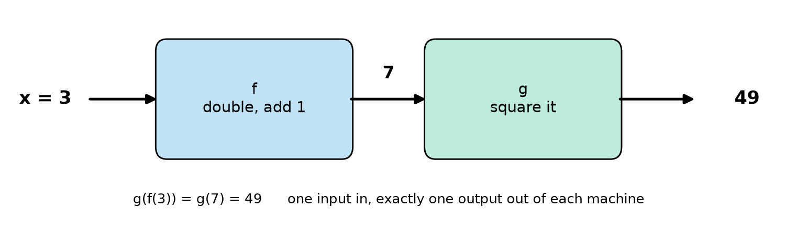
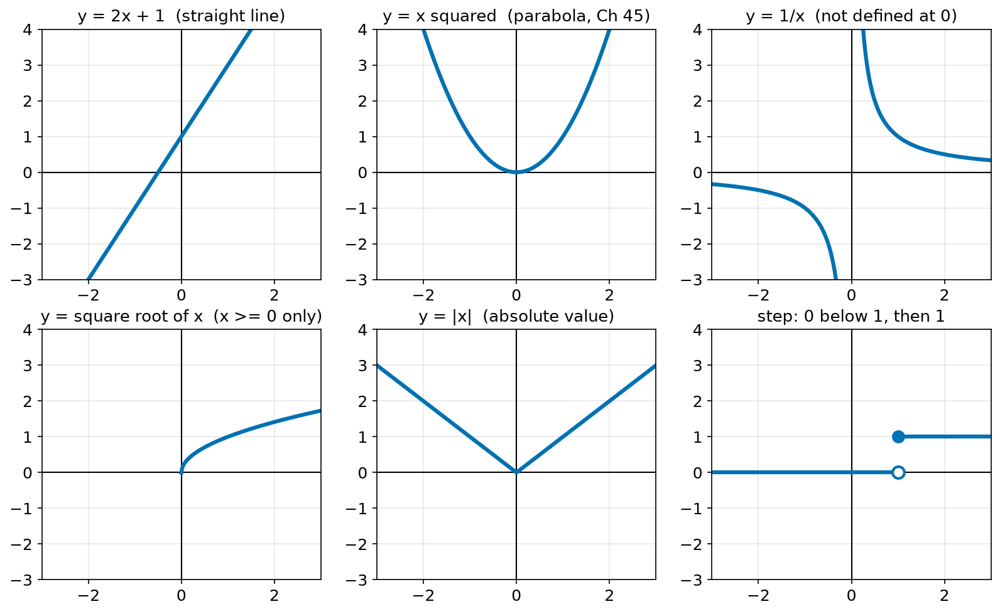
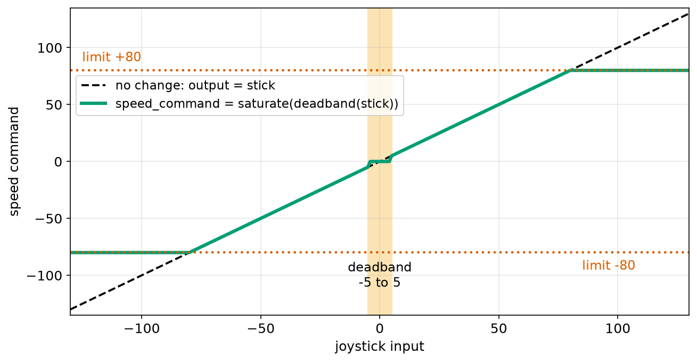
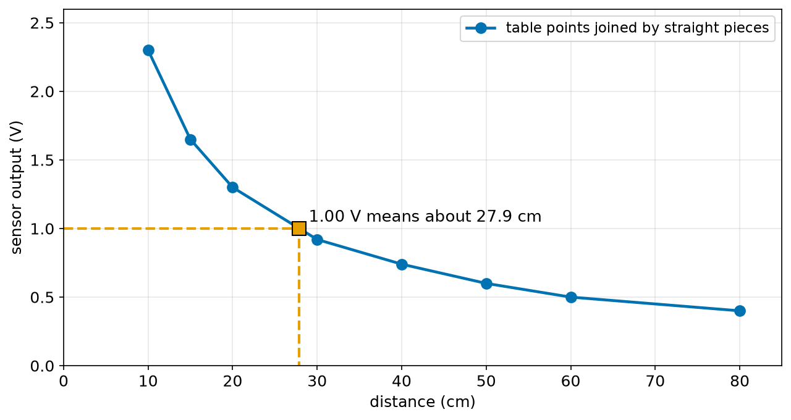
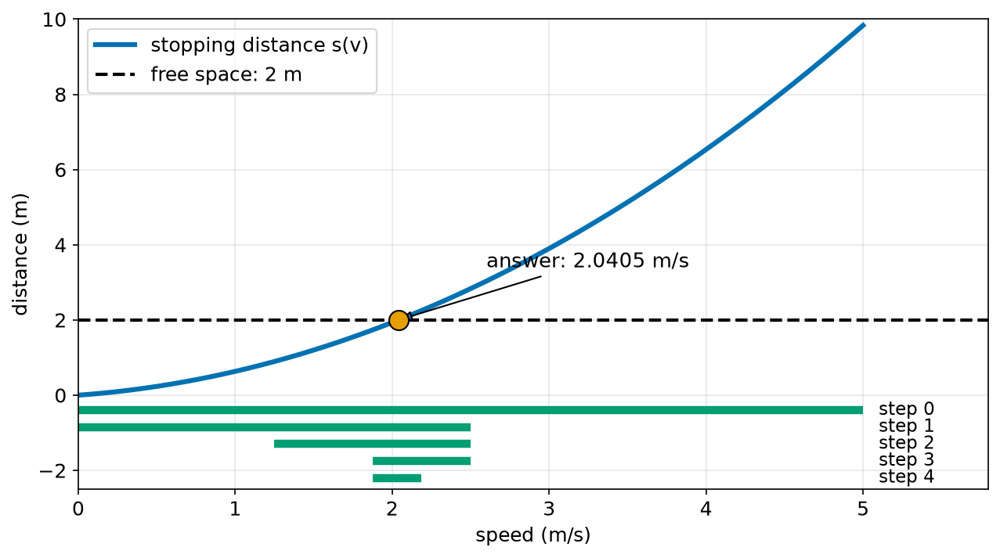
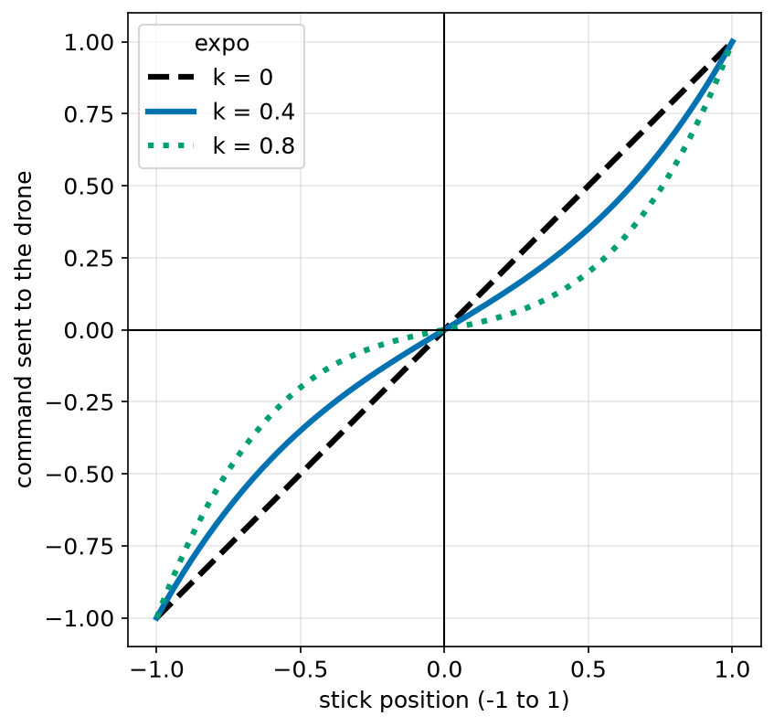

# Chapter 44 — Functions and Graphs

> **Part 3 · Chapter 44 of 749**
> **You need:** Chapter 23 (Python functions), Chapter 33 (matplotlib) and Chapter 43 (straight lines).
> **You will make:** a table of values for four functions, a joystick filter made of pieces, a sensor that is described by a table and read in both directions, and a method that finds the answer when algebra cannot.

---

## What you will learn

- What a mathematical **function** is, and how it matches a Python function.
- How to read the notation f(x).
- What the **domain** and the **range** of a function are.
- How to draw a graph from a table, and how to read a graph.
- The common shapes that robots meet: lines, curves, steps and pieces.
- How to join functions one after another, and how to undo a function.
- How a robot uses a table of values as a function.
- How **bisection** finds where a curve reaches a value, by halving a range again and again.

---

## New words in this chapter

| Word | Simple meaning |
|---|---|
| **function** | A rule that gives exactly one output for each input. |
| **input** / **output** | What goes into a function / what comes out. |
| **f(x)** | "f of x": the output of the function f when the input is x. |
| **domain** | All the inputs that a function accepts. |
| **range** | All the outputs that a function can give. |
| **graph** | A picture of a function: every point is (input, output). |
| **increasing** / **decreasing** | Going up / going down as the input grows. |
| **piecewise function** | A function made of different rules for different inputs. |
| **saturation** | Holding an output at a limit when the input goes beyond it. |
| **deadband** | A small zone around zero where the output is held at zero. |
| **composition** | Using the output of one function as the input of the next. |
| **inverse function** | The function that undoes another one. |
| **lookup table** | A table of known inputs and outputs, used as a function. |
| **bisection** | Finding an answer by halving the range that contains it, again and again. |

---

## 44.1 A machine with one input and one output

Think of a vending machine. You press a button and one drink comes out. Press the same button again, and you get the same drink. It never gives you two different drinks for the same button.

📖 **New word: function** — a rule that gives exactly one output for each input.



*Figure 44.1 — Two function machines, one after the other.*

**How to read this picture:** The number 3 goes into the blue machine f. It doubles it and adds 1, so 7 comes out. The 7 goes into the green machine g, which squares it. 49 comes out at the end.

### The notation f(x)

📖 **New word: f(x)** — read as "f of x". It means "the output of the function f when the input is x". It does **not** mean f times x.

```
f(x) = 2x + 1

f(3)  = 2 × 3 + 1  = 7
f(0)  = 2 × 0 + 1  = 1
f(−2) = 2 × (−2) + 1 = −3
```

You know this already from Python. A function with `def` takes an input and returns an output:

```python
def f(x):
    return 2 * x + 1
```

`f(3)` gives 7, just like the maths.

🧠 **Remember:** A maths function has the same idea as a **pure** Python function (Chapter 24): the same input always gives the same output, and nothing else changes.

### What is not a function?

A rule that can give **two** outputs for one input is not a function. "The number whose square is 9" is not a function of 9, because both 3 and −3 work. That is why `math.sqrt` agrees to give only the positive answer: it makes the rule a function.

On a graph, there is a quick test. Draw a vertical line anywhere. If it ever cuts the graph twice, the graph is not a function, because one x would have two y values. A circle fails this test.

---

## 44.2 Domain and range

📖 **New word: domain** — all the inputs that a function accepts.

📖 **New word: range** — all the outputs that a function can give.

| Function | Domain | Range | Why |
|---|---|---|---|
| f(x) = 2x + 1 | every number | every number | a straight line goes everywhere |
| f(x) = x² | every number | 0 and above | a square is never negative |
| f(x) = 1/x | every number except 0 | every number except 0 | you cannot divide by 0 |
| f(x) = √x | 0 and above | 0 and above | no real root of a negative |

🤖 **Robot link.** A robot's functions have domains too. A servo accepts only 0° to 180°. An ultrasonic sensor gives a sensible answer only from about 2 cm to 4 m. Sending an input outside the domain is one of the most common bugs. Good code checks the input first, as `reciprocal` and `root` do below.

⚠️ **Careful.** The word "range" here is a maths word. It is not the same as Python's `range()` (Chapter 20), although both are about "which numbers".

---

## 44.3 From a table to a graph

📖 **New word: graph** — a picture of a function. Every point on it is (input, output).

To draw a graph by hand:

1. Choose some inputs, and make a table of outputs.
2. Plot each pair as a point (Chapter 42).
3. Join the points with a smooth line, if the function is smooth.

You have done this with matplotlib since Chapter 33: `plt.plot(xs, ys)` draws exactly this kind of picture.

### Reading a graph

There are four questions you can ask any graph:

| Question | How to answer it |
|---|---|
| What is the output for this input? | Go up from the input on the x axis to the curve, then across to the y axis. |
| For which input is the output this value? | Go across from the y value to the curve, then down to the x axis. |
| Where is it largest or smallest? | Look for the highest and lowest points. |
| Where is it going up or down? | Read from left to right. |

📖 **New word: increasing** — going up as the input grows. 📖 **New word: decreasing** — going down as the input grows.

The second question, "which input gives this output?", is the one robots ask most. "Which speed gives a stopping distance of 2 m?" "Which distance gives a reading of 1.0 V?" We will answer both later in this chapter.

---

## 44.4 A gallery of shapes



*Figure 44.2 — Six function shapes you will meet again and again.*

**How to read this picture:** Each panel is one function, drawn on the same axes. The square root starts at 0 and only exists on the right. The 1/x curve has two separate pieces and a gap at 0. The step jumps at x = 1: the open circle means "not this point", and the filled circle means "this point".

| Shape | Where robots meet it |
|---|---|
| straight line | calibrations and maps (Chapter 43) |
| parabola, x² | stopping distance, thrust, falling objects (Chapter 45) |
| 1/x | light and sensor strength falling with distance |
| √x | the speed needed for a given thrust (Chapter 38) |
| \|x\| | the size of an error |
| step | a switch, a bumper, an on-off controller (Chapter 208) |

---

## 44.5 Functions in pieces

📖 **New word: piecewise function** — a function made of different rules for different inputs.

Robots are full of them. Two are especially common.

📖 **New word: saturation** — holding an output at a limit when the input goes beyond it.

```
saturate(x) =  limit      if x > limit
               −limit     if x < −limit
               x          otherwise
```

📖 **New word: deadband** — a small zone around zero where the output is held at zero.

```
deadband(x) =  0     if |x| < width
               x     otherwise
```

Chapter 18 used both with `if`, `elif` and `else`. Now we see their graphs.



*Figure 44.3 — A joystick filter made from two pieces.*

**How to read this picture:** The black dashed line would pass the joystick input straight through. The green line is what is sent. Near zero (the orange band), it is flat at 0: that is the deadband. Beyond ±80 (the red dotted lines), it is flat again: that is saturation. In between, it follows the input.

### Composition: one function after another

📖 **New word: composition** — using the output of one function as the input of the next.

```
speed_command(x) = saturate( deadband(x) )
```

In maths this is written g(f(x)), and it is read from the **inside out**: first f, then g.

⚠️ **Careful.** The order usually matters. With f(x) = 2x + 1 and g(x) = x²:

```
g(f(3)) = g(7)  = 49
f(g(3)) = f(9)  = 19
```

---

## 44.6 Undoing a function

📖 **New word: inverse function** — the function that undoes another one. It is written f⁻¹ (read "f inverse"). This −1 is a name, not a power: f⁻¹(x) does **not** mean 1/f(x).

If f takes 3 to 7, then f⁻¹ takes 7 back to 3.

To find it, write y = f(x), and solve for x (Chapter 41):

```
y = 2x + 1
y − 1 = 2x
x = (y − 1)/2

So f⁻¹(x) = (x − 1)/2.     Check: f⁻¹(7) = 6/2 = 3.
```

A function has an inverse only if each output comes from just **one** input. x² fails this, because 3 and −3 both give 9. A function that is always increasing, or always decreasing, never has this problem.

🤖 **Robot link.** A sensor is a function: distance in, voltage out. The robot needs the **inverse**: voltage in, distance out. Section 44.7 shows how to do this with a table, and section 44.8 shows how to do it when you cannot solve the equation.

---

## 44.7 A table as a function

📖 **New word: lookup table** — a table of known inputs and outputs, used as a function.

Many sensors come with a graph in their data sheet, not a formula. We read some points from it, and join them with straight pieces. Between two points, we use the straight line through them (Chapter 43). This is **interpolation**.

```
Between the table points (d1, v1) and (d2, v2):

v = v1 + (v2 − v1) × (d − d1) / (d2 − d1)
```

To go backwards, we swap the roles of d and v. This works only if the table is always increasing or always decreasing in the part we use.

---

## 44.8 When algebra cannot help: bisection

Some equations are hard or impossible to solve by rearranging. But a computer can always **search**.

📖 **New word: bisection** — finding an answer by halving the range that contains it, again and again.

It is like the game "I am thinking of a number between 1 and 100". You guess 50. "Too high." Now you know it is between 1 and 50, so you guess 25. Each guess halves what is left. After 7 guesses, you always have it.

For a function that is increasing:

```
1. Start with low and high, where f(low) is below the target and f(high) is above it.
2. Try the middle: mid = (low + high) / 2.
3. If f(mid) is below the target, the answer is above mid: set low = mid.
   Otherwise, set high = mid.
4. Repeat until low and high are as close as you need.
```

After n steps, the range has shrunk by 2ⁿ (Chapter 38). Starting with a range of 5, after 30 steps it is 5 ÷ 2³⁰, which is about 0.000000005.

🧠 **Remember:** Bisection always works if the function is smooth and you start with the answer between low and high. It may be slower than clever methods, but it is very hard to break. Chapter 361 uses smarter search methods for robot arms.

---

## Code

File `code/ch044/function_table.py`:

```python
# function_table.py - one input, one output: a table of values for four functions
import math


def double_plus_one(x):
    return 2 * x + 1


def square(x):
    return x * x


def reciprocal(x):
    if x == 0:
        return None
    return 1 / x


def root(x):
    if x < 0:
        return None
    return math.sqrt(x)


print("   x   2x+1   x*x    1/x   sqrt(x)")
for x in [-2, -1, 0, 0.5, 1, 2, 4]:
    values = [double_plus_one(x), square(x), reciprocal(x), root(x)]
    cells = ["  ---" if v is None else f"{v:6.2f}" for v in values]
    print(f"{x:4}", " ".join(cells))
```

| Line | Code | What it does (simple English) |
|---|---|---|
| 1 | `# function_table.py …` | A comment. |
| 2 | `import math` | For `math.sqrt`. |
| 3–4 | (blank) | Spacing. |
| 5–6 | `def double_plus_one(x): return 2 * x + 1` | f(x) = 2x + 1. Its domain is every number. |
| 7–8 | (blank) | Spacing. |
| 9–10 | `def square(x): return x * x` | x². |
| 11–12 | (blank) | Spacing. |
| 13 | `def reciprocal(x):` | 1/x. |
| 14 | `if x == 0:` | 0 is outside the domain. |
| 15 | `return None` | "No answer." |
| 16 | `return 1 / x` | The normal case. |
| 17–18 | (blank) | Spacing. |
| 19 | `def root(x):` | √x. |
| 20 | `if x < 0:` | Negative numbers are outside the domain. |
| 21 | `return None` | "No answer." |
| 22 | `return math.sqrt(x)` | The normal case. |
| 23–24 | (blank) | Spacing. |
| 25 | `print("   x   2x+1 …")` | The heading. |
| 26 | `for x in [-2, -1, 0, 0.5, 1, 2, 4]:` | Seven inputs, including awkward ones. |
| 27 | `values = […]` | The four outputs, in a list. |
| 28 | `cells = ["  ---" if v is None else f"{v:6.2f}" for v in values]` | A list comprehension (Chapter 21) with a one-line `if`: show `---` for "no answer", otherwise the number. |
| 29 | `print(f"{x:4}", " ".join(cells))` | `" ".join` puts the pieces together with spaces between them (Chapter 15). |

Output:

```
   x   2x+1   x*x    1/x   sqrt(x)
  -2  -3.00   4.00  -0.50   ---
  -1  -1.00   1.00  -1.00   ---
   0   1.00   0.00   ---   0.00
 0.5   2.00   0.25   2.00   0.71
   1   3.00   1.00   1.00   1.00
   2   5.00   4.00   0.50   1.41
   4   9.00  16.00   0.25   2.00
```

Look down each column and compare with Figure 44.2. x² gives the same output for −2 and 2. 1/x has a gap at 0. √x has no values on the left.

File `code/ch044/piecewise.py`:

```python
# piecewise.py - functions made of pieces, and functions joined one after another
def saturate(x, limit):
    if x > limit:
        return limit
    if x < -limit:
        return -limit
    return x


def deadband(x, width):
    if abs(x) < width:
        return 0
    return x


def speed_command(stick):
    return saturate(deadband(stick, 5), 80)


print(" stick  deadband  saturate  both")
for stick in [-120, -60, -3, 0, 2, 7, 50, 95, 130]:
    print(f"{stick:6d} {deadband(stick, 5):9d} {saturate(stick, 80):9d} {speed_command(stick):5d}")
```

| Line | Code | What it does (simple English) |
|---|---|---|
| 1 | `# piecewise.py …` | A comment. |
| 2 | `def saturate(x, limit):` | The saturation function. |
| 3–4 | `if x > limit: return limit` | Too high: hold at the limit. |
| 5–6 | `if x < -limit: return -limit` | Too low: hold at minus the limit. |
| 7 | `return x` | In between: pass it through. |
| 8–9 | (blank) | Spacing. |
| 10 | `def deadband(x, width):` | The deadband function. |
| 11 | `if abs(x) < width:` | Close to zero, on either side. |
| 12 | `return 0` | Treat it as zero. |
| 13 | `return x` | Otherwise pass it through. |
| 14–15 | (blank) | Spacing. |
| 16 | `def speed_command(stick):` | The composition. |
| 17 | `return saturate(deadband(stick, 5), 80)` | Inside first: deadband, then saturate. |
| 18–19 | (blank) | Spacing. |
| 20 | `print(" stick …")` | The heading. |
| 21 | `for stick in […]:` | Nine stick positions. |
| 22 | `print(f"…")` | Each piece alone, then both together. |

Output:

```
 stick  deadband  saturate  both
  -120      -120       -80   -80
   -60       -60       -60   -60
    -3         0        -3     0
     0         0         0     0
     2         0         2     0
     7         7         7     7
    50        50        50    50
    95        95        80    80
   130       130        80    80
```

The last column is the green line in Figure 44.3.

---

## Small examples

**Example 1.** f(x) = x² − 1. f(3) = 8, and f(−3) = 8.

**Example 2.** g(t) = 0.4t is the distance after t seconds at 0.4 m/s. g(10) = 4 m.

**Example 3.** The domain of √(x − 2) is x ≥ 2.

**Example 4.** The range of |x| is 0 and above.

**Example 5.** f(x) = x + 3 and g(x) = 2x. Then g(f(1)) = g(4) = 8.

**Example 6.** The inverse of f(x) = 5x is f⁻¹(x) = x/5.

**Example 7.** saturate(−200, 100) = −100.

**Example 8.** "Is it a function?" — Each student has one birthday, so "student → birthday" is a function. "Birthday → student" is not, because two students may share a birthday.

---

## 🏭 Real robot applications

### Application 1 (worked in full) — 🏠 Reading an infrared distance sensor

**1. The real problem.** A home robot uses an infrared distance sensor to keep away from furniture. The sensor sends out light and gives a **voltage**: higher when an object is close, lower when it is far. The data sheet gives a curve, not a formula. The robot needs the distance.

**2. Why this theory.** The sensor is a function: distance in, voltage out. Its graph is decreasing in the useful part, so it has an inverse there. A lookup table with straight pieces is a simple way to describe it.

**3. The numbers.** These are typical values for a common infrared sensor with a range of 10 to 80 cm, read from its curve:

| Distance (cm) | 10 | 15 | 20 | 30 | 40 | 50 | 60 | 80 |
|---|---|---|---|---|---|---|---|---|
| Output (V) | 2.30 | 1.65 | 1.30 | 0.92 | 0.74 | 0.60 | 0.50 | 0.40 |

⚠️ **Careful.** Closer than about 7 cm, sensors like this give a **lower** voltage again. So a reading of, say, 1.65 V could mean 15 cm or very close indeed. The voltage-to-distance rule is not a function there. Robots mount the sensor a little way back from the front so that nothing can get that close.

**4. The maths.** For a reading of 1.00 V: it lies between 1.30 V (20 cm) and 0.92 V (30 cm).

```
d = 20 + (30 − 20) × (1.00 − 1.30) / (0.92 − 1.30)
  = 20 + 10 × (−0.30) / (−0.38)
  = 20 + 7.89
  = 27.9 cm
```

**5. The code.** File `code/ch044/ir_lookup.py`:

```python
# ir_lookup.py - an infrared distance sensor described by a table, read both ways
TABLE = [(10, 2.30), (15, 1.65), (20, 1.30), (30, 0.92),
         (40, 0.74), (50, 0.60), (60, 0.50), (80, 0.40)]     # (cm, volts)


def volts_at(distance):
    for (d1, v1), (d2, v2) in zip(TABLE, TABLE[1:]):
        if d1 <= distance <= d2:
            return v1 + (v2 - v1) * (distance - d1) / (d2 - d1)
    return None


def distance_from_volts(volts):
    for (d1, v1), (d2, v2) in zip(TABLE, TABLE[1:]):
        if v2 <= volts <= v1:
            return d1 + (d2 - d1) * (volts - v1) / (v2 - v1)
    return None


print("distance 25 cm gives", f"{volts_at(25):.3f} V")
print("  volts   distance (cm)")
for volts in [2.30, 1.80, 1.00, 0.55, 0.30, 2.50]:
    d = distance_from_volts(volts)
    text = "outside the table" if d is None else f"{d:.1f}"
    print(f"{volts:7.2f}   {text}")
```

| Line | Code | What it does (simple English) |
|---|---|---|
| 1 | `# ir_lookup.py …` | A comment. |
| 2–3 | `TABLE = […]` | The table, as (distance, volts) pairs. A list can go over two lines inside its brackets. |
| 4–5 | (blank) | Spacing. |
| 6 | `def volts_at(distance):` | The sensor function: distance in, volts out. |
| 7 | `for (d1, v1), (d2, v2) in zip(TABLE, TABLE[1:]):` | `zip` pairs each row with the next row (Chapter 21), so we walk along the table one piece at a time. |
| 8 | `if d1 <= distance <= d2:` | Is the distance inside this piece? |
| 9 | `return v1 + (v2 - v1) * (distance - d1) / (d2 - d1)` | The straight line through the two points (Chapter 43). |
| 10 | `return None` | Outside the table: no answer. |
| 11–12 | (blank) | Spacing. |
| 13 | `def distance_from_volts(volts):` | The inverse: volts in, distance out. |
| 14 | `for … in zip(TABLE, TABLE[1:]):` | The same walk along the pieces. |
| 15 | `if v2 <= volts <= v1:` | The voltage falls as distance grows, so v2 is the smaller one. |
| 16 | `return d1 + (d2 - d1) * (volts - v1) / (v2 - v1)` | The same line, with the roles of d and v swapped. |
| 17 | `return None` | Outside the table. |
| 18–19 | (blank) | Spacing. |
| 20 | `print("distance 25 cm gives", …)` | Tests the forward function. |
| 21 | `print("  volts   distance (cm)")` | The heading. |
| 22 | `for volts in […]:` | Six readings, including two outside the table. |
| 23 | `d = distance_from_volts(volts)` | The inverse. |
| 24 | `text = "outside the table" if d is None else f"{d:.1f}"` | A one-line `if` (Chapter 18). |
| 25 | `print(f"{volts:7.2f}   {text}")` | Prints the row. |

Output:

```
distance 25 cm gives 1.110 V
  volts   distance (cm)
   2.30   10.0
   1.80   13.8
   1.00   27.9
   0.55   55.0
   0.30   outside the table
   2.50   outside the table
```



*Figure 44.4 — A curve made of straight pieces, read backwards.*

**How to read this picture:** Across the bottom is distance. Up the side is the sensor's voltage. The blue dots are the table, joined by straight pieces. The orange dashed line starts at 1.00 V on the side, goes across to the curve, and down to 27.9 cm.

**6. The result.** The robot can now turn any voltage between 0.40 and 2.30 V into a distance. Outside that, it honestly says "outside the table" instead of inventing a number. A reading of 0.30 V means "further than 80 cm", and 2.50 V means "dangerously close, or something is wrong".

**7. Going further.** More table points make the straight pieces closer to the real curve. Some robots fit a formula instead, such as d = a/(V − b), using least squares (Chapter 171). Every real sensor should be checked against its own measurements, because two sensors of the same type can differ (Chapter 133).

### Application 2 (worked in full) — 🏭 How fast may a factory robot drive?

**1. The real problem.** A mobile robot in a factory sees 2 m of free space ahead. If something steps into its path, it must be able to stop within that space. What is the fastest speed that is still safe?

**2. Why this theory.** The stopping distance is a function of speed. We know the output we can allow (2 m) and want the input. Chapter 45 will solve this exactly, but bisection works for **any** increasing function, even one with no neat algebra.

**3. The numbers.** The robot needs 0.3 s to notice and start braking. During that time it keeps moving. Then it brakes at 1.5 m/s².

**4. The maths.** The stopping distance has two parts (Chapter 59 explains the braking part):

```
s(v) = v × 0.3  +  v² / (2 × 1.5)
       reaction     braking

s(2) = 0.6 + 1.333 = 1.933 m     (a little under 2: safe)
s(2.5) = 0.75 + 2.083 = 2.833 m  (too far)
```

So the answer is between 2 and 2.5 m/s. Bisection finds it exactly.

**5. The code.** File `code/ch044/stopping_bisection.py`:

```python
# stopping_bisection.py - the fastest speed that still stops within 2 m, found by halving
REACTION_S = 0.3        # seconds before the brakes start
BRAKING = 1.5           # m/s squared
LIMIT_M = 2.0           # free space in front of the robot


def stopping_m(speed):
    return speed * REACTION_S + speed ** 2 / (2 * BRAKING)


def bisect(f, target, low, high, steps):
    for step in range(1, steps + 1):
        mid = (low + high) / 2
        if f(mid) < target:
            low = mid
        else:
            high = mid
        if step <= 6 or step == steps:
            print(f"step {step:2d}: speed between {low:.5f} and {high:.5f} m/s")
    return (low + high) / 2


best = bisect(stopping_m, LIMIT_M, 0.0, 5.0, 30)
print(f"fastest safe speed: {best:.4f} m/s")
print(f"check: stopping distance at that speed = {stopping_m(best):.6f} m")
```

| Line | Code | What it does (simple English) |
|---|---|---|
| 1 | `# stopping_bisection.py …` | A comment. |
| 2 | `REACTION_S = 0.3` | Time before braking starts. |
| 3 | `BRAKING = 1.5` | How quickly it slows down. |
| 4 | `LIMIT_M = 2.0` | The free space. |
| 5–6 | (blank) | Spacing. |
| 7 | `def stopping_m(speed):` | The function s(v). |
| 8 | `return speed * REACTION_S + speed ** 2 / (2 * BRAKING)` | Reaction distance plus braking distance. |
| 9–10 | (blank) | Spacing. |
| 11 | `def bisect(f, target, low, high, steps):` | A general bisection. `f` is any function (Chapter 24). |
| 12 | `for step in range(1, steps + 1):` | Counts 1 to `steps`. |
| 13 | `mid = (low + high) / 2` | The middle of the range. |
| 14 | `if f(mid) < target:` | Is the output still below the target? |
| 15 | `low = mid` | Then the answer is above mid. |
| 16 | `else:` | Otherwise … |
| 17 | `high = mid` | … the answer is below mid. |
| 18 | `if step <= 6 or step == steps:` | Print only the first six steps and the last one. |
| 19 | `print(f"step …")` | Shows the range shrinking. |
| 20 | `return (low + high) / 2` | The middle of the final, tiny range. |
| 21–22 | (blank) | Spacing. |
| 23 | `best = bisect(stopping_m, LIMIT_M, 0.0, 5.0, 30)` | Search between 0 and 5 m/s, 30 times. |
| 24 | `print(f"fastest safe speed: …")` | The answer. |
| 25 | `print(f"check: …")` | Always check by putting the answer back in. |

Output:

```
step  1: speed between 0.00000 and 2.50000 m/s
step  2: speed between 1.25000 and 2.50000 m/s
step  3: speed between 1.87500 and 2.50000 m/s
step  4: speed between 1.87500 and 2.18750 m/s
step  5: speed between 2.03125 and 2.18750 m/s
step  6: speed between 2.03125 and 2.10938 m/s
step 30: speed between 2.04048 and 2.04048 m/s
fastest safe speed: 2.0405 m/s
check: stopping distance at that speed = 2.000000 m
```



*Figure 44.5 — Each step halves the range that holds the answer.*

**How to read this picture:** The blue curve is the stopping distance. The dashed line is the free space, 2 m. The orange dot is where they meet. The green bars below show the range of possible speeds at each step. Each bar is half as long as the one above it, and every bar contains the answer.

**6. The result.** The robot may drive at up to 2.04 m/s with 2 m of free space. A safety system would use a little less, to leave a margin. If the robot sees less free space, it must slow down. The same code works for any free space, or any other stopping rule.

**7. Going further.** Real safety systems change the speed limit all the time, based on what the sensors see (Chapter 744 covers the standards). Chapter 45 finds the same answer with the quadratic formula: v = 2.0405 m/s. Getting the same answer by two different methods is a strong check.

### Application 3 — ♿ A gentle joystick for a powered wheelchair

A powered wheelchair must not move when the user's hand rests lightly on the joystick, and must not go too fast. The control is `saturate(deadband(x))`, exactly as in `piecewise.py`. With a deadband of 5% and a limit of 80%, a small tremor of 3% sends nothing at all, and a full push sends only 80%. Many chairs let a therapist set both numbers for each user.

### Application 4 — 🚁 "Expo" on a drone's radio controller

Pilots want fine control near the centre of the stick and full power at the ends. Radio controllers offer a curve called **expo**: f(x) = (1 − k)x + kx³, with x from −1 to 1. With k = 0.4, half the stick gives f(0.5) = 0.6 × 0.5 + 0.4 × 0.125 = 0.35, not 0.5. A full stick still gives f(1) = 1.



*Figure 44.6 — Three expo settings.*

**How to read this picture:** The black dashed line, k = 0, passes the stick straight through. With bigger k, the curve is flatter near the centre, so small stick movements make smaller commands. All the curves still meet at −1 and 1.

### Application 5 — 🌱 Heating a greenhouse

A greenhouse robot controls a heater with a piecewise function of temperature T: full power below 15 °C, zero power above 20 °C, and a straight line in between: power = 100 × (20 − T)/5 percent. At 17 °C, the heater gives 100 × 3/5 = 60%. This is gentler than a simple on-off switch, which would keep turning the heater fully on and fully off (Chapter 208).

---

## 🔧 Hands-on lab

### Lab 44.1 — Draw it by hand, then check (paper and simulation)

1. Make a table of f(x) = x² − 2x for x = −1, 0, 1, 2, 3.
2. Plot the points on squared paper and join them with a smooth curve.
3. From your graph, find the lowest point, and where the output is 0.
4. Plot the same function with matplotlib, using 100 points from −1 to 3.

**What you should see:** The table is 3, 0, −1, 0, 3. The lowest point is at (1, −1). The output is 0 at x = 0 and x = 2.

| If it does not work | Likely cause | Fix |
|---|---|---|
| f(−1) came out as −1 | You wrote −1² as −1 | Use (−1)², which is 1 |
| The computer curve looks like a set of straight lines | Too few points | Use `np.linspace(-1, 3, 100)` |

**Challenge:** Use the graph to answer: for which x is the output 1? Then use `bisect` from this chapter to find the answer to 4 decimal places.

### Lab 44.2 — Your own lookup table (hardware or simulation)

If you have a distance sensor and a ruler, measure its reading at 6 or more distances. If not, use the table from Application 1.

1. Put your measured pairs into `TABLE`, in order of distance.
2. Run `distance_from_volts` on three new readings.
3. Measure those three distances with the ruler and compare.

**What you should see:** The table gives distances within a few percent of the ruler. Between widely spaced points, the error is larger.

| If it does not work | Likely cause | Fix |
|---|---|---|
| Every answer is "outside the table" | The table is not in order of distance | Sort the rows by distance |
| Wrong distances | Your sensor's output rises with distance | Swap the condition in line 15 to `v1 <= volts <= v2` |

**Challenge:** Make the table work for both kinds of sensor, increasing and decreasing, by testing `min(v1, v2) <= volts <= max(v1, v2)`.

### Lab 44.3 — Bisection on new problems (simulation)

Copy `stopping_bisection.py`.

1. Change `LIMIT_M` to 1.0, then to 4.0.
2. Change `REACTION_S` to 0.6, as if the robot's software were slower.
3. Use `bisect` to find √13, by searching for where x² reaches 13 between 0 and 13.

**What you should see:** With 1.0 m the safe speed is about 1.34 m/s. With 4.0 m it is about 3.04 m/s. With the slower reaction and 2 m, it falls to about 1.71 m/s. √13 comes out as 3.6056, as in Chapter 38.

| If it does not work | Likely cause | Fix |
|---|---|---|
| The answer equals `low` or `high` exactly | The real answer is outside your starting range | Make `high` bigger |
| `TypeError: 'float' object is not callable` | You passed `stopping_m(2)`, not `stopping_m` | Pass the function itself, with no brackets |

**Challenge:** Change `bisect` so that it stops by itself when `high - low` is less than 1e-6, and returns the number of steps used.

---

## Common mistakes

⚠️ **Reading f(x) as f times x.** It means "f applied to x".

⚠️ **Giving a function an input outside its domain.** Check first.

⚠️ **Composing in the wrong order.** g(f(x)) means f first.

⚠️ **Thinking f⁻¹(x) means 1/f(x).** It means the inverse function.

⚠️ **Inverting a function that is not one-to-one.** x² and the close end of an IR sensor have no single inverse.

⚠️ **Trusting a table outside its ends.** Return "no answer" instead of guessing.

⚠️ **Starting bisection with a range that does not contain the answer.** It will quietly return one of the ends.

⚠️ **Passing `f(x)` where a function is needed.** Pass `f`, not its result.

---

## Practice

🏋️ **1.** f(x) = 3x − 2. Find f(4), f(−1) and f(0).

🏋️ **2.** g(x) = x² + 1. Find g(3) and g(−3). Does g have an inverse for all numbers?

🏋️ **3.** Give the domain of 1/(x − 2), and of √(x − 1).

🏋️ **4.** f(x) = 2x and g(x) = x + 3. Find f(g(1)) and g(f(1)).

🏋️ **5.** Find the inverse of f(x) = 2x + 1, and use it to find the input that gives 7.

🏋️ **6.** Using `piecewise.py`, find saturate(150, 100), deadband(−4, 5), speed_command(4) and speed_command(−90).

🏋️ **7.** Using the IR table, what distance is 1.30 V? What distance is 0.80 V?

🏋️ **8.** Bisection starts with a range of 5. How many steps until the range is smaller than 0.001?

🏋️ **9.** Is a circle the graph of a function? Explain with the vertical line test.

🏋️ **10.** With expo k = 0.4, what is sent for a stick of 0.5? For a stick of 1?

🏋️ **11.** Write `greenhouse_heater(temp_c)` from Application 5. Test it at 10, 15, 17, 20 and 25 °C.

---

## Answers

**1.** f(4) = 10. f(−1) = −5. f(0) = −2.

**2.** g(3) = 10 and g(−3) = 10. No: two inputs give the same output, so we cannot undo it. (If we only allow x ≥ 0, then there is an inverse: √(x − 1).)

**3.** Every number except 2. All x ≥ 1.

**4.** f(g(1)) = f(4) = 8. g(f(1)) = g(2) = 5. The order matters.

**5.** y = 2x + 1 gives x = (y − 1)/2, so f⁻¹(x) = (x − 1)/2. f⁻¹(7) = 3.

**6.** 100; 0; 0; −80.

**7.** 1.30 V is exactly a table point: 20 cm. For 0.80 V, it lies between 0.92 V (30 cm) and 0.74 V (40 cm): 30 + 10 × (0.80 − 0.92)/(0.74 − 0.92) = 30 + 6.7 = 36.7 cm.

**8.** We need 5 ÷ 2ⁿ < 0.001, so 2ⁿ > 5000. 2¹² = 4096 is too small, and 2¹³ = 8192 is enough. So 13 steps.

**9.** No. A vertical line through the middle of a circle cuts it twice, so one x has two y values.

**10.** 0.6 × 0.5 + 0.4 × 0.125 = 0.35. For 1: 0.6 + 0.4 = 1.

**11.**

```python
def greenhouse_heater(temp_c):
    if temp_c <= 15:
        return 100
    if temp_c >= 20:
        return 0
    return 100 * (20 - temp_c) / 5

for t in [10, 15, 17, 20, 25]:
    print(t, greenhouse_heater(t))
```

The results are 100, 100, 60.0, 0 and 0. At 15 and at 20, both neighbouring rules give the same value, so the pieces join without a jump.

---

## Summary

🧠 A function gives exactly one output for each input. f(x) is the output for input x.

🧠 The domain is the allowed inputs. The range is the possible outputs.

🧠 A graph shows every (input, output) pair. Read across and down to go backwards.

🧠 Saturation and deadband are piecewise functions found in almost every robot.

🧠 Composition applies one function after another, from the inside out. The order matters.

🧠 An inverse undoes a function. It exists only if no two inputs share an output.

🧠 A lookup table with straight pieces can describe a real sensor.

🧠 Bisection finds where a curve reaches a value by halving the range, again and again.

---

## Next chapter

In Chapter 45 we study the curve of x² properly: **quadratic equations and parabolas**. You will learn the quadratic formula, which solves Application 2 exactly, and see why a thrown ball, a braking robot and a car's headlight all follow the same shape.
