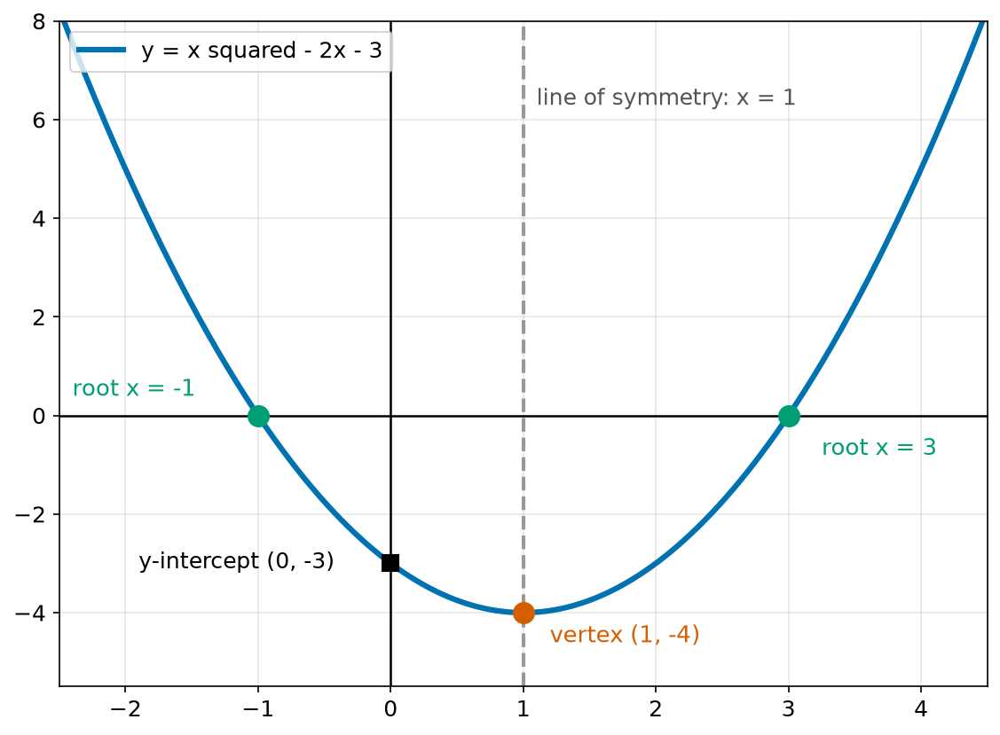
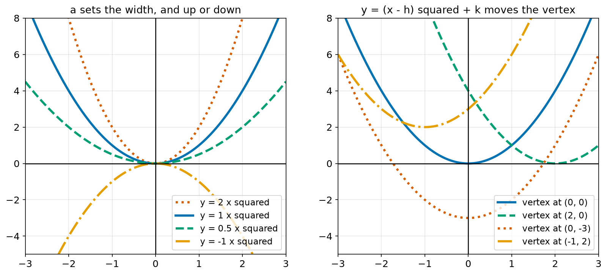
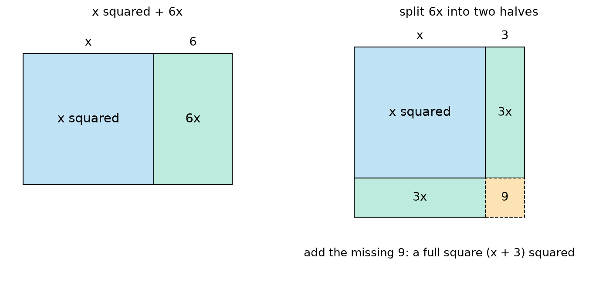
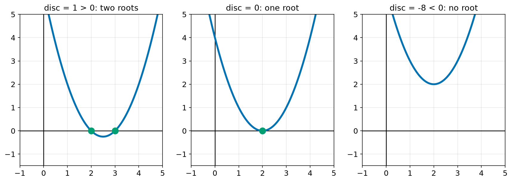
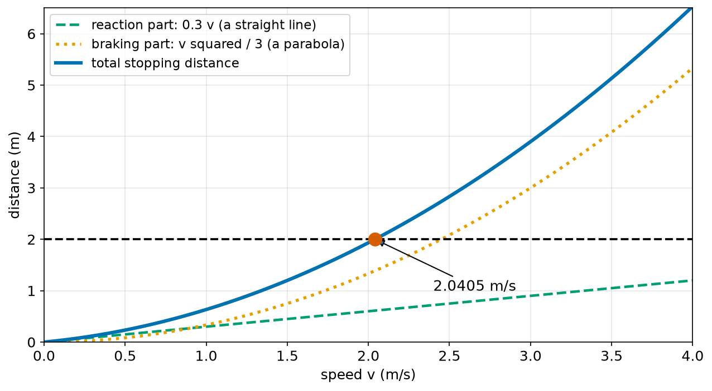
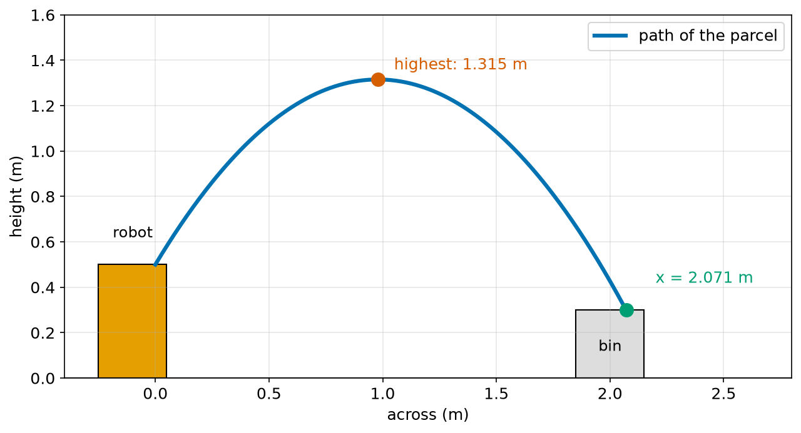

# Chapter 45 — Quadratic Equations and Parabolas

> **Part 3 · Chapter 45 of 749**
> **You need:** Chapter 40 (expanding brackets), Chapter 41 (solving), Chapter 44 (functions and graphs).
> **You will make:** a quadratic solver that handles every case, a program that describes any parabola, an exact safe-speed calculator, and a robot throw that must land in a bin.

---

## What you will learn

- What a **quadratic** is, and why its graph is a **parabola**.
- How the numbers a, b and c change the shape of the curve.
- How to find the **vertex**, the line of symmetry and the **roots**.
- Three ways to solve a quadratic: factorising, completing the square, and the formula.
- Where the quadratic formula comes from, step by step.
- How the **discriminant** tells you how many answers there are.
- Which answer a robot should keep, when there are two.

---

## New words in this chapter

| Word | Simple meaning |
|---|---|
| **quadratic** | An expression or equation whose highest power of x is 2. |
| **parabola** | The U-shaped curve of a quadratic. |
| **vertex** | The lowest or highest point of a parabola. |
| **line of symmetry** | The line that cuts a parabola into two mirror halves. |
| **root** | A value of x that makes the quadratic equal to zero. |
| **factorise** (a quadratic) | Write it as two brackets multiplied together. |
| **completing the square** | Adding a number to make a perfect square. |
| **quadratic formula** | The formula that solves any quadratic. |
| **discriminant** | b² − 4ac: it tells you how many roots there are. |
| **projectile** | An object that is thrown and then moves only under gravity. |

---

## 45.1 What a quadratic is

In Chapter 43, the highest power of x was 1: y = mx + c. Its graph was a straight line. Now we allow x².

📖 **New word: quadratic** — an expression or equation whose highest power of x is 2.

```
y = a x² + b x + c         with a not equal to 0
```

The name comes from the Latin word for "square". a, b and c are fixed numbers. If a were 0, the x² would disappear and we would be back to a straight line.

| Example | a | b | c |
|---|---|---|---|
| x² − 5x + 6 | 1 | −5 | 6 |
| 2x² + 3x − 2 | 2 | 3 | −2 |
| v²/3 + 0.3v − 2 | 1/3 | 0.3 | −2 |
| −4.905t² + 4t + 0.2 | −4.905 | 4 | 0.2 |

The last two are the robot problems in this chapter. Notice that the letter does not have to be x.

🤖 **Robot link.** Quadratics appear whenever something **speeds up or slows down steadily**. The stopping distance of a robot, the height of a thrown object, the position of an arm accelerating from rest, and the area of a square all follow quadratics. They also appear in squared errors (Chapter 38).

---

## 45.2 The parabola

📖 **New word: parabola** — the U-shaped curve of a quadratic.



*Figure 45.1 — y = x² − 2x − 3, with its important points.*

**How to read this picture:** The blue curve is the parabola. The red dot at the bottom is the vertex, the lowest point. The grey dashed line through the vertex is the line of symmetry: the left half is a mirror image of the right half. The green dots are where the curve crosses the x axis: the roots. The black square is where it crosses the y axis.

📖 **New word: vertex** — the lowest or highest point of a parabola.

📖 **New word: line of symmetry** — the line that cuts a parabola into two mirror halves. It always passes through the vertex.

📖 **New word: root** — a value of x that makes the quadratic equal to zero. On the graph, the roots are where the curve crosses the x axis.

### What a, b and c do



*Figure 45.2 — a sets the width and direction. Shifting moves the vertex.*

**How to read this picture:** On the left, every curve has its vertex at the origin. A bigger a gives a narrower curve. A negative a turns the curve upside down. On the right, the same curve is moved around. The vertex of y = (x − h)² + k is at (h, k).

| Number | What it does |
|---|---|
| a > 0 | opens **up**, so the vertex is the lowest point |
| a < 0 | opens **down**, so the vertex is the highest point |
| big \|a\| | narrow and steep |
| small \|a\| | wide and flat |
| c | where the curve crosses the y axis, because y = c when x = 0 |

### Finding the vertex

The line of symmetry is at:

```
x = −b / (2a)
```

Put this x into the quadratic to get the y of the vertex. We will see where this comes from in section 45.5.

🔢 **Maths.** For y = x² − 2x − 3: a = 1, b = −2, c = −3.

```
x = −(−2) / (2 × 1) = 1
y = 1² − 2 × 1 − 3 = −4
vertex = (1, −4)
```

That matches Figure 45.1.

🤖 **Robot link.** The vertex is the best or the worst value. If a quadratic gives the height of a thrown parcel, the vertex is the highest it goes. If it gives an error, the vertex is the smallest error possible. Finding the vertex is the simplest kind of **optimisation** (Chapter 190).

---

## 45.3 Solving by factorising

📖 **New word: factorise** (a quadratic) — write it as two brackets multiplied together.

The key fact is simple: **if two numbers multiply to give 0, at least one of them is 0.**

🔢 **Maths.** Solve x² − 5x + 6 = 0.

```
Find two numbers that multiply to 6 and add to −5:  −2 and −3.
x² − 5x + 6 = (x − 2)(x − 3)

Check by expanding (Chapter 40):  x² − 3x − 2x + 6 = x² − 5x + 6.  Correct.

(x − 2)(x − 3) = 0
so x − 2 = 0  or  x − 3 = 0
so x = 2      or  x = 3
```

🔢 **Maths.** Solve x² − 9 = 0.

```
x² − 9 = (x − 3)(x + 3)       (the "difference of two squares", Chapter 40)
x = 3  or  x = −3
```

Factorising is fast when the numbers are nice. Most robot problems have numbers like 0.3 and 1/3, which do not factorise neatly. For them we need a method that always works.

---

## 45.4 Completing the square

📖 **New word: completing the square** — adding a number to make a perfect square.

Look at x² + 6x. Can we make it into a square?



*Figure 45.3 — Splitting 6x in half shows the missing corner.*

**How to read this picture:** On the left, x² is a square and 6x is a strip. On the right, the strip has been cut in half, and the two halves, each 3x, are put on two sides of the square. One small corner is missing: a 3 by 3 square, which is 9. Adding it makes one big square with side x + 3.

```
x² + 6x + 9 = (x + 3)²
so  x² + 6x = (x + 3)² − 9
```

The rule: **take half of the number in front of x, square it, then add it and take it away again.**

🔢 **Maths.** Solve x² + 6x − 7 = 0.

```
x² + 6x − 7 = 0
(x + 3)² − 9 − 7 = 0
(x + 3)² = 16
x + 3 = 4      or     x + 3 = −4       (both 4 and −4 square to 16)
x = 1          or     x = −7
```

**Check:** 1 + 6 − 7 = 0. And 49 − 42 − 7 = 0. Both work.

---

## 45.5 The quadratic formula, built step by step

Now we complete the square on the general quadratic ax² + bx + c = 0. Every line says what changed.

```
ax² + bx + c = 0

Step 1. Divide every term by a, so that x² stands alone:
        x² + (b/a)x + c/a = 0

Step 2. Move the plain number to the right:
        x² + (b/a)x = −c/a

Step 3. Half of the number in front of x is b/(2a). Square it and add it to both sides:
        x² + (b/a)x + b²/(4a²) = b²/(4a²) − c/a

Step 4. The left side is now a perfect square:
        (x + b/(2a))² = b²/(4a²) − c/a

Step 5. Put the right side over the same bottom, 4a² (Chapter 37):
        (x + b/(2a))² = (b² − 4ac) / (4a²)

Step 6. Take the square root of both sides. Remember both signs:
        x + b/(2a) = ± √(b² − 4ac) / (2a)

Step 7. Move b/(2a) to the right:
        x = −b/(2a) ± √(b² − 4ac) / (2a)

Step 8. Join them over one bottom:
```

📖 **New word: quadratic formula** —

```
          −b ± √(b² − 4ac)
    x  =  ------------------
                 2a
```

The sign ± means "plus or minus": it gives two answers, one with + and one with −.

Look at step 7. The two answers are equally far on each side of x = −b/(2a). That is exactly the line of symmetry from section 45.2.

🔢 **Maths.** Solve 2x² + 3x − 2 = 0. Here a = 2, b = 3, c = −2.

```
b² − 4ac = 9 − 4 × 2 × (−2) = 9 + 16 = 25
√25 = 5

x = (−3 + 5) / 4 = 0.5
x = (−3 − 5) / 4 = −2
```

**Check:** 2 × 0.25 + 1.5 − 2 = 0. And 8 − 6 − 2 = 0. Both work.

---

## 45.6 The discriminant: how many answers?

📖 **New word: discriminant** — the number b² − 4ac, under the square root.



*Figure 45.4 — The discriminant decides how many times the curve crosses the x axis.*

**How to read this picture:** On the left, the curve dips below the axis and crosses it twice. In the middle, the vertex just touches the axis: one root. On the right, the curve stays above the axis and never crosses it.

| Discriminant | Square root | Roots |
|---|---|---|
| positive | a real number | two different roots |
| zero | 0 | one root (both answers are the same) |
| negative | no real square root (Chapter 38) | no real roots |

🤖 **Robot link.** "No real roots" is often a message. If a thrown parcel's height never reaches the height of a shelf, the equation for "when does it reach the shelf?" has a negative discriminant. The answer is "never". Chapter 351 uses this test to decide whether an arm can reach a point at all.

### Which answer should the robot keep?

A quadratic often has two answers, but only one makes sense:

- A negative **time** happened before the event started.
- A negative **speed** in a stopping problem means driving backward.
- A negative **length** is impossible.

So the code must choose. We will use `max(roots)` when we want the positive answer. Always ask: what does each answer mean in the real world?

---

## Code

File `code/ch045/quadratic.py`:

```python
# quadratic.py - solve a x^2 + b x + c = 0 with the quadratic formula
import math


def solve_quadratic(a, b, c):
    if a == 0:
        raise ValueError("not a quadratic: a is 0")
    disc = b * b - 4 * a * c
    if disc < 0:
        return ()
    if disc == 0:
        return (-b / (2 * a),)
    root = math.sqrt(disc)
    x1 = (-b - root) / (2 * a)
    x2 = (-b + root) / (2 * a)
    return tuple(sorted((x1, x2)))


if __name__ == "__main__":
    tests = [(1, -5, 6), (1, -4, 4), (1, 2, 5), (2, 3, -2), (1, -2, -3)]
    for a, b, c in tests:
        roots = solve_quadratic(a, b, c)
        shown = ", ".join(f"{r:g}" for r in roots) if roots else "no real solution"
        print(f"{a}x^2 + {b}x + {c} = 0   disc = {b * b - 4 * a * c:3d}   x = {shown}")
```

| Line | Code | What it does (simple English) |
|---|---|---|
| 1 | `# quadratic.py …` | A comment. |
| 2 | `import math` | For `math.sqrt`. |
| 3–4 | (blank) | Spacing. |
| 5 | `def solve_quadratic(a, b, c):` | The three numbers of the quadratic. |
| 6 | `if a == 0:` | Then it is not a quadratic, and step 1 would divide by zero. |
| 7 | `raise ValueError(…)` | Stops with a clear message (Chapter 25). |
| 8 | `disc = b * b - 4 * a * c` | The discriminant. |
| 9 | `if disc < 0:` | No real square root. |
| 10 | `return ()` | An empty tuple: no answers. |
| 11 | `if disc == 0:` | One answer. |
| 12 | `return (-b / (2 * a),)` | A tuple with one item. The comma makes it a tuple (Chapter 22). |
| 13 | `root = math.sqrt(disc)` | The square root, worked out once. |
| 14 | `x1 = (-b - root) / (2 * a)` | The formula with minus. |
| 15 | `x2 = (-b + root) / (2 * a)` | The formula with plus. |
| 16 | `return tuple(sorted((x1, x2)))` | Smaller first. When a is negative, x1 is the bigger one, so sorting keeps the order the same every time. |
| 17–18 | (blank) | Spacing. |
| 19 | `if __name__ == "__main__":` | The tests below run only when this file is run directly, not when another file imports it (Chapter 26). |
| 20 | `tests = […]` | Five quadratics: two roots, one root, none, and two more. |
| 21 | `for a, b, c in tests:` | Takes each one. |
| 22 | `roots = solve_quadratic(a, b, c)` | Solves it. |
| 23 | `shown = ", ".join(…) if roots else "no real solution"` | An empty tuple counts as False (Chapter 17). `:g` prints numbers without extra zeros. |
| 24 | `print(f"…")` | Prints the equation, the discriminant and the roots. |

Output:

```
1x^2 + -5x + 6 = 0   disc =   1   x = 2, 3
1x^2 + -4x + 4 = 0   disc =   0   x = 2
1x^2 + 2x + 5 = 0   disc = -16   x = no real solution
2x^2 + 3x + -2 = 0   disc =  25   x = -2, 0.5
1x^2 + -2x + -3 = 0   disc =  16   x = -1, 3
```

Every line agrees with the hand calculations in this chapter.

File `code/ch045/parabola_parts.py`:

```python
# parabola_parts.py - the important points of y = a x^2 + b x + c
from quadratic import solve_quadratic


def describe(a, b, c):
    vertex_x = -b / (2 * a)
    vertex_y = a * vertex_x ** 2 + b * vertex_x + c
    shape = "opens up (a lowest point)" if a > 0 else "opens down (a highest point)"
    print(f"y = {a}x^2 + {b}x + {c}")
    print(f"  {shape}")
    print(f"  vertex           : ({vertex_x:g}, {vertex_y:g})")
    print(f"  line of symmetry : x = {vertex_x:g}")
    print(f"  y-intercept      : (0, {c:g})")
    print(f"  x-intercepts     : {solve_quadratic(a, b, c)}")


describe(1, -2, -3)
describe(-0.5, 2, 1)
```

| Line | Code | What it does (simple English) |
|---|---|---|
| 1 | `# parabola_parts.py …` | A comment. |
| 2 | `from quadratic import solve_quadratic` | Reuses our solver. Thanks to the `__main__` check, its tests do not run here. |
| 3–4 | (blank) | Spacing. |
| 5 | `def describe(a, b, c):` | Prints everything about one parabola. |
| 6 | `vertex_x = -b / (2 * a)` | The line of symmetry. |
| 7 | `vertex_y = a * vertex_x ** 2 + b * vertex_x + c` | Puts that x into the quadratic. |
| 8 | `shape = … if a > 0 else …` | The sign of a decides the shape. |
| 9–14 | `print(…)` | Prints each fact. |
| 15–16 | (blank) | Spacing. |
| 17 | `describe(1, -2, -3)` | The parabola of Figure 45.1. |
| 18 | `describe(-0.5, 2, 1)` | One that opens downward. |

Output:

```
y = 1x^2 + -2x + -3
  opens up (a lowest point)
  vertex           : (1, -4)
  line of symmetry : x = 1
  y-intercept      : (0, -3)
  x-intercepts     : (-1.0, 3.0)
y = -0.5x^2 + 2x + 1
  opens down (a highest point)
  vertex           : (2, 3)
  line of symmetry : x = 2
  y-intercept      : (0, 1)
  x-intercepts     : (-0.4494897427831779, 4.449489742783178)
```

In the second parabola, the roots are equally far from x = 2: 2 − 2.449 and 2 + 2.449. That is the symmetry from step 7 of the formula.

---

## Small examples

**Example 1.** x² = 25 gives x = 5 or x = −5.

**Example 2.** x² − 4x = 0 factorises as x(x − 4) = 0, so x = 0 or x = 4.

**Example 3.** (x − 1)² = 0 has one root: x = 1.

**Example 4.** x² + 1 = 0 has discriminant −4, so no real roots.

**Example 5.** The vertex of y = 3x² − 12x + 1 is at x = 12/6 = 2, y = 12 − 24 + 1 = −11.

**Example 6.** y = −2x² + 8 opens down. Its highest point is (0, 8).

**Example 7.** For a robot arm that starts from rest and speeds up at 0.5 rad/s², the angle after t seconds is 0.25t². It turns 1 radian after t = 2 s.

**Example 8.** A square field has an area of 2.25 m². Its side is √2.25 = 1.5 m. The answer −1.5 m is impossible.

---

## 🏭 Real robot applications

### Application 1 (worked in full) — 🏭 The exact safe speed

**1. The real problem.** In Chapter 44, a factory robot had 2 m of free space and needed the fastest speed that would still let it stop. We used bisection. Now we solve it exactly, for **any** amount of free space.

**2. Why this theory.** The stopping distance is a quadratic in the speed v: a straight-line part for the reaction time, and a parabola for the braking.

**3. The numbers.** Reaction time 0.3 s. Braking at 1.5 m/s².

**4. The maths.**

```
v × 0.3 + v² / (2 × 1.5) = s

Move s to the left, so the right side is 0:
(1/3) v² + 0.3 v − s = 0

So a = 1/3, b = 0.3, c = −s.

For s = 2:
disc = 0.09 − 4 × (1/3) × (−2) = 0.09 + 2.6667 = 2.7567
√disc = 1.6603

v = (−0.3 + 1.6603) / (2/3) = 1.3603 / 0.6667 = 2.0405 m/s
v = (−0.3 − 1.6603) / (2/3) = −2.9405 m/s   (backward: not useful)
```

Bisection gave 2.0405 m/s in Chapter 44. Two methods agree.



*Figure 45.5 — A straight line plus a parabola.*

**How to read this picture:** The green dashed line is the distance covered before the brakes start. It grows steadily. The orange dotted curve is the braking distance. It grows faster and faster. The blue curve is the total. It crosses the 2 m line at 2.0405 m/s.

**5. The code.** File `code/ch045/stopping_exact.py`:

```python
# stopping_exact.py - the fastest safe speed for any free space, from the quadratic formula
from quadratic import solve_quadratic

REACTION_S = 0.3
BRAKING = 1.5


def safe_speed(free_m):
    a = 1 / (2 * BRAKING)
    b = REACTION_S
    c = -free_m
    roots = solve_quadratic(a, b, c)
    return max(roots)


print("free space (m)   fastest safe speed (m/s)")
for free in [0.5, 1.0, 2.0, 4.0, 8.0]:
    print(f"{free:14.1f} {safe_speed(free):18.4f}")
```

| Line | Code | What it does (simple English) |
|---|---|---|
| 1 | `# stopping_exact.py …` | A comment. |
| 2 | `from quadratic import solve_quadratic` | Our solver. |
| 3 | (blank) | Spacing. |
| 4 | `REACTION_S = 0.3` | Reaction time. |
| 5 | `BRAKING = 1.5` | Braking rate. |
| 6–7 | (blank) | Spacing. |
| 8 | `def safe_speed(free_m):` | Free space in, speed out. |
| 9 | `a = 1 / (2 * BRAKING)` | The number in front of v². |
| 10 | `b = REACTION_S` | The number in front of v. |
| 11 | `c = -free_m` | The free space, moved to the left side. |
| 12 | `roots = solve_quadratic(a, b, c)` | Both answers. c is negative and a is positive, so the discriminant is always positive here, and there are always two roots. |
| 13 | `return max(roots)` | Keeps the positive answer. |
| 14–15 | (blank) | Spacing. |
| 16 | `print("free space (m) …")` | The heading. |
| 17 | `for free in [0.5, 1.0, 2.0, 4.0, 8.0]:` | Each value doubles the one before. |
| 18 | `print(f"…")` | Prints the row. |

Output:

```
free space (m)   fastest safe speed (m/s)
           0.5             0.8548
           1.0             1.3396
           2.0             2.0405
           4.0             3.0432
           8.0             4.4696
```

**6. The result.** One formula now gives the safe speed for any free space, instantly. Notice that doubling the space does **not** double the speed: from 4 m to 8 m the speed rises only from 3.04 to 4.47 m/s. That is the square law (Chapter 38) at work. The formula is also much faster than bisection, which matters when a robot recalculates this 50 times a second.

**7. Going further.** Real robots also check their **braking** in poor conditions: a wet floor gives a lower braking rate, which makes a smaller safe speed. Safety standards for mobile robots ask for exactly this kind of calculation (Chapter 744). Chapter 59 shows where v²/(2a) comes from.

### Application 2 (worked in full) — 📦 Throwing a parcel into a bin

**1. The real problem.** Some fast sorting robots save time by tossing small, soft parcels into bins instead of carrying them. Will this throw land in the bin?

📖 **New word: projectile** — an object that is thrown and then moves only under gravity.

**2. Why this theory.** Gravity pulls the parcel down at a steady rate, so its height is a quadratic in time, and its path is a parabola. Its sideways speed does not change (we ignore air resistance), so its sideways distance is a straight line in time (Chapter 60 explains why the two parts are independent).

**3. The numbers.** The parcel leaves at a height of 0.5 m, with an upward speed of 4.0 m/s and a sideways speed of 2.4 m/s. The bin's top is 0.3 m high, and it spans from 1.85 m to 2.15 m away. Gravity g = 9.81 m/s².

**4. The maths.** The height after t seconds is:

```
h(t) = 0.5 + 4.0 t − ½ × 9.81 × t²
```

The highest point is the vertex: t = −b/(2a) = −4.0 / (2 × −4.905) = 0.408 s.

```
h(0.408) = 0.5 + 4.0 × 0.408 − 4.905 × 0.408² = 1.315 m
```

When is the parcel at the bin's height, 0.3 m?

```
0.5 + 4.0 t − 4.905 t² = 0.3
−4.905 t² + 4.0 t + 0.2 = 0         (a = −4.905, b = 4.0, c = 0.2)

disc = 16 + 4 × 4.905 × 0.2 = 19.924, √disc = 4.4636
t = (−4 ± 4.4636) / (−9.81)
t = −0.0473 s  (before the throw: not useful)
t = 0.8628 s

Sideways distance = 2.4 × 0.8628 = 2.071 m.    Between 1.85 and 2.15: in the bin.
```

**5. The code.** File `code/ch045/launcher.py`:

```python
# launcher.py - will a parcel thrown by a sorting robot land in the bin?
from quadratic import solve_quadratic

G = 9.81
START_HEIGHT = 0.5      # m, where the parcel leaves the robot
UP_SPEED = 4.0          # m/s, upward part of the throw
ACROSS_SPEED = 2.4      # m/s, sideways part of the throw
BIN_TOP = 0.3           # m, height of the top of the bin
BIN_NEAR = 1.85         # m, near edge of the bin
BIN_FAR = 2.15          # m, far edge of the bin

top_time = UP_SPEED / G
top_height = START_HEIGHT + UP_SPEED * top_time - 0.5 * G * top_time ** 2

a = -0.5 * G
b = UP_SPEED
c = START_HEIGHT - BIN_TOP
land_time = max(solve_quadratic(a, b, c))
land_x = ACROSS_SPEED * land_time

print(f"highest point : {top_height:.3f} m after {top_time:.3f} s")
print(f"reaches bin height after {land_time:.3f} s, at x = {land_x:.3f} m")
print("in the bin!" if BIN_NEAR <= land_x <= BIN_FAR else "missed the bin")
```

| Line | Code | What it does (simple English) |
|---|---|---|
| 1 | `# launcher.py …` | A comment. |
| 2 | `from quadratic import solve_quadratic` | Our solver. |
| 3 | (blank) | Spacing. |
| 4 | `G = 9.81` | Gravity, in m/s². |
| 5–10 | `START_HEIGHT = 0.5` and so on | The numbers of the throw and the bin, with units in comments. |
| 11 | (blank) | Spacing. |
| 12 | `top_time = UP_SPEED / G` | The vertex: −b/(2a) = 4.0 / 9.81. |
| 13 | `top_height = …` | The height at that time. |
| 14 | (blank) | Spacing. |
| 15 | `a = -0.5 * G` | The number in front of t². It is negative, so the parabola opens down. |
| 16 | `b = UP_SPEED` | The number in front of t. |
| 17 | `c = START_HEIGHT - BIN_TOP` | The bin height has been moved to the left side. |
| 18 | `land_time = max(solve_quadratic(a, b, c))` | The later of the two times. The earlier one is negative. |
| 19 | `land_x = ACROSS_SPEED * land_time` | Sideways distance = speed × time. |
| 20 | (blank) | Spacing. |
| 21 | `print(f"highest point …")` | The vertex. |
| 22 | `print(f"reaches bin height …")` | When and where it reaches the bin's height. |
| 23 | `print("in the bin!" if … else "missed the bin")` | A chained comparison decides (Chapter 17). |

Output:

```
highest point : 1.315 m after 0.408 s
reaches bin height after 0.863 s, at x = 2.071 m
in the bin!
```



*Figure 45.6 — The parcel's path is a parabola.*

**How to read this picture:** The orange block is the robot, and the grey block is the bin. The blue curve is the parcel's path. The red dot is the highest point. The green dot is where the parcel reaches the height of the bin's top, 2.071 m from the robot.

**6. The result.** The parcel lands 7.9 cm from the far edge of the bin. It works, but the margin is not large: a throw that was 4% too fast sideways would miss. The robot can use the same equations the other way round, to choose the throwing speed for each bin.

**7. Going further.** Real throwing robots must also handle air resistance, and parcels that are not all alike. Research robots have learned to throw objects by trial and error, starting from exactly this kind of physics model (Chapter 513). Chapter 60 explains projectile motion in full.

### Application 3 — 🛰️ The shape of a satellite dish

A dish antenna is a parabola turned round its axis. Every signal arriving straight in is reflected to one point, the **focus**. For the curve y = x²/(4f), the focus is a height f above the vertex. A dish 0.6 m wide and 0.06 m deep follows y = x²/(4f) with x = 0.3 and y = 0.06, so 0.06 = 0.09/(4f), and f = 0.09/0.24 = 0.375 m. That is where the receiver must go. Spacecraft, radar and some solar cookers all use this property.

### Application 4 — 🚁 How long does a drone take to climb?

A drone climbs with a steady upward acceleration of 2 m/s², starting at an upward speed of 1 m/s. Its height gain is h = 1t + ½ × 2t² = t + t². To gain 10 m: t² + t − 10 = 0. The formula gives t = (−1 + √41)/2 = 2.70 s. (The other root, −3.70 s, is before the climb began.) Starting from a hover, the same climb would take √10 = 3.16 s.

### Application 5 — ⚽ A goalkeeper robot predicts a ball

A goalkeeper robot's camera sees a ball in flight three times. Because a thrown ball follows a parabola, the robot fits y = ax² + bx + c through the three points. Three points give three equations for a, b and c. Solving them is the topic of Chapter 46. Once the robot knows the curve, it uses the formula to find where the ball will cross the goal line, and moves there before the ball arrives.

---

## 🔧 Hands-on lab

### Lab 45.1 — Measure a parabola (hardware, a ball and a phone)

1. Put a phone on a table to film a wall from the side. Stick strips of tape on the wall every 20 cm, for a height scale.
2. Throw a soft ball upward and slightly sideways in front of the wall. Film it.
3. Go through the video frame by frame, and write down the ball's height in 5 or more frames. Most phones film at 30 frames per second, so each frame is 1/30 s.
4. Plot height against time in matplotlib.

**What you should see:** The points lie on a parabola that opens downward. The highest point is in the middle of the flight. The left and right sides match.

| If it does not work | Likely cause | Fix |
|---|---|---|
| The ball is a blur | The phone's frame rate is too low | Use slow-motion mode, and use the new frame time |
| The points look scattered | The phone moved | Rest it on a book |
| The curve looks like a straight line | The throw was very short | Throw higher |

**Challenge:** Use your points to estimate g. (Hint: the height drops by ½ g t² below a straight line.)

### Lab 45.2 — Break the solver (simulation)

Use `quadratic.py`.

1. Try `solve_quadratic(0, 2, 4)`.
2. Try `solve_quadratic(1, -2, 1)`, then `solve_quadratic(1, -2, 1.0000001)`.
3. Try `solve_quadratic(1, -1e8, 1)` and check the smaller root by putting it back in.

**What you should see:** (1) A `ValueError`. (2) The first gives one root, 1.0. The second has a tiny negative discriminant, so it gives no roots, even though the curve almost touches the axis. (3) The smaller root should be about 1e-8, but the formula gives a poorer value, which Chapter 54 explains: two nearly equal numbers were subtracted.

| If it does not work | Likely cause | Fix |
|---|---|---|
| `ImportError` | You are running from another folder | Run it from `code/ch045` |
| The tests print twice | The `if __name__` line was removed | Put it back |

**Challenge:** For the third case, find the bigger root with the formula, then get the smaller one from the fact that the two roots multiply to c/a.

### Lab 45.3 — Aim the throw (simulation)

Copy `launcher.py`.

1. Change `ACROSS_SPEED` to 2.5, then to 2.0.
2. Put it back to 2.4. Change `UP_SPEED` to 4.5.
3. Change `BIN_TOP` to 1.5.

**What you should see:** At 2.5 m/s, the parcel reaches x = 2.157 m, just past the far edge: "missed the bin". At 2.0 m/s, x = 1.726 m: it lands short. With `UP_SPEED` 4.5, it flies further and misses. With `BIN_TOP` 1.5 the discriminant is negative, because the parcel never gets that high, and `max` of an empty tuple gives a `ValueError`.

| If it does not work | Likely cause | Fix |
|---|---|---|
| `ValueError: max() arg is an empty sequence` | The parcel never reaches the bin height | Test `if not roots:` first, and print "too low" |

**Challenge:** Write a loop that tries sideways speeds from 1.5 to 3.0 m/s in steps of 0.05, and prints every speed that lands in the bin.

---

## Common mistakes

⚠️ **Forgetting the ± and finding only one root.**

⚠️ **Writing −b² instead of b².** The formula uses b², which is never negative. With b = −3, b² = 9.

⚠️ **Dividing only part of the top by 2a.** Everything above the line is divided.

⚠️ **Losing a sign in c.** Move every term to one side first, so that the right side is 0.

⚠️ **Forgetting that a = 0 is not a quadratic.**

⚠️ **Taking the square root of a negative discriminant.** Check first.

⚠️ **Keeping a root that makes no sense**, such as a negative time or speed.

⚠️ **Mixing up the vertex x with the roots.** −b/(2a) is the middle, not a root.

---

## Practice

🏋️ **1.** Solve x² − 9 = 0.

🏋️ **2.** Factorise x² + 7x + 12, and solve x² + 7x + 12 = 0.

🏋️ **3.** Solve 2x² − 4x − 6 = 0 with the formula.

🏋️ **4.** How many real roots has x² + x + 1 = 0?

🏋️ **5.** Find the vertex and the roots of y = x² − 6x + 5.

🏋️ **6.** Solve x² + 4x − 5 = 0 by completing the square.

🏋️ **7.** A robot has a reaction time of 0.5 s and brakes at 2 m/s². What is the fastest safe speed with 3 m of free space?

🏋️ **8.** A ball is thrown straight up at 5 m/s from a height of 1 m. How high does it go, and when does it hit the ground?

🏋️ **9.** A robot pen is a rectangle with a perimeter of 20 m and an area of 21 m². Find its sides. What is the largest area possible with that perimeter?

🏋️ **10.** In `safe_speed`, why do we return `max(roots)`?

🏋️ **11.** Write `times_at_height(h)` for the parcel in Application 2. It should return both times when the parcel is at height h, or an empty tuple. Test it with h = 1.0 and h = 2.0.

---

## Answers

**1.** x = 3 or x = −3.

**2.** (x + 3)(x + 4), so x = −3 or x = −4.

**3.** a = 2, b = −4, c = −6. disc = 16 + 48 = 64. x = (4 ± 8)/4, so x = 3 or x = −1.

**4.** disc = 1 − 4 = −3. None.

**5.** Vertex at x = 6/2 = 3, y = 9 − 18 + 5 = −4. So (3, −4). Roots: (x − 1)(x − 5) = 0, so x = 1 or 5. They are equally far from 3.

**6.** x² + 4x = (x + 2)² − 4. So (x + 2)² − 9 = 0, so x + 2 = ±3, so x = 1 or x = −5.

**7.** v²/4 + 0.5v − 3 = 0. a = 0.25, b = 0.5, c = −3. disc = 0.25 + 3 = 3.25, √3.25 = 1.8028. v = (−0.5 + 1.8028)/0.5 = 2.606 m/s.

**8.** The highest point is at t = 5/9.81 = 0.510 s. Height = 1 + 5 × 0.510 − 4.905 × 0.510² = 2.274 m. It hits the ground when −4.905t² + 5t + 1 = 0: t = (5 + √(25 + 19.62))/9.81 = (5 + 6.680)/9.81 = 1.191 s.

**9.** If one side is x, the other is 10 − x. x(10 − x) = 21, so x² − 10x + 21 = 0, so x = 3 or 7. The sides are 3 m and 7 m. The area x(10 − x) = −x² + 10x has its vertex at x = 5, so the largest area is 5 × 5 = 25 m², a square.

**10.** The other root is negative. It describes driving backward, which is not what we asked.

**11.**

```python
from quadratic import solve_quadratic

def times_at_height(h):
    return solve_quadratic(-0.5 * 9.81, 4.0, 0.5 - h)

print(times_at_height(1.0))    # about (0.154, 0.661)
print(times_at_height(2.0))    # ()
```

At 1.0 m there are two times: once going up and once coming down. 2.0 m is higher than the top of the throw (1.315 m), so the discriminant is negative and there is no answer.

---

## Summary

🧠 A quadratic is ax² + bx + c with a ≠ 0. Its graph is a parabola.

🧠 a > 0 opens up. a < 0 opens down. c is where it crosses the y axis.

🧠 The vertex is at x = −b/(2a). It is the best or the worst value.

🧠 If a product is zero, one of its factors is zero. That is why factorising works.

🧠 Completing the square on ax² + bx + c = 0 gives the quadratic formula: x = (−b ± √(b² − 4ac)) / (2a).

🧠 The discriminant b² − 4ac gives two, one or no real roots.

🧠 Always ask which root makes sense for the robot.

---

## Next chapter

In Chapter 46 we solve **simultaneous equations**: two or more equations with two or more unknowns, all true at the same time. They let a robot find where two paths cross, fit a curve through points, and find the forces in a structure.
