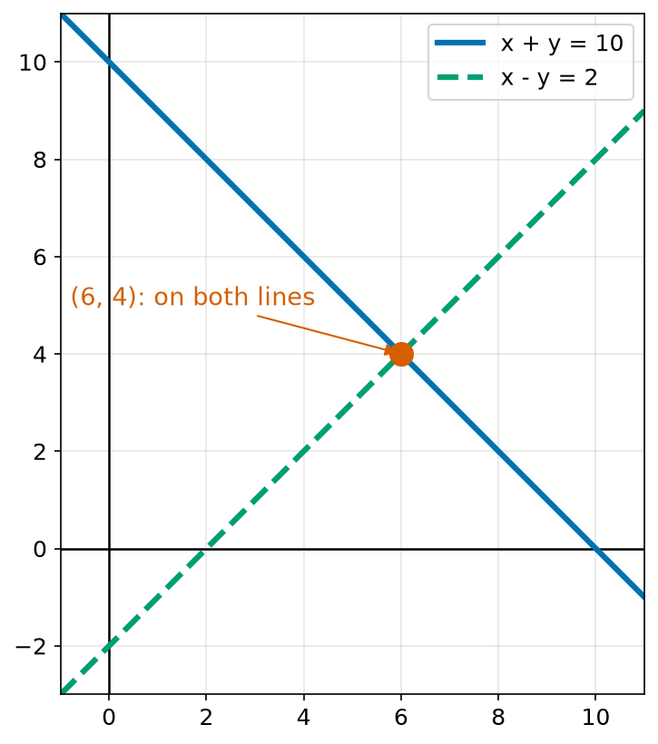
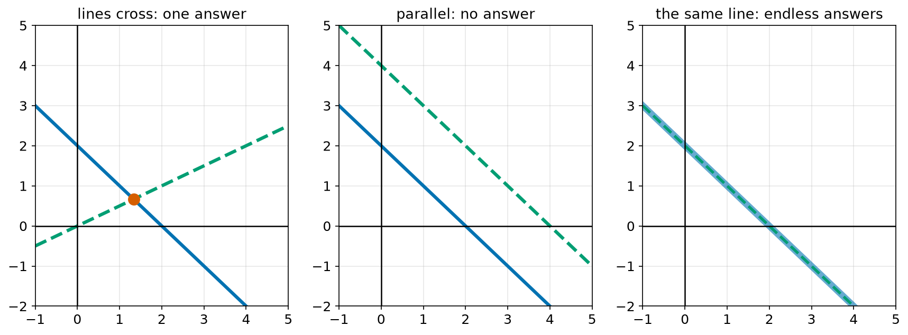
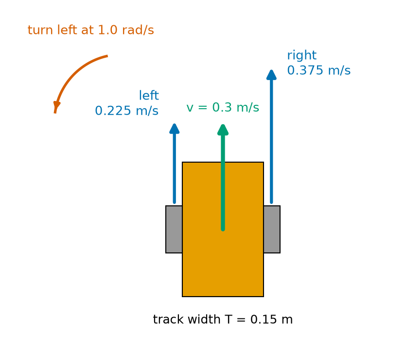
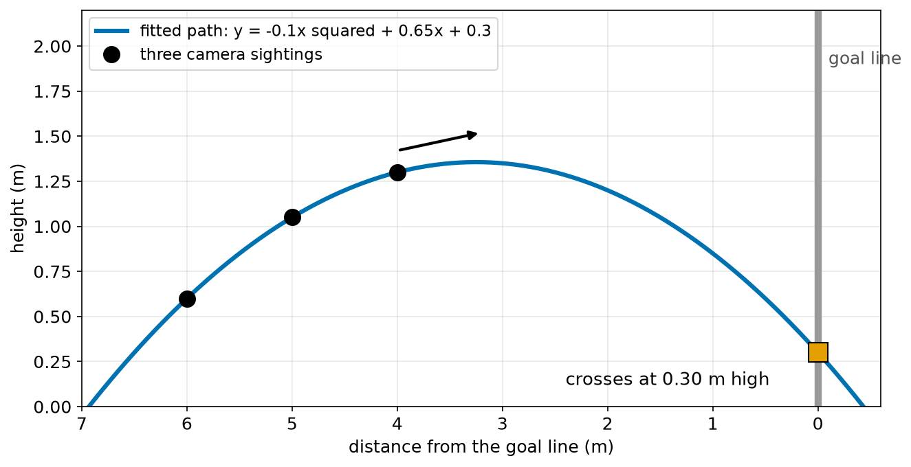
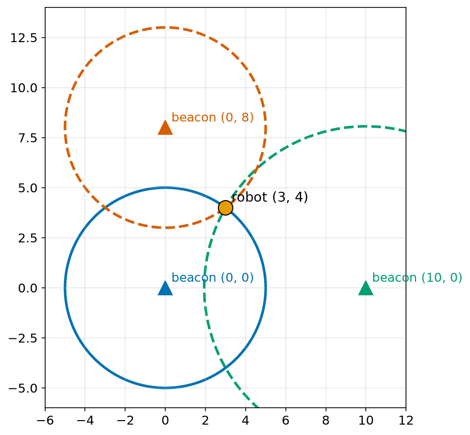

# Chapter 46 — Simultaneous Equations

> **Part 3 · Chapter 46 of 749**
> **You need:** Chapter 41 (solving), Chapter 43 (straight lines) and Chapter 45 (quadratics). Chapter 35 gave a first look with NumPy.
> **You will make:** a solver for two equations, a solver for three equations that works like NumPy's, Rover's wheel-speed calculator, and a goalkeeper robot that predicts where a ball will go.

---

## What you will learn

- What **simultaneous equations** are, and what their answer means on a graph.
- Two methods by hand: **substitution** and **elimination**.
- A formula that solves any pair of linear equations, and the number that warns when it cannot.
- When there is no answer, or endlessly many answers.
- How to solve three equations with three unknowns, step by step.
- What `np.linalg.solve` from Chapter 35 really does.
- Why robots need this: wheel speeds, curve fitting, and finding position from beacons.

---

## New words in this chapter

| Word | Simple meaning |
|---|---|
| **simultaneous equations** | Two or more equations that must all be true at the same time. |
| **system** | A group of simultaneous equations. |
| **substitution** | Solving one equation for one letter and putting that into the other. |
| **elimination** | Adding or subtracting equations so that one letter disappears. |
| **determinant** | For two equations, the number a1·b2 − a2·b1. If it is 0, there is no single answer. |
| **back substitution** | Finding the last unknown first, then putting it back to find the others. |
| **pivot** | The number we divide by during elimination. |
| **trilateration** | Finding a position from distances to known points. |

---

## 46.1 Two facts at once

Here is a puzzle. Two numbers add up to 10. Their difference is 2. What are they?

One fact alone is not enough. "Two numbers add to 10" could be 1 and 9, 5 and 5, 7.5 and 2.5, and so on, for ever. But both facts together pick out exactly one pair: 6 and 4.

📖 **New word: simultaneous equations** — two or more equations that must all be true **at the same time**. A group of them is called a **system**.

```
x + y = 10
x − y = 2
```

### On a graph

Each equation is a straight line (Chapter 43). Every point on the first line makes the first equation true. Every point on the second line makes the second one true. The answer must be on **both** lines: it is where they cross.



*Figure 46.1 — The answer to the system is the point where the lines meet.*

**How to read this picture:** The blue line holds every pair that adds to 10. The green dashed line holds every pair whose difference is 2. They meet at one point only, (6, 4). That point is the only pair that obeys both rules.

🧠 **Remember:** One unknown needs one equation. Two unknowns need two equations. Three unknowns need three. In general, you need as many independent equations as unknowns.

---

## 46.2 Method 1: substitution

📖 **New word: substitution** — solve one equation for one letter, and put that into the other equation.

🔢 **Maths.** Solve y = 2x + 1 and y = −x + 7.

```
Both say what y is, so the right sides must be equal:
2x + 1 = −x + 7
3x = 6
x = 2

Put x = 2 into either equation:
y = 2 × 2 + 1 = 5
```

**Check in the other equation:** −2 + 7 = 5. That is correct. So (2, 5).

🔢 **Maths.** Solve x + y = 10 and x − y = 2.

```
From the second: x = y + 2
Put that into the first: (y + 2) + y = 10
2y = 8
y = 4
x = 4 + 2 = 6
```

Substitution is good when one equation already has a letter on its own.

---

## 46.3 Method 2: elimination

📖 **New word: elimination** — add or subtract the equations so that one letter disappears.

This works because of the balance idea of Chapter 40: if two scales are each balanced, putting both left sides together and both right sides together gives a balanced scale too.

🔢 **Maths.** Solve x + y = 10 and x − y = 2.

```
Add the two equations:
  (x + y) + (x − y) = 10 + 2
  2x = 12
  x = 6
The y's cancelled: that is the elimination.
Then y = 10 − 6 = 4.
```

Often you must multiply first, so that one letter cancels.

🔢 **Maths.** Solve 3x + 2y = 16 and x + 2y = 8.

```
The y's already match. Subtract the second from the first:
  (3x + 2y) − (x + 2y) = 16 − 8
  2x = 8
  x = 4
Then 4 + 2y = 8, so y = 2.
```

🔢 **Maths.** Solve 2x + 3y = 12 and x − y = 1.

```
Multiply the second equation by 3, so the y's match in size:
  3x − 3y = 3
Add it to the first:
  (2x + 3y) + (3x − 3y) = 12 + 3
  5x = 15
  x = 3
Then 3 − y = 1, so y = 2.
```

**Check:** 2 × 3 + 3 × 2 = 12, and 3 − 2 = 1. Both are true.

---

## 46.4 A formula for any pair

Now we eliminate on the general system, just as we built the quadratic formula in Chapter 45.

```
a1 x + b1 y = c1        (1)
a2 x + b2 y = c2        (2)
```

**To find x**, make the y's match: multiply (1) by b2, and (2) by b1.

```
a1 b2 x + b1 b2 y = c1 b2
a2 b1 x + b1 b2 y = c2 b1

Subtract:
(a1 b2 − a2 b1) x = c1 b2 − c2 b1
```

**To find y**, make the x's match: multiply (1) by a2, and (2) by a1, and subtract:

```
(a1 b2 − a2 b1) y = a1 c2 − a2 c1
```

The same number appears in front of both. It has a name.

📖 **New word: determinant** — the number D = a1 b2 − a2 b1.

```
        c1 b2 − c2 b1              a1 c2 − a2 c1
   x = ---------------        y = ---------------
              D                          D
```

This is called **Cramer's rule** for two equations.

🔢 **Maths.** Check it on 2x + 3y = 12 and x − y = 1. Here a1 = 2, b1 = 3, c1 = 12, a2 = 1, b2 = −1, c2 = 1.

```
D = 2 × (−1) − 1 × 3 = −5
x = (12 × (−1) − 1 × 3) / (−5) = −15 / −5 = 3
y = (2 × 1 − 1 × 12) / (−5) = −10 / −5 = 2
```

The same answer as section 46.3. Chapter 163 shows what the determinant means as a picture, for bigger systems too.

---

## 46.5 No answer, or endless answers

If D = 0, we cannot divide. What does that mean?



*Figure 46.2 — Two lines can cross, never meet, or lie on top of each other.*

**How to read this picture:** On the left, the lines cross at one point: one answer. In the middle, the lines are parallel, with the same slope (Chapter 43). They never meet: no answer. On the right, the two equations describe the same line: every point on it is an answer.

| Case | Example | D | Answers |
|---|---|---|---|
| lines cross | x + y = 2 and x − 2y = 0 | −3 | one |
| parallel | x + y = 2 and 2x + 2y = 8 | 0 | none (the second says x + y = 4) |
| the same line | x + y = 2 and 2x + 2y = 4 | 0 | endlessly many |

D = 0 means that the two lines have the same slope. When that happens, the two equations do not give two **different** facts.

🤖 **Robot link.** A determinant of 0, or very close to 0, is a warning sign everywhere in robotics. For a robot arm it means a **singularity**: a pose where the arm loses the ability to move in some direction (Chapter 359). For a positioning system it means the beacons are badly placed, for example all in a straight line.

---

## 46.6 Three equations, three unknowns

The same idea works for more unknowns. The plan: use elimination to make a "staircase", then work backwards.

🔢 **Maths.** Solve:

```
 x +  y +  z = 6        (1)
2x −  y +  z = 3        (2)
 x + 2y −  z = 2        (3)
```

**Step 1. Remove x from (2) and (3), using (1).**

```
(2) − 2 × (1):   −3y −  z = −9      (4)
(3) − 1 × (1):     y − 2z = −4      (5)
```

**Step 2. Remove y from (5), using (4).** It is easier here to use (5) to write y = 2z − 4, then put it into (4):

```
−3(2z − 4) − z = −9
−6z + 12 − z = −9
−7z = −21
z = 3
```

**Step 3. Work backwards.**

📖 **New word: back substitution** — find the last unknown first, then put it back to find the others.

```
From (5): y = 2 × 3 − 4 = 2
From (1): x = 6 − 2 − 3 = 1
```

**Check in all three:** 1 + 2 + 3 = 6. 2 − 2 + 3 = 3. 1 + 4 − 3 = 2. All true.

This method is called **Gaussian elimination**, after the German mathematician Carl Friedrich Gauss. Chapter 165 studies it in full with matrices. It is exactly what `np.linalg.solve` does for you (Chapter 35), with some clever tricks to keep the rounding small.

📖 **New word: pivot** — the number we divide by during elimination. In step 1, the pivot was the 1 in front of x in (1). A computer always picks the **biggest** number available as the pivot, by swapping rows. Dividing by a tiny number would make small rounding errors huge (Chapter 54).

---

## Code

File `code/ch046/solve_2x2.py`:

```python
# solve_2x2.py - two equations, two unknowns: a1 x + b1 y = c1 and a2 x + b2 y = c2
def solve_2x2(a1, b1, c1, a2, b2, c2):
    det = a1 * b2 - a2 * b1
    if det == 0:
        return None
    x = (c1 * b2 - c2 * b1) / det
    y = (a1 * c2 - a2 * c1) / det
    return x, y


if __name__ == "__main__":
    systems = [
        (1, 1, 10, 1, -1, 2),
        (2, 3, 12, 1, -1, 1),
        (1, 1, 2, 2, 2, 8),
        (1, 1, 2, 2, 2, 4),
    ]
    for a1, b1, c1, a2, b2, c2 in systems:
        answer = solve_2x2(a1, b1, c1, a2, b2, c2)
        text = "no single answer" if answer is None else f"x = {answer[0]:g}, y = {answer[1]:g}"
        print(f"{a1}x + {b1}y = {c1}  and  {a2}x + {b2}y = {c2}   ->  {text}")
```

| Line | Code | What it does (simple English) |
|---|---|---|
| 1 | `# solve_2x2.py …` | A comment that shows the form of the equations. |
| 2 | `def solve_2x2(a1, b1, c1, a2, b2, c2):` | Six numbers describe the two equations. |
| 3 | `det = a1 * b2 - a2 * b1` | The determinant D. |
| 4 | `if det == 0:` | Parallel lines, or the same line. |
| 5 | `return None` | There is no single answer. |
| 6 | `x = (c1 * b2 - c2 * b1) / det` | Cramer's rule for x. |
| 7 | `y = (a1 * c2 - a2 * c1) / det` | Cramer's rule for y. |
| 8 | `return x, y` | Both answers. |
| 9–10 | (blank) | Spacing. |
| 11 | `if __name__ == "__main__":` | The tests run only when this file is run directly (Chapter 26). |
| 12–17 | `systems = […]` | Four systems: the two from this chapter, a parallel pair and a repeated line. |
| 18 | `for a1, b1, c1, a2, b2, c2 in systems:` | Unpacks six numbers at a time. |
| 19 | `answer = solve_2x2(…)` | Solves one system. |
| 20 | `text = … if answer is None else …` | Words for the result. |
| 21 | `print(f"…")` | Prints the system and the answer. |

Output:

```
1x + 1y = 10  and  1x + -1y = 2   ->  x = 6, y = 4
2x + 3y = 12  and  1x + -1y = 1   ->  x = 3, y = 2
1x + 1y = 2  and  2x + 2y = 8   ->  no single answer
1x + 1y = 2  and  2x + 2y = 4   ->  no single answer
```

⚠️ **Careful.** With decimals from sensors, D is rarely **exactly** 0. A value like 0.0000001 means "nearly parallel", and the answer will be huge and unreliable. Real code checks `abs(det) < 1e-9` instead (Chapter 54).

File `code/ch046/solve_3x3.py`:

```python
# solve_3x3.py - three equations, three unknowns, by elimination (then compare with NumPy)
import numpy as np


def solve_3x3(rows):
    m = [list(row) for row in rows]          # each row: [a, b, c, right side]
    n = 3
    for col in range(n):
        best = max(range(col, n), key=lambda r: abs(m[r][col]))
        m[col], m[best] = m[best], m[col]
        if m[col][col] == 0:
            return None
        for r in range(col + 1, n):
            factor = m[r][col] / m[col][col]
            for k in range(col, n + 1):
                m[r][k] = m[r][k] - factor * m[col][k]
    answer = [0.0] * n
    for r in range(n - 1, -1, -1):
        known = sum(m[r][k] * answer[k] for k in range(r + 1, n))
        answer[r] = (m[r][n] - known) / m[r][r]
    return answer


if __name__ == "__main__":
    rows = [[1, 1, 1, 6],
            [2, -1, 1, 3],
            [1, 2, -1, 2]]
    print("by hand :", solve_3x3(rows))
    a = np.array([r[:3] for r in rows], dtype=float)
    b = np.array([r[3] for r in rows], dtype=float)
    print("by NumPy:", np.linalg.solve(a, b))
```

| Line | Code | What it does (simple English) |
|---|---|---|
| 1 | `# solve_3x3.py …` | A comment. |
| 2 | `import numpy as np` | Only for the comparison at the end. |
| 3–4 | (blank) | Spacing. |
| 5 | `def solve_3x3(rows):` | Each row holds one equation: three numbers and the right side. |
| 6 | `m = [list(row) for row in rows]` | A **copy**, so that we do not change the caller's lists (Chapter 21). |
| 7 | `n = 3` | Three unknowns. |
| 8 | `for col in range(n):` | Works on the x column, then y, then z. |
| 9 | `best = max(range(col, n), key=lambda r: abs(m[r][col]))` | Finds the row with the biggest number in this column. This is the pivot choice. |
| 10 | `m[col], m[best] = m[best], m[col]` | Swaps that row into place. Swapping two equations changes nothing. |
| 11 | `if m[col][col] == 0:` | Even the biggest is 0. |
| 12 | `return None` | No single answer. |
| 13 | `for r in range(col + 1, n):` | Every row below the pivot row. |
| 14 | `factor = m[r][col] / m[col][col]` | How many pivot rows to subtract, so that this column becomes 0. |
| 15 | `for k in range(col, n + 1):` | Each number in the row, including the right side. |
| 16 | `m[r][k] = m[r][k] - factor * m[col][k]` | The elimination step: row minus factor × pivot row. |
| 17 | `answer = [0.0] * n` | Space for x, y and z. |
| 18 | `for r in range(n - 1, -1, -1):` | Back substitution: counts 2, 1, 0, so the last unknown comes first. |
| 19 | `known = sum(m[r][k] * answer[k] for k in range(r + 1, n))` | The part of this row made from unknowns we already found. |
| 20 | `answer[r] = (m[r][n] - known) / m[r][r]` | Solves this row for its own unknown. |
| 21 | `return answer` | The list [x, y, z]. |
| 22–23 | (blank) | Spacing. |
| 24 | `if __name__ == "__main__":` | Tests. |
| 25–27 | `rows = […]` | The system from section 46.6. |
| 28 | `print("by hand :", …)` | Our method. |
| 29 | `a = np.array(…)` | The left-side numbers, as a 3 × 3 array (Chapter 34). |
| 30 | `b = np.array(…)` | The right sides. |
| 31 | `print("by NumPy:", np.linalg.solve(a, b))` | NumPy's answer (Chapter 35). |

Output:

```
by hand : [1.0, 2.0000000000000004, 3.0000000000000004]
by NumPy: [1. 2. 3.]
```

Both give x = 1, y = 2, z = 3. Our version shows tiny rounding errors in the last digit: the 4 at the end is about 4 × 10⁻¹⁶. NumPy prints fewer digits, so its tiny errors are hidden. Chapter 54 explains where they come from.

---

## Small examples

**Example 1.** x + y = 5 and x = 3 give y = 2.

**Example 2.** y = 3x and y = x + 4: 3x = x + 4, so x = 2 and y = 6.

**Example 3.** 2x + y = 7 and 2x − y = 1. Adding gives 4x = 8, so x = 2 and y = 3.

**Example 4.** For x + 2y = 3 and 2x + 4y = 6, D = 4 − 4 = 0. The second is just the first doubled.

**Example 5.** A line y = mx + c through (1, 3) and (4, 9): m + c = 3 and 4m + c = 9. Subtract: 3m = 6, so m = 2 and c = 1. That is Chapter 43's method, seen as a system.

**Example 6.** A robot sees the same wall from two places. Each view gives one line. The corner of the room is where the two walls' lines cross.

**Example 7.** 3 motors and 2 sensors cost 41 dollars. 1 motor and 4 sensors cost 27 dollars. Then a motor costs 11 dollars and a sensor 4 dollars (see Practice 6).

---

## 🏭 Real robot applications

### Application 1 (worked in full) — 🤖 Rover's wheel speeds

**1. The real problem.** A planner tells Rover: "move forward at 0.3 m/s and turn left at 1.0 rad/s". But Rover cannot set those directly. It can only set the speeds of its left and right wheels. What must each wheel do? (A radian is a unit for angles, Chapter 47. One radian per second is a gentle turn.)

**2. Why this theory.** Rover's forward speed and turn rate each depend on **both** wheels (Chapter 285 derives this). So we have two equations with two unknowns.

**3. The numbers.** The wheels are T = 0.15 m apart. The wheel diameter is 0.06589 m (Chapter 16).

**4. The maths.** With L and R as the wheel speeds:

```
forward speed:  v = (L + R) / 2       → 0.5 L + 0.5 R = v
turn rate:      ω = (R − L) / T       → −L/T + R/T = ω
```

(ω, the Greek letter omega, is the usual name for a turn rate.) Solve by elimination, with v = 0.3 and ω = 1.0:

```
From the first: L + R = 0.6
From the second: R − L = 0.15 × 1.0 = 0.15
Add them:        2R = 0.75,  so R = 0.375 m/s
Then:            L = 0.6 − 0.375 = 0.225 m/s
```



*Figure 46.3 — To turn left, the right wheel must go faster.*

**How to read this picture:** Rover is seen from above, with its front at the top. The blue arrows are the wheel speeds: the right one is longer. The green arrow is the speed of the middle of the robot, which is the average. The red arrow shows the turn to the left.

**5. The code.** File `code/ch046/wheel_speeds.py`:

```python
# wheel_speeds.py - what must each wheel do to give this forward speed and turn rate?
import math

from solve_2x2 import solve_2x2

TRACK_M = 0.15            # distance between Rover's wheels (Chapter 35)
WHEEL_D_M = 0.06589       # wheel diameter (Chapter 16)

print(" forward   turn   |   left wheel   right wheel  (m/s)   left rpm  right rpm")
for v, w in [(0.3, 0.0), (0.3, 1.0), (0.0, 2.0), (0.2, -0.5)]:
    # 0.5 L + 0.5 R = v        and       -L/T + R/T = w
    left, right = solve_2x2(0.5, 0.5, v, -1 / TRACK_M, 1 / TRACK_M, w)
    rpm_left = left / (math.pi * WHEEL_D_M) * 60
    rpm_right = right / (math.pi * WHEEL_D_M) * 60
    print(f"{v:7.2f} {w:6.2f}   | {left:11.3f} {right:12.3f}        {rpm_left:9.1f} {rpm_right:9.1f}")
```

| Line | Code | What it does (simple English) |
|---|---|---|
| 1 | `# wheel_speeds.py …` | A comment. |
| 2 | `import math` | For π. |
| 3 | (blank) | Spacing. |
| 4 | `from solve_2x2 import solve_2x2` | Our solver. |
| 5 | (blank) | Spacing. |
| 6 | `TRACK_M = 0.15` | Distance between the wheels. |
| 7 | `WHEEL_D_M = 0.06589` | Wheel diameter. |
| 8 | (blank) | Spacing. |
| 9 | `print(…)` | The heading. |
| 10 | `for v, w in […]:` | Four requests: straight, gentle left, spin on the spot, gentle right. We use `w` for ω. |
| 11 | `# 0.5 L + 0.5 R = v …` | A comment that shows the two equations. |
| 12 | `left, right = solve_2x2(0.5, 0.5, v, -1 / TRACK_M, 1 / TRACK_M, w)` | a1, b1, c1 from the first equation, and a2, b2, c2 from the second. |
| 13 | `rpm_left = left / (math.pi * WHEEL_D_M) * 60` | m/s ÷ metres per turn = turns per second, then × 60 (Chapter 39). |
| 14 | `rpm_right = …` | The same for the right wheel. |
| 15 | `print(f"…")` | Prints the row. |

Output:

```
 forward   turn   |   left wheel   right wheel  (m/s)   left rpm  right rpm
   0.30   0.00   |       0.300        0.300             87.0      87.0
   0.30   1.00   |       0.225        0.375             65.2     108.7
   0.00   2.00   |      -0.150        0.150            -43.5      43.5
   0.20  -0.50   |       0.238        0.163             68.8      47.1
```

**6. The result.** Driving straight, both wheels match. To spin on the spot, the wheels go in opposite directions at the same speed: one negative, one positive. A negative turn rate (turning right) makes the left wheel faster. Every one of these comes from the same two equations. In Chapter 35, NumPy solved exactly this system with `np.linalg.solve`. Now you know what it was doing.

**7. Going further.** The two equations have their own rearranged formulas: R = v + ωT/2 and L = v − ωT/2 (Practice 7). Chapter 286 uses them, and also limits the wheel speeds when the request is too fast for the motors (saturation, Chapter 44), while keeping the shape of the turn.

### Application 2 (worked in full) — ⚽ The goalkeeper robot

**1. The real problem.** In Chapter 45, a goalkeeper robot saw a ball three times and needed its path. A thrown ball follows a parabola, y = ax² + bx + c. What are a, b and c, and how high will the ball be when it crosses the goal line?

**2. Why this theory.** Each sighting (x, y) must lie on the curve. That gives one equation in the three unknowns a, b and c. Three sightings give three equations: a 3 × 3 system.

**3. The numbers.** The camera measures the ball's distance from the goal line, x, and its height, y. The sightings are (6.0, 0.60), (5.0, 1.05) and (4.0, 1.30), in metres. Real camera readings are noisy. These are clean numbers, to show the method.

**4. The maths.** Put each point into y = ax² + bx + c:

```
36a + 6b + c = 0.60        (1)
25a + 5b + c = 1.05        (2)
16a + 4b + c = 1.30        (3)

(1) − (2):   11a + b = −0.45     (4)
(2) − (3):    9a + b = −0.25     (5)
(4) − (5):    2a = −0.20,  so  a = −0.10
From (5):    b = −0.25 + 0.90 = 0.65
From (3):    c = 1.30 − 16(−0.10) − 4(0.65) = 1.30 + 1.60 − 2.60 = 0.30
```

On the goal line x = 0, so y = c = 0.30 m.

**5. The code.** File `code/ch046/ball_fit.py`:

```python
# ball_fit.py - a goalkeeper robot fits a parabola through three sightings of a ball
from solve_3x3 import solve_3x3

sightings = [(6.0, 0.60), (5.0, 1.05), (4.0, 1.30)]     # (distance from goal line, height) in m

rows = [[x * x, x, 1, y] for x, y in sightings]          # a x^2 + b x + c = y
a, b, c = solve_3x3(rows)
print(f"path: y = {a:.4f} x^2 + {b:.4f} x + {c:.4f}")

for x, y in sightings:
    print(f"  check x = {x}: curve gives {a * x * x + b * x + c:.4f}, seen {y}")

height_at_goal = c                                       # x = 0 on the goal line
print(f"height when it crosses the goal line: {height_at_goal:.3f} m")
```

| Line | Code | What it does (simple English) |
|---|---|---|
| 1 | `# ball_fit.py …` | A comment. |
| 2 | `from solve_3x3 import solve_3x3` | Our 3 × 3 solver. |
| 3 | (blank) | Spacing. |
| 4 | `sightings = […]` | Three (x, y) points from the camera. |
| 5 | (blank) | Spacing. |
| 6 | `rows = [[x * x, x, 1, y] for x, y in sightings]` | Each point makes one equation: the numbers in front of a, b and c are x², x and 1, and the right side is y. |
| 7 | `a, b, c = solve_3x3(rows)` | Solves the system and unpacks the three answers. |
| 8 | `print(f"path: …")` | Shows the curve. |
| 9 | (blank) | Spacing. |
| 10 | `for x, y in sightings:` | Checks every sighting. |
| 11 | `print(f"  check …")` | The curve should pass through each one. |
| 12 | (blank) | Spacing. |
| 13 | `height_at_goal = c` | At x = 0, ax² + bx + c is just c. |
| 14 | `print(f"height …")` | The prediction. |

Output:

```
path: y = -0.1000 x^2 + 0.6500 x + 0.3000
  check x = 6.0: curve gives 0.6000, seen 0.6
  check x = 5.0: curve gives 1.0500, seen 1.05
  check x = 4.0: curve gives 1.3000, seen 1.3
height when it crosses the goal line: 0.300 m
```



*Figure 46.4 — Three points are enough to fix a parabola.*

**How to read this picture:** The ball moves from left to right, towards the goal line on the right. The black dots are the three sightings. The blue curve is the parabola through them. The orange square shows where it will cross the goal line: 0.30 m above the ground.

**6. The result.** After only three sightings, the robot knows the ball will cross the line at a height of 0.30 m, low enough to block with its body. It can start moving long before the ball arrives. Without the system of equations, it would have to wait and react at the last moment.

**7. Going further.** Three points fit a parabola exactly, so noise in one sighting moves the whole curve. Real robots use many sightings and find the curve that is closest to all of them, using least squares (Chapter 171). They also include air resistance and spin. Chapter 427 tracks moving objects with a Kalman filter, which handles noise very well.

### Application 3 — 🌾 Mixing fertiliser to the right strength

A farm robot carries two tanks, one with 10% fertiliser and one with 30%. It needs 100 L at 25%. If x litres come from the first tank and y from the second: x + y = 100, and 0.10x + 0.30y = 25. Substituting y = 100 − x: 0.10x + 30 − 0.30x = 25, so x = 25 L and y = 75 L. The robot's pumps run in that ratio. If the target changes field by field, the same two equations give new amounts at once.

### Application 4 — 🏙️ A delivery robot's power model

A delivery robot's power use is modelled as P = P0 + k × v, a fixed part for electronics plus a part that grows with speed. Two tests give 18 W at 0.5 m/s and 30 W at 1.5 m/s. That is two equations: P0 + 0.5k = 18 and P0 + 1.5k = 30. Subtracting gives k = 12 W per m/s, and so P0 = 12 W. The model predicts 12 + 12 × 1.2 = 26.4 W at 1.2 m/s, which the planner of Chapter 40 can use.

### Application 5 — 📡 Finding position from three beacons

Indoor robots often measure their distances to radio beacons with known positions. With beacons at (0, 0), (10, 0) and (0, 8), a robot measures distances of 5, 8.062 and 5 m. Each distance gives a circle, and the robot is where all three cross.



*Figure 46.5 — The robot is where the three circles meet.*

**How to read this picture:** Each triangle is a beacon. Each circle holds every point at the measured distance from that beacon. Only one point lies on all three circles: the robot, at (3, 4).

📖 **New word: trilateration** — finding a position from distances to known points.

The circle equations have squares in them, such as x² + y² = 25 and (x − 10)² + y² = 65. Subtracting one from another makes the squares cancel: x² − (x − 10)² = 25 − 65 gives 20x − 100 = −40, so x = 3. In the same way, the first and third give y = 4. A hard problem with squares became a simple linear one. Real systems do this with many beacons and least squares (Chapter 426).

---

## 🔧 Hands-on lab

### Lab 46.1 — Find two weights with a balance (hardware, kitchen scale)

You need a kitchen scale, and two kinds of small objects, such as coins of two types or two kinds of screws.

1. Weigh 3 of type A together with 2 of type B. Write the result.
2. Weigh 1 of type A together with 4 of type B. Write the result.
3. Write the two equations, and solve them with `solve_2x2`.
4. Weigh one of each type alone to check.

**What you should see:** The solved masses match the single weighings to within the scale's resolution.

| If it does not work | Likely cause | Fix |
|---|---|---|
| The answers are negative or silly | The two weighings were nearly the same mixture | Use mixtures that are very different |
| The answers are slightly off | Scale resolution (often 1 g) | Use more objects in each weighing |

**Challenge:** Do it with three kinds of object and three weighings, using `solve_3x3`.

### Lab 46.2 — Nearly parallel (simulation)

Use `solve_2x2.py`.

1. Solve x + y = 2 and x + 1.001y = 2.001.
2. Change the second right side to 2.002, a change of only 0.001.
3. Print the determinant for both.

**What you should see:** The first gives x = 1, y = 1. The second gives x = 0, y = 2. A change of 0.001 in one number moved the answer by 1. The determinant is 0.001, very close to zero. Nearly parallel lines make a system very sensitive to small errors.

| If it does not work | Likely cause | Fix |
|---|---|---|
| The answers show long decimals | Rounding (Chapter 54) | Print with `:.4f` |

**Challenge:** In the beacon problem, what happens if all three beacons are placed in a straight line? Try beacons at (0, 0), (5, 0) and (10, 0).

### Lab 46.3 — Command Rover (simulation)

Copy `wheel_speeds.py`.

1. Add the request (0.25, 0.5). Compare with Chapter 35's `wheel_mixer.py`, which asked for the same.
2. Add (0.5, 3.0).
3. Rover's motors can reach about 0.45 m/s at most. Which requests are impossible?

**What you should see:** (0.25, 0.5) gives left 0.2125 and right 0.2875 m/s, the same as Chapter 35. (0.5, 3.0) needs a right wheel of 0.725 m/s, which the motor cannot reach.

| If it does not work | Likely cause | Fix |
|---|---|---|
| `ImportError` | Not running inside `code/ch046` | Change folder first |
| Left and right swapped | ω sign reversed | Positive ω turns left (anticlockwise) |

**Challenge:** If one wheel is too fast, scale **both** wheel speeds down by the same factor, so that the robot still follows the same curve, just more slowly.

---

## Common mistakes

⚠️ **Using only one equation for two unknowns.** You need as many equations as unknowns.

⚠️ **Forgetting to multiply the right side** when you multiply an equation.

⚠️ **Subtracting only some of the terms.** Subtract every term, including the right sides.

⚠️ **Not checking the answer in every equation.**

⚠️ **Dividing by a determinant of 0, or nearly 0.**

⚠️ **Mixing up which number goes where** in the formula. Write the system in the form a x + b y = c first.

⚠️ **Changing the caller's data.** Copy the rows before elimination, as `solve_3x3` does.

⚠️ **Trusting an answer from nearly parallel lines.** It may be wildly wrong after a small error.

---

## Practice

🏋️ **1.** Solve x + y = 7 and x − y = 1.

🏋️ **2.** Solve 3x + 2y = 16 and x + 2y = 8 by elimination.

🏋️ **3.** Where do y = 2x + 1 and y = −x + 7 meet?

🏋️ **4.** Solve 2x + 4y = 10 and x + 2y = 6. Explain the result.

🏋️ **5.** Use Cramer's rule for 4x − y = 5 and 3x + 2y = 12.

🏋️ **6.** 3 motors and 2 sensors cost 41 dollars. 1 motor and 4 sensors cost 27 dollars. Find the price of each.

🏋️ **7.** Solve the wheel equations for L and R in letters. Then find the wheel speeds for v = 0.2 m/s and ω = −1.0 rad/s, with T = 0.15 m.

🏋️ **8.** Find the line y = mx + c through (1, 3) and (4, 9) as a system.

🏋️ **9.** Solve x + y + z = 10, x − y = 1, y + 2z = 9.

🏋️ **10.** A tank of 10% and a tank of 30% must make 100 L at 20%. How much from each?

🏋️ **11.** Write `crossing(m1, c1, m2, c2)`, which returns the point where y = m1 x + c1 and y = m2 x + c2 meet, using `solve_2x2`. Test it with two robot paths: y = 0.5x + 1 and y = −x + 4.

---

## Answers

**1.** Adding: 2x = 8, so x = 4 and y = 3.

**2.** Subtracting: 2x = 8, so x = 4. Then 2y = 4, so y = 2.

**3.** 2x + 1 = −x + 7 gives x = 2, so y = 5. They meet at (2, 5).

**4.** D = 2 × 2 − 1 × 4 = 0. The first equation, divided by 2, is x + 2y = 5, but the second says x + 2y = 6. Parallel lines: no answer.

**5.** D = 4 × 2 − 3 × (−1) = 11. x = (5 × 2 − 12 × (−1))/11 = 22/11 = 2. y = (4 × 12 − 3 × 5)/11 = 33/11 = 3.

**6.** 3m + 2s = 41 and m + 4s = 27. From the second, m = 27 − 4s. Then 81 − 12s + 2s = 41, so s = 4 and m = 11. A motor is 11 dollars and a sensor 4 dollars.

**7.** Adding L + R = 2v and R − L = ωT gives R = v + ωT/2, and so L = v − ωT/2. With the numbers: R = 0.2 − 0.075 = 0.125 m/s and L = 0.2 + 0.075 = 0.275 m/s. The left wheel is faster, so Rover turns right.

**8.** m + c = 3 and 4m + c = 9. Subtracting: 3m = 6, so m = 2 and c = 1. y = 2x + 1.

**9.** From the second, x = y + 1. Into the first: 2y + 1 + z = 10, so 2y + z = 9. With y + 2z = 9: from this, y = 9 − 2z, so 18 − 4z + z = 9, so z = 3. Then y = 3 and x = 4. Check: 4 + 3 + 3 = 10.

**10.** x + y = 100 and 0.1x + 0.3y = 20. Then 0.1x + 30 − 0.3x = 20, so x = 50 L and y = 50 L.

**11.**

```python
from solve_2x2 import solve_2x2

def crossing(m1, c1, m2, c2):
    # y = m x + c  is the same as  -m x + 1 y = c
    return solve_2x2(-m1, 1, c1, -m2, 1, c2)

print(crossing(0.5, 1, -1, 4))     # (2.0, 2.0)
```

The paths cross at (2, 2). If the two slopes are equal, the determinant is 0 and the function returns `None`: the paths never cross, or they are the same path.

---

## Summary

🧠 Simultaneous equations must all be true together. On a graph, the answer is where the lines cross.

🧠 Substitution puts one equation into the other. Elimination adds or subtracts equations to remove a letter.

🧠 For two equations, x = (c1 b2 − c2 b1)/D and y = (a1 c2 − a2 c1)/D, with D = a1 b2 − a2 b1.

🧠 D = 0 means parallel lines (no answer) or the same line (endless answers).

🧠 Three unknowns need three equations: eliminate down to a staircase, then back-substitute.

🧠 A determinant near zero is a warning: the answer is very sensitive to small errors.

🧠 Robots use systems to find wheel speeds, to fit curves, and to find their position from beacons.

---

## Next chapter

In Chapter 47 we start the maths of turning: **angles in degrees and radians**. You will learn why computers prefer radians, and how to keep an angle in a sensible range, such as −180° to +180°.
