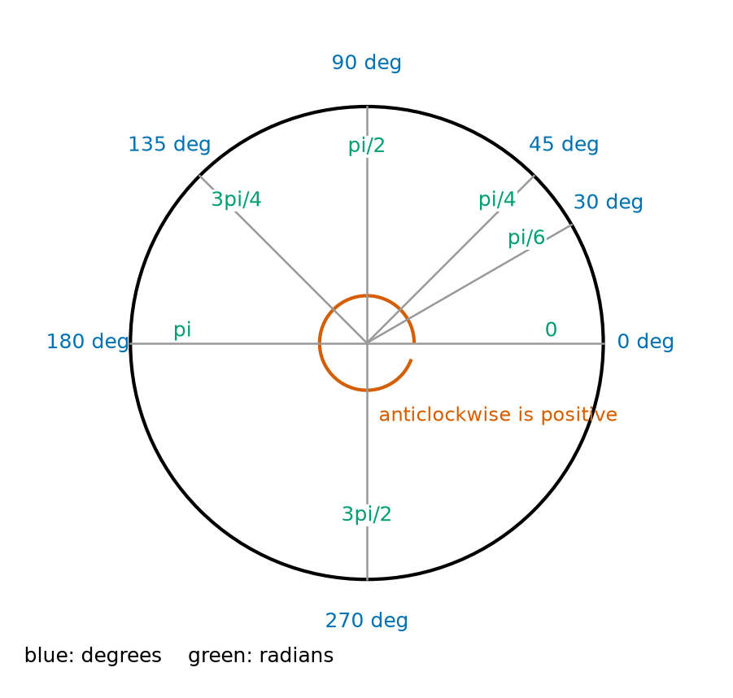
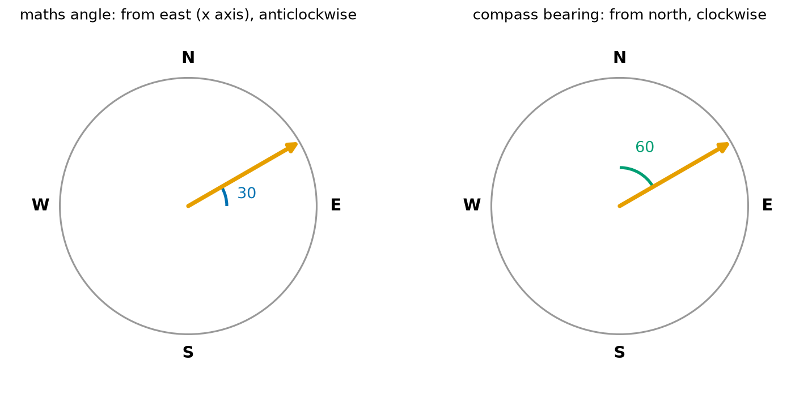
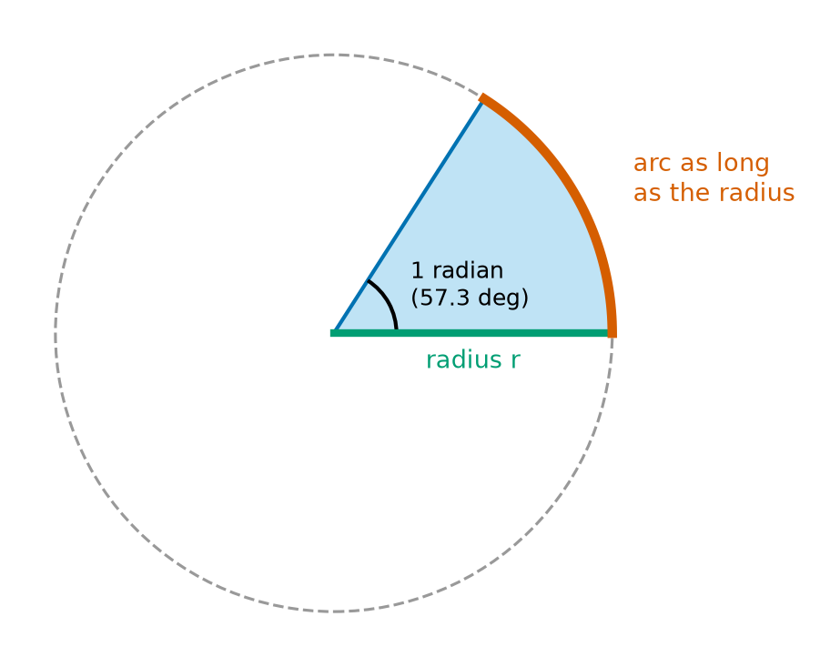
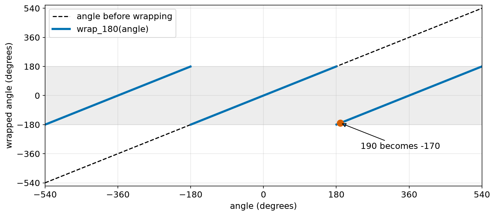
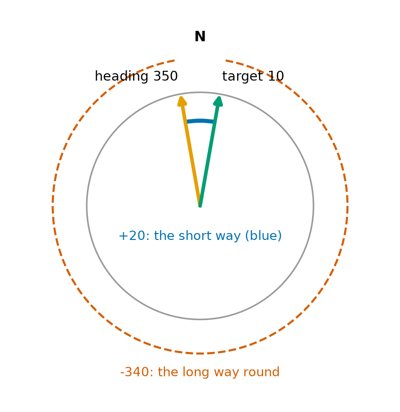
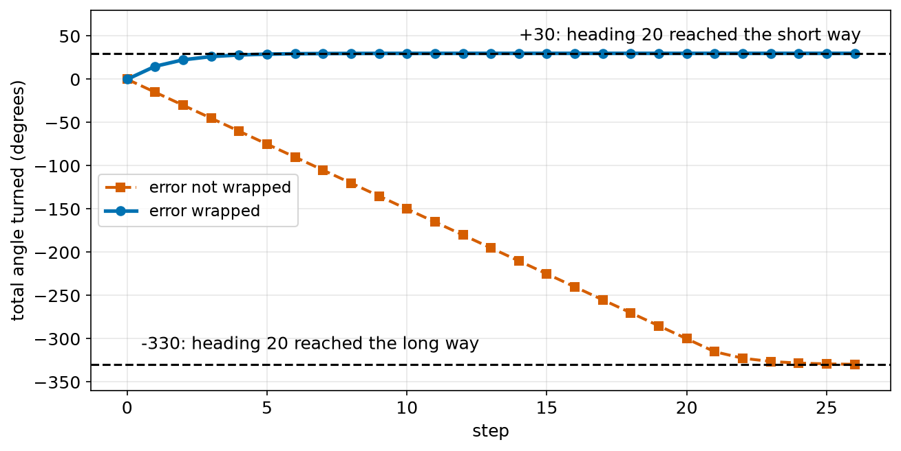

# Chapter 47 — Angles: Degrees and Radians

> **Part 3 · Chapter 47 of 749**
> **You need:** Chapter 13 (`%`), Chapter 26 (`math` module) and Chapter 42 (coordinates).
> **You will make:** a degrees and radians converter, the angle-wrapping functions that every mobile robot uses, Rover's wheel odometry with radians, and a boat autopilot that turns the short way.

---

## What you will learn

- What an angle measures.
- Where degrees come from, and how they are used for directions.
- The difference between a **maths angle** and a **compass bearing**.
- What a **radian** is, and why computers and robots prefer it.
- How to convert between degrees and radians.
- Why the distance a wheel rolls is radius × angle, but only in radians.
- How to **wrap** an angle into the range 0 to 360°, or −180° to +180°.
- How to find the shortest turn from one heading to another.

---

## New words in this chapter

| Word | Simple meaning |
|---|---|
| **angle** | The amount of turning between two directions. |
| **degree (°)** | 1/360 of a full turn. |
| **heading** | The direction a robot is facing. |
| **bearing** | A direction measured clockwise from north. |
| **radian (rad)** | The angle at which the arc is as long as the radius. About 57.3°. |
| **arc** | A part of the edge of a circle. |
| **arc length** | How long an arc is. |
| **angular speed** | How fast something turns, for example in rad/s. Written ω (omega). |
| **wrap** (an angle) | Bring an angle back into a fixed range, without changing its direction. |
| **shortest turn** | The smaller of the two ways to turn from one heading to another. |

---

## 47.1 What an angle is

Stand facing a door. Turn until you face a window. How much did you turn? That amount of turning is an **angle**.

📖 **New word: angle** — the amount of turning between two directions.

An angle does not care how far away things are. A small robot and a big ship that both turn a quarter turn have turned the same angle.

📖 **New word: heading** — the direction a robot is facing.

🤖 **Robot link.** Every robot that moves over the floor has a heading, and almost every robot arm is a chain of joints that each have an angle. Angles are as important to robots as distances.

---

## 47.2 Degrees

📖 **New word: degree** — 1/360 of a full turn. Written °.

Why 360? Nobody is completely sure. Ancient astronomers in Babylon counted in sixties, and a year has about 360 days. The number is handy because it divides exactly by 2, 3, 4, 5, 6, 8, 9, 10, 12 and more.

| Turn | Degrees |
|---|---|
| a full turn | 360° |
| half a turn | 180° |
| a quarter turn (a right angle) | 90° |
| an eighth of a turn | 45° |



*Figure 47.1 — Common angles, in both units.*

**How to read this picture:** Each grey line is one direction. The blue labels outside give the angle in degrees, measured from the line pointing right (0°). The green labels inside give the same angle in radians, which we meet in section 47.4. The red arc shows that the positive direction is anticlockwise.

### Two ways to measure direction



*Figure 47.2 — The same direction, described two different ways.*

**How to read this picture:** Both circles show the same orange arrow. On the left, the angle is measured the maths way: from east (the x axis), turning anticlockwise. It is 30°. On the right, it is measured the compass way: from north, turning clockwise. It is 60°.

📖 **New word: bearing** — a direction measured clockwise from north. Ships, aircraft, maps and phones use bearings.

| | Maths angle | Compass bearing |
|---|---|---|
| zero points to | east (along x) | north |
| positive direction | anticlockwise | clockwise |
| used by | maths, `math.sin`, robot software | maps, ships, GPS, phones |

To convert:

```
maths angle = 90° − bearing
bearing     = 90° − maths angle
```

(The same formula works both ways.) The answer may need wrapping into range, which we do in section 47.6.

🔢 **Maths.** A bearing of 135° (south-east) is a maths angle of 90 − 135 = −45°. A maths angle of 120° is a bearing of 90 − 120 = −30°, which is 330° after wrapping.

⚠️ **Careful.** Mixing these two is a common robot bug. In Chapter 26 we wrote `atan2(dx, dy)` to get a compass bearing, and noted that the maths form is `atan2(dy, dx)`. Chapter 50 explains why.

---

## 47.3 Arcs and circles

📖 **New word: arc** — a part of the edge of a circle.

📖 **New word: arc length** — how long an arc is.

The whole edge of a circle (its **circumference**) is 2πr long, where r is the radius (Chapter 48 explains why). A quarter turn makes a quarter of that: 2πr ÷ 4.

🔢 **Maths.** Rover's wheel has a radius of 3.29 cm. How far does it roll in a quarter turn?

```
circumference = 2 × π × 3.29 = 20.7 cm
quarter       = 20.7 ÷ 4     = 5.17 cm
```

With degrees, the general rule is clumsy:

```
arc length = (angle in degrees ÷ 360) × 2πr
```

There is a better unit that makes this rule very simple.

---

## 47.4 The radian

📖 **New word: radian** — the angle at which the arc is exactly as long as the radius.



*Figure 47.3 — Bend the radius round the edge of the circle. The angle it covers is one radian.*

**How to read this picture:** The green line is the radius. The red arc has the same length as the green line. The angle at the centre that holds this arc is one radian, about 57.3°.

How many radians make a full turn? The whole edge is 2πr long, and each radian uses up r of it:

```
full turn = 2πr ÷ r = 2π radians ≈ 6.283 rad
```

So:

```
360° = 2π rad
180° = π rad
```

| Degrees | Radians (exact) | Radians (decimal) |
|---|---|---|
| 0 | 0 | 0 |
| 30 | π/6 | 0.5236 |
| 45 | π/4 | 0.7854 |
| 90 | π/2 | 1.5708 |
| 180 | π | 3.1416 |
| 270 | 3π/2 | 4.7124 |
| 360 | 2π | 6.2832 |

### Converting

From 180° = π rad:

```
radians = degrees × π / 180
degrees = radians × 180 / π
```

🔢 **Maths.** Convert 60° to radians: 60 × π / 180 = π/3 = 1.0472 rad.

🔢 **Maths.** Convert 2 rad to degrees: 2 × 180 / π = 114.59°.

In Python, `math.radians(60)` and `math.degrees(2)` do the same.

### Why radians are the natural unit

**Reason 1: arc length becomes simple.** An angle θ (the Greek letter theta) in radians covers θ radii of edge. So:

```
arc length = r × θ          (θ in radians)
```

No 360, no π. This is the rule that turns a wheel's rotation into distance.

**Reason 2: speed becomes simple.**

📖 **New word: angular speed** — how fast something turns. Written ω (omega), in rad/s.

A wheel turning at ω rad/s rolls the ground at:

```
v = ω × r
```

🔢 **Maths.** A wheel of radius 0.033 m turns at 12.57 rad/s. The robot moves at 12.57 × 0.033 = 0.415 m/s.

**Reason 3: small angles.** For small angles in radians, sin θ is almost exactly θ. For example, sin(0.1) = 0.0998. This shortcut is used all over robotics, such as for balancing robots (Chapter 310), and it only works in radians.

**Reason 4: the computer uses them.** Python's `math.sin`, `math.cos` and `math.atan2` all work in radians. So do NumPy, ROS 2 (Chapter 555) and nearly all robot software.

⚠️ **Careful.** If you give `math.sin` an angle in degrees, Python does not complain. It just gives a wrong answer. `math.sin(90)` is about 0.894, not 1, because it means sin of 90 radians. The code below shows this.

🧠 **Remember:** Inside the program, use radians. Convert to degrees only when you show a value to a person.

---

## 47.5 Speed of turning: rpm and rad/s

Motors are often described in rpm, turns per minute (Chapter 39). One turn is 2π radians, and a minute is 60 seconds:

```
ω (rad/s) = rpm × 2π / 60
```

🔢 **Maths.** Rover's wheel at 120 rpm:

```
ω = 120 × 2π / 60 = 4π = 12.566 rad/s
```

---

## 47.6 Wrapping angles

Turn 360° and you face the same way as before. So 10°, 370° and −350° all point in the **same direction**. A robot that adds up turns can end up with headings like 725° or −190°. They are correct, but confusing, and they break comparisons.

📖 **New word: wrap** (an angle) — bring an angle back into a fixed range, without changing its direction.

### Into 0° to 360°

Chapter 13 showed that `%` gives the remainder, and that in Python the result of `% 360` is always between 0 and 359.99…, even for negative numbers:

```
wrap_360(a) = a % 360

725 % 360 = 5
−10 % 360 = 350
```

### Into −180° to +180°

For steering, it is better to have angles centred on zero, so that "a little to the left" is +10° and "a little to the right" is −10°. Not 350°. The trick, promised in Chapter 13:

```
wrap_180(a) = (a + 180) % 360 − 180
```

Why does it work? Adding 180 shifts the range we want, −180 to 180, up to 0 to 360. `% 360` puts the value into that range. Subtracting 180 shifts it back.

🔢 **Maths.** Wrap 190°:

```
(190 + 180) % 360 − 180 = 370 % 360 − 180 = 10 − 180 = −170°
```

190° to the left is the same direction as 170° to the right.



*Figure 47.4 — Every angle is folded back into the grey band from −180° to 180°.*

**How to read this picture:** Across the bottom is the angle before wrapping. The black dashed line shows it unchanged. The blue line is the wrapped angle. It always stays inside the grey band. Each time it reaches 180°, it jumps down to −180°, which is the same direction.

⚠️ **Careful.** Exactly 180° becomes −180°. The two are the same direction, so this is fine. Just do not be surprised.

### The shortest turn

📖 **New word: shortest turn** — the smaller of the two ways to turn from one heading to another.

A robot heading 350° must turn to 10°. Subtracting gives 10 − 350 = −340°: nearly a full turn to the right. But turning 20° to the left is much shorter.



*Figure 47.5 — Two ways from heading 350° to heading 10°.*

**How to read this picture:** North is at the top. The orange arrow is the current heading, 350°. The green arrow is the target, 10°. The short blue arc between them is a turn of 20°. The long red dashed arc is the other way: 340°.

The rule is to wrap the difference:

```
shortest_turn = wrap_180(target − heading)
```

```
wrap_180(10 − 350) = wrap_180(−340) = 20      (20° to the left)
```

Chapter 50 returns to wrapping, with radians and `atan2`, and shows the cases that still cause trouble.

---

## Code

File `code/ch047/convert_angles.py`:

```python
# convert_angles.py - degrees to radians and back, by hand and with the math module
import math

PI = 3.141592653589793


def deg_to_rad(degrees):
    return degrees * PI / 180


def rad_to_deg(radians):
    return radians * 180 / PI


print("degrees   radians (ours)   radians (math)")
for d in [0, 30, 45, 57.2958, 90, 180, 270, 360]:
    print(f"{d:7g} {deg_to_rad(d):14.4f} {math.radians(d):16.4f}")

print("1 radian is", f"{rad_to_deg(1):.4f}", "degrees")
print("sin(90) with degrees by mistake:", f"{math.sin(90):.4f}")
print("sin(90 degrees) done properly  :", f"{math.sin(math.radians(90)):.4f}")
```

| Line | Code | What it does (simple English) |
|---|---|---|
| 1 | `# convert_angles.py …` | A comment. |
| 2 | `import math` | For `math.radians` and `math.sin`. |
| 3 | (blank) | Spacing. |
| 4 | `PI = 3.141592653589793` | π, typed by hand. It is the same value as `math.pi`. |
| 5–6 | (blank) | Spacing. |
| 7 | `def deg_to_rad(degrees):` | Our own converter. |
| 8 | `return degrees * PI / 180` | degrees × π / 180. |
| 9–10 | (blank) | Spacing. |
| 11 | `def rad_to_deg(radians):` | The opposite direction. |
| 12 | `return radians * 180 / PI` | radians × 180 / π. |
| 13–14 | (blank) | Spacing. |
| 15 | `print("degrees …")` | The heading. |
| 16 | `for d in [0, 30, 45, 57.2958, 90, 180, 270, 360]:` | Common angles, and one radian in degrees. |
| 17 | `print(f"{d:7g} …")` | Ours and Python's, side by side. `g` prints without extra zeros. |
| 18 | (blank) | Spacing. |
| 19 | `print("1 radian is", …)` | Shows 57.2958°. |
| 20 | `print("sin(90) with degrees by mistake:", …)` | The common bug. |
| 21 | `print("sin(90 degrees) done properly  :", …)` | The correct way: convert first. |

Output:

```
degrees   radians (ours)   radians (math)
      0         0.0000           0.0000
     30         0.5236           0.5236
     45         0.7854           0.7854
57.2958         1.0000           1.0000
     90         1.5708           1.5708
    180         3.1416           3.1416
    270         4.7124           4.7124
    360         6.2832           6.2832
1 radian is 57.2958 degrees
sin(90) with degrees by mistake: 0.8940
sin(90 degrees) done properly  : 1.0000
```

The last two lines are worth remembering. The wrong one ran without any error, and gave a number that looks reasonable.

File `code/ch047/wrap_angle.py`:

```python
# wrap_angle.py - keep angles in a sensible range, and find the shortest turn
def wrap_360(angle):
    return angle % 360


def wrap_180(angle):
    return (angle + 180) % 360 - 180


def shortest_turn(heading, target):
    return wrap_180(target - heading)


print(" angle   0..360   -180..180")
for a in [0, 90, 180, 190, 359, 360, 725, -10, -190]:
    print(f"{a:6d} {wrap_360(a):8d} {wrap_180(a):11d}")

print()
print("heading  target   shortest turn (+ is left)")
for h, t in [(350, 10), (10, 350), (90, 270), (0, 179), (170, -170)]:
    print(f"{h:7d} {t:7d} {shortest_turn(h, t):12d}")
```

| Line | Code | What it does (simple English) |
|---|---|---|
| 1 | `# wrap_angle.py …` | A comment. |
| 2 | `def wrap_360(angle):` | Into 0 to 360. |
| 3 | `return angle % 360` | Python's `%` always gives a result from 0 up to (not including) 360. |
| 4–5 | (blank) | Spacing. |
| 6 | `def wrap_180(angle):` | Into −180 to 180. |
| 7 | `return (angle + 180) % 360 - 180` | Shift up, wrap, shift back. |
| 8–9 | (blank) | Spacing. |
| 10 | `def shortest_turn(heading, target):` | How far to turn, and which way. |
| 11 | `return wrap_180(target - heading)` | The difference, wrapped. Positive means turn left (anticlockwise, the maths way). |
| 12–13 | (blank) | Spacing. |
| 14 | `print(" angle …")` | The heading of the first table. |
| 15 | `for a in […]:` | Some angles that need wrapping, and some that do not. |
| 16 | `print(f"…")` | Both wrapped forms. |
| 17 | (blank) | Spacing. |
| 18 | `print()` | An empty line in the output. |
| 19 | `print("heading …")` | The heading of the second table. |
| 20 | `for h, t in […]:` | Five pairs of heading and target. |
| 21 | `print(f"…")` | The shortest turn. |

Output:

```
 angle   0..360   -180..180
     0        0           0
    90       90          90
   180      180        -180
   190      190        -170
   359      359          -1
   360        0           0
   725        5           5
   -10      350         -10
  -190      170         170

heading  target   shortest turn (+ is left)
    350      10           20
     10     350          -20
     90     270         -180
      0     179          179
    170    -170           20
```

From 90° to 270° is exactly half a turn: both ways are equally long, and the function picks −180. From 170° to −170° is just 20° to the left, across the "back" of the circle. Without wrapping, a robot would turn 340° the other way.

These functions work for degrees. For radians, replace 180 with π and 360 with 2π.

---

## Small examples

**Example 1.** 45° = π/4 rad ≈ 0.785 rad.

**Example 2.** π/3 rad = 60°.

**Example 3.** 3 rad ≈ 171.9°, a little less than half a turn.

**Example 4.** A wheel of radius 5 cm turns 2 rad: it rolls 5 × 2 = 10 cm.

**Example 5.** 60 rpm = 1 turn each second = 2π rad/s ≈ 6.28 rad/s.

**Example 6.** wrap_180(270) = −90. A turn of 270° left is the same as 90° right.

**Example 7.** wrap_360(−90) = 270.

**Example 8.** A bearing of 90° (east) is a maths angle of 0°.

---

## 🏭 Real robot applications

### Application 1 (worked in full) — 🤖 Rover's odometry with radians

**1. The real problem.** Rover counts encoder ticks. How far has it rolled? In Chapter 23 we used turns × π × diameter. Now we see the cleaner rule that robot software uses: distance = radius × angle.

**2. Why this theory.** In radians, arc length = r × θ. Ticks give the wheel angle. The radius turns the angle into distance.

**3. The numbers.** 540 ticks per wheel turn (Chapter 23). The wheel diameter is 0.06589 m (Chapter 16), so the radius is 0.032945 m.

**4. The maths.** For 2640 ticks:

```
turns    = 2640 ÷ 540 = 4.889
angle θ  = 4.889 × 2π = 30.718 rad
distance = r × θ = 0.032945 × 30.718 = 1.012 m
```

That is the same 1.012 m as in Chapter 23, so the two methods agree. And a wheel at 120 rpm has ω = 12.566 rad/s, so the robot moves at v = ω r = 0.414 m/s, the same as Chapter 39.

**5. The code.** File `code/ch047/wheel_odometry.py`:

```python
# wheel_odometry.py - distance rolled = radius x angle turned (in radians)
import math

TICKS_PER_TURN = 540            # Rover's encoder (Chapter 23)
WHEEL_RADIUS_M = 0.06589 / 2    # half the calibrated diameter (Chapter 16)

print("  ticks   turns   angle (rad)   distance (m)")
for ticks in [135, 540, 1000, 2640]:
    turns = ticks / TICKS_PER_TURN
    angle_rad = turns * 2 * math.pi
    distance = WHEEL_RADIUS_M * angle_rad
    print(f"{ticks:7d} {turns:7.3f} {angle_rad:13.3f} {distance:14.4f}")

wheel_rpm = 120
omega = wheel_rpm * 2 * math.pi / 60
print(f"{wheel_rpm} rpm = {omega:.3f} rad/s -> robot speed {omega * WHEEL_RADIUS_M:.3f} m/s")
```

| Line | Code | What it does (simple English) |
|---|---|---|
| 1 | `# wheel_odometry.py …` | The rule is in the comment. |
| 2 | `import math` | For `math.pi`. |
| 3 | (blank) | Spacing. |
| 4 | `TICKS_PER_TURN = 540` | Encoder ticks for one full wheel turn. |
| 5 | `WHEEL_RADIUS_M = 0.06589 / 2` | Radius from the diameter. |
| 6 | (blank) | Spacing. |
| 7 | `print(…)` | The heading. |
| 8 | `for ticks in [135, 540, 1000, 2640]:` | A quarter turn, one turn, and two other counts. |
| 9 | `turns = ticks / TICKS_PER_TURN` | How many turns. |
| 10 | `angle_rad = turns * 2 * math.pi` | One turn is 2π radians. |
| 11 | `distance = WHEEL_RADIUS_M * angle_rad` | Arc length = r × θ. |
| 12 | `print(f"…")` | Prints the row. |
| 13 | (blank) | Spacing. |
| 14 | `wheel_rpm = 120` | A motor speed. |
| 15 | `omega = wheel_rpm * 2 * math.pi / 60` | rpm to rad/s. |
| 16 | `print(f"…")` | v = ω × r. |

Output:

```
  ticks   turns   angle (rad)   distance (m)
    135   0.250         1.571         0.0517
    540   1.000         6.283         0.2070
   1000   1.852        11.636         0.3833
   2640   4.889        30.718         1.0120
120 rpm = 12.566 rad/s -> robot speed 0.414 m/s
```

**6. The result.** A quarter turn (1.571 rad, which is π/2) rolls 5.17 cm, as in section 47.3. Once the program works in radians, every distance is one multiplication. If someone wrote `distance = r * degrees`, every distance would be 57.3 times too big, and Rover would think it had driven 58 m after only 1 m.

**7. Going further.** Real odometry combines both wheels to find how far the robot moved **and** how much it turned (Chapter 288). The turn comes from the difference between the wheels, and it is also in radians.

### Application 2 (worked in full) — 🚤 A boat autopilot that turns the short way

**1. The real problem.** A small autonomous survey boat is heading 350° (just west of north). Its next waypoint is at heading 20°. The autopilot turns the boat towards the target. Which way should it turn?

**2. Why this theory.** The heading error must be wrapped into −180° to +180°. Without wrapping, the error is 20 − 350 = −330°, and the boat turns almost a full circle the wrong way.

**3. The numbers.** Each step, the autopilot turns by half the error (a gain of 0.5), but never more than 15° in one step, because a boat cannot turn faster than that. This is a P controller (Chapter 210) with saturation (Chapter 44).

**4. The maths.**

```
Without wrapping: error = 20 − 350 = −330  → turn −15 (the limit), to the right
With wrapping:    error = wrap_180(−330) = 30 → turn +15, to the left
Next step (with wrapping): heading 5, error 15 → turn +7.5
```

**5. The code.** File `code/ch047/heading_hold.py`:

```python
# heading_hold.py - a boat turns towards a new heading, with and without wrapping the error
def wrap_180(angle):
    return (angle + 180) % 360 - 180


GAIN = 0.5           # turn this fraction of the error each step
MAX_TURN = 15        # degrees per step, at most


def steer(heading, target, wrap):
    error = target - heading
    if wrap:
        error = wrap_180(error)
    turn = max(-MAX_TURN, min(MAX_TURN, GAIN * error))
    return (heading + turn) % 360, error


for wrap in [False, True]:
    heading = 350.0
    total = 0.0
    steps = []
    for step in range(8):
        new_heading, error = steer(heading, 20.0, wrap)
        total += abs(wrap_180(new_heading - heading))
        heading = new_heading
        steps.append(f"{heading:5.1f}")
    print(f"wrap={wrap!s:5}: headings {' '.join(steps)}   turned {total:.0f} degrees")
```

| Line | Code | What it does (simple English) |
|---|---|---|
| 1 | `# heading_hold.py …` | A comment. |
| 2–3 | `def wrap_180…` | The wrapping function from this chapter. |
| 4–5 | (blank) | Spacing. |
| 6 | `GAIN = 0.5` | How strongly to react to the error. |
| 7 | `MAX_TURN = 15` | The most the boat can turn in one step. |
| 8–9 | (blank) | Spacing. |
| 10 | `def steer(heading, target, wrap):` | One step of the autopilot. |
| 11 | `error = target - heading` | The plain difference. |
| 12 | `if wrap:` | Only in the good version … |
| 13 | `error = wrap_180(error)` | … wrap the error. |
| 14 | `turn = max(-MAX_TURN, min(MAX_TURN, GAIN * error))` | The P controller, then saturation: `min` cuts the top and `max` cuts the bottom. |
| 15 | `return (heading + turn) % 360, error` | The new heading, kept in 0 to 360. |
| 16–17 | (blank) | Spacing. |
| 18 | `for wrap in [False, True]:` | Runs both versions. |
| 19 | `heading = 350.0` | The start. |
| 20 | `total = 0.0` | The total angle turned. |
| 21 | `steps = []` | Headings, as text, for printing. |
| 22 | `for step in range(8):` | Eight steps. |
| 23 | `new_heading, error = steer(heading, 20.0, wrap)` | One step towards 20°. |
| 24 | `total += abs(wrap_180(new_heading - heading))` | Adds how much this step turned. |
| 25 | `heading = new_heading` | Moves on. |
| 26 | `steps.append(f"{heading:5.1f}")` | Remembers the heading. |
| 27 | `print(f"wrap={wrap!s:5}: …")` | `!s` turns True/False into text so it can be padded (Chapter 15). |

Output:

```
wrap=False: headings 335.0 320.0 305.0 290.0 275.0 260.0 245.0 230.0   turned 120 degrees
wrap=True : headings   5.0  12.5  16.2  18.1  19.1  19.5  19.8  19.9   turned 30 degrees
```



*Figure 47.6 — The total angle turned by the boat, in each version.*

**How to read this picture:** Across the bottom is the step number. Up the side is the total angle the boat has turned. The blue line, with wrapping, turns 30° to the left and settles. The red line, without wrapping, keeps turning right. It gets there in the end, but only after turning 330°.

**6. The result.** With wrapping, the boat turns 30° to the left and is close to 20° after 5 steps. Without it, the boat sets off to the right. After 8 steps it has turned 120° the wrong way and points at 230°, almost backward. On the water, this wastes time and energy, and it could take the boat into danger. One line of code, `wrap_180`, fixes it.

**7. Going further.** Real autopilots also handle wind and current, and limit how fast the turn rate can change. Every heading controller in this course uses wrapped errors, from Rover going to a goal (Chapter 298) to a drone's yaw control (Chapter 636).

### Application 3 — 🦾 A servo joint in degrees, a controller in radians

A hobby servo takes an angle from 0° to 180°, sent as a pulse of 1000 to 2000 μs (Chapter 43). A robot arm's software usually works in radians, from 0 to π. Before sending, it converts: a joint angle of 1.2 rad is 68.75°, which maps to a pulse of 1000 + 68.75/180 × 1000 = 1382 μs. Forgetting the conversion would send 1.2 as if it were degrees, and the joint would barely move.

### Application 4 — 🚁 A drone's gyroscope

A drone's gyroscope measures how fast it turns (Chapter 125). Many are set to a full range of ±250 °/s. In software this is 250 × π/180 = 4.36 rad/s. To turn the drone 90° (π/2 rad) at a steady yaw rate of 45 °/s (0.785 rad/s), it takes (π/2)/0.785 = 2.0 s. Flight software adds up the gyro readings to track the heading, and wraps the result every step.

### Application 5 — 🗺️ How far apart are a LiDAR's points?

A LiDAR (Chapter 132) spins and measures a distance every 0.25°. How far apart are the points on a wall 10 m away? The gap is an arc: s = r × θ = 10 × (0.25 × π/180) = 10 × 0.00436 = 0.0436 m, about 4.4 cm. A thin pole 3 cm wide could fall between two beams and not be seen at all. At 2 m, the gap is only 0.9 cm. This is why robots slow down in places with thin obstacles.

---

## 🔧 Hands-on lab

### Lab 47.1 — Find one radian with string (hardware)

You need a round plate or lid, string, scissors and a pen.

1. Draw round the plate on paper, and mark its centre. Measure the radius, and cut a piece of string exactly that long.
2. Lay the string along the edge of the circle, starting at one point. Mark where it ends.
3. Draw lines from the centre to both marks. Measure the angle with a protractor.
4. How many strings fit round the whole circle?

**What you should see:** The angle is close to 57°. A little more than 6 strings fit round the circle: 6.28 of them, which is 2π.

| If it does not work | Likely cause | Fix |
|---|---|---|
| The angle is much bigger than 57° | The string is the diameter, not the radius | Cut it to half the width of the circle |
| The string slips | It is a curved edge | Tape it down every few centimetres |

**Challenge:** Mark the angle that holds an arc of π radii (3.14 strings). What angle is it in degrees?

### Lab 47.2 — Hunt the degrees bug (simulation)

Write a short program that computes the x and y position of a point 1 m away at 30°, using `math.cos` and `math.sin`.

1. First, pass `30` directly.
2. Then pass `math.radians(30)`.
3. Find, by trying, an angle in degrees for which the wrong version happens to give almost the right answer.

**What you should see:** With `30`, you get about (0.154, −0.988), a point almost straight down. With radians, you get (0.866, 0.5). Both look like reasonable numbers, which is why this bug is so easy to miss.

| If it does not work | Likely cause | Fix |
|---|---|---|
| `NameError: math` | No import | Add `import math` |

**Challenge:** Write `pos(distance, angle_deg)` that always converts first, and add a check: if the caller passes a value bigger than 2π for an angle that should be in radians, print a warning.

### Lab 47.3 — Steer the boat (simulation)

Copy `heading_hold.py`.

1. Change the start heading to 200 and the target to 160.
2. Change the target to 20 + 180 = 200, with the start at 20.
3. Raise `GAIN` to 1.5 and `MAX_TURN` to 40.

**What you should see:** (1) Both versions turn 40° to the right, because the plain difference, −40°, is already the short way. (2) The error is exactly −180 (with wrapping), so the boat turns right. Either way is equally short. (3) The boat overshoots: the headings go 30, 15, 22.5, 18.8, 20.6 and so on, swinging past 20° and back each step, by less each time. Chapter 210 explains why a large gain does this.

| If it does not work | Likely cause | Fix |
|---|---|---|
| The wrapped version also turns the long way | `wrap_180` has a sign error | It must be `(a + 180) % 360 - 180` |

**Challenge:** Change everything to radians: headings in radians, `wrap_180` using `math.pi`, and a turn limit of 15° written as `math.radians(15)`.

---

## Common mistakes

⚠️ **Giving `math.sin` an angle in degrees.** Convert with `math.radians` first.

⚠️ **Mixing maths angles and compass bearings.** Decide which one your program uses, and convert at the edges.

⚠️ **Using arc length = r × θ with θ in degrees.**

⚠️ **Not wrapping a heading error.** The robot turns the long way.

⚠️ **Wrapping with a formula that fails for negatives.** Python's `%` handles them. Some other languages, such as C++ (Chapter 96), do not.

⚠️ **Comparing angles without wrapping.** 359° and 1° are only 2° apart.

⚠️ **Forgetting that rpm means turns per minute**, not per second.

---

## Practice

🏋️ **1.** Convert 60°, 120° and 225° to radians.

🏋️ **2.** Convert 2 rad, π/6 rad and 0.5 rad to degrees.

🏋️ **3.** Wrap 400°, −45°, 540° and −360° into the range −180° to 180°.

🏋️ **4.** Find the shortest turn from 30° to 300°, and from 200° to 20°.

🏋️ **5.** Turn the bearing 135° into a maths angle, and the maths angle 120° into a bearing.

🏋️ **6.** A wheel of radius 5 cm turns 3 rad. How far does it roll?

🏋️ **7.** Convert 300 rpm to rad/s.

🏋️ **8.** An arm 0.5 m long swings through 30°. How far does its tip move along its arc?

🏋️ **9.** A LiDAR measures every 1°. How far apart are its points on a wall 5 m away?

🏋️ **10.** Why does `math.sin(90)` give 0.894?

🏋️ **11.** Write `average_heading(a, b)` which gives the direction halfway between two headings, using `shortest_turn`. Test it with (350, 10) and with (80, 100). Why is (350 + 10)/2 the wrong answer?

---

## Answers

**1.** π/3 = 1.0472 rad. 2π/3 = 2.0944 rad. 5π/4 = 3.9270 rad.

**2.** 114.59°. 30°. 28.65°.

**3.** 40°. −45°. −180°. 0°.

**4.** wrap_180(300 − 30) = wrap_180(270) = −90: turn 90° right. wrap_180(20 − 200) = wrap_180(−180) = −180: exactly half a turn, either way.

**5.** 90 − 135 = −45° (maths). 90 − 120 = −30°, so the bearing is 330°.

**6.** 5 × 3 = 15 cm.

**7.** 300 × 2π / 60 = 10π ≈ 31.4 rad/s.

**8.** 30° = 0.5236 rad. s = 0.5 × 0.5236 = 0.262 m.

**9.** 1° = 0.01745 rad. 5 × 0.01745 = 0.087 m, about 8.7 cm.

**10.** 90 is taken as 90 radians. That is 14 full turns (87.96 rad) plus 2.035 rad, which is about 116.6°, and sin(116.6°) = 0.894.

**11.**

```python
def wrap_180(angle):
    return (angle + 180) % 360 - 180

def shortest_turn(heading, target):
    return wrap_180(target - heading)

def average_heading(a, b):
    return wrap_180(a + shortest_turn(a, b) / 2)

print(average_heading(350, 10))   # 0.0
print(average_heading(80, 100))   # 90.0
```

(350 + 10)/2 = 180, which points the opposite way. The headings 350° and 10° are both close to north, so their average must be north, 0°. Going halfway along the shortest turn gets this right.

---

## Summary

🧠 An angle is an amount of turning. A full turn is 360°, or 2π radians.

🧠 Maths angles start at east and go anticlockwise. Compass bearings start at north and go clockwise.

🧠 One radian is the angle whose arc is as long as the radius, about 57.3°.

🧠 radians = degrees × π/180. degrees = radians × 180/π.

🧠 In radians, arc length = r × θ, and speed = ω × r.

🧠 Python's `math` functions use radians. Convert before you call them.

🧠 wrap_180(a) = (a + 180) % 360 − 180. Always wrap a heading error, so that the robot turns the short way.

---

## Next chapter

In Chapter 48 we study **triangles, Pythagoras and circles**. You will find the straight-line distance between two points at last, see why a circle's edge is 2πr long, and use both to plan a robot's path.
