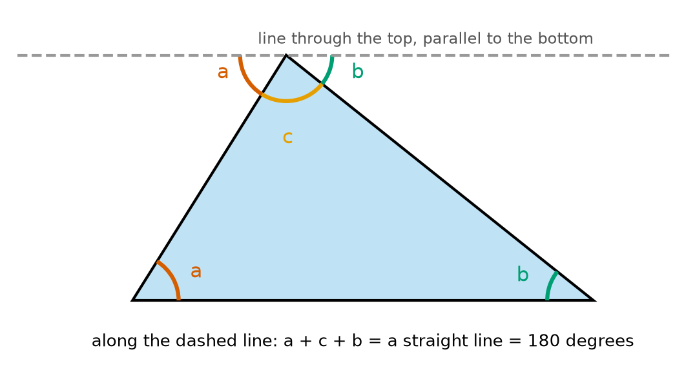
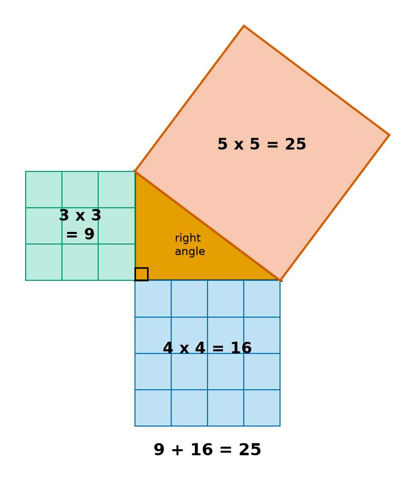
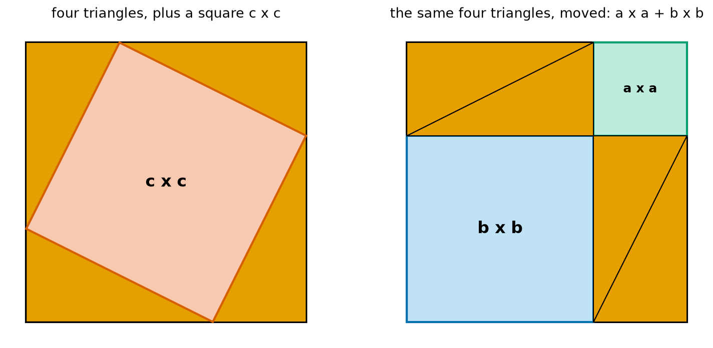
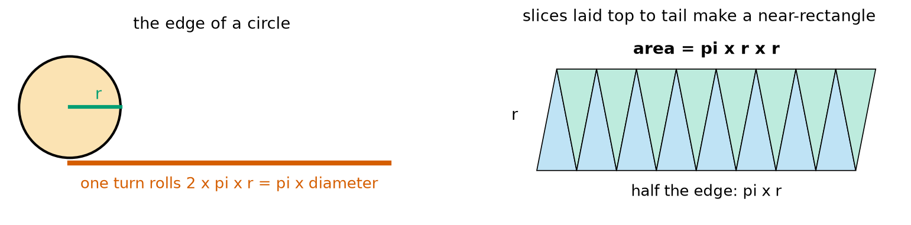
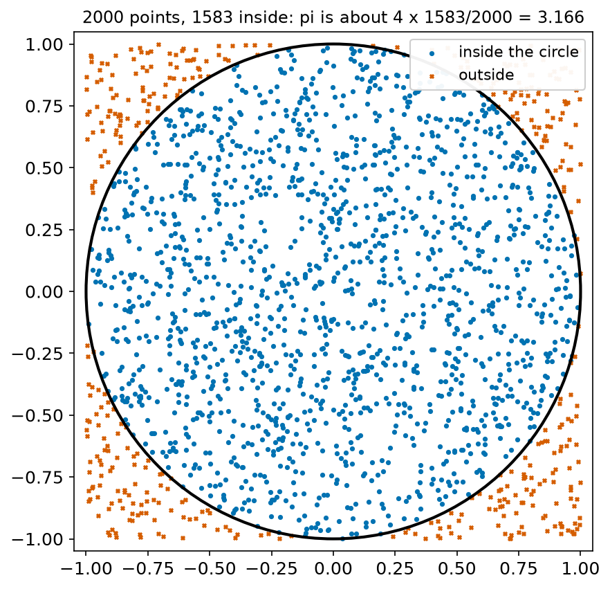
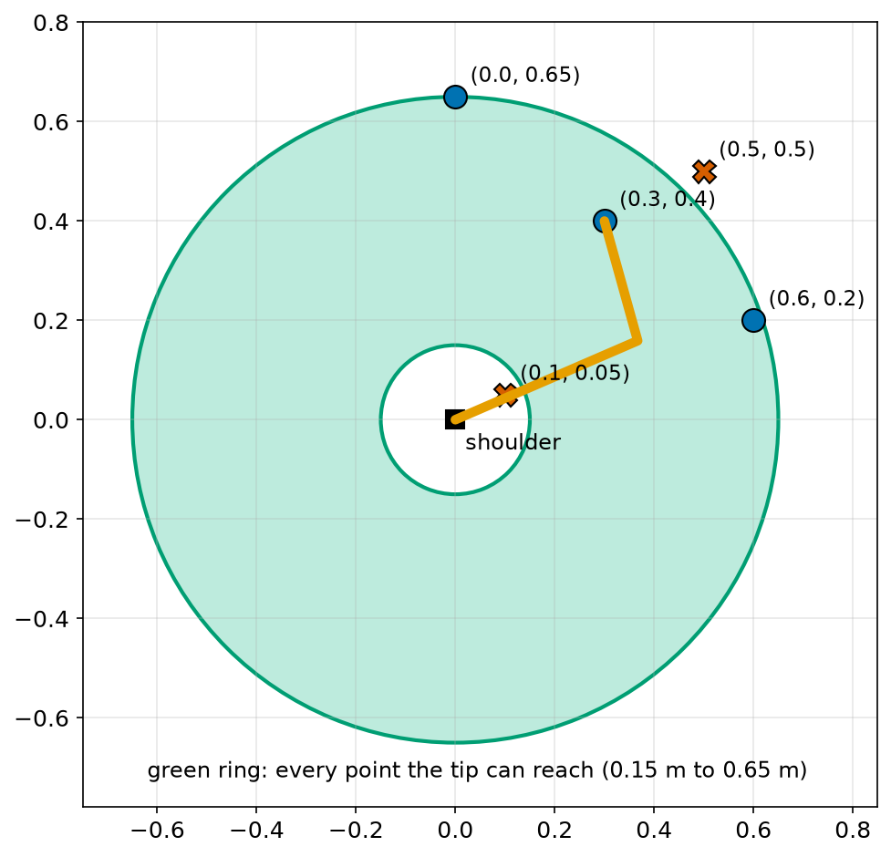
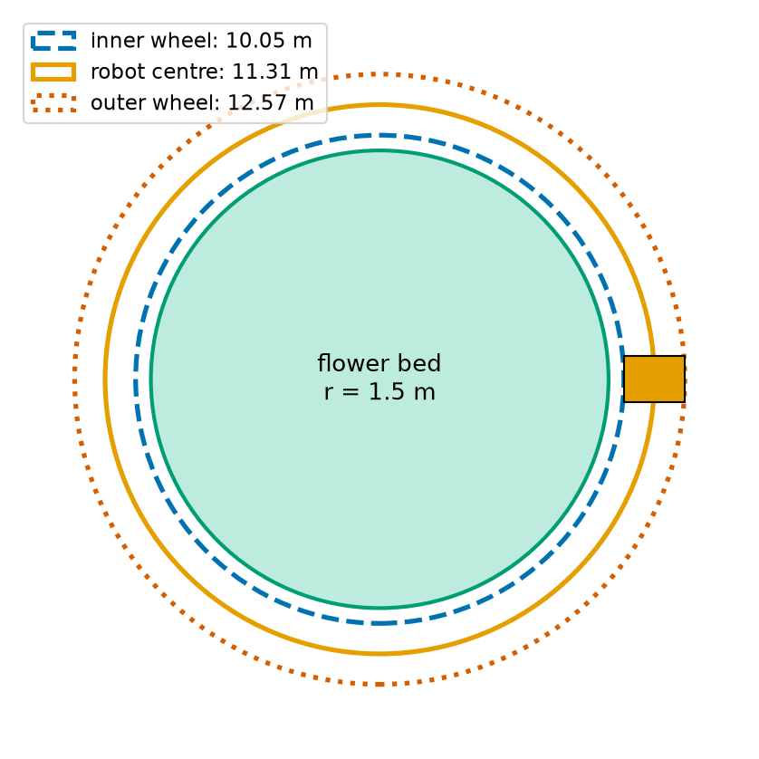

# Chapter 48 — Geometry: Triangles, Pythagoras, Circles

> **Part 3 · Chapter 48 of 749**
> **You need:** Chapter 38 (squares and roots), Chapter 42 (coordinates) and Chapter 47 (angles).
> **You will make:** a distance function for 2D and 3D, a program that estimates π by throwing random points, a reach checker for a robot arm, and a plan for a mower driving round a flower bed.

---

## What you will learn

- Why the angles in every triangle add up to 180°.
- The names of different triangles, and how to find a triangle's area.
- **Pythagoras' theorem**, with two pictures that show why it is true.
- How to use it backwards to check for a right angle.
- The straight-line distance between two points, in 2D and in 3D.
- What π is, why a circle's edge is 2πr long, and why its area is πr².
- How robots use all of this for reach, safety zones and turning.

---

## New words in this chapter

| Word | Simple meaning |
|---|---|
| **triangle** | A flat shape with three straight sides. |
| **right angle** | An angle of exactly 90°, a quarter turn. |
| **right-angled triangle** | A triangle with one right angle. |
| **hypotenuse** | The longest side of a right-angled triangle, opposite the right angle. |
| **theorem** | A statement that has been proved to be always true. |
| **Pythagoras' theorem** | In a right-angled triangle, a² + b² = c², where c is the hypotenuse. |
| **circumference** | The distance all the way round a circle. |
| **diameter** | The distance straight across a circle through its centre: twice the radius. |
| **π (pi)** | Circumference ÷ diameter, the same for every circle: about 3.14159. |
| **sector** | A slice of a circle, like a slice of pizza. |
| **annulus** | A ring: the area between two circles with the same centre. |

---

## 48.1 Triangles

📖 **New word: triangle** — a flat shape with three straight sides. It also has three corners and three angles.

Triangles are everywhere in robots, because a triangle is **rigid**. Push on the corner of a square made of four sticks, and it squashes into a diamond. A triangle of three sticks cannot change shape unless a stick bends or breaks. That is why robot frames, cranes and bridges are full of triangles.

### The angles add up to 180°

Look at Figure 48.1.



*Figure 48.1 — The three angles of the triangle fit together along a straight line.*

**How to read this picture:** The dashed line goes through the top corner and is parallel to the bottom side. The angle marked a at the bottom left is the same as the angle a at the top left, because parallel lines cut by the same slanting line make equal angles. The same is true for b. At the top, a, c and b sit side by side along the dashed line, which is straight: 180°.

```
a + b + c = 180°
```

🔢 **Maths.** A triangle has angles 50° and 60°. The third angle is 180 − 50 − 60 = 70°.

### Kinds of triangle

| Name | What it has |
|---|---|
| equilateral | three equal sides, and three angles of 60° |
| isosceles | two equal sides, and two equal angles |
| scalene | no equal sides |
| right-angled | one angle of 90° |

📖 **New word: right angle** — an angle of exactly 90°. On a drawing it is marked with a small square.

### The area of a triangle

A triangle is half of a rectangle. If the base is b and the height (measured straight up from the base) is h:

```
area = ½ × b × h
```

🔢 **Maths.** A triangular plate has a base of 0.4 m and a height of 0.3 m. Its area is 0.5 × 0.4 × 0.3 = 0.06 m².

---

## 48.2 Pythagoras' theorem

📖 **New word: right-angled triangle** — a triangle with one right angle.

📖 **New word: hypotenuse** — the longest side of a right-angled triangle. It is the side opposite the right angle.

📖 **New word: theorem** — a statement that has been proved to be always true.

📖 **New word: Pythagoras' theorem** — in a right-angled triangle with shorter sides a and b, and hypotenuse c:

```
a² + b² = c²
```

In words: the square on the hypotenuse equals the sum of the squares on the other two sides. It is named after Pythagoras, a Greek thinker who lived about 2,500 years ago, although people in Babylon and India knew it even earlier.



*Figure 48.2 — A triangle with sides 3, 4 and 5, with a square on each side.*

**How to read this picture:** The orange triangle has a right angle at its bottom left corner, marked with a small square. The green square on the short side has 9 small squares. The blue square has 16. The red square on the hypotenuse has an area of 25. And 9 + 16 = 25.

### Why it is true

One example is not a proof. Here is a proof that you can see.



*Figure 48.3 — The same big square, filled in two different ways.*

**How to read this picture:** Both big squares have the same size: each side is a + b. On the left, four copies of the orange triangle sit in the corners, and the space left over is a tilted square with side c. On the right, the same four triangles have been moved into two rectangles. The space left over is now two squares: a × a and b × b.

The big squares are the same. The four triangles are the same. So the space left over must be the same:

```
c² = a² + b²
```

### Using it

🔢 **Maths.** The two shorter sides are 6 and 8. How long is the hypotenuse?

```
c² = 6² + 8² = 36 + 64 = 100
c  = √100 = 10
```

🔢 **Maths.** The hypotenuse is 13 and one side is 5. How long is the other side? Rearrange (Chapter 41):

```
b² = c² − a² = 169 − 25 = 144
b  = 12
```

⚠️ **Careful.** c must be the **hypotenuse**, the longest side. And the theorem only works for a right-angled triangle.

### Backwards: checking for a right angle

If a² + b² = c², then the triangle **must** have a right angle. Builders have used this for thousands of years: make a rope triangle with sides 3, 4 and 5 units, and the corner between 3 and 4 is a perfect right angle.

| Sides | a² + b² | c² | Right angle? |
|---|---|---|---|
| 3, 4, 5 | 25 | 25 | yes |
| 5, 12, 13 | 169 | 169 | yes |
| 4, 5, 6 | 41 | 36 | no |

---

## 48.3 Distance between two points

In Chapter 42 we found the grid distance from (1, 1) to (5, 4): 7. We promised the straight-line distance later. Now we can find it.

The change in x and the change in y are the two shorter sides of a right-angled triangle. The straight line is the hypotenuse (look back at Figure 42.2).

```
distance = √( dx² + dy² )
```

🔢 **Maths.** From (1, 1) to (5, 4): dx = 4, dy = 3.

```
distance = √(16 + 9) = √25 = 5
```

🔢 **Maths.** From Rover at (0, 0) to the goal at (2, 3), from Chapter 26: √(4 + 9) = √13 = 3.606 m. Now you know where that number came from.

The straight line is never longer than the grid route: 5 is less than 7.

### In three dimensions

For points in space, add the change in z in the same way:

```
distance = √( dx² + dy² + dz² )
```

Why? First find the distance across the floor, √(dx² + dy²). Then that, and dz, are the two shorter sides of another right-angled triangle, standing up. Using Pythagoras twice gives the formula.

🔢 **Maths.** From a box's bottom corner (0, 0, 0) to its top far corner (3, 4, 12):

```
floor diagonal = √(9 + 16) = 5
full diagonal  = √(5² + 12²) = √(25 + 144) = √169 = 13
```

Python has these built in: `math.hypot(dx, dy)` and `math.dist(a, b)`.

🤖 **Robot link.** Distance is the most used calculation in mobile robotics: to the goal, to the nearest obstacle, to every laser point. Robots often compare **squared** distances, dx² + dy², to skip the square root and save time. If a² < b², then a < b, for distances. Chapter 3's tortoise and Chapter 10's brush both did this.

---

## 48.4 Circles and π

📖 **New word: circumference** — the distance all the way round a circle.

📖 **New word: diameter** — the distance straight across a circle, through its centre. It is twice the radius: d = 2r.

Take any circle, from a coin to a wheel to a running track. Divide its circumference by its diameter. You always get the same number:

📖 **New word: π (pi)** — circumference ÷ diameter. π = 3.14159265… Its digits never end and never repeat.

So:

```
circumference = π × d = 2 × π × r
```

This is why a wheel rolls πd in one turn, as we have used since Chapter 13.



*Figure 48.4 — The edge of a circle, and its area.*

**How to read this picture:** On the left, a wheel of radius r rolls one turn and lays its edge flat on the ground: the red line is 2πr long. On the right, a circle has been cut into thin slices, like a pizza, and the slices are laid top to tail. They make a shape that is almost a rectangle. Its height is r, and its length is half of the edge, πr.

### The area of a circle

From the right side of Figure 48.4, the area of the near-rectangle is height × length:

```
area = r × πr = π r²
```

The thinner the slices, the closer the shape gets to a real rectangle, and the closer the formula is to exact.

🔢 **Maths.** A cleaning robot is a disc of radius 0.17 m. It covers π × 0.17² = 0.0908 m² of floor.

⚠️ **Careful.** Doubling the radius makes the area **four** times bigger: π(2r)² = 4πr². This is the square law from Chapter 38.

### Sectors and arcs

📖 **New word: sector** — a slice of a circle, like a slice of pizza.

A sector with angle θ (in radians, Chapter 47) is the fraction θ/(2π) of the whole circle:

```
arc length  = r θ
sector area = ½ r² θ
```

🔢 **Maths.** A sensor sees a 60° (π/3) sector out to 4 m. It covers ½ × 16 × π/3 = 8.38 m².

### Rings

📖 **New word: annulus** — a ring: the area between two circles with the same centre. Its area is the big circle minus the small one: π(R² − r²).

---

## Code

File `code/ch048/distance.py`:

```python
# distance.py - straight-line distance with Pythagoras, in 2D and 3D
import math


def distance_2d(a, b):
    dx = b[0] - a[0]
    dy = b[1] - a[1]
    return math.sqrt(dx * dx + dy * dy)


def distance_3d(a, b):
    dx = b[0] - a[0]
    dy = b[1] - a[1]
    dz = b[2] - a[2]
    return math.sqrt(dx * dx + dy * dy + dz * dz)


print("(1, 1) to (5, 4)     :", distance_2d((1, 1), (5, 4)))
print("(0, 0) to (2, 3)     :", round(distance_2d((0, 0), (2, 3)), 4))
print("math.dist agrees     :", round(math.dist((0, 0), (2, 3)), 4))
print("box corner (3, 4, 12):", distance_3d((0, 0, 0), (3, 4, 12)))
for sides in [(3, 4, 5), (5, 12, 13), (4, 5, 6)]:
    a, b, c = sides
    print(f"{sides}: right angle? {a * a + b * b == c * c}")
```

| Line | Code | What it does (simple English) |
|---|---|---|
| 1 | `# distance.py …` | A comment. |
| 2 | `import math` | For `math.sqrt` and `math.dist`. |
| 3–4 | (blank) | Spacing. |
| 5 | `def distance_2d(a, b):` | Two points, each a tuple (x, y). |
| 6 | `dx = b[0] - a[0]` | Change in x. |
| 7 | `dy = b[1] - a[1]` | Change in y. |
| 8 | `return math.sqrt(dx * dx + dy * dy)` | Pythagoras. `dx * dx` is the same as `dx ** 2`. |
| 9–10 | (blank) | Spacing. |
| 11 | `def distance_3d(a, b):` | Two points in space, (x, y, z). |
| 12–14 | `dx = …`, `dy = …`, `dz = …` | The three changes. |
| 15 | `return math.sqrt(dx * dx + dy * dy + dz * dz)` | Pythagoras in 3D. |
| 16–17 | (blank) | Spacing. |
| 18 | `print("(1, 1) to (5, 4) …")` | The example from Chapter 42. |
| 19 | `print("(0, 0) to (2, 3) …")` | The goal from Chapter 26. |
| 20 | `print("math.dist agrees …")` | Python's own version. |
| 21 | `print("box corner …")` | The 3D example. |
| 22 | `for sides in […]:` | Three triangles to test. |
| 23 | `a, b, c = sides` | Unpacks the three sides. |
| 24 | `print(f"… {a * a + b * b == c * c}")` | Checks the theorem backwards. Whole numbers, so `==` is safe. |

Output:

```
(1, 1) to (5, 4)     : 5.0
(0, 0) to (2, 3)     : 3.6056
math.dist agrees     : 3.6056
box corner (3, 4, 12): 13.0
(3, 4, 5): right angle? True
(5, 12, 13): right angle? True
(4, 5, 6): right angle? False
```

Now an unusual way to find π, using Pythagoras and random numbers (Chapter 31). Picture a square from −1 to 1 on each side, with a circle of radius 1 inside it. The square's area is 4. The circle's area is π × 1² = π. So if we throw points at random into the square, the fraction that lands inside the circle should be about π/4. A point (x, y) is inside if x² + y² ≤ 1, by Pythagoras.

File `code/ch048/estimate_pi.py`:

```python
# estimate_pi.py - throw random points at a square and count those inside the circle
import math
import random

random.seed(3)

for throws in [100, 1_000, 10_000, 100_000, 1_000_000]:
    inside = 0
    for _ in range(throws):
        x = random.uniform(-1, 1)
        y = random.uniform(-1, 1)
        if x * x + y * y <= 1:
            inside += 1
    estimate = 4 * inside / throws
    print(f"{throws:9d} throws: pi is about {estimate:.4f}  (error {abs(estimate - math.pi):.4f})")
```

| Line | Code | What it does (simple English) |
|---|---|---|
| 1 | `# estimate_pi.py …` | A comment. |
| 2 | `import math` | For `math.pi`, to measure the error. |
| 3 | `import random` | For random points. |
| 4 | (blank) | Spacing. |
| 5 | `random.seed(3)` | The same "random" numbers on every run (Chapter 31). |
| 6 | (blank) | Spacing. |
| 7 | `for throws in […]:` | Five sizes of experiment. `1_000` is just 1000 (the `_` is only for reading). |
| 8 | `inside = 0` | A counter. |
| 9 | `for _ in range(throws):` | Throws one point each time. |
| 10 | `x = random.uniform(-1, 1)` | A random x across the square. |
| 11 | `y = random.uniform(-1, 1)` | A random y. |
| 12 | `if x * x + y * y <= 1:` | Pythagoras: is the point no further than 1 from the centre? No square root is needed. |
| 13 | `inside += 1` | Counts it. |
| 14 | `estimate = 4 * inside / throws` | The fraction inside is about π/4, so we multiply by 4. |
| 15 | `print(f"…")` | The estimate and how far it is from the real π. |

Output:

```
      100 throws: pi is about 3.3200  (error 0.1784)
     1000 throws: pi is about 3.1040  (error 0.0376)
    10000 throws: pi is about 3.1444  (error 0.0028)
   100000 throws: pi is about 3.1517  (error 0.0101)
  1000000 throws: pi is about 3.1402  (error 0.0014)
```



*Figure 48.5 — 2000 random points, coloured by whether they are inside the circle.*

**How to read this picture:** The blue dots fell inside the circle, and the red crosses fell outside, in the corners of the square. About four out of five dots are blue. Four times that fraction is close to π.

More throws usually give a better answer, but not every time: with this seed, 10,000 throws happened to land closer than 100,000. Random methods improve slowly and unevenly. This is a **Monte Carlo** method (Chapter 31), and Chapter 202 uses the same idea to test robots.

---

## Small examples

**Example 1.** The angles of an equilateral triangle are 60°, 60° and 60°.

**Example 2.** A right-angled triangle has a 35° angle. The third is 180 − 90 − 35 = 55°.

**Example 3.** Sides 9 and 12 give a hypotenuse of √(81 + 144) = 15.

**Example 4.** The diagonal of a square with side 1 m is √2 = 1.414 m.

**Example 5.** From (−2, 1) to (1, 5): √(9 + 16) = 5.

**Example 6.** A wheel of diameter 0.2 m rolls 0.628 m in one turn.

**Example 7.** A circle of radius 3 has an area of 9π ≈ 28.3.

**Example 8.** A ring from r = 1 to R = 2 has an area of π(4 − 1) = 3π ≈ 9.42.

---

## 🏭 Real robot applications

### Application 1 (worked in full) — 🏭 Can the arm reach it?

**1. The real problem.** A two-link arm on a factory bench has a shoulder at (0, 0). Its first link is 0.40 m long and its second is 0.25 m. Parts arrive at various places. Before trying to move, the controller must know: can the tip reach this point at all?

**2. Why this theory.** The tip's distance from the shoulder is a straight-line distance, by Pythagoras. The furthest the tip can reach is with the arm straight out: 0.40 + 0.25. The nearest is with the elbow folded right back: 0.40 − 0.25. Every distance in between is possible. So the reachable area is a ring, an annulus.

**3. The numbers.** Links of 0.40 m and 0.25 m. Five targets: (0.30, 0.40), (0.60, 0.20), (0.10, 0.05), (0.0, 0.65) and (0.5, 0.5), in metres.

**4. The maths.**

```
furthest = 0.40 + 0.25 = 0.65 m
nearest  = |0.40 − 0.25| = 0.15 m
ring area = π (0.65² − 0.15²) = π (0.4225 − 0.0225) = 0.4π = 1.257 m²

Target (0.3, 0.4):  d = √(0.09 + 0.16) = 0.5    → between 0.15 and 0.65: reachable
Target (0.5, 0.5):  d = √(0.25 + 0.25) = 0.707  → more than 0.65: not reachable
```

**5. The code.** File `code/ch048/arm_reach.py`:

```python
# arm_reach.py - can a two-link arm reach this point?
import math

UPPER_M = 0.40      # first link
FORE_M = 0.25       # second link

nearest = abs(UPPER_M - FORE_M)
furthest = UPPER_M + FORE_M
print(f"reachable ring: from {nearest:.2f} m to {furthest:.2f} m from the shoulder")
print(f"area the tip can reach: {math.pi * (furthest ** 2 - nearest ** 2):.3f} m^2")

for target in [(0.30, 0.40), (0.60, 0.20), (0.10, 0.05), (0.0, 0.65), (0.5, 0.5)]:
    d = math.dist((0, 0), target)
    ok = nearest <= d <= furthest
    print(f"target {target}: distance {d:.3f} m -> {'reachable' if ok else 'NOT reachable'}")
```

| Line | Code | What it does (simple English) |
|---|---|---|
| 1 | `# arm_reach.py …` | A comment. |
| 2 | `import math` | For `math.pi` and `math.dist`. |
| 3 | (blank) | Spacing. |
| 4 | `UPPER_M = 0.40` | First link length. |
| 5 | `FORE_M = 0.25` | Second link length. |
| 6 | (blank) | Spacing. |
| 7 | `nearest = abs(UPPER_M - FORE_M)` | Elbow folded back. `abs` handles links in either order. |
| 8 | `furthest = UPPER_M + FORE_M` | Arm straight. |
| 9 | `print(f"reachable ring: …")` | Shows the ring. |
| 10 | `print(f"area …")` | π(R² − r²). |
| 11 | (blank) | Spacing. |
| 12 | `for target in […]:` | Five targets. |
| 13 | `d = math.dist((0, 0), target)` | Distance from the shoulder. |
| 14 | `ok = nearest <= d <= furthest` | Inside the ring? (A chained comparison, Chapter 17.) |
| 15 | `print(f"…")` | Shows the answer. |

Output:

```
reachable ring: from 0.15 m to 0.65 m from the shoulder
area the tip can reach: 1.257 m^2
target (0.3, 0.4): distance 0.500 m -> reachable
target (0.6, 0.2): distance 0.632 m -> reachable
target (0.1, 0.05): distance 0.112 m -> NOT reachable
target (0.0, 0.65): distance 0.650 m -> reachable
target (0.5, 0.5): distance 0.707 m -> NOT reachable
```



*Figure 48.6 — The tip can reach every point in the green ring, and no other point.*

**How to read this picture:** The black square is the shoulder. The green ring is everywhere the tip can reach. Blue dots are reachable targets, and red crosses are not. One target is too far away, and one is too close to the shoulder. The orange lines show the arm reaching (0.3, 0.4).

**6. The result.** The controller now rejects impossible targets at once, instead of trying to move and failing. The target (0.0, 0.65) is exactly on the outer edge: the arm can only reach it fully stretched, which is a weak and risky pose (Chapter 359 explains why). Real code usually keeps a small margin from both edges.

**7. Going further.** The ring is the arm's **workspace** (Chapter 335). Real joints have angle limits, which cut slices out of the ring. Chapter 351 finds the actual joint angles needed to reach a point, using the law of cosines from Chapter 51.

### Application 2 (worked in full) — 🌱 A mower round a flower bed

**1. The real problem.** A garden robot must mow neatly round a round flower bed, keeping its centre 0.30 m from the edge. Its two wheels are 0.40 m apart. How far does each wheel travel in one lap, and how much faster must the outer wheel turn?

**2. Why this theory.** Each wheel follows its own circle round the same centre. Circumference = 2πr gives each distance. The wheel turns come from the wheel's own circumference.

**3. The numbers.** The bed has a radius of 1.5 m. The robot's centre is 0.30 m outside the bed. The wheels are 0.40 m apart and have a radius of 0.10 m.

**4. The maths.**

```
Robot centre path:   r = 1.5 + 0.3 = 1.8 m       → 2π × 1.8 = 11.310 m
Inner wheel:         r = 1.8 − 0.2 = 1.6 m       → 2π × 1.6 = 10.053 m
Outer wheel:         r = 1.8 + 0.2 = 2.0 m       → 2π × 2.0 = 12.566 m

Wheel circumference: 2π × 0.10 = 0.6283 m
Inner wheel turns:   10.053 / 0.6283 = 16.00
Outer wheel turns:   12.566 / 0.6283 = 20.00
Ratio of speeds:     2.0 / 1.6 = 1.25
```

The 2π cancels in the ratio: the speeds are simply in the ratio of the radii.

**5. The code.** File `code/ch048/flower_bed.py`:

```python
# flower_bed.py - a mower drives once round a round flower bed: how far does each wheel go?
import math

BED_RADIUS_M = 1.5          # the flower bed
GAP_M = 0.30                # from the bed edge to the robot's centre
TRACK_M = 0.40              # distance between the mower's wheels
WHEEL_RADIUS_M = 0.10

path_radius = BED_RADIUS_M + GAP_M
inner = path_radius - TRACK_M / 2
outer = path_radius + TRACK_M / 2

for name, r in [("centre", path_radius), ("inner wheel", inner), ("outer wheel", outer)]:
    length = 2 * math.pi * r
    turns = length / (2 * math.pi * WHEEL_RADIUS_M)
    print(f"{name:12s}: circle radius {r:.2f} m, distance {length:.3f} m, wheel turns {turns:.2f}")

print(f"outer wheel must go {outer / inner:.3f} times as fast as the inner wheel")
print(f"area of the bed: {math.pi * BED_RADIUS_M ** 2:.2f} m^2")
```

| Line | Code | What it does (simple English) |
|---|---|---|
| 1 | `# flower_bed.py …` | A comment. |
| 2 | `import math` | For `math.pi`. |
| 3 | (blank) | Spacing. |
| 4–7 | `BED_RADIUS_M = 1.5` and so on | The sizes, in metres. |
| 8 | (blank) | Spacing. |
| 9 | `path_radius = BED_RADIUS_M + GAP_M` | The robot's centre path. |
| 10 | `inner = path_radius - TRACK_M / 2` | Half the track width inside. |
| 11 | `outer = path_radius + TRACK_M / 2` | Half the track width outside. |
| 12 | (blank) | Spacing. |
| 13 | `for name, r in […]:` | The three circles. |
| 14 | `length = 2 * math.pi * r` | Circumference. |
| 15 | `turns = length / (2 * math.pi * WHEEL_RADIUS_M)` | Distance ÷ distance per wheel turn. |
| 16 | `print(f"{name:12s}: …")` | `12s` pads the name to 12 characters. |
| 17 | (blank) | Spacing. |
| 18 | `print(f"outer wheel must go …")` | The ratio of the radii. |
| 19 | `print(f"area of the bed: …")` | πr². |

Output:

```
centre      : circle radius 1.80 m, distance 11.310 m, wheel turns 18.00
inner wheel : circle radius 1.60 m, distance 10.053 m, wheel turns 16.00
outer wheel : circle radius 2.00 m, distance 12.566 m, wheel turns 20.00
outer wheel must go 1.250 times as fast as the inner wheel
area of the bed: 7.07 m^2
```



*Figure 48.7 — Each wheel follows its own circle.*

**How to read this picture:** The green circle is the flower bed. The orange box is the mower. The blue dashed circle is the inner wheel's path, the orange circle is the centre's path, and the red dotted circle is the outer wheel's path. The outer one is 2.5 m longer than the inner one.

**6. The result.** If both wheels turned at the same speed, the mower would drive straight and leave the bed. With the outer wheel turning 1.25 times as fast, it follows the edge exactly. The numbers also check the encoders: after one lap, the encoders should report 16 and 20 turns. A difference tells the robot that a wheel slipped.

**7. Going further.** Chapter 285 turns this into general formulas for any turn, linking the two wheel speeds to the robot's speed and turn rate, as in Chapter 46. Real mowers follow curved edges of any shape, which needs path tracking (Chapter 300).

### Application 3 — 🚁 Bigger propellers

Thrust depends strongly on the area of the disc that a propeller sweeps (Chapter 617). A 7-inch propeller sweeps π × 3.5² = 38.5 square inches. A 5-inch propeller sweeps π × 2.5² = 19.6 square inches. The bigger one sweeps (7/5)² = 1.96 times the area, almost double, though it is only 40% wider. This is why heavy-lifting drones use large propellers.

### Application 4 — 🏗️ A layout robot checks a right angle

On building sites, layout robots drive over the floor and draw where walls will go. To check that two drawn walls meet at a right angle, the robot measures 3 m along one wall from the corner, 4 m along the other, and the distance between those two points. If it is 5.000 m, the corner is square. A distance of 5.010 m means the angle is a little more than 90°. The same 3-4-5 rule that ancient builders used with knotted rope.

### Application 5 — 🏥 A hospital robot's safety circle

A hospital delivery robot slows down if any person is within 1.2 m of its centre, and stops within 0.5 m. Its laser gives points (x, y). For each point, it compares x² + y² with 1.2² = 1.44 and 0.5² = 0.25, with no square root needed. The slow-down zone is a ring of area π(1.44 − 0.25) = 3.74 m². In busy corridors, a smaller ring lets the robot keep moving, but a ring that is too small is unsafe. Safety rules decide these sizes (Chapter 744).

---

## 🔧 Hands-on lab

### Lab 48.1 — Measure π (hardware)

You need three round things of different sizes (a cup, a plate, a bucket), string and a ruler.

1. Wrap the string once round each object, and measure the length: the circumference.
2. Measure the diameter of each, straight across the middle.
3. Divide each circumference by its diameter.

**What you should see:** Each answer is close to 3.14, whatever the size. Answers between 3.0 and 3.3 are normal for string and ruler.

| If it does not work | Likely cause | Fix |
|---|---|---|
| The answer is near 6.3 | You measured the radius, not the diameter | Measure right across |
| The answer is near 3.5 or more | The string overlapped itself | Mark where it meets, then measure only to the mark |

**Challenge:** Roll a toy car wheel along the floor for exactly 10 turns, measure the distance, and use it to find the wheel's diameter.

### Lab 48.2 — A 3-4-5 corner (hardware)

1. On the floor, use tape to mark a corner where two walls, or two tiles, meet.
2. Mark 30 cm along one edge and 40 cm along the other.
3. Measure the distance between the two marks.

**What you should see:** 50 cm, if the corner is square. A few millimetres more or less tells you the corner is not quite 90°.

| If it does not work | Likely cause | Fix |
|---|---|---|
| Far from 50 cm | Measured from the wrong point | Both 30 and 40 must start at the corner itself |

**Challenge:** Use the distance you measured with the law of cosines (Chapter 51) to find the actual angle of the corner.

### Lab 48.3 — Change the arm (simulation)

Copy `arm_reach.py`.

1. Make both links 0.30 m long.
2. Then try links of 0.50 m and 0.10 m.
3. Plot the ring with matplotlib, and add the targets.

**What you should see:** With equal links, the nearest distance is 0: the tip can reach right back to the shoulder, and the reachable area is a full disc, π × 0.6² = 1.131 m². (0.5, 0.5) is still out of reach. With 0.50 and 0.10, the ring is from 0.40 to 0.60 m: a thin ring, so most targets fail.

| If it does not work | Likely cause | Fix |
|---|---|---|
| A negative nearest distance | `abs` was removed | Keep `abs(UPPER_M - FORE_M)` |

**Challenge:** Add a third link of 0.10 m. What is the new nearest and furthest distance? (Be careful: the nearest is not always a simple subtraction.)

---

## Common mistakes

⚠️ **Using Pythagoras on a triangle with no right angle.**

⚠️ **Putting the hypotenuse in the wrong place.** c is the longest side, alone on one side of the equals sign.

⚠️ **Adding the lengths instead of the squares.** √(3² + 4²) is 5, not 7.

⚠️ **Writing √(a² + b²) = a + b.** That is the mistake from Chapter 38.

⚠️ **Mixing up radius and diameter.** Circumference is πd, or 2πr.

⚠️ **Forgetting that area grows with the square.** Twice the radius, four times the area.

⚠️ **Taking square roots you do not need.** To compare distances, compare the squares.

---

## Practice

🏋️ **1.** Two angles of a triangle are 50° and 60°. Find the third.

🏋️ **2.** A right-angled triangle has shorter sides 6 and 8. Find the hypotenuse.

🏋️ **3.** The hypotenuse is 13 and one side is 5. Find the other side.

🏋️ **4.** Find the distance from (−1, 2) to (5, 10).

🏋️ **5.** Find the distance from (0, 0, 0) to (2, 3, 6).

🏋️ **6.** Is a triangle with sides 7, 24 and 25 right-angled?

🏋️ **7.** A wheel has a diameter of 0.1 m. How far does it roll in one turn? How many turns for 10 m?

🏋️ **8.** A cleaning robot has a radius of 0.17 m. What area does it cover when standing still?

🏋️ **9.** A sector of a circle of radius 2 m has an angle of 90°. Find its arc length and area.

🏋️ **10.** An arm has two links of 0.3 m. Can it reach (0.5, 0.5)?

🏋️ **11.** Write `nearest_obstacle(points, radius)` which returns the closest laser point and whether it is inside the safety radius. Test it with points (1.2, 0.4), (0.3, −0.35) and (2, 2), and a radius of 0.5 m.

---

## Answers

**1.** 180 − 50 − 60 = 70°.

**2.** √(36 + 64) = √100 = 10.

**3.** √(169 − 25) = √144 = 12.

**4.** dx = 6, dy = 8, so √(36 + 64) = 10.

**5.** √(4 + 9 + 36) = √49 = 7.

**6.** 49 + 576 = 625 = 25². Yes.

**7.** π × 0.1 = 0.314 m. 10 ÷ 0.314 = 31.8 turns.

**8.** π × 0.17² = 0.0908 m².

**9.** 90° = π/2 rad. Arc = 2 × π/2 = π ≈ 3.14 m. Area = ½ × 4 × π/2 = π ≈ 3.14 m².

**10.** It can reach up to 0.6 m. The distance to (0.5, 0.5) is 0.707 m. No.

**11.**

```python
import math

def nearest_obstacle(points, radius):
    closest = min(points, key=lambda p: p[0] ** 2 + p[1] ** 2)
    d = math.hypot(closest[0], closest[1])
    return closest, d, d <= radius

print(nearest_obstacle([(1.2, 0.4), (0.3, -0.35), (2, 2)], 0.5))
```

The closest point is (0.3, −0.35), at 0.461 m, which is inside 0.5 m: the robot must stop. `min` compares squared distances, and only the winner needs a square root.

---

## Summary

🧠 The angles of a triangle always add up to 180°.

🧠 A triangle's area is ½ × base × height.

🧠 In a right-angled triangle, a² + b² = c², with c the hypotenuse. If a² + b² = c², the angle is a right angle.

🧠 The straight-line distance is √(dx² + dy²), or √(dx² + dy² + dz²) in 3D.

🧠 π = circumference ÷ diameter ≈ 3.14159.

🧠 Circumference = 2πr. Area = πr². Arc = rθ. Sector area = ½r²θ.

🧠 To compare distances quickly, compare the squares and skip the square root.

---

## Next chapter

In Chapter 49 we use right-angled triangles in a new way: **sin, cos and tan**. They link a triangle's angles to its sides, and they let a robot turn an angle and a distance into x and y.
