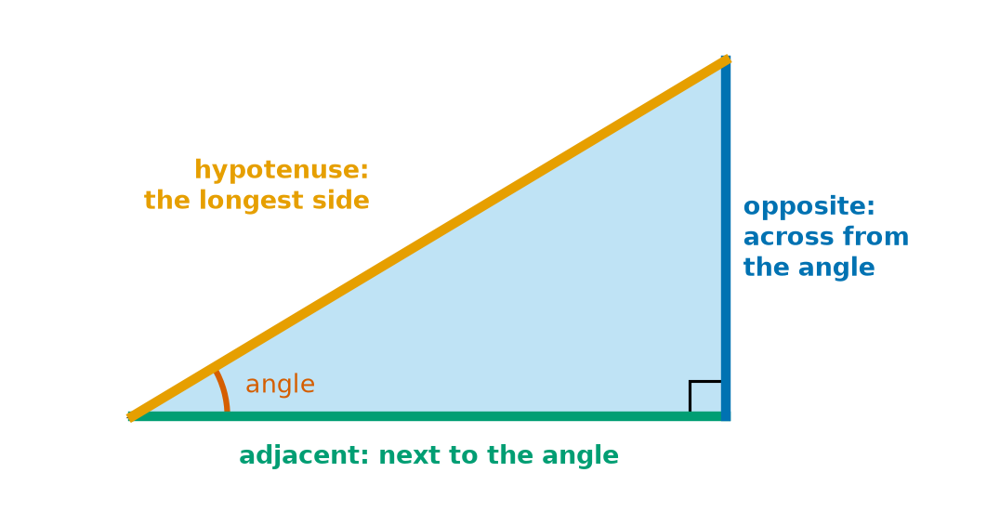
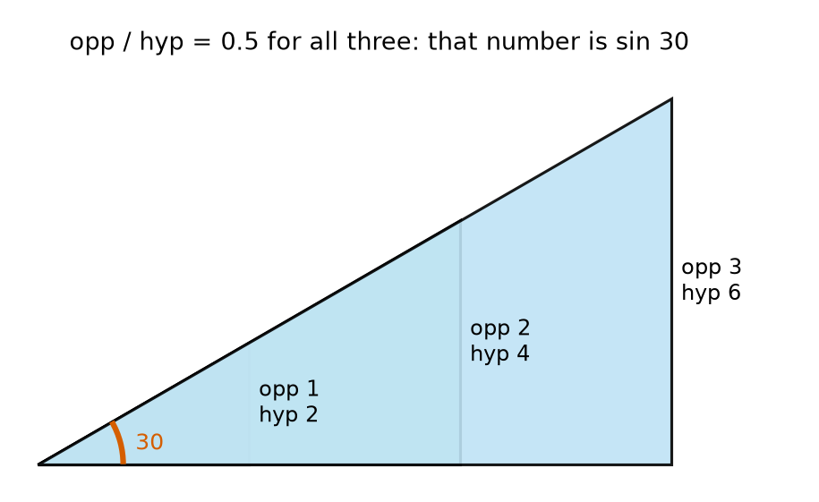
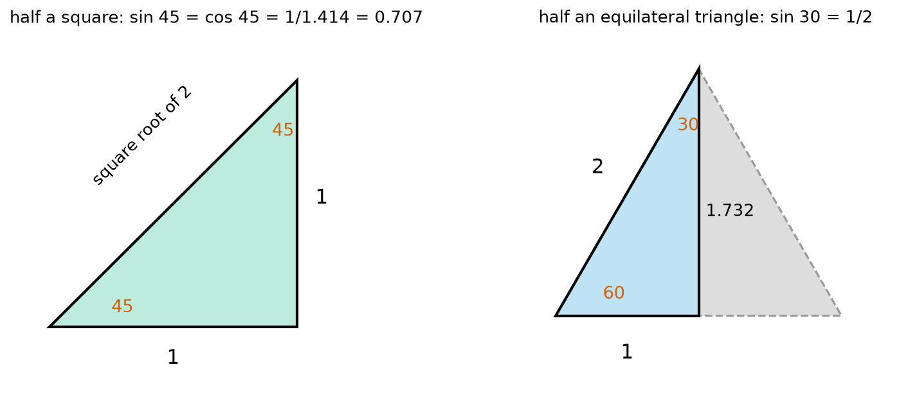
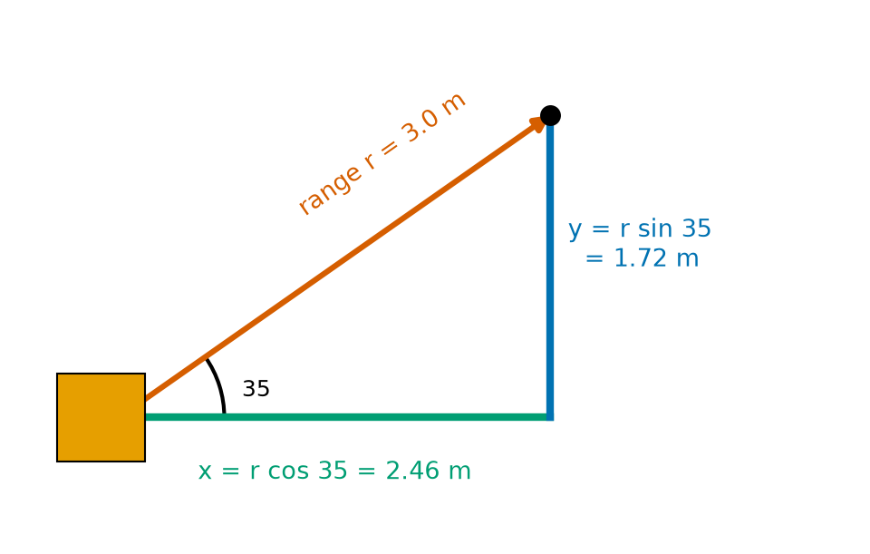
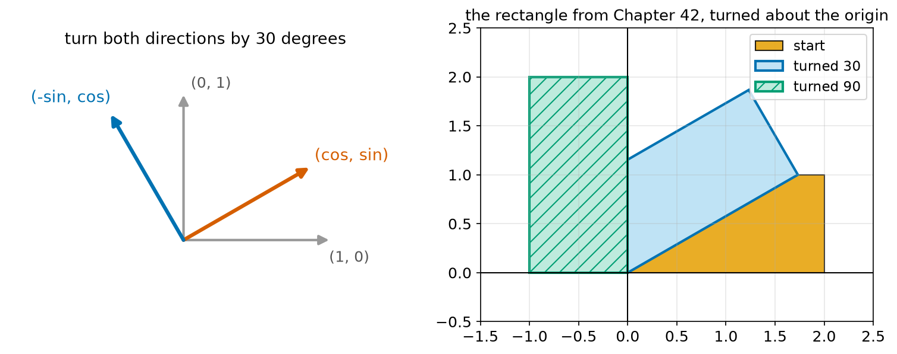
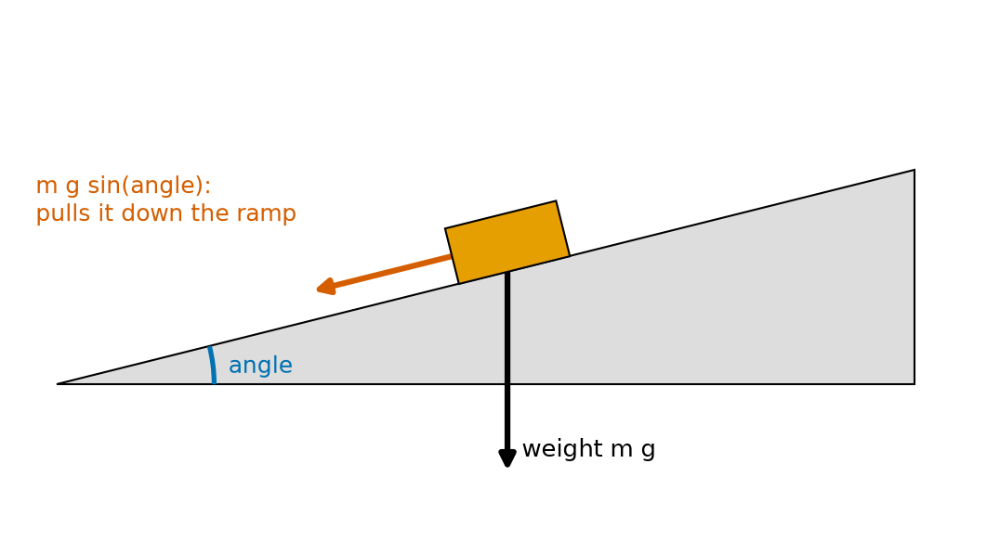
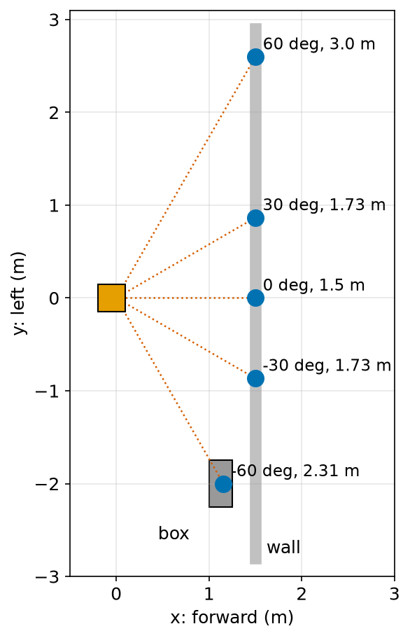

# Chapter 49 — Trigonometry Part 1: sin, cos, tan in Right Triangles

> **Part 3 · Chapter 49 of 749**
> **You need:** Chapter 47 (angles and radians) and Chapter 48 (Pythagoras). A phone with a spirit-level app helps.
> **You will make:** a program that shows why sin, cos and tan exist, a slope-to-angle converter, a shape rotator, a laser-scan converter, and a check of whether a robot can climb a ramp.

---

## What you will learn

- The names of the sides of a right-angled triangle, seen from one angle.
- What **sine**, **cosine** and **tangent** are, and why they depend only on the angle.
- The exact values for 30°, 45° and 60°.
- How to find a missing side from one side and an angle.
- How to find an angle from two sides, with **asin**, **acos** and **atan**.
- How to turn a distance and an angle into x and y.
- How to rotate a point or a shape about the origin.
- How to measure a real ramp angle with a phone, and check it in Python.

---

## New words in this chapter

| Word | Simple meaning |
|---|---|
| **trigonometry** | The maths of triangles: how their sides and angles are linked. |
| **opposite** | The side across from the angle we are looking at. |
| **adjacent** | The side next to the angle that is not the hypotenuse. |
| **sine (sin)** | opposite ÷ hypotenuse. |
| **cosine (cos)** | adjacent ÷ hypotenuse. |
| **tangent (tan)** | opposite ÷ adjacent. |
| **similar triangles** | Triangles with the same angles but different sizes. |
| **inverse trig functions** | asin, acos and atan: they give back the angle from a ratio. |
| **polar coordinates** | Describing a point by its distance and angle, (r, θ). |
| **component** | The part of an arrow that points along x, or along y. |

---

## 49.1 Naming the sides

📖 **New word: trigonometry** — the maths of triangles: how their sides and angles are linked. The name comes from Greek words for "triangle" and "measure".

In Chapter 48 we named the longest side of a right-angled triangle the hypotenuse. Now we pick one of the other two angles, and name the other sides **from its point of view**.



*Figure 49.1 — The sides, named from the angle marked in red.*

**How to read this picture:** The red arc marks the angle we are interested in. The orange side is the hypotenuse, opposite the right angle (the small square). The blue side is across the triangle from the red angle: the **opposite** side. The green side touches the red angle and is not the hypotenuse: the **adjacent** side.

📖 **New word: opposite** — the side across from the angle.

📖 **New word: adjacent** — the side next to the angle that is not the hypotenuse.

⚠️ **Careful.** "Opposite" and "adjacent" change if you look from the other angle. The hypotenuse never changes.

---

## 49.2 Three ratios

Here is the key discovery. Look at Figure 49.2.



*Figure 49.2 — Three right-angled triangles with the same 30° angle.*

**How to read this picture:** Three triangles share the same 30° corner at the left. They are different sizes. For each one, the opposite side is exactly half of the hypotenuse: 1 of 2, 2 of 4, 3 of 6.

📖 **New word: similar triangles** — triangles with the same angles but different sizes. One is just a scaled copy of the other (Chapter 42), so every side is scaled by the same factor, and **the ratios between sides stay the same**.

So for a right-angled triangle, the ratios depend only on the angle. They are so useful that they have names.

📖 **New word: sine** —

```
sin(angle) = opposite / hypotenuse
```

📖 **New word: cosine** —

```
cos(angle) = adjacent / hypotenuse
```

📖 **New word: tangent** —

```
tan(angle) = opposite / adjacent
```

Many people remember them with the made-up word **SOH-CAH-TOA**: **S**ine = **O**pposite over **H**ypotenuse, **C**osine = **A**djacent over **H**ypotenuse, **T**angent = **O**pposite over **A**djacent.

🔢 **Maths.** A triangle has sides 5, 12 and 13, and we look from the angle opposite the side 5.

```
sin = 5/13  = 0.385
cos = 12/13 = 0.923
tan = 5/12  = 0.417
```

### Two useful facts

**Fact 1.** tan = sin ÷ cos, because (opp/hyp) ÷ (adj/hyp) = opp/adj.

**Fact 2.** sin² + cos² = 1, for every angle. This is Pythagoras in disguise:

```
sin² + cos² = (opp/hyp)² + (adj/hyp)² = (opp² + adj²)/hyp² = hyp²/hyp² = 1
```

### Range of values

The hypotenuse is the longest side, so sin and cos are always between 0 and 1 in a right-angled triangle (Chapter 50 extends this to −1 to 1). tan can be any size: as the angle gets close to 90°, the adjacent side shrinks to nothing, and tan grows without end.

---

## 49.3 Three angles worth knowing exactly



*Figure 49.3 — The exact values come from half a square and half an equilateral triangle.*

**How to read this picture:** On the left, a square with side 1 is cut along its diagonal, which is √2 long by Pythagoras. Both angles are 45°. On the right, an equilateral triangle with side 2 is cut in half. The bottom becomes 1, the angles are 30°, 60° and 90°, and the height is √(4 − 1) = √3 ≈ 1.732.

| Angle | sin | cos | tan |
|---|---|---|---|
| 0° | 0 | 1 | 0 |
| 30° | 1/2 = 0.5 | √3/2 ≈ 0.866 | 1/√3 ≈ 0.577 |
| 45° | 1/√2 ≈ 0.707 | 1/√2 ≈ 0.707 | 1 |
| 60° | √3/2 ≈ 0.866 | 1/2 = 0.5 | √3 ≈ 1.732 |
| 90° | 1 | 0 | no value |

Notice that sin 30° = cos 60°. In general, sin(a) = cos(90° − a), because the opposite side of one angle is the adjacent side of the other.

🤖 **Robot link.** Chapter 3 used cos 30° ≈ 0.866 and sin 30° = 0.5 to place a robot's sensor. Now you know where those numbers come from.

---

## 49.4 Finding a missing side

Choose the ratio that links the side you **know** and the side you **want**. Then rearrange (Chapter 41).

🔢 **Maths.** The hypotenuse is 10 and the angle is 30°. Find the opposite side.

```
sin 30 = opp / 10
opp = 10 × sin 30 = 10 × 0.5 = 5
```

🔢 **Maths.** The adjacent side is 4 and the angle is 60°. Find the opposite side.

```
tan 60 = opp / 4
opp = 4 × tan 60 = 4 × 1.732 = 6.93
```

🔢 **Maths.** A ladder 3 m long leans at 70° to the ground. How high does it reach?

```
height = 3 × sin 70 = 3 × 0.940 = 2.82 m
the foot is 3 × cos 70 = 3 × 0.342 = 1.03 m from the wall
```

In Python, remember radians: `3 * math.sin(math.radians(70))`.

---

## 49.5 Finding an angle

📖 **New word: inverse trig functions** — asin, acos and atan. They take a ratio and give back the angle. Some calculators write them sin⁻¹, cos⁻¹ and tan⁻¹ (like f⁻¹ in Chapter 44, this does not mean 1/sin).

```
angle = atan(opposite / adjacent)
angle = asin(opposite / hypotenuse)
angle = acos(adjacent / hypotenuse)
```

In Python they are `math.atan`, `math.asin` and `math.acos`, and they return **radians**.

🔢 **Maths.** A ramp rises 0.3 m over a run of 4 m.

```
angle = atan(0.3 / 4) = atan(0.075) = 0.0749 rad = 4.29°
```

### From a slope to an angle

Chapter 43 gave slopes as a ratio or a percentage. A slope m is rise ÷ run, which is exactly the tangent of the angle:

```
angle = atan(m)
```

| Slope | Angle |
|---|---|
| 5% | 2.86° |
| 8.33% (1:12) | 4.76° |
| 10% | 5.71° |
| 100% | 45° |

⚠️ **Careful.** A 100% slope is 45°, not 90°. It rises 1 for every 1 across.

⚠️ **Careful.** `math.asin` and `math.acos` only accept values from −1 to 1. A sensor value slightly above 1 because of noise gives a `ValueError`. Robot code often clips the value first (Chapter 44).

---

## 49.6 From distance and angle to x and y

A laser sensor reports: "something at 3.0 m, at 35° to the left". Where is it, in x and y?

📖 **New word: polar coordinates** — describing a point by its distance r and its angle θ from the x axis, written (r, θ). x and y are then called **Cartesian coordinates**, after Descartes (Chapter 42).



*Figure 49.4 — The beam is the hypotenuse. x and y are the other two sides.*

**How to read this picture:** The orange box is the robot. The red arrow is the laser beam, 3 m long at 35°. The green line is how far the point is forward, x. The blue line is how far it is to the left, y. Together they form a right-angled triangle.

```
x = r cos θ
y = r sin θ
```

🔢 **Maths.** r = 3.0 m, θ = 35°: x = 3 × 0.819 = 2.46 m, y = 3 × 0.574 = 1.72 m.

📖 **New word: component** — the part of an arrow that points along x, or along y. x and y here are the components of the beam.

Going back, from (x, y) to (r, θ): r = √(x² + y²) by Pythagoras, and θ = atan(y/x). But atan alone cannot tell (1, 1) from (−1, −1), because y/x is 1 for both. Chapter 50 fixes this with `atan2`.

---

## 49.7 Turning a point

In Chapter 42 we could slide, flip and scale a shape, and turning had to wait. Now we can do it.

Here is the idea. Every point (x, y) is "x steps along the x direction, plus y steps along the y direction". To turn the whole picture by an angle θ, we turn those two directions, and keep the same number of steps.



*Figure 49.5 — Turn the two directions, and every point turns with them.*

**How to read this picture:** On the left, the grey arrows are the x direction (1, 0) and the y direction (0, 1). Turned by 30°, the x direction becomes the red arrow (cos θ, sin θ), by section 49.6 with r = 1. The y direction is 90° further round: the blue arrow (−sin θ, cos θ). On the right, the rectangle of Chapter 42 has been turned by 30° and by 90°.

So the point x × (1, 0) + y × (0, 1) becomes x × (cos θ, sin θ) + y × (−sin θ, cos θ):

```
x_new = x cos θ − y sin θ
y_new = x sin θ + y cos θ
```

This turns a point anticlockwise about the origin by θ. Chapter 167 writes the same rule as a matrix, the **rotation matrix** you used with NumPy in Chapter 35.

🔢 **Maths.** Turn (3, 4) by 90°: cos 90 = 0, sin 90 = 1.

```
x_new = 3 × 0 − 4 × 1 = −4
y_new = 3 × 1 + 4 × 0 = 3
```

The point (3, 4) goes to (−4, 3). Its distance from the origin is still 5. Turning never changes distances.

---

## Code

File `code/ch049/trig_ratios.py`:

```python
# trig_ratios.py - the ratios of a right-angled triangle depend only on its angle
import math

print("A 30-degree triangle drawn at three sizes:")
for hyp in [1.0, 2.5, 10.0]:
    opp = hyp * math.sin(math.radians(30))
    adj = hyp * math.cos(math.radians(30))
    print(f"  hyp {hyp:5.1f}  opp {opp:6.3f}  adj {adj:6.3f}   "
          f"opp/hyp {opp / hyp:.3f}  adj/hyp {adj / hyp:.3f}  opp/adj {opp / adj:.3f}")

print()
print("angle    sin      cos      tan")
for deg in [0, 30, 45, 60, 89, 90]:
    r = math.radians(deg)
    tan_text = "too big" if deg == 90 else f"{math.tan(r):8.3f}"
    print(f"{deg:5d} {math.sin(r):8.3f} {math.cos(r):8.3f} {tan_text:>8}")
```

| Line | Code | What it does (simple English) |
|---|---|---|
| 1 | `# trig_ratios.py …` | A comment. |
| 2 | `import math` | For sin, cos, tan and radians. |
| 3 | (blank) | Spacing. |
| 4 | `print("A 30-degree triangle …")` | A heading. |
| 5 | `for hyp in [1.0, 2.5, 10.0]:` | Three sizes of the same triangle. |
| 6 | `opp = hyp * math.sin(math.radians(30))` | Opposite = hyp × sin. |
| 7 | `adj = hyp * math.cos(math.radians(30))` | Adjacent = hyp × cos. |
| 8–9 | `print(f"…" f"…")` | Two strings next to each other are joined into one (Chapter 15). Shows the sides and the three ratios. |
| 10 | (blank) | Spacing. |
| 11 | `print()` | An empty line. |
| 12 | `print("angle    sin …")` | The heading of the table. |
| 13 | `for deg in [0, 30, 45, 60, 89, 90]:` | Some angles, including two awkward ones. |
| 14 | `r = math.radians(deg)` | Convert first (Chapter 47). |
| 15 | `tan_text = "too big" if deg == 90 else …` | tan 90° has no value. |
| 16 | `print(f"…{tan_text:>8}")` | `>8` lines the text up on the right. |

Output:

```
A 30-degree triangle drawn at three sizes:
  hyp   1.0  opp  0.500  adj  0.866   opp/hyp 0.500  adj/hyp 0.866  opp/adj 0.577
  hyp   2.5  opp  1.250  adj  2.165   opp/hyp 0.500  adj/hyp 0.866  opp/adj 0.577
  hyp  10.0  opp  5.000  adj  8.660   opp/hyp 0.500  adj/hyp 0.866  opp/adj 0.577

angle    sin      cos      tan
    0    0.000    1.000    0.000
   30    0.500    0.866    0.577
   45    0.707    0.707    1.000
   60    0.866    0.500    1.732
   89    1.000    0.017   57.290
   90    1.000    0.000  too big
```

The sides change size, but the ratios do not. At 89°, tan is already 57.29: the opposite side is 57 times the adjacent side.

File `code/ch049/find_angle.py`:

```python
# find_angle.py - from two sides back to the angle, with asin, acos and atan
import math

rise = 0.30
run = 4.00
length = math.hypot(rise, run)

print(f"ramp: rise {rise} m, run {run} m, sloping length {length:.4f} m")
print(f"from tan: {math.degrees(math.atan(rise / run)):.3f} degrees")
print(f"from sin: {math.degrees(math.asin(rise / length)):.3f} degrees")
print(f"from cos: {math.degrees(math.acos(run / length)):.3f} degrees")

for percent in [5, 8.33, 10, 15, 100]:
    angle = math.degrees(math.atan(percent / 100))
    print(f"a {percent:6.2f}% slope is {angle:5.2f} degrees")
```

| Line | Code | What it does (simple English) |
|---|---|---|
| 1 | `# find_angle.py …` | A comment. |
| 2 | `import math` | For the inverse functions. |
| 3 | (blank) | Spacing. |
| 4 | `rise = 0.30` | The opposite side. |
| 5 | `run = 4.00` | The adjacent side. |
| 6 | `length = math.hypot(rise, run)` | The hypotenuse, √(rise² + run²) (Chapter 48). |
| 7 | (blank) | Spacing. |
| 8 | `print(f"ramp: …")` | Shows the three sides. |
| 9 | `print(f"from tan: …")` | atan(opp/adj), changed to degrees. |
| 10 | `print(f"from sin: …")` | asin(opp/hyp). |
| 11 | `print(f"from cos: …")` | acos(adj/hyp). |
| 12 | (blank) | Spacing. |
| 13 | `for percent in [5, 8.33, 10, 15, 100]:` | Slopes from Chapter 43. |
| 14 | `angle = math.degrees(math.atan(percent / 100))` | Percent ÷ 100 is the slope, which is the tangent. |
| 15 | `print(f"…")` | Shows the angle. |

Output:

```
ramp: rise 0.3 m, run 4.0 m, sloping length 4.0112 m
from tan: 4.289 degrees
from sin: 4.289 degrees
from cos: 4.289 degrees
a   5.00% slope is  2.86 degrees
a   8.33% slope is  4.76 degrees
a  10.00% slope is  5.71 degrees
a  15.00% slope is  8.53 degrees
a 100.00% slope is 45.00 degrees
```

All three methods agree, as they must.

File `code/ch049/rotate_points.py`:

```python
# rotate_points.py - turn a shape about the origin using sin and cos
import math

SHAPE = [(0, 0), (2, 0), (2, 1), (0, 1)]


def rotate(points, degrees):
    t = math.radians(degrees)
    c = math.cos(t)
    s = math.sin(t)
    return [(x * c - y * s, x * s + y * c) for x, y in points]


for angle in [90, 30, 180]:
    turned = rotate(SHAPE, angle)
    text = ", ".join(f"({x:.3f}, {y:.3f})" for x, y in turned)
    print(f"{angle:4d} degrees: {text}")

corner = rotate([(2, 1)], 30)[0]
print("distance from origin before:", round(math.hypot(2, 1), 4), " after:", round(math.hypot(*corner), 4))
```

| Line | Code | What it does (simple English) |
|---|---|---|
| 1 | `# rotate_points.py …` | A comment. |
| 2 | `import math` | For sin and cos. |
| 3 | (blank) | Spacing. |
| 4 | `SHAPE = […]` | The rectangle from Chapter 42. |
| 5–6 | (blank) | Spacing. |
| 7 | `def rotate(points, degrees):` | Turns every point anticlockwise about (0, 0). |
| 8 | `t = math.radians(degrees)` | Convert once. |
| 9 | `c = math.cos(t)` | Work out cos once, not for every point. |
| 10 | `s = math.sin(t)` | The same for sin. |
| 11 | `return [(x * c - y * s, x * s + y * c) for x, y in points]` | The turning rule, for each point. |
| 12–13 | (blank) | Spacing. |
| 14 | `for angle in [90, 30, 180]:` | Three turns. |
| 15 | `turned = rotate(SHAPE, angle)` | Turns the shape. |
| 16 | `text = ", ".join(…)` | Makes neat text of the points. |
| 17 | `print(f"{angle:4d} degrees: {text}")` | Shows them. |
| 18 | (blank) | Spacing. |
| 19 | `corner = rotate([(2, 1)], 30)[0]` | Turns one point. `[0]` takes it out of the list. |
| 20 | `print(…, math.hypot(*corner) …)` | `*corner` passes the two numbers of the tuple as two inputs (Chapter 24). The distance should not change. |

Output:

```
  90 degrees: (0.000, 0.000), (0.000, 2.000), (-1.000, 2.000), (-1.000, 0.000)
  30 degrees: (0.000, 0.000), (1.732, 1.000), (1.232, 1.866), (-0.500, 0.866)
 180 degrees: (-0.000, 0.000), (-2.000, 0.000), (-2.000, -1.000), (-0.000, -1.000)
distance from origin before: 2.2361  after: 2.2361
```

A turn by 180° gives the same answer as flipping over both axes, as Chapter 42 Practice 6 said. The `-0.000` values are really zero. One is a zero with a minus sign: in Python, 0 × −1 gives −0.0. The other is a tiny number, about −1.2 × 10⁻¹⁶, because sin 180° comes out as 1.2 × 10⁻¹⁶ instead of exactly 0 (Chapter 54).

---

## Small examples

**Example 1.** sin 30° = 0.5, so a 4 m ramp at 30° rises 2 m.

**Example 2.** cos 60° = 0.5, so a beam of 6 m at 60° reaches 3 m forward.

**Example 3.** tan 45° = 1, so at 45° the rise equals the run.

**Example 4.** opp = 7, adj = 7: the angle is atan(1) = 45°.

**Example 5.** opp = 1, hyp = 2: the angle is asin(0.5) = 30°.

**Example 6.** sin² 40° + cos² 40° = 0.413 + 0.587 = 1.

**Example 7.** A beam of 2 m at 90° is at (0, 2): straight to the left.

**Example 8.** Turning (1, 0) by 45° gives (0.707, 0.707).

---

## 🏭 Real robot applications

### Application 1 (worked in full) — 🏥 Can the robot climb the ramp?

**1. The real problem.** A hospital delivery robot (Chapter 43) meets ramps. Its motors can push with a limited torque. On which ramps can it climb without stalling?

**2. Why this theory.** Gravity pulls straight down. On a ramp, only part of that pull acts **along** the ramp, trying to roll the robot back. That part is the weight × sin(angle). Chapter 61 explains forces fully. Here we only need the triangle.



*Figure 49.6 — Only part of the weight pulls the robot down the ramp.*

**How to read this picture:** The black arrow is the robot's weight, pointing straight down. The red arrow is the part of it that points down the slope. The steeper the ramp, the longer the red arrow. On flat ground it is zero.

**3. The numbers.** Mass 25 kg, so weight = 25 × 9.81 = 245.2 N. Wheel radius 0.08 m. The motors, through their gearbox (Chapter 37), can give at most 2.2 N m at the wheels together. We ignore rolling friction here.

**4. The maths.** For a 10% ramp:

```
angle  = atan(0.10) = 5.71°
along  = 245.2 × sin 5.71° = 245.2 × 0.0995 = 24.4 N
torque = force × wheel radius = 24.4 × 0.08 = 1.95 N m     (Chapter 65)
1.95 ≤ 2.2, so the robot can climb it.
```

**5. The code.** File `code/ch049/ramp_force.py`:

```python
# ramp_force.py - how hard must a robot push to climb a ramp?
import math

MASS_KG = 25.0
G = 9.81
WHEEL_RADIUS_M = 0.08
MOTOR_LIMIT_NM = 2.2          # both drive wheels together, after the gearbox

weight = MASS_KG * G
print(f"weight: {weight:.1f} N")
print(" slope   angle   pull down the ramp   torque needed   ok?")
for percent in [0, 5, 8.33, 10, 15]:
    angle = math.atan(percent / 100)
    along = weight * math.sin(angle)
    torque = along * WHEEL_RADIUS_M
    ok = "yes" if torque <= MOTOR_LIMIT_NM else "NO"
    print(f"{percent:5.2f}% {math.degrees(angle):6.2f} {along:15.1f} N {torque:13.2f} N m   {ok}")
```

| Line | Code | What it does (simple English) |
|---|---|---|
| 1 | `# ramp_force.py …` | A comment. |
| 2 | `import math` | For atan, sin and degrees. |
| 3 | (blank) | Spacing. |
| 4 | `MASS_KG = 25.0` | The robot's mass. |
| 5 | `G = 9.81` | Gravity. |
| 6 | `WHEEL_RADIUS_M = 0.08` | The wheel radius. |
| 7 | `MOTOR_LIMIT_NM = 2.2` | The most torque the drive can give. |
| 8 | (blank) | Spacing. |
| 9 | `weight = MASS_KG * G` | Weight in newtons. |
| 10 | `print(f"weight: …")` | Shows it. |
| 11 | `print(" slope …")` | The heading. |
| 12 | `for percent in [0, 5, 8.33, 10, 15]:` | Five ramps. |
| 13 | `angle = math.atan(percent / 100)` | Slope to angle, in radians. |
| 14 | `along = weight * math.sin(angle)` | The part of the weight along the ramp. |
| 15 | `torque = along * WHEEL_RADIUS_M` | Torque = force × radius. |
| 16 | `ok = "yes" if … else "NO"` | Compare with the limit. |
| 17 | `print(f"…")` | Prints the row. |

Output:

```
weight: 245.2 N
 slope   angle   pull down the ramp   torque needed   ok?
 0.00%   0.00             0.0 N          0.00 N m   yes
 5.00%   2.86            12.2 N          0.98 N m   yes
 8.33%   4.76            20.4 N          1.63 N m   yes
10.00%   5.71            24.4 N          1.95 N m   yes
15.00%   8.53            36.4 N          2.91 N m   NO
```

**6. The result.** The robot can climb every ramp up to 10%, including all wheelchair ramps built to the 1:12 rule. The 15% loading ramp is too steep: the robot would stall, and might roll backward. The map should mark it as forbidden, exactly as Chapter 43 said. Adding friction and the extra force needed to speed up (Chapter 61) would make the limit a little lower.

**7. Going further.** Real robots also measure their own tilt with an IMU (Chapter 127), and slow down or refuse to go on when a slope is steeper than expected. Chapter 150 includes slopes when choosing motors.

### Application 2 (worked in full) — 🗺️ A laser scan becomes a map

**1. The real problem.** A warehouse robot's laser sensor gives five readings, each as an angle and a distance. To decide where to drive, it needs the points as x (forward) and y (left).

**2. Why this theory.** Each reading is a point in polar coordinates. x = r cos θ and y = r sin θ turn it into x and y. (Chapter 34 did the same with NumPy arrays. Here we do it one point at a time, to see each step.)

**3. The numbers.** The readings are (−60°, 2.31 m), (−30°, 1.73 m), (0°, 1.50 m), (30°, 1.73 m) and (60°, 3.00 m). Negative angles are to the right.

**4. The maths.** For the reading at 30°:

```
x = 1.73 × cos 30 = 1.73 × 0.866 = 1.498 m
y = 1.73 × sin 30 = 1.73 × 0.5   = 0.865 m
```

**5. The code.** File `code/ch049/scan_to_xy.py`:

```python
# scan_to_xy.py - turn laser readings (distance and angle) into x and y in front of the robot
import math

readings = [(-60, 2.31), (-30, 1.73), (0, 1.50), (30, 1.73), (60, 3.00)]   # (degrees, metres)

print("angle   range     x (forward)   y (left)")
for deg, r in readings:
    t = math.radians(deg)
    x = r * math.cos(t)
    y = r * math.sin(t)
    print(f"{deg:5d} {r:7.2f} {x:13.3f} {y:10.3f}")
```

| Line | Code | What it does (simple English) |
|---|---|---|
| 1 | `# scan_to_xy.py …` | A comment. |
| 2 | `import math` | For cos, sin and radians. |
| 3 | (blank) | Spacing. |
| 4 | `readings = […]` | Five (angle, distance) pairs. |
| 5 | (blank) | Spacing. |
| 6 | `print("angle …")` | The heading. |
| 7 | `for deg, r in readings:` | Takes each reading. |
| 8 | `t = math.radians(deg)` | Degrees to radians. |
| 9 | `x = r * math.cos(t)` | Forward part. |
| 10 | `y = r * math.sin(t)` | Sideways part. A negative angle gives a negative y: to the right. |
| 11 | `print(f"…")` | Prints the row. |

Output:

```
angle   range     x (forward)   y (left)
  -60    2.31         1.155     -2.001
  -30    1.73         1.498     -0.865
    0    1.50         1.500      0.000
   30    1.73         1.498      0.865
   60    3.00         1.500      2.598
```



*Figure 49.7 — Five beams become five points on a plan.*

**How to read this picture:** The orange square is the robot, facing right. The red dotted lines are the beams. The blue dots are the points from the table. Four of them line up at x = 1.5 m: a wall straight ahead. The fifth, at x = 1.155 m, is closer: something stands in front of the wall.

**6. The result.** In raw form, the readings 1.73, 1.50, 1.73 and 3.00 m look nothing alike. In x and y, four of them share x = 1.5: a straight wall. The odd one out reveals a box, 1.16 m ahead and 2.0 m to the right. Without sin and cos, the robot could not see the shape of the room.

**7. Going further.** A real LiDAR gives hundreds of readings per turn (Chapter 132). Robots find straight walls in them with line fitting (Chapter 171) and build maps (Chapter 430). The points must also be moved from the robot's own frame into the map's frame, which needs the turning rule from section 49.7 (Chapter 331).

### Application 3 — 🏗️ How high is the digger's bucket?

An excavator's arm is 5 m long and is raised at 35° above the ground from its pivot. Its tip is 5 × sin 35° = 2.87 m above the pivot and 5 × cos 35° = 4.10 m in front of it. Machine-control systems on diggers measure the angles of each part of the arm and add up such triangles, to show the driver exactly how deep the bucket is digging.

### Application 4 — 🚁 Why a drone tilts to move

A drone's thrust always points straight out of its top. To fly forward, it tilts. At a tilt of 15°, only T × cos 15° of the thrust holds it up, so the thrust must rise to T = mg ÷ cos 15°. For a 1.6 kg drone, that is 15.70 ÷ 0.966 = 16.25 N. The forward part is T × sin 15° = mg × tan 15° = 4.21 N, which speeds the drone up at 4.21 ÷ 1.6 = 2.6 m/s². Chapter 623 builds on this.

### Application 5 — 🛰️ Pointing a solar panel

A solar panel collects the most power when the Sun shines straight onto it. If the Sun is at an angle θ away from straight-on, the power falls to cos θ of the best value. At 60° away, cos 60° = 0.5: half the power. A rover panel that gives 200 W facing the Sun gives only 100 W at 60°. This is why some spacecraft and solar robots turn their panels to follow the Sun.

---

## 🔧 Hands-on lab

### Lab 49.1 — Measure a ramp with a phone (hardware)

You need a board or a large book, something to prop it up, a tape measure and a phone with a spirit-level or "level" app (most phones have one built in, or a free app does it).

1. Make a ramp. Measure the **rise** (height of the top end) and the **run** (horizontal distance along the floor).
2. Compute the angle in Python: `math.degrees(math.atan(rise / run))`.
3. Lay the phone flat on the ramp and read the angle from the app.
4. Compare the two.

**What you should see:** The two angles agree to within about 1°. The phone measures the angle using gravity: its accelerometer feels g × sin(angle) along the phone (Chapter 124).

| If it does not work | Likely cause | Fix |
|---|---|---|
| A big difference | The run was measured along the board | Measure the run along the floor |
| The phone angle jumps around | The phone is not flat on the ramp | Put it in the middle of the board |
| The phone shows the angle of the wrong axis | The phone is turned the wrong way | Lay it along the slope, not across it |

**Challenge:** The phone also gives the sloping length, if you measure it. Check that rise ÷ length = sin(angle).

### Lab 49.2 — How tall is that tree? (hardware)

1. Stand a measured distance d from a tree or a building, for example 15 m.
2. Use the phone's level app, held along your line of sight to the top, to measure the angle up to the top.
3. Height = d × tan(angle) + the height of your eyes.

**What you should see:** For 15 m and an angle of 32°, with eyes at 1.6 m: 15 × 0.625 + 1.6 = 10.97 m.

| If it does not work | Likely cause | Fix |
|---|---|---|
| The height looks far too big | The angle was in degrees but `math.tan` needs radians | Use `math.tan(math.radians(angle))` |
| Different results each time | Hand shake | Rest the phone on a stick |

**Challenge:** Measure from two different distances, and check that you get the same height.

### Lab 49.3 — Turn Rover's outline (simulation)

Copy `rotate_points.py`.

1. Draw a robot outline: a rectangle 0.3 m by 0.2 m centred on the origin, with a small triangle at the front.
2. Turn it by 0°, 45°, 90° and 135°, and plot all four with matplotlib.
3. Then move each turned copy to a different place with `translate` from Chapter 42.

**What you should see:** The outline turns about its own centre, because the centre is at the origin. Turning first and then translating puts each copy where you want it, facing the way you want.

| If it does not work | Likely cause | Fix |
|---|---|---|
| The robot swings round a far-away point | The shape is not centred on the origin | Build it around (0, 0) |
| It turns the wrong way | Swapped signs in the rule | `x c − y s` and `x s + y c` |

**Challenge:** Translate first and turn second. What happens, and why does the order matter? (Chapter 318 explains.)

---

## Common mistakes

⚠️ **Mixing up opposite and adjacent.** They depend on which angle you look from.

⚠️ **Passing degrees to `math.sin`.** Convert with `math.radians`.

⚠️ **Forgetting that `math.atan` returns radians.** Convert with `math.degrees` to show it.

⚠️ **Using trig ratios on a triangle with no right angle.** Chapter 51 handles other triangles.

⚠️ **Giving `asin` or `acos` a value above 1.** Clip noisy values.

⚠️ **Thinking a 100% slope is vertical.** It is 45°.

⚠️ **Mixing up the signs in the rotation rule.**

⚠️ **Using atan(y/x) when x might be negative or zero.** Use atan2 (Chapter 50).

---

## Practice

🏋️ **1.** A triangle has sides 5, 12 and 13. From the angle opposite the side 5, find sin, cos and tan.

🏋️ **2.** The hypotenuse is 10 and the angle is 30°. Find the other two sides.

🏋️ **3.** The adjacent side is 4 and the angle is 60°. Find the opposite side.

🏋️ **4.** The opposite side is 3 and the adjacent side is 4. Find the angle.

🏋️ **5.** A 3 m ladder leans at 70°. How high does it reach, and how far is its foot from the wall?

🏋️ **6.** A laser beam of 2.5 m points at −40°. Find x and y.

🏋️ **7.** Turn (1, 0) by 90°. Turn (3, 4) by 90°.

🏋️ **8.** What angle is a 12% slope?

🏋️ **9.** Without a calculator: sin 30°, cos 60°, tan 45°.

🏋️ **10.** Why does tan 90° have no value?

🏋️ **11.** Write `tree_height(distance_m, angle_deg, eye_m)` from Lab 49.2, and test it with 15, 32 and 1.6.

---

## Answers

**1.** sin = 5/13 = 0.385. cos = 12/13 = 0.923. tan = 5/12 = 0.417.

**2.** Opposite = 10 × sin 30° = 5. Adjacent = 10 × cos 30° = 8.66.

**3.** 4 × tan 60° = 6.93.

**4.** atan(3/4) = 36.87°.

**5.** Height = 3 × sin 70° = 2.82 m. Foot = 3 × cos 70° = 1.03 m.

**6.** x = 2.5 × cos(−40°) = 1.915 m. y = 2.5 × sin(−40°) = −1.607 m (to the right).

**7.** (1, 0) → (0, 1). (3, 4) → (−4, 3).

**8.** atan(0.12) = 6.84°.

**9.** 0.5, 0.5, 1.

**10.** At 90°, the adjacent side has shrunk to 0, and tan = opposite ÷ adjacent would mean dividing by zero.

**11.**

```python
import math

def tree_height(distance_m, angle_deg, eye_m):
    return distance_m * math.tan(math.radians(angle_deg)) + eye_m

print(round(tree_height(15, 32, 1.6), 2))     # 10.97
```

---

## Summary

🧠 From one angle of a right-angled triangle: the opposite side is across from it, the adjacent side is next to it, and the hypotenuse is the longest.

🧠 sin = opp/hyp, cos = adj/hyp, tan = opp/adj. They depend only on the angle.

🧠 sin 30° = 0.5, sin 45° = cos 45° ≈ 0.707, tan 45° = 1, cos 60° = 0.5.

🧠 asin, acos and atan give the angle back, in radians.

🧠 A slope m is the tangent of the slope's angle.

🧠 A distance r at angle θ is at x = r cos θ, y = r sin θ.

🧠 To turn a point: x_new = x cos θ − y sin θ, y_new = x sin θ + y cos θ.

---

## Next chapter

In Chapter 50 we free sin and cos from the triangle. Using the **unit circle**, they work for any angle, even more than 90° and negative angles. We also meet **atan2**, the function every mobile robot uses to point at its goal.
