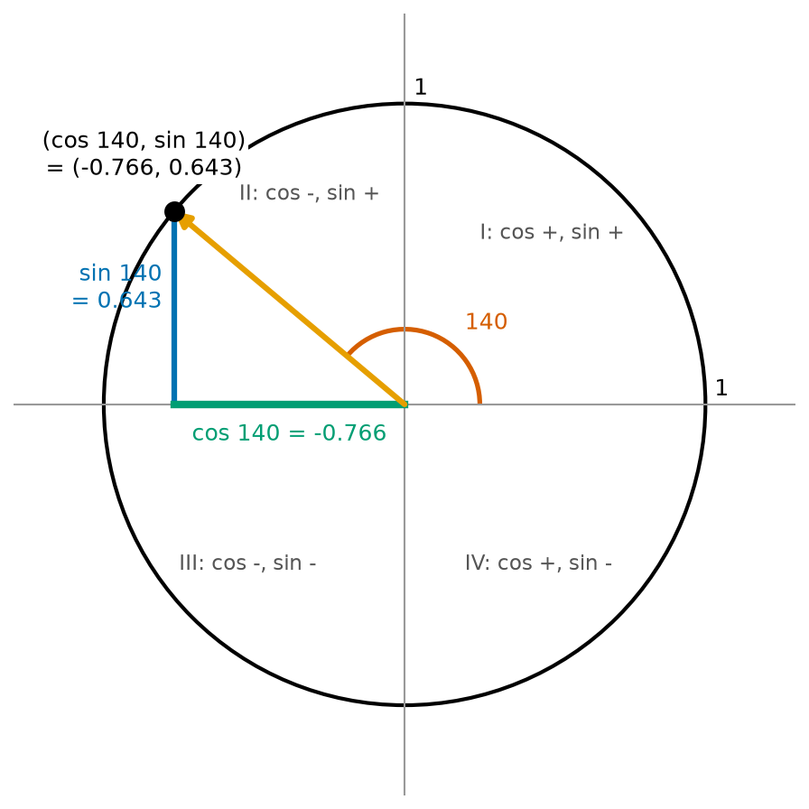
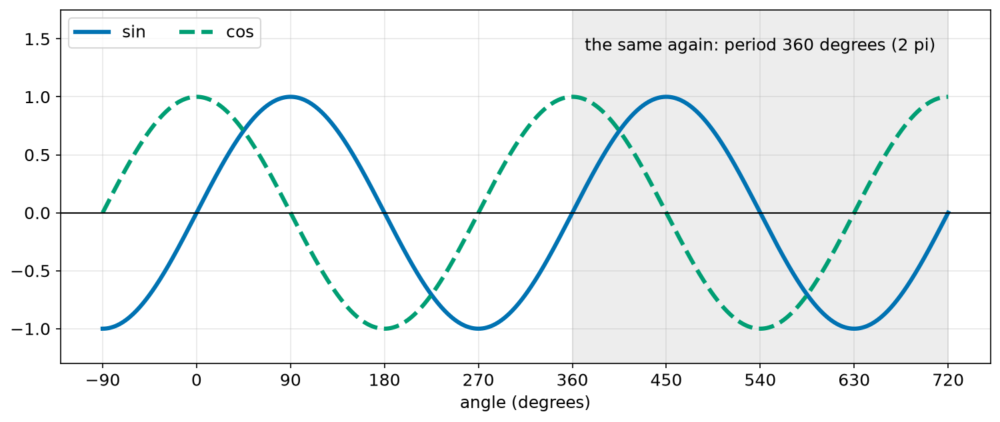
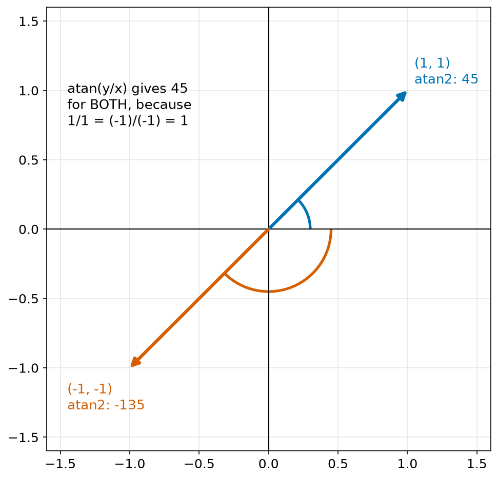
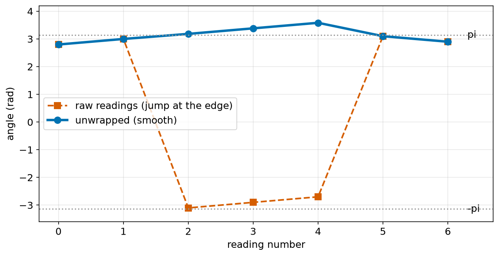
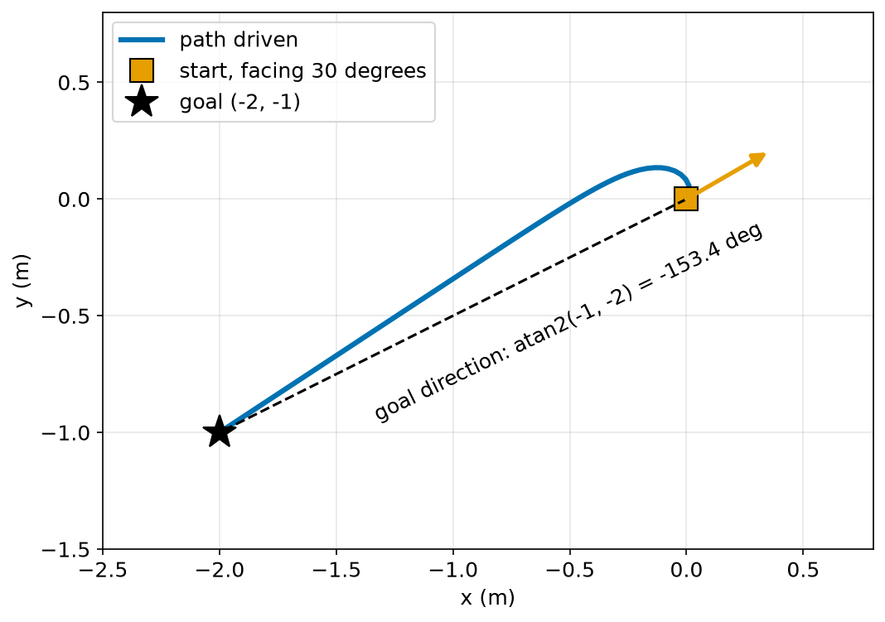
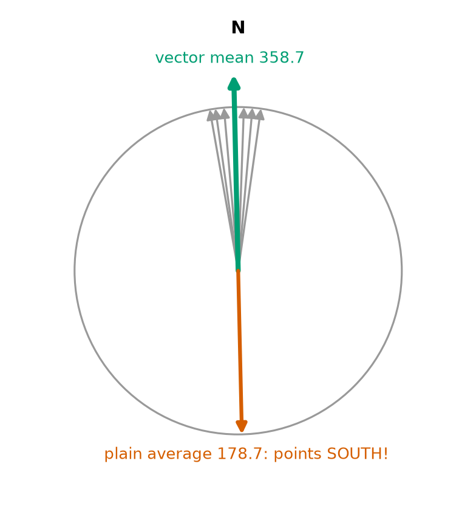
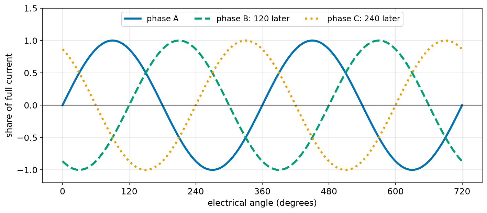

# Chapter 50 — Trigonometry Part 2: the Unit Circle, atan2, Wrapping Angles

> **Part 3 · Chapter 50 of 749**
> **You need:** Chapter 47 (radians and wrapping) and Chapter 49 (sin, cos, tan).
> **You will make:** a table of sin and cos for any angle, a demonstration of why `atan2` is needed, wrapping and unwrapping functions in radians, Rover driving to a goal behind it, and the correct average of compass readings.

---

## What you will learn

- How the **unit circle** gives sin and cos for every angle, not only those below 90°.
- The signs of sin and cos in each quadrant.
- What the graphs of sin and cos look like, and what **period** means.
- A few rules that link angles, such as sin(−θ) = −sin θ.
- Why `atan(y / x)` is not enough, and how `atan2(y, x)` fixes it.
- How to wrap angles in radians, and how to **unwrap** a list of angles.
- How to average angles correctly.

---

## New words in this chapter

| Word | Simple meaning |
|---|---|
| **unit circle** | A circle of radius 1 with its centre at the origin. |
| **periodic** | Repeating the same pattern again and again. |
| **period** | The length of one repeat. For sin and cos it is 360°, or 2π. |
| **wave** | The up-and-down shape of a sin or cos graph. |
| **atan2** | A function that gives the full direction of the point (x, y), from −π to π. |
| **pose** | Where a robot is and which way it faces: (x, y, θ). |
| **unwrap** | Remove the jumps of 2π from a list of angles, so that it changes smoothly. |
| **vector mean** | An average of directions, found by adding arrows. |

---

## 50.1 The unit circle

In Chapter 49, sin and cos came from a right-angled triangle. But a triangle's angles are less than 90°. A robot turns through every angle: 140°, 270°, −30°. We need sin and cos for all of them.

📖 **New word: unit circle** — a circle of radius 1 with its centre at the origin.

Start at the point (1, 0) and walk anticlockwise round the unit circle through an angle θ. Where are you?



*Figure 50.1 — The point at angle θ on the unit circle is (cos θ, sin θ).*

**How to read this picture:** The orange arrow has length 1 and makes an angle of 140° with the x axis. The black dot at its end is on the circle. The green line is its x value, −0.766. The blue line is its y value, 0.643. The grey labels show the signs of cos and sin in each quadrant.

For angles below 90°, Chapter 49 gave x = r cos θ and y = r sin θ. With r = 1, the point is (cos θ, sin θ). Now we **turn that around** and make it the definition, for every angle:

```
cos θ = the x coordinate of the point at angle θ on the unit circle
sin θ = the y coordinate of that point
```

For angles below 90°, nothing changes. For bigger angles, sin and cos may now be negative.

### The signs in each quadrant

| Quadrant | Angles | cos | sin | tan |
|---|---|---|---|---|
| I | 0° to 90° | + | + | + |
| II | 90° to 180° | − | + | − |
| III | 180° to 270° | − | − | + |
| IV | 270° to 360° | + | − | − |

🔢 **Maths.** cos 140° = −0.766 and sin 140° = 0.643. The point is to the left (negative x) and up (positive y): quadrant II.

### Some rules you can read from the circle

| Rule | Why |
|---|---|
| sin² θ + cos² θ = 1 | the point is 1 from the centre (Pythagoras) |
| cos(−θ) = cos θ | turning the other way gives the same x … |
| sin(−θ) = −sin θ | … and the opposite y |
| sin(180° − θ) = sin θ | the mirror point across the y axis has the same height |
| cos(180° − θ) = −cos θ | … and the opposite x |
| sin(θ + 360°) = sin θ | a full turn brings you back to the same point |

🔢 **Maths.** sin 150° = sin(180° − 30°) = sin 30° = 0.5.

🧠 **Remember:** cos is "how far across", sin is "how far up", for a point 1 away at that angle.

---

## 50.2 The waves of sin and cos

Walk round and round the circle and draw the height (sin) against the angle. You get a **wave**.



*Figure 50.2 — Both functions repeat every 360°.*

**How to read this picture:** Across the bottom is the angle, from −90° to 720°, which is two full turns. The blue line is sin, and the green dashed line is cos. Both swing between −1 and 1. The grey part on the right is an exact copy of the part before it.

📖 **New word: periodic** — repeating the same pattern again and again.

📖 **New word: period** — the length of one repeat. For sin and cos, it is 360°, or 2π radians.

Notice that the cos wave is the sin wave moved 90° to the left: cos θ = sin(θ + 90°).

🤖 **Robot link.** Waves are everywhere in robots: the current in a brushless motor (Application 5), vibration in a drone frame (Chapter 631), the swing of a walking robot's legs (Chapter 672), and sound in an ultrasonic sensor. Chapter 243 shows how control engineers test systems with sine waves.

---

## 50.3 The problem with atan

In Chapter 49, we found the angle of a point (x, y) with atan(y/x). Try it on two points that are exactly opposite each other:

```
(1, 1):    y/x = 1/1   = 1     atan(1) = 45°
(−1, −1):  y/x = −1/−1 = 1     atan(1) = 45°   wrong! It points the other way, to −135°.
```

Dividing y by x throws away the signs, so atan cannot tell quadrant I from III, or II from IV. And when x = 0, it divides by zero.



*Figure 50.3 — Two opposite directions with the same ratio y/x.*

**How to read this picture:** The blue arrow points to (1, 1), at 45°. The red arrow points to (−1, −1), the opposite way, at −135°. For both, y ÷ x = 1, so atan gives 45° for both.

### atan2 looks at the signs

📖 **New word: atan2** — a function that takes y and x **separately**, looks at both signs, and gives the full direction, from −π to π (−180° to 180°).

```python
math.atan2(y, x)       # note: y first, then x
```

| Point | atan(y/x) | atan2(y, x) | Correct? |
|---|---|---|---|
| (1, 1) | 45° | 45° | both right |
| (−1, 1) | −45° | 135° | only atan2 |
| (−1, −1) | 45° | −135° | only atan2 |
| (0, 2) | divides by 0 | 90° | only atan2 |

🧠 **Remember:** To get the direction of anything from x and y, always use `math.atan2(y, x)`. It is one of the most used functions in all robotics.

### Maths angle or compass bearing?

`atan2(y, x)` gives a **maths angle**: from the x axis, anticlockwise. In Chapter 26 we wrote `atan2(dx, dy)` to get a **compass bearing**: from north (the y axis), clockwise. Swapping the two inputs mirrors the picture across the line y = x, which turns one convention into the other. Both are correct, as long as you know which you used (Chapter 47).

---

## 50.4 Wrapping in radians

In Chapter 47 we wrapped degrees with `(a + 180) % 360 − 180`. In radians:

```
wrap_pi(a) = (a + π) % (2π) − π
```

There are two other common ways to do the same thing:

- `math.atan2(math.sin(a), math.cos(a))` — find the point on the circle, then ask for its angle. This always gives −π to π.
- `math.remainder(a, 2 * math.pi)` — Python's built-in way.

All three give the same answers (except, perhaps, exactly at ±π).

### Unwrapping

📖 **New word: unwrap** — remove the jumps of 2π from a list of angles, so that it changes smoothly.

Imagine a robot turning slowly anticlockwise past 180°. Its wrapped heading reads 2.8, 3.0, then suddenly −3.1. It did not spin round: it just crossed the edge of the range. If you plot it, or average it, or estimate a turn rate from it, the jump causes trouble.

The fix: for each new reading, add the **wrapped change** from the previous unwrapped value.

```
unwrapped[i] = unwrapped[i−1] + wrap_pi(reading[i] − unwrapped[i−1])
```

This assumes that the robot never turns more than half a turn between two readings, which is almost always true if the readings are frequent.

---

## Code

File `code/ch050/unit_circle.py`:

```python
# unit_circle.py - cos and sin for any angle: the point on a circle of radius 1
import math

print(" angle      cos      sin    quadrant")
for deg in [0, 45, 90, 135, 180, 225, 270, 315, 360, 405, -45]:
    t = math.radians(deg)
    c = math.cos(t)
    s = math.sin(t)
    if abs(c) < 1e-12 or abs(s) < 1e-12:
        where = "on an axis"
    elif c > 0 and s > 0:
        where = "I"
    elif c < 0 < s:
        where = "II"
    elif c < 0 and s < 0:
        where = "III"
    else:
        where = "IV"
    print(f"{deg:6d} {c:8.3f} {s:8.3f}    {where}")
```

| Line | Code | What it does (simple English) |
|---|---|---|
| 1 | `# unit_circle.py …` | A comment. |
| 2 | `import math` | For cos, sin and radians. |
| 3 | (blank) | Spacing. |
| 4 | `print(" angle …")` | The heading. |
| 5 | `for deg in […]:` | Every 45° round the circle, plus angles beyond 360° and below 0°. |
| 6 | `t = math.radians(deg)` | Radians, as always. |
| 7 | `c = math.cos(t)` | The x of the point on the unit circle. |
| 8 | `s = math.sin(t)` | The y of the point. |
| 9 | `if abs(c) < 1e-12 or abs(s) < 1e-12:` | "Practically zero". cos 90° comes out as 6 × 10⁻¹⁷, not exactly 0 (Chapter 54). |
| 10 | `where = "on an axis"` | No quadrant. |
| 11–12 | `elif c > 0 and s > 0: where = "I"` | Both positive. |
| 13–14 | `elif c < 0 < s: where = "II"` | A chained comparison: c below 0, and s above 0. |
| 15–16 | `elif c < 0 and s < 0: where = "III"` | Both negative. |
| 17–18 | `else: where = "IV"` | The only case left. |
| 19 | `print(f"…")` | Prints the row. |

Output:

```
 angle      cos      sin    quadrant
     0    1.000    0.000    on an axis
    45    0.707    0.707    I
    90    0.000    1.000    on an axis
   135   -0.707    0.707    II
   180   -1.000    0.000    on an axis
   225   -0.707   -0.707    III
   270   -0.000   -1.000    on an axis
   315    0.707   -0.707    IV
   360    1.000   -0.000    on an axis
   405    0.707    0.707    I
   -45    0.707   -0.707    IV
```

405° gives the same as 45°, and −45° the same as 315°. The `-0.000` values are tiny negative numbers from rounding.

File `code/ch050/atan_vs_atan2.py`:

```python
# atan_vs_atan2.py - why atan(y / x) gets half the directions wrong
import math

points = [(1, 1, 45), (-1, 1, 135), (-1, -1, -135), (1, -1, -45), (0, 2, 90), (-3, 0, 180)]

print("   point   true direction   atan(y/x)   atan2(y, x)")
for x, y, true_deg in points:
    if x == 0:
        plain = "divide by 0"
    else:
        plain = f"{math.degrees(math.atan(y / x)):8.1f}"
    good = math.degrees(math.atan2(y, x))
    print(f"{str((x, y)):>9} {true_deg:12d}     {plain:>11} {good:12.1f}")
```

| Line | Code | What it does (simple English) |
|---|---|---|
| 1 | `# atan_vs_atan2.py …` | A comment. |
| 2 | `import math` | For atan and atan2. |
| 3 | (blank) | Spacing. |
| 4 | `points = […]` | Six points, each with its true direction, worked out from a drawing. |
| 5 | (blank) | Spacing. |
| 6 | `print("   point …")` | The heading. |
| 7 | `for x, y, true_deg in points:` | Unpacks three values. |
| 8 | `if x == 0:` | atan(y/x) would divide by zero. |
| 9 | `plain = "divide by 0"` | Say so. |
| 10 | `else:` | Otherwise … |
| 11 | `plain = f"…"` | … use the old method. |
| 12 | `good = math.degrees(math.atan2(y, x))` | The new method: y and x separately. |
| 13 | `print(f"…")` | `str((x, y))` turns the point into text so it can be lined up. |

Output:

```
   point   true direction   atan(y/x)   atan2(y, x)
   (1, 1)           45            45.0         45.0
  (-1, 1)          135           -45.0        135.0
 (-1, -1)         -135            45.0       -135.0
  (1, -1)          -45           -45.0        -45.0
   (0, 2)           90     divide by 0         90.0
  (-3, 0)          180            -0.0        180.0
```

atan was wrong for three of the six points, and crashed on one. atan2 was right for all six.

File `code/ch050/wrap_radians.py`:

```python
# wrap_radians.py - three ways to wrap an angle into -pi..pi, and how to unwrap a list
import math


def wrap_pi(a):
    return (a + math.pi) % (2 * math.pi) - math.pi


def wrap_pi_trig(a):
    return math.atan2(math.sin(a), math.cos(a))


def unwrap(angles):
    result = [angles[0]]
    for a in angles[1:]:
        step = wrap_pi(a - result[-1])
        result.append(result[-1] + step)
    return result


for a in [3.0, 4.0, -4.0, 7.0, 100.0]:
    print(f"{a:6.1f} rad -> {wrap_pi(a):7.4f}  {wrap_pi_trig(a):7.4f}  {math.remainder(a, 2 * math.pi):7.4f}")

readings = [2.8, 3.0, -3.1, -2.9, -2.7, 3.1, 2.9]
print("raw     :", readings)
print("unwrapped:", [round(v, 2) for v in unwrap(readings)])
```

| Line | Code | What it does (simple English) |
|---|---|---|
| 1 | `# wrap_radians.py …` | A comment. |
| 2 | `import math` | For π, sin, cos, atan2 and remainder. |
| 3–4 | (blank) | Spacing. |
| 5–6 | `def wrap_pi(a): …` | Chapter 47's trick, with π instead of 180. |
| 7–8 | (blank) | Spacing. |
| 9–10 | `def wrap_pi_trig(a): …` | Go to the circle and back. |
| 11–12 | (blank) | Spacing. |
| 13 | `def unwrap(angles):` | Makes a list of angles smooth. |
| 14 | `result = [angles[0]]` | The first reading is kept as it is. |
| 15 | `for a in angles[1:]:` | Every reading after the first (Chapter 21 slicing). |
| 16 | `step = wrap_pi(a - result[-1])` | The change since the last value, taken the short way. |
| 17 | `result.append(result[-1] + step)` | Add that change, without any jump. |
| 18 | `return result` | The smooth list. |
| 19–20 | (blank) | Spacing. |
| 21 | `for a in [3.0, 4.0, -4.0, 7.0, 100.0]:` | Some angles to wrap. |
| 22 | `print(f"…")` | All three methods, side by side. |
| 23 | (blank) | Spacing. |
| 24 | `readings = […]` | A heading crossing ±π twice. |
| 25 | `print("raw     :", readings)` | As measured. |
| 26 | `print("unwrapped:", …)` | Smooth, rounded to 2 decimals. |

Output:

```
   3.0 rad ->  3.0000   3.0000   3.0000
   4.0 rad -> -2.2832  -2.2832  -2.2832
  -4.0 rad ->  2.2832   2.2832   2.2832
   7.0 rad ->  0.7168   0.7168   0.7168
 100.0 rad -> -0.5310  -0.5310  -0.5310
raw     : [2.8, 3.0, -3.1, -2.9, -2.7, 3.1, 2.9]
unwrapped: [2.8, 3.0, 3.18, 3.38, 3.58, 3.1, 2.9]
```



*Figure 50.4 — The same readings, raw and unwrapped.*

**How to read this picture:** The red dashed line is the raw heading. It jumps from 3.0 to −3.1 and back, because the heading crossed the edge at π. The blue line is unwrapped. It rises a little above π and comes back: the robot really turned just a little.

---

## Small examples

**Example 1.** cos 180° = −1 and sin 180° = 0: the point (−1, 0).

**Example 2.** sin 270° = −1: the bottom of the circle.

**Example 3.** cos(−60°) = cos 60° = 0.5.

**Example 4.** sin 210° = −0.5 (quadrant III, so negative).

**Example 5.** atan2(0, −1) = π, which is 180°.

**Example 6.** atan2(−3, 0) = −π/2, which is −90°.

**Example 7.** wrap_pi(2π) = 0.

**Example 8.** The direction from (2, 5) to (−1, 1) is atan2(1 − 5, −1 − 2) = atan2(−4, −3) = −126.9°.

---

## 🏭 Real robot applications

### Application 1 (worked in full) — 🤖 Rover drives to a goal behind it

**1. The real problem.** Rover is at (0, 0), facing 30°. Its goal is at (−2, −1), which is behind it and to the left. It must turn the right way and drive there.

📖 **New word: pose** — where a robot is and which way it faces: (x, y, θ).

**2. Why this theory.** The direction to the goal is atan2(dy, dx). atan would point Rover the wrong way, because dx and dy are both negative. The heading error must be wrapped, as in Chapter 47, so that Rover turns the short way.

**3. The numbers.** Speed 0.3 m/s. Turn rate = 2.0 × heading error (in rad/s). Time step 0.1 s. Rover stops within 5 cm of the goal.

**4. The maths.** At the start:

```
dx = −2 − 0 = −2,   dy = −1 − 0 = −1
wanted = atan2(−1, −2) = −153.4°     (atan(−1/−2) = atan(0.5) would say 26.6°: the opposite way)
error  = wrap(−153.4 − 30) = wrap(−183.4) = +176.6°
```

So Rover turns left, through almost a half turn.

**5. The code.** File `code/ch050/go_to_goal.py`:

```python
# go_to_goal.py - Rover turns towards a goal with atan2 and a wrapped heading error
import math


def wrap_pi(a):
    return (a + math.pi) % (2 * math.pi) - math.pi


GOAL = (-2.0, -1.0)
SPEED = 0.3            # m/s
TURN_GAIN = 2.0        # rad/s of turning for each rad of error
DT = 0.1               # seconds per step

x, y, heading = 0.0, 0.0, math.radians(30)
path = [(x, y)]
for step in range(200):
    dx = GOAL[0] - x
    dy = GOAL[1] - y
    distance = math.hypot(dx, dy)
    if distance < 0.05:
        break
    wanted = math.atan2(dy, dx)
    error = wrap_pi(wanted - heading)
    heading = wrap_pi(heading + TURN_GAIN * error * DT)
    x += SPEED * math.cos(heading) * DT
    y += SPEED * math.sin(heading) * DT
    path.append((x, y))
    if step in (0, 1, 2):
        print(f"step {step}: wanted {math.degrees(wanted):7.1f} deg, error {math.degrees(error):7.1f} deg")

print(f"reached ({x:.3f}, {y:.3f}) after {step} steps = {step * DT:.1f} s")
```

| Line | Code | What it does (simple English) |
|---|---|---|
| 1 | `# go_to_goal.py …` | A comment. |
| 2 | `import math` | For atan2, hypot, cos and sin. |
| 3–4 | (blank) | Spacing. |
| 5–6 | `def wrap_pi(a): …` | Wrapping in radians. |
| 7–8 | (blank) | Spacing. |
| 9 | `GOAL = (-2.0, -1.0)` | Where to go. |
| 10 | `SPEED = 0.3` | Forward speed. |
| 11 | `TURN_GAIN = 2.0` | How hard to turn for a given error. |
| 12 | `DT = 0.1` | Each step is 0.1 s (a 10 Hz loop, Chapter 30). |
| 13 | (blank) | Spacing. |
| 14 | `x, y, heading = 0.0, 0.0, math.radians(30)` | The start pose. |
| 15 | `path = [(x, y)]` | Records where Rover has been. |
| 16 | `for step in range(200):` | At most 200 steps (20 s), so the loop cannot run for ever. |
| 17 | `dx = GOAL[0] - x` | How far the goal is along x. |
| 18 | `dy = GOAL[1] - y` | And along y. |
| 19 | `distance = math.hypot(dx, dy)` | Straight-line distance (Chapter 48). |
| 20 | `if distance < 0.05:` | Close enough? |
| 21 | `break` | Stop the loop (Chapter 19). |
| 22 | `wanted = math.atan2(dy, dx)` | The direction to the goal. |
| 23 | `error = wrap_pi(wanted - heading)` | How far to turn, the short way. |
| 24 | `heading = wrap_pi(heading + TURN_GAIN * error * DT)` | Turn a little, and keep the heading in range. |
| 25 | `x += SPEED * math.cos(heading) * DT` | Move forward: the x part of the step (Chapter 49). |
| 26 | `y += SPEED * math.sin(heading) * DT` | The y part. |
| 27 | `path.append((x, y))` | Remember the point. |
| 28 | `if step in (0, 1, 2):` | Only for the first three steps … |
| 29 | `print(f"step …")` | … show the wanted direction and the error. |
| 30 | (blank) | Spacing. |
| 31 | `print(f"reached …")` | Where it finished, and how long it took. |

Output:

```
step 0: wanted  -153.4 deg, error   176.6 deg
step 1: wanted  -153.0 deg, error   141.7 deg
step 2: wanted  -152.3 deg, error   114.1 deg
reached (-1.976, -0.984) after 80 steps = 8.0 s
```



*Figure 50.5 — Rover turns round to the left, then drives straight to the goal.*

**How to read this picture:** The orange square is the start, and the orange arrow shows the starting heading. The black star is the goal. The dashed line is the direct direction, −153.4°. The blue line is the path Rover drove: a short curve as it turns round, then almost straight.

**6. The result.** Rover arrives within 3 cm of the goal in 8.0 s. With `math.atan(dy / dx)` on line 22, Rover would aim at 26.6°, directly away from the goal, and drive off the other way. With an unwrapped error, it would sometimes turn the long way round. Two small details make the difference between a robot that works and one that does not.

**7. Going further.** This is the go-to-goal controller of Chapter 298. Real versions slow down near the goal, slow down while turning sharply, and use the robot's own frame of reference (Chapter 316). Chapter 299 also controls the final heading.

### Application 2 (worked in full) — 🚤 The average of compass readings

**1. The real problem.** A survey boat's compass is noisy, so the software averages the last few readings. Today the boat faces almost exactly north, and the readings are 350°, 355°, 2°, 8°, 5° and 352°. What is the average heading?

📖 **New word: vector mean** — an average of directions, found by adding arrows.

**2. Why this theory.** A plain average treats 350° and 2° as far apart, but they are only 12° apart. If we instead turn each reading into an arrow of length 1, (cos θ, sin θ), add the arrows, and take atan2 of the total, the "wrap" problem disappears.

**3. The numbers.** Six readings, all within 10° of north.

**4. The maths.**

```
Plain average: (350 + 355 + 2 + 8 + 5 + 352) / 6 = 1072 / 6 = 178.7°   (south!)

Vector mean: add up the cos and sin of each reading
  sum of cos = 5.957,  sum of sin = −0.139
  atan2(−0.139, 5.957) = −1.3°, which is 358.7°
```

The length of the total arrow, divided by the number of readings, says how much the readings agree: 1 means all the same, and 0 means they point all over the place.

**5. The code.** File `code/ch050/average_heading.py`:

```python
# average_heading.py - the average of compass readings near north, done wrongly and rightly
import math

readings_deg = [350, 355, 2, 8, 5, 352]

plain = sum(readings_deg) / len(readings_deg)

sum_x = sum(math.cos(math.radians(d)) for d in readings_deg)
sum_y = sum(math.sin(math.radians(d)) for d in readings_deg)
vector = math.degrees(math.atan2(sum_y, sum_x)) % 360
spread = math.hypot(sum_x, sum_y) / len(readings_deg)

print("readings     :", readings_deg)
print(f"plain average: {plain:.1f} degrees")
print(f"vector mean  : {vector:.1f} degrees")
print(f"agreement    : {spread:.4f}  (1 = all readings the same)")
```

| Line | Code | What it does (simple English) |
|---|---|---|
| 1 | `# average_heading.py …` | A comment. |
| 2 | `import math` | For cos, sin, atan2 and hypot. |
| 3 | (blank) | Spacing. |
| 4 | `readings_deg = […]` | The compass readings. |
| 5 | (blank) | Spacing. |
| 6 | `plain = sum(readings_deg) / len(readings_deg)` | The ordinary average. |
| 7 | (blank) | Spacing. |
| 8 | `sum_x = sum(math.cos(…) for d in readings_deg)` | Adds the x parts of all the arrows. This `sum(… for …)` form works like a list comprehension (Chapter 21). |
| 9 | `sum_y = sum(math.sin(…) for d in readings_deg)` | Adds the y parts. |
| 10 | `vector = math.degrees(math.atan2(sum_y, sum_x)) % 360` | The direction of the total arrow, wrapped into 0 to 360. |
| 11 | `spread = math.hypot(sum_x, sum_y) / len(readings_deg)` | The length of the average arrow. |
| 12 | (blank) | Spacing. |
| 13–16 | `print(…)` | Shows the results. |

Output:

```
readings     : [350, 355, 2, 8, 5, 352]
plain average: 178.7 degrees
vector mean  : 358.7 degrees
agreement    : 0.9931  (1 = all readings the same)
```



*Figure 50.6 — The grey arrows are the readings. Their correct average points north.*

**How to read this picture:** North is at the top. The six thin grey arrows all point nearly north. The thick green arrow is the vector mean. The red arrow is the plain average, which points south, the opposite of every single reading.

**6. The result.** The plain average said "south", and an autopilot that trusted it would turn the boat round. The vector mean says 358.7°, which is right. The agreement of 0.993 shows that the readings are close together, so the average can be trusted.

**7. Going further.** The same trick averages wind directions, robot headings from several sensors, and angles in filters (Chapter 425). Chapter 197 covers averages in general, and Chapter 199 shows the better way to combine readings that are more or less trustworthy.

### Application 3 — 🏭 A turntable that crosses zero

A factory turntable has an absolute encoder that reports its angle from −π to π. When the table turns through ±π, the reading jumps by 2π. A controller that estimated speed from the change in angle would suddenly see a speed of about 6.28 rad in one step: a huge, false spike. Unwrapping each new reading, as in `unwrap`, removes the spike, and the controller sees the true, smooth motion. Chapter 123 measures speed from encoders.

### Application 4 — 📷 Aiming a camera at a person

A security robot's pan-tilt camera must point at a person whose head is at x = 3 m, y = −2 m, z = 1.5 m above the camera. The pan angle (turning left and right) is atan2(y, x) = atan2(−2, 3) = −33.7°, to the right. The tilt angle (up and down) is atan2(z, horizontal distance) = atan2(1.5, √13) = atan2(1.5, 3.606) = 22.6°, upward. Two calls of atan2 aim the camera in 3D. Chapter 153 builds a pan-tilt head with two servos.

### Application 5 — 🚁 The three currents of a drone motor

A brushless drone motor (Chapter 146) has three coils. To spin smoothly, they are fed with currents shaped like sine waves, each 120° behind the last: sin θ, sin(θ − 120°) and sin(θ − 240°), where θ is the motor's electrical angle.



*Figure 50.7 — Three sine waves, evenly spaced by 120°.*

**How to read this picture:** Each line is the current in one coil. They have the same shape, but each is 120° later than the one before. At any angle, the three values add up to zero.

At θ = 30°, the three currents are 0.5, −1.0 and 0.5 of the full current. They add up to 0: the current that flows in through one coil flows out through the others. The motor's controller computes these sines thousands of times every second.

---

## 🔧 Hands-on lab

### Lab 50.1 — A unit circle on paper (paper and protractor)

1. Draw a circle of radius 10 cm. Label the axes, and call 10 cm "1".
2. Mark the points at 30°, 120°, 210° and 300°.
3. Measure the x and y of each point with a ruler, and divide by 10.
4. Compare with `math.cos` and `math.sin`.

**What you should see:** For 120°, about (−0.50, 0.87). For 210°, about (−0.87, −0.50). For 300°, about (0.50, −0.87). Your measurements should agree to about 0.02.

| If it does not work | Likely cause | Fix |
|---|---|---|
| The signs are wrong | Angles measured clockwise | Measure anticlockwise from the right-hand x axis |
| The size is about 10 times too big | You did not divide by the radius | Divide by 10 |

**Challenge:** Use the drawing to check that sin(180° − θ) = sin θ for θ = 30°.

### Lab 50.2 — Drive to every corner (simulation)

Copy `go_to_goal.py`.

1. Try goals at (2, 1), (−2, 1), (2, −1) and (0, −2).
2. Replace line 22 with `wanted = math.atan(dy / dx)` and run again.
3. Remove `wrap_pi` from line 23 (keep it on line 24) and try the goal (−2, −1) with a start heading of 170°.

**What you should see:** (1) Rover reaches all four goals. (2) With atan, it fails for the goals with negative dx: for (−2, 1) it drives away and ends at about (5.5, −2.3) after 200 steps, never arriving. With dx = 0 (the last goal) it crashes with `ZeroDivisionError`. (3) Without wrapping, Rover turns 329° to the right, the long way round, and arrives after 84 steps. With wrapping it turns only 39° to the left and arrives after 74 steps.

| If it does not work | Likely cause | Fix |
|---|---|---|
| The loop never stops | Rover keeps missing the goal | Check `TURN_GAIN` and the 0.05 m stopping distance |
| `NameError: wrap_pi` | The function was deleted | Only remove the call on line 23 |

**Challenge:** Plot `path` with matplotlib for all four goals in one picture.

### Lab 50.3 — Average the wind (simulation)

Copy `average_heading.py`.

1. Use readings 10, 20, 30 and 40. Compare the two averages.
2. Use readings 0, 90, 180 and 270.
3. Use readings 170 and 190.

**What you should see:** (1) Both give 25°: far from 0°/360°, the plain average is fine. (2) The vector mean is meaningless and the agreement is 0.0000: the readings cancel out. (3) The vector mean is 180°, the plain average is also 180°. Now try 170 and −170 (the same directions written differently): the plain average says 0°, which is wrong.

| If it does not work | Likely cause | Fix |
|---|---|---|
| The vector mean prints a tiny negative angle | The `% 360` was removed | Keep it, to show 0 to 360 |

**Challenge:** Write `angle_spread_ok(readings, limit)` that returns False when the agreement is below a limit such as 0.9, so that the robot ignores averages it cannot trust.

---

## Common mistakes

⚠️ **Using `atan(y / x)` to find a direction.** Use `atan2(y, x)`.

⚠️ **Swapping the inputs of atan2.** It is `atan2(y, x)`: y first. `atan2(x, y)` gives a compass bearing, which is a different thing.

⚠️ **Averaging angles with an ordinary average** when they may cross 0°/360° or ±180°.

⚠️ **Estimating turn speed from wrapped angles** without unwrapping first.

⚠️ **Forgetting that sin and cos can be negative** for angles above 90°.

⚠️ **Forgetting to wrap the heading after adding a turn.** It slowly grows to huge values.

---

## Practice

🏋️ **1.** Find cos and sin of 120°, 210° and 300°, using the unit circle.

🏋️ **2.** In which quadrant is 250°? What are the signs of its cos and sin?

🏋️ **3.** Work out atan2(2, −2), atan2(−3, 0) and atan2(0, −1), in degrees.

🏋️ **4.** Wrap 5 rad and −4 rad into −π to π.

🏋️ **5.** A robot at (1, 1) faces 90°. Its goal is at (4, −2). Find the direction to the goal and the heading error.

🏋️ **6.** Using `atan2(dx, dy)`, find the compass bearing of a goal with dx = 1, dy = 1, and of one with dx = −1, dy = 0.

🏋️ **7.** What is the vector mean of 170° and 190°?

🏋️ **8.** Unwrap the list [3.0, −3.0, −2.8].

🏋️ **9.** Without a calculator: sin 150° and cos(−60°).

🏋️ **10.** Why does atan(y/x) fail for the point (−1, 0)?

🏋️ **11.** Write `relative_bearing(robot_x, robot_y, robot_heading_deg, target_x, target_y)` which gives the angle (−180 to 180) that the robot must turn to face the target. Test it with a robot at (0, 0) facing 90°, and a target at (1, 1).

---

## Answers

**1.** 120°: (−0.5, 0.866). 210°: (−0.866, −0.5). 300°: (0.5, −0.866).

**2.** Quadrant III. cos is negative, sin is negative.

**3.** 135°. −90°. 180°.

**4.** 5 − 2π = −1.2832 rad. −4 + 2π = 2.2832 rad.

**5.** dx = 3, dy = −3. Direction = atan2(−3, 3) = −45°. Error = wrap(−45 − 90) = −135°: turn 135° to the right.

**6.** atan2(1, 1) = 45°: north-east. atan2(−1, 0) = −90°, which is 270°: west.

**7.** The two arrows are mirror images across the x axis, so their total points along −x: 180°.

**8.** [3.0, 3.283, 3.483]. The jump from 3.0 to −3.0 was really a small step of 0.283 rad.

**9.** sin 150° = sin 30° = 0.5. cos(−60°) = cos 60° = 0.5.

**10.** y/x = 0/(−1) = 0, and atan(0) = 0°: pointing right. But (−1, 0) points left, at 180°. atan2(0, −1) gets 180° because it sees that x is negative.

**11.**

```python
import math

def relative_bearing(robot_x, robot_y, robot_heading_deg, target_x, target_y):
    wanted = math.degrees(math.atan2(target_y - robot_y, target_x - robot_x))
    return (wanted - robot_heading_deg + 180) % 360 - 180

print(relative_bearing(0, 0, 90, 1, 1))     # -45.0
```

The target is at 45°. The robot faces 90°, so it must turn 45° to the right: −45°.

---

## Summary

🧠 On the unit circle, the point at angle θ is (cos θ, sin θ). This defines sin and cos for every angle.

🧠 cos is negative in quadrants II and III. sin is negative in quadrants III and IV.

🧠 sin and cos are waves with a period of 360°, or 2π.

🧠 Use `math.atan2(y, x)` to find a direction. Never `atan(y / x)`.

🧠 Wrap in radians with (a + π) % 2π − π, or with atan2(sin a, cos a).

🧠 Unwrap a list of angles by adding wrapped changes.

🧠 Average angles by adding arrows (cos, sin), then taking atan2.

---

## Next chapter

In Chapter 51 we leave right angles behind. **The law of sines and the law of cosines** solve any triangle. They let a robot arm find its elbow angle, and let a robot find its position from distances and angles.
